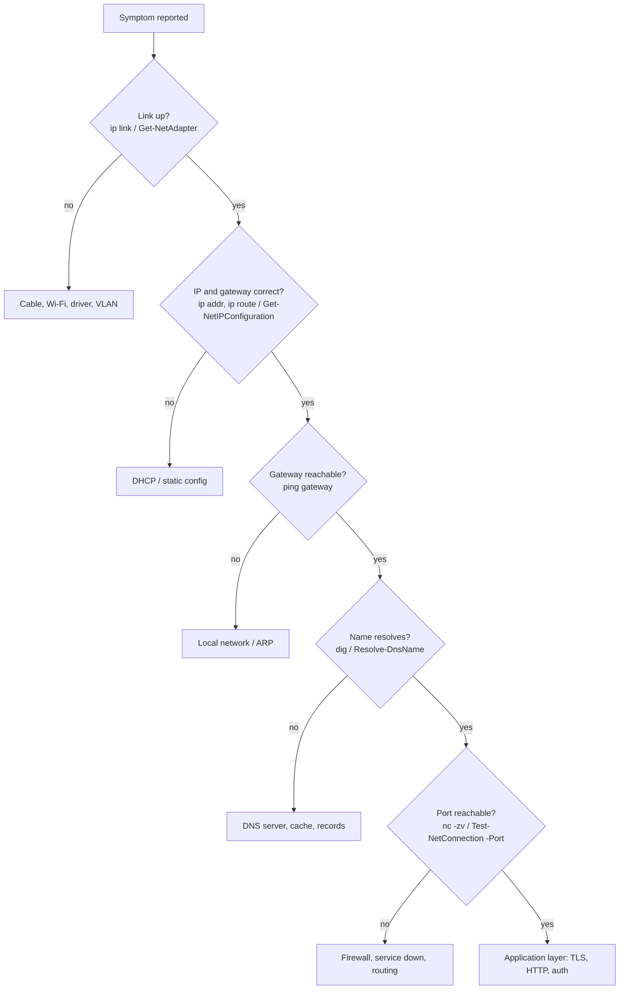

# Path B — Network Analyst / Network Engineer

Network analysts keep traffic flowing and prove where it stops. Host-side command-line tools are how you separate "the network is down" from "this host is misconfigured".

## Competencies and where they are taught

| Competency | Linux | Windows | Days |
|---|---|---|---|
| IP addressing (IPv4/IPv6), private vs public | `ip -br addr`, `ip -6 addr` | `Get-NetIPAddress`, `Get-NetIPConfiguration` | 11 |
| Subnetting & CIDR | `ipcalc` (package), manual calculation | `Get-NetIPAddress` `PrefixLength` | 11 |
| Routing | `ip route`, `ip route get 8.8.8.8` | `Get-NetRoute`, `Find-NetRoute` | 11, 27 |
| DHCP | `journalctl -u systemd-networkd`, `/run/systemd/netif/leases`, `networkctl` | `ipconfig /all`, `Get-NetIPInterface -Dhcp` | 11 |
| DNS | `dig`, `host`, `resolvectl` | `Resolve-DnsName`, `Get-DnsClientCache`, `Clear-DnsClientCache` | 13 |
| ICMP, latency, loss, path | `ping`, `traceroute`, `tracepath`, `mtr` | `Test-Connection`, `tracert`, `pathping` | 12 |
| TCP/UDP and ports | `ss -tulpn`, `nc -zv` | `Test-NetConnection -Port`, `Get-NetTCPConnection`, `Get-NetUDPEndpoint` | 14 |
| Interfaces, MAC, ARP/ND | `ip link`, `ip neigh` | `Get-NetAdapter`, `Get-NetNeighbor` | 15 |
| Packet capture | `tcpdump -i any -w file.pcap` | `pktmon start --capture`, `pktmon etl2pcap` | 15, 20 |
| Wireshark analysis | Display filters, follow TCP stream, expert info | Same | 15, 27 |
| Nmap (authorised targets only) | `nmap -sT -p- localhost`, service detection | Nmap for Windows | 20, 27 |
| Network automation | Bash loops over host lists, CSV output | PowerShell loops, `Export-Csv` | 22–25, 29 |

## Structured troubleshooting model

## Final project: Network Diagnostic Toolkit

Build `net-toolkit.sh` and `Net-Toolkit.ps1` that accept a **target host and port list** and produce a report containing:

- Local interfaces, addresses, gateway, DNS servers and routes.
- Gateway and target reachability (latency, loss) and path (traceroute/tracert).
- Forward and reverse DNS resolution, plus a comparison against a second resolver.
- TCP port tests for each requested port.
- Local listening ports and the owning processes.
- Optional: a 30-second capture filtered to the target, saved as `.pcap`. This needs authorisation and elevated rights.
- Output as text and CSV, with clear PASS/FAIL per layer.

Building blocks: `network-diagnostic`, `dns-check` and `port-monitor` (released Days 13–15).

## Recommended next steps

- Certifications: CompTIA Network+, Cisco CCNA, Wireshark WCNA.
- Practice: GNS3/EVE-NG or Containerlab topologies, Wireshark sample captures (<https://wiki.wireshark.org/SampleCaptures>).
