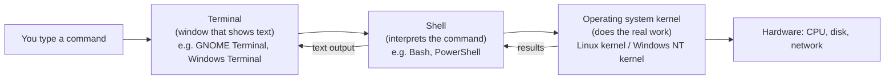

# Day 01: Introduction to Linux and PowerShell

!!! info "Lesson overview"
    | | |
    |---|---|
    | **Module** | 1 — Command-Line Fundamentals |
    | **Difficulty** | :material-signal-cellular-1: Beginner |
    | **Estimated time** | 3–4 hours (90 min reading, 60 min demonstrations, 60–90 min lab and quiz) |
    | **Platforms** | Ubuntu 24.04 LTS (Bash 5.2) · Windows 11 (Windows PowerShell 5.1 and PowerShell 7.4+) |
    | **Lab** | [Lab 01: First Contact](../../labs/lab-01.md) |

## Learning Objectives

By the end of this lesson you will be able to:

1. Explain the difference between a **GUI** and a **CLI**, and between a **terminal**, a **shell** and the **operating system kernel**.
2. Describe what **Bash** and **PowerShell** are, and the key design difference between them (text streams vs .NET objects).
3. Open a terminal on Ubuntu and a PowerShell session on Windows, and tell which PowerShell edition you are running.
4. Run your first identity and system commands: `whoami`, `hostname`, `pwd`, `ls`, `uname`, `date` and their PowerShell counterparts `Get-Location`, `Get-ChildItem`, `Get-ComputerInfo`, `Get-Date`.
5. Read command syntax: command name, options/parameters, arguments.
6. Use built-in help (`man`, `--help`, `Get-Help`, `Get-Command`) to learn any command without searching the web.

## Prerequisites

- A computer with **Ubuntu 24.04 LTS** (physical, VM or [WSL2](../../getting-started/wsl2.md)) and/or **Windows 11**.
- Optional but recommended: [PowerShell 7](../../getting-started/powershell-install.md) installed alongside Windows PowerShell 5.1.
- No prior command-line experience is needed.
- Read [Lab Environment & Safety](../../getting-started/lab-environment.md) once before doing any lab in this course.

## Introduction and Concepts

### GUI versus CLI

A **graphical user interface (GUI)** lets you operate a computer by pointing and clicking: File Explorer, Settings, the Ubuntu Files app. A **command-line interface (CLI)** lets you operate it by typing instructions as text.

The GUI is easier to discover; the CLI is far more powerful for professional work because commands are:

| Property | Why it matters to an IT professional |
|---|---|
| **Precise** | `ls -lh /var/log` always means exactly the same thing. "Click the third icon" does not. |
| **Repeatable** | You can run the same command on 1 or 1,000 servers. |
| **Scriptable** | Commands saved in a file become automation (Module 5). |
| **Remote-friendly** | Most servers have no GUI at all. You manage them over SSH or PowerShell Remoting (Day 26). |
| **Auditable** | Commands can be logged, reviewed and pasted into a ticket or incident report. |
| **Lightweight** | A text session works over a slow VPN where remote desktop would freeze. |

### Terminal, shell and operating system

These three words are often mixed up. They are different layers:



- **Terminal (terminal emulator):** the window program. It draws characters, handles copy/paste, tabs and fonts. Examples: GNOME Terminal, Konsole, Windows Terminal, the VS Code terminal. It does **not** understand commands.
- **Shell:** the program running *inside* the terminal. It reads what you type, expands wildcards and variables, finds the program to run, starts it and shows the result. Examples: Bash, Zsh, PowerShell, cmd.exe.
- **Operating system (kernel):** manages processes, memory, files, devices and the network. The shell asks the kernel to do things through *system calls*.

You can run different shells in the same terminal: Windows Terminal can host PowerShell 7, Windows PowerShell 5.1, cmd.exe and an Ubuntu (WSL) Bash tab side by side.

### What is Bash?

**Bash** (Bourne-Again SHell) is the default interactive shell on Ubuntu and most Linux distributions. It is a GNU project, first released in 1989.

Key characteristics:

- Commands are mostly **separate programs** (`ls` is `/usr/bin/ls`). Bash starts them and connects their input and output.
- Data flows between commands as **plain text** (bytes). You extract fields with tools such as `grep`, `cut` and `awk` (Days 4 and 24).
- Commands are short and terse (`ls`, `cp`, `rm`) and options are usually single letters (`-l`) or long words (`--all`).
- Bash is **case-sensitive**: `ls` works, `LS` does not. File names are case-sensitive too: `Report.txt` and `report.txt` are two different files.

### What is PowerShell?

**PowerShell** is Microsoft's task-automation shell and scripting language, built on .NET. There are two editions you will meet:

| Edition | Executable | Version | Runtime | Platforms | Status |
|---|---|---|---|---|---|
| **Windows PowerShell** | `powershell.exe` | 5.1 | .NET Framework 4.x | Windows only (built in) | Maintained, no new features |
| **PowerShell** (often "PowerShell 7") | `pwsh` / `pwsh.exe` | 7.x | .NET (Core) | Windows, Linux, macOS | Actively developed |

Key characteristics:

- Commands are called **cmdlets** and follow a **Verb-Noun** naming pattern: `Get-Process`, `Stop-Service`, `New-Item`. Run `Get-Verb` to see the approved verbs.
- Cmdlets output **.NET objects**, not text. An object has **properties** (e.g. a file's `Name`, `Length`, `LastWriteTime`) that you select, filter and sort directly without parsing text (Day 5).
- Cmdlet and parameter names are **case-insensitive**: `get-childitem`, `Get-ChildItem` and `GET-CHILDITEM` are identical.
- Parameters start with a dash and are whole words: `-Path`, `-Recurse`. You may shorten them to any unambiguous prefix (`-Rec`), and tab completion fills them in.
- **Aliases** make it feel familiar: `ls`, `dir`, `cd`, `pwd`, `cat`, `cp`, `mv`, `rm` are aliases on **Windows**. Run `Get-Alias ls` to see what an alias points to.

!!! warning "Aliases differ between Windows and Linux PowerShell"
    In PowerShell 7 **on Linux and macOS**, aliases such as `ls`, `cp`, `mv`, `rm`, `cat` and `ps` are **not** defined, so they run the native Linux programs instead. Always use full cmdlet names (`Get-ChildItem`) in scripts so they behave the same everywhere.

### Opening a terminal

=== "Ubuntu 24.04"

    - **Keyboard shortcut:** ++ctrl+alt+t++ opens GNOME Terminal.
    - **Activities menu:** press the ++super++ key, type `terminal`, press ++enter++.
    - **WSL2 on Windows:** open Windows Terminal and choose the *Ubuntu* tab, or type `wsl` in PowerShell.
    - **Remote server:** `ssh user@server` (covered fully on Day 26).

    The prompt looks like this:

    ```text
    student@ubuntu-lab:~$
    ```

    `student` is the user, `ubuntu-lab` is the host name, `~` is the current directory (your home) and `$` means a normal user. A `#` instead of `$` means you are **root** (the administrator), so be careful.

=== "Windows 11"

    - **Start menu:** press ++win++, type `terminal` (Windows Terminal) or `powershell`, press ++enter++.
    - **As administrator:** right-click *Terminal* → *Run as administrator*, or press ++win+x++ then ++a++. Use this only when a task really needs elevation.
    - **PowerShell 7:** run `pwsh` or pick *PowerShell* (not *Windows PowerShell*) in Windows Terminal.
    - **Run dialog:** ++win+r++, type `powershell` or `pwsh`.

    The prompt looks like this:

    ```text
    PS C:\Users\student>
    ```

    `PS` means you are in PowerShell, followed by the current location. An elevated window shows *Administrator:* in its title bar.

### Command syntax

Almost every command in both shells follows this shape:

```text
command  [options / parameters]  [arguments]
```

=== "Bash"

    ```bash
    ls -l -a /etc          # command=ls, options=-l -a, argument=/etc
    ls -la /etc            # short options can be combined
    ls --all --human-readable -l /var/log   # long options use two dashes
    ```

=== "PowerShell"

    ```powershell
    Get-ChildItem -Path C:\Windows -Directory     # -Path takes a value; -Directory is a switch
    Get-ChildItem C:\Windows -Directory           # -Path is positional, so the name can be omitted
    Get-ChildItem -Path $HOME -Filter *.txt -Recurse
    ```

    PowerShell parameters are one of two kinds. A **parameter with a value** looks like `-Path C:\Windows`. A **switch** is either present or absent, like `-Recurse` or `-Force`.

In help pages and in this course, `[square brackets]` mean *optional*, `<angle brackets>` mean *replace with your value*, and `...` means *may be repeated*.

## Linux Command Reference

| Command | Purpose | Package / availability | Needs root? |
|---|---|---|---|
| `whoami` | Print the effective user name | coreutils (always installed) | No |
| `hostname` | Show or set the system host name | hostname (installed by default) | Only to set |
| `hostnamectl` | Show or set host name and OS details (systemd) | systemd | Only to set |
| `pwd` | Print the current working directory | Bash built-in and coreutils | No |
| `ls` | List directory contents | coreutils | No (only to read protected dirs) |
| `uname` | Print kernel and system information | coreutils | No |
| `date` | Print or set the date and time | coreutils | Only to set |
| `man` | Display the manual page for a command | man-db | No |
| `<command> --help` | Short built-in usage summary | Most GNU programs | No |
| `help` | Help for Bash *built-in* commands (`cd`, `pwd`, `type`) | Bash built-in | No |
| `type` / `which` | Show what a command name resolves to | Bash built-in / debianutils | No |

## PowerShell Command Reference

| Cmdlet | Common aliases | Purpose | Works in 5.1 | Works in 7.x | Admin? |
|---|---|---|---|---|---|
| `Get-Location` | `pwd`, `gl` | Show the current location | Yes | Yes (all OS) | No |
| `Get-ChildItem` | `ls`\*, `dir`, `gci` | List items in a location | Yes | Yes (all OS) | No |
| `Get-ComputerInfo` | `gin` | Detailed OS and hardware information | Yes | **Windows only** | No |
| `Get-Date` | — | Current date/time as a `DateTime` object | Yes | Yes (all OS) | No |
| `Get-Help` | `help`, `man`\* | Show help for cmdlets and concepts | Yes | Yes | `Update-Help` may need admin in 5.1 |
| `Get-Command` | `gcm` | Find commands by name, verb, noun or module | Yes | Yes | No |
| `$env:USERNAME`, `whoami.exe` | — | Current user | Yes | Yes (`$env:USER` on Linux) | No |
| `$env:COMPUTERNAME`, `hostname.exe` | — | Computer name | Yes | `hostname` on Linux | No |
| `$PSVersionTable` | — | PowerShell version and edition | Yes | Yes | No |

\* `ls` and `man` are aliases only on Windows. On Linux they run the native programs.

## Detailed Command Explanations

### `whoami` — who am I logged in as?

`whoami` prints the **effective** user name, which is the account whose permissions your commands are running with right now. That is not always the person who logged in: after `sudo -i` or `su - admin` it changes.

On Windows, `whoami.exe` exists too and prints `COMPUTER\user` or `DOMAIN\user`. In PowerShell the environment variable `$env:USERNAME` holds the plain name, and `[Security.Principal.WindowsIdentity]::GetCurrent().Name` returns the full identity.

**Why professionals use it:** before running any administrative change, confirm *who* you are. Running something as root by mistake, or failing because you are not, are both everyday mistakes.

### `hostname` — which machine am I on?

`hostname` prints the system's host name. When you have five SSH sessions open, it is the fastest way to confirm you are on `web-prod-02` and **not** `db-prod-01` before you restart something. `hostname -I` (capital i, Linux only) prints all IP addresses assigned to the host. On systemd systems `hostnamectl` shows the host name together with the OS, kernel and hardware vendor.

On Windows, `hostname.exe` works in both PowerShell and cmd. PowerShell also exposes `$env:COMPUTERNAME`.

### `pwd` / `Get-Location` — where am I?

`pwd` (print working directory) shows the absolute path of the directory you are "in". Every relative path you type is interpreted relative to this location (Day 2). `pwd -P` resolves symbolic links and shows the physical path.

`Get-Location` returns a `PathInfo` object. Its `Path` property is the location. PowerShell locations can be on *providers* other than the file system, such as the registry (`HKLM:\`) or certificate store (`Cert:\`), which is why the cmdlet is not called `Get-Directory`.

### `ls` / `Get-ChildItem` — what is here?

`ls` lists the contents of a directory (the current one if you give no argument). Without options it shows names only. Most useful options:

- `-l` long format: permissions, link count, owner, group, size, modification time, name
- `-a` include hidden entries (names starting with `.`)
- `-h` human-readable sizes (K, M, G), used with `-l`
- `-t` sort by modification time, newest first; add `-r` to reverse
- `-R` recurse into subdirectories
- `-d` list a directory itself, not its contents

`Get-ChildItem` returns **objects**: `FileInfo` for files and `DirectoryInfo` for directories. The table you see is just PowerShell's default *formatting* of those objects. The objects themselves carry many more properties (`FullName`, `Extension`, `CreationTime`, `Attributes`...).

### `uname` — what kernel and architecture?

`uname` prints information about the running kernel. `uname -a` prints everything; `-s` kernel name, `-n` host name, `-r` kernel release, `-m` machine architecture (`x86_64`, `aarch64`), `-o` operating system. To see the **distribution** (Ubuntu version), read `/etc/os-release` or run `lsb_release -a`, because `uname` describes the kernel only.

The nearest PowerShell equivalents are `Get-ComputerInfo` (Windows) and the automatic variables `$IsLinux`, `$IsWindows`, `$IsMacOS` (PowerShell 7 only).

### `Get-ComputerInfo` — full system inventory (Windows)

`Get-ComputerInfo` (PowerShell 5.1+, Windows only) collects about 180 properties: OS name and build, install date, BIOS, manufacturer, model, CPU count, memory, time zone, domain and more. It queries WMI/CIM, so it takes several seconds. Always ask for just the properties you need with `-Property`. Property names accept wildcards (`-Property Os*`).

On PowerShell 7 for Linux this cmdlet does not exist. Use `uname`, `hostnamectl` and `/etc/os-release` instead.

### `date` / `Get-Date` — what time is it, exactly?

Time matters enormously in IT operations: log correlation, certificate validity, Kerberos authentication (which fails when clocks are skewed by more than 5 minutes by default) and incident timelines.

- `date` prints the current date and time in the local time zone. `date -u` prints UTC. `date +FORMAT` formats it, e.g. `date '+%Y-%m-%d %H:%M:%S'`. GNU `date -d 'yesterday'` or `date -d '2 hours ago'` calculates other times. `date -Iseconds` prints ISO 8601. `timedatectl` shows time zone and NTP synchronisation status.
- `Get-Date` returns a `DateTime` **object** that you can do arithmetic on: `(Get-Date).AddDays(-7)`. Format it with `-Format 'yyyy-MM-dd HH:mm:ss'` (.NET format strings) or `-UFormat '%Y-%m-%d'` (Unix-style). UTC: `(Get-Date).ToUniversalTime()`, or `Get-Date -AsUTC` in PowerShell 7.1+.

!!! tip "Use ISO 8601 and UTC in reports"
    `2026-11-08T10:05:00Z` sorts correctly as text and means the same thing in every country. Day 29's report scripts use this format.

### Getting help — the most important skill of the day

=== "Bash / Linux"

    - `man ls` opens the manual page. Navigate with arrow keys or ++space++, search with `/word` then ++n++ for the next match, quit with ++q++. Sections: 1 = user commands, 5 = file formats, 8 = admin commands (`man 5 passwd` vs `man 1 passwd`).
    - `ls --help` prints a short usage summary directly to the terminal.
    - `help cd` documents Bash **built-ins**, which have no separate manual page.
    - `type ls` tells you whether a name is an alias, built-in, function or file. `which ls` prints the path of the executable.
    - `apropos network` / `man -k network` searches manual page descriptions.
    - `whatis uname` prints a one-line description.

=== "PowerShell"

    - `Get-Help Get-ChildItem` shows a summary. Add `-Examples`, `-Detailed`, `-Full` or `-Parameter Path`.
    - `Get-Help Get-ChildItem -Online` opens the official documentation in a browser.
    - `Update-Help` downloads the full local help files. On Windows PowerShell 5.1 run it from an **elevated** window. On PowerShell 7 use `Update-Help -Scope CurrentUser` without admin rights. Until you do this, `Get-Help` shows only auto-generated syntax.
    - `Get-Command *service*` finds commands by wildcard. `Get-Command -Verb Get -Noun Net*` searches by verb/noun.
    - `Get-Help about_*` lists conceptual topics, e.g. `Get-Help about_Wildcards`.

## Syntax and Parameters

### Bash commands

```text
whoami
hostname [-I] [-f] [-s]
pwd [-L | -P]
ls [OPTION]... [FILE]...
uname [-a] [-s] [-n] [-r] [-m] [-o]
date [-u] [-d STRING] [+FORMAT]
man [SECTION] PAGE
```

| Option | Command | Meaning |
|---|---|---|
| `-I` | hostname | All IP addresses of the host (Linux `hostname` from the *hostname* package) |
| `-f` / `-s` | hostname | Fully-qualified / short name |
| `-P` | pwd | Physical path with symlinks resolved |
| `-l`, `-a`, `-h`, `-t`, `-r`, `-R`, `-d` | ls | Long, all, human sizes, sort by time, reverse, recursive, directory itself |
| `-a`, `-s`, `-n`, `-r`, `-m`, `-o` | uname | All, kernel name, node name, kernel release, machine, OS |
| `-u` | date | Use UTC |
| `-d STRING` | date | Display a described time (`'tomorrow'`, `'2026-01-01 09:00'`) — GNU only |
| `+FORMAT` | date | `%Y` year, `%m` month, `%d` day, `%H:%M:%S` time, `%Z` zone, `%s` Unix epoch |

### PowerShell cmdlets

```text
Get-Location [-PSProvider <String[]>] [-PSDrive <String[]>] [-Stack]
Get-ChildItem [[-Path] <String[]>] [[-Filter] <String>] [-Include <String[]>] [-Exclude <String[]>]
              [-Recurse] [-Depth <UInt32>] [-Force] [-Name] [-File] [-Directory] [-Hidden]
Get-ComputerInfo [[-Property] <String[]>]
Get-Date [[-Date] <DateTime>] [-Format <String>] [-UFormat <String>] [-AsUTC]
Get-Help [[-Name] <String>] [-Examples | -Detailed | -Full | -Online | -Parameter <String>]
Get-Command [[-Name] <String[]>] [-Verb <String[]>] [-Noun <String[]>] [-Module <String[]>]
```

| Parameter | Cmdlet | Meaning |
|---|---|---|
| `-Path` | Get-ChildItem | Location(s) to list; supports wildcards. Positional (position 0). |
| `-Filter` | Get-ChildItem | Provider-side filter such as `*.log`. It is faster than `-Include` because the file system applies it. |
| `-Recurse` / `-Depth` | Get-ChildItem | Recurse into subfolders / limit the recursion depth (PowerShell 5.0+) |
| `-Force` | Get-ChildItem | Include hidden and system items (similar to `ls -a`) |
| `-File` / `-Directory` | Get-ChildItem | Only files / only folders |
| `-Name` | Get-ChildItem | Return names as plain strings instead of objects |
| `-Property` | Get-ComputerInfo | Only collect these properties (wildcards allowed) |
| `-Format` | Get-Date | .NET format string: `yyyy-MM-dd HH:mm:ss`, `o` (round-trip ISO 8601). The output becomes a **string**, not a DateTime. |
| `-UFormat` | Get-Date | Unix-style format: `%Y-%m-%d` |
| `-AsUTC` | Get-Date | Return UTC time (PowerShell 7.1+ only) |

## Practical Demonstrations

The outputs below are **examples**. Your user name, host name, dates and sizes will be different. PowerShell outputs were captured on Windows 11 (build 26200) with Windows PowerShell 5.1, with the user and host renamed to `student` and `WIN11-LAB`. Linux outputs show the standard format on Ubuntu 24.04 LTS, with the user `student` and host `ubuntu-lab`.

### Demo 1 — Identify yourself and the machine

=== "Bash"

    ```bash
    whoami
    hostname
    hostname -I
    ```

    **Expected output (example):**

    ```text
    student
    ubuntu-lab
    192.168.56.10 10.0.2.15
    ```

=== "PowerShell"

    ```powershell
    whoami
    $env:USERNAME
    hostname
    $env:COMPUTERNAME
    ```

    **Expected output (example):**

    ```text
    win11-lab\student
    student
    WIN11-LAB
    WIN11-LAB
    ```

### Demo 2 — Where am I and what is here?

=== "Bash"

    ```bash
    pwd
    ls
    ls -la
    ls -lh /var/log | head -5
    ```

    **Expected output (example):**

    ```text
    /home/student
    Desktop  Documents  Downloads  Music  Pictures  Public  Templates  Videos
    total 48
    drwxr-x--- 15 student student 4096 Nov  8 09:12 .
    drwxr-xr-x  3 root    root    4096 Oct 30 14:01 ..
    -rw-------  1 student student 1342 Nov  8 09:10 .bash_history
    -rw-r--r--  1 student student  220 Oct 30 14:01 .bash_logout
    -rw-r--r--  1 student student 3771 Oct 30 14:01 .bashrc
    drwxr-xr-x  2 student student 4096 Oct 30 14:20 Desktop
    ...
    total 2.9M
    -rw-r--r--  1 root      root       11K Nov  8 08:59 alternatives.log
    drwxr-xr-x  2 root      root      4.0K Nov  3 06:25 apt
    -rw-r-----  1 syslog    adm        38K Nov  8 09:17 auth.log
    -rw-r--r--  1 root      root       59K Oct 30 14:05 bootstrap.log
    ```

    How to read a long-listing line: `-rw-r--r--` is the type and permissions (Day 7), `1` the link count, `root root` the owner and group, `11K` the size, `Nov  8 08:59` the modification time, then the name.

=== "PowerShell"

    ```powershell
    Get-Location
    Get-ChildItem C:\Windows -Directory | Select-Object -First 3
    Get-ChildItem $HOME -Force
    ```

    **Expected output (captured, Windows PowerShell 5.1):**

    ```text
    Path
    ----
    C:\Users\student

        Directory: C:\Windows

    Mode                 LastWriteTime         Length Name
    ----                 -------------         ------ ----
    d-----        11-09-2026     14:11                appcompat
    d-----        06-11-2026     18:48                apppatch
    d-----        08-11-2026     04:41                AppReadiness
    ```

    The `Mode` column letters are: `d` directory, `a` archive, `r` read-only, `h` hidden, `s` system, `l` reparse point/link. The date format follows your Windows regional settings. The capture above used an Indian locale (dd-MM-yyyy).

### Demo 3 — Kernel, OS and hardware

=== "Bash"

    ```bash
    uname -a
    uname -r
    uname -m
    cat /etc/os-release
    hostnamectl
    ```

    **Expected output (example):**

    ```text
    Linux ubuntu-lab 6.8.0-48-generic #48-Ubuntu SMP PREEMPT_DYNAMIC Fri Sep 27 14:04:52 UTC 2024 x86_64 x86_64 x86_64 GNU/Linux
    6.8.0-48-generic
    x86_64
    PRETTY_NAME="Ubuntu 24.04.1 LTS"
    NAME="Ubuntu"
    VERSION_ID="24.04"
    VERSION="24.04.1 LTS (Noble Numbat)"
    VERSION_CODENAME=noble
    ID=ubuntu
    ...
     Static hostname: ubuntu-lab
           Icon name: computer-vm
             Chassis: vm
      Virtualization: oracle
    Operating System: Ubuntu 24.04.1 LTS
              Kernel: Linux 6.8.0-48-generic
        Architecture: x86-64
    ```

=== "PowerShell"

    ```powershell
    $PSVersionTable
    Get-ComputerInfo -Property OsName, OsVersion, OsArchitecture, CsNumberOfLogicalProcessors
    ```

    **Expected output (captured, Windows PowerShell 5.1):**

    ```text
    Name                           Value
    ----                           -----
    PSVersion                      5.1.26100.9168
    PSEdition                      Desktop
    PSCompatibleVersions           {1.0, 2.0, 3.0, 4.0...}
    BuildVersion                   10.0.26100.9168
    CLRVersion                     4.0.30319.42000
    WSManStackVersion              3.0
    PSRemotingProtocolVersion      2.3
    SerializationVersion           1.1.0.1

    OsName                                    OsVersion  OsArchitecture CsNumberOfLogicalProcessors
    ------                                    ---------  -------------- ---------------------------
    Microsoft Windows 11 Home Single Language 10.0.26200 64-bit                                   8
    ```

    `PSEdition` is `Desktop` for Windows PowerShell 5.1 and `Core` for PowerShell 7.

### Demo 4 — Dates and times

=== "Bash"

    ```bash
    date
    date -u
    date '+%Y-%m-%d %H:%M:%S'
    date -Iseconds
    date -d '7 days ago' +%F
    timedatectl
    ```

    **Expected output (example, time zone Asia/Kolkata):**

    ```text
    Sun Nov  8 15:35:43 IST 2026
    Sun Nov  8 10:05:43 UTC 2026
    2026-11-08 15:35:43
    2026-11-08T15:35:43+05:30
    2026-11-01
                   Local time: Sun 2026-11-08 15:35:43 IST
               Universal time: Sun 2026-11-08 10:05:43 UTC
                     RTC time: Sun 2026-11-08 10:05:43
                    Time zone: Asia/Kolkata (IST, +0530)
    System clock synchronized: yes
                  NTP service: active
              RTC in local TZ: no
    ```

=== "PowerShell"

    ```powershell
    Get-Date
    Get-Date -Format 'yyyy-MM-dd HH:mm:ss'
    Get-Date -Format o
    (Get-Date).ToUniversalTime()
    (Get-Date).AddDays(-7).ToString('yyyy-MM-dd')
    (Get-Date).DayOfWeek
    ```

    **Expected output (example):**

    ```text
    08 November 2026 15:35:43
    2026-11-08 15:35:43
    2026-11-08T15:35:43.1234567+05:30
    08 November 2026 10:05:43
    2026-11-01
    Sunday
    ```

### Demo 5 — Learning a command you have never seen

=== "Bash"

    ```bash
    type ls pwd cd
    whatis uname
    uname --help | head -15
    man -k "host name"
    ```

    **Expected output (example):**

    ```text
    ls is aliased to `ls --color=auto'
    pwd is a shell builtin
    cd is a shell builtin
    uname (1)            - print system information
    Usage: uname [OPTION]...
    Print certain system information.  With no OPTION, same as -s.

      -a, --all                print all information, in the following order,
                                 except omit -p and -i if unknown:
      -s, --kernel-name        print the kernel name
      -n, --nodename           print the network node hostname
      -r, --kernel-release     print the kernel release
    ...
    hostname (1)         - show or set the system's host name
    hostnamectl (1)      - Control the system hostname
    ```

=== "PowerShell"

    ```powershell
    Get-Command Get-ChildItem
    Get-Alias ls, dir, cd, pwd, cat
    Get-Command -Verb Get -Noun *Computer*
    Get-Help Get-Date -Examples
    ```

    **Expected output (captured, Windows PowerShell 5.1):**

    ```text
    CommandType     Name                                               Version    Source
    -----------     ----                                               -------    ------
    Cmdlet          Get-ChildItem                                      3.1.0.0    Microsoft.PowerShell.Management

    CommandType     Name                                               Version    Source
    -----------     ----                                               -------    ------
    Alias           ls -> Get-ChildItem
    Alias           dir -> Get-ChildItem
    Alias           cd -> Set-Location
    Alias           pwd -> Get-Location
    Alias           cat -> Get-Content
    ...
    ```

## Linux vs PowerShell Comparison

| Task | Bash (Ubuntu) | PowerShell (Windows) | Notes |
|---|---|---|---|
| Current user | `whoami` | `whoami` · `$env:USERNAME` | `whoami.exe` prints `HOST\user` |
| Host name | `hostname` | `hostname` · `$env:COMPUTERNAME` | |
| Current directory | `pwd` | `Get-Location` (`pwd`) | PS returns an object; use `(Get-Location).Path` for the string |
| List a directory | `ls -la` | `Get-ChildItem -Force` (`ls`, `dir`) | PS objects have more properties than the table shows |
| Kernel / OS info | `uname -a`, `cat /etc/os-release` | `Get-ComputerInfo -Property Os*` | No single exact equivalent; different OS models |
| Architecture | `uname -m` | `$env:PROCESSOR_ARCHITECTURE` | Windows reports `AMD64` / `ARM64` |
| Shell version | `echo $BASH_VERSION` | `$PSVersionTable.PSVersion` | |
| Date and time | `date` | `Get-Date` | PS returns a `DateTime` you can calculate with |
| Formatted date | `date +%F` | `Get-Date -Format yyyy-MM-dd` | Different format languages |
| UTC time | `date -u` | `(Get-Date).ToUniversalTime()` / `Get-Date -AsUTC` (7.1+) | |
| Full help | `man ls` | `Get-Help Get-ChildItem -Full` | Run `Update-Help` once in PowerShell |
| Quick help | `ls --help` | `Get-Help Get-ChildItem` · `Get-ChildItem -?` | |
| Find a command | `apropos disk`, <code>compgen -c &#124; grep disk</code> | `Get-Command *disk*` | |
| What is this name? | `type ls` | `Get-Command ls` | |
| Case sensitivity | Commands and file names are case-sensitive | Cmdlets case-insensitive; NTFS names case-insensitive by default | |
| Data between commands | Text | .NET objects | The central difference, explored on Day 5 |

## Real-World IT Scenarios

1. **The "wrong server" incident.** An engineer intends to reboot a test server but runs the command in the production SSH tab. Professionals run `hostname` (and often put the host name in their prompt) before every disruptive action. Many companies colour production prompts red for this reason.
2. **Help-desk ticket triage.** A user reports "my laptop is slow since the update". The first 60 seconds are `Get-ComputerInfo -Property OsName,OsVersion,OsBuildNumber,CsTotalPhysicalMemory` so the ticket records the exact build and memory size.
3. **Kerberos authentication failure.** Domain logons fail with clock-skew errors. `Get-Date` on the client and `w32tm /query /status` reveal a 9-minute drift. On Linux, `timedatectl` shows `System clock synchronized: no`.
4. **Vendor support call.** The vendor asks for the kernel version. `uname -r` gives `6.8.0-48-generic` instantly, without logging in to a GUI.
5. **Documentation and handover.** At the start of a change window an engineer runs `whoami; hostname; date -u` and pastes the output into the change ticket as evidence of who did what, where and when.

## Cybersecurity Application

- **Situational awareness after gaining a shell (authorised testing or incident response):** the first commands any responder or penetration tester runs are `whoami`, `hostname`, `id`, `uname -a` (Linux) or `whoami /all`, `hostname`, `$PSVersionTable` (Windows). Knowing the current user, privileges and OS version determines the next steps.
- **Recognising attacker activity:** because attackers run exactly these commands, a SOC analyst seeing `whoami` followed by `whoami /priv` and `net user` executed by a web-server process (for example `w3wp.exe` or `www-data`) treats it as a strong indicator of compromise. You will hunt for such process-creation events on Days 16–17.
- **Time is evidence:** incident timelines need trustworthy timestamps. Recording `date -u` / `Get-Date -Format o` when you collect evidence, and checking that NTP is synchronised, keeps your timeline defensible.
- **PowerShell edition and logging:** Windows PowerShell 5.1 and PowerShell 7 support Script Block Logging, which attackers try to avoid by launching older engines. Knowing how to check `$PSVersionTable` is the first step toward understanding PowerShell security logging (Day 19).

## Network Analyst Application

- `hostname -I` (Linux) quickly lists the host's IP addresses before deeper investigation with `ip addr` (Day 11).
- Host names matter for DNS: the name `hostname` prints should resolve to the IP you expect. A mismatch is a classic cause of "it works by IP but not by name" problems (Day 13).
- Accurate time on network devices and hosts is essential for correlating packet captures with firewall and server logs (Days 15 and 27).
- Knowing whether you are in Windows PowerShell 5.1 or PowerShell 7 matters because some networking cmdlets (`Test-Connection` parameters, `Test-NetConnection`) behave differently between them (Day 12).

## System Administrator Application

- **Inventory:** `Get-ComputerInfo` and `uname -a` / `/etc/os-release` give OS version and build for patch compliance reporting.
- **Pre-change checklist:** `whoami` (right account and privileges?), `hostname` (right machine?), `date` (inside the approved change window?).
- **Help-first culture:** an administrator who can read `man` and `Get-Help` pages can work on systems without internet access, which is common in secure data centres.
- **Standardising sessions:** administrators set prompts and Windows Terminal profiles so that admin sessions, production hosts and PowerShell editions are visually distinct.

## Common Mistakes

| Mistake | What happens | Correct approach |
|---|---|---|
| Typing `LS` or `Whoami` in Bash | `Command 'LS' not found` | Linux commands are lowercase and case-sensitive |
| Using `ls -la` in PowerShell 7 on Windows | `Get-ChildItem: A parameter cannot be found that matches parameter name 'la'` | `ls` is an alias for `Get-ChildItem`; use `Get-ChildItem -Force` |
| Expecting `ls` to be Get-ChildItem on Linux PowerShell | The native `ls` runs and returns text, not objects | Use `Get-ChildItem` in scripts |
| Running everything as Administrator/root "to be safe" | Mistakes become system-wide; malware gets full rights | Use a normal shell; elevate only for the specific task |
| Reading `Get-Help` output and seeing only syntax | Local help files were never downloaded | Run `Update-Help` (admin in 5.1, or `-Scope CurrentUser` in 7) or use `-Online` |
| Using `Get-ComputerInfo` without `-Property` in a script | Slow (several seconds) and lots of noise | Request only the properties you need |
| Assuming `uname` shows the Ubuntu version | It shows the **kernel** version | `cat /etc/os-release` or `lsb_release -a` |
| Using `Get-Date -Format` and then doing date maths | `-Format` returns a **string**; `.AddDays()` fails | Keep the `DateTime` object; format only at the end |

## Troubleshooting Guide

| Symptom | Likely cause | Fix |
|---|---|---|
| `bash: <cmd>: command not found` | Typo, wrong case, or package not installed | Check spelling; `type <cmd>`; Ubuntu often suggests `sudo apt install <package>` |
| `<cmd> : The term '<cmd>' is not recognized as the name of a cmdlet...` | Typo, module not loaded, or command not in PATH | `Get-Command *partial*`; check the edition (5.1 vs 7) |
| PowerShell window closes immediately when a script is double-clicked | Scripts run in a new window that exits | Run scripts from an open PowerShell session (`.\script.ps1`) |
| `pwsh` is not recognized | PowerShell 7 not installed | See [PowerShell 7 Installation](../../getting-started/powershell-install.md) |
| `man: command not found` or "No manual entry" in a container/WSL minimal image | Ubuntu minimal images strip manuals | `sudo apt install man-db` then `sudo unminimize` (Ubuntu server/minimal) |
| Prompt shows `#` | You are root | `exit` to return to your normal account unless root is required |
| `Get-ComputerInfo` not found in PowerShell on Linux | Windows-only cmdlet | Use `uname -a`, `hostnamectl`, `cat /etc/os-release` |
| Time is wrong | Wrong time zone or NTP not syncing | Linux: `timedatectl`, `sudo timedatectl set-timezone Asia/Kolkata`; Windows: Settings → Time & language, `w32tm /resync` (admin) |

## Hands-on Lab

Complete **[Lab 01: First Contact](../../labs/lab-01.md)**. You will open both shells, record a system identity report, discover commands with help, and build your first one-line inventory in each shell. The lab includes verification steps and a full solution.

Summary of tasks:

1. Open Bash and PowerShell; identify the shell edition and version.
2. Record user, host, current directory, OS and kernel/build, architecture and UTC time.
3. Use help to discover the options for long listings and hidden files.
4. Produce a single-line identity summary in each shell.
5. Run the course's `system-info` script and compare it with your manual results.

## Practice Questions

1. What is the difference between a terminal and a shell? Give one example of each.
2. Name the two PowerShell editions, their executables and the .NET runtime each uses.
3. What does the `$` at the end of a Bash prompt indicate, and what does `#` indicate?
4. Which command shows the Ubuntu release version, and why is `uname -r` not the answer?
5. Write the PowerShell command that lists only directories in `C:\Windows`.
6. Write the Bash command that lists all files in `/etc` including hidden ones, in long format with human-readable sizes.
7. Why does `ls -la` fail in PowerShell on Windows, and what is the correct PowerShell command?
8. How do you print the current date as `2026-11-08` in Bash and in PowerShell?
9. What PowerShell variable tells you whether you are in Windows PowerShell 5.1 or PowerShell 7?
10. How do you find every PowerShell command whose name contains the word `Service`?
11. Explain why `Get-Date -Format 'yyyy-MM-dd'` followed by `.AddDays(1)` fails.
12. Name three things a security analyst learns from `whoami`, `hostname` and `uname -a` at the start of an investigation.

??? success "Practice answers"
    1. The **terminal** is the window program that displays text and accepts keystrokes (GNOME Terminal, Windows Terminal). The **shell** interprets commands (Bash, PowerShell). One terminal can host many different shells.
    2. **Windows PowerShell 5.1**: `powershell.exe`, .NET Framework 4.x, Windows only. **PowerShell 7**: `pwsh`, modern .NET, cross-platform.
    3. `$` = normal (unprivileged) user; `#` = root, the superuser.
    4. `cat /etc/os-release` (or `lsb_release -a`). `uname -r` prints the **kernel** release (e.g. `6.8.0-48-generic`), not the distribution version.
    5. `Get-ChildItem -Path C:\Windows -Directory`
    6. `ls -lah /etc`
    7. On Windows, `ls` is an alias for `Get-ChildItem`, which has no `-la` parameter. Use `Get-ChildItem -Force` (shows hidden items). The long-format table is the default output.
    8. Bash: `date +%F` (or `date +%Y-%m-%d`). PowerShell: `Get-Date -Format yyyy-MM-dd`.
    9. `$PSVersionTable` — check `PSEdition` (`Desktop` = 5.1, `Core` = 7) or `PSVersion`.
    10. `Get-Command *Service*`
    11. `-Format` converts the date to a **string**. Strings do not have an `AddDays()` method. Do the arithmetic first: `(Get-Date).AddDays(1).ToString('yyyy-MM-dd')`.
    12. Which account and privilege level they are operating as; which machine (host name) they are on; the OS/kernel version and architecture, which determines relevant vulnerabilities, tools and log locations.

## Quiz

**Q1.** Which component actually executes the system call that reads a file from disk?

- A. The terminal
- B. The shell
- C. The operating system kernel
- D. The prompt

??? question "Answer and explanation"
    **C.** The terminal only displays text and the shell interprets your command. The kernel performs file, process and device operations on behalf of programs.

**Q2.** In PowerShell, what does `Get-ChildItem` return?

- A. A block of text
- B. .NET objects such as `FileInfo` and `DirectoryInfo`
- C. A CSV file
- D. Nothing; it only prints to the screen

??? question "Answer and explanation"
    **B.** PowerShell cmdlets emit objects. The table you see is the default formatting. Because the objects keep properties like `Length` and `LastWriteTime`, you can sort and filter without text parsing.

**Q3.** You run `ls` in PowerShell 7 on Ubuntu. What runs?

- A. `Get-ChildItem`
- B. `/usr/bin/ls`
- C. An error
- D. `dir`

??? question "Answer and explanation"
    **B.** The `ls` alias is not defined on non-Windows platforms, so PowerShell runs the native Linux executable, which returns text, not objects.

**Q4.** Which Bash command prints the kernel release only?

- A. `uname -a`
- B. `uname -m`
- C. `uname -r`
- D. `hostname -r`

??? question "Answer and explanation"
    **C.** `-r` = kernel release. `-a` prints everything and `-m` prints the architecture. `hostname` has no `-r` option.

**Q5.** Why should scripts use `Get-ComputerInfo -Property ...` instead of plain `Get-ComputerInfo`?

- A. Plain `Get-ComputerInfo` requires administrator rights
- B. Collecting only required properties is faster and produces cleaner output
- C. Plain `Get-ComputerInfo` only works in PowerShell 7
- D. `-Property` is mandatory

??? question "Answer and explanation"
    **B.** The cmdlet works without admin rights in 5.1 and 7 on Windows. Gathering all ~180 properties is slow, and specifying `-Property` limits the work and the output.

**Q6.** What is the safest way to learn about a Bash built-in such as `cd`?

- A. `man cd`
- B. `help cd`
- C. `cd --help` always
- D. `Get-Help cd`

??? question "Answer and explanation"
    **B.** Built-ins are part of Bash itself and documented by `help`. `man cd` often has no entry, and `cd --help` works in recent Bash versions but `help` is the canonical method.

**Q7.** Which statement about case sensitivity is correct?

- A. Bash and PowerShell are both case-insensitive
- B. Bash commands are case-sensitive; PowerShell cmdlet names are case-insensitive
- C. PowerShell is case-sensitive; Bash is not
- D. Both are case-sensitive

??? question "Answer and explanation"
    **B.** `LS` fails in Bash, but `get-childitem` works in PowerShell. Note: Linux **file names** are case-sensitive too, while NTFS is case-insensitive by default.

**Q8.** You need a timestamp for an incident report that colleagues in three countries will read. Which is best?

- A. `date`
- B. `Get-Date`
- C. `date -u -Iseconds` or `(Get-Date).ToUniversalTime().ToString('o')`
- D. The clock in the taskbar

??? question "Answer and explanation"
    **C.** ISO 8601 in UTC is unambiguous across time zones and sorts correctly as text.

## Homework

1. **Shell inventory (both platforms):** create a text file `day01-inventory.txt` containing the output of the commands from Demo 1, Demo 3 and Demo 4 for each machine you have. In Bash use `command >> day01-inventory.txt`, and in PowerShell use `command | Out-File -Append day01-inventory.txt`. Redirection is taught properly on Day 3. For now, just use it.
2. **Help hunt:** using only built-in help (no web search), find:
    - the `ls` option that sorts by file size,
    - the `Get-ChildItem` parameter that limits recursion depth,
    - the `date` format code for the day of the year,
    - the `Get-Date` property that returns the day of the year.
3. **Alias table:** run `Get-Alias` and write down 10 aliases that match Linux command names. For each, note whether the PowerShell behaviour is truly equivalent (hint: compare `rm -rf` with `Remove-Item`).
4. **Reflection (100 words):** explain to a non-technical manager why the IT team prefers the command line for server administration.

??? success "Homework answer key (items 2–3)"
    - `ls -S` sorts by size (largest first); `ls -lSh` shows sizes too.
    - `Get-ChildItem -Depth <n>` (PowerShell 5.0+).
    - `date +%j` prints the day of the year (001–366).
    - `(Get-Date).DayOfYear`
    - Typical aliases: `ls, dir, cd, pwd, cat, cp, mv, rm, rmdir, echo, sleep, sort, kill, ps, man, mount` (some exist only in 5.1, e.g. `curl` and `wget` were aliases for `Invoke-WebRequest` in Windows PowerShell 5.1 but were removed in PowerShell 6+). Behaviour differs: `rm -rf` fails in PowerShell because `-rf` is not a parameter. The equivalent is `Remove-Item -Recurse -Force`.

## Professional Tips

- **Put the host name and user in your prompt and window title.** Ubuntu does this by default. In PowerShell, customise the `prompt` function in your `$PROFILE` once you reach Day 23.
- **Learn to read help pages quickly.** Look at *SYNOPSIS/SYNTAX* first, then *EXAMPLES*. Most people jump to examples, which is fine.
- **Prefer full cmdlet names in scripts and aliases at the prompt.** `gci` is fine interactively; `Get-ChildItem` in a script is readable by the next engineer.
- **Use tab completion constantly.** It saves typing and prevents typos in both shells: press ++tab++ to complete paths, commands and PowerShell parameters.
- **Use Windows Terminal** with separate profiles for PowerShell 7, Windows PowerShell 5.1 and Ubuntu (WSL).
- **Always know your edition:** many "PowerShell doesn't work" questions online are really "Windows PowerShell 5.1 vs PowerShell 7" differences.

## Command Cheat Sheet

```bash
# ---- Bash (Ubuntu 24.04) ----
whoami                     # current (effective) user
hostname ; hostname -I     # host name ; all IP addresses
pwd                        # current directory
ls -lah                    # long, all (hidden), human sizes
uname -a ; uname -r        # all kernel info ; kernel release
cat /etc/os-release        # distribution and version
date ; date -u ; date +%F  # local ; UTC ; YYYY-MM-DD
timedatectl                # time zone and NTP status
man ls ; ls --help         # full manual ; quick help
help cd ; type ls          # built-in help ; what is this name?
```

```powershell
# ---- PowerShell (5.1 / 7.x) ----
whoami ; $env:USERNAME                    # current user
hostname ; $env:COMPUTERNAME              # computer name
Get-Location                              # current location (pwd)
Get-ChildItem -Force                      # list including hidden (ls/dir)
$PSVersionTable                           # PowerShell version and edition
Get-ComputerInfo -Property Os*            # OS details (Windows only)
Get-Date ; Get-Date -Format yyyy-MM-dd    # date object ; formatted string
(Get-Date).ToUniversalTime()              # UTC
Get-Help Get-ChildItem -Examples          # examples
Get-Command *Service* ; Get-Alias ls      # find commands ; resolve alias
```

## Completion Checklist

- [ ] I can explain the difference between terminal, shell and kernel.
- [ ] I opened a Bash terminal and a PowerShell session and identified the PowerShell edition.
- [ ] I ran `whoami`, `hostname`, `pwd`, `ls`, `uname` and `date` and understood their output.
- [ ] I ran `Get-Location`, `Get-ChildItem`, `Get-ComputerInfo` and `Get-Date` and understood their output.
- [ ] I can read command syntax (command, options/parameters, arguments; `[optional]`, `<value>`).
- [ ] I used `man`, `--help`, `Get-Help` and `Get-Command` to find information.
- [ ] I completed Lab 01 and checked it against the solution.
- [ ] I answered the practice questions and the quiz.
- [ ] I completed the homework.

## Further Reading

- GNU Bash Reference Manual — <https://www.gnu.org/software/bash/manual/>
- Linux man pages: [ls(1)](https://man7.org/linux/man-pages/man1/ls.1.html), [uname(1)](https://man7.org/linux/man-pages/man1/uname.1.html), [date(1)](https://man7.org/linux/man-pages/man1/date.1.html), [hostname(1)](https://man7.org/linux/man-pages/man1/hostname.1.html), [whoami(1)](https://man7.org/linux/man-pages/man1/whoami.1.html), [man(1)](https://man7.org/linux/man-pages/man1/man.1.html)
- Ubuntu documentation — <https://documentation.ubuntu.com/>
- What is PowerShell? — <https://learn.microsoft.com/en-us/powershell/scripting/overview>
- Differences between Windows PowerShell 5.1 and PowerShell 7 — <https://learn.microsoft.com/en-us/powershell/scripting/whats-new/differences-from-windows-powershell>
- [Get-ChildItem](https://learn.microsoft.com/en-us/powershell/module/microsoft.powershell.management/get-childitem), [Get-Location](https://learn.microsoft.com/en-us/powershell/module/microsoft.powershell.management/get-location), [Get-ComputerInfo](https://learn.microsoft.com/en-us/powershell/module/microsoft.powershell.management/get-computerinfo), [Get-Date](https://learn.microsoft.com/en-us/powershell/module/microsoft.powershell.utility/get-date), [Get-Help](https://learn.microsoft.com/en-us/powershell/module/microsoft.powershell.core/get-help)
- Windows Terminal — <https://learn.microsoft.com/en-us/windows/terminal/>

---

**Next:** [Day 02: File and Directory Management](day-02.md)
