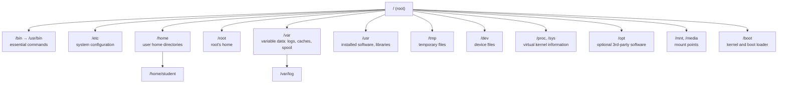

# Day 02: File and Directory Management

!!! info "Lesson overview"
    | | |
    |---|---|
    | **Module** | 1 — Command-Line Fundamentals |
    | **Difficulty** | :material-signal-cellular-1: Beginner |
    | **Estimated time** | 3–4 hours (75 min reading, 75 min demonstrations, 60–90 min lab and quiz) |
    | **Platforms** | Ubuntu 24.04 LTS (Bash 5.2, GNU coreutils 9.4) · Windows 11 (Windows PowerShell 5.1 and PowerShell 7.4+) |
    | **Lab** | [Lab 02: Project Workspace](../../labs/lab-02.md) |

## Learning Objectives

By the end of this lesson you will be able to:

1. Describe the **Linux Filesystem Hierarchy** (`/`, `/etc`, `/home`, `/var`, `/usr`, `/tmp`...) and the main **Windows** folders (`C:\Windows`, `C:\Program Files`, `C:\Users`, `C:\ProgramData`).
2. Distinguish **absolute** and **relative** paths, and use `.`, `..`, `~` and `-` correctly.
3. Navigate with `cd` / `Set-Location`, and use `pushd`/`popd` / `Push-Location`/`Pop-Location`.
4. Create, copy, move, rename and delete files and directories with `mkdir`, `touch`, `cp`, `mv`, `rm`, `rmdir` and with `New-Item`, `Copy-Item`, `Move-Item`, `Rename-Item`, `Remove-Item`.
5. Use **wildcards** (`*`, `?`, `[...]`) and understand who expands them in each shell.
6. Perform **recursive** operations deliberately, and apply **safe-deletion practices** (`-i`, `-WhatIf`, `-Confirm`, preview first, quote variables).

## Prerequisites

- [Day 01](day-01.md) completed: you can open both shells and use `pwd`, `ls`, `Get-Location`, `Get-ChildItem` and help.
- A **non-production** machine or VM. Today you will delete files on purpose, so work only inside the practice folder created in the lab.

## Introduction and Concepts

### Everything is a file (Linux) and drives plus folders (Windows)

Linux has a **single directory tree** that starts at the root, `/`. Every disk, USB stick, network share and even virtual information about the kernel is *mounted* somewhere inside that tree. There are no drive letters.

Windows uses **drive letters** (`C:\`, `D:\`), each with its own tree. PowerShell generalises this with **PSDrives**: `C:`, `HKLM:` (registry), `Env:` (environment variables), `Cert:` (certificates). `Get-PSDrive` lists them (Day 9 goes deeper).



### The Linux Filesystem Hierarchy Standard (FHS)

| Path | Contains | Professional relevance |
|---|---|---|
| `/` | Root of the whole tree | Never delete anything here casually |
| `/bin`, `/sbin` | Essential user/admin programs. On Ubuntu 24.04 these are **symbolic links** to `/usr/bin` and `/usr/sbin` (the "merged /usr" layout) | `ls -ld /bin` shows `/bin -> usr/bin` |
| `/etc` | System-wide **configuration** text files (`/etc/passwd`, `/etc/hosts`, `/etc/ssh/sshd_config`) | Back up before editing; audited by security teams |
| `/home` | One directory per user (`/home/student`) | User data; often a separate partition |
| `/root` | Home of the `root` user | Not readable by normal users |
| `/var` | Data that changes: `/var/log` (logs), `/var/lib` (state, databases), `/var/cache`, `/var/spool` | Disk-full incidents usually start here (Day 9) |
| `/tmp` | Temporary files, cleared at boot (and by `systemd-tmpfiles`) | World-writable, so a classic location for malware drops |
| `/usr` | Installed programs and libraries (`/usr/bin`, `/usr/lib`, `/usr/share`) | Managed by the package manager (Day 10). Do not edit by hand. |
| `/usr/local` | Software you install manually | Survives package upgrades |
| `/opt` | Self-contained third-party applications | Vendor software |
| `/dev` | Device files (`/dev/sda`, `/dev/null`) | Disks appear here (Day 9) |
| `/proc`, `/sys` | Virtual files generated by the kernel (`/proc/cpuinfo`, `/proc/meminfo`) | Process and hardware investigation (Days 8, 28) |
| `/boot` | Kernel images and boot loader | A full `/boot` breaks kernel upgrades |
| `/mnt`, `/media` | Mount points for temporary and removable media | Day 9 |
| `/srv` | Data served by this system (web, FTP) | Optional |
| `/run` | Runtime data since boot (PID files, sockets) | Cleared at boot |

### Key Windows locations

| Path | Contains | PowerShell shortcut |
|---|---|---|
| `C:\Windows` | Operating system | `$env:windir` |
| `C:\Windows\System32` | Core 64-bit system programs and DLLs | |
| `C:\Program Files`, `C:\Program Files (x86)` | Installed 64-bit / 32-bit applications | `$env:ProgramFiles` |
| `C:\ProgramData` | Machine-wide application data (hidden) | `$env:ProgramData` |
| `C:\Users\<name>` | User profile (Desktop, Documents, Downloads) | `$HOME`, `$env:USERPROFILE`, `~` |
| `C:\Users\<name>\AppData` | Per-user application data: `Roaming`, `Local`, `LocalLow` | `$env:APPDATA`, `$env:LOCALAPPDATA` |
| `%TEMP%` | Per-user temporary folder | `$env:TEMP` |

### Absolute and relative paths

An **absolute path** starts from the root and works no matter where you are:

- Linux: `/home/student/projects/report.txt`
- Windows: `C:\Users\student\projects\report.txt`

A **relative path** is interpreted from the **current directory**:

- `projects/report.txt` means "the `projects` folder inside wherever I am now".

Special names:

| Symbol | Meaning | Bash | PowerShell |
|---|---|---|---|
| `.` | Current directory | Yes | Yes |
| `..` | Parent directory | Yes | Yes |
| `~` | Home directory | Yes (expanded by the shell) | Yes (in file system cmdlets and `cd`). Native programs may not understand it, so use `$HOME` |
| `-` | Previous directory | `cd -` | `Set-Location -` (PowerShell 6.2+ only) |
| `/` vs `\` | Separator | `/` only | Both `\` and `/` work in PowerShell |

!!! tip "Spaces in names"
    Paths containing spaces must be **quoted** in both shells: `cd "My Documents"`, `Set-Location 'C:\Program Files'`. In Bash you can also escape the space: `cd My\ Documents`. Tab completion inserts the quoting for you.

### Wildcards (globbing)

| Pattern | Matches | Example |
|---|---|---|
| `*` | Any number of characters (including none) | `*.log` → `app.log`, `error.log` |
| `?` | Exactly one character | `file?.txt` → `file1.txt`, `fileA.txt` |
| `[abc]` | One character from the set | `report[12].csv` → `report1.csv`, `report2.csv` |
| `[a-z]` | One character from a range | `log[0-9].txt` |
| `{a,b}` | **Bash brace expansion** (not a wildcard). Generates words even if no file exists | `mkdir {src,docs,tests}` |

**Who expands the wildcard matters:**

- In **Bash**, the *shell* expands `*.log` into a list of matching names **before** the command runs. `rm *.log` actually runs `rm app.log error.log`. If nothing matches, Bash passes the literal text `*.log` (unless `nullglob` is set). Names beginning with `.` are **not** matched by `*`.
- In **PowerShell**, the *cmdlet* expands wildcards in its `-Path` parameter. Use **`-LiteralPath`** when a real file name contains `[` or `]`, because those are wildcard characters (for example `report[final].txt`).

### Recursion

"Recursive" means *the directory and everything inside it, at any depth*. It is required to copy or delete a folder tree. In Bash use `cp -r`, `rm -r`, `ls -R`. In PowerShell use `-Recurse`, and limit the depth with `Get-ChildItem -Depth`. Recursion is powerful and dangerous, so always preview before a recursive delete.

### Safe deletion: there is no Recycle Bin

`rm` and `Remove-Item` **do not** move files to the Trash or Recycle Bin. Deleted means gone, short of restoring from backup. Professional habits:

1. **Preview** with the same pattern first: `ls *.tmp` before `rm *.tmp`; `Get-ChildItem *.tmp` before `Remove-Item *.tmp`.
2. **Ask for confirmation**: `rm -i`, `rm -I`; `Remove-Item -Confirm`.
3. **Simulate**: `Remove-Item -WhatIf` shows what *would* be deleted without deleting anything.
4. **Quote and guard variables in scripts**: `rm -rf -- "${target:?}/"*` refuses to run when `$target` is empty, which prevents the infamous `rm -rf /*`.
5. **Have a backup** and know where it is before deleting in production.
6. **Never** run recursive forced deletes as root or Administrator unless you have verified the path twice.

## Linux Command Reference

| Command | Purpose | Key options | Needs root? |
|---|---|---|---|
| `cd` | Change directory (Bash built-in) | `cd`, `cd ~`, `cd -`, `cd ..` | No |
| `pwd` | Print current directory | `-P` | No |
| `ls` | List | `-l -a -h -R -d -t` | No |
| `mkdir` | Make directories | `-p` (parents, no error if exists), `-v`, `-m MODE` | Only outside your areas |
| `touch` | Create empty file or update timestamps | `-c` (do not create), `-d DATE` | No |
| `cp` | Copy files/directories | `-r`, `-i`, `-n`, `-v`, `-p`, `-a`, `-u` | No |
| `mv` | Move or rename | `-i`, `-n`, `-v`, `-u` | No |
| `rm` | Remove files/directories | `-i`, `-I`, `-r`, `-f`, `-v`, `-d` | No |
| `rmdir` | Remove **empty** directories | `-p`, `-v` | No |
| `pushd` / `popd` / `dirs` | Directory stack | `dirs -v` | No |
| `tree` | Show a directory tree | `-L N`, `-a`, `-d` (install: `sudo apt install tree`) | No |
| `file` | Identify a file's type by content | | No |
| `stat` | Detailed file metadata (size, inode, times) | | No |

## PowerShell Command Reference

| Cmdlet | Aliases (Windows) | Purpose | Key parameters |
|---|---|---|---|
| `Set-Location` | `cd`, `chdir`, `sl` | Change location | `-Path`, `-LiteralPath`, `-` (6.2+) |
| `Push-Location` / `Pop-Location` | `pushd` / `popd` | Location stack | `-Path`, `-StackName` |
| `New-Item` | `ni` (`mkdir` is a function) | Create file or directory | `-Path`, `-Name`, `-ItemType File/Directory`, `-Value`, `-Force` |
| `Copy-Item` | `cp`, `copy`, `cpi` | Copy | `-Path`, `-Destination`, `-Recurse`, `-Force`, `-Filter`, `-WhatIf` |
| `Move-Item` | `mv`, `move`, `mi` | Move (and rename) | `-Path`, `-Destination`, `-Force`, `-WhatIf` |
| `Rename-Item` | `ren`, `rni` | Rename in place | `-Path`, `-NewName` |
| `Remove-Item` | `rm`, `del`, `rmdir`, `rd`, `ri`, `erase` | Delete | `-Path`, `-Recurse`, `-Force`, `-WhatIf`, `-Confirm`, `-LiteralPath` |
| `Test-Path` | — | Does a path exist? Returns `True`/`False` | `-Path`, `-PathType Leaf/Container` |
| `Get-Item` | `gi` | Get one item (file/folder object) | `-Path`, `-Force` |
| `Resolve-Path` | `rvpa` | Expand wildcards / relative paths to full paths | `-Path`, `-Relative` |
| `Join-Path` / `Split-Path` | — | Build / take apart paths safely | `-Parent`, `-Leaf`, `-Extension` (7+) |

## Detailed Command Explanations

### Navigating: `cd` and `Set-Location`

`cd DIR` changes the shell's current directory. `cd` alone (or `cd ~`) goes home, `cd ..` goes up one level, `cd -` returns to the previous directory and prints it. `cd` is a **built-in** because a separate program could not change the shell's own directory.

`Set-Location` does the same in PowerShell and can also move into other providers (`Set-Location HKLM:\SOFTWARE`). Since PowerShell 6.2, `Set-Location -` and `Set-Location +` move backward and forward through location history. In Windows PowerShell 5.1, use `Push-Location`/`Pop-Location` instead.

`pushd DIR` changes directory **and** remembers where you were. `popd` returns. This is great in scripts: `pushd /var/log; ...; popd`.

### Creating directories: `mkdir` and `New-Item -ItemType Directory`

`mkdir reports` creates one directory. `mkdir -p projects/2026/q4` creates the whole chain and **does not fail** if it already exists, which makes it safe in scripts. Combine with brace expansion: `mkdir -p lab/{logs,configs,scripts}`.

`New-Item -Path reports -ItemType Directory` creates a directory and returns its `DirectoryInfo` object. Intermediate directories are created automatically. With `-Force`, no error occurs if the directory already exists. On Windows, `mkdir` is a built-in **function** that calls `New-Item -ItemType Directory`. On Linux PowerShell, `mkdir` runs the native program.

### Creating files: `touch` and `New-Item -ItemType File`

`touch notes.txt` creates an empty file if it does not exist. If it **does** exist, `touch` only updates its modification time and never changes the content. `touch -c` updates times without creating.

`New-Item -Path notes.txt -ItemType File` creates an empty file. `-Value 'text'` writes initial content.

!!! danger "`New-Item -Force` overwrites existing files"
    For **files**, `New-Item -Force` replaces an existing file with a new empty (or `-Value`) file, so its content is lost. That is different from `touch`. The safe PowerShell "touch" is:

    ```powershell
    if (Test-Path -Path notes.txt) { (Get-Item notes.txt).LastWriteTime = Get-Date }
    else { New-Item -Path notes.txt -ItemType File | Out-Null }
    ```

### Copying: `cp` and `Copy-Item`

`cp SOURCE DEST` copies a file. If `DEST` is an existing directory, the file goes inside it with the same name. To copy a **directory** you must add `-r` (recursive). Important options:

- `-i` asks before overwriting; `-n` never overwrites
- `-v` prints each file copied (verbose)
- `-p` preserves mode, ownership and timestamps; `-a` (archive) = `-r` plus preserve everything, including symlinks. Use it for backups.
- `-u` copies only when the source is newer than the destination

`Copy-Item -Path SOURCE -Destination DEST` behaves similarly. `-Recurse` copies folder contents. `-Force` overwrites read-only files and creates hidden items. `-Filter *.log` limits what is copied. `-WhatIf` previews.

!!! note "The nested-folder rule (both shells)"
    `cp -r src backup` and `Copy-Item src backup -Recurse` produce **`backup/` = copy of `src`** if `backup` does **not** exist, but **`backup/src/`** if `backup` already exists. To copy only the *contents*, use `cp -r src/. backup/` or `Copy-Item src\* backup -Recurse`.

### Moving and renaming: `mv`, `Move-Item`, `Rename-Item`

In Linux, moving and renaming are the same operation: `mv old.txt new.txt` renames, `mv file.txt archive/` moves. Within one filesystem a move is instant (only the directory entry changes); across filesystems it copies and then deletes. `-i` prompts before overwrite, `-n` never overwrites, `-v` is verbose.

`Move-Item` moves and can rename at the same time. `Rename-Item -Path old.txt -NewName new.txt` renames in place. `-NewName` takes **only a name, not a path**. By default `Move-Item` refuses to overwrite an existing destination file. Add `-Force` to allow it.

### Deleting: `rm`, `rmdir`, `Remove-Item`

- `rm file` deletes files. `rm -r dir` deletes a directory tree. `rm -f` never prompts and ignores missing files.
- `rm -i` asks for every file; `rm -I` asks **once** when deleting more than three files or recursively, which is a sensible default.
- `rmdir dir` removes a directory **only if it is empty**, which makes it a safe way to clean up.
- `Remove-Item path` deletes. Non-empty folders need `-Recurse` (otherwise PowerShell asks for confirmation). Hidden or read-only items need `-Force`. `-WhatIf` simulates and `-Confirm` prompts.

Every PowerShell cmdlet that changes the system supports `-WhatIf` and `-Confirm` (the *ShouldProcess* mechanism). Use them every time you are unsure.

### Helpers: `Test-Path`, `Join-Path`, `stat`, `file`

- `Test-Path C:\Temp\lab` returns `True` or `False`. It is essential in scripts before creating or deleting.
- `Join-Path $HOME 'lab'` builds a path with the correct separator for the OS. This is better than string concatenation.
- `stat file` (Linux) shows size, permissions, inode and the **access/modify/change** times.
- `file mystery.bin` identifies content regardless of the extension. Attackers rename executables to `.jpg`, but `file` is not fooled.

## Syntax and Parameters

### Bash

```text
cd [-L|-P] [DIR | - | ~]
mkdir [-p] [-v] [-m MODE] DIR...
touch [-c] [-d DATE] FILE...
cp [-r] [-i|-n] [-v] [-p|-a] [-u] SOURCE... DEST
mv [-i|-n] [-v] [-u] SOURCE... DEST
rm [-i|-I] [-r] [-f] [-v] [--] FILE...
rmdir [-p] [-v] DIR...
```

| Option | Applies to | Meaning |
|---|---|---|
| `-p` | mkdir | Create parent directories as needed; no error if existing |
| `-p` | cp | Preserve mode, ownership, timestamps |
| `-a` | cp | Archive: recursive + preserve all attributes + copy symlinks as symlinks |
| `-r` / `-R` | cp, rm | Recursive |
| `-i` | cp, mv, rm | Interactive: prompt before each overwrite/removal |
| `-I` | rm | Prompt once before removing more than 3 files or recursively |
| `-n` | cp, mv | No-clobber: never overwrite |
| `-f` | rm | Force: never prompt, ignore nonexistent files |
| `-u` | cp, mv | Update: only when source is newer or destination missing |
| `-v` | most | Verbose: print what is done |
| `--` | rm, cp, mv | End of options: needed for names that start with `-` (e.g. `rm -- -weird.txt`) |

### PowerShell

```text
Set-Location [[-Path] <String>] [-LiteralPath <String>] [-PassThru]
New-Item [-Path] <String[]> [-ItemType <String>] [-Name <String>] [-Value <Object>] [-Force] [-WhatIf] [-Confirm]
Copy-Item [-Path] <String[]> [[-Destination] <String>] [-Recurse] [-Force] [-Filter <String>]
          [-Include <String[]>] [-Exclude <String[]>] [-PassThru] [-WhatIf] [-Confirm]
Move-Item [-Path] <String[]> [[-Destination] <String>] [-Force] [-PassThru] [-WhatIf] [-Confirm]
Rename-Item [-Path] <String> [-NewName] <String> [-Force] [-PassThru] [-WhatIf] [-Confirm]
Remove-Item [-Path] <String[]> [-LiteralPath <String[]>] [-Recurse] [-Force] [-Filter <String>]
            [-Include <String[]>] [-Exclude <String[]>] [-WhatIf] [-Confirm]
Test-Path [-Path] <String[]> [-PathType <Any|Container|Leaf>]
```

| Parameter | Meaning |
|---|---|
| `-ItemType` | `File`, `Directory`, `SymbolicLink`, `HardLink`, `Junction` |
| `-Force` | Allow hidden/read-only items; **New-Item:** overwrite existing files; **Move-Item:** overwrite destination |
| `-Recurse` | Include all child items |
| `-Filter` | Fast provider filter (one pattern) |
| `-Include` / `-Exclude` | Additional patterns. With `Copy-Item`/`Remove-Item` they work most reliably together with `-Recurse` or a wildcard path |
| `-PassThru` | Output the resulting object (useful for verification) |
| `-WhatIf` | Show what would happen; do nothing |
| `-Confirm` | Ask before each action |
| `-LiteralPath` | Treat the path exactly as typed (no wildcard interpretation) |

## Practical Demonstrations

All demos work inside a disposable practice folder in your home directory. Outputs are **examples**: names match the commands, while dates, users and sizes will differ on your system.

### Demo 1 — Explore the hierarchy

=== "Bash"

    ```bash
    cd /
    ls
    ls -ld /bin /sbin
    cd /var/log
    pwd
    cd ..
    pwd
    cd -
    cd ~
    pwd
    ```

    **Expected output (example, Ubuntu 24.04):**

    ```text
    bin  bin.usr-is-merged  boot  dev  etc  home  lib  lib64  lost+found  media  mnt  opt  proc  root  run  sbin  snap  srv  sys  tmp  usr  var
    lrwxrwxrwx 1 root root 7 Apr 22  2024 /bin -> usr/bin
    lrwxrwxrwx 1 root root 8 Apr 22  2024 /sbin -> usr/sbin
    /var/log
    /var
    /var/log
    /home/student
    ```

=== "PowerShell"

    ```powershell
    Set-Location C:\
    Get-ChildItem -Directory | Select-Object Name
    Set-Location $env:windir
    Get-Location
    Set-Location ..
    Get-Location
    Set-Location ~
    Get-Location
    $env:TEMP
    ```

    **Expected output (example):**

    ```text
    Name
    ----
    PerfLogs
    Program Files
    Program Files (x86)
    Users
    Windows

    Path
    ----
    C:\Windows

    Path
    ----
    C:\

    Path
    ----
    C:\Users\student

    C:\Users\student\AppData\Local\Temp
    ```

### Demo 2 — Build a project structure

=== "Bash"

    ```bash
    mkdir -p ~/day02/project/{docs,src,logs,backup}
    cd ~/day02/project
    touch docs/readme.txt src/app.sh logs/app.log logs/error.log logs/debug.tmp
    ls -R
    ```

    **Expected output:**

    ```text
    .:
    backup  docs  logs  src

    ./backup:

    ./docs:
    readme.txt

    ./logs:
    app.log  debug.tmp  error.log

    ./src:
    app.sh
    ```

=== "PowerShell"

    ```powershell
    $root = Join-Path $HOME 'day02\project'
    'docs','src','logs','backup' | ForEach-Object { New-Item -Path (Join-Path $root $_) -ItemType Directory -Force | Out-Null }
    Set-Location $root
    'docs\readme.txt','src\app.ps1','logs\app.log','logs\error.log','logs\debug.tmp' |
        ForEach-Object { New-Item -Path $_ -ItemType File | Out-Null }
    Get-ChildItem -Recurse -File | Select-Object FullName
    ```

    **Expected output (example):**

    ```text
    FullName
    --------
    C:\Users\student\day02\project\docs\readme.txt
    C:\Users\student\day02\project\logs\app.log
    C:\Users\student\day02\project\logs\debug.tmp
    C:\Users\student\day02\project\logs\error.log
    C:\Users\student\day02\project\src\app.ps1
    ```

    `ForEach-Object` runs the block once per input item, and `$_` is the current item. It is explained fully on Day 5. `| Out-Null` discards the objects `New-Item` would otherwise print.

### Demo 3 — Copy, including the nested-folder rule

=== "Bash"

    ```bash
    cp -v logs/*.log backup/
    cp -r docs docs-copy          # docs-copy did not exist → becomes a copy of docs
    cp -r docs docs-copy          # now it exists → creates docs-copy/docs
    ls -R docs-copy
    ```

    **Expected output:**

    ```text
    'logs/app.log' -> 'backup/app.log'
    'logs/error.log' -> 'backup/error.log'
    docs-copy:
    docs  readme.txt

    docs-copy/docs:
    readme.txt
    ```

=== "PowerShell"

    ```powershell
    Copy-Item -Path logs\*.log -Destination backup -PassThru | Select-Object Name
    Copy-Item -Path docs -Destination docs-copy -Recurse
    Copy-Item -Path docs -Destination docs-copy -Recurse
    Get-ChildItem docs-copy -Recurse | Select-Object FullName
    ```

    **Expected output (example):**

    ```text
    Name
    ----
    app.log
    error.log

    FullName
    --------
    C:\Users\student\day02\project\docs-copy\docs
    C:\Users\student\day02\project\docs-copy\readme.txt
    C:\Users\student\day02\project\docs-copy\docs\readme.txt
    ```

### Demo 4 — Move and rename

=== "Bash"

    ```bash
    mv -v src/app.sh src/main.sh
    mkdir -p archive
    mv -v logs/*.tmp archive/
    mv -i backup/app.log logs/app.log    # prompts because logs/app.log exists
    ```

    **Expected output:**

    ```text
    renamed 'src/app.sh' -> 'src/main.sh'
    renamed 'logs/debug.tmp' -> 'archive/debug.tmp'
    mv: overwrite 'logs/app.log'? n
    ```

=== "PowerShell"

    ```powershell
    Rename-Item -Path src\app.ps1 -NewName main.ps1 -PassThru | Select-Object Name
    New-Item -Path archive -ItemType Directory -Force | Out-Null
    Move-Item -Path logs\*.tmp -Destination archive -PassThru | Select-Object FullName
    Move-Item -Path backup\app.log -Destination logs\app.log
    ```

    **Expected output (example):**

    ```text
    Name
    ----
    main.ps1

    FullName
    --------
    C:\Users\student\day02\project\archive\debug.tmp

    Move-Item : Cannot create a file when that file already exists.
    ```

    The last command fails **on purpose**: `Move-Item` will not overwrite an existing file unless you add `-Force`.

### Demo 5 — Safe deletion

=== "Bash"

    ```bash
    ls logs/*.log                # 1. preview exactly what the pattern matches
    rm -i logs/error.log         # 2. confirm a single delete
    rmdir archive                # 3. fails: not empty, so nothing is lost
    rm -rI docs-copy             # 4. one confirmation for a recursive delete
    target=""                    # 5. guard against empty variables in scripts
    rm -rf -- "${target:?target is empty}/"
    ```

    **Expected output:**

    ```text
    logs/app.log  logs/error.log
    rm: remove regular empty file 'logs/error.log'? y
    rmdir: failed to remove 'archive': Directory not empty
    rm: remove 1 argument recursively? y
    bash: target: target is empty
    ```

    The `${target:?message}` expansion stops the command with an error when the variable is empty or unset, so `rm` never runs.

=== "PowerShell"

    ```powershell
    Get-ChildItem logs\*.log                    # 1. preview
    Remove-Item logs\error.log -WhatIf          # 2. simulate
    Remove-Item logs\error.log -Confirm         # 3. confirm
    Remove-Item docs-copy -Recurse -WhatIf      # 4. preview recursive delete
    Remove-Item docs-copy -Recurse
    $target = ''
    if ([string]::IsNullOrWhiteSpace($target)) { Write-Warning 'Target is empty - refusing to delete.' }
    ```

    **Expected output (example):**

    ```text
        Directory: C:\Users\student\day02\project\logs

    Mode                 LastWriteTime         Length Name
    ----                 -------------         ------ ----
    -a----        08-11-2026     16:02              0 app.log
    -a----        08-11-2026     16:02              0 error.log

    What if: Performing the operation "Remove File" on target "C:\Users\student\day02\project\logs\error.log".

    Confirm
    Are you sure you want to perform this action?
    Performing the operation "Remove File" on target "C:\Users\student\day02\project\logs\error.log".
    [Y] Yes  [A] Yes to All  [N] No  [L] No to All  [S] Suspend  [?] Help (default is "Y"): Y

    What if: Performing the operation "Remove Directory" on target "C:\Users\student\day02\project\docs-copy".
    WARNING: Target is empty - refusing to delete.
    ```

### Demo 6 — Wildcards and literal paths

=== "Bash"

    ```bash
    cd ~/day02/project
    touch file1.txt file2.txt fileA.txt file10.txt .hidden.txt 'report[final].txt'
    ls file?.txt
    ls file[0-9].txt
    ls *.txt                 # .hidden.txt is NOT matched
    ls -d .*.txt
    echo {jan,feb,mar}-report.csv
    ```

    **Expected output:**

    ```text
    file1.txt  file2.txt  fileA.txt
    file1.txt  file2.txt
    file10.txt  file1.txt  file2.txt  fileA.txt  'report[final].txt'
    .hidden.txt
    jan-report.csv feb-report.csv mar-report.csv
    ```

=== "PowerShell"

    ```powershell
    'file1.txt','file2.txt','fileA.txt','file10.txt','report[final].txt' |
        ForEach-Object { New-Item -Path . -Name $_ -ItemType File -Force | Out-Null }
    Get-ChildItem file?.txt -Name
    Get-ChildItem 'file[0-9].txt' -Name
    Get-Item 'report[final].txt'           # wildcard interpretation: returns nothing
    Get-Item -LiteralPath 'report[final].txt' | Select-Object Name
    ```

    **Expected output (example):**

    ```text
    file1.txt
    file2.txt
    fileA.txt
    file1.txt
    file2.txt

    Name
    ----
    report[final].txt
    ```

    `New-Item -Name` treats the name literally, so it can create `report[final].txt`. `Get-Item 'report[final].txt'` interprets `[final]` as "one of f, i, n, a, l", finds no match and returns nothing. `-LiteralPath` fixes it.

## Linux vs PowerShell Comparison

| Task | Bash | PowerShell | Notes |
|---|---|---|---|
| Go home | `cd` · `cd ~` | `Set-Location ~` · `cd ~` | |
| Up one level | `cd ..` | `Set-Location ..` | |
| Previous directory | `cd -` | `Set-Location -` (6.2+) · `Pop-Location` | Not in 5.1 |
| Make directory (with parents) | `mkdir -p a/b/c` | `New-Item a\b\c -ItemType Directory -Force` | PowerShell creates parents automatically |
| Create empty file | `touch f.txt` | `New-Item f.txt -ItemType File` | `New-Item -Force` overwrites; `touch` does not |
| Update timestamp | `touch f.txt` | `(Get-Item f.txt).LastWriteTime = Get-Date` | |
| Copy file | `cp a b` | `Copy-Item a b` | |
| Copy directory | `cp -r src dst` | `Copy-Item src dst -Recurse` | Same nesting rule |
| Copy preserving attributes | `cp -a` | `robocopy src dst /E /COPY:DAT` | `Copy-Item` does not preserve ACLs; robocopy is the Windows tool for that |
| Move / rename | `mv a b` | `Move-Item a b` · `Rename-Item a -NewName b` | |
| No-overwrite | `cp -n`, `mv -n` | default for `Move-Item`; `Copy-Item` overwrites unless you test first | Check with `Test-Path` |
| Delete file | `rm f` | `Remove-Item f` | No recycle bin in either |
| Delete tree | `rm -r d` | `Remove-Item d -Recurse` | |
| Preview a delete | `ls pattern` first | `Remove-Item ... -WhatIf` | `-WhatIf` is a real simulation |
| Confirm | `rm -i` / `rm -I` | `-Confirm` | |
| Remove empty dir only | `rmdir d` | `Remove-Item d` (prompts if not empty) | |
| Does it exist? | `[ -e path ]` · `test -d dir` | `Test-Path path` | Bash tests are covered on Day 22 |
| Literal name with `[ ]` | quote it: `'a[1].txt'` | `-LiteralPath` | |
| Brace expansion | `mkdir {a,b,c}` | <code>'a','b','c' &#124; % { mkdir $_ }</code> | No braces in PowerShell |

## Real-World IT Scenarios

1. **Standard server layout.** A team requires every application server to have `/opt/app/{bin,conf,logs,data}`. One `mkdir -p` line in a build script creates it identically on every host, and running it twice is harmless.
2. **Pre-change backup.** Before editing `/etc/ssh/sshd_config`, an admin runs `sudo cp -a /etc/ssh/sshd_config /etc/ssh/sshd_config.bak.$(date +%F)`. If the change breaks SSH, the original is one `cp` away. Windows equivalent: `Copy-Item C:\App\config.xml "C:\App\config.xml.bak.$(Get-Date -Format yyyy-MM-dd)"`.
3. **User profile migration.** A help-desk technician moves a departing employee's documents to an archive share with `Move-Item` / `robocopy`, keeping the original folder names.
4. **Cleaning old build artefacts.** A developer deletes `*.tmp` files from a build tree. They preview with `Get-ChildItem -Recurse -Filter *.tmp` first, then pipe the same command to `Remove-Item -WhatIf`, and only then delete.
5. **The empty-variable disaster.** A cleanup script ran `rm -rf $DIR/*` with `$DIR` unset and deleted the system root's contents. Quoting plus `${DIR:?}` would have stopped it. This is a real, recurring class of production incident.

## Cybersecurity Application

- **Know where attackers hide files:** `/tmp`, `/var/tmp` and `/dev/shm` on Linux (world-writable), and `%TEMP%`, `%APPDATA%`, `C:\ProgramData` and `C:\Users\Public` on Windows are favourite drop locations for malware and tools. You will search them by modification time on Day 4.
- **Hidden files:** names starting with `.` on Linux (`ls -a`) and the Hidden attribute on Windows (`Get-ChildItem -Force`) are a trivial but common way to hide persistence scripts.
- **File type vs extension:** `file invoice.pdf` revealing `ELF 64-bit LSB executable` is a red flag. On Windows, check the first bytes: `Get-Content invoice.pdf -Encoding Byte -TotalCount 2` in 5.1 (or `-AsByteStream` in 7) returning `77 90` ("MZ") means a Windows executable.
- **Evidence preservation:** during incident response, **copy** suspicious files with timestamps preserved (`cp -a`, `robocopy /COPY:DAT`) instead of moving or opening them, and never delete them. Changing timestamps destroys timeline evidence.
- **Ransomware awareness:** recursive operations across shares are exactly what ransomware does at scale. Unexpected mass renames or deletions are a key detection signal.

## Network Analyst Application

- Network configuration lives in files: `/etc/hosts`, `/etc/resolv.conf`, `/etc/netplan/*.yaml` on Ubuntu, and `C:\Windows\System32\drivers\etc\hosts` on Windows. Navigating to them and **backing them up before editing** is a daily task (Days 11–13).
- Packet captures (`.pcap`) and device configuration backups pile up quickly. Organise them by date with `mkdir -p captures/$(date +%F)` and clean them with previewed deletes.
- Copying configs from many devices into one structured folder tree (`site/device/date`) makes later comparison easy.

## System Administrator Application

- **Idempotent setup:** `mkdir -p` and `New-Item -Force` (for directories) let setup scripts run repeatedly without errors.
- **Change management:** a timestamped `.bak` copy before every configuration edit, using `cp -a` or `Copy-Item`.
- **Disk housekeeping:** previewed, pattern-based cleanups of `/var/tmp`, old logs and temp folders (Day 9 adds size analysis).
- **Path hygiene in scripts:** use `Join-Path` and quoted `"$var"`, so scripts work with spaces and on every OS.

## Common Mistakes

| Mistake | What happens | Correct approach |
|---|---|---|
| `rm -rf $DIR/*` with an empty `$DIR` | Deletes everything under `/` that you have rights to | `rm -rf -- "${DIR:?}"/*` and never run as root casually |
| `rm -rf` in PowerShell | Error: parameter `rf` not found | `Remove-Item -Recurse -Force` |
| Expecting deleted files in the Recycle Bin | They are gone permanently | Back up first; use `-WhatIf` / `-i` |
| `New-Item -Force file.txt` used like `touch` | Existing content wiped | `Test-Path` first, or update `LastWriteTime` |
| `cp -r src dst` run twice | Second run creates `dst/src` | Copy contents: `cp -r src/. dst/` / `Copy-Item src\* dst -Recurse` |
| Forgetting quotes around paths with spaces | `cd: too many arguments` / wrong item | Quote: `"My Folder"` |
| Using `Get-Item` on a file name containing `[` `]` | Nothing returned or wrong file | `-LiteralPath` |
| `Rename-Item a.txt -NewName folder\b.txt` | Error: `-NewName` takes only a name | Use `Move-Item` to change folders |
| `rmdir` on a non-empty directory in Bash | `Directory not empty` | Intended safety; use `rm -r` only after review |
| Working in `C:\Windows\System32` by accident (elevated shells start there) | Files created or deleted in a system folder | `Set-Location ~` first; check `Get-Location` |

## Troubleshooting Guide

| Error message | Cause | Fix |
|---|---|---|
| `mkdir: cannot create directory 'x': File exists` | Already exists | Use `mkdir -p` |
| `mkdir: cannot create directory '/opt/app': Permission denied` | Normal users cannot write to `/opt` | `sudo mkdir -p /opt/app` if appropriate, or work in `~` |
| `cp: -r not specified; omitting directory 'docs'` | Copying a directory without recursion | `cp -r docs dest` |
| `rm: cannot remove 'x': Is a directory` | Directory needs `-r` (or `rmdir` if empty) | `rmdir x` / `rm -r x` |
| `rm: cannot remove 'x': Permission denied` | No write permission on the **parent directory** | Check `ls -ld .` (Day 7) |
| `New-Item : An item with the specified name ... already exists.` | Already exists | Add `-Force` (directories) or `Test-Path` first |
| `Remove-Item : ... The process cannot access the file because it is being used by another process.` | File open in an application | Close the app; find the locking process (Day 8) |
| `Remove-Item : ... is an item with children and the Recurse parameter was not specified` | Non-interactive delete of a non-empty folder | Add `-Recurse` after a `-WhatIf` preview |
| `Copy-Item : Access to the path ... is denied.` | Read-only, system or permission problem | `-Force` for read-only items; run elevated only if it is truly a system path |
| `Set-Location : Cannot find path ... because it does not exist.` | Typo or relative path from the wrong location | `Get-Location`; use tab completion; use an absolute path |
| `bash: cd: too many arguments` | Unquoted space in the path | Quote the path |

## Hands-on Lab

Complete **[Lab 02: Project Workspace](../../labs/lab-02.md)**. You will build a standard project folder tree, populate it, back it up correctly (avoiding the nested-folder trap), reorganise files with wildcards, and safely clean up using preview and simulation. The lab includes verification commands and a full solution for both shells.

## Practice Questions

1. What is the difference between `/etc` and `/var` on Linux? Give one example file from each.
2. Why are `/bin` and `/sbin` symbolic links on Ubuntu 24.04?
3. You are in `/home/student/projects`. Write the absolute and a relative path to `/home/student/notes.txt`.
4. Write one Bash command that creates `lab/logs`, `lab/configs` and `lab/scripts` at once, even if `lab` does not exist.
5. Write the PowerShell equivalent of question 4.
6. What is the danger of `New-Item -Path data.csv -ItemType File -Force` when `data.csv` already exists?
7. Explain what happens when you run `cp -r src backup` twice.
8. Which `rm` option asks only once before a recursive delete?
9. How do you see what `Remove-Item C:\Temp\old -Recurse` would delete without deleting anything?
10. Why does `ls *` not show `.bashrc`, and how do you include it?
11. A file is named `log[2026].txt`. Why does `Get-Item log[2026].txt` fail to find it, and what is the fix?
12. Write a Bash command that deletes the directory stored in `$target` but refuses to run if `$target` is empty.
13. Which PowerShell cmdlet renames a file without moving it, and which parameter takes the new name?
14. What does `cd -` do, and what is the PowerShell equivalent in 5.1 and in 7?

??? success "Practice answers"
    1. `/etc` holds **configuration** (e.g. `/etc/hosts`, `/etc/passwd`). `/var` holds **changing data** (e.g. `/var/log/syslog`, `/var/log/auth.log`).
    2. Ubuntu uses the **merged /usr** layout: all programs live in `/usr/bin` and `/usr/sbin`, and the top-level directories remain as compatibility symlinks.
    3. Absolute: `/home/student/notes.txt`. Relative: `../notes.txt` (or `~/notes.txt`, which is home-relative).
    4. `mkdir -p lab/{logs,configs,scripts}`
    5. `'logs','configs','scripts' | ForEach-Object { New-Item -Path "lab\$_" -ItemType Directory -Force }`
    6. `-Force` **replaces** the existing file with a new empty one, so all its data is lost.
    7. First run: `backup` does not exist, so it becomes a copy of `src`. Second run: `backup` exists, so `src` is copied **inside** it as `backup/src`.
    8. `rm -I`
    9. Add `-WhatIf`: `Remove-Item C:\Temp\old -Recurse -WhatIf`
    10. Bash wildcards do not match names starting with `.`. Use `ls -a`, or `ls -d .*` for hidden names only (or `shopt -s dotglob`).
    11. `[2026]` is treated as a wildcard character set (one of 2, 0, 6). Use `Get-Item -LiteralPath 'log[2026].txt'`.
    12. `rm -rf -- "${target:?target is empty}"`
    13. `Rename-Item -Path old.txt -NewName new.txt`. `-NewName` takes the new name only.
    14. `cd -` returns to the previous directory and prints it. PowerShell 7 (6.2+): `Set-Location -`. In 5.1: use `Push-Location` before moving and `Pop-Location` to return.

## Quiz

**Q1.** Which directory stores system-wide configuration files on Linux?

- A. `/usr`
- B. `/etc`
- C. `/var`
- D. `/opt`

??? question "Answer and explanation"
    **B.** `/etc` holds configuration. `/usr` holds installed software, `/var` changing data such as logs, and `/opt` add-on applications.

**Q2.** `cp -r reports archive` is run and `archive` already exists. Where do the files end up?

- A. Directly in `archive/`
- B. In `archive/reports/`
- C. The command fails
- D. `archive` is replaced

??? question "Answer and explanation"
    **B.** When the destination directory exists, the source directory is copied inside it. PowerShell `Copy-Item -Recurse` behaves the same way.

**Q3.** Which PowerShell parameter **simulates** a destructive command?

- A. `-Force`
- B. `-Confirm`
- C. `-WhatIf`
- D. `-PassThru`

??? question "Answer and explanation"
    **C.** `-WhatIf` reports what would happen and changes nothing. `-Confirm` asks interactively but does act if you answer Yes.

**Q4.** What does `mkdir -p /srv/app/logs` do if `/srv/app/logs` already exists?

- A. Fails with "File exists"
- B. Deletes and recreates it
- C. Succeeds silently
- D. Creates `/srv/app/logs/logs`

??? question "Answer and explanation"
    **C.** `-p` makes `mkdir` idempotent: no error if the directory exists, and parents are created as needed.

**Q5.** Which statement about deleting is true?

- A. `rm` moves files to the Trash
- B. `Remove-Item` moves files to the Recycle Bin
- C. Both delete permanently
- D. Both ask for confirmation by default for every file

??? question "Answer and explanation"
    **C.** Neither uses the Trash or Recycle Bin. `Remove-Item` prompts only for non-empty folders without `-Recurse`, and `rm` prompts only with `-i`/`-I` (or for write-protected files).

**Q6.** In Bash, who expands `*.log` in `rm *.log`?

- A. The `rm` program
- B. The kernel
- C. The Bash shell, before `rm` runs
- D. The terminal

??? question "Answer and explanation"
    **C.** Bash replaces the pattern with matching names and then starts `rm` with that list. In PowerShell, by contrast, the cmdlet expands wildcards in `-Path`.

**Q7.** Which command safely creates `notes.txt` in PowerShell **without** destroying it if it already exists?

- A. `New-Item notes.txt -ItemType File -Force`
- B. `if (-not (Test-Path notes.txt)) { New-Item notes.txt -ItemType File }`
- C. `Remove-Item notes.txt; New-Item notes.txt`
- D. `Set-Content notes.txt ''`

??? question "Answer and explanation"
    **B.** It creates the file only if it is missing. A and D overwrite the content, and C deletes it first.

**Q8.** Why should production scripts use `"${dir:?}"` rather than `$dir` in `rm -rf` commands?

- A. It is faster
- B. It aborts if `dir` is empty or unset, preventing deletion of the wrong path
- C. It enables recursion
- D. It makes `rm` interactive

??? question "Answer and explanation"
    **B.** Parameter expansion `${var:?}` causes an error and stops the command when the variable is empty. The quotes also protect paths containing spaces.

## Homework

1. **Map the filesystems:** for each of 10 FHS directories, write one sentence on what it contains and run `ls -ld` on it. Do the same for 6 Windows folders using `Get-Item`, and note the `Mode` attributes.
2. **Rebuild the lab without notes:** delete your Lab 02 workspace (preview first!) and rebuild it from memory in **both** shells.
3. **Write a safe cleanup one-liner** in each shell that deletes `*.tmp` files under `~/day02` recursively, with a preview step. Bash hint: `find` (Day 4) or `shopt -s globstar` and `**/*.tmp`.
4. **Research:** read `man cp` and `Get-Help Copy-Item -Full`. List three options or parameters not covered today and what they do.

??? success "Homework answer key (item 3)"
    ```bash
    shopt -s globstar nullglob
    ls ~/day02/**/*.tmp              # preview
    rm -iv ~/day02/**/*.tmp          # confirm each
    ```

    ```powershell
    $tmp = Get-ChildItem -Path "$HOME\day02" -Filter *.tmp -Recurse -File
    $tmp | Select-Object FullName            # preview
    $tmp | Remove-Item -WhatIf               # simulate
    $tmp | Remove-Item                       # delete
    ```

## Professional Tips

- **Tab-complete every path.** It eliminates typos and handles spaces and quoting automatically.
- **Make `rm` safer interactively:** some admins add `alias rm='rm -I'` to `~/.bashrc`. Never rely on aliases inside scripts, though; be explicit.
- **Use `-WhatIf` reflexively** with `Remove-Item`, `Move-Item` and every new cmdlet that changes things. In a script, `$WhatIfPreference = $true` turns it on for everything.
- **Timestamp your backups:** `cp -a file{,.bak.$(date +%F-%H%M)}` uses brace expansion to create `file.bak.2026-11-08-1602`.
- **Prefer `robocopy` on Windows for large or permission-sensitive copies.** It can resume, retry, log and preserve ACLs (`robocopy src dst /E /COPY:DATSOU /R:2 /W:5 /LOG:copy.log`).
- **Keep work out of system folders:** start every session with `cd ~` / `Set-Location ~` until you deliberately need elsewhere.

## Command Cheat Sheet

```bash
# ---- Bash ----
cd /path ; cd .. ; cd ~ ; cd -          # navigate
pushd /var/log ; popd                    # directory stack
mkdir -p a/b/{c,d}                       # nested dirs, idempotent
touch file.txt                           # create / update timestamp
cp -v a.txt b.txt ; cp -a src/ dst/      # copy ; archive copy
cp -r src/. dst/                         # copy contents only
mv -i old new ; mv *.log archive/        # rename ; move
rm -i f ; rm -rI dir ; rmdir emptydir    # safe deletes
rm -rf -- "${dir:?}"                     # guarded script delete
ls -d .* ; file x ; stat x               # hidden ; type ; metadata
```

```powershell
# ---- PowerShell ----
Set-Location C:\path ; Set-Location ..   # navigate
Push-Location C:\Windows ; Pop-Location  # location stack
New-Item a\b\c -ItemType Directory -Force
New-Item file.txt -ItemType File          # careful: -Force overwrites files
Copy-Item a.txt b.txt ; Copy-Item src dst -Recurse
Copy-Item src\* dst -Recurse              # copy contents only
Move-Item old.txt archive\ ; Rename-Item a.txt -NewName b.txt
Remove-Item f -WhatIf ; Remove-Item dir -Recurse -Confirm
Test-Path C:\x ; Join-Path $HOME lab ; Get-Item -LiteralPath 'a[1].txt'
```

## Completion Checklist

- [ ] I can name the purpose of `/etc`, `/home`, `/var`, `/usr`, `/tmp`, `/opt`, `/proc` and `/dev`.
- [ ] I know the main Windows folders and their `$env:` shortcuts.
- [ ] I can use absolute and relative paths, `.`, `..`, `~` and `-`.
- [ ] I can create, copy, move, rename and delete files and folders in both shells.
- [ ] I understand the nested-folder rule for recursive copies.
- [ ] I can use `*`, `?`, `[...]` and Bash brace expansion, and I know when to use `-LiteralPath`.
- [ ] I always preview deletions and know `-i`, `-I`, `-WhatIf` and `-Confirm`.
- [ ] I completed Lab 02 and checked it against the solution.
- [ ] I answered the practice questions and quiz.
- [ ] I completed the homework.

## Further Reading

- Filesystem Hierarchy Standard 3.0 — <https://refspecs.linuxfoundation.org/FHS_3.0/fhs/index.html>
- `man hier` — <https://man7.org/linux/man-pages/man7/hier.7.html>
- Linux man pages: [cp(1)](https://man7.org/linux/man-pages/man1/cp.1.html), [mv(1)](https://man7.org/linux/man-pages/man1/mv.1.html), [rm(1)](https://man7.org/linux/man-pages/man1/rm.1.html), [mkdir(1)](https://man7.org/linux/man-pages/man1/mkdir.1.html), [touch(1)](https://man7.org/linux/man-pages/man1/touch.1.html), [glob(7)](https://man7.org/linux/man-pages/man7/glob.7.html)
- Bash manual: Filename Expansion and Brace Expansion — <https://www.gnu.org/software/bash/manual/bash.html#Shell-Expansions>
- PowerShell: [New-Item](https://learn.microsoft.com/en-us/powershell/module/microsoft.powershell.management/new-item), [Copy-Item](https://learn.microsoft.com/en-us/powershell/module/microsoft.powershell.management/copy-item), [Move-Item](https://learn.microsoft.com/en-us/powershell/module/microsoft.powershell.management/move-item), [Remove-Item](https://learn.microsoft.com/en-us/powershell/module/microsoft.powershell.management/remove-item), [Set-Location](https://learn.microsoft.com/en-us/powershell/module/microsoft.powershell.management/set-location), [about_Wildcards](https://learn.microsoft.com/en-us/powershell/module/microsoft.powershell.core/about/about_wildcards)
- robocopy — <https://learn.microsoft.com/en-us/windows-server/administration/windows-commands/robocopy>

---

**Previous:** [Day 01: Introduction to Linux and PowerShell](day-01.md) · **Next:** [Day 03: Reading and Managing Files](day-03.md)
