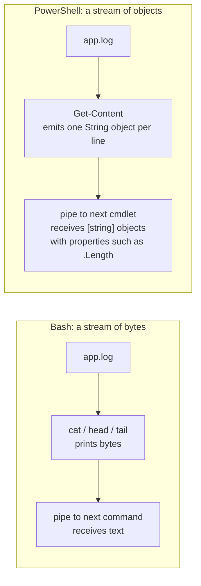

# Day 03: Reading and Managing Files

!!! info "Lesson overview"
    | | |
    |---|---|
    | **Module** | 1 — Command-Line Fundamentals |
    | **Difficulty** | :material-signal-cellular-1: Beginner |
    | **Estimated time** | 3–4 hours (75 min reading, 75 min demonstrations, 60–90 min lab and quiz) |
    | **Platforms** | Ubuntu 24.04 LTS (Bash 5.2, GNU coreutils 9.4, util-linux) · Windows 11 (Windows PowerShell 5.1 and PowerShell 7.4+) |
    | **Lab** | [Lab 03: Log Reader](../../labs/lab-03.md) |

## Learning Objectives

By the end of this lesson you will be able to:

1. Display whole files with `cat` and `Get-Content`, and know when **not** to (large or binary files).
2. Page through long files with `less` and `more`, including searching, jumping and following inside `less`.
3. Read the **beginning** and the **end** of a file with `head`, `tail`, `Get-Content -TotalCount` and `Get-Content -Tail`, and extract a range of lines.
4. **Follow** a growing log in real time with `tail -f` / `tail -F` and `Get-Content -Wait`.
5. Count lines, words, characters and bytes with `wc` and `Measure-Object`, and explain why the numbers sometimes differ.
6. Redirect output and errors with `>`, `>>`, `2>`, `2>&1`, `&>`, `/dev/null`, `$null`, `Out-File` and `Tee-Object`.
7. Name the **six PowerShell output streams** and redirect each of them.
8. Recognise encoding and line-ending problems (UTF-8, UTF-16, BOM, CRLF vs LF) when files move between Linux and Windows.

## Prerequisites

- [Day 02](day-02.md) completed: you can navigate, create, copy and delete files and folders safely in both shells.
- A normal (non-root, non-elevated) shell. Reading files is harmless, but redirection with `>` **overwrites** files, so work inside the practice folder `~/day03` / `$HOME\day03`.
- Optional: membership of the `adm` group on Ubuntu to read `/var/log/syslog` and `/var/log/auth.log` without `sudo`. Check with `id -nG`. The first user created during Ubuntu installation is normally in `adm`.

## Introduction and Concepts

### Why reading files is a core professional skill

Almost everything an administrator, analyst or engineer needs to know is written down in a **text file** somewhere:

- **Configuration:** `/etc/ssh/sshd_config`, `/etc/hosts`, `C:\Windows\System32\drivers\etc\hosts`, application `*.conf`, `*.ini`, `*.json` and `*.xml` files.
- **Logs:** `/var/log/syslog`, `/var/log/auth.log`, web server access logs, IIS logs under `C:\inetpub\logs\LogFiles`, application logs.
- **Evidence and reports:** exported CSV files, command output saved during an investigation, packet-capture summaries.

Reading them quickly, without opening a heavy graphical editor, and **without changing them**, is something you will do dozens of times a day. Today you learn the tools to look at a file from the top, from the bottom, page by page, live as it grows, and to measure its size in lines. You also learn how to send command output **into** files: redirection.

### Text pipeline versus object pipeline (first look)

Both shells read files line by line, but they hand the result to the next command differently:



- In **Bash**, `cat` writes bytes to *standard output*. The next program in the pipe reads those bytes and has to work out where lines and fields are.
- In **PowerShell**, `Get-Content` emits **one `[string]` object per line**. Each object even carries extra properties such as `ReadCount` (the line number) and `PSPath` (the file it came from). Cmdlets such as `Select-Object` and `Measure-Object` work on those objects directly.

Day 5 covers pipelines in depth. Today you only need to know that the line is the unit of work in both shells.

### Standard streams and file descriptors (Linux)

Every Linux process starts with three open **file descriptors**:

| Number | Name | Default destination | Redirect with |
|---|---|---|---|
| 0 | **stdin** (standard input) | Keyboard | `<` |
| 1 | **stdout** (standard output) | Terminal | `>` / `>>` / `1>` |
| 2 | **stderr** (standard error) | Terminal | `2>` / `2>>` |

Normal results go to **stdout**; error and diagnostic messages go to **stderr**. Because both appear in the terminal, they look the same, but they are separate channels. This is why `ls /etc/hostname /nonexistent > out.txt` still prints the error message on screen: only stdout went into the file.

### PowerShell output streams

PowerShell has **six** numbered streams (plus the host itself, used by `Write-Host`):

| # | Stream | Written by | Shown by default? | Since |
|---|---|---|---|---|
| 1 | **Success** (output) | Normal output, `Write-Output` | Yes | 1.0 |
| 2 | **Error** | Errors, `Write-Error` | Yes (red) | 1.0 |
| 3 | **Warning** | `Write-Warning` | Yes (`$WarningPreference = 'Continue'`) | 3.0 (redirectable) |
| 4 | **Verbose** | `Write-Verbose`, `-Verbose` | No (`$VerbosePreference = 'SilentlyContinue'`) | 3.0 (redirectable) |
| 5 | **Debug** | `Write-Debug`, `-Debug` | No | 3.0 (redirectable) |
| 6 | **Information** | `Write-Information`, and `Write-Host` since 5.0 | No for `Write-Information`; yes for `Write-Host` | 5.0 |

Only the **Success** stream (1) travels down the pipeline to the next command. Everything else goes "sideways" to the console. You can redirect any numbered stream to a file (`2> errors.txt`, `3> warnings.txt`), to `$null` (`4>$null`), or merge it into the success stream (`2>&1`, `*>&1`). `*>` redirects **all** streams.

!!! note "Why this matters for scripts"
    A function that "returns" text with `Write-Host` cannot be captured in a variable or piped to `Out-File` in Windows PowerShell 5.1 and later without stream 6 redirection, because `Write-Host` does not write to the success stream. Use `Write-Output` (or just put the value on its own line) for real output, and `Write-Verbose` / `Write-Information` for messages. The course scripts follow this rule.

### How big is "too big"?

`cat` and `Get-Content` without parameters read the **whole** file. That is fine for a 5 KB config file and a bad idea for a 4 GB web server log:

- `cat huge.log` floods your terminal and may take minutes to scroll past.
- `$lines = Get-Content huge.log` loads every line into memory as separate .NET string objects, which can use several times the file size in RAM.

For big files, **sample** instead of reading: look at the top (`head`, `-TotalCount`), the bottom (`tail`, `-Tail`), page with `less`, or stream line by line without storing everything (`Get-Content -ReadCount`, `switch -File`, `[System.IO.File]::ReadLines()`). Measure size first with `ls -lh` / `wc -l` / `(Get-Item f).Length`.

### Encodings and line endings (the cross-platform trap)

Text is bytes plus a rule (the **encoding**) for turning bytes into characters.

| Topic | Linux / PowerShell 7 | Windows PowerShell 5.1 |
|---|---|---|
| Default encoding when *writing* with `>` / `Out-File` | UTF-8 **without** BOM | **UTF-16 LE** ("Unicode") **with** BOM |
| Default for `Set-Content` / `Add-Content` | UTF-8 without BOM | System ANSI code page ("Default", e.g. Windows-1252) |
| Line ending | **LF** (`\n`) | **CRLF** (`\r\n`) |

Two practical consequences:

1. A file created in Windows PowerShell 5.1 with `>` looks like `H.e.l.l.o` or contains `NUL` bytes when opened with `cat` or `grep` on Linux, because UTF-16 uses two bytes per ASCII character. Fix: write with `Out-File -Encoding utf8` (5.1) or use PowerShell 7.
2. A shell script written in Notepad with CRLF endings fails on Linux with `/bin/bash^M: bad interpreter` or `$'\r': command not found`. `cat -A` reveals the `^M` (carriage return) characters, and `file` reports `with CRLF line terminators`. Fix with `dos2unix` (package `dos2unix`) or `sed -i 's/\r$//' script.sh`.

## Linux Command Reference

| Command | Purpose | Key options | Package / availability | Needs root? |
|---|---|---|---|---|
| `cat` | Concatenate and print files | `-n` number lines, `-b` number non-blank, `-A` show all invisible characters, `-s` squeeze blank lines | coreutils (always installed) | No (only for protected files) |
| `tac` | Print a file **last line first** | | coreutils | No |
| `less` | Pager: scroll, search, follow | `-N` line numbers, `-S` chop long lines, `-R` keep colours, `+F` follow, `+G` start at end, `-X` leave text on screen | `less` (installed on Ubuntu) | No |
| `more` | Simple forward-only pager | `+N` start at line N | util-linux | No |
| `head` | First lines/bytes | `-n N`, `-n -N` (all but last N, GNU), `-c N` | coreutils | No |
| `tail` | Last lines/bytes, follow | `-n N`, `-n +N` (from line N), `-c N`, `-f`, `-F`, `--pid=PID`, `-s SEC` | coreutils | No |
| `wc` | Count lines, words, bytes, characters | `-l`, `-w`, `-c`, `-m`, `-L` (longest line, GNU) | coreutils | No |
| `nl` | Number lines (more options than `cat -n`) | `-ba` number all lines | coreutils | No |
| `tee` | Copy stdin to a file **and** stdout | `-a` append | coreutils | No |
| `zcat` / `zless` | Read **gzip-compressed** files (rotated logs) | | gzip | No |
| `file` | Detect encoding and line endings | `-i` MIME type and charset | file | No |
| `od` | Dump raw bytes | `-c` characters, `-A x -t x1z` hex | coreutils | No |

## PowerShell Command Reference

| Cmdlet | Aliases (Windows) | Purpose | Key parameters | 5.1 | 7.x |
|---|---|---|---|---|---|
| `Get-Content` | `gc`, `cat`, `type` | Read file content, one object per line | `-Path`, `-LiteralPath`, `-TotalCount` (`-First`, `-Head`), `-Tail` (`-Last`), `-Wait`, `-Raw`, `-ReadCount`, `-Encoding`, `-Delimiter` | Yes | Yes |
| `Select-Object` | `select` | Pick first/last/some objects | `-First`, `-Last`, `-Skip`, `-SkipLast`, `-Index`, `-Unique` | Yes | Yes |
| `Measure-Object` | `measure` | Count objects; lines/words/characters; sum/average/min/max | `-Line`, `-Word`, `-Character`, `-IgnoreWhiteSpace`, `-Property`, `-Sum`, `-Average`, `-Minimum`, `-Maximum`, `-AllStats` (7) | Yes | Yes (+ `-AllStats`, `-StandardDeviation`) |
| `Out-File` | — | Send output to a file (what `>` does) | `-FilePath`, `-Append`, `-NoClobber`, `-Encoding`, `-Width` | Yes | Yes |
| `Tee-Object` | `tee` | Save to a file **and** pass on down the pipeline | `-FilePath`, `-Append`, `-Variable`, `-Encoding` (7.2+) | Yes | Yes |
| `Set-Content` / `Add-Content` | `sc` (5.1 only) / `ac` | Write / append string content | `-Path`, `-Value`, `-Encoding`, `-NoNewline` | Yes | Yes |
| `Out-Null` | — | Discard output | | Yes | Yes |
| `Out-Host -Paging` | `oh` | Page output one screen at a time (like `more`) | `-Paging` | Console host only | Console host only |
| `Format-Hex` | `fhx` | Show raw bytes | `-Path`, `-Encoding`, `-Count` (7.x, not in 5.1) | Yes (5.0+) | Yes |
| `Write-Output` / `Write-Error` / `Write-Warning` / `Write-Verbose` / `Write-Debug` / `Write-Information` | `echo`, `write` (for `Write-Output`) | Write to streams 1–6 | `-InformationAction`, `-Verbose` | Yes | Yes |

!!! warning "Aliases that look like Linux commands"
    On **Windows**, `cat` and `type` are aliases for `Get-Content`, so `cat -n file` fails (`A parameter cannot be found that matches parameter name 'n'`). On **Linux** PowerShell 7, `cat` runs the real `/usr/bin/cat`. Always use the full cmdlet name in scripts.

## Detailed Command Explanations

### `cat`: print and concatenate

`cat` (from con**cat**enate) reads each file named on the command line and writes its bytes to stdout. With one file it simply displays it; with several it joins them: `cat part1.log part2.log > full.log`.

Useful options (GNU coreutils):

- `cat -n file` numbers every line; `cat -b` numbers only non-blank lines.
- `cat -A file` shows invisible characters: `$` at each line end, `^I` for tabs, `^M` for carriage returns (CRLF files). It is the quickest way to diagnose a "the script looks right but does not work" problem.
- `cat -s` squeezes repeated blank lines into one.

**When not to use it:** large files (use `less`/`head`/`tail`), binary files (they can garble your terminal; run `reset` if that happens) and "useless use of cat" such as `cat file | grep x` where `grep x file` does the same with one less process. The pipe version is not wrong, just unnecessary.

`tac` is `cat` in reverse: the newest log entry, which is at the bottom, is shown first.

### `less` and `more`: pagers

A **pager** shows a file one screen at a time. `more` is the original, simple pager (in Ubuntu it comes from util-linux and can scroll back only within limits). `less` is more capable: it scrolls in both directions, searches, and does **not** read the whole file before showing the first screen, so it opens multi-gigabyte logs instantly.

Keys inside `less` (press `h` for the full list):

| Key | Action |
|---|---|
| ++space++ / ++page-down++ / `f` | Forward one screen |
| `b` / ++page-up++ | Back one screen |
| ++enter++ / `j` / ++arrow-down++ | Forward one line |
| `k` / ++arrow-up++ | Back one line |
| `g` / `G` | Go to the first / last line |
| `50g` | Go to line 50 |
| `/text` | Search forward for `text` (a regular expression) |
| `?text` | Search backward |
| `n` / `N` | Next / previous match |
| `&text` | Show **only** lines that match `text` (filter); `&` + ++enter++ clears it |
| `F` | Follow mode: like `tail -f`. ++ctrl+c++ stops following and returns to normal paging |
| `-N` | Toggle line numbers while viewing |
| `-S` | Toggle wrapping of long lines |
| `q` | Quit |

Many commands use `less` automatically through the `PAGER` environment variable: `man`, `git log`, `journalctl` and `systemctl status` all open in `less`, so the same keys work there.

In PowerShell, the closest built-in equivalent is `Get-Content big.log | Out-Host -Paging` (or the `more` function on Windows). It pages forward only and has no search. On Windows, many professionals install a real `less` (it ships with Git for Windows) or use a graphical viewer for very large logs.

### `head` and `Get-Content -TotalCount`: the top of a file

`head` prints the first 10 lines by default.

- `head -n 20 file` (or `head -20 file`) prints the first 20 lines.
- `head -n -5 file` prints everything **except** the last 5 lines (GNU extension).
- `head -c 512 file` prints the first 512 bytes, which is useful for checking a file's signature or header.
- With several files, `head` prints a `==> name <==` banner before each; `-q` suppresses it.

`Get-Content -Path file -TotalCount 20` reads only the first 20 lines and then **stops reading**, so it is fast even on huge files. `-TotalCount` has the aliases `-First` and `-Head`. `Get-Content file | Select-Object -First 20` gives the same result; since PowerShell 3.0, `Select-Object -First` also stops the upstream command once it has enough objects.

### `tail` and `Get-Content -Tail`: the end of a file

Logs are appended at the bottom, so the **end** of the file is where the newest events are.

- `tail file` prints the last 10 lines; `tail -n 50 file` the last 50.
- `tail -n +100 file` prints from line **100 to the end** (note the `+`). This is the standard way to skip a header: `tail -n +2 data.csv` drops the first line.
- `tail -c 1K file` prints the last 1 KiB.

`tail` seeks to the end of the file instead of reading from the beginning, so `tail -n 20` on a 10 GB file is instant.

`Get-Content -Path file -Tail 50` (alias `-Last`, available since PowerShell 3.0) also reads from the end of the file. Avoid `Get-Content file | Select-Object -Last 50` on large files: it reads every line first.

### Reading a range of lines

There is no single "lines 100 to 120" command, but combinations work everywhere:

| Goal | Bash | PowerShell |
|---|---|---|
| Lines 100–120 | <code>head -n 120 file &#124; tail -n 21</code> or `sed -n '100,120p' file` | <code>Get-Content file &#124; Select-Object -Skip 99 -First 21</code> or `(Get-Content file)[99..119]` |
| Line 42 only | `sed -n '42p' file` | `(Get-Content file)[41]` or <code>Get-Content file -TotalCount 42 &#124; Select-Object -Last 1</code> |

Remember that PowerShell **arrays start at index 0**, so line 42 is element `[41]`. Bash line numbers in `sed` start at 1. `sed` is covered properly on Day 24; `sed -n 'Np'` is all you need today.

### Following a growing file: `tail -f`, `tail -F` and `Get-Content -Wait`

Watching a log *while* you reproduce a problem is one of the most useful troubleshooting techniques.

- `tail -f /var/log/syslog` prints the last 10 lines, then keeps the file open and prints new lines as they are written. Stop with ++ctrl+c++.
- `tail -F` (capital F) is the same as `--follow=name --retry`: if the log is **rotated** (renamed to `syslog.1` and a new `syslog` created), `tail -F` notices and reopens the new file. With `-f`, you would silently keep watching the old, renamed file. Use `-F` for system logs that `logrotate` manages.
- `tail -f --pid=1234 app.log` stops following automatically when process 1234 exits.
- `tail -n 0 -f file` shows **only new** lines from now on.

In PowerShell, `Get-Content -Path app.log -Tail 10 -Wait` does the same job. `-Wait` checks the file about once per second and outputs new lines. Without `-Tail`, it first prints the **whole** file, so always combine the two on big logs. You can filter while you follow: `Get-Content app.log -Tail 0 -Wait | Where-Object { $_ -match 'ERROR' }`.

!!! tip "Follow and filter"
    Bash: `tail -F /var/log/syslog | grep --line-buffered -i error`. The `--line-buffered` option makes `grep` print each match immediately instead of waiting to fill a buffer, which matters when you add another pipe after it. Day 4 covers `grep` in depth.

### `wc` and `Measure-Object`: counting

`wc` (**w**ord **c**ount) prints lines, words and bytes:

- `wc -l` counts **newline characters**. A last line without a trailing newline is not counted, which is why `wc -l` sometimes reports one less than you expect.
- `wc -w` counts words (sequences of non-whitespace characters).
- `wc -c` counts **bytes**; `wc -m` counts **characters**. They differ for UTF-8 text with non-ASCII letters (`é` is one character but two bytes).
- `wc -L` prints the length of the longest line (GNU).
- <code>ls &#124; wc -l</code> counts directory entries; <code>grep -c ERROR file</code> is a faster way to count matching lines than <code>grep ERROR file &#124; wc -l</code>.

`Measure-Object` has two personalities:

1. **Counting objects:** `Get-Content app.log | Measure-Object` returns an object whose `Count` property is the number of lines (strings) received. `(Get-Content app.log).Count` is a shortcut.
2. **Measuring text:** `Get-Content app.log | Measure-Object -Line -Word -Character` returns `Lines`, `Words` and `Characters`. The `-Line` count can differ from `wc -l` and from `Count` because it does not count empty lines in the same way, so use `Count` when you need an exact line total.
3. **Statistics on a property:** `Get-ChildItem C:\Windows\Logs -Recurse -File | Measure-Object -Property Length -Sum -Average -Maximum` totals file sizes. PowerShell 7 adds `-StandardDeviation` and `-AllStats`.

### Redirection in Bash

| Syntax | Meaning |
|---|---|
| `cmd > file` | Send stdout to `file`, **overwriting** it (created if missing) |
| `cmd >> file` | Append stdout to `file` |
| `cmd 2> file` | Send stderr to `file` |
| `cmd 2>> file` | Append stderr |
| `cmd > out 2> err` | stdout and stderr to separate files |
| `cmd > file 2>&1` | stdout to `file`, then stderr to **where stdout now points**: both into `file` |
| `cmd &> file` | Bash shorthand for `> file 2>&1` (Bash-only, not POSIX `sh`) |
| `cmd &>> file` | Append both (Bash 4+) |
| `cmd 2> /dev/null` | Discard errors |
| `cmd < file` | Read stdin from `file` |
| <code>cmd1 &#124; cmd2</code> | Pipe: stdout of `cmd1` becomes stdin of `cmd2` (stderr is **not** piped) |
| <code>cmd 2&gt;&amp;1 &#124; cmd2</code> | Pipe both stdout and stderr (Bash 4 shorthand: <code>cmd &#124;&amp; cmd2</code>) |

**Order matters.** Redirections are processed left to right. `cmd > file 2>&1` sends both into the file. `cmd 2>&1 > file` first points stderr at the *terminal* (where stdout was at that moment), then moves stdout to the file, so errors still appear on screen.

**`/dev/null`** is a special device that discards everything written to it ("the bit bucket").

**Protecting files from `>`:** `set -o noclobber` makes `>` refuse to overwrite an existing file (`cannot overwrite existing file`). `>|` overrides it deliberately. Some administrators enable `noclobber` in `~/.bashrc`.

**`tee`** reads stdin and writes it both to stdout and to a file, so you can watch and save at the same time: `./backup.sh 2>&1 | tee backup.log`. `tee -a` appends.

!!! danger "`sudo` and redirection"
    `sudo echo "10.0.0.5 db01" >> /etc/hosts` fails with `Permission denied`. `sudo` elevates `echo`, but the `>>` redirection is performed by **your** unprivileged shell before `sudo` runs. Use `echo "10.0.0.5 db01" | sudo tee -a /etc/hosts`, and back up the file first (`sudo cp -a /etc/hosts /etc/hosts.bak.$(date +%F)`).

### Redirection in PowerShell

PowerShell supports the same operators with stream numbers 1–6:

| Syntax | Meaning |
|---|---|
| `cmd > file` | Success stream to file (overwrite). Same as <code>cmd &#124; Out-File file</code> |
| `cmd >> file` | Append success stream. Same as <code>Out-File -Append</code> |
| `cmd 2> file` | Error stream to file |
| `cmd 2>&1` | Merge errors into the success stream (so they can be piped or captured) |
| `cmd 3> file` / `4>` / `5>` / `6>` | Warning / Verbose / Debug / Information stream to file |
| `cmd *> file` | **All** streams to file |
| `cmd 2>$null` | Discard errors |
| <code>cmd &#124; Out-Null</code> or `$null = cmd` | Discard success output |

Rules to remember:

- You can only redirect **to a file**, to `$null`, or **into stream 1** (`&1`). `1>&2` is not supported.
- There is **no `<` input redirection** in PowerShell. Use `Get-Content file | cmd`.
- `>` is literally `Out-File`, so it uses `Out-File`'s encoding: **UTF-16 LE in 5.1**, UTF-8 without BOM in 7. Use `Out-File -Encoding utf8` (or `ascii`) in 5.1 when the file will be read by Linux tools or older programs. In 5.1, `utf8` writes a BOM; PowerShell 7 offers `utf8NoBOM` (the default) and `utf8BOM`.
- `Out-File` formats objects as they would appear on screen and wraps at the console width. Add `-Width 200` (or more) to stop long lines from being cut, or use `Export-Csv` / `ConvertTo-Json` (Day 24) for structured data.
- `Out-File -NoClobber` refuses to overwrite an existing file, which is the equivalent of Bash `noclobber`.

`Tee-Object` writes the objects to a file **and** passes them on: `Get-Process | Tee-Object -FilePath procs.txt | Sort-Object CPU -Descending | Select-Object -First 5`. `-Variable name` saves them into a variable instead of a file. `-Append` exists since PowerShell 3.0.

### `Set-Content`, `Add-Content` and `Out-File`: which one?

| Cmdlet | Input | Formatting | Typical use |
|---|---|---|---|
| `Out-File` / `>` | Any objects | Formats like the console (tables, wrapping) | Saving what you see on screen |
| `Set-Content` | Strings (calls `.ToString()` on objects) | None, raw text | Writing config or data files |
| `Add-Content` | Strings | None | Appending a line to a log |

Example of the difference: `Get-Date > a.txt` saves the multi-line formatted date; `Get-Date | Set-Content b.txt` saves `11/08/2026 16:02:13`, the plain `ToString()` value.

### Large files in PowerShell

| Technique | Memory use | Notes |
|---|---|---|
| `Get-Content f -TotalCount N` / `-Tail N` | Tiny | Sample the top or bottom |
| <code>Get-Content f &#124; ForEach-Object { ... }</code> | Low (streams) | Slow per line, but does not keep every line |
| <code>Get-Content f -ReadCount 1000 &#124; ForEach-Object { $_ ... }</code> | Low | Sends arrays of 1,000 lines; much faster than one line at a time |
| `switch -Regex -File f { 'ERROR' { $_ } }` | Low | Fast, built into the language |
| `[System.IO.File]::ReadLines($path)` | Low | .NET enumerator; needs a **full** path |
| `$all = Get-Content f` | **High** | Every line stored; fine for small files only |
| `Get-Content f -Raw` | High | One single string; needed for multi-line regex (Day 24) |

## Syntax and Parameters

### Bash

```text
cat  [-n|-b] [-A] [-s] [FILE]...
less [-N] [-S] [-R] [-X] [+F|+G|+/pattern] [FILE]...
more [+NUM] [FILE]...
head [-n [-]NUM] [-c [-]NUM] [-q] [FILE]...
tail [-n [+]NUM] [-c [+]NUM] [-f|-F] [--pid=PID] [-s SECONDS] [FILE]...
wc   [-l] [-w] [-c] [-m] [-L] [FILE]...
tee  [-a] FILE...
command > file   command >> file   command 2> file   command > file 2>&1   command &> file
```

| Option | Applies to | Meaning |
|---|---|---|
| `-n` | cat | Number all output lines |
| `-A` | cat | Show all: `$` at line end, `^I` tab, `^M` carriage return |
| `-n NUM` | head, tail | Number of lines (default 10) |
| `-n -NUM` | head | All but the last NUM lines (GNU) |
| `-n +NUM` | tail | Start at line NUM |
| `-c NUM` | head, tail | Bytes instead of lines; suffixes `K`, `M` (×1024) |
| `-f` | tail | Follow the open file descriptor |
| `-F` | tail | Follow by **name** and retry (survives log rotation) |
| `--pid=PID` | tail | Stop following when PID dies |
| `-l` / `-w` / `-c` / `-m` | wc | Lines (newlines) / words / bytes / characters |
| `-a` | tee | Append instead of overwrite |
| `+F` | less | Start in follow mode |
| `-N` | less | Show line numbers |
| `-S` | less | Chop (do not wrap) long lines |

### PowerShell

```text
Get-Content [-Path] <String[]> [-TotalCount <Int64>] [-Tail <Int32>] [-ReadCount <Int64>]
            [-Wait] [-Raw] [-Delimiter <String>] [-Encoding <Encoding>] [-LiteralPath <String[]>]
Select-Object [-First <Int32>] [-Last <Int32>] [-Skip <Int32>] [-SkipLast <Int32>] [-Index <Int32[]>] [-Unique]
Measure-Object [[-Property] <String[]>] [-Line] [-Word] [-Character] [-IgnoreWhiteSpace]
               [-Sum] [-Average] [-Minimum] [-Maximum] [-StandardDeviation] [-AllStats]
Out-File [-FilePath] <String> [[-Encoding] <Encoding>] [-Append] [-NoClobber] [-Width <Int32>] [-NoNewline]
Tee-Object [-FilePath] <String> [-Append] [-Encoding <Encoding>] | Tee-Object -Variable <String>
Set-Content [-Path] <String[]> [-Value] <Object[]> [-Encoding <Encoding>] [-NoNewline]
Add-Content [-Path] <String[]> [-Value] <Object[]> [-Encoding <Encoding>]
```

| Parameter | Cmdlet | Meaning |
|---|---|---|
| `-TotalCount` (`-First`, `-Head`) | Get-Content | Read only the first N lines |
| `-Tail` (`-Last`) | Get-Content | Read only the last N lines (3.0+) |
| `-Wait` | Get-Content | Keep the file open and output new lines (Ctrl+C to stop) |
| `-Raw` | Get-Content | Return the whole file as **one** string, newlines preserved (3.0+) |
| `-ReadCount` | Get-Content | Lines per pipeline object (default 1; 0 = all at once) |
| `-Encoding` | Get-Content, Out-File, Set-Content | Text encoding. 5.1 values: `Unicode`, `UTF8`, `ASCII`, `Default`, `OEM`, `Byte`... 7 adds `utf8NoBOM`, `utf8BOM` and code page numbers |
| `-AsByteStream` | Get-Content (7.x) | Read raw bytes; replaces `-Encoding Byte` from 5.1 |
| `-Skip` / `-SkipLast` | Select-Object | Skip the first / last N objects (`-SkipLast` since 5.0) |
| `-Index` | Select-Object | Select objects by zero-based position |
| `-Line` / `-Word` / `-Character` | Measure-Object | Text statistics |
| `-Append` / `-NoClobber` | Out-File | Append / refuse to overwrite |
| `-Width` | Out-File | Characters per line before wrapping |
| `-Variable` | Tee-Object | Store the objects in a variable |

## Practical Demonstrations

All demos use a practice folder and a generated sample log, so everyone gets the same file. The Bash outputs below were produced on GNU coreutils 9.4. Treat all outputs as **examples**: dates, owners and timing will differ on your system.

### Demo 1 — Create a sample log

=== "Bash"

    ```bash
    mkdir -p ~/day03 && cd ~/day03
    for i in $(seq 1 500); do
      level=INFO
      [ $((i % 50)) -eq 0 ] && level=ERROR
      [ $((i % 20)) -eq 7 ] && level=WARN
      printf '2026-11-08 09:%02d:%02d %s web01 request id=%04d\n' $((i / 60)) $((i % 60)) "$level" "$i"
    done > app.log
    ls -l app.log
    ```

    **Expected output (example):**

    ```text
    -rw-rw-r-- 1 student student 23510 Nov  8 16:33 app.log
    ```

    The `for` loop (Day 22) prints 500 lines, and the single `> app.log` after `done` redirects the output of the **whole loop** into the file.

=== "PowerShell"

    ```powershell
    $dir = Join-Path $HOME 'day03'
    New-Item -Path $dir -ItemType Directory -Force | Out-Null
    Set-Location $dir
    1..500 | ForEach-Object {
        $level = 'INFO'
        if ($_ % 50 -eq 0) { $level = 'ERROR' }
        if ($_ % 20 -eq 7) { $level = 'WARN' }
        '2026-11-08 09:{0:d2}:{1:d2} {2} web01 request id={3:d4}' -f [int][math]::Floor($_ / 60), ($_ % 60), $level, $_
    } | Set-Content -Path app.log -Encoding UTF8
    Get-Item app.log | Select-Object Name, Length
    ```

    **Expected output (example):**

    ```text
    Name    Length
    ----    ------
    app.log  24013
    ```

    The size differs from Linux because Windows writes **CRLF** line endings (one extra byte per line, 500 bytes in total), and Windows PowerShell 5.1 adds a 3-byte UTF-8 BOM. PowerShell 7 writes no BOM, so expect 24010 there.

### Demo 2 — Whole file, numbered lines, invisible characters

=== "Bash"

    ```bash
    cat -n app.log | head -n 3
    printf 'a\r\nb\r\n' > win.txt
    cat -A win.txt
    file win.txt
    ```

    **Expected output (example):**

    ```text
         1  2026-11-08 09:00:01 INFO web01 request id=0001
         2  2026-11-08 09:00:02 INFO web01 request id=0002
         3  2026-11-08 09:00:03 INFO web01 request id=0003
    a^M$
    b^M$
    win.txt: ASCII text, with CRLF line terminators
    ```

    `^M$` at the end of each line is the signature of a Windows (CRLF) file.

=== "PowerShell"

    ```powershell
    Get-Content app.log -TotalCount 3 | ForEach-Object { '{0,6}  {1}' -f $_.ReadCount, $_ }
    Set-Content -Path win.txt -Value 'a','b'
    Format-Hex -Path win.txt
    ```

    **Expected output (example, Windows PowerShell 5.1):**

    ```text
         1  2026-11-08 09:00:01 INFO web01 request id=0001
         2  2026-11-08 09:00:02 INFO web01 request id=0002
         3  2026-11-08 09:00:03 INFO web01 request id=0003

               Path: C:\Users\student\day03\win.txt

               00 01 02 03 04 05 06 07 08 09 0A 0B 0C 0D 0E 0F

    00000000   61 0D 0A 62 0D 0A                                a..b..
    ```

    `ReadCount` is the line number that `Get-Content` attaches to every line. `0D 0A` is CR LF. PowerShell 7 shows the same bytes with a slightly different header layout.

### Demo 3 — Top, bottom and a range

=== "Bash"

    ```bash
    head -n 3 app.log
    tail -n 3 app.log
    head -n 12 app.log | tail -n 3        # lines 10-12
    tail -n +499 app.log                  # line 499 to the end
    ```

    **Expected output (example):**

    ```text
    2026-11-08 09:00:01 INFO web01 request id=0001
    2026-11-08 09:00:02 INFO web01 request id=0002
    2026-11-08 09:00:03 INFO web01 request id=0003
    2026-11-08 09:08:18 INFO web01 request id=0498
    2026-11-08 09:08:19 INFO web01 request id=0499
    2026-11-08 09:08:20 ERROR web01 request id=0500
    2026-11-08 09:00:10 INFO web01 request id=0010
    2026-11-08 09:00:11 INFO web01 request id=0011
    2026-11-08 09:00:12 INFO web01 request id=0012
    2026-11-08 09:08:19 INFO web01 request id=0499
    2026-11-08 09:08:20 ERROR web01 request id=0500
    ```

=== "PowerShell"

    ```powershell
    Get-Content app.log -TotalCount 3
    Get-Content app.log -Tail 3
    Get-Content app.log | Select-Object -Skip 9 -First 3     # lines 10-12
    (Get-Content app.log)[498..499]                          # lines 499-500 (zero-based)
    ```

    **Expected output (example):**

    ```text
    2026-11-08 09:00:01 INFO web01 request id=0001
    2026-11-08 09:00:02 INFO web01 request id=0002
    2026-11-08 09:00:03 INFO web01 request id=0003
    2026-11-08 09:08:18 INFO web01 request id=0498
    2026-11-08 09:08:19 INFO web01 request id=0499
    2026-11-08 09:08:20 ERROR web01 request id=0500
    2026-11-08 09:00:10 INFO web01 request id=0010
    2026-11-08 09:00:11 INFO web01 request id=0011
    2026-11-08 09:00:12 INFO web01 request id=0012
    2026-11-08 09:08:19 INFO web01 request id=0499
    2026-11-08 09:08:20 ERROR web01 request id=0500
    ```

### Demo 4 — Counting

=== "Bash"

    ```bash
    wc app.log
    wc -l app.log
    wc -l < app.log            # number only, no file name
    grep -c ERROR app.log
    grep -c WARN app.log
    ```

    **Expected output (example):**

    ```text
      500  3000 23510 app.log
    500 app.log
    500
    10
    25
    ```

    `wc` prints lines, words and bytes. Reading from stdin with `<` hides the file name, which is handy in scripts: `count=$(wc -l < app.log)`.

=== "PowerShell"

    ```powershell
    (Get-Content app.log).Count
    Get-Content app.log | Measure-Object -Line -Word -Character
    (Get-Content app.log | Where-Object { $_ -match 'ERROR' }).Count
    (Select-String -Path app.log -Pattern 'WARN').Count
    ```

    **Expected output (example):**

    ```text
    500

    Lines Words Characters Property
    ----- ----- ---------- --------
      500  3000      23010

    10
    25
    ```

    `Characters` is 23010, not 24013: `Get-Content` strips the line endings, and `Measure-Object` counts characters, not bytes. Linux `wc -c` (23510) counts the 500 LF bytes too.

### Demo 5 — Following a live log

Open **two** terminals in the practice folder.

=== "Bash"

    ```bash
    # Terminal 1: follow only new lines
    tail -n 0 -F ~/day03/live.log

    # Terminal 2: append a line every second, five times
    for i in 1 2 3 4 5; do echo "$(date +%T) heartbeat $i" >> ~/day03/live.log; sleep 1; done
    ```

    **Expected output in terminal 1 (example):**

    ```text
    tail: cannot open '/home/student/day03/live.log' for reading: No such file or directory
    tail: '/home/student/day03/live.log' has appeared;  following new file
    16:41:02 heartbeat 1
    16:41:03 heartbeat 2
    16:41:04 heartbeat 3
    16:41:05 heartbeat 4
    16:41:06 heartbeat 5
    ```

    Because of `-F` (retry), `tail` waits for the file to be created. Press ++ctrl+c++ to stop. Try `less +F live.log` as well: ++ctrl+c++ leaves follow mode, `/heartbeat 3` searches, `F` resumes following.

=== "PowerShell"

    ```powershell
    # Terminal 1: create the file, then follow only new lines
    Set-Location $HOME\day03
    New-Item live.log -ItemType File -Force | Out-Null
    Get-Content live.log -Tail 0 -Wait

    # Terminal 2: append a line every second, five times
    1..5 | ForEach-Object { Add-Content -Path $HOME\day03\live.log -Value ("{0:HH:mm:ss} heartbeat {1}" -f (Get-Date), $_); Start-Sleep -Seconds 1 }
    ```

    **Expected output in terminal 1 (example):**

    ```text
    16:41:02 heartbeat 1
    16:41:03 heartbeat 2
    16:41:04 heartbeat 3
    16:41:05 heartbeat 4
    16:41:06 heartbeat 5
    ```

    `Get-Content -Wait` needs the file to exist when it starts. Press ++ctrl+c++ to stop.

### Demo 6 — Redirection: stdout, stderr and both

=== "Bash"

    ```bash
    cd ~/day03
    ls /etc/hostname /nonexistent > out.txt 2> err.txt
    echo "exit code: $?"
    cat out.txt
    cat err.txt
    ls /etc/hostname /nonexistent &> all.txt
    cat all.txt
    ls /nonexistent 2>&1 > only.txt        # wrong order: error still on screen
    set -o noclobber
    echo test > out.txt                    # refused
    set +o noclobber
    ```

    **Expected output (example):**

    ```text
    exit code: 2
    /etc/hostname
    ls: cannot access '/nonexistent': No such file or directory
    ls: cannot access '/nonexistent': No such file or directory
    /etc/hostname
    ls: cannot access '/nonexistent': No such file or directory
    bash: out.txt: cannot overwrite existing file
    ```

    In `all.txt`, the error appears **before** the normal output. stderr is unbuffered and is written immediately, while stdout to a file is buffered. Never rely on the order of lines from the two streams once they are merged.

=== "PowerShell"

    ```powershell
    Set-Location $HOME\day03
    Get-Item C:\Windows\win.ini, C:\nonexistent > out.txt 2> err.txt
    Get-Content out.txt
    Get-Content err.txt -TotalCount 1
    Get-Item C:\Windows\win.ini, C:\nonexistent *> all.txt
    (Get-Content all.txt | Measure-Object).Count
    Get-Item C:\nonexistent 2>$null
    $?
    ```

    **Expected output (example):**

    ```text
        Directory: C:\Windows

    Mode                 LastWriteTime         Length Name
    ----                 -------------         ------ ----
    -a----        07-05-2022     10:52             92 win.ini

    Get-Item : Cannot find path 'C:\nonexistent' because it does not exist.
    12
    False
    ```

    `$?` is `False` because the last command reported an error, even though the error was discarded. The exact count of lines in `all.txt` depends on the PowerShell version and console width.

### Demo 7 — `tee`, `Tee-Object` and the PowerShell streams

=== "Bash"

    ```bash
    cd ~/day03
    grep ERROR app.log | tee errors.txt | wc -l
    head -n 2 errors.txt
    echo "second run" | tee -a errors.txt > /dev/null
    tail -n 1 errors.txt
    ```

    **Expected output (example):**

    ```text
    10
    2026-11-08 09:00:50 ERROR web01 request id=0050
    2026-11-08 09:01:40 ERROR web01 request id=0100
    second run
    ```

=== "PowerShell"

    ```powershell
    function Test-Streams {
        [CmdletBinding()] param()
        Write-Output      '1 success'
        Write-Error       '2 error'
        Write-Warning     '3 warning'
        Write-Verbose     '4 verbose'
        Write-Debug       '5 debug'
        Write-Information '6 information'
    }
    Test-Streams -Verbose 2>$null 3>warn.txt 6>&1 | Tee-Object -FilePath streams.txt
    Get-Content warn.txt
    ```

    **Expected output (example):**

    ```text
    1 success
    VERBOSE: 4 verbose
    6 information
    3 warning
    ```

    Stream 2 is discarded, stream 3 goes to `warn.txt`, stream 4 is shown because of `-Verbose` (but is not captured), stream 5 is hidden (no `-Debug`), and stream 6 is merged into the success stream, so `Tee-Object` saves `1 success` and `6 information` into `streams.txt`.

### Demo 8 — Encoding surprises (Windows PowerShell 5.1)

=== "Bash"

    ```bash
    # A file written by Windows PowerShell 5.1 with "> report.txt", copied to Linux:
    file report.txt
    head -c 16 report.txt | od -c
    iconv -f UTF-16LE -t UTF-8 report.txt | head -n 3      # convert for reading
    ```

    **Expected output (example):**

    ```text
    report.txt: Unicode text, UTF-16, little-endian text, with CRLF line terminators
    0000000 377 376   N  \0   a  \0   m  \0   e  \0      \0      \0      \0
    0000020
    Name    Length
    ----    ------
    app.log  24013
    ```

    `377 376` (hex `FF FE`) is the UTF-16 LE byte order mark; `\0` after every letter is the second byte of each UTF-16 character. `iconv` (part of the C library, always installed) converts it.

=== "PowerShell"

    ```powershell
    Get-Item app.log | Select-Object Name, Length > report.txt              # 5.1: UTF-16 LE
    Get-Item app.log | Select-Object Name, Length | Out-File report-utf8.txt -Encoding utf8
    (Get-Item report.txt).Length, (Get-Item report-utf8.txt).Length
    Format-Hex report.txt | Select-Object -First 1
    ```

    **Expected output (example, Windows PowerShell 5.1):**

    ```text
    110
    57

               00 01 02 03 04 05 06 07 08 09 0A 0B 0C 0D 0E 0F

    00000000   FF FE 0D 00 0A 00 4E 00 61 00 6D 00 65 00 20 00  ÿþ....N.a.m.e. .
    ```

    The UTF-16 file is roughly **twice** as large (exact sizes vary with column widths). In PowerShell 7 both commands produce UTF-8 (the first without a BOM), so the sizes are almost identical.

## Linux vs PowerShell Comparison

| Task | Bash | PowerShell | Notes |
|---|---|---|---|
| Show whole file | `cat f` | `Get-Content f` | `cat` is an alias for `Get-Content` on Windows only |
| Number lines | `cat -n f` · `nl -ba f` | <code>Get-Content f &#124; % { "$($PSItem.ReadCount) $PSItem" }</code> | |
| Show invisible characters | `cat -A f` | `Format-Hex f` | |
| Page through | `less f` | <code>Get-Content f &#124; Out-Host -Paging</code> | No search in `Out-Host -Paging` |
| First 20 lines | `head -n 20 f` | `Get-Content f -TotalCount 20` | Both stop reading early |
| Last 20 lines | `tail -n 20 f` | `Get-Content f -Tail 20` | Both read from the end |
| Skip header line | `tail -n +2 f` | <code>Get-Content f &#124; Select-Object -Skip 1</code> | |
| All but last 5 | `head -n -5 f` | <code>Get-Content f &#124; Select-Object -SkipLast 5</code> | `-SkipLast` 5.0+ |
| Line N | `sed -n 'Np' f` | `(Get-Content f)[N-1]` | Zero-based index ⚠ |
| Follow a log | `tail -F f` | `Get-Content f -Tail 10 -Wait` | `-F` survives rotation |
| Count lines | `wc -l f` | `(Get-Content f).Count` | `wc -l` counts newline characters |
| Count words / chars | `wc -w f` · `wc -m f` | <code>Get-Content f &#124; Measure-Object -Word -Character</code> | |
| Sum a property | `awk` (Day 24) | `Measure-Object -Property Length -Sum` | Objects make this trivial |
| Overwrite file | `cmd > f` | `cmd > f` · `Out-File f` | ⚠ 5.1 writes UTF-16 LE |
| Append | `cmd >> f` | `cmd >> f` · `Add-Content f` | |
| Errors to file | `cmd 2> f` | `cmd 2> f` | |
| Everything to file | `cmd &> f` · `cmd > f 2>&1` | `cmd *> f` | |
| Discard errors | `2> /dev/null` | `2>$null` | |
| Discard output | `> /dev/null` | <code>&#124; Out-Null</code> · `$null = cmd` | |
| Save and show | <code>cmd &#124; tee f</code> | <code>cmd &#124; Tee-Object f</code> | |
| Refuse overwrite | `set -o noclobber` | `Out-File -NoClobber` | |
| Input from file | `cmd < f` | <code>Get-Content f &#124; cmd</code> | No `<` in PowerShell |
| Compressed log | `zcat f.gz` · `zless f.gz` | No built-in; expand first | |

## Real-World IT Scenarios

1. **"The website is slow since 10:00."** A sysadmin runs `tail -n 200 /var/log/nginx/access.log` to see the most recent requests, then `tail -F` the error log while a colleague reproduces the problem. The newest lines appear the moment the error happens, so cause and effect are linked in seconds.
2. **Change verification.** After editing `/etc/ssh/sshd_config`, an admin runs `sudo tail -n 20 /var/log/auth.log` immediately after `sudo systemctl reload ssh` to confirm the service accepted the change (Day 8 covers services).
3. **Ticket evidence.** A help-desk technician saves the output of a diagnostic command for the ticket with `ipconfig /all > C:\Temp\ticket-48213.txt` and attaches it. Saving it in a known file avoids "it worked when I looked" disputes.
4. **Scheduled job logging.** A nightly backup runs from cron as `/opt/backup/run.sh >> /var/log/backup.log 2>&1`, so both output and errors are appended to one log that monitoring can check (Day 25).
5. **Windows Update or CBS troubleshooting.** An administrator opens an elevated PowerShell and runs `Get-Content C:\Windows\Logs\CBS\CBS.log -Tail 100` instead of opening a 300 MB file in Notepad, which can freeze.
6. **Data import failures.** A CSV exported from a Windows tool fails to import on a Linux server. `file export.csv` reveals `UTF-16, little-endian`. Re-exporting with `-Encoding utf8` or converting with `iconv` fixes the import.

## Cybersecurity Application

- **First look at a suspicious file without executing it:** `file sample`, `head -c 64 sample | od -A x -t x1z`, and `Format-Hex sample -Count 64` (7.x; in 5.1 pipe to `Select-Object -First 4`) show the file signature (`MZ` = Windows executable, `7F 45 4C 46` = ELF, `PK` = ZIP/Office document). Reading never runs the code. Never double-click evidence.
- **Live monitoring during an incident:** `sudo tail -F /var/log/auth.log` shows SSH logins and `sudo` use as they happen. Combined with `grep` (Day 4) and the Security event log (Day 17), this is how analysts watch an attacker's activity in real time.
- **Preserve evidence when collecting output:** use `tee` / `Tee-Object` so you see results **and** keep an exact record. Name files with host and UTC time: `evidence-web01-$(date -u +%Y%m%dT%H%M%SZ).txt`. Never redirect into an existing evidence file with `>`; use a new file or `>>`.
- **Log tampering awareness:** attackers often truncate logs (`> /var/log/auth.log`) or delete lines. A sudden drop in `wc -l` between two measurements, or gaps in timestamps when you `tail` and `head`, is a red flag. Day 16 introduces journald, which is harder to edit silently.
- **Rotated and compressed logs:** older evidence lives in `auth.log.1`, `auth.log.2.gz` and so on. `zcat`/`zless` read them without decompressing to disk, so the originals stay untouched.

## Network Analyst Application

- **Read device and host network configuration quickly:** `cat /etc/hosts`, `cat /etc/resolv.conf`, `cat /etc/netplan/*.yaml` (Ubuntu-specific netplan), `Get-Content C:\Windows\System32\drivers\etc\hosts`.
- **Capture tool output to files for comparison:** `ip route > routes-before.txt`, make the change, `ip route > routes-after.txt`, then compare (Day 11 uses `diff`; PowerShell has `Compare-Object`).
- **Watch firewall or proxy logs live** while testing a connection: `tail -F /var/log/ufw.log` (Ubuntu, when UFW logging is on) shows `[UFW BLOCK]` lines the moment a test packet is dropped (Day 18).
- **Large exports:** NetFlow, firewall and proxy exports can be millions of lines. Sample with `head`/`tail`, count with `wc -l`, and only then decide how to filter.

## System Administrator Application

- **Standard log triage routine:** (1) `ls -lh` to see the size and age of the logs, (2) `tail -n 50` for the latest events, (3) `grep -c` / `Measure-Object` to quantify errors, (4) `tail -F` while reproducing the problem.
- **Script logging:** send output and errors from automated jobs to a dated log with `>> "$log" 2>&1` (Bash) or `*>> $log` (PowerShell), and keep messages on the right streams (`Write-Verbose`, `Write-Warning`, `Write-Error`).
- **Safe config edits:** before writing with `>` or `Set-Content`, take a timestamped backup (Day 2), and prefer `tee -a` / `Add-Content` for appending a line.
- **Cross-platform files:** in mixed estates, always write with an explicit encoding (`-Encoding utf8`), and check scripts for CRLF before deploying them to Linux.

## Common Mistakes

| Mistake | What happens | Correct approach |
|---|---|---|
| `cat huge.log` | Terminal floods for minutes | `less huge.log`, `head`, `tail` |
| `sort file > file` | `file` is truncated **before** `sort` reads it: the data is lost | Write to a new file, then `mv`: `sort file > file.sorted && mv file.sorted file` |
| `cmd 2>&1 > file` | Errors still appear on screen | `cmd > file 2>&1` (order matters) |
| `sudo echo x >> /etc/hosts` | `Permission denied` | <code>echo x &#124; sudo tee -a /etc/hosts</code> |
| `tail -f` on a log that rotates | Output silently stops after rotation | `tail -F` |
| `Get-Content big.log -Wait` without `-Tail` | Prints the whole file first | `Get-Content big.log -Tail 10 -Wait` |
| `$lines = Get-Content 5GB.log` | Memory exhausted, very slow | `-TotalCount`/`-Tail`, `-ReadCount`, `switch -File` |
| `cat -n file` in Windows PowerShell | `A parameter cannot be found that matches parameter name 'n'` | `cat` is `Get-Content` there; use PowerShell syntax |
| Writing a Linux config file with `>` in Windows PowerShell 5.1 | UTF-16 file that Linux tools cannot read | `Out-File -Encoding utf8` / `Set-Content -Encoding UTF8`, or PowerShell 7 |
| `(Get-Content f)[1]` to get line 1 | Returns line **2** | Index 0 is the first line |
| Expecting `Write-Host` output in a file | The file is empty | Use `Write-Output`, or redirect stream 6 (`6>`) |

## Troubleshooting Guide

| Error message / symptom | Cause | Fix |
|---|---|---|
| `cat: /var/log/auth.log: Permission denied` | File is readable only by `root` and group `adm` | `sudo cat ...`, or ask to be added to `adm` (`sudo usermod -aG adm student`, then log in again) |
| `cat: dir: Is a directory` | You gave a directory | `ls dir` |
| `tail: inotify cannot be used, reverting to polling` | Too many watchers or an unsupported filesystem (e.g. some network mounts) | Harmless; tail still works by polling |
| `less` shows `"file" may be a binary file. See it anyway?` | File contains non-text bytes | Answer `n`; use `file`, `od -c` or `strings` instead |
| Terminal shows garbage after `cat binary` | Control bytes changed terminal settings | Type `reset` and press ++enter++ |
| `bash: ./script.sh: /bin/bash^M: bad interpreter` | Script has CRLF line endings | `sed -i 's/\r$//' script.sh` or `dos2unix script.sh` |
| `bash: file: cannot overwrite existing file` | `noclobber` is on | Use a new name, or <code>&gt;&#124;</code> deliberately |
| `Get-Content : Cannot find path ... because it does not exist.` | Wrong path or name | `Get-Location`, tab completion, `Test-Path` |
| `Get-Content : An object at the specified path ... does not exist, or has been filtered by the -Include or -Exclude parameter.` | Wildcard characters `[ ]` in the name | `-LiteralPath` |
| `Get-Content : The process cannot access the file ... because it is being used by another process.` | Another program holds an exclusive lock | Copy the file first (`Copy-Item`) and read the copy, or stop the program |
| Linux tools show `N\0a\0m\0e` or `grep` says `binary file matches` | UTF-16 file from Windows PowerShell 5.1 | `iconv -f UTF-16LE -t UTF-8`; write with `-Encoding utf8` next time |
| `Out-File` text is cut at 80 characters | Default formatting width | `Out-File -Width 300` or use `Set-Content` / `Export-Csv` |
| `The '<' operator is reserved for future use.` | Input redirection does not exist in PowerShell | <code>Get-Content f &#124; cmd</code> |

## Hands-on Lab

Complete **[Lab 03: Log Reader](../../labs/lab-03.md)**. You will generate a realistic web-server access log, sample its top and bottom, extract an exact line range, count requests and errors, follow the log live while traffic is "generated" in a second terminal, and save evidence with correct redirection and encoding in **both** shells. The lab includes verification commands and a full solution.

## Practice Questions

1. What is the difference between `cat`, `less` and `tail` when you open a 2 GB log file?
2. Write a Bash command that prints only lines 200 to 210 of `access.log`.
3. Write the PowerShell equivalent of question 2 in two different ways.
4. Why should you use `tail -F` rather than `tail -f` on `/var/log/syslog`?
5. What does `tail -n +2 data.csv` do, and what is the PowerShell equivalent?
6. A file has 99 lines but `wc -l` reports 98. What is the most likely reason?
7. Explain the difference between `cmd > out.txt 2>&1` and `cmd 2>&1 > out.txt`.
8. Why does `sudo echo "test" >> /etc/motd` fail, and how do you fix it?
9. List the six PowerShell streams in order, with the cmdlet that writes to each.
10. What encoding does `Get-Process > p.txt` use in Windows PowerShell 5.1 and in PowerShell 7?
11. How do you follow a log in PowerShell while only showing **new** lines that contain `ERROR`?
12. Why does `sort names.txt > names.txt` destroy the file?
13. Which command shows tabs and Windows line endings in a Linux file?
14. What is the difference between `Out-File` and `Set-Content` when saving `Get-Date`?

??? success "Practice answers"
    1. `cat` prints the whole file to the screen (slow, unreadable). `less` opens instantly and pages through it without reading it all first. `tail` jumps to the end and prints only the last lines.
    2. `sed -n '200,210p' access.log` or `head -n 210 access.log | tail -n 11`.
    3. `Get-Content access.log | Select-Object -Skip 199 -First 11` and `(Get-Content access.log)[199..209]`.
    4. `-F` follows the file **by name** and retries, so it keeps working after log rotation renames the file and creates a new one. `-f` keeps reading the old, renamed file.
    5. It prints from line 2 to the end, which skips a header line. PowerShell: `Get-Content data.csv | Select-Object -Skip 1`.
    6. The last line does not end with a newline character; `wc -l` counts newlines.
    7. The first sends stdout to the file and then points stderr at the same file, so both are saved. The second points stderr at the terminal first (where stdout was), then moves only stdout to the file.
    8. The redirection is done by your unprivileged shell, not by `sudo`. Use `echo "test" | sudo tee -a /etc/motd` (after a backup).
    9. 1 Success (`Write-Output`), 2 Error (`Write-Error`), 3 Warning (`Write-Warning`), 4 Verbose (`Write-Verbose`), 5 Debug (`Write-Debug`), 6 Information (`Write-Information`, and `Write-Host` since 5.0).
    10. 5.1: UTF-16 LE with BOM ("Unicode"). 7: UTF-8 without BOM.
    11. `Get-Content app.log -Tail 0 -Wait | Where-Object { $_ -match 'ERROR' }`.
    12. The shell opens and truncates `names.txt` for writing **before** `sort` starts, so `sort` reads an empty file.
    13. `cat -A file` (`^I` = tab, `^M$` = CRLF).
    14. `Out-File` saves the formatted, multi-line console view of the object; `Set-Content` saves the object's plain `ToString()` text in one line.

## Quiz

**Q1.** Which command prints a file starting at line 50 and continuing to the end?

- A. `head -n 50 file`
- B. `tail -n 50 file`
- C. `tail -n +50 file`
- D. `head -n -50 file`

??? question "Answer and explanation"
    **C.** The `+` makes `tail` count from the beginning. B prints the last 50 lines, A the first 50, and D everything except the last 50.

**Q2.** Which PowerShell command reads only the last 20 lines of a 3 GB log efficiently?

- A. `Get-Content big.log | Select-Object -Last 20`
- B. `Get-Content big.log -Tail 20`
- C. `(Get-Content big.log)[-20..-1]`
- D. `Get-Content big.log -Raw`

??? question "Answer and explanation"
    **B.** `-Tail` reads from the end of the file. A and C read all 3 GB first (C also stores it in memory), and D loads the whole file as one string.

**Q3.** You run `backup.sh > backup.log 2>&1`. Where do error messages go?

- A. To the terminal
- B. To `backup.log`
- C. To `/dev/null`
- D. Nowhere; the command fails

??? question "Answer and explanation"
    **B.** stdout is redirected to the file first, then `2>&1` makes stderr point to the same place.

**Q4.** In PowerShell, which stream does `Write-Verbose` write to, and which redirection sends it to a file?

- A. Stream 3, `3>`
- B. Stream 4, `4>`
- C. Stream 5, `5>`
- D. Stream 6, `6>`

??? question "Answer and explanation"
    **B.** Verbose is stream 4. Warning is 3, Debug 5 and Information 6. The message is only produced when `-Verbose` is used or `$VerbosePreference` is `Continue`.

**Q5.** Why might a Linux tool display `N^@a^@m^@e` for a file created on Windows?

- A. The file has CRLF line endings
- B. The file is UTF-16 LE, written by `>` in Windows PowerShell 5.1
- C. The file is compressed
- D. The file is encrypted

??? question "Answer and explanation"
    **B.** UTF-16 stores each ASCII character as the character plus a NUL byte (`^@`). CRLF would show as `^M` at line ends instead.

**Q6.** What does `tee -a audit.txt` do?

- A. Replaces `audit.txt` and prints nothing
- B. Appends stdin to `audit.txt` and also writes it to stdout
- C. Reads `audit.txt` aloud
- D. Appends only error messages

??? question "Answer and explanation"
    **B.** `tee` copies its input to the file and to stdout; `-a` appends instead of overwriting.

**Q7.** Which is the safest way to append a line to `/etc/hosts` as a normal user with sudo rights?

- A. `sudo echo "10.0.0.5 db01" >> /etc/hosts`
- B. `echo "10.0.0.5 db01" > /etc/hosts`
- C. `echo "10.0.0.5 db01" | sudo tee -a /etc/hosts`
- D. `sudo cat "10.0.0.5 db01" > /etc/hosts`

??? question "Answer and explanation"
    **C.** `tee` runs with root privileges and `-a` appends. A fails with permission denied, B would overwrite the file (and fail), and D is wrong in several ways and would truncate the file if it could. Back up `/etc/hosts` first.

**Q8.** `Get-Content app.log -Wait` prints thousands of old lines before showing new ones. What fixes it?

- A. Add `-Raw`
- B. Add `-Tail 0` (or a small number)
- C. Add `-ReadCount 0`
- D. Use `-Encoding UTF8`

??? question "Answer and explanation"
    **B.** Without `-Tail`, `-Wait` first outputs the entire file. `-Tail 0` starts with no old lines and shows only new ones.

## Homework

1. **Explore real logs (read-only):** on Ubuntu, list `/var/log` with `ls -lht /var/log | head`, then use `tail -n 20` on `syslog` and `auth.log` (with `sudo` if needed). On Windows, list `C:\Windows\Logs` and use `Get-Content -Tail 20` on one readable log. Write three sentences about what each log contains.
2. **Line-ending experiment:** create a two-line file in Notepad on Windows, copy it to Linux (or WSL), and inspect it with `cat -A` and `file`. Convert it with `sed -i 's/\r$//'` and inspect it again.
3. **Stream practice:** write a PowerShell function that writes one message to each of the six streams (as in Demo 7). Run it four times: sending only warnings to a file, discarding errors, capturing everything with `*>`, and merging information into the pipeline.
4. **Measure a folder:** use `Get-ChildItem -Recurse -File | Measure-Object -Property Length -Sum -Maximum` on your `Documents` folder. On Linux, use `du -sh ~/Documents` (Day 9 explains `du`) and `find ~/Documents -type f | wc -l` (Day 4 explains `find`).
5. **Research:** read `man tail` and `Get-Help Get-Content -Full`. Find one option or parameter not covered today (for example `tail -s`, `Get-Content -Delimiter`) and test it.

??? success "Homework answer key (item 3)"
    ```powershell
    function Test-Streams {
        [CmdletBinding()] param()
        Write-Output 'success'; Write-Error 'error'; Write-Warning 'warning'
        Write-Verbose 'verbose'; Write-Debug 'debug'; Write-Information 'information'
    }
    Test-Streams 3> warnings.txt                 # only warnings to a file
    Test-Streams 2>$null                         # discard errors
    Test-Streams -Verbose -Debug *> all.txt      # everything (5.1 prompts at Write-Debug; see note)
    Test-Streams 6>&1 | Tee-Object -Variable captured
    $captured                                    # 'success' and 'information'
    ```

    In Windows PowerShell 5.1, `-Debug` sets `$DebugPreference` to `Inquire` and asks for confirmation at each `Write-Debug`. Current PowerShell 7 releases use `Continue` and do not prompt.

## Professional Tips

- **Size before you read:** `ls -lh file` / `(Get-Item file).Length / 1MB` takes a second and stops you from flooding your terminal or exhausting memory.
- **Learn five `less` keys:** `/`, `n`, `G`, `F` and `q`. They work in `man`, `journalctl`, `git log` and `systemctl status` too.
- **Timestamp every evidence file** and keep originals untouched. Work on copies (`cp -a`, `Copy-Item`) when you need to transform data.
- **Make `noclobber` your friend** in interactive shells (`set -o noclobber` in `~/.bashrc`) and use `>|` only when you mean it.
- **Be explicit about encoding** in Windows PowerShell 5.1 scripts that write files for other systems: `-Encoding utf8` (or `ascii` for very old tools).
- **Put messages on the right stream** in your scripts: data to Success, problems to Error/Warning, progress to Verbose/Information. Callers can then redirect exactly what they need.

## Command Cheat Sheet

```bash
# ---- Bash ----
cat -n file ; cat -A file ; tac file        # show, number, invisible chars, reversed
less +G file ; less +F file                 # open at end ; follow (Ctrl+C, then F to resume)
head -n 20 file ; head -c 64 file           # top lines ; first bytes
tail -n 20 file ; tail -n +2 file           # bottom lines ; skip header
sed -n '100,120p' file                      # line range
tail -F /var/log/syslog                     # follow, survives rotation
wc -l file ; wc -l < file ; grep -c ERROR file
cmd > out ; cmd >> out ; cmd 2> err         # overwrite ; append ; errors
cmd > all.log 2>&1 ; cmd &> all.log         # both streams (order matters!)
cmd 2>/dev/null ; cmd | tee -a log.txt      # discard errors ; save and show
echo line | sudo tee -a /etc/file           # privileged append
zcat file.gz ; zless file.gz                # rotated, compressed logs
```

```powershell
# ---- PowerShell ----
Get-Content f -TotalCount 20 ; Get-Content f -Tail 20
Get-Content f | Select-Object -Skip 99 -First 21 ; (Get-Content f)[41]
Get-Content f -Tail 0 -Wait | Where-Object { $_ -match 'ERROR' }
(Get-Content f).Count ; Get-Content f | Measure-Object -Line -Word -Character
Get-ChildItem -File -Recurse | Measure-Object Length -Sum -Maximum
cmd > out.txt ; cmd >> out.txt ; cmd 2> err.txt ; cmd *> all.txt
cmd 2>$null ; cmd | Out-Null ; cmd | Tee-Object -FilePath log.txt
cmd | Out-File out.txt -Encoding utf8 -Width 300   # 5.1: avoid UTF-16
Get-Content big.log | Out-Host -Paging ; Format-Hex f
```

## Completion Checklist

- [ ] I can display, number and inspect a file with `cat` / `Get-Content` and know when not to.
- [ ] I can page and search with `less` (`/`, `n`, `G`, `F`, `q`).
- [ ] I can read the top, the bottom and an exact range of lines in both shells.
- [ ] I can follow a live log with `tail -F` and `Get-Content -Tail 0 -Wait`.
- [ ] I can count lines, words and characters, and explain differences between `wc` and `Measure-Object`.
- [ ] I can redirect stdout and stderr separately and together, in the correct order.
- [ ] I can name the six PowerShell streams and redirect any of them.
- [ ] I know how encoding (UTF-16 vs UTF-8) and CRLF vs LF break cross-platform files, and how to fix them.
- [ ] I completed Lab 03 and checked it against the solution.
- [ ] I answered the practice questions and quiz, and completed the homework.

## Further Reading

- GNU coreutils manual: [cat](https://www.gnu.org/software/coreutils/manual/html_node/cat-invocation.html), [head](https://www.gnu.org/software/coreutils/manual/html_node/head-invocation.html), [tail](https://www.gnu.org/software/coreutils/manual/html_node/tail-invocation.html), [wc](https://www.gnu.org/software/coreutils/manual/html_node/wc-invocation.html), [tee](https://www.gnu.org/software/coreutils/manual/html_node/tee-invocation.html)
- Linux man pages: [cat(1)](https://man7.org/linux/man-pages/man1/cat.1.html), [less(1)](https://man7.org/linux/man-pages/man1/less.1.html), [more(1)](https://man7.org/linux/man-pages/man1/more.1.html), [head(1)](https://man7.org/linux/man-pages/man1/head.1.html), [tail(1)](https://man7.org/linux/man-pages/man1/tail.1.html), [wc(1)](https://man7.org/linux/man-pages/man1/wc.1.html), [tee(1)](https://man7.org/linux/man-pages/man1/tee.1.html), [iconv(1)](https://man7.org/linux/man-pages/man1/iconv.1.html)
- Bash manual: Redirections — <https://www.gnu.org/software/bash/manual/bash.html#Redirections>
- Ubuntu Server documentation: logging and log files — <https://documentation.ubuntu.com/server/>
- PowerShell: [Get-Content](https://learn.microsoft.com/en-us/powershell/module/microsoft.powershell.management/get-content), [Select-Object](https://learn.microsoft.com/en-us/powershell/module/microsoft.powershell.utility/select-object), [Measure-Object](https://learn.microsoft.com/en-us/powershell/module/microsoft.powershell.utility/measure-object), [Out-File](https://learn.microsoft.com/en-us/powershell/module/microsoft.powershell.utility/out-file), [Tee-Object](https://learn.microsoft.com/en-us/powershell/module/microsoft.powershell.utility/tee-object), [Set-Content](https://learn.microsoft.com/en-us/powershell/module/microsoft.powershell.management/set-content)
- PowerShell concepts: [about_Redirection](https://learn.microsoft.com/en-us/powershell/module/microsoft.powershell.core/about/about_redirection), [about_Output_Streams](https://learn.microsoft.com/en-us/powershell/module/microsoft.powershell.core/about/about_output_streams), [about_Character_Encoding](https://learn.microsoft.com/en-us/powershell/module/microsoft.powershell.core/about/about_character_encoding)

---

**Previous:** [Day 02: File and Directory Management](day-02.md) · **Next:** [Day 04: Searching Files and Text](day-04.md)
