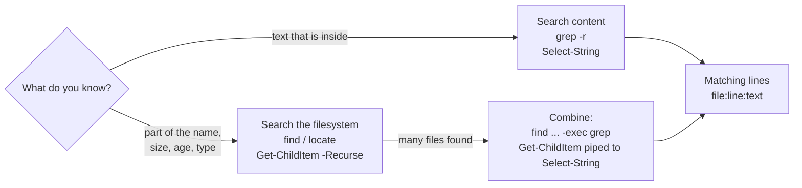

# Day 04: Searching Files and Text

!!! info "Lesson overview"
    | | |
    |---|---|
    | **Module** | 1 — Command-Line Fundamentals |
    | **Difficulty** | :material-signal-cellular-2: Beginner–Intermediate |
    | **Estimated time** | 3–4 hours (80 min reading, 80 min demonstrations, 60–90 min lab and quiz) |
    | **Platforms** | Ubuntu 24.04 LTS (Bash 5.2, GNU findutils 4.9, GNU grep 3.11, plocate) · Windows 11 (Windows PowerShell 5.1 and PowerShell 7.4+) |
    | **Lab** | [Lab 04: Needle in the Haystack](../../labs/lab-04.md) |

## Learning Objectives

By the end of this lesson you will be able to:

1. Find files by **name, type, size, age and depth** with `find` and with `Get-ChildItem -Recurse` plus `-Filter`, `-Include` and `Where-Object`.
2. Run a command on every file found (`find -exec`, `xargs`, `ForEach-Object`) and delete found files **safely** with a preview first.
3. Search **inside** files with `grep` (`-r -i -n -v -E -c -l -L -w -o -A -B -C --include`) and `Select-String` (`-Pattern -CaseSensitive -NotMatch -SimpleMatch -Context -List -AllMatches`).
4. Locate files instantly with `locate` / `plocate`, and explain why its results can be out of date.
5. Find out **which program actually runs** with `which`, `type`, `command -v` and `Get-Command`.
6. Explain the difference between **wildcards** (globs) and **regular expressions**, and write basic regular expressions for words, numbers and IPv4 addresses.
7. Apply these tools to practical log searching: errors, failed logins, IP addresses, and recently changed files.

## Prerequisites

- [Day 03](day-03.md) completed: you can read files with `head`, `tail`, `less`, `Get-Content`, and redirect output.
- [Day 02](day-02.md) wildcards (`*`, `?`, `[...]`) and safe deletion habits.
- Optional for the `locate` section: permission to install a package on your Ubuntu VM (`sudo apt install plocate`).

## Introduction and Concepts

### Two different questions

"Searching" means two different things, and each has its own tools:

| Question | Example | Bash | PowerShell |
|---|---|---|---|
| **Where is a file?** (search the filesystem by name or attributes) | "Where is `sshd_config`?", "Which files changed in the last hour?" | `find`, `locate` | `Get-ChildItem -Recurse` |
| **Which lines contain some text?** (search file content) | "Which log lines mention `Failed password`?" | `grep` | `Select-String` |

The two are often combined: first find the files, then search inside them.



### How `find` thinks

`find` walks a directory tree **live** (it reads the disk every time) and evaluates an **expression** for every file it meets:

```text
find [starting-points] [options] [tests] [actions]
find /var/log          -maxdepth 2  -type f -name '*.log' -mtime -1   -print
```

- **Starting points:** one or more directories (default `.`).
- **Options:** `-maxdepth N`, `-mindepth N`, `-xdev` (do not cross into other filesystems). Put them **first**: GNU `find` warns if you place them after tests.
- **Tests:** `-name`, `-iname`, `-type`, `-size`, `-mtime`, `-mmin`, `-newer`, `-user`, `-perm`, `-empty`, `-path`. Several tests in a row are joined with an implicit **AND**. Use `-o` for OR, `!` or `-not` for NOT, and escaped parentheses `\( ... \)` for grouping.
- **Actions:** `-print` (default), `-ls`, `-exec`, `-ok` (asks first), `-delete`, `-print0`.

Because `find` reads the real filesystem, it is always **accurate** but can be slow on large trees. `locate` is the opposite: instant, but it only knows what was in its database the last time the database was updated.

### How `Get-ChildItem -Recurse` thinks

PowerShell has no separate `find` command. `Get-ChildItem` (aliases `gci`, `dir`, `ls` on Windows) lists items; `-Recurse` walks the whole tree. You narrow the results in three ways, from fastest to most flexible:

1. **`-Filter '*.log'`**: the pattern is passed to the file-system provider (the Windows API on Windows), so non-matching files are skipped early. One pattern only.
2. **`-Include` / `-Exclude`**: PowerShell wildcard patterns, several allowed (`-Include *.log, *.txt`). Slower than `-Filter`. Without `-Recurse`, they apply only when the path ends with `\*`.
3. **`Where-Object`**: any condition on any property (`Length`, `LastWriteTime`, `Attributes`, `Extension`...). The most flexible, but every item must be created first.

Because the results are **objects** (`FileInfo` / `DirectoryInfo`), you can sort, filter and measure them by property without parsing text, which is often simpler than the equivalent Bash.

### Wildcards versus regular expressions

This is the single most important concept today. They look similar but are **different languages**:

| | Wildcards (globs) | Regular expressions (regex) |
|---|---|---|
| Used for | **File names** | **Text** (lines inside files, strings) |
| Used by | Bash file names, `find -name`, `Get-ChildItem`, `-like` | `grep`, `grep -E`, `Select-String`, `-match`, `sed`, `awk` |
| Must match | The **whole** name | **Any part** of the line, unless anchored with `^` and `$` |
| `*` means | Any characters | "Zero or more of the **previous** item" |
| `?` means | Exactly one character | "Zero or one of the previous item" (ERE) |
| `.` means | A literal dot | **Any one** character |
| Any characters | `*` | `.*` |
| One of a set | `[abc]` | `[abc]` |
| Start / end | Implicit (whole name) | `^` / `$` |

So `*.log` as a **wildcard** means "names ending in `.log`". As a **regex**, `*.log` is invalid or nonsense, and `.log` would match "any character followed by `log`", including `catalog` and `blog`. The regex for "ends in `.log`" is `\.log$`.

### Regular expression essentials

GNU `grep` understands three dialects: **BRE** (basic, the default), **ERE** (extended, `grep -E`) and **PCRE** (Perl-compatible, `grep -P`). PowerShell (`Select-String`, `-match`) uses the **.NET** regex engine, which is close to PCRE. Use `grep -E` in Bash so that `+ ? | ( ) { }` work without backslashes, and the same pattern will usually work in PowerShell too.

| Pattern | Meaning | Example matches |
|---|---|---|
| `abc` | Literal text | `abc`, `xabcx` |
| `.` | Any single character | `a.c` → `abc`, `a-c` |
| `\.` | A literal dot | `10\.0` → `10.0` |
| `^` / `$` | Start / end of line | `^ERROR`, `\.conf$` |
| `[0-9]` / `[a-z]` / `[^ ]` | One character from a set / range / **not** in the set | `[0-9]` → `7` |
| `*` | Zero or more of the previous item | `ab*c` → `ac`, `abbbc` |
| `+` | One or more (ERE / .NET) | `[0-9]+` → `2026` |
| `?` | Zero or one (ERE / .NET) | `colou?r` → `color`, `colour` |
| `{n}` / `{n,m}` | Exactly n / between n and m (ERE / .NET) | `[0-9]{1,3}` |
| <code>a&#124;b</code> | Alternation: a **or** b (ERE / .NET) | <code>WARN&#124;ERROR</code> |
| `( )` | Group (ERE / .NET) | `([0-9]{1,3}\.){3}` |
| `\b` | Word boundary (GNU `grep` and .NET) | `\bfail\b` |
| `\d`, `\s`, `\w` | Digit, whitespace, word character (**.NET / PCRE**; GNU `grep -E` supports `\s` and `\w` but **not** `\d`) | `\d+` |

An IPv4-shaped address: `([0-9]{1,3}\.){3}[0-9]{1,3}` (Bash `grep -E`) or `(\d{1,3}\.){3}\d{1,3}` (PowerShell). It also matches impossible values such as `999.1.1.1`, which is acceptable for log searching.

!!! warning "Case sensitivity is opposite by default"
    `grep` is **case-sensitive** by default (`-i` makes it insensitive). `Select-String`, `-match` and `-like` are **case-insensitive** by default (`-CaseSensitive`, `-cmatch` and `-clike` make them sensitive). On Linux, `find -name` is case-sensitive (`-iname` is not); on Windows, file names are case-insensitive anyway.

### Quoting patterns

Always put patterns in **single quotes** in Bash: `find . -name '*.log'`, `grep -E '[0-9]+'`. Without quotes, Bash expands `*.log` itself before `find` sees it (Day 02). That gives wrong or confusing results when matching files exist in the current directory. In PowerShell, single quotes also prevent `$` in a regex from being treated as a variable: `Select-String -Pattern 'error$'`.

## Linux Command Reference

| Command | Purpose | Key options | Package / availability | Needs root? |
|---|---|---|---|---|
| `find` | Search the filesystem live by name and attributes | `-maxdepth`, `-name`, `-iname`, `-type f/d/l`, `-size`, `-mtime`, `-mmin`, `-newer`, `-newermt`, `-user`, `-perm`, `-empty`, `-path`, `-exec`, `-ok`, `-delete`, `-print0` | findutils (always installed) | Only to search directories you cannot read |
| `xargs` | Build command lines from standard input | `-0`, `-n N`, `-r` (do not run if input is empty, GNU), `-p` (prompt) | findutils | No |
| `grep` | Search text for a pattern | `-r`, `-R`, `-i`, `-n`, `-v`, `-E`, `-F`, `-P`, `-c`, `-l`, `-L`, `-w`, `-x`, `-o`, `-h`, `-H`, `-A`, `-B`, `-C`, `-q`, `-s`, `-m N`, `--include`, `--exclude`, `--exclude-dir`, `--color` | grep (always installed) | Only for protected files |
| `zgrep` | `grep` inside `.gz` files | Same as `grep` | gzip | No |
| `locate` / `plocate` | Search a pre-built index of file names | `-i`, `-c`, `-l N` (limit), `-b` (base name only), `-r REGEX` | `plocate` (Ubuntu 24.04; may need `sudo apt install plocate`) | `updatedb` needs root |
| `updatedb` | Rebuild the `locate` database | | plocate | Yes |
| `which` | Show the path of the program that would run | `-a` (all matches in `PATH`) | debianutils (Debian/Ubuntu) | No |
| `type` | Bash built-in: describe a name (alias, keyword, function, built-in, file) | `-a`, `-t`, `-P` | Bash built-in | No |
| `command -v` | POSIX way to get a command's path or name; best for scripts | `-v`, `-V` | Shell built-in | No |
| `whereis` | Find the binary, source and man page of a command | `-b`, `-m` | util-linux | No |

## PowerShell Command Reference

| Cmdlet | Aliases (Windows) | Purpose | Key parameters | 5.1 | 7.x |
|---|---|---|---|---|---|
| `Get-ChildItem` | `gci`, `dir`, `ls` | List and search files recursively | `-Path`, `-Recurse`, `-Depth` (5.0+), `-Filter`, `-Include`, `-Exclude`, `-File`, `-Directory`, `-Hidden`, `-Force`, `-Name`, `-ErrorAction` | Yes | Yes |
| `Where-Object` | `where`, `?` | Filter objects by any condition | Script block `{ $_.Length -gt 1MB }` or simplified syntax `Where-Object Length -gt 1MB` (3.0+) | Yes | Yes |
| `Select-String` | `sls` | Search text in files or strings (like `grep`) | `-Path`, `-Pattern`, `-SimpleMatch`, `-CaseSensitive`, `-NotMatch`, `-Context`, `-List`, `-AllMatches`, `-Quiet`, `-Include`, `-Exclude`, `-Encoding`, `-Raw` (7), `-NoEmphasis` (7) | Yes | Yes |
| `Get-Command` | `gcm` | Find commands and the file that runs | `-Name`, `-CommandType`, `-All`, `-Module`, `-Syntax` | Yes | Yes |
| `ForEach-Object` | `%`, `foreach` | Run a script block for each found item | `-Process` | Yes | Yes |
| `Group-Object` | `group` | Count occurrences (preview of Day 24) | `-Property`, `-NoElement` | Yes | Yes |
| `Sort-Object` | `sort` | Sort results | `-Property`, `-Descending`, `-Unique` | Yes | Yes |
| `where.exe` | — | Windows program that finds executables in `PATH` (like `which`) | `/R dir` recursive | Windows only | Windows only |

!!! warning "`where` is not `where.exe`"
    In PowerShell, `where` is an alias for `Where-Object`. Typing `where ping` does nothing useful. Type `where.exe ping`, or better, `Get-Command ping`.

## Detailed Command Explanations

### `find` by name and type

- `find . -name '*.log'` finds files whose **name** ends in `.log`, under the current directory, at any depth. The pattern is a **wildcard**, matched against the base name only.
- `find . -iname 'readme*'` ignores case (`README.md`, `Readme.txt`).
- `find /etc -type f -name '*.conf'` adds a type test: `f` regular file, `d` directory, `l` symbolic link.
- `find . -path '*/logs/*' -name '*.log'` matches against the **whole path**, useful for "log files inside any `logs` folder".
- `find . -maxdepth 1 -type d` lists only the immediate sub-directories (and `.` itself; add `-mindepth 1` to drop it).
- `find . \( -name '*.tmp' -o -name '*.bak' \)` uses OR with grouping. The parentheses must be escaped or quoted so that Bash does not interpret them.
- `find . -type d -name node_modules -prune -o -name '*.js' -print` skips whole directories (`-prune`) while searching the rest.

### `find` by size and time

- **Size:** `-size +100M` (more than 100 MiB), `-size -10k` (less than 10 KiB), `-size 0` or `-empty` (empty). Units: `c` bytes, `k` KiB, `M` MiB, `G` GiB. **Rounding gotcha:** sizes are rounded **up** to whole units before comparing, so `-size -1M` only matches empty files. Use `-size -1024k` instead.
- **Time** (24-hour periods, counted back from now):
    - `-mtime -1` modified less than 24 hours ago.
    - `-mtime +7` modified more than 7 full days ago (because of rounding, at least 8 days).
    - `-mmin -30` modified in the last 30 minutes.
    - `-newer reference.txt` modified more recently than `reference.txt`.
    - `-newermt '2026-11-08 09:00'` modified after a given date and time (GNU).
- **m, a, c:** `-mtime` is **modification** (content changed), `-atime` **access** (often not updated, because Ubuntu mounts with `relatime`), `-ctime` **status change** (content **or** permissions/owner changed). Attackers can fake `mtime` with `touch -d`, but changing it updates `ctime`, which is why investigators check both.

### `find` actions: `-exec`, `xargs` and `-delete`

- `find . -name '*.log' -exec ls -l {} \;` runs `ls -l` **once per file**. `{}` is replaced by the file name, and `\;` ends the command.
- `find . -name '*.log' -exec ls -l {} +` runs `ls -l` **once with many files**, which is much faster for large results.
- `find . -name '*.conf' -ok cp {} {}.bak \;` asks `y/n` before each command.
- `find . -name '*.tmp' -print0 | xargs -0 -r rm -v` deletes safely even when names contain spaces or newlines. `-print0` and `-0` separate names with a NUL byte; `-r` skips `rm` when nothing is found.
- `find . -name '*.tmp' -delete` deletes directly. **Always** run the same command with `-print` (or nothing) first, and keep `-delete` **last**: `find . -delete -name '*.tmp'` would delete **everything**, because the expression is evaluated left to right.

### `find` and permission errors

Searching from `/` as a normal user produces many `Permission denied` messages on stderr. Hide them with `2>/dev/null` (Day 03), or search only where you need to. `-xdev` keeps `find` from wandering into `/proc`, network mounts or USB disks.

### `grep`: search inside files

`grep PATTERN FILE...` prints every line that contains a match for `PATTERN`. The most useful options:

| Option | Meaning |
|---|---|
| `-i` | Ignore case |
| `-n` | Show line numbers |
| `-v` | Invert: show lines that do **not** match |
| `-c` | Count matching lines (per file) |
| `-l` / `-L` | List only names of files that match / do **not** match |
| `-r` / `-R` | Recursive into directories (`-R` also follows all symbolic links) |
| `-w` | Match whole words only (`-w fail` does not match `failed`) |
| `-x` | Match the whole line |
| `-o` | Print only the matching part, one per line |
| `-E` / `-F` / `-P` | Extended regex / fixed string (no regex) / Perl regex |
| `-A N` / `-B N` / `-C N` | N lines of context **after** / **before** / **both** |
| `-h` / `-H` | Hide / show file names in the output |
| `-m N` | Stop after N matching lines |
| `-q` | Quiet: print nothing, only set the exit code (for scripts) |
| `-s` | Suppress "No such file" and "Permission denied" messages |
| `--include='*.log'` / `--exclude=` / `--exclude-dir=` | Limit a recursive search by file name (wildcards) |

**Exit codes** (Day 05 builds on them): `0` = at least one match, `1` = no match, `2` = error (for example, the file does not exist). That is why `grep -q` is used in `if` statements.

On Ubuntu, interactive shells alias `grep` to `grep --color=auto`, so matches are highlighted. Scripts do not use the alias.

### `Select-String`: PowerShell's `grep`

`Select-String -Path app.log -Pattern 'ERROR'` returns one **MatchInfo object** per matching line. On screen it looks like `app.log:3:2026-11-08 ... ERROR ...`, but each result has properties:

| Property | Content |
|---|---|
| `Path` / `Filename` | Full path / file name |
| `LineNumber` | Line number (starting at 1) |
| `Line` | The full text of the line |
| `Pattern` | The pattern that matched |
| `Matches` | Regex match objects; `.Matches.Value` is the matched text |
| `Context` | Lines before/after (with `-Context`) |

Key parameters:

- **Case-insensitive by default.** Add `-CaseSensitive` to behave like `grep`.
- `-Pattern` takes a **regex**; `-SimpleMatch` treats it as plain text (like `grep -F`), which is safer for text with `.`, `$`, `(`, `[` or `%`.
- `-NotMatch` is `grep -v`.
- `-Context 2` or `-Context 1,3` (before, after) is `grep -C` / `-B` / `-A`. In the output, the matching line is marked with `>`.
- `-List` stops at the first match in each file; with `Select-Object -ExpandProperty Path` it is `grep -l`.
- `-AllMatches` finds every match on a line, not only the first; combine with `.Matches.Value` for `grep -o`.
- `-Quiet` returns only `True` or `False`, like `grep -q`.
- **There is no `-Recurse`.** Pipe files in: `Get-ChildItem -Recurse -Filter *.log | Select-String -Pattern 'ERROR'`. `-Path` accepts wildcards (`-Path logs\*.log`) and `-Include` / `-Exclude`.
- PowerShell 7 highlights matches and adds `-NoEmphasis` to turn that off, plus `-Raw` to output only the matching line text (strings instead of objects). In 5.1, use `| ForEach-Object Line` or `| Select-Object -ExpandProperty Line`.

### `Where-Object`: filter by any property

`Where-Object` keeps only the objects for which a condition is true:

```powershell
Get-ChildItem -Recurse -File | Where-Object { $_.Length -gt 1MB }              # script-block syntax
Get-ChildItem -Recurse -File | Where-Object Length -gt 1MB                     # simplified syntax (3.0+)
Get-ChildItem -Recurse -File | Where-Object { $_.LastWriteTime -gt (Get-Date).AddHours(-1) }
Get-ChildItem -Recurse -File | Where-Object { $_.Extension -in '.tmp', '.bak' }
```

Common comparison operators: `-eq`, `-ne`, `-gt`, `-ge`, `-lt`, `-le`, `-like` (wildcard), `-match` (regex), `-in`, `-contains`, and their case-sensitive versions `-ceq`, `-clike`, `-cmatch`. Combine with `-and`, `-or`, `-not`.

!!! tip "Filter left"
    Filter as early ("as far left") as possible. `Get-ChildItem -Recurse -Filter *.log` is much faster than `Get-ChildItem -Recurse | Where-Object Name -like '*.log'`, because the second version creates an object for every file before discarding most of them.

### `locate` / `plocate`: the instant index

`locate` searches a **database** of file names instead of the disk, so it answers in milliseconds. On Ubuntu 24.04 the implementation is **plocate** (the older `mlocate` is no longer used). The package provides the `locate` command and a systemd timer (`plocate-updatedb.timer`) that refreshes the database once a day.

- `locate sshd_config` lists every indexed path that **contains** `sshd_config`.
- `locate -i readme` ignores case; `locate -c '*.log'` only counts; `locate -l 5 python` limits output to 5 results; `locate -b '\sshd_config'` matches the base name exactly.
- `sudo updatedb` refreshes the database **now**. A file created five minutes ago is **not** found until then, and a deleted file may still be listed.
- plocate checks permissions, so it does not show you paths in directories you cannot read.

Windows has no built-in command-line equivalent. Windows Search keeps an index for Explorer and the Start menu, but PowerShell normally uses `Get-ChildItem -Recurse`, which reads the disk live.

### Which program runs? `which`, `type`, `command -v`, `Get-Command`

When you type a name, the shell looks for (in order): an **alias**, a shell **keyword** or **function**, a **built-in**, and finally an executable **file** in the directories listed in `$PATH`.

- `type -a ls` shows every definition: on Ubuntu, `ls is aliased to 'ls --color=auto'` and then `ls is /usr/bin/ls`.
- `which -a python3` shows all matching executables in `PATH`, but it does **not** know about aliases, functions or built-ins.
- `command -v grep` prints the path (or the name, for built-ins). It is defined by POSIX, works in every shell, and is the recommended way for scripts to check whether a tool exists: `command -v nmap >/dev/null || echo "nmap not installed"`.
- `whereis grep` also shows the man page location.

In PowerShell, `Get-Command name` shows the **CommandType** (Alias, Function, Cmdlet, Application, ExternalScript) and the **Source** (module or file path). `Get-Command name -All` shows all of them in precedence order, which reveals when a function or alias is shadowing a program. `(Get-Command ping).Source` returns just the path.

## Syntax and Parameters

### Bash

```text
find [-H|-L] [path...] [-maxdepth N] [-mindepth N] [-xdev]
     [-name PAT|-iname PAT|-path PAT] [-type f|d|l] [-size [+|-]N[ckMG]] [-empty]
     [-mtime [+|-]N] [-mmin [+|-]N] [-newer FILE] [-newermt DATE] [-user NAME] [-perm MODE]
     [-print|-print0|-ls|-delete|-exec CMD {} \;|-exec CMD {} +|-ok CMD {} \;]
grep [-r|-R] [-i] [-n] [-v] [-c] [-l|-L] [-w] [-x] [-o] [-h|-H] [-E|-F|-P] [-q] [-s] [-m N]
     [-A N] [-B N] [-C N] [--include=GLOB] [--exclude=GLOB] [--exclude-dir=GLOB] PATTERN [FILE...]
locate [-i] [-c] [-l N] [-b] [-r REGEX] PATTERN...
which [-a] NAME...        type [-a] [-t] NAME...        command -v NAME
```

| Test / option | Meaning |
|---|---|
| `-name` / `-iname` | Base name matches a wildcard (case-sensitive / insensitive) |
| `-path` | Whole path matches a wildcard |
| `-type f` / `d` / `l` | Regular file / directory / symbolic link |
| `-size +N` / `-N` / `N` | Larger than / smaller than / exactly N units (rounded up) |
| `-mtime -N` / `+N` | Modified less than / more than N×24 hours ago |
| `-mmin -N` | Modified less than N minutes ago |
| `-newer F` / `-newermt D` | Modified after file F / after date D |
| `-maxdepth N` | Descend at most N levels (0 = starting points only) |
| `-o`, `!`, `\( \)` | OR, NOT, grouping |
| `-exec ... {} \;` / `{} +` | Run once per file / once with many files |
| `-delete` | Delete matches (put it **last**; preview first) |
| `-print0` + `xargs -0` | NUL-separated names, safe with spaces |
| `grep -E` | Extended regex: <code>+ ? &#124; ( ) { }</code> without backslashes |
| `grep -F` | Fixed string, no regex |
| `grep -r` + `--include` | Recursive, limited to matching file names |

### PowerShell

```text
Get-ChildItem [[-Path] <String[]>] [[-Filter] <String>] [-Include <String[]>] [-Exclude <String[]>]
              [-Recurse] [-Depth <UInt32>] [-File] [-Directory] [-Hidden] [-Force] [-Name]
Where-Object [-FilterScript] <ScriptBlock>     |     Where-Object <Property> <-Operator> <Value>
Select-String [-Pattern] <String[]> [-Path] <String[]> [-SimpleMatch] [-CaseSensitive] [-NotMatch]
              [-Context <Int32[]>] [-List] [-AllMatches] [-Quiet] [-Include <String[]>]
              [-Exclude <String[]>] [-Encoding <Encoding>] [-Raw] [-NoEmphasis]
Get-Command [[-Name] <String[]>] [-CommandType <CommandTypes>] [-All] [-Module <String[]>] [-Syntax]
```

| Parameter | Cmdlet | Meaning |
|---|---|---|
| `-Recurse` | Get-ChildItem | Include all sub-directories |
| `-Depth N` | Get-ChildItem | Recurse at most N levels (5.0+; implies `-Recurse`) |
| `-Filter` | Get-ChildItem | One provider-level wildcard; fastest |
| `-Include` / `-Exclude` | Get-ChildItem, Select-String | One or more PowerShell wildcards |
| `-File` / `-Directory` | Get-ChildItem | Only files / only folders (3.0+) |
| `-Force` / `-Hidden` | Get-ChildItem | Include hidden and system items / only hidden items |
| `-ErrorAction SilentlyContinue` | Any | Hide "Access denied" errors (like `2>/dev/null`) |
| `-Pattern` | Select-String | Regex (one or more patterns) |
| `-SimpleMatch` | Select-String | Literal text, no regex |
| `-CaseSensitive` | Select-String | Match case exactly |
| `-NotMatch` | Select-String | Lines that do not match |
| `-Context B,A` | Select-String | Lines of context before and after |
| `-List` | Select-String | First match per file only |
| `-AllMatches` | Select-String | All matches per line |
| `-Quiet` | Select-String | Return `True`/`False` |
| `-Raw` / `-NoEmphasis` | Select-String | 7.x only: plain line output / no highlighting |
| `-All` | Get-Command | Show every command with that name, in precedence order |

## Practical Demonstrations

All demos use a practice tree in your home directory. The Bash outputs below were produced with GNU findutils 4.9.0 and GNU grep 3.11 and then labelled; times, owners and directory order will differ on your system. `find` lists entries in the order the filesystem returns them, so the demos pipe to `sort` to make the output predictable.

### Demo 1 — Build the practice tree

=== "Bash"

    ```bash
    mkdir -p ~/day04/{app/{logs,config},backup,tmp} && cd ~/day04
    cat > app/logs/app-2026-11-07.log <<'EOF'
    2026-11-07 23:58:01 INFO  user=alice action=login src=10.0.0.15
    2026-11-07 23:59:12 ERROR db timeout after 30s
    EOF
    cat > app/logs/app-2026-11-08.log <<'EOF'
    2026-11-08 08:00:01 INFO  user=bob action=login src=10.0.0.22
    2026-11-08 08:05:44 WARN  disk usage 85%
    2026-11-08 08:10:02 ERROR Failed password for admin from 203.0.113.50
    2026-11-08 08:10:05 error retry scheduled
    2026-11-08 08:10:09 ERROR Failed password for admin from 203.0.113.50
    2026-11-08 08:15:30 INFO  user=carol action=logout src=10.0.0.31
    EOF
    printf '# application settings\nlisten_port=8080\ndb_host=10.0.0.40\ndb_password=LabOnly-NotReal\n' > app/config/app.conf
    printf 'db_user=app\ndb_port=5432\n' > app/config/db.conf
    cp app/config/app.conf backup/app.conf.bak
    touch -d '2026-10-01 12:00' backup/app.conf.bak     # make the backup "old"
    touch tmp/cache.tmp tmp/session.tmp
    truncate -s 2M tmp/big.bin                          # 2 MiB file for size searches
    ```

    `cat > file <<'EOF' ... EOF` is a **here-document**: everything up to the line `EOF` becomes the file content. The quotes around `'EOF'` stop Bash from expanding `$` inside it. `203.0.113.50` is from a range reserved for documentation, and the "password" is fake lab data.

=== "PowerShell"

    ```powershell
    $root = Join-Path $HOME 'day04'
    'app\logs', 'app\config', 'backup', 'tmp' |
        ForEach-Object { New-Item -Path (Join-Path $root $_) -ItemType Directory -Force | Out-Null }
    Set-Location $root
    Set-Content app\logs\app-2026-11-07.log -Value @(
        '2026-11-07 23:58:01 INFO  user=alice action=login src=10.0.0.15'
        '2026-11-07 23:59:12 ERROR db timeout after 30s')
    Set-Content app\logs\app-2026-11-08.log -Value @(
        '2026-11-08 08:00:01 INFO  user=bob action=login src=10.0.0.22'
        '2026-11-08 08:05:44 WARN  disk usage 85%'
        '2026-11-08 08:10:02 ERROR Failed password for admin from 203.0.113.50'
        '2026-11-08 08:10:05 error retry scheduled'
        '2026-11-08 08:10:09 ERROR Failed password for admin from 203.0.113.50'
        '2026-11-08 08:15:30 INFO  user=carol action=logout src=10.0.0.31')
    Set-Content app\config\app.conf -Value '# application settings', 'listen_port=8080', 'db_host=10.0.0.40', 'db_password=LabOnly-NotReal'
    Set-Content app\config\db.conf -Value 'db_user=app', 'db_port=5432'
    Copy-Item app\config\app.conf backup\app.conf.bak
    (Get-Item backup\app.conf.bak).LastWriteTime = Get-Date '2026-10-01 12:00'
    New-Item tmp\cache.tmp, tmp\session.tmp -ItemType File | Out-Null
    $fs = [System.IO.File]::Create((Join-Path $root 'tmp\big.bin')); $fs.SetLength(2MB); $fs.Close()
    ```

    `@( ... )` with one string per line builds an array; each element becomes one line in the file. The .NET `SetLength` call creates a 2 MiB file without needing administrator rights.

### Demo 2 — Find by name and type

=== "Bash"

    ```bash
    find . -name '*.log' | sort
    find . -type d | sort
    find . -type f -iname 'APP*' | sort
    find . -maxdepth 1 -mindepth 1 -type d | sort
    ```

    **Expected output (example):**

    ```text
    ./app/logs/app-2026-11-07.log
    ./app/logs/app-2026-11-08.log
    .
    ./app
    ./app/config
    ./app/logs
    ./backup
    ./tmp
    ./app/config/app.conf
    ./app/logs/app-2026-11-07.log
    ./app/logs/app-2026-11-08.log
    ./backup/app.conf.bak
    ./app
    ./backup
    ./tmp
    ```

=== "PowerShell"

    ```powershell
    Get-ChildItem -Recurse -Filter *.log -Name
    Get-ChildItem -Recurse -Directory -Name
    Get-ChildItem -Recurse -File -Filter 'APP*' -Name
    Get-ChildItem -Directory -Name
    ```

    **Expected output (example):**

    ```text
    app\logs\app-2026-11-07.log
    app\logs\app-2026-11-08.log
    app
    backup
    tmp
    app\config
    app\logs
    app\config\app.conf
    app\logs\app-2026-11-07.log
    app\logs\app-2026-11-08.log
    backup\app.conf.bak
    app
    backup
    tmp
    ```

    `-Name` returns relative paths as plain strings. Windows file names are case-insensitive, so `-Filter 'APP*'` matches `app.conf` without any extra switch.

### Demo 3 — Find by size, age and emptiness

=== "Bash"

    ```bash
    find . -type f -size +1M
    find . -type f -mtime +7
    find . -type f -empty | sort
    find . -type f -mmin -60 -name '*.log' | sort
    ```

    **Expected output (example):**

    ```text
    ./tmp/big.bin
    ./backup/app.conf.bak
    ./tmp/cache.tmp
    ./tmp/session.tmp
    ./app/logs/app-2026-11-07.log
    ./app/logs/app-2026-11-08.log
    ```

    The last command finds both logs because you created them in the last hour, even though their **content** mentions different dates. `find` uses file system timestamps, not dates written inside files.

=== "PowerShell"

    ```powershell
    Get-ChildItem -Recurse -File | Where-Object Length -gt 1MB | Select-Object Name, Length
    Get-ChildItem -Recurse -File | Where-Object LastWriteTime -lt (Get-Date).AddDays(-7) | Select-Object Name, LastWriteTime
    Get-ChildItem -Recurse -File | Where-Object Length -eq 0 | Select-Object -ExpandProperty Name
    Get-ChildItem -Recurse -File -Filter *.log | Where-Object { $_.LastWriteTime -gt (Get-Date).AddMinutes(-60) } | Select-Object -ExpandProperty Name
    ```

    **Expected output (example):**

    ```text
    Name      Length
    ----      ------
    big.bin  2097152

    Name         LastWriteTime
    ----         -------------
    app.conf.bak 01-10-2026 12:00:00

    cache.tmp
    session.tmp
    app-2026-11-07.log
    app-2026-11-08.log
    ```

    `1MB` is a built-in PowerShell constant (1,048,576). `KB`, `GB`, `TB` and `PB` also exist. The date format follows your Windows regional settings.

### Demo 4 — Act on what you found, safely

=== "Bash"

    ```bash
    find . -type f -name '*.conf*' -exec wc -l {} +
    find . -name '*.tmp'                       # 1. preview
    find . -name '*.tmp' -ok rm {} \;          # 2. confirm each (answer y / n)
    find . -name '*.tmp' -print0 | xargs -0 -r rm -v    # alternative: no prompt, NUL-safe
    ```

    **Expected output (example):**

    ```text
      4 ./app/config/app.conf
      2 ./app/config/db.conf
      4 ./backup/app.conf.bak
     10 total
    ./tmp/session.tmp
    ./tmp/cache.tmp
    < rm ... ./tmp/session.tmp > ? y
    < rm ... ./tmp/cache.tmp > ? n
    removed './tmp/cache.tmp'
    ```

    With `-exec ... +`, `wc` ran once for all three files, so it also printed a total. The final `xargs` line removed the file that was kept at the `-ok` prompt.

=== "PowerShell"

    ```powershell
    Get-ChildItem -Recurse -File -Filter *.conf* | ForEach-Object { '{0,3} {1}' -f (Get-Content $_.FullName).Count, $_.Name }
    Get-ChildItem -Recurse -Filter *.tmp                     # 1. preview
    Get-ChildItem -Recurse -Filter *.tmp | Remove-Item -WhatIf    # 2. simulate
    Get-ChildItem -Recurse -Filter *.tmp | Remove-Item -Confirm   # 3. confirm each
    ```

    **Expected output (example):**

    ```text
      4 app.conf
      2 db.conf
      4 app.conf.bak

        Directory: C:\Users\student\day04\tmp

    Mode                 LastWriteTime         Length Name
    ----                 -------------         ------ ----
    -a----        08-11-2026     16:40              0 cache.tmp
    -a----        08-11-2026     16:40              0 session.tmp
    What if: Performing the operation "Remove File" on target "C:\Users\student\day04\tmp\cache.tmp".
    What if: Performing the operation "Remove File" on target "C:\Users\student\day04\tmp\session.tmp".
    ```

    `-Filter *.conf*` also matches `app.conf.bak`. The objects coming from `Get-ChildItem` bind to `Remove-Item` by their path, so names with spaces are handled correctly.

### Demo 5 — `grep` and `Select-String` basics

=== "Bash"

    ```bash
    cd ~/day04/app/logs
    grep ERROR app-2026-11-08.log
    grep -i error app-2026-11-08.log | wc -l
    grep -n -i error *.log
    grep -c -i error *.log
    grep -v INFO app-2026-11-08.log
    ```

    **Expected output (example):**

    ```text
    2026-11-08 08:10:02 ERROR Failed password for admin from 203.0.113.50
    2026-11-08 08:10:09 ERROR Failed password for admin from 203.0.113.50
    3
    app-2026-11-07.log:2:2026-11-07 23:59:12 ERROR db timeout after 30s
    app-2026-11-08.log:3:2026-11-08 08:10:02 ERROR Failed password for admin from 203.0.113.50
    app-2026-11-08.log:4:2026-11-08 08:10:05 error retry scheduled
    app-2026-11-08.log:5:2026-11-08 08:10:09 ERROR Failed password for admin from 203.0.113.50
    app-2026-11-07.log:1
    app-2026-11-08.log:3
    2026-11-08 08:05:44 WARN  disk usage 85%
    2026-11-08 08:10:02 ERROR Failed password for admin from 203.0.113.50
    2026-11-08 08:10:05 error retry scheduled
    2026-11-08 08:10:09 ERROR Failed password for admin from 203.0.113.50
    ```

    Without `-i`, the lower-case `error retry scheduled` line is **not** matched.

=== "PowerShell"

    ```powershell
    Set-Location $HOME\day04\app\logs
    Select-String -Path app-2026-11-08.log -Pattern 'ERROR' -CaseSensitive
    (Select-String -Path app-2026-11-08.log -Pattern 'error').Count
    Select-String -Path *.log -Pattern 'error'
    Select-String -Path *.log -Pattern 'error' | Group-Object Filename -NoElement
    Select-String -Path app-2026-11-08.log -Pattern 'INFO' -NotMatch | ForEach-Object Line
    ```

    **Expected output (example):**

    ```text
    app-2026-11-08.log:3:2026-11-08 08:10:02 ERROR Failed password for admin from 203.0.113.50
    app-2026-11-08.log:5:2026-11-08 08:10:09 ERROR Failed password for admin from 203.0.113.50
    3
    app-2026-11-07.log:2:2026-11-07 23:59:12 ERROR db timeout after 30s
    app-2026-11-08.log:3:2026-11-08 08:10:02 ERROR Failed password for admin from 203.0.113.50
    app-2026-11-08.log:4:2026-11-08 08:10:05 error retry scheduled
    app-2026-11-08.log:5:2026-11-08 08:10:09 ERROR Failed password for admin from 203.0.113.50

    Count Name
    ----- ----
        1 app-2026-11-07.log
        3 app-2026-11-08.log

    2026-11-08 08:05:44 WARN  disk usage 85%
    2026-11-08 08:10:02 ERROR Failed password for admin from 203.0.113.50
    2026-11-08 08:10:05 error retry scheduled
    2026-11-08 08:10:09 ERROR Failed password for admin from 203.0.113.50
    ```

    `Select-String` is case-insensitive unless you add `-CaseSensitive`. That is the **opposite** of `grep`. `Group-Object` (Day 24) is the object way to count per file.

### Demo 6 — Recursive search, file lists and context

=== "Bash"

    ```bash
    cd ~/day04
    grep -rl password . | sort
    grep -rn --include='*.conf' password .
    grep -rL ERROR app/config | sort
    grep -B1 -A1 'disk usage' app/logs/app-2026-11-08.log
    grep -rw login app/logs | sort
    ```

    **Expected output (example):**

    ```text
    ./app/config/app.conf
    ./app/logs/app-2026-11-08.log
    ./backup/app.conf.bak
    ./app/config/app.conf:4:db_password=LabOnly-NotReal
    app/config/app.conf
    app/config/db.conf
    2026-11-08 08:00:01 INFO  user=bob action=login src=10.0.0.22
    2026-11-08 08:05:44 WARN  disk usage 85%
    2026-11-08 08:10:02 ERROR Failed password for admin from 203.0.113.50
    app/logs/app-2026-11-07.log:2026-11-07 23:58:01 INFO  user=alice action=login src=10.0.0.15
    app/logs/app-2026-11-08.log:2026-11-08 08:00:01 INFO  user=bob action=login src=10.0.0.22
    ```

    `-w login` matched `action=login` because `=` is not a word character. It would not match `logins` or `relogin`.

=== "PowerShell"

    ```powershell
    Set-Location $HOME\day04
    Get-ChildItem -Recurse -File | Select-String -Pattern 'password' -List | Select-Object -ExpandProperty Path
    Get-ChildItem -Recurse -File -Filter *.conf | Select-String -Pattern 'password'
    Get-ChildItem app\config -File | Where-Object { -not (Select-String -Path $_.FullName -Pattern 'ERROR' -Quiet) } | Select-Object -ExpandProperty Name
    Select-String -Path app\logs\app-2026-11-08.log -Pattern 'disk usage' -Context 1,1
    Get-ChildItem app\logs -File | Select-String -Pattern '\blogin\b'
    ```

    **Expected output (example):**

    ```text
    C:\Users\student\day04\app\config\app.conf
    C:\Users\student\day04\app\logs\app-2026-11-08.log
    C:\Users\student\day04\backup\app.conf.bak

    app\config\app.conf:4:db_password=LabOnly-NotReal
    app.conf
    db.conf

      app\logs\app-2026-11-08.log:1:2026-11-08 08:00:01 INFO  user=bob action=login src=10.0.0.22
    > app\logs\app-2026-11-08.log:2:2026-11-08 08:05:44 WARN  disk usage 85%
      app\logs\app-2026-11-08.log:3:2026-11-08 08:10:02 ERROR Failed password for admin from 203.0.113.50

    app\logs\app-2026-11-07.log:1:2026-11-07 23:58:01 INFO  user=alice action=login src=10.0.0.15
    app\logs\app-2026-11-08.log:1:2026-11-08 08:00:01 INFO  user=bob action=login src=10.0.0.22
    ```

    `\b` is the regex word boundary, the `Select-String` equivalent of `grep -w`. The `>` marks the matching line inside its context.

### Demo 7 — Regular expressions: extract and count IP addresses

=== "Bash"

    ```bash
    cd ~/day04
    grep -E 'WARN|ERROR' app/logs/app-2026-11-08.log | wc -l
    grep 'WARN\|ERROR'   app/logs/app-2026-11-08.log | wc -l     # same in BRE (GNU)
    grep -rhEo '([0-9]{1,3}\.){3}[0-9]{1,3}' app/logs | sort | uniq -c | sort -rn
    grep -F '85%' -r .
    grep -E '^2026-11-08 08:1[0-9]' app/logs/app-2026-11-08.log | wc -l
    ```

    **Expected output (example):**

    ```text
    3
    3
          2 203.0.113.50
          1 10.0.0.31
          1 10.0.0.22
          1 10.0.0.15
    ./app/logs/app-2026-11-08.log:2026-11-08 08:05:44 WARN  disk usage 85%
    4
    ```

    `-o` prints only the matched text, `-h` hides file names, and <code>sort &#124; uniq -c &#124; sort -rn</code> counts and ranks them (Day 24 explains `sort` and `uniq`). The `^` anchor and the range `1[0-9]` select the minutes 08:10–08:19.

=== "PowerShell"

    ```powershell
    Set-Location $HOME\day04
    (Select-String -Path app\logs\app-2026-11-08.log -Pattern 'WARN|ERROR' -CaseSensitive).Count
    Select-String -Path app\logs\*.log -Pattern '(\d{1,3}\.){3}\d{1,3}' -AllMatches |
        ForEach-Object { $_.Matches.Value } |
        Group-Object | Sort-Object Count -Descending | Select-Object Count, Name
    Get-ChildItem -Recurse -File | Select-String -SimpleMatch '85%'
    (Select-String -Path app\logs\app-2026-11-08.log -Pattern '^2026-11-08 08:1\d').Count
    ```

    **Expected output (example):**

    ```text
    3

    Count Name
    ----- ----
        2 203.0.113.50
        1 10.0.0.15
        1 10.0.0.22
        1 10.0.0.31

    app\logs\app-2026-11-08.log:2:2026-11-08 08:05:44 WARN  disk usage 85%
    4
    ```

    `-CaseSensitive` is needed in the first line, otherwise `error retry scheduled` would also be counted (4). `-SimpleMatch` treats `%` as plain text.

### Demo 8 — Which program runs?

=== "Bash"

    ```bash
    type -a ls
    type cd ll
    command -v grep
    which -a python3
    whereis grep
    command -v nmap >/dev/null || echo "nmap is not installed"
    ```

    **Expected output (example, Ubuntu 24.04 interactive shell):**

    ```text
    ls is aliased to `ls --color=auto'
    ls is /usr/bin/ls
    ls is /bin/ls
    cd is a shell builtin
    ll is aliased to `ls -alF'
    /usr/bin/grep
    /usr/bin/python3
    /bin/python3
    grep: /usr/bin/grep /usr/share/man/man1/grep.1.gz /usr/share/info/grep.info.gz
    nmap is not installed
    ```

    `/bin` is a symbolic link to `/usr/bin` on Ubuntu (Day 02), so each program appears twice in `type -a` and `which -a`. The aliases come from Ubuntu's default `~/.bashrc`.

=== "PowerShell"

    ```powershell
    Get-Command ls, dir, Get-ChildItem
    Get-Command ping | Select-Object Name, CommandType, Source
    where.exe ping
    Get-Command -Name *-Service -CommandType Cmdlet | Select-Object -ExpandProperty Name
    if (-not (Get-Command nmap -ErrorAction SilentlyContinue)) { 'nmap is not installed' }
    ```

    **Expected output (example, Windows PowerShell 5.1):**

    ```text
    CommandType     Name                          Version    Source
    -----------     ----                          -------    ------
    Alias           ls -> Get-ChildItem
    Alias           dir -> Get-ChildItem
    Cmdlet          Get-ChildItem                 3.1.0.0    Microsoft.PowerShell.Management

    Name     CommandType Source
    ----     ----------- ------
    PING.EXE Application C:\Windows\system32\PING.EXE

    C:\Windows\System32\PING.EXE
    Get-Service
    New-Service
    Restart-Service
    Resume-Service
    Set-Service
    Start-Service
    Stop-Service
    Suspend-Service
    nmap is not installed
    ```

    PowerShell 7 shows version `7.0.0.0` for the module, and adds `Remove-Service` to the list.

## Linux vs PowerShell Comparison

| Task | Bash | PowerShell | Notes |
|---|---|---|---|
| Find by name | `find . -name '*.log'` | `Get-ChildItem -Recurse -Filter *.log` | Quote the Bash pattern |
| Case-insensitive name | `find . -iname 'readme*'` | `Get-ChildItem -Recurse -Filter readme*` | Windows names are case-insensitive |
| Only files / folders | `-type f` / `-type d` | `-File` / `-Directory` | |
| Limit depth | `-maxdepth 2` | `-Depth 2` | `-Depth` is 5.0+ |
| Several patterns | <code>\( -name '&#42;.log' -o -name '&#42;.txt' \)</code> | `-Include *.log, *.txt` | |
| Larger than 100 MiB | `find . -size +100M` | `Where-Object Length -gt 100MB` | |
| Changed in last 24 h | `find . -mtime -1` | `Where-Object LastWriteTime -gt (Get-Date).AddDays(-1)` | |
| Empty files | `find . -empty` | `Where-Object Length -eq 0` | |
| Run a command per file | `-exec cmd {} \;` · `-exec cmd {} +` | <code>&#124; ForEach-Object { cmd $_.FullName }</code> | |
| Delete found files | `-delete` (after preview) | <code>&#124; Remove-Item -WhatIf</code>, then without | |
| Hide access errors | `2>/dev/null` | `-ErrorAction SilentlyContinue` | |
| Search text | `grep 'x' f` | `Select-String -Pattern 'x' -Path f` | ⚠ opposite case defaults |
| Ignore / match case | `grep -i` | default / `-CaseSensitive` | |
| Invert | `grep -v` | `-NotMatch` | |
| Count lines | `grep -c` | `(Select-String ...).Count` | |
| Files that match | `grep -l` | <code>-List &#124; Select-Object -Expand Path</code> | |
| Recursive | `grep -r` | <code>Get-ChildItem -Recurse &#124; Select-String</code> | No `-Recurse` on `Select-String` |
| Limit by file type | `--include='*.conf'` | `Get-ChildItem -Filter *.conf` or `Select-String -Include` | |
| Whole word | `grep -w` | `-Pattern '\bword\b'` | |
| Only the match | `grep -o` | `-AllMatches` + `.Matches.Value` | |
| Context | `-C 2` / `-B 1 -A 3` | `-Context 2` / `-Context 1,3` | |
| Literal text | `grep -F` | `-SimpleMatch` | |
| Quiet test | `grep -q` (exit code) | `-Quiet` (`True`/`False`) | |
| Search `.gz` | `zgrep` | No built-in | |
| Indexed search | `locate` | No built-in | |
| Path of a command | `command -v x` · `which x` | `(Get-Command x).Source` · `where.exe x` | ⚠ `where` = `Where-Object` |
| What is this name? | `type -a x` | `Get-Command x -All` | |
| Wildcard match on a string | `[[ $s == *.log ]]` | `$s -like '*.log'` | |
| Regex match on a string | `[[ $s =~ ^[0-9]+$ ]]` | `$s -match '^\d+$'` | |

## Real-World IT Scenarios

1. **"Where is the config file?"** A new application has been installed and nobody knows where its configuration lives. `sudo find / -xdev -name '*.conf' -newermt '2026-11-08' 2>/dev/null` lists every `.conf` file created or changed today on the root filesystem. On Windows: `Get-ChildItem C:\ProgramData, 'C:\Program Files' -Recurse -Include *.conf, *.config, *.json -ErrorAction SilentlyContinue | Where-Object LastWriteTime -gt (Get-Date).Date`.
2. **Disk filling up.** Monitoring alerts at 90% on `/var`. `sudo find /var -xdev -type f -size +500M -exec ls -lh {} +` finds the culprits in seconds; Day 9 adds `du` and `df`.
3. **Error triage across many servers' logs.** An operator copies logs from ten web servers into one folder per host and runs `grep -rc 'HTTP/1.1" 5' logs/` to see which hosts return the most 5xx responses.
4. **Hard-coded credentials before a code release.** A reviewer runs `grep -rniE 'password|secret|api[_-]?key' --include='*.py' --include='*.json' src/` to catch secrets before they reach the repository. On Windows: `Get-ChildItem src -Recurse -Include *.ps1, *.json | Select-String -Pattern 'password|secret|api[_-]?key'`.
5. **"It worked yesterday."** `find /etc -mtime -1 -type f` (as root) or `Get-ChildItem C:\App -Recurse | Where-Object LastWriteTime -gt (Get-Date).AddDays(-1)` lists what changed in the last 24 hours, which is often the fastest route to the cause.
6. **Wrong version of a tool.** A script uses `python3` but fails with a module error. `type -a python3` / `Get-Command python -All` shows that a different installation earlier in `PATH` is being used.

## Cybersecurity Application

- **Brute-force detection:** `sudo grep 'Failed password' /var/log/auth.log | grep -Eo 'from ([0-9]{1,3}\.){3}[0-9]{1,3}' | sort | uniq -c | sort -rn | head` ranks the source IPs of failed SSH logins on Ubuntu (Red Hat family: `/var/log/secure`). The Windows equivalent uses the Security log, event ID 4625, with `Get-WinEvent` (Days 16–17).
- **Recently modified files in drop locations:** `find /tmp /var/tmp /dev/shm -type f -mmin -60 2>/dev/null` and `Get-ChildItem $env:TEMP, C:\Users\Public, C:\ProgramData -Recurse -File -Force -ErrorAction SilentlyContinue | Where-Object LastWriteTime -gt (Get-Date).AddHours(-1)`. New executables or scripts here are a classic indicator of compromise.
- **Hidden files:** `find / -xdev -name '.*' -type f -newer /etc/hostname 2>/dev/null` and `Get-ChildItem -Recurse -Hidden` find hidden items created after a reference point.
- **SUID binaries** (Day 19 preview): `find / -xdev -perm -4000 -type f 2>/dev/null` lists programs that run with their owner's privileges. Unexpected entries are a privilege-escalation risk.
- **Indicators of compromise (IOC) sweeps:** given a list of malicious IPs or domains in `iocs.txt`, `grep -rFf iocs.txt /var/log/` searches every log for any of them (`-f` reads patterns from a file, `-F` treats them as literal text). PowerShell: `Get-ChildItem C:\Logs -Recurse -File | Select-String -SimpleMatch -Pattern (Get-Content iocs.txt)`.
- **Do not trust `locate` during an investigation:** its database is up to a day old and could miss an attacker's newest files. Use `find` for live answers.

## Network Analyst Application

- **Find which configuration mentions an address:** `grep -rn '10.0.0.40' /etc 2>/dev/null` shows every file that references a server, which is useful before re-addressing it. Remember to escape dots for an exact match: `grep -rnF '10.0.0.40' /etc` or `grep -rnE '10\.0\.0\.40\b' /etc`.
- **Search firewall and proxy logs:** `grep -c 'DPT=22 ' /var/log/ufw.log` counts blocked SSH attempts (Ubuntu UFW logging, Day 18); `Select-String -Path C:\Windows\System32\LogFiles\Firewall\pfirewall.log -Pattern ' DROP TCP '` searches the Windows Firewall log when logging is enabled (it is off by default and the folder needs administrator rights).
- **Extract every IP address from a capture summary or device log** with `grep -Eo` / `-AllMatches`, then count and rank them.
- **Locate capture files:** `find ~/captures -name '*.pcap*' -mtime -7 -size +10M` lists last week's large packet captures (Day 15).

## System Administrator Application

- **Config audits:** `grep -rE '^\s*PermitRootLogin' /etc/ssh/` shows the effective lines (ignoring comments, which start with `#`) across `sshd_config` and its `sshd_config.d/` drop-ins on Ubuntu.
- **Housekeeping with previews:** `find /var/log/app -name '*.log.*' -mtime +30` → review → `-delete`. Windows: `Get-ChildItem D:\Logs -Recurse -Filter *.log | Where-Object LastWriteTime -lt (Get-Date).AddDays(-30) | Remove-Item -WhatIf`.
- **Script dependency checks:** start scripts with `command -v jq >/dev/null || { echo "jq required" >&2; exit 1; }` / `if (-not (Get-Command git -ErrorAction SilentlyContinue)) { throw 'git required' }`.
- **Inventory:** `find /opt -maxdepth 2 -type d` and `Get-ChildItem 'C:\Program Files' -Directory` give a quick view of installed applications (Day 10 uses package managers properly).

## Common Mistakes

| Mistake | What happens | Correct approach |
|---|---|---|
| `find . -name *.log` (unquoted) | Bash expands `*.log` first; `find` gets wrong arguments or `paths must precede expression` | `find . -name '*.log'` |
| `grep *.log` as a "file search" | `grep` uses the first file name as the **pattern** | `find . -name '*.log'` or `ls *.log` |
| Using regex in `find -name` | `-name '.*\.log'` matches names starting with a dot | `-name` uses wildcards; regex needs `-regex` |
| Using a wildcard as a regex: `grep '*.log'` | Unexpected matches or none | `grep '\.log$'` |
| Forgetting `grep` is case-sensitive | Misses `Error`, `error` | `grep -i` |
| Forgetting `Select-String` is case-*in*sensitive | Counts too many | `-CaseSensitive` |
| `find . -delete -name '*.tmp'` | Deletes **everything** under `.` | Tests first, `-delete` last, preview with `-print` |
| <code>find ... &#124; xargs rm</code> with spaces in names | Wrong files deleted or "No such file" errors | <code>-print0 &#124; xargs -0</code>, or `-exec rm {} +` |
| `-size -1M` to find "small" files | Only matches empty files (rounding) | `-size -1024k` |
| `where ping` in PowerShell | Nothing useful (it is `Where-Object`) | `where.exe ping` / `Get-Command ping` |
| `Select-String -Recurse` | `A parameter cannot be found that matches parameter name 'Recurse'` | <code>Get-ChildItem -Recurse &#124; Select-String</code> |
| `Select-String '10.0.0.1'` | Also matches `10.0.0.15`, `10x0y0z1`... | `-SimpleMatch`, or `'10\.0\.0\.1\b'` |
| Trusting `locate` for brand-new files | "Not found" although the file exists | `sudo updatedb` or `find` |

## Troubleshooting Guide

| Error message / symptom | Cause | Fix |
|---|---|---|
| `find: paths must precede expression: 'b.log'` | Unquoted wildcard expanded by Bash into several names | Quote the pattern: `-name '*.log'` |
| `find: '/root': Permission denied` (many lines) | Normal users cannot read some directories | Add `2>/dev/null`, search narrower paths, or use `sudo` if justified |
| `find: warning: you have specified the global option -maxdepth after the argument -name` | Option order | Put `-maxdepth` right after the path |
| `grep: dir: Is a directory` | Directory given without `-r` | `grep -r pattern dir` |
| `grep: (standard input): binary file matches` / `Binary file x matches` | File contains NUL bytes (binary, or UTF-16 from Windows) | `grep -a` to treat it as text, or convert with `iconv` (Day 03) |
| `grep: Unmatched ( or \(` / `Invalid regular expression` | Special characters in the pattern | Escape them, use `grep -F`, or quote properly |
| `grep: warning: stray \ before -` (grep 3.8+) | Unnecessary backslash in the pattern | Remove the backslash, or use `-e` before patterns starting with `-` |
| `locate` reports that `/var/lib/plocate/plocate.db` does not exist | Database not built yet | `sudo updatedb` |
| `Command 'locate' not found` | plocate not installed | `sudo apt install plocate` |
| `Get-ChildItem : Access to the path 'C:\...' is denied.` | Protected folders | `-ErrorAction SilentlyContinue`, or run elevated only if needed |
| `Get-ChildItem -Include` returns nothing | `-Include` without `-Recurse` and a path that does not end in `\*` | Add `-Recurse`, or use `-Path .\*` / `-Filter` |
| `Select-String : The file ... cannot be read: Access to the path ... is denied.` | Locked or protected file | Skip with `-ErrorAction SilentlyContinue`; copy the file first if it is locked |
| `Select-String : ... parsing "..." - Unterminated [] set.` | Invalid regex | `-SimpleMatch`, or escape with `[regex]::Escape('text')` |
| `-Filter *.htm` also returns `.html` files (Windows) | The Windows API also matches 8.3 short names | Add <code>&#124; Where-Object Extension -eq '.htm'</code> |

## Hands-on Lab

Complete **[Lab 04: Needle in the Haystack](../../labs/lab-04.md)**. A colleague suspects that someone tried to brute-force the admin account of a small web application and that a suspicious script was dropped on the server. You will generate a realistic directory tree with logs and files, then use `find` / `Get-ChildItem` and `grep` / `Select-String` to locate recent and large files, find failed logins, rank the attacking IP addresses, find a hard-coded credential, and clean up temporary files safely. The lab has full Bash and PowerShell solutions.

## Practice Questions

1. What is the difference between `find` and `locate`? When would you prefer each?
2. Write a `find` command that lists regular files under `/var/log` larger than 50 MiB, without permission errors on screen.
3. Write the PowerShell equivalent of question 2 for `C:\Windows\Logs`.
4. What does `find . -mtime -2` match? And `-mtime +2`?
5. Why must `-delete` come at the end of a `find` expression?
6. Explain the difference between `-exec ls -l {} \;` and `-exec ls -l {} +`.
7. What are the default case-sensitivity behaviours of `grep` and `Select-String`, and which options reverse them?
8. Write a `grep` command that lists only the **names** of `.conf` files under `/etc` that contain `Listen`.
9. Write the PowerShell equivalent of `grep -rn 'timeout' ~/app --include='*.log'`.
10. Write a regex that matches lines starting with `ERROR` or `WARN`. Show it with `grep -E` and `Select-String`.
11. Why does `grep -c 'error' file` differ from `grep -o 'error' file | wc -l` when a line contains "error" twice?
12. You type `where git` in PowerShell and nothing happens. Why, and what should you type?
13. What does `command -v` return for `cd`, and why is it preferred over `which` in scripts?
14. In wildcards, `*` means "any characters". What does `*` mean in a regular expression?

??? success "Practice answers"
    1. `find` reads the filesystem live (accurate, slower, can filter by size, time, type, permissions). `locate` searches a daily index (instant, name only, can be out of date). Use `locate` to quickly find where something lives, and `find` for investigations, recent files or attribute-based searches.
    2. `find /var/log -type f -size +50M 2>/dev/null` (add `sudo` to include protected directories).
    3. `Get-ChildItem C:\Windows\Logs -Recurse -File -ErrorAction SilentlyContinue | Where-Object Length -gt 50MB`
    4. `-mtime -2`: modified less than 48 hours ago. `-mtime +2`: modified more than 2 whole days ago (at least 72 hours, because the age is rounded down to whole days before comparing).
    5. `find` evaluates left to right. If `-delete` comes before the tests, it runs for every file before the tests can exclude anything, so everything is deleted.
    6. `\;` runs `ls -l` once per file (many processes). `+` passes as many file names as possible to one `ls -l` (much faster).
    7. `grep` is case-sensitive (`-i` makes it insensitive). `Select-String` is case-insensitive (`-CaseSensitive` makes it sensitive).
    8. `grep -rl --include='*.conf' Listen /etc 2>/dev/null`
    9. `Get-ChildItem ~/app -Recurse -Filter *.log | Select-String -Pattern 'timeout' -CaseSensitive` (output already includes the line number).
    10. `grep -E '^(ERROR|WARN)' app.log` and `Select-String -Path app.log -Pattern '^(ERROR|WARN)' -CaseSensitive`.
    11. `-c` counts **lines** that match (1), while `-o` prints **each match** on its own line (2).
    12. `where` is an alias for `Where-Object`. Use `where.exe git` or `Get-Command git`.
    13. It prints `cd` (a built-in has no path). `command -v` is POSIX, built into every shell, knows about built-ins, aliases and functions, and has a reliable exit status. `which` is an external program that only searches `PATH` and behaves differently between systems.
    14. "Zero or more of the **previous** item". "Any characters" in regex is `.*`.

## Quiz

**Q1.** Which command lists files under the current directory modified in the last 30 minutes?

- A. `find . -mtime -30`
- B. `find . -mmin -30 -type f`
- C. `find . -mmin +30 -type f`
- D. `locate -mmin 30`

??? question "Answer and explanation"
    **B.** `-mmin -30` means less than 30 minutes ago. A means less than 30 **days**, C means more than 30 minutes ago, and `locate` has no time tests.

**Q2.** You need the PowerShell equivalent of `grep -v '^#' sshd_config` (lines that are not comments). Which works?

- A. `Select-String -Path sshd_config -Pattern '^#' -NotMatch`
- B. `Select-String -Path sshd_config -Pattern '^#' -Quiet`
- C. `Get-ChildItem sshd_config -Exclude '#*'`
- D. `Select-String -Path sshd_config -SimpleMatch '^#'`

??? question "Answer and explanation"
    **A.** `-NotMatch` inverts the match. B only returns True/False, C filters file **names**, and D searches for the literal text `^#`.

**Q3.** What does `grep -rl 'api_key' /srv/app` print?

- A. Every matching line with its line number
- B. Only the names of files that contain `api_key`
- C. The number of matches per file
- D. Files that do **not** contain `api_key`

??? question "Answer and explanation"
    **B.** `-l` lists matching file names once each; `-r` searches recursively. D is `-L`, C is `-c`, and A needs `-n` without `-l`.

**Q4.** Which pattern correctly matches file names ending in `.log` when used with `find -name`?

- A. `'.*\.log$'`
- B. `'*.log'`
- C. `'\.log'`
- D. `'log*'`

??? question "Answer and explanation"
    **B.** `-name` takes a **wildcard**. A is a regular expression (usable with `find -regex` or `grep`), C would match only the literal name `.log`, and D matches names **starting** with `log`.

**Q5.** Why might `locate report.pdf` miss a file you created ten minutes ago?

- A. `locate` only searches your home directory
- B. The `locate` database has not been updated since the file was created
- C. `locate` cannot search PDF files
- D. `locate` is case-sensitive

??? question "Answer and explanation"
    **B.** `locate` searches an index updated by `updatedb`, normally once a day. Run `sudo updatedb` or use `find`.

**Q6.** In PowerShell, which command shows the path of the `ping` program?

- A. `where ping`
- B. `which ping`
- C. `(Get-Command ping).Source`
- D. `Get-Help ping -Path`

??? question "Answer and explanation"
    **C.** `Get-Command` returns an object whose `Source` is the file path. A runs `Where-Object`, B is not a built-in command in Windows PowerShell, and D is not a valid parameter.

**Q7.** Which regex matches an IPv4-shaped address in `grep -E`?

- A. `*.*.*.*`
- B. `[0-9]+.[0-9]+.[0-9]+.[0-9]+`
- C. `([0-9]{1,3}\.){3}[0-9]{1,3}`
- D. `\d{1,3}(\.\d{1,3}){3}`

??? question "Answer and explanation"
    **C.** Escaped dots and limited repetition. A is a wildcard, not a regex. B uses unescaped `.` (any character), so it also matches `1a2b3c4`. D is fine in PowerShell/.NET or `grep -P`, but GNU `grep -E` does not support `\d`.

**Q8.** What is the safest way to delete all `*.tmp` files under `~/build` in Bash?

- A. `rm -rf ~/build/*.tmp`
- B. `find ~/build -name '*.tmp'`, review the list, then `find ~/build -name '*.tmp' -delete`
- C. `find ~/build -delete -name '*.tmp'`
- D. `locate '*.tmp' | xargs rm`

??? question "Answer and explanation"
    **B.** Preview with the exact same expression, then add `-delete` at the end. A only matches the top level (not sub-directories), C deletes everything, and D uses a possibly stale database and breaks on spaces.

## Homework

1. **Explore `/etc` read-only:** find all `.conf` files directly in `/etc` (`-maxdepth 1`), count them with `wc -l`, and find which of them mention `localhost` with `grep -l`. On Windows, do the same for `C:\Windows\System32\drivers\etc` with `Get-ChildItem` and `Select-String`.
2. **Regex drill:** write and test patterns that match (a) a line that is a comment (starts with optional spaces and `#`), (b) a 24-hour time `HH:MM:SS`, (c) an e-mail address of the form `name@domain.tld`. Test each with `grep -E` and `Select-String`.
3. **Your own IOC sweep:** create `iocs.txt` with three fake IPs from `203.0.113.0/24` and plant one of them in a file under `~/day04`. Find it with `grep -rFf iocs.txt ~/day04` and with `Select-String -SimpleMatch -Pattern (Get-Content iocs.txt)`.
4. **Install and compare:** on your Ubuntu VM, `sudo apt install plocate`, run `sudo updatedb`, then time `locate sshd_config` and `find / -name sshd_config 2>/dev/null` with `time`. Write down the difference.
5. **Research:** read `man find` (section EXPRESSION) and `Get-Help Select-String -Full`. Find one test or parameter not covered today (for example `find -regex`, `Select-String -Encoding`) and try it.

??? success "Homework answer key (item 2)"
    ```bash
    grep -E '^[[:space:]]*#' file                         # (a) comment lines
    grep -E '([01][0-9]|2[0-3]):[0-5][0-9]:[0-5][0-9]' file  # (b) HH:MM:SS
    grep -E '[A-Za-z0-9._%+-]+@[A-Za-z0-9.-]+\.[A-Za-z]{2,}' file   # (c) e-mail
    ```

    ```powershell
    Select-String -Path file -Pattern '^\s*#'
    Select-String -Path file -Pattern '([01]\d|2[0-3]):[0-5]\d:[0-5]\d'
    Select-String -Path file -Pattern '[A-Za-z0-9._%+-]+@[A-Za-z0-9.-]+\.[A-Za-z]{2,}'
    ```

    `[[:space:]]` is a POSIX character class that works in every `grep` dialect; `\s` is the .NET shorthand.

## Professional Tips

- **Quote every pattern** in Bash with single quotes. It prevents the most common `find` and `grep` mistakes.
- **Narrow first:** start `find` in the most specific directory you can, use `-xdev`, and in PowerShell use `-Filter` before `Where-Object`.
- **Prefer `grep -E`** and you can usually reuse the same regex in PowerShell. Replace `[0-9]` with `\d` only when you know the engine supports it.
- **Use `-F` / `-SimpleMatch` for literal text** such as IP addresses, URLs and paths. It is faster and avoids regex surprises with `.`.
- **Combine `-n` and context** (`grep -n -C 3`, `-Context 3`) when you report a finding, so the reader sees what happened around it.
- **Save searches as evidence:** `grep -rn ... | tee findings-$(date +%F).txt` / `| Tee-Object findings.txt` (Day 03).
- **Check what runs** with `type -a` / `Get-Command -All` whenever a tool behaves unexpectedly; an alias or a different version in `PATH` is a common cause.

## Command Cheat Sheet

```bash
# ---- Bash: find files ----
find . -name '*.log' ; find . -iname 'readme*' ; find /etc -maxdepth 1 -type f -name '*.conf'
find . -type f -size +100M ; find . -type f -empty ; find . -size -1024k
find . -mtime -1 ; find . -mmin -30 ; find . -newermt '2026-11-08 09:00'
find . \( -name '*.tmp' -o -name '*.bak' \) -print        # OR with grouping
find . -name '*.log' -exec ls -lh {} +                    # act on results
find . -name '*.tmp' ; find . -name '*.tmp' -delete       # preview, then delete
find / -xdev -perm -4000 -type f 2>/dev/null              # SUID files
# ---- Bash: search text ----
grep -i error app.log ; grep -n ; grep -v ; grep -c ; grep -w word
grep -rn --include='*.conf' 'pattern' /etc 2>/dev/null
grep -rl pattern dir ; grep -rL pattern dir ; grep -C 2 pattern f
grep -E 'WARN|ERROR' f ; grep -F '10.0.0.1' f ; grep -q x f && echo found
grep -Eo '([0-9]{1,3}\.){3}[0-9]{1,3}' f | sort | uniq -c | sort -rn
# ---- Bash: locate and identify ----
locate -i name ; sudo updatedb ; type -a cmd ; command -v cmd ; which -a cmd
```

```powershell
# ---- PowerShell: find files ----
Get-ChildItem -Recurse -Filter *.log ; Get-ChildItem -Recurse -Include *.log, *.txt
Get-ChildItem -Recurse -File -Depth 2 -ErrorAction SilentlyContinue
Get-ChildItem -Recurse -File | Where-Object Length -gt 100MB
Get-ChildItem -Recurse -File | Where-Object LastWriteTime -gt (Get-Date).AddMinutes(-30)
Get-ChildItem -Recurse -Filter *.tmp | Remove-Item -WhatIf
# ---- PowerShell: search text ----
Select-String -Path app.log -Pattern 'error' ; Select-String ... -CaseSensitive
Select-String -Path *.log -Pattern 'INFO' -NotMatch ; Select-String ... -Context 2
Get-ChildItem -Recurse -Filter *.conf | Select-String -Pattern 'password'
Get-ChildItem -Recurse -File | Select-String 'x' -List | Select-Object -ExpandProperty Path
Select-String -Path f -SimpleMatch '10.0.0.1' ; Select-String -Path f -Pattern 'x' -Quiet
Select-String -Path f -Pattern '(\d{1,3}\.){3}\d{1,3}' -AllMatches |
    ForEach-Object { $_.Matches.Value } | Group-Object | Sort-Object Count -Descending
# ---- PowerShell: identify commands ----
Get-Command name ; Get-Command name -All ; (Get-Command ping).Source ; where.exe ping
```

## Completion Checklist

- [ ] I can find files by name, type, size, age and depth with `find` and `Get-ChildItem`.
- [ ] I can run a command on found files, and delete found files only after a preview.
- [ ] I can search inside files with `grep` and `Select-String`, recursively, with line numbers, counts, context and inversion.
- [ ] I know that `grep` is case-sensitive and `Select-String` is not by default.
- [ ] I can explain the difference between wildcards and regular expressions, and write regexes for words, times and IPv4 addresses.
- [ ] I know when `locate` is useful and why its results can be stale.
- [ ] I can find out which program or alias runs with `type`, `command -v`, `which` and `Get-Command`.
- [ ] I completed Lab 04 and checked it against the solution.
- [ ] I answered the practice questions and quiz, and completed the homework.

## Further Reading

- GNU findutils manual — <https://www.gnu.org/software/findutils/manual/html_mono/find.html>
- GNU grep manual — <https://www.gnu.org/software/grep/manual/grep.html>
- Linux man pages: [find(1)](https://man7.org/linux/man-pages/man1/find.1.html), [grep(1)](https://man7.org/linux/man-pages/man1/grep.1.html), [xargs(1)](https://man7.org/linux/man-pages/man1/xargs.1.html), [regex(7)](https://man7.org/linux/man-pages/man7/regex.7.html), [glob(7)](https://man7.org/linux/man-pages/man7/glob.7.html), [whereis(1)](https://man7.org/linux/man-pages/man1/whereis.1.html)
- plocate on Ubuntu 24.04 — <https://manpages.ubuntu.com/manpages/noble/man1/plocate.1.html>
- Bash manual: `type` and `command` built-ins — <https://www.gnu.org/software/bash/manual/bash.html#Bash-Builtins>
- PowerShell: [Get-ChildItem](https://learn.microsoft.com/en-us/powershell/module/microsoft.powershell.management/get-childitem), [Select-String](https://learn.microsoft.com/en-us/powershell/module/microsoft.powershell.utility/select-string), [Where-Object](https://learn.microsoft.com/en-us/powershell/module/microsoft.powershell.core/where-object), [Get-Command](https://learn.microsoft.com/en-us/powershell/module/microsoft.powershell.core/get-command)
- PowerShell concepts: [about_Regular_Expressions](https://learn.microsoft.com/en-us/powershell/module/microsoft.powershell.core/about/about_regular_expressions), [about_Comparison_Operators](https://learn.microsoft.com/en-us/powershell/module/microsoft.powershell.core/about/about_comparison_operators), [about_Wildcards](https://learn.microsoft.com/en-us/powershell/module/microsoft.powershell.core/about/about_wildcards)
- .NET regular expression language quick reference — <https://learn.microsoft.com/en-us/dotnet/standard/base-types/regular-expression-language-quick-reference>

---

**Previous:** [Day 03: Reading and Managing Files](day-03.md) · **Next:** [Day 05: Command Help, History and Pipelines](day-05.md)
