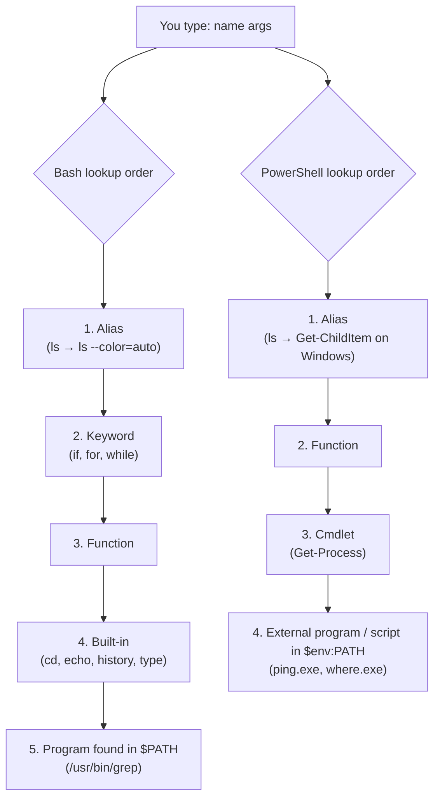
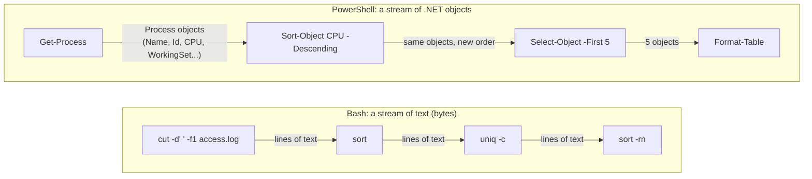

# Day 05: Command Help, History and Pipelines

!!! info "Lesson overview"
    | | |
    |---|---|
    | **Module** | 1 — Command-Line Fundamentals |
    | **Difficulty** | :material-signal-cellular-2: Beginner–Intermediate |
    | **Estimated time** | 3–4 hours (80 min reading, 80 min demonstrations, 60–90 min lab and quiz) |
    | **Platforms** | Ubuntu 24.04 LTS (Bash 5.2, man-db) · Windows 11 (Windows PowerShell 5.1 and PowerShell 7.4+) |
    | **Lab** | [Lab 05: Pipeline Builder](../../labs/lab-05.md) |

## Learning Objectives

By the end of this lesson you will be able to:

1. Find out **what a command name really is** (alias, built-in, function, keyword or program) with `type`, `command -v`, `Get-Command` and `Get-Alias`, and explain why that matters.
2. Use every layer of built-in help: `man` sections and searches (`man -k`, `man -f`), `--help`, Bash `help`, `Get-Help` with `-Examples`, `-Parameter`, `-Full` and `-Online`, `about_` topics and `Get-Member`.
3. Search, reuse and safely manage **command history** in both shells (`history`, `fc`, `!!`, `!n`, `!$`, ++ctrl+r++, `Get-History`, `Invoke-History`, the PSReadLine history file) and keep secrets out of it.
4. Build **text pipelines** in Bash and **object pipelines** in PowerShell, and explain the difference in terms of how data moves between commands.
5. Chain commands with `;`, `&&` and `||`, knowing that `&&` / `||` in PowerShell exist **only in PowerShell 7+**.
6. Read and use **exit codes and status variables**: `$?` and `${PIPESTATUS[@]}` in Bash, `$?` and `$LASTEXITCODE` in PowerShell, and the effect of `set -o pipefail`.
7. Apply basic error handling: `2>/dev/null` and `if !` in Bash; `-ErrorAction`, `$Error`, terminating vs non-terminating errors and `try` / `catch` / `finally` in PowerShell.

## Prerequisites

- Days 01–04 completed, especially redirection (`>`, `2>`, `2>&1`) from [Day 03](day-03.md) and `grep` / `Select-String` from [Day 04](day-04.md).
- An Ubuntu 24.04 terminal (VM, WSL2 or physical) and a Windows 11 PowerShell window (5.1 and, ideally, 7.4+). See [PowerShell 7 Installation](../../getting-started/powershell-install.md).
- Optional: in PowerShell, run `Update-Help` once (elevated in 5.1, or `Update-Help -Scope CurrentUser` in 7) so that `Get-Help` shows full help instead of syntax only.
- Read [Lab Environment & Safety](../../getting-started/lab-environment.md). Everything today is read-only except files you create inside the lab folder.

## Introduction and Concepts

Today closes Module 1 by teaching the three skills that make every other command easier: **finding out how a command works** (help), **reusing what you have already typed** (history), and **joining small commands into a solution** (pipelines and exit codes). Professionals rarely remember every option. They are fast because they know how to look things up in seconds and how to combine simple tools.

### What happens when you type a command name?

When you press ++enter++, the shell does not run "a program called `ls`" directly. It first decides **what kind of thing** the name refers to. The order of lookup explains many confusing situations, such as an alias hiding a program or a PowerShell alias shadowing a Linux tool.



That is why `type ls` in Bash prints `ls is aliased to 'ls --color=auto'` on Ubuntu and why `where` in PowerShell runs `Where-Object` instead of `where.exe` (Day 04).

### The layers of help

| Layer | Bash / Linux | PowerShell | Best for |
|---|---|---|---|
| One-line description | `whatis name` (= `man -f`) | `Get-Command name` · `Get-Help name` (synopsis) | "What is this?" |
| Quick usage | `name --help` | `Get-Help name` · `name -?` | Remembering an option |
| Full manual | `man name` | `Get-Help name -Full` | Every option and detail |
| Examples | EXAMPLES section in `man` (not every page has one) | `Get-Help name -Examples` | Getting started fast |
| One parameter | search inside `man` with `/-r` | `Get-Help name -Parameter Recurse` | Details of one option |
| Search by topic | `man -k keyword` (= `apropos`) | `Get-Command *keyword*` · `Get-Help keyword` | "Which command does X?" |
| Concepts | `man 7 regex`, `man bash` | `Get-Help about_*` | Background topics |
| Built-ins of the shell | `help cd` | (cmdlets have normal help) | Bash built-ins |
| Online, latest | man7.org, documentation.ubuntu.com | `Get-Help name -Online` (learn.microsoft.com) | Newest version |
| The object itself | — | <code>name &#124; Get-Member</code> | Which properties can I use? |

### History: your personal command log

Both shells remember the commands you type:

- **Bash** keeps a list in memory and writes it to `~/.bash_history` when the shell exits. Ubuntu's default `~/.bashrc` sets `HISTCONTROL=ignoreboth` (ignore duplicates **and** lines starting with a space), `HISTSIZE=1000`, `HISTFILESIZE=2000` and `shopt -s histappend` (append instead of overwrite, so several terminals do not erase each other's history).
- **PowerShell** has two histories. `Get-History` shows the **current session** only. The **PSReadLine** module (included with Windows PowerShell 5.1 on Windows 10/11 and with PowerShell 7) also saves every command to a text file that survives across sessions; its path is `(Get-PSReadLineOption).HistorySavePath`, usually `%APPDATA%\Microsoft\Windows\PowerShell\PSReadLine\ConsoleHost_history.txt`.

History is a productivity tool **and** a security artefact. Investigators read history files to reconstruct what happened, and attackers read them to find passwords that people typed on the command line.

### Text pipelines versus object pipelines

A **pipeline** connects the output of one command to the input of the next with `|`. Both shells use the same symbol, but what flows through the pipe is different. This is the central design difference between the two shells.



- In **Bash**, each program writes bytes to standard output (file descriptor 1) and the next program reads them from standard input. To pick a "field" you must know the text layout: column 1 separated by spaces, field 7 separated by `:`. If the layout changes (an extra space, a different locale), the pipeline can silently break.
- In **PowerShell**, cmdlets pass **objects** one at a time. `Sort-Object CPU` sorts by the `CPU` *property*; it does not care how the table looks on screen. The formatting happens only at the very end, when the objects reach the host. `Get-Member` shows which properties are available.
- When PowerShell runs an **external program** (`ipconfig.exe`, `git`, `grep` on Linux), that program's output enters the pipeline as **strings, one per line**. You are back in the text world and need `Select-String`, `-split` or `ConvertFrom-*` cmdlets.

### Exit codes: how commands report success

Every program finishes with an **exit status**, an integer from 0 to 255:

| Value | Meaning (convention) |
|---|---|
| `0` | Success |
| `1` | General failure (for `grep`: "no lines matched") |
| `2` | Misuse or serious error (for `grep` and `ls`: file missing, bad option) |
| `126` | Command found but not executable (permission denied) |
| `127` | Command not found |
| `128 + N` | Killed by signal N (e.g. `130` = interrupted by ++ctrl+c++, signal 2) |

Bash stores the last status in `$?`. PowerShell has **two** variables: `$?` is a Boolean (`True`/`False`) for "did the last command succeed?", and `$LASTEXITCODE` is the integer exit code of the last **native program** or script that called `exit`. Exit codes are what make `&&`, `||`, `if` and monitoring scripts work: your Day 29 diagnostic scripts return `3` when a threshold is breached precisely so that schedulers and monitoring systems can react.

## Linux Command Reference

| Command | Purpose | Package / availability | Needs root? |
|---|---|---|---|
| `man` | Display manual pages; `-k` search, `-f` one-line description | man-db (missing on minimized/container images) | No |
| `whatis` / `apropos` | One-line description / keyword search of manual pages | man-db | No |
| `<command> --help` | Short usage summary printed by the program itself | Most GNU programs | No |
| `help` | Help for Bash built-ins (`help cd`, `help -d history`) | Bash built-in | No |
| `info` | GNU Info manuals (more detailed for coreutils, grep, bash) | `info` package (may need installing) | No |
| `type` | What a name is: alias, keyword, function, built-in or file (`-a` all, `-t` kind only) | Bash built-in | No |
| `command -v` | Print what would run; quiet dependency checks in scripts | POSIX shell built-in | No |
| `history` | List, delete (`-d`), clear (`-c`), append (`-a`) or write (`-w`) history | Bash built-in | No |
| `fc` | List (`-l`) or edit and re-run history entries | Bash built-in | No |
| `!!` `!n` `!-n` `!str` `!$` `^a^b` | History expansion (interactive Bash) | Bash | No |
| <code>&#124;</code> <code>&#124;&amp;</code> | Pipe stdout (and with <code>&#124;&amp;</code>, stdout+stderr) to the next command | Bash syntax | No |
| `;` `&&` <code>&#124;&#124;</code> | Run sequentially / only if previous succeeded / only if it failed | Bash syntax | No |
| `$?` `${PIPESTATUS[@]}` | Exit status of last command / of every command in the last pipeline | Bash variables | No |
| `set -o pipefail` | Make a pipeline fail if **any** part fails | Bash option | No |
| `tee` | Copy a stream to a file and onward (Day 03) | coreutils | No |
| `xargs` | Turn input lines into arguments (Day 04) | findutils | No |

## PowerShell Command Reference

| Cmdlet / feature | Common aliases | Purpose | Works in 5.1 | Works in 7.x | Admin? |
|---|---|---|---|---|---|
| `Get-Help` | `help`, `man`\* | Help for cmdlets and `about_` topics | Yes | Yes | No (`Update-Help` needs admin in 5.1) |
| `Update-Help` | — | Download local help files | Yes | Yes (`-Scope CurrentUser` 6.1+) | 5.1: yes |
| `Get-Command` | `gcm` | Find commands; show type, source and `-Syntax` | Yes | Yes | No |
| `Get-Alias` | `gal` | Resolve aliases; `-Definition` for reverse lookup | Yes | Yes (fewer aliases on Linux) | No |
| `Get-Member` | `gm` | List an object's type, properties and methods | Yes | Yes | No |
| `Get-History` | `h`, `history`, `ghy` | Commands of the current session | Yes | Yes | No |
| `Invoke-History` | `r`, `ihy` | Re-run a history entry | Yes | Yes | No |
| `Clear-History` | `clhy` | Clear the session history (not the PSReadLine file) | Yes | Yes | No |
| `Get-PSReadLineOption` | — | PSReadLine settings, including `HistorySavePath` | Yes (PSReadLine 2.0 on Windows 10/11) | Yes (PSReadLine 2.x) | No |
| `Sort-Object`, `Select-Object`, `Where-Object`, `ForEach-Object`, `Group-Object`, `Measure-Object` | `sort`\*, `select`, `where` / `?`, `foreach` / `%`, `group`, `measure` | Object pipeline building blocks | Yes | Yes | No |
| `Format-Table` / `Format-List` | `ft` / `fl` | Display formatting; **always last** in a pipeline | Yes | Yes | No |
| `;` | — | Statement separator | Yes | Yes | No |
| `&&` / <code>&#124;&#124;</code> | — | Pipeline chain operators | **No** (parser error) | **7.0+ only** | No |
| `$?` / `$LASTEXITCODE` | — | Success Boolean / native exit code | Yes | Yes | No |
| `-ErrorAction`, `$ErrorActionPreference`, `try`/`catch`/`finally`, `$Error` | `-ea` | Error handling | Yes | Yes | No |

\* `man` and `sort` are aliases only on **Windows**. On Linux PowerShell 7 they run the native programs.

## Detailed Command Explanations

### `type`, `command -v` — what is this name?

`type NAME` reports how Bash will interpret a name. `type -a NAME` lists **every** match in lookup order, and `type -t NAME` prints just the kind (`alias`, `keyword`, `function`, `builtin`, `file`). On Ubuntu 24.04, `/bin` is a symbolic link to `/usr/bin` ("merged /usr"), so `type -a ls` lists the program twice (`/usr/bin/ls` and `/bin/ls`). That is the same file, not two copies.

`command -v NAME` prints the path of a program, or just the name for built-ins and aliases, and returns exit code 1 if nothing is found. Because it is a POSIX built-in, it is the portable way for scripts to test dependencies: `command -v nmap >/dev/null || { echo "nmap missing" >&2; exit 2; }`. `which` is an external program and does not know about aliases, functions or built-ins.

### `man`, `whatis`, `apropos`, `info` — the manual

`man NAME` opens the manual page in a pager (`less`, Day 03): ++space++ next page, `/word` search, ++n++ next match, ++q++ quit. Manual pages are grouped into **sections**:

| Section | Contents | Example |
|---|---|---|
| 1 | User commands | `man 1 passwd` (the command) |
| 5 | File formats | `man 5 passwd` (the `/etc/passwd` file format) |
| 7 | Overviews and conventions | `man 7 regex`, `man 7 signal` |
| 8 | System administration commands | `man 8 useradd` |

`man -k word` (identical to `apropos word`) searches the one-line descriptions of all pages, and `man -f name` (identical to `whatis name`) prints one-line descriptions of pages named exactly `name`. These use a database that `mandb` builds; on a fresh system it may not exist yet, in which case `sudo mandb` creates it.

!!! warning "Minimized images have no manuals"
    Ubuntu Server minimal installations, many cloud images, Docker containers and some WSL images remove manual pages to save space. `man ls` then prints *"This system has been minimized by removing packages and content that are not required…"*. Run `sudo unminimize` (Ubuntu server/minimal images) and make sure `man-db` is installed, or use the online pages at man7.org and manpages.ubuntu.com.

`info coreutils` or `info grep` opens the GNU Info manuals, which are often more complete than the man pages for GNU tools. The `info` viewer may need `sudo apt install info`.

### `--help` and `help`

Almost every GNU program accepts `--help` and prints a short usage summary **to standard output**, so you can pipe it: `grep --help | grep -i context`. Bash **built-ins** such as `cd`, `history`, `type`, `read` and `set` do not have their own man page (they are documented inside `man bash`), so use `help NAME`. `help -d NAME` gives a one-line description and `help` alone lists all built-ins.

### `Get-Help` — PowerShell's help system

`Get-Help Name` shows the synopsis, syntax and description. Useful switches:

- `-Examples` — only the examples (the fastest way to start).
- `-Parameter Name` — one parameter, including **Required?**, **Position?**, **Default value**, **Accept pipeline input?** and **Accept wildcard characters?**. Use `-Parameter *` to see all of them.
- `-Full` — everything, including inputs, outputs and notes. `-Detailed` is between the default and `-Full`.
- `-Online` — opens the latest version on learn.microsoft.com in a browser.
- `Get-Help about_*` — lists the conceptual topics, e.g. `about_Pipelines`, `about_Pipeline_Chain_Operators`, `about_Automatic_Variables`, `about_Try_Catch_Finally`, `about_Redirection`, `about_History`.

`Name -?` is a shortcut for `Get-Help Name`. If help shows only syntax, the local help files were never downloaded: run `Update-Help` (from an elevated window in 5.1) or use `-Online`.

### `Get-Command`, `Get-Alias` — finding and resolving commands

`Get-Command` searches all commands PowerShell can run. `Get-Command *dns*` searches by wildcard, `-Verb Get -Noun Net*` by naming pattern, `-Module NetTCPIP` by module, `-CommandType Application` for external programs and `-ParameterName ComputerName` for commands that have a given parameter. `Get-Command Get-Process -Syntax` prints just the syntax. For a name that exists in several forms, `Get-Command name -All` shows all of them in precedence order, much like `type -a`.

`Get-Alias ls` resolves an alias; `Get-Alias -Definition Get-ChildItem` does the reverse and shows every alias for a cmdlet.

### `Get-Member` — what is in this object?

Because PowerShell pipelines carry objects, the question "which column can I sort on?" becomes "which **property** does this object have?". Pipe any output to `Get-Member` (alias `gm`): it prints the .NET **TypeName** and every property and method. `Get-Member -MemberType Property` shows properties only. When a pipeline produces several types (for example `Get-ChildItem` returns both `FileInfo` and `DirectoryInfo`), `Get-Member` lists each type once.

### `history`, `fc` and history expansion (Bash)

- `history` lists the numbered history; `history 10` the last 10 entries.
- ++ctrl+r++ starts an **incremental reverse search**: type part of a command, press ++ctrl+r++ again for older matches, ++enter++ to run, or ++right++ to edit first. This is the single most useful history feature.
- **History expansion** (interactive shells only): `!!` the previous command (classic use: `sudo !!`), `!42` entry 42, `!-2` two commands ago, `!ssh` the most recent command starting with `ssh`, `!$` the last argument of the previous command, `!*` all its arguments, `^old^new` repeat the previous command with the first `old` replaced by `new`. Add `:p` (e.g. `!42:p`) to **print without running**, which is the safe way to check what an expansion means.
- `fc -l -5` lists the last five entries; `fc` alone opens the previous command in your editor and runs it when you save.
- Variables: `HISTFILE` (default `~/.bash_history`), `HISTSIZE` (entries in memory), `HISTFILESIZE` (lines in the file), `HISTCONTROL` (`ignorespace`, `ignoredups`, `ignoreboth`, `erasedups`), `HISTIGNORE` (patterns not to record) and `HISTTIMEFORMAT` (adds timestamps, e.g. `export HISTTIMEFORMAT='%F %T  '`).
- Management: `history -d 42` deletes one entry, `history -c` clears the in-memory list, `history -a` appends new entries to the file now, `history -w` writes the whole list to the file.

### `Get-History`, `Invoke-History` and PSReadLine (PowerShell)

`Get-History` returns `HistoryInfo` objects with `Id`, `CommandLine`, `ExecutionStatus`, `StartExecutionTime` and `EndExecutionTime`, so you can calculate how long each command took: `Get-History | Select-Object Id, CommandLine, @{n='Seconds'; e={($_.EndExecutionTime - $_.StartExecutionTime).TotalSeconds}}`. `Invoke-History 12` (alias `r 12`) re-runs entry 12. `Clear-History` clears the **session** list only.

PSReadLine provides the editing experience: ++up++ / ++down++, ++ctrl+r++ reverse search, ++f8++ search for entries starting with what you have typed, and `#text` then ++tab++ to complete from history. It saves history to the file in `(Get-PSReadLineOption).HistorySavePath`. PSReadLine tries not to write command lines that look sensitive to that file (lines containing `password`, `asplaintext`, `token`, `apikey` or `secret`), and version 2.2.0 improved this filter. It is best-effort only, the behaviour depends on the PSReadLine version (Windows PowerShell 5.1 ships the older 2.0), and the command still sits in the session history, so never type secrets on the command line.

### Pipelines in Bash

`cmd1 | cmd2` connects stdout of `cmd1` to stdin of `cmd2`. All commands in a pipeline **run at the same time**, each in its own process; data flows as it is produced. Standard error is **not** piped by default (you still see errors on screen). Use `cmd 2>&1 | next` or the Bash shortcut `cmd |& next` to pipe both. Typical text-pipeline building blocks: `grep` (filter lines), `cut` (pick fields), `sort` (order; `-n` numeric, `-r` reverse, `-k` key), `uniq -c` (count adjacent duplicates, so sort first), `head`/`tail` (limit), `wc -l` (count), `tee` (save a copy), `xargs` (turn lines into arguments). `awk` and `sed` are covered on Day 24.

### Pipelines in PowerShell

Each object leaves one cmdlet and enters the next **as soon as it is produced** (streaming). The receiving cmdlet binds the object to a parameter in one of two ways, which `Get-Help <cmdlet> -Parameter <name>` reports under *Accept pipeline input?*:

- **ByValue** — the whole object is the right type for the parameter (a `Process` object binds to `Stop-Process -InputObject`).
- **ByPropertyName** — the object has a property with the same name as the parameter (`Get-Service | Stop-Service` binds the `Name` property to `-Name`).

The golden rules are **filter left** (filter as early as possible, ideally with the source cmdlet's own parameters such as `-Filter`), and **format right** (`Format-Table` / `Format-List` turn objects into display instructions, so they must be the **last** command; nothing useful can be sorted or exported after them).

### Command chaining: `;`, `&&`, `||`

| Operator | Bash | PowerShell 5.1 | PowerShell 7+ |
|---|---|---|---|
| `a ; b` | Run `a`, then `b` regardless | Same | Same |
| `a && b` | Run `b` only if `a` succeeded (exit 0) | **Parser error** | Run `b` only if `$?` is `True` after `a` |
| <code>a &#124;&#124; b</code> | Run `b` only if `a` failed | **Parser error** | Run `b` only if `$?` is `False` after `a` |

In Windows PowerShell 5.1, write the same logic with `if`: `cmd1; if ($?) { cmd2 }`. A common Bash idiom `a && b || c` is **not** a true if/else: if `b` fails, `c` also runs. Use a real `if` when that matters.

### Exit codes and status variables

=== "Bash"

    - `$?` holds the status of the **last** command. Read it immediately: the next command (even `echo`) overwrites it.
    - For a pipeline, `$?` is the status of the **last** command in the pipeline only. `${PIPESTATUS[@]}` is an array with the status of every command in the most recent pipeline.
    - `set -o pipefail` makes the pipeline's status the last **non-zero** status, so a failed `grep` at the start of `grep … | wc -l` is no longer hidden. Scripts in this course use `set -o nounset -o pipefail`.
    - `exit N` ends a script with status `N`. `return N` does the same for a function.
    - `if command; then …` tests a command's exit status directly. `if ! command; then …` inverts it.

=== "PowerShell"

    - `$?` is `True` if the last command succeeded completely, `False` if it wrote any error (cmdlet) or returned a non-zero exit code (native program).
    - `$LASTEXITCODE` is the integer exit code of the last **native program** (`ping.exe`, `git`, `bash`) or of a script that ended with `exit N`. Cmdlets do **not** change it.
    - **Non-terminating errors** (most cmdlet errors, for example one missing file out of ten) print a red error and the pipeline continues. **Terminating errors** stop the statement. `-ErrorAction Stop` turns a non-terminating error into a terminating one so that `try`/`catch` can handle it.
    - `-ErrorAction` (alias `-ea`) values: `Continue` (default), `SilentlyContinue`, `Stop`, `Inquire`, `Ignore`. `$ErrorActionPreference` sets the default for the session or script.
    - `$Error` is a list of recent errors, newest first: `$Error[0]` is the latest.
    - PowerShell 7.4: setting `$PSNativeCommandUseErrorActionPreference = $true` makes a non-zero exit code from a native program raise an error that honours `$ErrorActionPreference`.

## Syntax and Parameters

### Bash

```text
man [SECTION] PAGE          man -k KEYWORD          man -f PAGE
whatis PAGE                 apropos KEYWORD         help [-d] [BUILTIN]
type [-a] [-t] NAME...      command -v NAME
history [N]                 history -d OFFSET       history -c | -a | -w
fc -l [FIRST [LAST]]        fc [-e EDITOR] [FIRST]
cmd1 | cmd2                 cmd1 |& cmd2            cmd1 ; cmd2
cmd1 && cmd2                cmd1 || cmd2            set -o pipefail
```

| Item | Meaning |
|---|---|
| `man 5 passwd` | Page `passwd` in section 5 (file format) rather than section 1 |
| `man -k regex` | Search page names and descriptions (= `apropos`) |
| `man -f ls` | One-line description (= `whatis`) |
| `help -d history` | One-line description of a built-in |
| `type -a` / `type -t` | All matches / kind only (`alias`, `keyword`, `function`, `builtin`, `file`) |
| `command -v` | Path or name of what would run; exit 1 if nothing |
| `history N` | Last N entries |
| `history -d N` | Delete entry N (negative offsets count from the end in Bash 5.0+) |
| `!!`, `!N`, `!-N`, `!str`, `!$`, `!*`, `^a^b`, `:p` | Previous, number N, N back, starting with `str`, last argument, all arguments, substitute, print only |
| `HISTCONTROL=ignoreboth` | Do not record duplicates or lines starting with a space |
| `HISTTIMEFORMAT='%F %T  '` | Show timestamps in `history` |
| `${PIPESTATUS[@]}` | Exit status of each command in the last pipeline |

### PowerShell

```text
Get-Help [[-Name] <String>] [-Examples | -Detailed | -Full | -Online | -Parameter <String[]>]
Update-Help [-Module <String[]>] [-UICulture <CultureInfo[]>] [-Scope <AllUsers|CurrentUser>] [-Force]
Get-Command [[-Name] <String[]>] [-Verb <String[]>] [-Noun <String[]>] [-Module <String[]>]
            [-CommandType <CommandTypes>] [-ParameterName <String[]>] [-Syntax] [-All]
Get-Alias [[-Name] <String[]>] [-Definition <String[]>]
Get-Member [[-Name] <String[]>] [-MemberType <PSMemberTypes>] [-InputObject <PSObject>]
Get-History [[-Id] <Int64[]>] [[-Count] <Int32>]
Invoke-History [[-Id] <String>]
Clear-History [[-Id] <Int32[]>] [[-Count] <Int32>] [-CommandLine <String[]>]
```

| Parameter / item | Meaning |
|---|---|
| `-Examples`, `-Detailed`, `-Full` | Increasing levels of help detail |
| `-Parameter Name` | Help for one parameter, including pipeline input and wildcard support |
| `-Online` | Open the current web version |
| `Update-Help -Scope CurrentUser` | Install help for the current user only, no admin needed (6.1+) |
| `Get-Command -CommandType` | `Alias`, `Function`, `Cmdlet`, `Application`, `ExternalScript` |
| `Get-Command -ParameterName` | Commands that have that parameter |
| `Get-Command -Syntax` | Print the syntax only |
| `Get-Command -All` | All commands with that name, in precedence order |
| `Get-Alias -Definition` | Aliases that point to a given cmdlet |
| `Get-Member -MemberType Property` | Properties only (`Method`, `NoteProperty`, `ScriptProperty`…) |
| `Get-History -Count N` | Last N entries of this session |
| `Invoke-History Id` | Re-run that entry (alias `r`) |
| `-ErrorAction Stop` / `SilentlyContinue` / `Ignore` | Make errors terminating / hide them but record them in `$Error` / hide and do not record |
| `-ErrorVariable name` | Store this command's errors in `$name` as well |

## Practical Demonstrations

The Bash outputs below were **generated by running the commands with Bash 5.2.21 on Ubuntu 24.04 in a container** (host renamed to `ubuntu-lab`, user to `student`). That container is a *minimized* image, which is why Demo 1 shows the "minimized" message. On a normal Ubuntu desktop or server, `man` works. The PowerShell outputs were **not** executed for this release (there is no PowerShell on the release host). They show the documented format from learn.microsoft.com, with values derived from the same data. Treat every output as an example: your numbers, paths and times will differ.

Demos 4–6 use the lab's sample web log. Create it first if you want identical numbers (the generator is in [Lab 05](../../labs/lab-05.md#initial-conditions)).

### Demo 1 — What is this command, and where is its help?

=== "Bash"

    ```bash
    type -a ls cd echo
    type -t history
    command -v grep
    help -d history fc type
    man -f ls            # same as: whatis ls
    ```

    **Expected output (example):**

    ```text
    ls is aliased to `ls --color=auto'
    ls is /usr/bin/ls
    ls is /bin/ls
    cd is a shell builtin
    echo is a shell builtin
    echo is /usr/bin/echo
    echo is /bin/echo
    builtin
    /usr/bin/grep
    history - Display or manipulate the history list.
    fc - Display or execute commands from the history list.
    type - Display information about command type.
    ls (1)               - list directory contents
    ```

    In a non-interactive shell (a script) the alias line does not appear, because aliases are only loaded in interactive shells. On a minimized image, the last command prints this instead:

    ```text
    This system has been minimized by removing packages and content that are
    not required on a system that users do not log into.

    To restore this content, including manpages, you can run the 'unminimize'
    command. You will still need to ensure the 'man-db' package is installed.
    ```

=== "PowerShell"

    ```powershell
    Get-Command ls, Get-ChildItem, ping
    Get-Alias -Definition Get-ChildItem
    Get-Command -Verb Get -Noun *History*
    Get-Help Get-History -Parameter Count
    ```

    **Expected output (example, Windows PowerShell 5.1):**

    ```text
    CommandType     Name                                               Version    Source
    -----------     ----                                               -------    ------
    Alias           ls -> Get-ChildItem
    Cmdlet          Get-ChildItem                                      3.1.0.0    Microsoft.PowerShell.Management
    Application     PING.EXE                                           10.0.2...  C:\Windows\system32\PING.EXE

    CommandType     Name                                               Version    Source
    -----------     ----                                               -------    ------
    Alias           dir -> Get-ChildItem
    Alias           gci -> Get-ChildItem
    Alias           ls -> Get-ChildItem

    CommandType     Name                                               Version    Source
    -----------     ----                                               -------    ------
    Cmdlet          Get-History                                        3.0.0.0    Microsoft.PowerShell.Core

    -Count <System.Int32>
        Specifies the number of the most recent history entries that this cmdlet gets. ...

        Required?                    false
        Position?                    1
        Default value                None
        Accept pipeline input?       False
        Accept wildcard characters?  false
    ```

    `Application` means an external program, so `ping` in PowerShell is `PING.EXE`, which returns text, not objects.

### Demo 2 — Searching the manual and help by topic

=== "Bash"

    ```bash
    man -k '^user'
    man 5 passwd | head -n 8        # the FILE format, not the command
    grep --help | grep -i -- '-c,'
    ```

    **Expected output (example, Ubuntu 24.04 with man pages installed; the list depends on installed packages):**

    ```text
    useradd (8)          - create a new user or update default new user information
    userdel (8)          - delete a user account and related files
    usermod (8)          - modify a user account
    users (1)            - print the user names of users currently logged in to the current host
    PASSWD(5)                File Formats and Configuration                PASSWD(5)

    NAME
           passwd - the password file

    DESCRIPTION
           /etc/passwd contains one line for each user account, with seven fields
           delimited by colons (“:”). These fields are:
      -c, --count               print only a count of selected lines per FILE
      -C, --context=NUM         print NUM lines of output context
    ```

    `-i` made the search case-insensitive, so `-C,` matched too. The `--` in `grep -i -- '-c,'` marks the end of options, so `grep` treats `-c,` as the pattern and not as an option.

=== "PowerShell"

    ```powershell
    Get-Command *LocalUser*
    Get-Help about_Pipeline_Chain_Operators     # PowerShell 7 only
    ```

    **Expected output (example, Windows 11):**

    ```text
    CommandType     Name                                               Version    Source
    -----------     ----                                               -------    ------
    Cmdlet          Disable-LocalUser                                  1.0.0.0    Microsoft.PowerShell.LocalAccounts
    Cmdlet          Enable-LocalUser                                   1.0.0.0    Microsoft.PowerShell.LocalAccounts
    Cmdlet          Get-LocalUser                                      1.0.0.0    Microsoft.PowerShell.LocalAccounts
    Cmdlet          New-LocalUser                                      1.0.0.0    Microsoft.PowerShell.LocalAccounts
    Cmdlet          Remove-LocalUser                                   1.0.0.0    Microsoft.PowerShell.LocalAccounts
    Cmdlet          Rename-LocalUser                                   1.0.0.0    Microsoft.PowerShell.LocalAccounts
    Cmdlet          Set-LocalUser                                      1.0.0.0    Microsoft.PowerShell.LocalAccounts
    ...
    ```

    You have just discovered tomorrow's (Day 06) cmdlets using help alone. If `about_Pipeline_Chain_Operators` is not found in Windows PowerShell 5.1, that is expected: the feature and its help topic exist only in PowerShell 7.

### Demo 3 — History: search, reuse, and keep secrets out

=== "Bash"

    ```bash
    cd /var/log
    ls | wc -l
     echo secret-not-saved      # note the leading space
    ls | wc -l                  # duplicate of the previous recorded line
    history
    !2
    echo done
    history 3
    export HISTTIMEFORMAT='%F %T  '
    echo one
    history 2
    echo two
    ^two^three
    ```

    **Expected output (generated in an interactive Bash with Ubuntu's default `.bashrc`):**

    ```text
    14
    secret-not-saved
    14
        1  cd /var/log
        2  ls | wc -l
        3  history
    ls | wc -l
    14
    done
        4  ls | wc -l
        5  echo done
        6  history 3
    one
        8  2026-11-09 16:42:21  echo one
        9  2026-11-09 16:42:21  history 2
    two
    echo three
    three
    ```

    Notice that **neither** the space-prefixed line nor the duplicate `ls | wc -l` was recorded: that is `HISTCONTROL=ignoreboth` at work. `!2` printed the expanded command before running it, and `^two^three` re-ran `echo two` with the substitution. Entry 7 is the `export` line; after it, `history` shows the time each command was run.

=== "PowerShell"

    ```powershell
    Get-ChildItem C:\Windows\Logs | Measure-Object
    Get-Date
    Get-History
    Invoke-History 1
    Get-History | Select-Object Id, CommandLine, ExecutionStatus, StartExecutionTime -Last 2
    (Get-PSReadLineOption).HistorySavePath
    ```

    **Expected output (example):**

    ```text
      Id CommandLine
      -- -----------
       1 Get-ChildItem C:\Windows\Logs | Measure-Object
       2 Get-Date

    Id CommandLine                                       ExecutionStatus StartExecutionTime
    -- -----------                                       --------------- ------------------
     3 Get-History                                             Completed 09-11-2026 16:45:02
     4 Invoke-History 1                                        Completed 09-11-2026 16:45:09

    C:\Users\student\AppData\Roaming\Microsoft\Windows\PowerShell\PSReadLine\ConsoleHost_history.txt
    ```

    `Invoke-History 1` first echoes the command line it is running. Unlike Bash, `Get-History` is per session. The PSReadLine file holds history from **all** sessions, which is what ++up++ and ++ctrl+r++ search.

### Demo 4 — A text pipeline versus an object pipeline

Question: *which client IP addresses sent the most requests?*

=== "Bash"

    ```bash
    cd ~/lab05
    head -n 2 access.log
    cut -d' ' -f1 access.log | sort | uniq -c | sort -rn | head -n 3
    cut -d' ' -f9 access.log | sort | uniq -c | sort -rn
    ```

    **Expected output (generated):**

    ```text
    10.0.0.8 - - [09/Nov/2026:10:00:01 +0530] "GET /static/app.js HTTP/1.1" 200 157
    10.0.0.5 - - [09/Nov/2026:10:00:02 +0530] "GET /api/orders HTTP/1.1" 200 194
         97 10.0.0.8
         60 203.0.113.50
         49 10.0.0.5
        146 200
         60 401
         20 500
         14 404
    ```

    Read it left to right: take field 1 (separator: space), sort so identical addresses are adjacent, count adjacent duplicates, sort numerically in reverse, keep the top 3. Field 9 is the HTTP status code. The pipeline depends completely on the **text layout** of the log.

=== "PowerShell"

    ```powershell
    Set-Location $HOME\lab05
    $requests = Get-Content .\access.log | ForEach-Object {
        $f = $_ -split ' '
        [pscustomobject]@{ IP = $f[0]; Path = $f[6]; Status = [int]$f[8]; Bytes = [int]$f[9] }
    }
    $requests | Get-Member -MemberType NoteProperty
    $requests | Group-Object IP | Sort-Object Count -Descending | Select-Object Count, Name -First 3
    $requests | Group-Object Status -NoElement | Sort-Object Count -Descending
    ```

    **Expected output (example):**

    ```text
       TypeName: System.Management.Automation.PSCustomObject

    Name   MemberType   Definition
    ----   ----------   ----------
    Bytes  NoteProperty int Bytes=157
    IP     NoteProperty string IP=10.0.0.8
    Path   NoteProperty string Path=/static/app.js
    Status NoteProperty int Status=200

    Count Name
    ----- ----
       97 10.0.0.8
       60 203.0.113.50
       49 10.0.0.5

    Count Name
    ----- ----
      146 200
       60 401
       20 500
       14 404
    ```

    The text is parsed **once** into objects (the `-split` indexes are zero-based, so field 9 in `cut` is `$f[8]`). After that, every question is a property operation: `Group-Object`, `Sort-Object`, `Where-Object`, `Measure-Object`. Native Windows logs, services and processes are *already* objects, so this parsing step is not needed for them.

### Demo 5 — Exit codes, `PIPESTATUS` and `pipefail`

=== "Bash"

    ```bash
    ls /etc/hostname; echo "exit: $?"
    ls /nonexistent; echo "exit: $?"
    grep -q ' 500 ' access.log; echo "grep found: $?"
    grep -q ' 418 ' access.log; echo "grep none: $?"
    grep -q x missing.log; echo "grep error: $?"
    nosuchcmd; echo "not found: $?"
    false | true; echo "pipe: $? PIPESTATUS: ${PIPESTATUS[*]}"
    grep ' 418 ' access.log | wc -l; echo "without pipefail: $?"
    set -o pipefail
    grep ' 418 ' access.log | wc -l; echo "with pipefail: $?"
    ```

    **Expected output (generated):**

    ```text
    /etc/hostname
    exit: 0
    ls: cannot access '/nonexistent': No such file or directory
    exit: 2
    grep found: 0
    grep none: 1
    grep: missing.log: No such file or directory
    grep error: 2
    demo5.sh: line 6: nosuchcmd: command not found
    not found: 127
    pipe: 0 PIPESTATUS: 1 0
    0
    without pipefail: 0
    0
    with pipefail: 1
    ```

    These lines were saved as `demo5.sh` and run with `bash demo5.sh`, so Bash prefixes its own error messages with the script name and line number to its own error messages. Typed interactively, Ubuntu prints `nosuchcmd: command not found` instead. `grep` distinguishes "no match" (1) from "error" (2), which is why scripts can tell "nothing suspicious found" from "the log file is missing". The `false | true` line shows that `$?` reports only the last command; `PIPESTATUS` reveals that `false` failed. With `pipefail`, the failed `grep` makes the pipeline fail, even though `wc` printed `0` successfully.

=== "PowerShell"

    ```powershell
    Get-Item C:\Windows\win.ini; "`$? = $?"
    Get-Item C:\nonexistent.txt; "`$? = $?"
    ping.exe -n 1 192.0.2.1 > $null; "`$? = $?  LASTEXITCODE = $LASTEXITCODE"
    ping.exe -n 1 127.0.0.1 > $null; "`$? = $?  LASTEXITCODE = $LASTEXITCODE"
    Select-String -Path .\access.log -Pattern ' 500 ' -Quiet
    Select-String -Path .\access.log -Pattern ' 418 ' -Quiet
    ```

    **Expected output (example):**

    ```text
        Directory: C:\Windows

    Mode                 LastWriteTime         Length Name
    ----                 -------------         ------ ----
    -a----        07-05-2022     10:52             92 win.ini
    $? = True
    Get-Item : Cannot find path 'C:\nonexistent.txt' because it does not exist.
    ...
    $? = False
    $? = False  LASTEXITCODE = 1
    $? = True  LASTEXITCODE = 0
    True
    False
    ```

    `192.0.2.1` is a documentation address (TEST-NET-1) that should not answer, so `ping.exe` exits with 1. The backtick in `` "`$?" `` stops PowerShell from expanding the first `$?` inside the string. Cmdlets set only `$?`. Native programs set both.

### Demo 6 — Chaining and basic error handling

=== "Bash"

    ```bash
    mkdir -p ~/lab05/reports && cd ~/lab05/reports && echo "ready in $PWD"
    false && echo yes || echo "previous command failed"
    cd /nonexist && rm -f ./*.tmp        # rm never runs because cd failed
    echo "status: $?"
    if ! grep -q ' 500 ' ~/lab05/access.log; then
        echo "OK: no server errors"
    else
        echo "ALERT: $(grep -c ' 500 ' ~/lab05/access.log) server errors"
    fi
    ```

    **Expected output (generated by running the lines as `demo6.sh`, home shown as `/home/student`):**

    ```text
    ready in /home/student/lab05/reports
    previous command failed
    demo6.sh: line 3: cd: /nonexist: No such file or directory
    status: 1
    ALERT: 20 server errors
    ```

    `cd dir && rm …` is the professional habit: if the `cd` fails, the destructive command never runs in the **wrong** directory.

=== "PowerShell"

    ```powershell
    # PowerShell 7+ only: pipeline chain operators
    New-Item -ItemType Directory -Path $HOME\lab05\reports -Force && Set-Location $HOME\lab05\reports
    Get-Item C:\nonexistent.txt -ErrorAction SilentlyContinue || 'previous command failed'

    # Works in 5.1 and 7: the same logic with if, and try/catch
    New-Item -ItemType Directory -Path $HOME\lab05\reports -Force | Out-Null; if ($?) { 'ready' }
    try {
        Get-Content -Path C:\nonexistent.txt -ErrorAction Stop
    } catch {
        "Could not read file: $($_.Exception.Message)"
    } finally {
        'finished (finally always runs)'
    }
    $count = (Select-String -Path $HOME\lab05\access.log -Pattern ' 500 ').Count
    if ($count -gt 0) { "ALERT: $count server errors" } else { 'OK: no server errors' }
    ```

    **Expected output (example):**

    ```text
        Directory: C:\Users\student\lab05

    Mode                 LastWriteTime         Length Name
    ----                 -------------         ------ ----
    d-----        09-11-2026     16:50                reports
    previous command failed
    ready
    Could not read file: Cannot find path 'C:\nonexistent.txt' because it does not exist.
    finished (finally always runs)
    ALERT: 20 server errors
    ```

    Without `-ErrorAction Stop`, `Get-Content` writes a **non-terminating** error and the `catch` block never runs. In Windows PowerShell 5.1 the first two lines fail with *"The token '&&' is not a valid statement separator in this version."*

## Linux vs PowerShell Comparison

| Task | Bash (Ubuntu) | PowerShell | Notes |
|---|---|---|---|
| What is this name? | `type -a name` | `Get-Command name -All` | Both show aliases first |
| Path of a program | `command -v name` | `(Get-Command name).Source` | `which` ignores aliases/built-ins |
| Resolve an alias | `type ll` / `alias ll` | `Get-Alias ls` | |
| Reverse alias lookup | `alias` (lists all) | `Get-Alias -Definition Get-ChildItem` | |
| Quick help | `name --help` | `Get-Help name` · `name -?` | |
| Full help | `man name` | `Get-Help name -Full` | Run `Update-Help` first in PS |
| Examples | EXAMPLES in `man` | `Get-Help name -Examples` | |
| One option | `/` search in `man` | `Get-Help name -Parameter X` | |
| Search by keyword | `man -k word` / `apropos` | `Get-Command *word*` / `Get-Help word` | |
| Concept pages | `man 7 regex`, `man bash` | `Get-Help about_*` | |
| Online docs | man7.org | `Get-Help name -Online` | |
| Object members | — (text has no members) | <code>... &#124; Get-Member</code> | ⚠ Central difference |
| Show history | `history` | `Get-History` | ⚠ PS: current session only |
| Persistent history file | `~/.bash_history` | `(Get-PSReadLineOption).HistorySavePath` | |
| Re-run entry N | `!N` | `Invoke-History N` / `r N` | |
| Re-run previous | `!!` | `r` / ++up++ ++enter++ | |
| Reverse search | ++ctrl+r++ | ++ctrl+r++ (PSReadLine) | |
| Clear history | `history -c` | `Clear-History` (+ delete the PSReadLine file) | |
| Pipe | <code>&#124;</code> (text) | <code>&#124;</code> (objects) | ⚠ |
| Pipe stderr too | <code>2&gt;&amp;1 &#124;</code> or <code>&#124;&amp;</code> | <code>2&gt;&amp;1 &#124;</code> | |
| Sequential | `a ; b` | `a ; b` | |
| On success / failure | `a && b` · <code>a &#124;&#124; b</code> | 7+: `a && b` · <code>a &#124;&#124; b</code>; 5.1: `a; if ($?) { b }` | ⚠ 5.1 parser error |
| Last status | `$?` (integer) | `$?` (Boolean) · `$LASTEXITCODE` (integer) | ⚠ |
| Status of each pipe stage | `${PIPESTATUS[@]}` | — (objects; errors go to `$Error`) | |
| Fail on any pipe stage | `set -o pipefail` | `$ErrorActionPreference = 'Stop'` | Not identical |
| Hide errors | `2>/dev/null` | `-ErrorAction SilentlyContinue` · `2>$null` | |
| Catch errors | `if ! cmd; then … fi` | `try { … -ErrorAction Stop } catch { … }` | |
| Exit a script with a code | `exit 3` | `exit 3` | |

## Real-World IT Scenarios

1. **Help-desk engineer, offline site.** A branch office has no internet during an outage. The engineer needs the `robocopy` switch for retrying and the `Test-NetConnection` parameter for a port test. `robocopy /?` and `Get-Help Test-NetConnection -Parameter Port` answer both in seconds, because `Update-Help` was run when the laptop was built.
2. **"It worked yesterday".** A script now fails with `ls: unrecognized option`. `type -a ls` shows a new alias in someone's `.bashrc` that adds options. In PowerShell the same problem appears as a custom `function` that overrides a cmdlet; `Get-Command name -All` reveals it.
3. **Change documentation.** After a maintenance window, an administrator exports the session's commands: `history | tail -n 40 > change-1234.txt` or `Get-History | Export-Csv change-1234.csv`. The change record now shows exactly what was done and when (with `HISTTIMEFORMAT` or `StartExecutionTime`).
4. **Monitoring check.** A Nagios-style or scheduled check must report "OK", "warning" or "critical". The script uses exit codes (0, 1, 2, 3) because every scheduler and monitoring system understands them. A silent failure inside a pipeline (no `pipefail`) once let a broken check report "OK" for weeks; adding `set -o pipefail` fixed it.
5. **Safe clean-up one-liners.** `cd /srv/app/tmp && find . -name '*.tmp' -mtime +7 -delete` only deletes if the `cd` succeeded. Written with `;` instead of `&&`, a mistyped directory would delete matching files in whatever directory the shell happened to be in.

## Cybersecurity Application

- **History files are evidence.** During incident response on Linux, investigators collect `~/.bash_history` for every user (and `/root/.bash_history`). On Windows they collect each user's PSReadLine `ConsoleHost_history.txt`. These often show an attacker's reconnaissance (`whoami`, `id`, `uname -a`, `net user`), downloads and persistence commands.
- **Anti-forensics indicators.** Commands such as `history -c`, `unset HISTFILE`, `export HISTSIZE=0`, `ln -sf /dev/null ~/.bash_history` or `Remove-Item (Get-PSReadLineOption).HistorySavePath` are red flags. A history file that is empty, or a symbolic link to `/dev/null`, on an account that is used every day is suspicious in itself. (PowerShell **Script Block Logging**, event ID 4104, records script content even when history is cleared. You will enable and read it on Days 16 and 19.)
- **Secrets in history.** A password typed as `mysql -p'Winter2026!'` or `New-Object PSCredential('admin', (ConvertTo-SecureString 'P@ss' -AsPlainText -Force))` lands in plain text in the history file, where anyone who later reads the file can find it. Use interactive prompts (`mysql -p` with no value, `Read-Host -AsSecureString`, `Get-Credential`), a leading space in Bash (with `ignorespace`), or a secrets manager. If a secret was typed, **rotate it**. Deleting the history line is not enough.
- **Pipelines for triage.** The Day 04 brute-force pipeline (`grep 'Failed password' | grep -Eo 'from …' | sort | uniq -c | sort -rn`) is a typical SOC text pipeline. In PowerShell the same analysis on Windows uses objects from `Get-WinEvent` and `Group-Object` (Day 17).
- **Exit codes in detection scripts.** A detection script that returns `0` when the log is **missing** is dangerous, because a missing log looks like "all clear". Distinguish `grep` status 1 (no match) from 2 (error), and use `-ErrorAction Stop` with `try`/`catch` in PowerShell.

## Network Analyst Application

- **Connectivity chains:** `ping -c 1 -W 2 10.0.0.1 >/dev/null && echo "gateway up" || echo "gateway DOWN"` quickly tests a hop. In PowerShell 7: `Test-Connection 10.0.0.1 -Count 1 -Quiet` returns `True`/`False`, which is easier to use than parsing `ping` text.
- **Discovering network commands:** `man -k socket`, `man -k route`, `Get-Command -Module NetTCPIP` and `Get-Command -Noun Net*` list the tools you will use in Module 3 without leaving the terminal.
- **Text vs objects in network output:** `ss -tn | grep ESTAB | wc -l` counts established TCP connections from text. `Get-NetTCPConnection -State Established | Measure-Object` counts objects, and you can `Group-Object RemoteAddress` with no parsing (Day 14).
- **Native tools inside PowerShell:** `ipconfig /all`, `tracert` and `nslookup` return text in PowerShell too. Prefer the object cmdlets (`Get-NetIPConfiguration`, `Resolve-DnsName`) when you want to filter or export results.
- **Exit codes for automation:** `nc -z host 443` / `Test-NetConnection host -Port 443` results feed into `&&` / `if` so that monitoring scripts can alert on a closed port.

## System Administrator Application

- **Self-sufficiency:** knowing `man -k`, `Get-Command` and `Get-Help -Examples` is what lets an administrator work on air-gapped or restricted servers. Build machines with `Update-Help` already done, and keep `man-db` on server images unless space is critical.
- **Standard shell settings:** many organisations deploy a `/etc/profile.d/history.sh` that sets `HISTTIMEFORMAT`, a larger `HISTSIZE` and `shopt -s histappend` so that every administrator's history has timestamps for audits.
- **Safe operations:** chain with `&&`, never with `;`, when a later command is destructive. Run long pipelines with `set -o pipefail` in scripts.
- **Object pipelines for reports:** `Get-Service | Where-Object Status -eq 'Stopped' | Select-Object Name, StartType | Export-Csv stopped.csv -NoTypeInformation` produces a clean report without any text parsing. Use `Format-Table` only for the screen.
- **Script exit codes:** scheduled tasks and cron jobs record the exit code. A script that always exits `0` hides failures from the scheduler; the course's scripts return 0 (OK), 1 (error), 2 (bad usage) and 3 (threshold breached).

## Common Mistakes

| Mistake | What happens | Correct approach |
|---|---|---|
| Reading `$?` after another command | `echo` (or anything else) overwrites it, so you see `0` | Save it immediately: `rc=$?` |
| Assuming `$?` covers the whole pipeline | <code>false &#124; true</code> reports success | Use `${PIPESTATUS[@]}` or `set -o pipefail` |
| <code>a &amp;&amp; b &#124;&#124; c</code> as if/else | `c` also runs when `b` fails | Use `if a; then b; else c; fi` |
| Using `&&` in Windows PowerShell 5.1 | `The token '&&' is not a valid statement separator in this version.` | Use `; if ($?) { … }` or PowerShell 7 |
| `Format-Table` in the middle of a pipeline | `Export-Csv` writes garbage such as `Microsoft.PowerShell.Commands.Internal.Format...` | Format **last**; use `Select-Object` to choose columns |
| `try { Get-Content missing.txt } catch { … }` | `catch` never runs (non-terminating error) | Add `-ErrorAction Stop` |
| Checking `$LASTEXITCODE` after a cmdlet | Shows the code of an **older** native command | Use `$?` for cmdlets; `$LASTEXITCODE` only for native programs |
| `uniq -c` without `sort` first | Counts only **adjacent** duplicates: wrong totals | <code>sort &#124; uniq -c &#124; sort -rn</code> |
| Running `!something` without checking | Executes an unexpected older command | Use `!something:p` to print first, or ++ctrl+r++ |
| Typing passwords on the command line | Saved in plain text in the history file | Prompt for them; rotate any exposed secret |
| `history -c` to "tidy up" on a shared server | Removes your audit trail; looks like anti-forensics | Leave history intact; delete only a mistyped secret with `history -d`, then rotate it |
| `man passwd` when you need the file format | Shows the **command** (section 1) | `man 5 passwd` |

## Troubleshooting Guide

| Symptom | Likely cause | Fix |
|---|---|---|
| `No manual entry for X` | Package has no man page, or man pages were not installed | Try `X --help`, `help X` (built-in), `info X`; on minimized images `sudo unminimize` and `sudo apt install man-db` |
| "This system has been minimized…" | Ubuntu minimal/cloud/container image | `sudo unminimize`, or use man7.org / manpages.ubuntu.com |
| `man -k` returns `nothing appropriate` | The man database has not been built | `sudo mandb` |
| `Get-Help` shows only syntax and *"Get-Help cannot find the Help files for this cmdlet"* | Local help not downloaded | `Update-Help` (elevated in 5.1) or `Update-Help -Scope CurrentUser` (7); or `-Online` |
| `Update-Help` fails for some modules | Not every module publishes updatable help, or no internet | Ignore those modules (`-ErrorAction SilentlyContinue`), or use `-Online` |
| `!` in a string gives `event not found` | Interactive history expansion inside double quotes | Use single quotes: `echo 'Hello!'`, or `set +H` |
| `history` shows nothing from other terminals | Each shell writes its history on exit | `history -a` in one shell, `history -n` in the other; or wait until exit |
| `Get-History` is empty in a new window | It is per session | Search the PSReadLine file: <code>Get-Content (Get-PSReadLineOption).HistorySavePath &#124; Select-String word</code> |
| `Get-PSReadLineOption` not recognized | Host without PSReadLine (e.g. some remote or ISE sessions) | Use a console host; `Import-Module PSReadLine` |
| PowerShell: `The token '&&' is not a valid statement separator` | Windows PowerShell 5.1 | Run `pwsh`, or use `if ($?)` |
| Pipeline in PowerShell "loses" properties | A `Format-*` cmdlet or `Out-String` came earlier | Move formatting to the end |
| `Sort-Object CPU` does nothing useful | Property name misspelled (no error is raised) | Check names with `Get-Member` |
| Script always succeeds in cron/Task Scheduler although it failed | Last command was `echo` / no `exit` code | `exit 1` on failure; `set -o pipefail`; PowerShell `exit $code` |

## Hands-on Lab

Complete **[Lab 05: Pipeline Builder](../../labs/lab-05.md)**. As a NOC analyst you receive a web-server access log and must answer the shift lead's questions using only pipelines, then turn one answer into a small check that reports its result with an exit code, and save your command history as evidence.

Summary of tasks:

1. Use only built-in help to find the options you need (`sort`, `uniq`, `cut`; `Sort-Object`, `Group-Object`, `Measure-Object`).
2. Count requests, rank client IPs and summarise status codes with a text pipeline (Bash) and an object pipeline (PowerShell).
3. Identify the suspected brute-force source (most `401` responses) and the paths causing `500` errors.
4. Demonstrate `$?`, `PIPESTATUS`, `pipefail`, `$LASTEXITCODE` and `try`/`catch`.
5. Write a one-screen check that prints `OK` or `ALERT` and exits with 0 or 3.
6. Export your history to a file as change evidence.

## Practice Questions

1. In what order does Bash look up a command name, and how does that explain `type ls` saying "aliased"?
2. What is the difference between `man passwd` and `man 5 passwd`?
3. Which two commands are identical to `man -k` and `man -f`?
4. Why does `man cd` usually fail, and what should you use instead?
5. Write the PowerShell command that shows only the examples for `Get-Process`.
6. How do you find every PowerShell command that has a `-ComputerName` parameter?
7. What does `!$` mean in Bash, and how can you see what an expansion like `!42` will run **without** running it?
8. Where is PowerShell's persistent history file, and how do you display its path?
9. Explain the difference between a text pipeline and an object pipeline, using `sort` / `Sort-Object` as the example.
10. Why must `sort` come before `uniq -c`?
11. A pipeline `grep ERROR app.log | wc -l` prints `0` and `$?` is `0`, but `app.log` does not exist. Why, and how do you make the pipeline report the failure?
12. What is the difference between `$?` and `$LASTEXITCODE` in PowerShell?
13. Rewrite `Test-Path C:\Temp && Get-ChildItem C:\Temp` so that it works in Windows PowerShell 5.1.
14. Why does `try { Remove-Item C:\nope.txt } catch { 'failed' }` not print `failed`?
15. Give two indicators in history files that an attacker tried to hide their activity.

??? success "Practice answers"
    1. Alias → keyword → function → built-in → program in `$PATH`. Ubuntu's `~/.bashrc` defines `alias ls='ls --color=auto'`, and aliases are checked first, so `type` reports the alias.
    2. `man passwd` opens the first section that matches, which is section 1, the `passwd` **command**. `man 5 passwd` opens section 5, the **file format** of `/etc/passwd`.
    3. `apropos` (= `man -k`) and `whatis` (= `man -f`).
    4. `cd` is a Bash **built-in**, so it is documented inside `man bash`, not in its own page. Use `help cd`.
    5. `Get-Help Get-Process -Examples`
    6. `Get-Command -ParameterName ComputerName`
    7. `!$` is the last argument of the previous command (e.g. `mkdir /tmp/x` then `cd !$`). Use `!42:p` to print the expanded command without executing it.
    8. Usually `%APPDATA%\Microsoft\Windows\PowerShell\PSReadLine\ConsoleHost_history.txt` on Windows. Show it with `(Get-PSReadLineOption).HistorySavePath`.
    9. `sort` receives lines of **text** and sorts by characters (or by a field you name with `-k`, after telling it the separator). `Sort-Object` receives **objects** and sorts by a **property** such as `CPU` or `Length`, regardless of how the output looks.
    10. `uniq` only collapses **adjacent** identical lines. Sorting first puts identical lines next to each other so the counts are correct.
    11. `$?` reports only the last command (`wc`), which succeeded. `grep` failed with status 2, visible in `${PIPESTATUS[0]}`. Use `set -o pipefail` (and check that the file exists) so that the pipeline returns a non-zero status.
    12. `$?` is a Boolean for the last command of any kind (cmdlet or native). `$LASTEXITCODE` is the integer exit code of the last native program or script `exit`, and cmdlets do not change it.
    13. `if (Test-Path C:\Temp) { Get-ChildItem C:\Temp }`. Note that `Test-Path` *returns* `False` rather than failing, so in PowerShell 7 `Test-Path C:\Temp && Get-ChildItem C:\Temp` would actually run `Get-ChildItem` even when the path is missing, because `$?` is still `True`. The `if` version is correct in both editions.
    14. A missing file causes a **non-terminating** error, which `catch` does not see. Add `-ErrorAction Stop` (or set `$ErrorActionPreference = 'Stop'`).
    15. Any two of: `history -c`, `unset HISTFILE`, `HISTSIZE=0`, `~/.bash_history` symbolic-linked to `/dev/null`, an empty or recently truncated history file on an active account, deletion of `ConsoleHost_history.txt`, `Set-PSReadLineOption -HistorySaveStyle SaveNothing`.

## Quiz

**Q1.** Which command lists every way Bash could interpret the name `echo`?

- A. `which echo`
- B. `type -a echo`
- C. `man echo`
- D. `command -v echo`

??? question "Answer and explanation"
    **B.** `type -a` lists all matches in lookup order: the built-in first, then `/usr/bin/echo` and `/bin/echo`. `which` only searches `PATH` for programs, and `command -v` prints only the first match.

**Q2.** You run `false | true; echo $?` in Bash without `pipefail`. What is printed?

- A. `1`
- B. `0`
- C. `1 0`
- D. Nothing

??? question "Answer and explanation"
    **B.** A pipeline's status is the status of its last command (`true` = 0). `${PIPESTATUS[*]}` would show `1 0`. With `set -o pipefail`, `$?` would be `1`.

**Q3.** What does this line do in Windows PowerShell 5.1? `Get-Service spooler && 'running'`

- A. Prints the service and then `running`
- B. Prints `running` only if the service exists
- C. Fails with a parser error
- D. Runs both commands in parallel

??? question "Answer and explanation"
    **C.** Pipeline chain operators `&&` and `||` were added in PowerShell 7.0. In 5.1 the parser rejects them. Use `Get-Service spooler; if ($?) { 'running' }`.

**Q4.** Which PowerShell command shows what properties the output of `Get-Process` has?

- A. `Get-Process | Format-List`
- B. `Get-Help Get-Process -Full`
- C. `Get-Process | Get-Member`
- D. `Get-Command Get-Process`

??? question "Answer and explanation"
    **C.** `Get-Member` inspects the actual objects and lists their type name, properties and methods. `Format-List` shows values for some properties, and help describes parameters, not every property.

**Q5.** A script runs `grep -q 'CRITICAL' /var/log/app.log` and treats any non-zero exit code as "no critical messages". Why is this dangerous?

- A. `grep -q` always returns 0
- B. Exit code 2 (file missing or unreadable) is treated as "all clear"
- C. `-q` prints too much output
- D. `grep` cannot read log files

??? question "Answer and explanation"
    **B.** `grep` returns 0 for a match, 1 for no match and 2 for an error. A detection script must treat 2 as a failure (for example "log missing — investigate") rather than as a clean result.

**Q6.** Why does `Get-Service | Format-Table Name, Status | Export-Csv services.csv` produce a useless file?

- A. `Export-Csv` cannot handle services
- B. `Format-Table` outputs formatting objects, not service objects
- C. CSV files cannot contain a `Status` column
- D. You need administrator rights

??? question "Answer and explanation"
    **B.** `Format-*` cmdlets convert objects into display instructions. Anything after them receives those internal formatting objects. Use `Select-Object Name, Status` before `Export-Csv`, and format only at the end of a pipeline that goes to the screen.

**Q7.** With Ubuntu's default `HISTCONTROL=ignoreboth`, which of these commands is **not** saved to history?

- A. `ls -l` typed once
- B. `export DB_PASS=example` typed with a leading space before `export`
- C. `sudo apt update`
- D. `history`

??? question "Answer and explanation"
    **B.** `ignoreboth` = `ignorespace` + `ignoredups`: lines starting with a space and consecutive duplicates are not recorded. Even so, the secret is still visible on screen and in the process list while it runs, so prompts or secret stores are better.

**Q8.** In PowerShell, which variable holds the exit code of the last `ping.exe` run?

- A. `$?`
- B. `$LASTEXITCODE`
- C. `$Error[0]`
- D. `$ExitCode`

??? question "Answer and explanation"
    **B.** `$LASTEXITCODE` is the integer exit code of the last native program. `$?` is only a Boolean, `$Error` contains error records, and `$ExitCode` is not an automatic variable.

**Q9.** Which statement about `Get-History` is correct?

- A. It shows commands from all sessions since the computer was installed
- B. It shows only commands from the current session; PSReadLine keeps a separate cross-session file
- C. It is available only in PowerShell 7
- D. `Clear-History` also deletes the PSReadLine history file

??? question "Answer and explanation"
    **B.** `Get-History` is per session. The PSReadLine file at `(Get-PSReadLineOption).HistorySavePath` persists across sessions, and `Clear-History` does not touch it.

**Q10.** You want to delete old temporary files only if you are definitely in `/srv/app/tmp`. Which is safest?

- A. `cd /srv/app/tmp ; rm -f *.tmp`
- B. `cd /srv/app/tmp && rm -f ./*.tmp`
- C. `rm -f *.tmp ; cd /srv/app/tmp`
- D. `cd /srv/app/tmp || rm -f *.tmp`

??? question "Answer and explanation"
    **B.** `&&` runs `rm` only if `cd` succeeded. With `;` (A), a failed `cd` leaves you in the previous directory and `rm` deletes files there. D runs `rm` only when `cd` **fails**: the worst option.

## Homework

1. **Help without the web.** Using only `man`, `--help`, `help` and `Get-Help`, write down: (a) the `sort` option for a "human-readable" numeric sort such as `2K`, `1G`; (b) the `uniq` option that prints only duplicated lines; (c) the Bash variable that lists patterns not to save in history; (d) the `Sort-Object` parameter that removes duplicates; (e) whether `Stop-Service -Name` accepts pipeline input, and how.
2. **History hygiene.** Add `export HISTTIMEFORMAT='%F %T  '` to your `~/.bashrc` (back it up first: `cp ~/.bashrc ~/.bashrc.bak`), open a new terminal and confirm `history` shows timestamps. In PowerShell, display the PSReadLine history path and count its lines with `Measure-Object -Line`.
3. **Pipelines both ways.** On Linux, list the five largest files in `/var/log` with a pipeline of `ls`/`du`, `sort` and `head`. On Windows, do the same for `C:\Windows\Logs` with `Get-ChildItem -Recurse -File`, `Sort-Object` and `Select-Object`. Write two sentences on which approach was easier and why.
4. **Exit-code table.** Create a table of the exit codes you observe for: a successful `ls`, `ls` on a missing path, `grep` with match / no match / missing file, an unknown command, and a non-executable file. Repeat in PowerShell with `$?` and `$LASTEXITCODE` for `Get-Item` (exists / missing) and `ping.exe` (reachable / unreachable).
5. **Write-up (150 words).** Explain to a new colleague why "format right" matters, with one example of a broken and a fixed pipeline.

??? success "Homework answer key (items 1 and 4)"
    1. (a) `sort -h` (`--human-numeric-sort`); (b) `uniq -d` (`-D` prints all duplicate lines); (c) `HISTIGNORE` (documented in `man bash`, section *Shell Variables*); (d) `Sort-Object -Unique`; (e) yes: `Get-Help Stop-Service -Parameter Name` shows *Accept pipeline input? True (ByPropertyName, ByValue)*.
    4. Typical values on Ubuntu 24.04: `ls` success 0, missing path 2; `grep` match 0, no match 1, missing file 2; unknown command 127; non-executable file 126. In PowerShell: `Get-Item` existing `$?` = `True`, missing `$?` = `False` (`$LASTEXITCODE` unchanged); `ping.exe` reachable `True`/0, unreachable `False`/1.

## Professional Tips

- **Learn ++ctrl+r++ today.** It works in Bash and in PSReadLine and saves more time than any alias.
- **Use `:p` before running unfamiliar history expansions**, and avoid `!` expansions on production servers when one wrong number could restart the wrong service.
- **Make your history useful for audits:** timestamps (`HISTTIMEFORMAT`), larger `HISTSIZE` and `histappend`. On shared admin accounts, prefer named accounts plus `sudo`, so that the logs show who did what (Day 17).
- **Read help in this order:** synopsis, then examples, then the one parameter you need. Do not read `-Full` top to bottom.
- **Build pipelines incrementally.** Run the first command, check the output, add one stage, run again. Use `head` / `Select-Object -First 5` while building so you do not flood the terminal.
- **In scripts, check status explicitly** (`if ! cmd; then`, `set -o pipefail`, `-ErrorAction Stop`, `exit` codes). Interactive habits such as ignoring a red error do not scale to automation.
- **Prefer object cmdlets over parsing text in PowerShell.** Parse native-tool text only when no cmdlet exists, and turn it into `[pscustomobject]` once, at the start.

## Command Cheat Sheet

```bash
# ---- Bash (Ubuntu 24.04) ----
type -a NAME ; type -t NAME          # what is NAME? (alias/builtin/file)
command -v NAME || echo missing      # dependency check for scripts
man NAME ; man 5 NAME ; man -k WORD  # manual ; section 5 ; keyword search
whatis NAME ; help BUILTIN           # one-line description ; built-in help
NAME --help | grep -i WORD           # search quick help
history 20 ; history -d N            # last 20 ; delete entry N
!! ; !N ; !str ; !$ ; ^a^b ; !N:p    # history expansion (print-only with :p)
export HISTTIMEFORMAT='%F %T  '      # timestamps in history
cut -d' ' -f1 f | sort | uniq -c | sort -rn | head   # count and rank
cmd 2>&1 | less ; cmd |& less        # pipe stderr too
a && b ; a || b ; a ; b              # success / failure / always
echo $? ; echo "${PIPESTATUS[@]}"    # last status ; every pipe stage
set -o pipefail                      # pipeline fails if any stage fails
```

```powershell
# ---- PowerShell (5.1 / 7.x) ----
Get-Command NAME -All ; Get-Alias ls        # what is NAME? ; resolve alias
Get-Alias -Definition Get-ChildItem          # aliases for a cmdlet
Get-Help NAME -Examples                      # examples first
Get-Help NAME -Parameter Path                # one parameter
Get-Help about_Pipelines                     # concept topic
Get-Command -ParameterName ComputerName      # commands with a parameter
... | Get-Member -MemberType Property        # what properties can I use?
Get-History ; Invoke-History N ; r N         # session history ; re-run
(Get-PSReadLineOption).HistorySavePath       # persistent history file
... | Group-Object X | Sort-Object Count -Descending | Select-Object -First 3
... | Select-Object A, B | Export-Csv f.csv  # select, then export (format last!)
a; if ($?) { b }                             # 5.1-compatible "and then"
a && b ; a || b                              # PowerShell 7+ only
$? ; $LASTEXITCODE ; $Error[0]               # status ; native code ; last error
try { cmd -ErrorAction Stop } catch { $_.Exception.Message } finally { }
```

## Completion Checklist

- [ ] I can explain the Bash and PowerShell command lookup order and use `type -a` / `Get-Command -All`.
- [ ] I used `man` sections, `man -k`, `--help` and `help`, and I know what to do on a minimized image.
- [ ] I used `Get-Help` with `-Examples`, `-Parameter` and `-Online`, and I ran `Update-Help`.
- [ ] I used `Get-Member` to discover object properties.
- [ ] I searched and reused history with ++ctrl+r++, `!N`, `!$`, `Get-History` and `Invoke-History`.
- [ ] I know where both shells store history and how to keep secrets out of it.
- [ ] I built the same analysis as a text pipeline and as an object pipeline.
- [ ] I used `;`, `&&` and `||`, and I know which PowerShell edition supports `&&`/`||`.
- [ ] I read `$?`, `${PIPESTATUS[@]}` and `$LASTEXITCODE`, and I used `set -o pipefail`.
- [ ] I handled an error with `-ErrorAction Stop` and `try`/`catch`.
- [ ] I completed Lab 05, the practice questions, the quiz and the homework.
- [ ] I took the [Module 1 test](../../assessments/module-1-test.md).

## Further Reading

- Linux man pages: [man(1)](https://man7.org/linux/man-pages/man1/man.1.html), [apropos(1)](https://man7.org/linux/man-pages/man1/apropos.1.html), [whatis(1)](https://man7.org/linux/man-pages/man1/whatis.1.html), [man-pages(7)](https://man7.org/linux/man-pages/man7/man-pages.7.html) (sections), [bash(1)](https://man7.org/linux/man-pages/man1/bash.1.html), [sort(1)](https://man7.org/linux/man-pages/man1/sort.1.html), [uniq(1)](https://man7.org/linux/man-pages/man1/uniq.1.html), [cut(1)](https://man7.org/linux/man-pages/man1/cut.1.html), [pipe(7)](https://man7.org/linux/man-pages/man7/pipe.7.html)
- GNU Bash Reference Manual: [Pipelines](https://www.gnu.org/software/bash/manual/html_node/Pipelines.html), [Lists of Commands](https://www.gnu.org/software/bash/manual/html_node/Lists.html), [Exit Status](https://www.gnu.org/software/bash/manual/html_node/Exit-Status.html), [Bash History Facilities](https://www.gnu.org/software/bash/manual/html_node/Bash-History-Facilities.html), [History Expansion](https://www.gnu.org/software/bash/manual/html_node/History-Interaction.html), [Bourne Shell Builtins](https://www.gnu.org/software/bash/manual/html_node/Bourne-Shell-Builtins.html)
- Ubuntu manual pages (noble): [unminimize(1)](https://manpages.ubuntu.com/manpages/noble/man1/unminimize.1.html) · Ubuntu documentation — <https://documentation.ubuntu.com/>
- PowerShell cmdlets: [Get-Help](https://learn.microsoft.com/en-us/powershell/module/microsoft.powershell.core/get-help), [Update-Help](https://learn.microsoft.com/en-us/powershell/module/microsoft.powershell.core/update-help), [Get-Command](https://learn.microsoft.com/en-us/powershell/module/microsoft.powershell.core/get-command), [Get-Alias](https://learn.microsoft.com/en-us/powershell/module/microsoft.powershell.utility/get-alias), [Get-Member](https://learn.microsoft.com/en-us/powershell/module/microsoft.powershell.utility/get-member), [Get-History](https://learn.microsoft.com/en-us/powershell/module/microsoft.powershell.core/get-history), [Invoke-History](https://learn.microsoft.com/en-us/powershell/module/microsoft.powershell.core/invoke-history), [Clear-History](https://learn.microsoft.com/en-us/powershell/module/microsoft.powershell.core/clear-history), [Get-PSReadLineOption](https://learn.microsoft.com/en-us/powershell/module/psreadline/get-psreadlineoption), [Group-Object](https://learn.microsoft.com/en-us/powershell/module/microsoft.powershell.utility/group-object)
- PowerShell concepts: [about_Pipelines](https://learn.microsoft.com/en-us/powershell/module/microsoft.powershell.core/about/about_pipelines), [about_Pipeline_Chain_Operators](https://learn.microsoft.com/en-us/powershell/module/microsoft.powershell.core/about/about_pipeline_chain_operators), [about_Automatic_Variables](https://learn.microsoft.com/en-us/powershell/module/microsoft.powershell.core/about/about_automatic_variables) (`$?`, `$LASTEXITCODE`, `$Error`), [about_Try_Catch_Finally](https://learn.microsoft.com/en-us/powershell/module/microsoft.powershell.core/about/about_try_catch_finally), [about_CommonParameters](https://learn.microsoft.com/en-us/powershell/module/microsoft.powershell.core/about/about_commonparameters), [about_Preference_Variables](https://learn.microsoft.com/en-us/powershell/module/microsoft.powershell.core/about/about_preference_variables), [about_History](https://learn.microsoft.com/en-us/powershell/module/microsoft.powershell.core/about/about_history), [about_Command_Precedence](https://learn.microsoft.com/en-us/powershell/module/microsoft.powershell.core/about/about_command_precedence)
- PSReadLine history and sensitive-data filtering — <https://learn.microsoft.com/en-us/powershell/module/psreadline/about/about_psreadline>

---

**Previous:** [Day 04: Searching Files and Text](day-04.md) · **Next:** [Day 06: Users and Groups](../module-2/day-06.md)
