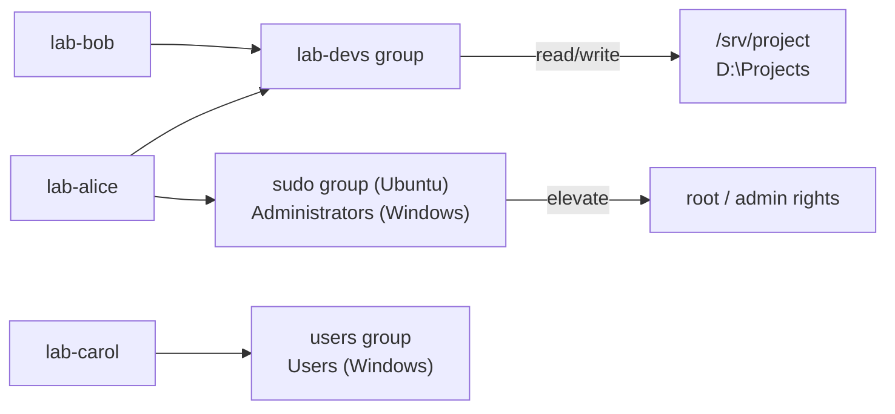
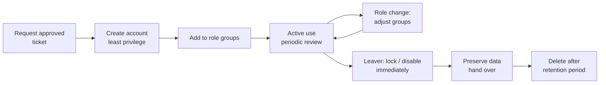

# Day 06: Users and Groups

!!! info "Lesson overview"
    | | |
    |---|---|
    | **Module** | 2 — System Administration |
    | **Difficulty** | :material-signal-cellular-2: Beginner–Intermediate |
    | **Estimated time** | 3–4 hours (80 min reading, 80 min demonstrations, 60–90 min lab and quiz) |
    | **Platforms** | Ubuntu 24.04 LTS (Bash 5.2, shadow-utils `useradd`/`usermod`, `adduser` 3.137) · Windows 11 (Windows PowerShell 5.1 and PowerShell 7.4+, `Microsoft.PowerShell.LocalAccounts` module) |
    | **Lab** | [Lab 06: Onboard & Offboard](../../labs/lab-06.md) |

## Learning Objectives

By the end of this lesson you will be able to:

1. Explain what a **user account**, a **group**, a **UID/GID** and a Windows **SID** are, and why every file, process and log entry is tied to one.
2. Read the fields of `/etc/passwd`, `/etc/shadow` and `/etc/group`, and query them safely with `getent`, `id` and `groups`.
3. Create, modify, lock, expire and delete local Linux accounts with `useradd`, `adduser` (Debian/Ubuntu), `usermod`, `passwd`, `chage` and `userdel`.
4. Create and manage groups with `groupadd`, `gpasswd` and `usermod -aG`, and explain why `usermod -G` without `-a` is dangerous.
5. Manage local Windows accounts and groups with `Get-LocalUser`, `New-LocalUser`, `Set-LocalUser`, `Disable-LocalUser`, `Remove-LocalUser`, `Get-LocalGroup`, `Add-LocalGroupMember` and `Get-LocalGroupMember`, and know their 5.1/7 and Windows-only limits.
6. Pass passwords safely as `SecureString` values and keep them out of command history.
7. Run a professional **onboarding** and **offboarding** procedure: least privilege, disable before delete, preserve data.
8. Audit a machine for risky accounts: extra UID 0 users, empty passwords, unexpected `sudo` or `Administrators` members, and accounts that never expire.

## Prerequisites

- Days 01–05 completed: you can navigate, read files, search with `grep`/`Select-String`, and build pipelines.
- An **Ubuntu 24.04 VM or WSL2 instance you can snapshot**, where your account can use `sudo`.
- A **Windows 11 VM or test machine** where you can open an **elevated** PowerShell window. Do not practise on your work laptop or a domain-joined machine.
- Read [Lab Environment & Safety](../../getting-started/lab-environment.md). Today's commands change security-relevant configuration, so take a snapshot first.

!!! danger "Use throwaway lab accounts only"
    Every example in this lesson uses accounts and groups whose names begin with `lab-` (`lab-alice`, `lab-bob`, `lab-devs`). Never practise on your own account, `root`, `Administrator` or any account a real person uses. Locking or deleting the wrong account can lock you out of the machine.

## Introduction and Concepts

### Why accounts matter

Every action on a computer is performed **by some identity**. When a process opens a file, the kernel compares the identity of the process with the permissions on the file (Day 07). When you read `/var/log/auth.log` or the Windows Security log (Days 16–17), each line names the account that logged in, failed or elevated. Accounts are therefore the foundation of:

- **Access control** — who may read, change or run what.
- **Accountability** — logs can only tell you *who* did something if each person has their own account.
- **Least privilege** — people and services get exactly the rights they need and no more.

There are three kinds of account you will meet on both platforms:

| Kind | Linux example | Windows example | Purpose |
|---|---|---|---|
| **Super-user** | `root` (UID 0) | Built-in `Administrator` (RID 500), members of `Administrators` | Unlimited control of the machine |
| **Regular user** | `student`, `lab-alice` (UID ≥ 1000) | `student`, `lab-alice` | A person who logs in |
| **System / service account** | `www-data`, `sshd`, `systemd-network` (UID < 1000) | `LocalSystem`, `NetworkService`, `LocalService`, virtual service accounts | Runs a program, usually cannot log in interactively |

### Users and groups

A **group** is a named collection of accounts. Instead of granting a permission to ten people one at a time, you grant it to a group and add the ten people to that group. When someone changes job, you change their group memberships, not hundreds of file permissions.



On Linux every user has exactly **one primary group** (stored in `/etc/passwd`, used as the group owner of new files) and any number of **supplementary groups** (listed in `/etc/group`). Ubuntu creates a private primary group with the same name as the user (the "user private group" scheme, `USERGROUPS_ENAB yes` in `/etc/login.defs`). Windows has no primary group concept for local file creation; membership in all groups is equal.

### How Linux stores accounts

Local accounts live in plain text files, one record per line, fields separated by colons:

| File | Readable by | Contains |
|---|---|---|
| `/etc/passwd` | Everyone | Name, UID, primary GID, comment, home, shell |
| `/etc/shadow` | root (and group `shadow`) | Password hash and password-ageing data |
| `/etc/group` | Everyone | Group name, GID, member list |
| `/etc/gshadow` | root | Group passwords and administrators (rarely used) |
| `/etc/login.defs` | Everyone | Defaults: UID/GID ranges, password ageing, home directory mode |
| `/etc/skel/` | Everyone | Template files copied into each new home directory |

A line of `/etc/passwd`:

```text
lab-alice:x:1001:1001:Lab Alice:/home/lab-alice:/bin/bash
│         │ │    │    │         │               └─ 7 login shell
│         │ │    │    │         └─ 6 home directory
│         │ │    │    └─ 5 comment (GECOS): full name, room, phone
│         │ │    └─ 4 primary GID
│         │ └─ 3 UID
│         └─ 2 "x" = the password is in /etc/shadow
└─ 1 user name
```

A line of `/etc/shadow` (shortened):

```text
lab-alice:$y$j9T$7lLACgE...:20766:0:90:14:::
│         │                 │     │ │  │  │││
│         │                 │     │ │  │  ││└─ 9 reserved
│         │                 │     │ │  │  │└─ 8 account expiry (days since 1970-01-01)
│         │                 │     │ │  │  └─ 7 inactive days after password expiry
│         │                 │     │ │  └─ 6 warning days
│         │                 │     │ └─ 5 maximum password age
│         │                 │     └─ 4 minimum password age
│         │                 └─ 3 last change (days since 1970-01-01; 20766 = 2026-11-09)
│         └─ 2 hash ($y$ = yescrypt, Ubuntu's default); "!" or "*" prefix = locked / no password login
└─ 1 user name
```

A line of `/etc/group`:

```text
lab-devs:x:1003:lab-alice,lab-bob
│        │ │    └─ 4 supplementary members (comma-separated, no spaces)
│        │ └─ 3 GID
│        └─ 2 group password placeholder
└─ 1 group name
```

!!! warning "Never edit these files with a normal editor"
    A typo in `/etc/passwd` or `/etc/shadow` can stop everyone, including root, from logging in. Use the tools in this lesson. If you truly must edit, use `sudo vipw` / `sudo vigr` (and `vipw -s` / `vigr -s` for the shadow files), which lock the file and check it before saving.

### UID and GID ranges on Ubuntu

| Range | Used for | Defined in |
|---|---|---|
| `0` | `root` — the kernel checks for UID 0, not the name "root" | Kernel |
| `1`–`99` | Static system accounts created by the base system | Debian policy |
| `100`–`999` | Dynamic system accounts for services (`useradd -r`) | `SYS_UID_MIN`/`SYS_UID_MAX` |
| `1000`–`60000` | Regular users (`UID_MIN`/`UID_MAX`) | `/etc/login.defs` |
| `65534` | `nobody` — owns nothing, used for unprivileged services | Debian policy |

Any account with **UID 0 is root**, whatever its name. Attackers who gain root sometimes add a second UID 0 account with an innocent name such as `backup`, which is why the audit in this lesson checks for it.

Red Hat-family distributions (RHEL, Fedora, Rocky) use the same ranges today, but name the administrators' group **`wheel`** instead of **`sudo`**.

### How Windows stores accounts

Local Windows accounts are stored in the **Security Account Manager (SAM)** database, a protected part of the registry that you never edit directly. Each account and group is identified by a **security identifier (SID)**, for example:

```text
S-1-5-21-1004336348-1177238915-682003330-1001
│ │ │  └──────── machine (domain) identifier ──┘ └─ RID (relative ID)
│ │ └─ 21 = issued by a machine or domain
│ └─ 5 = NT Authority
└─ revision 1
```

| Well-known SID / RID | Account or group |
|---|---|
| RID **500** | Built-in `Administrator` (disabled by default on Windows 11) |
| RID **501** | `Guest` (disabled by default) |
| RID **503** | `DefaultAccount` (system-managed) |
| RID **≥ 1000** | Accounts you create |
| `S-1-5-32-544` | `Administrators` group |
| `S-1-5-32-545` | `Users` group |
| `S-1-5-32-555` | `Remote Desktop Users` group |

Permissions, logs and group memberships record the **SID**, not the name. Renaming an account keeps its SID, so permissions follow it; deleting and recreating an account with the same name creates a **new** SID, and the old permissions no longer apply. Linux behaves the same way with UIDs.

### Local accounts versus domain accounts

In companies, most Windows accounts are **domain** accounts stored in Active Directory (or cloud accounts in Microsoft Entra ID), and many Linux servers authenticate against a directory through SSSD or LDAP. This lesson covers **local** accounts only. Directory tools such as `Get-ADUser` (RSAT ActiveDirectory module) and `realm`/`sssd` are out of scope here. Two practical consequences:

- `getent passwd` on Linux includes directory users when SSSD/LDAP is configured, whereas `cat /etc/passwd` only shows local ones. Prefer `getent`.
- On Windows, `net user /domain` queries the domain; `Get-LocalUser` never does.

### The account lifecycle



Professional teams never jump straight from "active" to "deleted". Disabling is instant and reversible; deletion is permanent and orphans files and permissions.

## Linux Command Reference

| Command | Purpose | Package / availability | Needs root? |
|---|---|---|---|
| `id` | Show UID, GID and group memberships | coreutils | No |
| `groups` | List group names of a user | coreutils | No |
| `whoami` | Effective user name | coreutils | No |
| `getent` | Query account databases (files, LDAP, SSSD) | libc-bin | No (`shadow` needs root) |
| `useradd` | Low-level: create a user | passwd (shadow-utils), all distributions | Yes |
| `adduser` | Friendly interactive wrapper around `useradd` | adduser — **Debian/Ubuntu-specific** (different program on RHEL) | Yes |
| `usermod` | Change an existing user | passwd | Yes |
| `userdel` | Delete a user | passwd | Yes |
| `passwd` | Set password; lock, unlock, expire, show status | passwd | Yes (except for your own password) |
| `chpasswd` | Set passwords in batch from standard input | passwd | Yes |
| `chage` | Show/change password ageing and account expiry | passwd | Yes (`-l` on yourself works without) |
| `groupadd` / `groupmod` / `groupdel` | Create / change / delete a group | passwd | Yes |
| `gpasswd` | Add or remove group members, set member list | passwd | Yes |
| `vipw` / `vigr` | Safely edit passwd/group files | passwd | Yes |
| `who` / `w` / `last` | Who is logged in now / recently | util-linux, procps, wtmpdb | No |
| `sudo -l -U user` | List what a user may run with sudo | sudo | Yes |

## PowerShell Command Reference

All `*-Local*` cmdlets come from the **`Microsoft.PowerShell.LocalAccounts`** module.

| Cmdlet / tool | Aliases | Purpose | Works in 5.1 | Works in 7.x | Admin? |
|---|---|---|---|---|---|
| `Get-LocalUser` | `glu` | List local users | Yes | Windows only (see note) | No |
| `New-LocalUser` | `nlu` | Create a local user | Yes | Windows only | **Yes** |
| `Set-LocalUser` | `slu` | Change description, expiry, password options | Yes | Windows only | **Yes** |
| `Rename-LocalUser` | `rnlu` | Rename (SID unchanged) | Yes | Windows only | **Yes** |
| `Disable-LocalUser` / `Enable-LocalUser` | `dlu` / `elu` | Disable or enable an account | Yes | Windows only | **Yes** |
| `Remove-LocalUser` | `rlu` | Delete a local user (profile folder stays) | Yes | Windows only | **Yes** |
| `Get-LocalGroup` | `glg` | List local groups | Yes | Windows only | No |
| `New-LocalGroup` / `Remove-LocalGroup` | `nlg` / `rlg` | Create / delete a local group | Yes | Windows only | **Yes** |
| `Get-LocalGroupMember` | `glgm` | List members of a group | Yes | Windows only | No |
| `Add-LocalGroupMember` / `Remove-LocalGroupMember` | `algm` / `rlgm` | Add / remove members | Yes | Windows only | **Yes** |
| `whoami /user /groups /priv` | — | Your SID, groups and privileges | Yes | Yes | No |
| `net user`, `net localgroup` | — | Classic commands (`net.exe`) | Yes | Yes | To change |
| `Read-Host -AsSecureString` | — | Prompt for a password without echoing it | Yes | Yes | No |

!!! note "PowerShell 7 and the LocalAccounts module"
    `Microsoft.PowerShell.LocalAccounts` is a **Windows-only** module that ships with Windows PowerShell 5.1 (64-bit). It does not exist in PowerShell on Linux or macOS. In PowerShell 7 on Windows it normally loads automatically; a type-load error when importing it has been reported with some 7.x releases. If that happens, run `Import-Module Microsoft.PowerShell.LocalAccounts -UseWindowsPowerShell` (which uses the Windows PowerShell compatibility layer), or simply do today's work in Windows PowerShell 5.1. The module is also not available in 32-bit PowerShell on 64-bit Windows.

## Detailed Command Explanations

### `id`, `groups` and `whoami` — who am I, and what am I a member of?

`id` prints the **real and effective UID, primary GID and every supplementary group** of the current user, or of the user you name. It is the quickest way to answer "why can't I read this file?" (missing group) or "why can I sudo?" (member of `sudo`). Useful forms: `id -u` (UID only), `id -un` (name), `id -gn` (primary group name), `id -nG` (all group names).

`groups USER` prints only group names. Both commands read the account database, so a user you **just** added to a group will show the new group with `id lab-alice`, but an already-logged-in session of that user will not have it until they log out and back in (or start a new login shell). This is the most common "I added them to the group and it still doesn't work" problem.

On Windows, `whoami /groups` lists every group in your current **access token** (including well-known groups such as `Everyone` and `NT AUTHORITY\Authenticated Users`), `whoami /user` shows your SID and `whoami /priv` shows privileges. Like Linux, a new group membership only appears in the token after you sign out and in.

### `getent` — read account databases the right way

`getent passwd lab-alice`, `getent group sudo` and `sudo getent shadow lab-alice` query the Name Service Switch (configured in `/etc/nsswitch.conf`), so they return local **and** directory (LDAP/SSSD) accounts. The exit code is `0` when found and `2` when the key does not exist, which makes it ideal in scripts: `getent passwd lab-alice >/dev/null || echo "no such user"`.

### `useradd` — the low-level account creator

`useradd` is part of the shadow utilities on every distribution. On Ubuntu its defaults are minimal: **without `-m` it does not create a home directory**, and without `-s` the shell is `/bin/sh` (from `/etc/default/useradd`). A complete, explicit command for a person is:

```bash
sudo useradd -m -s /bin/bash -c "Lab Alice" lab-alice
```

Important options: `-m` create home from `/etc/skel`, `-d DIR` home path, `-s SHELL`, `-c COMMENT`, `-g GROUP` primary group, `-G G1,G2` supplementary groups, `-u UID` fixed UID, `-e YYYY-MM-DD` account expiry, `-r` system account (UID below 1000, no ageing), `-M` do not create home. The new account has **no usable password** (shadow field `!`), so nobody can log in with a password until you set one with `passwd`.

### `adduser` — the friendly wrapper (Debian/Ubuntu)

On Debian and Ubuntu, `adduser` is a separate Perl program that calls `useradd` with sensible defaults: it creates the home directory, copies `/etc/skel`, sets `/bin/bash`, adds the user to the `users` group (Ubuntu 24.04 behaviour, controlled by `/etc/adduser.conf`), and interactively asks for a password and full name. `adduser USER GROUP` adds an existing user to a group. Ubuntu 24.04 ships adduser 3.137, where `--comment` replaces the older `--gecos` option and `--disabled-password` creates the account without a password.

!!! warning "Same name, different program"
    On RHEL, Fedora and Rocky Linux, `adduser` is only a symbolic link to `useradd` and behaves like it (no prompts). Scripts that must run on several distributions should call `useradd` with explicit options.

### `usermod` — change an existing account

`usermod` changes any field of an account: `-aG GROUP` append to supplementary groups, `-c` comment, `-s` shell, `-d DIR -m` move the home directory, `-l NEWNAME` rename, `-L` / `-U` lock / unlock the password, `-e DATE` set expiry (`-e 1` expires it immediately; `-e ''` removes expiry).

!!! danger "`usermod -G` without `-a` replaces all groups"
    `usermod -G lab-devs lab-alice` sets lab-alice's supplementary groups to **exactly** `lab-devs`, silently removing her from every other group, including `sudo`. Always type **`-aG`** (append). The demo below shows the effect.

### `passwd` — set, lock, unlock, expire and inspect passwords

- `passwd` with no argument changes your own password.
- `sudo passwd lab-alice` sets another user's password (prompts twice; nothing is echoed).
- `sudo passwd -l lab-alice` **locks** the password by prefixing the hash with `!`. Key-based SSH logins may still work, so for a leaver also expire the account (`usermod -e 1` or `chage -E 0`).
- `sudo passwd -u lab-alice` unlocks.
- `sudo passwd -e lab-alice` expires the password, forcing a change at next login.
- `sudo passwd -S lab-alice` prints a status line: name, status (`P` usable password, `L` locked, `NP` no password), date of last change, min, max, warn and inactive days.

For automation, `chpasswd` reads `user:password` pairs on standard input. Never type a real password on the command line, because it ends up in your shell history and in the process list. Lab passwords in this course are deliberately fake.

### `chage` — password ageing and account expiry

`chage -l USER` shows ageing information in readable form. Changes: `-M DAYS` maximum password age, `-m DAYS` minimum, `-W DAYS` warning, `-I DAYS` inactivity after expiry, `-E YYYY-MM-DD` account expiry (`-E -1` removes it), `-d 0` force a change at next login. Contractors and interns should always have an expiry date set on day one.

### `userdel` — delete an account

`sudo userdel lab-bob` removes the account records but **leaves the home directory and mail spool**, which are then owned by a bare number (the old UID). `sudo userdel -r lab-bob` also deletes the home directory and mail spool, and is irreversible. Professionals preview first (`ls -la /home/lab-bob`, `du -sh /home/lab-bob`), archive anything the business needs, then delete. After deletion, `sudo find / -xdev -nouser` lists orphaned files. `userdel` refuses to delete a user who is logged in (unless `-f`, which you should avoid).

### `groupadd`, `gpasswd` and `groupdel` — manage groups

- `sudo groupadd lab-devs` creates a group with the next free GID; `-r` creates a system group; `-g GID` fixes the number.
- `sudo gpasswd -a lab-bob lab-devs` adds one member; `-d` removes one member. Unlike `usermod -G`, `gpasswd -a/-d` cannot accidentally wipe other memberships.
- `sudo gpasswd -M lab-alice,lab-bob lab-devs` **sets** the entire member list (replaces it).
- `sudo groupdel lab-devs` deletes a group. It refuses if the group is any user's primary group.

### `sudo` group membership on Ubuntu

On Ubuntu, `/etc/sudoers` contains `%sudo ALL=(ALL:ALL) ALL`, so **membership of the `sudo` group equals administrator rights**. Granting admin is `sudo usermod -aG sudo NAME`; revoking it is `sudo gpasswd -d NAME sudo`. `sudo -l -U NAME` shows what a user may run. Red Hat-family systems use the `wheel` group. Sudoers policy itself (`visudo`) is covered on Day 19.

### `who`, `w` and `last` — who is on the machine?

`who` lists current login sessions, `w` adds what each user is running and the load average, and `last` shows recent logins from the login history. Before deleting or locking an account, check that it is not in use. These commands are covered again on Day 17 for security monitoring.

### `Get-LocalUser` — list Windows local accounts

`Get-LocalUser` returns `LocalUser` objects with properties such as `Name`, `Enabled`, `Description`, `FullName`, `SID`, `PasswordLastSet`, `PasswordExpires`, `LastLogon`, `AccountExpires`, `UserMayChangePassword`, `PasswordRequired` and `PrincipalSource`. The default view shows only `Name`, `Enabled` and `Description`, so pipe to `Select-Object` for the interesting ones. `-Name` accepts wildcards (`lab-*`) and `-SID` finds an account by SID. It does not need elevation.

### `New-LocalUser` — create a Windows local account

```powershell
$pw = Read-Host -Prompt 'Password for lab-alice' -AsSecureString
New-LocalUser -Name 'lab-alice' -Password $pw -FullName 'Lab Alice' -Description 'LAB account - delete after Day 06'
```

The `-Password` parameter accepts only a **`SecureString`**, never plain text, which keeps the password out of the console history. `Read-Host -AsSecureString` prompts without echoing. Other parameters: `-NoPassword` (account with no password; combine with `-Disabled` or set a password later), `-AccountExpires DATE`, `-AccountNeverExpires`, `-PasswordNeverExpires`, `-UserMayNotChangePassword`, `-Disabled`. Names are limited to 20 characters and descriptions to 48.

!!! tip "Check the Users group after creating an account"
    Accounts created with `net user NAME /add` are added to the local `Users` group automatically. Do not assume the same for `New-LocalUser`: check with `Get-LocalGroupMember -Group Users` and, if the account must sign in interactively, add it with `Add-LocalGroupMember -Group Users -Member NAME`.

### `Set-LocalUser`, `Rename-LocalUser`, `Disable-LocalUser`, `Enable-LocalUser`

`Set-LocalUser` changes an existing account: `-Description`, `-FullName`, `-Password` (SecureString), `-AccountExpires DATE`, `-AccountNeverExpires`, `-PasswordNeverExpires $true/$false`, `-UserMayChangePassword $true/$false`. Note that the last two take a Boolean value, not a switch. `Rename-LocalUser -Name old -NewName new` keeps the SID. `Disable-LocalUser -Name NAME` is the Windows equivalent of locking plus expiring: the account cannot sign in at all, and it is instantly reversible with `Enable-LocalUser`. All of these support `-WhatIf` and `-Confirm`.

### `Remove-LocalUser` — delete a Windows local account

`Remove-LocalUser -Name lab-bob` deletes the account from the SAM. It does **not** delete the profile folder `C:\Users\lab-bob` or the files the user owned; those files now show an unresolvable SID as owner. Use `-WhatIf` first. Profiles can be listed with `Get-CimInstance -ClassName Win32_UserProfile` and removed through *Settings → Accounts* or the CIM instance, after the data has been preserved.

### `Get-LocalGroup`, `New-LocalGroup`, `Add-LocalGroupMember`, `Remove-LocalGroupMember`, `Get-LocalGroupMember`

`Get-LocalGroup` lists groups (`Administrators`, `Users`, `Remote Desktop Users`, `Event Log Readers`...). `New-LocalGroup -Name lab-devs -Description '...'` creates one. `Add-LocalGroupMember -Group lab-devs -Member lab-alice, lab-bob` adds members and **appends** (there is no equivalent of the `usermod -G` trap). `Remove-LocalGroupMember` removes. `Get-LocalGroupMember -Group Administrators` returns `ObjectClass`, `Name` and `PrincipalSource` (`Local`, `ActiveDirectory`, `AzureAD`, `MicrosoftAccount`), which is exactly what an access review needs.

!!! note "Known issue: orphaned members"
    `Get-LocalGroupMember` is widely reported (in community troubleshooting, not in the cmdlet documentation) to fail with *"Failed to compare two elements in the array"* or a similar error when a group contains the SID of a deleted or unresolvable domain account. `net localgroup Administrators` still works as a fallback.

### `net user` and `net localgroup` — the classic tools

`net.exe` predates PowerShell and is available everywhere, including Windows Recovery and Server Core. `net user` lists accounts; `net user lab-alice` shows details (last logon, password expiry, group memberships); `net localgroup Administrators` lists members; `net user NAME /active:no` disables. Its output is text, not objects, so prefer the cmdlets in scripts. Avoid `net user NAME PASSWORD /add`, because it puts the password in history; `net user NAME * /add` prompts instead.

## Syntax and Parameters

### Bash

```text
id [-u | -g | -G] [-n] [USER]
groups [USER...]
getent DATABASE [KEY...]               # passwd, group, shadow
useradd [-m] [-M] [-r] [-s SHELL] [-c COMMENT] [-d HOME] [-g GROUP] [-G G1,G2] [-u UID] [-e YYYY-MM-DD] LOGIN
adduser [--disabled-password] [--comment TEXT] [--shell SHELL] USER     # Debian/Ubuntu
adduser USER GROUP                                                     # Debian/Ubuntu
usermod [-a -G G1,G2] [-c COMMENT] [-s SHELL] [-d HOME -m] [-l NEW] [-L | -U] [-e DATE] LOGIN
passwd [-l | -u | -e | -S | -d] [USER]
chage [-l] [-M MAX] [-m MIN] [-W WARN] [-I INACTIVE] [-E DATE] [-d LASTDAY] USER
userdel [-r] LOGIN
groupadd [-r] [-g GID] GROUP
gpasswd [-a USER | -d USER | -M U1,U2] GROUP
groupdel GROUP
```

| Option | Command | Meaning |
|---|---|---|
| `-m` / `-M` | useradd | Create / do not create the home directory |
| `-r` | useradd, groupadd | System account or group (ID below 1000, no ageing) |
| `-s` | useradd, usermod | Login shell (`/usr/sbin/nologin` blocks interactive login) |
| `-G` | useradd, usermod | Supplementary groups. **With usermod, replaces the list unless `-a` is given** |
| `-a` | usermod | Append to the supplementary groups (only with `-G`) |
| `-e` | useradd, usermod | Account expiry `YYYY-MM-DD`; `1` = already expired; empty = never |
| `-L` / `-U` | usermod | Lock / unlock the password (same as `passwd -l/-u`) |
| `-l` / `-u` | passwd | Lock / unlock the password |
| `-e` | passwd | Expire the password: must change at next login |
| `-S` | passwd | Status: `P` usable, `L` locked, `NP` no password |
| `-l` | chage | List ageing information |
| `-M` / `-W` | chage | Maximum age / warning days |
| `-E` | chage | Account expiry date (`-1` removes) |
| `-r` | userdel | Also remove home directory and mail spool (irreversible) |
| `-a` / `-d` / `-M` | gpasswd | Add one / delete one / set the whole member list |

### PowerShell

```text
Get-LocalUser [[-Name] <String[]>] | [-SID <SecurityIdentifier[]>]
New-LocalUser [-Name] <String> {-Password <SecureString> | -NoPassword} [-FullName <String>] [-Description <String>]
              [-AccountExpires <DateTime> | -AccountNeverExpires] [-PasswordNeverExpires] [-UserMayNotChangePassword] [-Disabled]
Set-LocalUser [-Name] <String> [-Password <SecureString>] [-Description <String>] [-FullName <String>]
              [-AccountExpires <DateTime> | -AccountNeverExpires] [-PasswordNeverExpires <Boolean>] [-UserMayChangePassword <Boolean>]
Rename-LocalUser [-Name] <String> [-NewName] <String>
Disable-LocalUser [-Name] <String[]>        Enable-LocalUser [-Name] <String[]>
Remove-LocalUser [-Name] <String[]> [-WhatIf] [-Confirm]
Get-LocalGroup [[-Name] <String[]>]
New-LocalGroup [-Name] <String> [-Description <String>]
Add-LocalGroupMember [-Group] <String> [-Member] <LocalPrincipal[]>
Remove-LocalGroupMember [-Group] <String> [-Member] <LocalPrincipal[]>
Get-LocalGroupMember [-Group] <String> [[-Member] <String>]
```

| Parameter | Cmdlet | Meaning |
|---|---|---|
| `-Password` | New-/Set-LocalUser | A `SecureString` (`Read-Host -AsSecureString`). Plain strings are rejected |
| `-NoPassword` | New-LocalUser | Create without a password |
| `-AccountExpires` | New-/Set-LocalUser | `DateTime` after which sign-in fails, e.g. `(Get-Date).AddDays(30)` |
| `-PasswordNeverExpires` | New-LocalUser (switch) / Set-LocalUser (Boolean) | Avoid for people; acceptable only with compensating controls |
| `-Disabled` | New-LocalUser | Create the account disabled |
| `-Member` | `*-LocalGroupMember` | Names, SIDs or `LocalUser` objects; may be `COMPUTER\user` or `DOMAIN\user` |
| `-WhatIf` / `-Confirm` | All changing cmdlets | Preview / ask before acting |

## Practical Demonstrations

Run the Linux demos with `sudo` in your snapshot VM or WSL2, and the Windows demos in an **elevated** PowerShell window on a test machine. The Bash outputs below were generated by running the commands on Ubuntu 24.04 (Bash 5.2, adduser 3.137) in a container; the user, host, UIDs and GIDs were renumbered to what a fresh Ubuntu install with one existing user (`student`, UID 1000) assigns. The PowerShell outputs were **not** executed (there is no Windows host in the release pipeline). They show the documented default formats from learn.microsoft.com. Treat all of them as examples: your IDs, SIDs, dates and descriptions will differ.

### Demo 1 — Who am I, and what does the account database say?

=== "Bash"

    ```bash
    id
    id -nG
    getent passwd student root
    getent group sudo
    awk -F: '{print $1, $3}' /etc/passwd | head -5
    sudo grep -E '^(UID_MIN|UID_MAX|PASS_MAX_DAYS|USERGROUPS_ENAB|HOME_MODE)' /etc/login.defs
    ```

    **Expected output (example):**

    ```text
    uid=1000(student) gid=1000(student) groups=1000(student),4(adm),24(cdrom),27(sudo),30(dip),46(plugdev),100(users)
    student adm cdrom sudo dip plugdev users
    student:x:1000:1000:Student,,,:/home/student:/bin/bash
    root:x:0:0:root:/root:/bin/bash
    sudo:x:27:student
    root 0
    daemon 1
    bin 2
    sys 3
    sync 4
    HOME_MODE    0750
    PASS_MAX_DAYS    99999
    UID_MIN    1000
    UID_MAX    60000
    USERGROUPS_ENAB yes
    ```

    `student` is in `sudo`, so it can administer the machine. `PASS_MAX_DAYS 99999` means passwords never expire by default on Ubuntu.

=== "PowerShell"

    ```powershell
    whoami
    whoami /groups | Select-String 'Administrators|Users'
    Get-LocalUser
    Get-LocalUser -Name $env:USERNAME | Select-Object Name, Enabled, SID, PasswordLastSet, LastLogon, PrincipalSource
    ```

    **Expected output (example):**

    ```text
    win11-lab\student
    BUILTIN\Administrators   Alias   S-1-5-32-544 Group used for deny only, ...
    BUILTIN\Users            Alias   S-1-5-32-545 Mandatory group, Enabled by default, Enabled group

    Name               Enabled Description
    ----               ------- -----------
    Administrator      False   Built-in account for administering the computer/domain
    DefaultAccount     False   A user account managed by the system.
    Guest              False   Built-in account for guest access to the computer/domain
    student            True
    WDAGUtilityAccount False   A user account managed and used by the system for Windows Defender Application Guard scen...

    Name            : student
    Enabled         : True
    SID             : S-1-5-21-1004336348-1177238915-682003330-1001
    PasswordLastSet : 01-11-2026 09:12:40
    LastLogon       : 09-11-2026 08:01:15
    PrincipalSource : Local
    ```

    "Group used for deny only" on `Administrators` means the window is **not** elevated: User Account Control gives you a filtered token until you choose *Run as administrator*.

### Demo 2 — Create users the low-level and the friendly way

=== "Bash"

    ```bash
    sudo useradd -m -s /bin/bash -c "Lab Alice" lab-alice
    getent passwd lab-alice
    id lab-alice
    ls -ld /home/lab-alice ; ls -A /home/lab-alice
    sudo passwd -S lab-alice

    # Debian/Ubuntu only: friendly wrapper, no password yet
    sudo adduser --disabled-password --comment "Lab Carol" lab-carol
    id lab-carol
    ```

    **Expected output (example):**

    ```text
    lab-alice:x:1001:1001:Lab Alice:/home/lab-alice:/bin/bash
    uid=1001(lab-alice) gid=1001(lab-alice) groups=1001(lab-alice)
    drwxr-x--- 2 lab-alice lab-alice 4096 Nov  9 16:41 /home/lab-alice
    .bash_logout  .bashrc  .profile
    lab-alice L 2026-11-09 0 99999 7 -1
    info: Adding user `lab-carol' ...
    info: Selecting UID/GID from range 1000 to 59999 ...
    info: Adding new group `lab-carol' (1002) ...
    info: Adding new user `lab-carol' (1002) with group `lab-carol (1002)' ...
    info: Creating home directory `/home/lab-carol' ...
    info: Copying files from `/etc/skel' ...
    info: Adding new user `lab-carol' to supplemental / extra groups `users' ...
    info: Adding user `lab-carol' to group `users' ...
    uid=1002(lab-carol) gid=1002(lab-carol) groups=1002(lab-carol),100(users)
    ```

    Note the `L` in the `passwd -S` line: a brand-new `useradd` account has no usable password. The home directory is mode `750` (`HOME_MODE`), so other users cannot browse it. The three files came from `/etc/skel`.

=== "PowerShell"

    ```powershell
    # Elevated window. The password is typed at the prompt, never on the command line.
    $pw = Read-Host -Prompt 'Lab password for lab-alice' -AsSecureString
    New-LocalUser -Name 'lab-alice' -Password $pw -FullName 'Lab Alice' -Description 'LAB account - Day 06'
    New-LocalUser -Name 'lab-carol' -NoPassword -Disabled -Description 'LAB account - Day 06'
    Get-LocalUser -Name 'lab-*' | Select-Object Name, Enabled, SID, PasswordRequired, AccountExpires
    ```

    **Expected output (example):**

    ```text
    Lab password for lab-alice: ************

    Name      Enabled Description
    ----      ------- -----------
    lab-alice True    LAB account - Day 06
    lab-carol False   LAB account - Day 06

    Name      Enabled SID                                           PasswordRequired AccountExpires
    ----      ------- ---                                           ---------------- --------------
    lab-alice True    S-1-5-21-1004336348-1177238915-682003330-1002             True
    lab-carol False   S-1-5-21-1004336348-1177238915-682003330-1003            False
    ```

    The RIDs (`1002`, `1003`) continue from the last account created on the machine.

### Demo 3 — Groups, and the `usermod -G` trap

=== "Bash"

    ```bash
    sudo useradd -m -s /bin/bash -c "Lab Bob" lab-bob
    sudo groupadd lab-devs
    sudo usermod -aG lab-devs lab-alice
    sudo gpasswd -a lab-bob lab-devs
    getent group lab-devs
    groups lab-alice

    # The trap: give alice sudo, then "add" a group without -a
    sudo usermod -aG sudo lab-alice ; id -nG lab-alice
    sudo usermod -G lab-devs lab-alice ; id -nG lab-alice
    ```

    **Expected output (example):**

    ```text
    Adding user lab-bob to group lab-devs
    lab-devs:x:1004:lab-alice,lab-bob
    lab-alice : lab-alice lab-devs
    lab-alice sudo lab-devs
    lab-alice lab-devs
    ```

    The second `usermod` had no `-a`, so `sudo` disappeared without any warning. In a real company that could remove a colleague's admin rights, or worse, a script with `-G sudo` could strip everyone's project groups.

=== "PowerShell"

    ```powershell
    $pw = Read-Host -Prompt 'Lab password for lab-bob' -AsSecureString
    New-LocalUser -Name 'lab-bob' -Password $pw -Description 'LAB account - Day 06' | Out-Null
    New-LocalGroup -Name 'lab-devs' -Description 'LAB group - Day 06'
    Add-LocalGroupMember -Group 'lab-devs' -Member 'lab-alice', 'lab-bob'
    Get-LocalGroupMember -Group 'lab-devs'
    Get-LocalGroupMember -Group 'Administrators'
    ```

    **Expected output (example):**

    ```text
    Name     Description
    ----     -----------
    lab-devs LAB group - Day 06

    ObjectClass Name                PrincipalSource
    ----------- ----                ---------------
    User        WIN11-LAB\lab-alice Local
    User        WIN11-LAB\lab-bob   Local

    ObjectClass Name                    PrincipalSource
    ----------- ----                    ---------------
    User        WIN11-LAB\Administrator Local
    User        WIN11-LAB\student       Local
    ```

    `Add-LocalGroupMember` always appends, so the `-G` trap does not exist on Windows. Adding a member who is already present raises a *"is already a member"* error; use `-ErrorAction SilentlyContinue` only when you have checked that this is the reason.

### Demo 4 — Passwords, ageing and expiry

=== "Bash"

    ```bash
    sudo passwd lab-alice                 # type a lab-only password twice
    sudo passwd -S lab-alice
    sudo chage -M 90 -W 14 lab-alice      # max age 90 days, warn 14 days before
    sudo chage -E 2026-12-31 lab-bob      # contractor: account ends on 31 Dec
    sudo chage -l lab-alice
    sudo chage -l lab-bob | grep 'Account expires'
    sudo getent shadow lab-alice | cut -d: -f1,3-8
    ```

    **Expected output (example):**

    ```text
    New password:
    Retype new password:
    passwd: password updated successfully
    lab-alice P 2026-11-09 0 99999 7 -1
    Last password change                                : Nov 09, 2026
    Password expires                                    : Feb 07, 2027
    Password inactive                                   : never
    Account expires                                     : never
    Minimum number of days between password change      : 0
    Maximum number of days between password change      : 90
    Number of days of warning before password expires   : 14
    Account expires                                     : Dec 31, 2026
    lab-alice:20766:0:90:14::
    ```

    `20766` is the number of days since 1970-01-01, i.e. 2026-11-09. The status changed from `L` to `P` once a password was set.

=== "PowerShell"

    ```powershell
    Set-LocalUser -Name 'lab-bob' -AccountExpires (Get-Date '2026-12-31')
    Set-LocalUser -Name 'lab-alice' -PasswordNeverExpires $false
    Get-LocalUser -Name 'lab-alice', 'lab-bob' |
        Select-Object Name, PasswordLastSet, PasswordExpires, AccountExpires, UserMayChangePassword
    net user lab-bob | Select-String 'expires|Last set|Local Group'
    ```

    **Expected output (example):**

    ```text
    Name      PasswordLastSet     PasswordExpires     AccountExpires      UserMayChangePassword
    ----      ---------------     ---------------     --------------      ---------------------
    lab-alice 09-11-2026 16:41:02 21-12-2026 16:41:02                                      True
    lab-bob   09-11-2026 16:43:10 21-12-2026 16:43:10 31-12-2026 00:00:00                  True

    Account expires              31-12-2026 00:00:00
    Password last set            09-11-2026 16:43:10
    Password expires             21-12-2026 16:43:10
    Local Group Memberships      *lab-devs
    ```

    `PasswordExpires` is calculated from the local password policy (42 days by default on a stand-alone machine; `net accounts` shows it). Dates follow the regional format of the machine.

### Demo 5 — Offboarding: lock, then delete safely

=== "Bash"

    ```bash
    who                                    # is lab-bob logged in?
    sudo passwd -l lab-bob                 # 1. lock the password
    sudo usermod -e 1 lab-bob              # 2. expire the account (blocks SSH keys too)
    sudo passwd -S lab-bob
    sudo chage -l lab-bob | grep 'Account expires'
    sudo gpasswd -d lab-bob lab-devs       # 3. remove group memberships
    sudo ls -la /home/lab-bob ; sudo du -sh /home/lab-bob   # 4. preview the data
    sudo tar -czf /root/lab-bob-home-$(date +%F).tar.gz -C /home lab-bob   # 5. preserve
    sudo userdel lab-bob                   # 6. delete the account, keep the home for now
    getent passwd lab-bob ; echo "exit code: $?"
    sudo find /home -maxdepth 1 -nouser
    ```

    **Expected output (example):**

    ```text
    student  pts/0        2026-11-09 16:30 (192.168.56.1)
    passwd: password changed.
    lab-bob L 2026-11-09 0 99999 7 -1
    Account expires                                     : Jan 02, 1970
    Removing user lab-bob from group lab-devs
    total 20
    drwxr-x--- 2 lab-bob lab-bob 4096 Nov  9 16:41 .
    drwxr-xr-x 6 root    root    4096 Nov  9 16:41 ..
    -rw-r--r-- 1 lab-bob lab-bob  220 Mar 31  2024 .bash_logout
    -rw-r--r-- 1 lab-bob lab-bob 3771 Mar 31  2024 .bashrc
    -rw-r--r-- 1 lab-bob lab-bob  807 Mar 31  2024 .profile
    16K /home/lab-bob
    exit code: 2
    /home/lab-bob
    ```

    After `userdel`, `getent` returns exit code 2 (not found) and the home directory is listed by `find -nouser` because its owner UID no longer maps to a name. Once the archive has been checked, `sudo rm -rI /home/lab-bob` removes it. (The expiry date shows as 2 January 1970 because `-e 1` means "day 1 after the epoch".)

=== "PowerShell"

    ```powershell
    query user 2>$null                                  # who is signed in (Windows Pro/Enterprise)
    Disable-LocalUser -Name 'lab-bob'                   # 1. disable: instant and reversible
    Remove-LocalGroupMember -Group 'lab-devs' -Member 'lab-bob'   # 2. remove memberships
    Get-LocalUser -Name 'lab-bob' | Select-Object Name, Enabled, LastLogon
    Get-ChildItem C:\Users\lab-bob -Force -ErrorAction SilentlyContinue   # 3. preview profile data
    Remove-LocalUser -Name 'lab-bob' -WhatIf            # 4. preview the deletion
    Remove-LocalUser -Name 'lab-bob'                    # 5. delete (profile folder remains)
    Get-LocalUser -Name 'lab-bob' -ErrorAction SilentlyContinue ; "Found: $?"
    ```

    **Expected output (example):**

    ```text
    Name    Enabled LastLogon
    ----    ------- ---------
    lab-bob False

    What if: Performing the operation "Remove local user" on target "lab-bob".
    Found: False
    ```

    `LastLogon` is empty because the account never signed in, so no profile folder was created. If it had, `C:\Users\lab-bob` would remain after `Remove-LocalUser` until you remove the profile.

### Demo 6 — A quick account security audit

=== "Bash"

    ```bash
    # Any account with UID 0 other than root?
    awk -F: '$3 == 0 {print $1}' /etc/passwd
    # Accounts with an EMPTY password field (anyone could log in)
    sudo awk -F: '$2 == "" {print $1}' /etc/shadow
    # Regular users and their shells
    awk -F: '$3 >= 1000 && $3 < 60000 {print $1, $3, $7}' /etc/passwd
    # Who has admin rights?
    getent group sudo adm
    # Users that can log in interactively (shell is not nologin/false)
    grep -Ev '(nologin|false)$' /etc/passwd | cut -d: -f1
    ```

    **Expected output (example):**

    ```text
    root
    student 1000 /bin/bash
    lab-alice 1001 /bin/bash
    lab-carol 1002 /bin/bash
    sudo:x:27:student
    adm:x:4:syslog,student
    root
    sync
    student
    lab-alice
    lab-carol
    ```

    Only `root` has UID 0 and the empty-password check printed nothing, which is the healthy result. `sync` has the shell `/bin/sync`, a historical oddity that only runs `sync`.

=== "PowerShell"

    ```powershell
    # Enabled accounts, password and expiry settings
    Get-LocalUser | Where-Object Enabled |
        Select-Object Name, PasswordRequired, PasswordNeverExpires, AccountExpires, LastLogon
    # Built-in Administrator (RID 500) state, whatever it has been renamed to
    Get-LocalUser | Where-Object { $PSItem.SID.Value -like '*-500' } | Select-Object Name, Enabled
    # Who is an administrator?
    Get-LocalGroupMember -Group 'Administrators' | Select-Object Name, ObjectClass, PrincipalSource
    # Accounts that have not signed in for 90 days
    Get-LocalUser | Where-Object { $PSItem.Enabled -and $PSItem.LastLogon -lt (Get-Date).AddDays(-90) }
    ```

    **Expected output (example):**

    ```text
    Name      PasswordRequired PasswordNeverExpires AccountExpires LastLogon
    ----      ---------------- -------------------- -------------- ---------
    student               True                 True                09-11-2026 08:01:15
    lab-alice             True                False

    Name          Enabled
    ----          -------
    Administrator   False

    Name                    ObjectClass PrincipalSource
    ----                    ----------- ---------------
    WIN11-LAB\Administrator User        Local
    WIN11-LAB\student       User        Local

    Name      Enabled Description
    ----      ------- -----------
    lab-alice True    LAB account - Day 06
    ```

    `lab-alice` appears in the last query because she has never signed in (`LastLogon` is empty, which compares as older than any date). Accounts that are enabled but never used are a classic audit finding.

## Linux vs PowerShell Comparison

| Task | Bash (Ubuntu) | PowerShell (Windows) | Notes |
|---|---|---|---|
| Who am I / my groups | `id` · `id -nG` | `whoami` · `whoami /groups` | New groups appear only after a fresh login on both |
| List users | `getent passwd` | `Get-LocalUser` | Linux includes service accounts |
| One user's details | `getent passwd NAME` · `sudo chage -l NAME` | <code>Get-LocalUser NAME &#124; Format-List &#42;</code> · `net user NAME` | |
| Create user | `sudo useradd -m -s /bin/bash -c "Full Name" NAME` (or `adduser`, Debian/Ubuntu) | `New-LocalUser -Name NAME -Password $pw` | Windows needs elevation and a `SecureString` |
| Set password | `sudo passwd NAME` | `Set-LocalUser -Name NAME -Password $pw` | Never put passwords on the command line |
| Force change at next login | `sudo passwd -e NAME` | `net user NAME /logonpasswordchg:yes` | No direct LocalAccounts parameter |
| Account expiry | `sudo chage -E 2026-12-31 NAME` | `Set-LocalUser NAME -AccountExpires '2026-12-31'` | |
| Lock / disable | `sudo passwd -l NAME` + `sudo usermod -e 1 NAME` | `Disable-LocalUser NAME` | ⚠ Linux password lock alone does not stop SSH keys |
| Unlock / enable | `sudo passwd -u NAME` + `sudo usermod -e '' NAME` | `Enable-LocalUser NAME` | |
| Rename | `sudo usermod -l NEW OLD` | `Rename-LocalUser OLD -NewName NEW` | UID / SID unchanged |
| Delete | `sudo userdel NAME` (`-r` removes home) | `Remove-LocalUser NAME` | ⚠ Windows never removes the profile folder |
| Create group | `sudo groupadd NAME` | `New-LocalGroup NAME` | |
| Add to group | `sudo usermod -aG GRP NAME` · `sudo gpasswd -a NAME GRP` | `Add-LocalGroupMember -Group GRP -Member NAME` | ⚠ `usermod -G` without `-a` replaces |
| Remove from group | `sudo gpasswd -d NAME GRP` | `Remove-LocalGroupMember -Group GRP -Member NAME` | |
| List group members | `getent group GRP` | `Get-LocalGroupMember GRP` | Linux list excludes users whose *primary* group it is |
| Admin group | `sudo` (Ubuntu) / `wheel` (RHEL) | `Administrators` (`S-1-5-32-544`) | |
| Identifier | UID / GID | SID (RID 500 = built-in Administrator) | Recreating a name creates a new ID |
| Account store | `/etc/passwd`, `/etc/shadow`, `/etc/group` | SAM database | Never edit directly |

## Real-World IT Scenarios

1. **New starter onboarding.** HR raises a ticket for a new developer. The administrator creates the account with the naming standard, adds only the `developers` and `vpn-users` groups, forces a password change at first login (`passwd -e` / `net user NAME /logonpasswordchg:yes`) and records the commands in the ticket. Nobody gets `sudo` or `Administrators` "just in case".
2. **Contractor with an end date.** A three-month contractor gets an account with an expiry date set **at creation** (`useradd -e 2027-02-28`, `New-LocalUser -AccountExpires`). When the contract ends, access stops even if nobody remembers to raise the leaver ticket.
3. **"I was added to the group but still get Permission denied."** The user's existing session still holds the old group list. `id` (new) and `id` inside their session (old) differ. Logging out and in, or `newgrp`/a new SSH session, fixes it. On Windows, signing out refreshes the token.
4. **The vanishing admin rights.** A colleague ran `usermod -G docker deploy` on a build server, and the `deploy` user lost membership of every other group, breaking the release pipeline. The fix was to restore the memberships from `/etc/group` in the previous night's backup, and the team now uses `gpasswd -a` in scripts.
5. **Leaver with active SSH keys.** An engineer leaves; the help desk runs `passwd -l`. A week later the account is still used via an SSH key. The correct leaver procedure locks the password **and** expires the account (`usermod -e 1`), removes keys from `~/.ssh/authorized_keys`, and kills running sessions.
6. **Shared "admin" account.** An audit finds four people sharing one local Administrator password, so nobody can tell who changed a firewall rule. The remediation is named accounts per person, membership of `Administrators` only when needed, and the built-in account disabled or managed by Windows LAPS.

## Cybersecurity Application

- **Persistence through new accounts.** Creating a local account is a common attacker persistence technique (MITRE ATT&CK T1136.001, *Create Account: Local Account*). On Windows, account creation is Security log event **4720**, addition to a security-enabled local group is **4732**, and an account being enabled or disabled is **4722**/**4725**. On Ubuntu, `useradd`, `usermod` and `passwd` write lines to `/var/log/auth.log` (Day 17 hunts these).
- **Extra UID 0 accounts.** `awk -F: '$3 == 0' /etc/passwd` must print only `root`. Any other line is a critical finding: the account has full root rights regardless of its name.
- **Empty passwords and never-expiring accounts.** An empty second field in `/etc/shadow`, or `PasswordRequired = False` on an enabled Windows account, means anyone can sign in. Accounts that never expire and never sign in are dormant attack surface.
- **Privileged group review.** Regularly compare `getent group sudo` and `Get-LocalGroupMember Administrators` with an approved list. Attackers add themselves to these groups because it is quieter than creating a new account.
- **Service accounts that can log in.** A web server account such as `www-data` should have the shell `/usr/sbin/nologin`. If a compromised service account has `/bin/bash`, an attacker who steals its credentials gets an interactive shell.
- **Evidence preservation.** During an incident, **disable, do not delete** a suspicious account. Deleting destroys the SID/UID mapping that makes logs and file ownership readable, and removes evidence.

## Network Analyst Application

- Network services often run under dedicated accounts: `tcpdump` drops privileges to the `tcpdump` user after opening the capture device, and Wireshark on Ubuntu lets members of the **`wireshark`** group capture without running the GUI as root (`sudo usermod -aG wireshark $USER`, then log in again). This is least privilege in practice (Day 15).
- Remote access is controlled by group membership: `Remote Desktop Users` on Windows, and `AllowGroups` in `/etc/ssh/sshd_config` on Linux (Day 26). When "SSH works for Alice but not Bob", compare `id alice` and `id bob`.
- Network appliances and jump hosts are frequently audited for local accounts that bypass central authentication (RADIUS/TACACS+/LDAP). The same audit commands apply to any Linux-based appliance shell you are authorised to use.
- When correlating flows with hosts, logs record user names or SIDs; knowing how to translate a SID (`Get-LocalUser -SID ...`) or UID (`getent passwd 1001`) back to a name is part of the investigation.

## System Administrator Application

- **Standardise creation.** Wrap `useradd`/`New-LocalUser` in a reviewed script (Day 23) that enforces naming, comment fields (ticket number), shell, groups and expiry, so every account is created the same way.
- **Group-based access.** Grant permissions to groups (`lab-devs`), never to individuals; then joiners, movers and leavers only need group changes.
- **Quarterly access reviews.** Export `getent group sudo` and `Get-LocalGroupMember Administrators` to CSV (Day 24) and have managers confirm each member.
- **Service accounts.** Create them with `useradd -r -s /usr/sbin/nologin -M` (no home, no login). On Windows prefer built-in or virtual/managed service accounts over local user accounts with passwords.
- **Local admin password management.** On Windows fleets, use Windows LAPS so each machine's local administrator password is unique and rotated, rather than one shared password.
- **Keep data when people leave.** Archive home directories and profiles according to the retention policy before deleting accounts, and record what was done.

## Common Mistakes

| Mistake | What happens | Correct approach |
|---|---|---|
| `usermod -G sudo NAME` (no `-a`) | All other supplementary groups are removed | `usermod -aG sudo NAME` or `gpasswd -a NAME sudo` |
| `useradd NAME` without `-m` / `-s` on Ubuntu | No home directory; shell `/bin/sh` | `useradd -m -s /bin/bash -c "..." NAME`, or `adduser` |
| Expecting group changes to work immediately | Existing sessions keep the old groups | Log out and in (Linux and Windows) |
| `passwd -l` only, for a leaver | SSH key logins still work | Also `usermod -e 1`, remove `authorized_keys`, end sessions |
| `userdel -r` without looking | Home directory and data gone forever | Preview, archive, then delete |
| Editing `/etc/passwd` with `nano` | One typo can break all logins | Use `usermod`, `vipw`, `vigr` |
| `New-LocalUser -Password 'Secret1!'` | Error: cannot convert String to SecureString (and the password is now in history) | `Read-Host -AsSecureString` |
| `Set-LocalUser -PasswordNeverExpires` with no value | Error: missing an argument | It takes a Boolean: `-PasswordNeverExpires $false` |
| Running LocalAccounts cmdlets in a non-elevated window | `Access denied` | Open PowerShell as administrator |
| Deleting and recreating an account to "fix" it | New UID/SID; old permissions and ownership no longer apply | Fix the existing account; rename keeps the ID |
| Disabling the only administrator account | You lock yourself out of administration | Confirm another admin works first; keep a snapshot |

## Troubleshooting Guide

| Symptom | Likely cause | Fix |
|---|---|---|
| `useradd: Permission denied.` / `cannot lock /etc/passwd` | Not running as root | Prefix with `sudo` |
| `useradd: user 'lab-alice' already exists` | Name taken | `getent passwd lab-alice`; choose another name or modify the existing account |
| `usermod: group 'lab-dev' does not exist` | Typo or group not created | `getent group`; create it with `groupadd` |
| `userdel: user lab-bob is currently used by process 1234` | User is logged in or has processes | `who`; `ps -u lab-bob`; end the session properly, then retry |
| `su - lab-svc` prints *This account is currently not available.* | Shell is `/usr/sbin/nologin` (by design for service accounts) | Expected; use `sudo -u lab-svc COMMAND` for tests |
| Login works with a key after `passwd -l` | Password lock does not affect public-key authentication | `sudo usermod -e 1 NAME`; review `~/.ssh/authorized_keys` |
| `Get-LocalUser : The term ... is not recognized` | PowerShell on Linux/macOS, or 32-bit PowerShell | Use 64-bit Windows PowerShell 5.1, or PowerShell 7 on Windows |
| Type-load error importing LocalAccounts in PowerShell 7 | Known compatibility issue in some 7.x releases | `Import-Module Microsoft.PowerShell.LocalAccounts -UseWindowsPowerShell`, or use 5.1 |
| `New-LocalUser : Access denied.` | Window not elevated | Run as administrator |
| `New-LocalUser : The password does not meet the password policy requirements` | Local password policy (length/complexity) | Use a longer lab password; check with `net accounts` |
| `Add-LocalGroupMember : ... is already a member of group` | Membership exists | Nothing to do; check with `Get-LocalGroupMember` |
| `Get-LocalGroupMember` fails on `Administrators` | Group contains an orphaned SID | `net localgroup Administrators`; remove the orphaned SID |
| User cannot sign in to Windows after `New-LocalUser` | Not a member of `Users` / sign-in rights | `Add-LocalGroupMember -Group Users -Member NAME` |

## Hands-on Lab

Complete **[Lab 06: Onboard & Offboard](../../labs/lab-06.md)**. Acting as the administrator of a small team, you will process an onboarding ticket for two lab users and a lab group, set password and expiry policy, fix a broken group membership caused by the `-G` trap, run an account audit, and finally process a leaver ticket with lock, data preservation and deletion, in both Bash and PowerShell.

Summary of tasks:

1. Snapshot the VM and record a "before" audit.
2. Create `lab-alice` and `lab-bob`, and the group `lab-devs`, with correct comments and shells.
3. Set lab passwords safely, a 90-day maximum age for alice and an expiry date for bob (contractor).
4. Reproduce and repair the `usermod -G` membership loss.
5. Audit UID 0 accounts, empty passwords and admin group members.
6. Offboard `lab-bob`: lock/disable, remove memberships, archive the home, delete the account.
7. Compare the "after" audit with the "before" audit and clean up.

## Practice Questions

1. What are the seven fields of an `/etc/passwd` line?
2. Why does `/etc/passwd` contain `x` in the second field, and where is the real password hash?
3. What makes an account the super-user on Linux: its name or its UID?
4. Write the command that creates `lab-dave` with a home directory, Bash shell and the comment `Lab Dave` using `useradd`.
5. What is the difference between `useradd` and `adduser` on Ubuntu, and on RHEL?
6. You run `sudo usermod -G lab-devs lab-alice`. What has happened to her other supplementary groups, and what should you have typed?
7. A user was added to `lab-devs` but still gets *Permission denied* in their open session. Why?
8. Which two commands together stop a leaver from logging in by password **and** by SSH key?
9. What does `passwd -S` print, and what do `P`, `L` and `NP` mean?
10. How do you make `lab-bob`'s account stop working after 31 December 2026 in Bash and in PowerShell?
11. Why does `New-LocalUser -Password 'Pa55word!'` fail, and how do you supply the password correctly?
12. What does `Remove-LocalUser` leave behind, and what does `userdel` without `-r` leave behind?
13. What is RID 500, and why might an auditor look for it by SID rather than by name?
14. Write a one-liner that lists every account with UID 0.
15. Why should a suspicious account be disabled rather than deleted during an incident?

??? success "Practice answers"
    1. User name, password placeholder, UID, primary GID, comment (GECOS), home directory, login shell.
    2. `/etc/passwd` must be readable by everyone (programs map UIDs to names), so storing hashes there would expose them. The `x` means the hash is in `/etc/shadow`, readable only by root and the `shadow` group.
    3. The **UID**. Any account with UID 0 has root privileges, whatever its name.
    4. `sudo useradd -m -s /bin/bash -c "Lab Dave" lab-dave`
    5. `useradd` is the low-level tool on every distribution, with minimal defaults. On Debian/Ubuntu `adduser` is a separate, interactive wrapper that creates the home, sets Bash, asks for a password and adds the user to `users`. On RHEL-family systems `adduser` is just a link to `useradd`.
    6. They were removed: her supplementary groups are now exactly `lab-devs`. Use `sudo usermod -aG lab-devs lab-alice` (or `sudo gpasswd -a lab-alice lab-devs`).
    7. Group memberships are read at login. The existing session still has the old group list; the user must log out and in (or start a new login session).
    8. `sudo passwd -l NAME` (lock the password) and `sudo usermod -e 1 NAME` (expire the account; also blocks key-based logins). Removing the user's `authorized_keys` and ending sessions completes it.
    9. Name, status, date of last password change, minimum age, maximum age, warning days and inactive days. `P` = usable password, `L` = locked, `NP` = no password.
    10. Bash: `sudo chage -E 2026-12-31 lab-bob` (or `usermod -e 2026-12-31`). PowerShell: `Set-LocalUser -Name lab-bob -AccountExpires (Get-Date '2026-12-31')`.
    11. `-Password` accepts only a `SecureString`, and a plain string cannot be converted automatically. Use `$pw = Read-Host -AsSecureString` and pass `-Password $pw`. This also keeps the password out of history.
    12. `Remove-LocalUser` leaves the profile folder (`C:\Users\NAME`) and files owned by the old SID. `userdel` without `-r` leaves the home directory and mail spool, owned by the old numeric UID.
    13. RID 500 is the built-in Administrator account. It can be renamed, so searching by the SID ending in `-500` finds it even if it is now called something innocent.
    14. `awk -F: '$3 == 0 {print $1}' /etc/passwd`
    15. Deleting destroys the UID/SID-to-name mapping, so logs and file ownership become harder to interpret, and evidence (home directory, profile) may be lost. Disabling stops use immediately and is reversible.

## Quiz

**Q1.** Which file contains password hashes on Ubuntu?

- A. `/etc/passwd`
- B. `/etc/shadow`
- C. `/etc/group`
- D. `/etc/login.defs`

??? question "Answer and explanation"
    **B.** `/etc/shadow` holds the hash and password-ageing fields and is readable only by root and the `shadow` group. `/etc/passwd` holds `x` as a placeholder.

**Q2.** What does `sudo usermod -G lab-devs lab-alice` do if lab-alice is currently in `sudo` and `lab-ops`?

- A. Adds `lab-devs`; she keeps `sudo` and `lab-ops`
- B. Replaces her supplementary groups with just `lab-devs`
- C. Changes her primary group to `lab-devs`
- D. Fails because `-a` is missing

??? question "Answer and explanation"
    **B.** Without `-a`, `-G` sets the complete supplementary list. She loses `sudo` and `lab-ops` silently. `-g` would change the primary group.

**Q3.** A new account created with `sudo useradd -m lab-eve` on Ubuntu shows `lab-eve L ...` in `passwd -S`. Why?

- A. The account is disabled by an administrator
- B. `useradd` created it without a usable password
- C. The home directory is missing
- D. The account has expired

??? question "Answer and explanation"
    **B.** `useradd` leaves the password field as `!`, which `passwd -S` reports as `L`. Set a password with `sudo passwd lab-eve` or use key-based authentication.

**Q4.** Which PowerShell statement creates a local user without exposing the password in history?

- A. `New-LocalUser -Name lab-x -Password 'P@ss'`
- B. `New-LocalUser -Name lab-x -Password (Read-Host -AsSecureString)`
- C. `net user lab-x P@ss /add`
- D. `New-LocalUser lab-x P@ss`

??? question "Answer and explanation"
    **B.** `Read-Host -AsSecureString` prompts without echoing and returns a `SecureString`, which is what `-Password` requires. A fails (string to SecureString), C works but records the password in history, D is invalid.

**Q5.** Where do the `*-LocalUser` and `*-LocalGroup*` cmdlets work?

- A. Everywhere PowerShell 7 runs, including Linux
- B. Windows only: built into Windows PowerShell 5.1, and usable from PowerShell 7 on Windows
- C. Only on Windows Server
- D. Only in PowerShell 7

??? question "Answer and explanation"
    **B.** `Microsoft.PowerShell.LocalAccounts` is a Windows-only module. It ships with 64-bit Windows PowerShell 5.1 and can be used from PowerShell 7 on Windows (via the compatibility layer if a direct import fails). It does not exist on Linux or macOS.

**Q6.** A leaver's password was locked with `passwd -l`, but they still log in over SSH. What is the most likely reason?

- A. `passwd -l` did not work
- B. They use public-key authentication, which a password lock does not block
- C. SSH ignores `/etc/shadow`
- D. They are root

??? question "Answer and explanation"
    **B.** Locking prefixes the hash with `!`, which only blocks password authentication. Expire the account (`usermod -e 1` / `chage -E 0`), remove their keys and end sessions.

**Q7.** On Ubuntu, which group membership grants full `sudo` rights by default?

- A. `wheel`
- B. `adm`
- C. `sudo`
- D. `users`

??? question "Answer and explanation"
    **C.** Ubuntu's `/etc/sudoers` contains `%sudo ALL=(ALL:ALL) ALL`. `wheel` plays this role on Red Hat-family systems. `adm` allows reading many logs but not administration.

**Q8.** You delete the local Windows account `lab-bob` and recreate an account with the same name. Can the new account open the files the old one owned?

- A. Yes, permissions follow the name
- B. No, the new account has a new SID, and permissions reference SIDs
- C. Yes, after a reboot
- D. Only if the password is the same

??? question "Answer and explanation"
    **B.** Windows (and Linux, with UIDs) stores the identifier, not the name, in permissions. A recreated account gets a new SID, so old permissions refer to an unresolved SID. Rename accounts instead of deleting and recreating them.

**Q9.** Which command lists accounts with an empty password field on Linux?

- A. `awk -F: '$3 == 0' /etc/passwd`
- B. `sudo awk -F: '$2 == ""' /etc/shadow`
- C. `getent group sudo`
- D. `passwd -S root`

??? question "Answer and explanation"
    **B.** The second field of `/etc/shadow` is the hash; empty means no password is required. A finds UID 0 accounts, C lists sudo members.

## Homework

1. **Account inventory.** On your Ubuntu VM, produce a table of every account with UID ≥ 1000 showing name, UID, primary group name, shell and last password change (combine `getent passwd`, `id -gn` and `sudo chage -l`). Do the same on Windows with `Get-LocalUser | Select-Object Name, Enabled, PasswordLastSet, LastLogon`, and export it with `Export-Csv`.
2. **Policy research (help only, no web).** Using `man login.defs` and `man useradd`, find: the variable that sets the default home directory mode, the variable for the maximum password age, and the option of `useradd` that sets the inactive period. On Windows, run `net accounts` and record the minimum password length and maximum password age.
3. **Service account.** Create a system account `lab-backup` with no home directory and the shell `/usr/sbin/nologin`. Prove that `su - lab-backup` refuses an interactive login, then delete it.
4. **Written procedure.** Write a one-page leaver procedure for your team covering both platforms: who approves it, the exact commands in order, what is archived, how long data is kept, and how you verify completion.

??? success "Homework answer key (items 2–3)"
    - `HOME_MODE` (Ubuntu 24.04 sets `0750`); `PASS_MAX_DAYS` (default `99999`); `useradd -f INACTIVE` (days after password expiry before the account is disabled). `net accounts` on a stand-alone Windows 11 machine typically shows a minimum password length of 0 and a maximum password age of 42 days unless policy changes them.
    - Item 3:

    ```bash
    sudo useradd -r -M -s /usr/sbin/nologin -c "Lab backup service" lab-backup
    getent passwd lab-backup          # UID below 1000, shell /usr/sbin/nologin
    sudo su - lab-backup              # "This account is currently not available."
    sudo userdel lab-backup
    ```

## Professional Tips

- **Name accounts consistently** (`firstname.lastname`, or a prefix for service accounts such as `svc-`). Consistency makes audits and log searches easy.
- **Put the ticket number in the comment field** (`-c "Lab Alice - REQ-1234"`, `-Description`). Months later, anyone can see why the account exists.
- **Prefer `gpasswd -a/-d` in scripts.** They change one membership and can never wipe the rest.
- **Disable first, delete later.** A disabled account can be re-enabled in seconds if HR made a mistake; a deleted one cannot.
- **Set an expiry on every temporary account at creation time.** Relying on a future leaver ticket is how dormant accounts accumulate.
- **Verify with a second command.** After every change run `id NAME` / `getent group GRP` or `Get-LocalGroupMember`, and paste the result into the ticket.
- **Keep passwords out of history.** Use prompts (`passwd`, `Read-Host -AsSecureString`, `net user NAME *`). If a password ever lands in history, change it and clear the history entry.

## Command Cheat Sheet

```bash
# ---- Bash (Ubuntu 24.04) ----
id ; id -nG NAME ; groups NAME            # identity and groups
getent passwd NAME ; getent group GRP     # query account databases
sudo useradd -m -s /bin/bash -c "Full Name" NAME   # create (low level)
sudo adduser NAME                         # create (Debian/Ubuntu, interactive)
sudo passwd NAME ; sudo passwd -S NAME    # set password ; status
sudo passwd -e NAME                       # force change at next login
sudo chage -l NAME ; sudo chage -M 90 NAME ; sudo chage -E 2026-12-31 NAME
sudo usermod -aG GRP NAME                 # APPEND to a group (never -G alone)
sudo gpasswd -a NAME GRP ; sudo gpasswd -d NAME GRP
sudo groupadd GRP ; sudo groupdel GRP
sudo passwd -l NAME ; sudo usermod -e 1 NAME   # lock + expire (leaver)
sudo userdel NAME ; sudo userdel -r NAME  # delete (keep / remove home)
awk -F: '$3 == 0' /etc/passwd             # audit: UID 0 accounts
sudo awk -F: '$2 == ""' /etc/shadow       # audit: empty passwords
```

```powershell
# ---- PowerShell (Windows only; elevated for changes) ----
whoami /groups ; whoami /user                          # token groups ; SID
Get-LocalUser ; Get-LocalUser lab-* | Format-List *    # list ; details
$pw = Read-Host -AsSecureString                        # safe password prompt
New-LocalUser -Name NAME -Password $pw -FullName 'Full Name' -Description 'REQ-1234'
Set-LocalUser -Name NAME -AccountExpires (Get-Date '2026-12-31')
Set-LocalUser -Name NAME -PasswordNeverExpires $false
Disable-LocalUser NAME ; Enable-LocalUser NAME
Rename-LocalUser NAME -NewName NEWNAME
Remove-LocalUser NAME -WhatIf ; Remove-LocalUser NAME   # profile folder remains
New-LocalGroup GRP ; Add-LocalGroupMember -Group GRP -Member NAME
Get-LocalGroupMember Administrators ; Remove-LocalGroupMember -Group GRP -Member NAME
net user NAME ; net localgroup Administrators ; net accounts
```

## Completion Checklist

- [ ] I can name the fields of `/etc/passwd`, `/etc/shadow` and `/etc/group`.
- [ ] I can explain UIDs, GIDs, SIDs and why UID 0 / RID 500 matter.
- [ ] I created, modified, locked and deleted lab users with `useradd`, `usermod`, `passwd`, `chage` and `userdel`.
- [ ] I created groups and managed memberships with `groupadd`, `gpasswd` and `usermod -aG`, and I understand the `-G` trap.
- [ ] I managed local Windows users and groups with the LocalAccounts cmdlets in an elevated window.
- [ ] I passed passwords only as prompts or `SecureString` values.
- [ ] I can perform a leaver procedure: disable/lock, remove memberships, preserve data, delete.
- [ ] I ran the account audit on both platforms.
- [ ] I completed Lab 06 and checked it against the solution.
- [ ] I answered the practice questions and the quiz, and completed the homework.

## Further Reading

- Linux man pages: [useradd(8)](https://man7.org/linux/man-pages/man8/useradd.8.html), [usermod(8)](https://man7.org/linux/man-pages/man8/usermod.8.html), [userdel(8)](https://man7.org/linux/man-pages/man8/userdel.8.html), [passwd(1)](https://man7.org/linux/man-pages/man1/passwd.1.html), [chage(1)](https://man7.org/linux/man-pages/man1/chage.1.html), [chpasswd(8)](https://man7.org/linux/man-pages/man8/chpasswd.8.html), [groupadd(8)](https://man7.org/linux/man-pages/man8/groupadd.8.html), [gpasswd(1)](https://man7.org/linux/man-pages/man1/gpasswd.1.html), [id(1)](https://man7.org/linux/man-pages/man1/id.1.html), [groups(1)](https://man7.org/linux/man-pages/man1/groups.1.html), [getent(1)](https://man7.org/linux/man-pages/man1/getent.1.html), [vipw(8)](https://man7.org/linux/man-pages/man8/vipw.8.html), [sudo(8)](https://man7.org/linux/man-pages/man8/sudo.8.html)
- File formats: [passwd(5)](https://man7.org/linux/man-pages/man5/passwd.5.html), [shadow(5)](https://man7.org/linux/man-pages/man5/shadow.5.html), [group(5)](https://man7.org/linux/man-pages/man5/group.5.html), [login.defs(5)](https://man7.org/linux/man-pages/man5/login.defs.5.html)
- Ubuntu (Debian/Ubuntu-specific): [adduser(8)](https://manpages.ubuntu.com/manpages/noble/man8/adduser.8.html), [adduser.conf(5)](https://manpages.ubuntu.com/manpages/noble/man5/adduser.conf.5.html), Ubuntu Server user management — <https://documentation.ubuntu.com/server/how-to/security/user-management/>
- PowerShell LocalAccounts module — <https://learn.microsoft.com/en-us/powershell/module/microsoft.powershell.localaccounts/>: [Get-LocalUser](https://learn.microsoft.com/en-us/powershell/module/microsoft.powershell.localaccounts/get-localuser), [New-LocalUser](https://learn.microsoft.com/en-us/powershell/module/microsoft.powershell.localaccounts/new-localuser), [Set-LocalUser](https://learn.microsoft.com/en-us/powershell/module/microsoft.powershell.localaccounts/set-localuser), [Disable-LocalUser](https://learn.microsoft.com/en-us/powershell/module/microsoft.powershell.localaccounts/disable-localuser), [Enable-LocalUser](https://learn.microsoft.com/en-us/powershell/module/microsoft.powershell.localaccounts/enable-localuser), [Remove-LocalUser](https://learn.microsoft.com/en-us/powershell/module/microsoft.powershell.localaccounts/remove-localuser), [Get-LocalGroup](https://learn.microsoft.com/en-us/powershell/module/microsoft.powershell.localaccounts/get-localgroup), [New-LocalGroup](https://learn.microsoft.com/en-us/powershell/module/microsoft.powershell.localaccounts/new-localgroup), [Add-LocalGroupMember](https://learn.microsoft.com/en-us/powershell/module/microsoft.powershell.localaccounts/add-localgroupmember), [Remove-LocalGroupMember](https://learn.microsoft.com/en-us/powershell/module/microsoft.powershell.localaccounts/remove-localgroupmember), [Get-LocalGroupMember](https://learn.microsoft.com/en-us/powershell/module/microsoft.powershell.localaccounts/get-localgroupmember)
- Windows PowerShell compatibility in PowerShell 7 — <https://learn.microsoft.com/en-us/powershell/scripting/whats-new/module-compatibility>
- Windows commands: [net user](https://learn.microsoft.com/en-us/windows-server/administration/windows-commands/net-user), [whoami](https://learn.microsoft.com/en-us/windows-server/administration/windows-commands/whoami)
- Well-known security identifiers — <https://learn.microsoft.com/en-us/windows-server/identity/ad-ds/manage/understand-security-identifiers>
- Windows LAPS overview — <https://learn.microsoft.com/en-us/windows-server/identity/laps/laps-overview>
- Read-Host (`-AsSecureString`) — <https://learn.microsoft.com/en-us/powershell/module/microsoft.powershell.utility/read-host>

---

**Previous:** [Day 05: Command Help, History and Pipelines](../module-1/day-05.md) · **Next:** [Day 07: File Permissions and Access Control](day-07.md)
