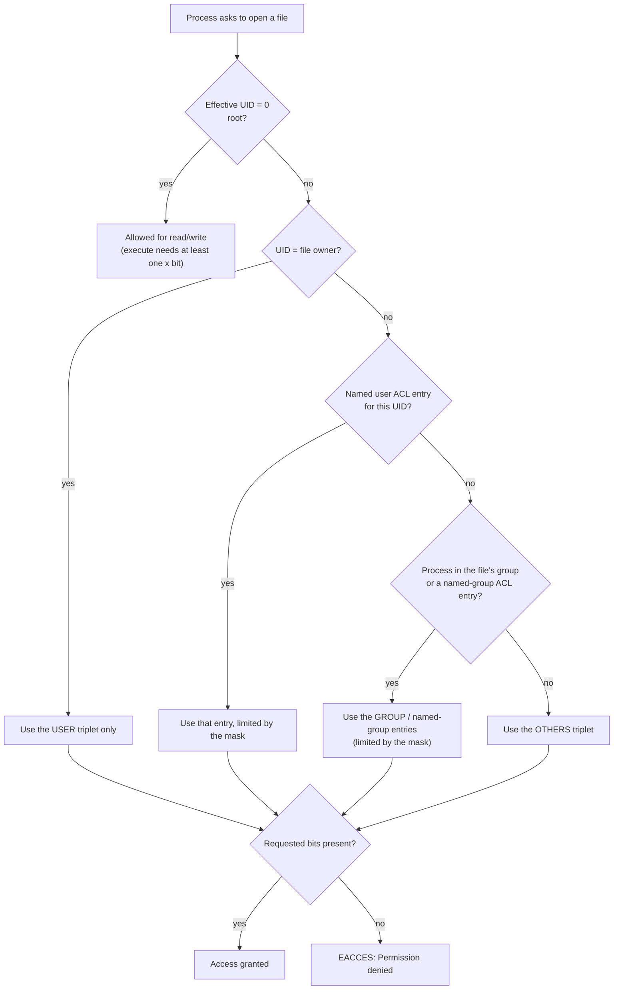
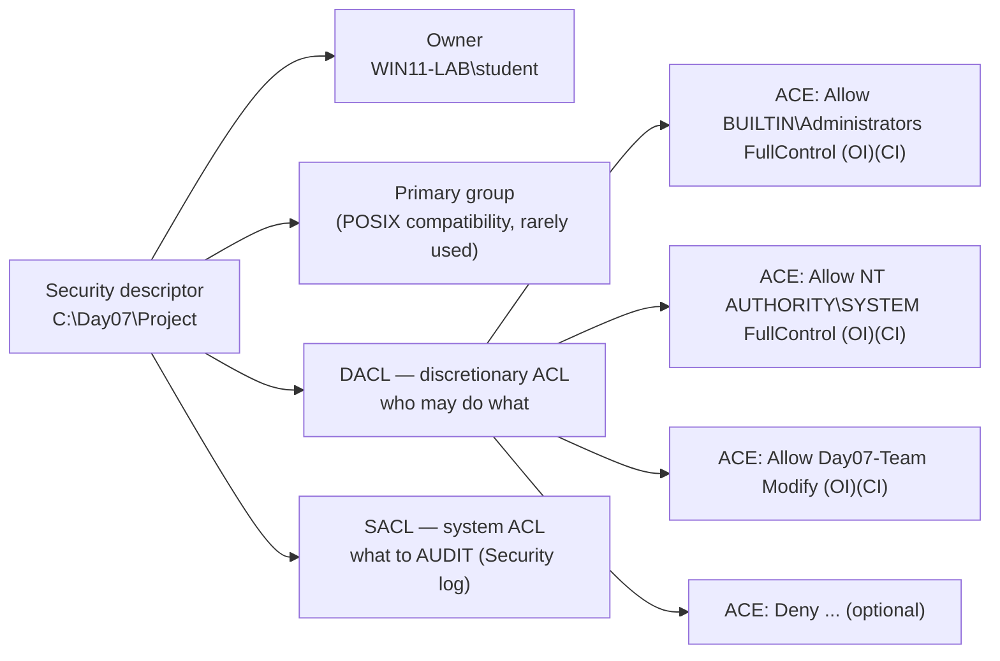

# Day 07: File Permissions and Access Control

!!! info "Lesson overview"
    | | |
    |---|---|
    | **Module** | 2 — System Administration |
    | **Difficulty** | :material-signal-cellular-2: Intermediate |
    | **Estimated time** | 3.5–4 hours (90 min reading, 75 min demonstrations, 60–90 min lab and quiz) |
    | **Platforms** | Ubuntu 24.04 LTS (Bash 5.2, GNU coreutils 9.4, acl 2.3) · Windows 11 (Windows PowerShell 5.1 and PowerShell 7.4+) |
    | **Lab** | [Lab 07: Lock It Down](../../labs/lab-07.md) |

## Learning Objectives

By the end of this lesson you will be able to:

1. Read Linux permission strings (`-rwxr-x---`) and octal modes (`750`) for **files** and **directories**, and explain why `r`, `w` and `x` mean different things on a directory.
2. Change permissions with `chmod` in **numeric** (`640`, `2770`) and **symbolic** (`u+x`, `g-w`, `o=`, `a+X`) form, including safe recursive changes.
3. Change ownership with `chown` and `chgrp`, and explain who is allowed to do so.
4. Calculate the effect of a **umask** and explain why Ubuntu users get `0002` while root gets `0022`.
5. Use the **special bits** (setuid, setgid, sticky), build a setgid shared directory, and audit a system for setuid/setgid and world-writable files with `find -perm`.
6. Grant access to an extra user or group with **POSIX ACLs** (`getfacl`, `setfacl`), including default ACLs and the ACL mask.
7. Explain the **Windows NTFS** model: security descriptor, owner, DACL, SACL, ACEs, allow/deny, explicit vs inherited entries, and inheritance flags.
8. Inspect and change NTFS permissions with `Get-Acl`, `Set-Acl`, `icacls` and `takeown`, and **back up ACLs before every change** (`getfacl -R`, `icacls /save`) so you can restore them.

## Prerequisites

- [Day 06: Users and Groups](day-06.md) completed: you can create throwaway `lab-*` users and groups, and you understand UIDs, GIDs and supplementary groups.
- [Day 02](../module-1/day-02.md) and [Day 04](../module-1/day-04.md): you can navigate, create files and use `find`.
- A **non-production** Ubuntu VM or WSL2 instance where you may use `sudo`, and a Windows 11 VM (or test machine) where you can open an **elevated** PowerShell for the NTFS demonstrations.
- On minimal Ubuntu images (containers, some cloud images) the `acl` package that provides `getfacl`/`setfacl` may be missing: `sudo apt install acl`. Standard Ubuntu 24.04 desktop and server installs include it.

!!! warning "Permissions changes are security changes"
    Every command today can either close a hole or open one. Work only inside the practice folders (`~/day07`, `/srv/day07`, `C:\Day07`), back up permissions **before** you change them, and never "fix" an access problem with `chmod 777` or *Everyone: Full control*.

## Introduction and Concepts

### Why access control exists

An operating system is shared: by many users, by services that run under their own accounts, and by programs written by people you do not know. **Access control** answers one question for every file operation: *may this identity perform this action on this object?*

Both Linux and Windows answer that question with the same three ingredients:

| Ingredient | Linux | Windows |
|---|---|---|
| **Subject** (who is asking) | A process running with a UID and a list of GIDs | A process with an access **token**: the user SID, group SIDs and privileges |
| **Object** (what is accessed) | A file, directory, device or socket (an *inode*) | A file, folder, registry key, service, printer… (a *securable object*) |
| **Policy** (what is allowed) | Owner, group, mode bits (`rwx` × 3), special bits and an optional ACL | A **security descriptor**: owner, group, DACL (who may do what) and SACL (what to audit) |

The kernel checks the policy **every time** a file is opened, not once at login. That is why a permission change takes effect immediately for new operations, while a **group membership** change (which lives in the process's credentials or token) takes effect only for new logins, as you saw on Day 06.

### The Linux model: owner, group, others

Every file and directory has exactly **one owner** (a UID), **one group** (a GID), and **three permission triplets**:

```text
 -  rwx  r-x  ---
 │   │    │    └── others: everyone else
 │   │    └─────── group: members of the file's group
 │   └──────────── user (owner)
 └──────────────── type: - file, d directory, l symlink, c/b device, p pipe, s socket
```

Each triplet has three bits, worth 4, 2 and 1:

| Bit | Value | On a **file** | On a **directory** |
|---|---|---|---|
| `r` | 4 | Read the contents | **List** the names inside (`ls`) |
| `w` | 2 | Modify the contents (truncate, append, overwrite) | **Create, delete and rename** entries inside (needs `x` too) |
| `x` | 1 | Execute it as a program or script | **Enter / traverse** it (`cd`, and reach anything below it by path) |

Adding the values gives the familiar **octal** digits: `rwx` = 7, `rw-` = 6, `r-x` = 5, `r--` = 4, `---` = 0. So `-rwxr-x---` is `750` and `-rw-r-----` is `640`.

!!! tip "The two rules beginners miss"
    1. **Deleting a file is a directory operation.** Whether you can delete or rename `report.txt` depends on `w` + `x` on the **directory** containing it, not on the permissions of `report.txt` itself (unless the sticky bit is set, see below).
    2. **`x` on every directory in the path is required.** To read `/srv/app/conf/app.conf` you need `x` on `/`, `/srv`, `/srv/app` and `/srv/app/conf`, plus `r` on the file. One missing `x` anywhere and you get *Permission denied*.

### How Linux decides: first match wins

The kernel does **not** add the triplets together. It picks exactly **one** of them:



Consequences:

- An owner with `---r--r--` (`044`) **cannot read** their own file, even though group and others can. The owner triplet is checked and the search stops there. (The owner can still `chmod` it back, because changing the mode is a right of ownership, not a permission bit.)
- **root bypasses** read and write checks entirely. This is why `sudo` makes permission problems "disappear", and why running everything as root hides mistakes until they reach production.
- The ACL branch only exists when a file has extended ACL entries. You will meet it later today.

### Ownership: who may change what

| Action | Who may do it |
|---|---|
| `chmod` (change mode bits) | The **owner** of the file, or root |
| `chgrp` to another group | The owner, **only to a group they are a member of**; root to any group |
| `chown` to another user | **Only root** (otherwise users could give away files to dodge disk quotas or frame others) |
| `setfacl` | The owner, or root |

### The umask: default permissions for new files

Programs normally create files asking for mode `666` (`rw-rw-rw-`) and directories asking for `777`. The process's **umask** then **removes** bits. The umask is a mask, not a subtraction: each bit set in the umask is cleared from the requested mode.

| umask | New file (from 666) | New directory (from 777) | Typical use |
|---|---|---|---|
| `0022` | `644` `rw-r--r--` | `755` `rwxr-xr-x` | root and most service accounts |
| `0002` | `664` `rw-rw-r--` | `775` `rwxrwxr-x` | Ubuntu users with a private group (team-friendly) |
| `0027` | `640` `rw-r-----` | `750` `rwxr-x---` | Hardened servers: no access for others |
| `0077` | `600` `rw-------` | `700` `rwx------` | Private keys, secrets, root on hardened systems |

**Ubuntu 24.04 detail (verified against `login.defs(5)` and `pam_umask(8)`):** `/etc/login.defs` contains `UMASK 022` and `USERGROUPS_ENAB yes`. Logins go through PAM (`pam_umask` in `/etc/pam.d/common-session`). Because `USERGROUPS_ENAB` is `yes`, `pam_umask` applies its *usergroups* rule: for a **non-root user whose user name equals their primary group name** (the default "user private group" created by `useradd`/`adduser`), the group bits of the umask are made equal to the owner bits, so `022` becomes **`002`**. Root keeps `0022`. A user whose primary group is a shared group such as `users` also keeps `0022`. This is safe only because each user's primary group contains just that user.

### Special bits: setuid, setgid and sticky

A fourth, leading octal digit holds three special bits:

| Bit | Octal | Shown as | On a file | On a directory |
|---|---|---|---|---|
| **setuid** | 4000 | `s` in the user `x` position (`-rwsr-xr-x`) | The program runs with the **file owner's** UID (often root) | No effect on Linux |
| **setgid** | 2000 | `s` in the group `x` position (`-rwxr-sr-x`) | The program runs with the **file's group** | New files and subdirectories **inherit the directory's group**; new subdirectories also get setgid |
| **sticky** | 1000 | `t` in the others `x` position (`drwxrwxrwt`) | Ignored on Linux | **Restricted deletion:** only the file's owner, the directory's owner or root may delete or rename entries |

A **capital** `S` or `T` means the special bit is set but the underlying `x` bit is **not**: usually a mistake (for example `-rwSr--r--`).

Real examples on every Ubuntu system:

- `/usr/bin/passwd` is `-rwsr-xr-x root root` (`4755`). A normal user runs it, but it executes as root so it can write `/etc/shadow`, which only root may modify.
- `/tmp` is `drwxrwxrwt` (`1777`): everyone may create files, but nobody may delete someone else's.
- `/usr/bin/chage` and `unix_chkpwd` are setgid **shadow**, so they can read `/etc/shadow` (`-rw-r----- root shadow`, `640`) without being root.

Setuid programs are a classic **privilege escalation** target: a bug in any setuid-root binary is a bug that runs as root. Linux ignores the setuid bit on interpreted scripts (`#!/bin/bash`), so only compiled binaries are affected. Auditing the list of setuid/setgid files is a standard hardening and incident-response task.

### POSIX ACLs: more than one group

The owner/group/others model allows exactly one group per file. When a second team, a single auditor or a service account needs access, use an **access control list** (ACL) instead of loosening "others":

```text
user::rw-              owner (same as the u triplet)
user:lab-audit:r--     named user entry
group::r--             owning group (same as the g triplet)
group:lab-devs:rw-     named group entry
mask::rw-              upper limit for named users, named groups and the owning group
other::---             others (same as the o triplet)
default:...            (directories only) template copied to new files and subdirectories
```

Three facts to remember:

1. A `+` at the end of the `ls -l` mode (`-rw-r-----+`) means "this file has an extended ACL; run `getfacl`".
2. When an ACL exists, the **group triplet shown by `ls -l` is the mask**, not the owning group's permissions. `chmod g=...` changes the mask, which can silently reduce every named entry (`#effective:` in `getfacl` output shows the result).
3. **Default ACLs** on a directory replace the umask for files created inside it: the new file's permissions come from the default ACL (limited by the mode the program requested).

### The Windows model: security descriptors, DACLs and ACEs

Every securable object on NTFS carries a **security descriptor**:



- An **ACE** (access control entry) names a **trustee** (a user or group, stored as a **SID**), a type (**Allow** or **Deny**), a set of **rights** (FullControl, Modify, ReadAndExecute, Read, Write, or fine-grained rights such as DeleteSubdirectoriesAndFiles) and **inheritance flags**.
- The **owner** can always read and change the DACL, even if no ACE grants it access. Administrators can **take ownership** (`SeTakeOwnershipPrivilege`), which is how locked-out folders are recovered with `takeown`.
- **No matching ACE = no access.** An empty DACL denies everyone; a *missing* (null) DACL grants everyone everything. You almost never see either on NTFS.
- The **SACL** controls auditing (Day 17); reading it needs the *Manage auditing and security log* privilege, which is why `Get-Acl -Audit` requires elevation.

#### Inheritance

Unlike Linux mode bits, NTFS permissions **flow down** the folder tree. When you add an ACE to a folder with the flags `(OI)(CI)`, Windows copies it to existing children and to every new child as an **inherited** ACE, shown with `(I)` in `icacls` and `IsInherited = True` in PowerShell.

| `icacls` code | .NET flag | Meaning |
|---|---|---|
| `(OI)` | `InheritanceFlags.ObjectInherit` | Files inside inherit this ACE |
| `(CI)` | `InheritanceFlags.ContainerInherit` | Subfolders inherit this ACE |
| `(IO)` | `PropagationFlags.InheritOnly` | Applies to children only, not to this folder itself |
| `(NP)` | `PropagationFlags.NoPropagateInherit` | Inherit to direct children only, not grandchildren |
| `(I)` | `IsInherited` (read-only) | This ACE was inherited from a parent |

To give a folder its own independent permissions you **disable (break) inheritance**. You must decide what to do with the ACEs it currently inherits: **copy** them as explicit ACEs (`icacls /inheritance:d`, `SetAccessRuleProtection($true, $true)`) or **remove** them (`icacls /inheritance:r`, `SetAccessRuleProtection($true, $false)`). Removing them without first granting yourself and SYSTEM access is the fastest way to lock everyone out.

#### Allow vs deny: the evaluation order

Windows stores ACEs in **canonical order** and evaluates them top-down until every requested right is either granted or denied:

1. Explicit **Deny**
2. Explicit **Allow**
3. Inherited **Deny** (closest parent first)
4. Inherited **Allow**

So an **explicit Allow beats an inherited Deny**, and a Deny on a group you are in beats an Allow for you at the same level. Microsoft's guidance is to avoid Deny ACEs where possible and simply **not grant** access; Deny entries make troubleshooting much harder.

#### Basic permissions (what the Security tab shows)

| Basic permission | `icacls` | Includes |
|---|---|---|
| Full control | `F` | Everything, including change permissions (`WDAC`) and take ownership (`WO`) |
| Modify | `M` | Read, write, execute **and delete** |
| Read & execute | `RX` | Read files, list folders, run programs |
| List folder contents | `(CI)RX` on folders only | Read & execute, inherited by folders only |
| Read | `R` | Read data, attributes and permissions |
| Write | `W` | Create files, write data, append; no delete |
| (no access) | `N` | Used with `/grant:r` to replace; prefer removing ACEs |

#### Linux and Windows models side by side

| Concept | Linux | Windows NTFS |
|---|---|---|
| Who | UID + GIDs | SIDs in the access token |
| Default policy | Mode bits on every inode | DACL (usually inherited) |
| Extra principals | POSIX ACL (optional) | Any number of ACEs (normal) |
| Inheritance | None for mode bits; **default ACLs** and **setgid directories** emulate it | Built in: `(OI)(CI)` flags |
| Deny | Not available (only "not granted") | Explicit and inherited Deny ACEs |
| Superuser | root bypasses checks | Administrators are **not** exempt; they use ownership/privileges to regain access |
| Change owner | root only | Owner with `SeRestorePrivilege`, or take ownership with `SeTakeOwnershipPrivilege` |
| Auditing | `auditd` rules (Day 17) | SACL entries + audit policy |

## Linux Command Reference

| Command | Purpose | Package / availability | Needs root? |
|---|---|---|---|
| `ls -l`, `ls -ld DIR` | Show type, mode, owner, group (`+` = ACL present) | coreutils | No |
| `stat` | Exact octal mode, owner, inode and timestamps | coreutils | No |
| `chmod` | Change mode bits (numeric or symbolic) | coreutils | Owner or root |
| `chown` | Change owner and/or group | coreutils | **Root** to change owner |
| `chgrp` | Change group | coreutils | Owner (to own groups) or root |
| `umask` | Show or set the creation mask of the current shell | Bash built-in | No |
| `find -perm` | Find files by permission bits (audits) | findutils | Root to search everywhere |
| `getfacl` | Show POSIX ACLs; back them up with `-R` | `acl` package | No (read) |
| `setfacl` | Modify, remove, or restore ACLs | `acl` package (`sudo apt install acl` on minimal images) | Owner or root |
| `lsattr` / `chattr` | Show / set ext4 attributes such as immutable (`+i`) | e2fsprogs | `chattr +i` needs root |
| `namei -l PATH` | Show permissions of **every directory** along a path | util-linux | No |
| `sudo -u USER test -r FILE` | Test access as another user | sudo | Root (via sudo) |

## PowerShell Command Reference

| Cmdlet / tool | Aliases | Purpose | Works in 5.1 | Works in 7.x | Admin? |
|---|---|---|---|---|---|
| `Get-Acl` | — | Read a security descriptor (owner, DACL, optionally SACL) as an object | Yes | **Windows only** | No (except `-Audit`) |
| `Set-Acl` | — | Write a security descriptor back to an item | Yes | **Windows only** | Depends on the object; changing owner/SACL needs admin |
| `[System.Security.AccessControl.FileSystemAccessRule]` | — | .NET class used to build a new ACE | Yes | Windows only | — |
| `icacls.exe` | — | Display, grant, remove, **save and restore** DACLs; change inheritance | Yes | Yes (native Windows tool) | Depends on the object |
| `takeown.exe` | — | Take ownership of files/folders | Yes | Yes (native) | Usually admin |
| `Get-ChildItem` + `Get-Acl` | — | Audit permissions across a tree | Yes | Windows only | No |
| `Get-Acl HKLM:\...` | — | Read registry key permissions (Registry provider) | Yes | Windows only | No |
| <code>Get-Item ... &#124; Select-Object Attributes</code> | — | Read-only / hidden attributes (not security) | Yes | Yes | No |

!!! note "Edition and platform notes"
    - `Get-Acl` and `Set-Acl` are in the **Microsoft.PowerShell.Security** module. In PowerShell 7 the help states *"This cmdlet is only available on the Windows platform."* On Linux and macOS use `ls -l`, `stat`, `chmod` and `getfacl` from PowerShell instead.
    - Windows PowerShell 5.1 has two extra `Get-Acl` parameters that PowerShell 7 does not: `-AllCentralAccessPolicies` and `-UseTransaction`.
    - `icacls` and `takeown` are Windows executables, so they behave identically in 5.1 and 7. Their output is plain text, not objects.

## Detailed Command Explanations

### `ls -l` and `stat` — reading permissions

`ls -l` shows the mode string, link count, owner, group, size, time and name. Use `ls -ld DIR` to see a directory **itself** rather than its contents. A trailing `+` means an ACL exists and a trailing `.` means an SELinux context (Ubuntu does not use SELinux by default).

`stat FILE` prints the octal mode next to the symbolic one, for example `Access: (0640/-rw-r-----)`. For scripts, use a format string: `stat -c '%a %A %U:%G %n' FILE` prints `640 -rw-r----- alice:devs file`.

`namei -l /srv/app/conf/app.conf` lists every path component with its mode and owner. It is the fastest way to find the one directory that lacks `x` when "the file is readable but I still get *Permission denied*".

### `chmod` — numeric mode

A numeric mode sets **all** bits at once. Three digits are user, group, others; an optional leading fourth digit holds setuid (4), setgid (2) and sticky (1).

| Mode | String | Typical use |
|---|---|---|
| `600` | `rw-------` | Private keys, `.env` files, password files |
| `640` | `rw-r-----` | Config readable by a service group, e.g. `/etc/shadow` (`root:shadow`) |
| `644` | `rw-r--r--` | Public config and documents |
| `700` | `rwx------` | Private directory (`~/.ssh`) or private script |
| `750` | `rwxr-x---` | Team-readable script or directory |
| `755` | `rwxr-xr-x` | Programs in `/usr/local/bin`, public directories |
| `2770` | `rwxrws---` | Shared team directory: group inherited, others locked out |
| `1777` | `rwxrwxrwt` | Shared drop directory like `/tmp` |
| `777` | `rwxrwxrwx` | **Almost never correct.** Anyone can replace the content |

GNU detail (from `chmod(1)`): for **directories**, a numeric mode **does not clear** existing setuid/setgid bits. `chmod 770 shared` on a `2770` directory leaves it `2770`. Use `chmod g-s shared` or an extra leading zero, `chmod 00770 shared`, to clear it.

### `chmod` — symbolic mode

Symbolic mode changes **only the bits you mention**, which makes it safer for recursive changes:

```text
chmod [ugoa][+-=][rwxXst] FILE
       │      │    └── bits: r w x, X (execute only for directories / already-executable files), s (setuid/setgid), t (sticky)
       │      └─────── + add, - remove, = set exactly (others in that class cleared)
       └────────────── u owner, g group, o others, a all (default a, filtered by umask)
```

Examples: `chmod u+x deploy.sh`, `chmod go-w file`, `chmod o= secret.txt` (clear all bits for others), `chmod u=rw,g=r,o= file` (same as `640`), `chmod g+s shared/`, `chmod +t drop/`.

The capital **`X`** is the secret to safe recursion: `chmod -R g+rwX dir` gives `x` to directories (so they can be entered) but **not** to ordinary files, unless a file is already executable for someone.

### `chmod -R` pitfalls

- `chmod -R 644 dir` removes `x` from **every directory**, so nobody (except root) can enter them any more. Use `chmod -R u=rwX,go=rX dir`, or split files and directories with `find`: `find dir -type d -exec chmod 755 {} +` and `find dir -type f -exec chmod 644 {} +`.
- `chmod -R 755 dir` makes every file executable, which is wrong for data and a security smell.
- `sudo chmod -R ... /` or a mistyped path (`/ etc`) can break a whole system. GNU `chmod`, `chown` and `chgrp` support `--preserve-root`, which refuses to operate recursively on `/`.
- Recursive `chmod` does **not** follow symbolic links it meets during traversal, and it never changes the permissions of a link itself (link permissions are not used).

### `chown` and `chgrp` — ownership

```bash
sudo chown alice report.txt            # owner only
sudo chown alice:devs report.txt       # owner and group
sudo chown :devs report.txt            # group only (same as chgrp devs)
sudo chown -R www-data:www-data /srv/www/site   # whole tree
chgrp devs report.txt                  # owner may do this if they are in "devs"
sudo chown --reference=good.conf bad.conf       # copy owner/group from another file
```

`chown -R` does not follow symlinks by default; `-h` changes a symlink itself instead of its target. When an unprivileged user changes the owner or group of an executable, the kernel clears setuid/setgid bits as a safety measure, so re-check special bits after ownership changes.

### `umask` — controlling defaults

`umask` prints the current mask (`0002`), `umask -S` prints the **allowed** bits symbolically (`u=rwx,g=rwx,o=rx`), and `umask 027` changes the mask **for the current shell and its children only**. Make permanent changes in the right place:

| Scope | Where |
|---|---|
| One script | `umask 077` at the top of the script |
| One user | `~/.bashrc` or `~/.profile` (`umask 027`) |
| All PAM logins | `UMASK` in `/etc/login.defs` (read by `pam_umask`) |
| A systemd service | `UMask=0027` in the unit file (Day 08) |

### Special bits in practice

- **setgid shared directory:** `sudo chgrp devs /srv/shared && sudo chmod 2770 /srv/shared`. Every file created inside gets group `devs` regardless of the creator's primary group. Combine with a `002` umask or a default ACL so the group can also **write** the new files.
- **Sticky drop folder:** `chmod 1777 /srv/drop` lets everyone upload, and nobody delete others' uploads.
- **setuid binaries:** you should almost never **add** one. Your job is to **audit** them: `sudo find / -xdev -perm -4000 -type f`.

### `find -perm` — permission audits

| Form | Meaning | Example |
|---|---|---|
| `-perm 644` | Mode is **exactly** 644 | Files that still have the default mode |
| `-perm -4000` | **All** of these bits are set (here: setuid) | Setuid audit |
| `-perm /6000` | **Any** of these bits is set (setuid or setgid) | Combined special-bit audit |
| `-perm -o+w` or `-perm -0002` | World-writable | Files anyone can modify |
| `-type d -perm -0002 ! -perm -1000` | World-writable directories **without** sticky bit | Unsafe shared directories |
| `-nouser` / `-nogroup` | Owner or group no longer exists | Leftovers after offboarding (Day 06) |

Add `-xdev` to stay on one filesystem (skips `/proc`, network mounts) and `2>/dev/null` to hide errors from unreadable paths.

### `getfacl` and `setfacl` — POSIX ACLs

| Task | Command |
|---|---|
| Show | `getfacl file` · `getfacl --omit-header file` |
| Grant a user read | `setfacl -m u:lab-audit:r file` |
| Grant a group read/write, directories traversable | `setfacl -R -m g:devs:rwX dir` |
| Default ACL for new files in a directory | `setfacl -d -m g:devs:rwX dir` |
| Remove one entry | `setfacl -x u:lab-audit file` |
| Remove all extended entries | `setfacl -b file` |
| Remove only the default ACL | `setfacl -k dir` |
| **Back up** a tree | `getfacl -R dir > perms.acl` |
| **Restore** a backup | `setfacl --restore=perms.acl` (run from the same directory you backed up from) |
| Dry run | `setfacl --test -m u:x:r file` |

`getfacl -R` also records owner, group and mode bits (the `user::`, `group::` and `other::` lines), so `getfacl -R` + `setfacl --restore` is a complete **permissions backup** for a tree even when no ACLs are used. `getfacl` strips the leading `/` from absolute paths (it prints a warning), so back up and restore from the same working directory.

### `chattr` and `lsattr` — attributes beyond permissions (ext4)

`sudo chattr +i file` makes a file **immutable**: nobody, not even root, can modify, delete or rename it until `chattr -i` is run. Attackers use it to protect their persistence files, and administrators sometimes use it on critical configs. `lsattr file` shows the flags (`----i---------e-------`). Attributes are filesystem-specific (ext4, XFS partly) and are not part of the permission bits.

### Windows: `Get-Acl`

`Get-Acl -Path C:\Day07\Project` returns a `DirectorySecurity` (or `FileSecurity`, `RegistrySecurity`) object. Useful members:

| Member | What it gives you |
|---|---|
| `.Owner` | Owner as `DOMAIN\Name` |
| `.Access` | Array of `FileSystemAccessRule` objects: `IdentityReference`, `FileSystemRights`, `AccessControlType` (Allow/Deny), `IsInherited`, `InheritanceFlags`, `PropagationFlags` |
| `.AccessToString` | The DACL as readable text, one ACE per line |
| `.Sddl` | The whole security descriptor as one SDDL string (good for baselines and diffs) |
| `.AreAccessRulesProtected` | `True` when inheritance is disabled |
| `.Audit` | SACL entries (only with `-Audit`, which needs elevation) |
| `.SetAccessRule()`, `.AddAccessRule()`, `.RemoveAccessRule()`, `.RemoveAccessRuleAll()`, `.PurgeAccessRules()` | Edit ACEs in memory |
| `.SetAccessRuleProtection(isProtected, preserveInheritance)` | Disable/enable inheritance (in memory) |
| `.SetOwner()` | Change the owner (in memory) |

Nothing changes on disk until you pass the modified object to `Set-Acl`. `Get-Acl` also works on the **registry**: `Get-Acl HKLM:\SYSTEM\CurrentControlSet\Services\Spooler | Format-List`.

### Windows: `Set-Acl`

The pattern is always **get → modify in memory → set**:

```powershell
$acl  = Get-Acl -Path C:\Day07\Project
$rule = [System.Security.AccessControl.FileSystemAccessRule]::new(
            'WIN11-LAB\Day07-Team',        # identity
            'Modify',                      # FileSystemRights
            'ContainerInherit,ObjectInherit',  # InheritanceFlags  = (CI)(OI)
            'None',                        # PropagationFlags
            'Allow')                       # AccessControlType
$acl.AddAccessRule($rule)
Set-Acl -Path C:\Day07\Project -AclObject $acl -WhatIf
Set-Acl -Path C:\Day07\Project -AclObject $acl
```

`::new()` works in both 5.1 and 7 (PowerShell 5.0+). The `New-Object` form used in Microsoft's documentation also works: `New-Object System.Security.AccessControl.FileSystemAccessRule($identity, $rights, $inherit, $propagate, $type)`.

Known pitfalls:

- `Set-Acl` writes the **whole** descriptor it was given. If `Get-Acl` returned an owner you are not allowed to set, Windows PowerShell 5.1 can fail with *"The security identifier is not allowed to be the owner of this object"*. Run elevated, or use `icacls` for that change.
- `SetAccessRule()` **replaces** every existing Allow rule for that identity; `AddAccessRule()` **merges** with them. Choose deliberately.
- `Set-Acl` supports `-WhatIf` and `-Confirm`. Use them.

### Windows: `icacls`

`icacls` is the Swiss-army knife for NTFS permissions and the tool most administrators use in scripts and tickets:

```text
icacls C:\Day07\Project                                  # display
icacls C:\Day07\Project /save C:\Day07\acl-before.txt /t /c   # BACK UP the tree's DACLs
icacls C:\Day07\Project /grant "Day07-Team:(OI)(CI)M"   # add an ACE
icacls C:\Day07\Project /grant:r "lab-audit:(OI)(CI)RX" # replace that user's explicit grants
icacls C:\Day07\Project /remove:g Everyone              # remove all Allow ACEs for Everyone
icacls C:\Day07\Project /inheritance:d                  # disable inheritance, copy ACEs
icacls C:\Day07\Project /inheritance:r                  # disable inheritance, remove inherited ACEs
icacls C:\Day07\Project /inheritance:e                  # re-enable inheritance
icacls C:\Day07\Project\* /reset /t /c                  # replace with inherited defaults
icacls C:\Day07 /restore C:\Day07\acl-before.txt        # RESTORE (note: run on the parent folder)
icacls C:\Day07\Project /findsid lab-old /t             # where is this account still granted?
```

Rules worth memorising:

- `/save` stores entries **relative to the folder you pass**, so `/restore` is run against the **parent directory** of what you saved. `/t` recurses, `/c` continues on errors, `/q` suppresses success messages.
- `/grant` adds; `/grant:r` replaces previously granted **explicit** permissions for that SID.
- `/remove:g` removes grants, `/remove:d` removes denies, plain `/remove` removes both.
- Quote trustees with spaces (`"Authenticated Users:(OI)(CI)RX"`), and in PowerShell quote any argument containing parentheses, or PowerShell will try to evaluate `(OI)` as an expression.
- A numeric SID needs a `*` prefix: `*S-1-1-0` (Everyone).

### Windows: `takeown`

`takeown /f C:\Day07\Locked /r /d y` makes the current user the owner of a folder tree (`/a` gives ownership to the Administrators group instead). Ownership does **not** grant access by itself; it gives you the right to rewrite the DACL, which you then do with `icacls /grant` or `/reset`. Use it for recovery, not as a routine fix, and record it in the ticket.

## Syntax and Parameters

### Bash

```text
ls -l [FILE]... ; ls -ld DIR...
stat [-c FORMAT] FILE...
chmod [-R] [-v|-c] [--preserve-root] MODE[,MODE]... FILE...
chmod [-R] --reference=RFILE FILE...
chown [-R] [-h] [-v|-c] [OWNER][:[GROUP]] FILE...
chgrp [-R] [-h] [-v|-c] GROUP FILE...
umask [-S] [MODE]
find PATH... [-xdev] [-type f|d] [-perm MODE | -perm -MODE | -perm /MODE] [-nouser] [-nogroup]
getfacl [-R] [-p] [--omit-header] FILE...
setfacl [-R] [-d] {-m|-x} ACL_ENTRIES FILE...   ;   setfacl -b|-k FILE...   ;   setfacl --restore=FILE
lsattr FILE... ; chattr [+-=]ATTRS FILE...
```

| Option | Command | Meaning |
|---|---|---|
| `-R` | chmod, chown, chgrp, getfacl, setfacl | Recursive |
| `-v` / `-c` | chmod, chown, chgrp | Verbose for every file / report only real changes |
| `--reference=RFILE` | chmod, chown, chgrp | Copy mode or ownership from another file |
| `--preserve-root` | chmod, chown, chgrp | Refuse to operate recursively on `/` |
| `-h` | chown, chgrp | Change a symbolic link itself |
| `%a %A %U %G %n` | stat -c | Octal mode, symbolic mode, owner, group, name |
| `-S` | umask | Show the mask as allowed permissions |
| `-perm -MODE` / `/MODE` | find | All bits set / any bit set |
| `-m` / `-x` | setfacl | Modify (add or change) / remove entries |
| `-d` | setfacl | Operate on the **default** ACL |
| `-b` / `-k` | setfacl | Remove all extended entries / remove the default ACL |
| `--restore=FILE` | setfacl | Apply a `getfacl -R` backup |
| `--test` | setfacl | Show the result without changing anything |
| `-p` | getfacl | Keep leading `/` in path names |
| `+i` / `+a` | chattr | Immutable / append-only |

ACL entry syntax: `u:NAME:PERMS`, `g:NAME:PERMS`, `m::PERMS`, `o::PERMS`, prefixed with `d:` for default entries; `PERMS` uses `r`, `w`, `x`, `X` or `-`.

### PowerShell and Windows tools

```text
Get-Acl [[-Path] <String[]>] [-Audit] [-Filter <String>] [-Include <String[]>] [-Exclude <String[]>]
Get-Acl -LiteralPath <String[]> ... ; Get-Acl -InputObject <PSObject> ...
        # 5.1 only: [-AllCentralAccessPolicies] [-UseTransaction]
Set-Acl [-Path] <String[]> [-AclObject] <Object> [-ClearCentralAccessPolicy] [-PassThru]
        [-Filter <String>] [-Include <String[]>] [-Exclude <String[]>] [-WhatIf] [-Confirm]
Set-Acl -LiteralPath <String[]> [-AclObject] <Object> ...
[System.Security.AccessControl.FileSystemAccessRule]::new(identity, rights, inheritanceFlags, propagationFlags, type)
icacls name [/save aclfile] [/setowner user] [/findsid Sid] [/verify] [/reset] [/T] [/C] [/L] [/Q]
icacls name [/grant[:r] Sid:perm[...]] [/deny Sid:perm[...]] [/remove[:g|:d] Sid[...]] [/inheritance:e|d|r] [/T] [/C] [/L] [/Q]
icacls directory [/substitute SidOld SidNew [...]] [/restore aclfile] [/C] [/L] [/Q]
takeown [/s computer [/u user [/p [password]]]] /f filename [/a] [/r [/d {Y|N}]]
```

| Parameter | Tool | Meaning |
|---|---|---|
| `-Path` / `-LiteralPath` | Get-Acl, Set-Acl | Item(s); `-LiteralPath` for names containing `[` `]` |
| `-Audit` | Get-Acl | Also read the SACL (needs elevation) |
| `-AclObject` | Set-Acl | The modified security descriptor to apply |
| `-PassThru` | Set-Acl | Return the applied descriptor |
| `-WhatIf` / `-Confirm` | Set-Acl | Simulate / ask before applying |
| `FileSystemRights` | FileSystemAccessRule | `FullControl`, `Modify`, `ReadAndExecute`, `Read`, `Write`, `ListDirectory`, `Delete`… (combine with commas) |
| `InheritanceFlags` | FileSystemAccessRule | `None`, `ContainerInherit`, `ObjectInherit` |
| `PropagationFlags` | FileSystemAccessRule | `None`, `InheritOnly`, `NoPropagateInherit` |
| `AccessControlType` | FileSystemAccessRule | `Allow` or `Deny` |
| `/save` `/restore` | icacls | Back up / restore DACLs to/from a file |
| `/grant[:r]` `/deny` <code>/remove[:g&#124;:d]</code> | icacls | Add / replace / deny / remove ACEs |
| <code>/inheritance:e&#124;d&#124;r</code> | icacls | Enable / disable and copy / disable and remove inherited ACEs |
| `/reset` | icacls | Replace ACLs with the default inherited ACLs |
| `/t` `/c` `/q` | icacls | Recurse / continue on error / quiet |
| `F M RX R W D N` | icacls | Full, Modify, Read & execute, Read, Write, Delete, No access |
| `/f` `/r` `/a` `/d y` | takeown | Target / recursive / give to Administrators / answer prompts |

## Practical Demonstrations

The **Bash** outputs below were produced by running the commands with Bash 5.2.21 and GNU coreutils 9.4 on Ubuntu 24.04.5 inside a container (not a full desktop install), with throwaway accounts. UIDs were renumbered to the 1000 range and dates will differ on your system. The **PowerShell** outputs are **examples** written from the Microsoft documentation for Windows 11; they were not captured on a live system, and names, SIDs and dates will differ.

### Demo 1 — Read permissions precisely

=== "Bash"

    ```bash
    mkdir -p ~/day07 && cd ~/day07
    touch report.txt
    mkdir scripts
    ls -l
    stat report.txt
    stat -c '%A %a %U %G %n' report.txt scripts
    ```

    **Expected output (example):**

    ```text
    total 4
    -rw-rw-r-- 1 student student    0 Nov 10 16:42 report.txt
    drwxrwxr-x 2 student student 4096 Nov 10 16:42 scripts
      File: report.txt
      Size: 0               Blocks: 0          IO Block: 4096   regular empty file
    Device: 254,0   Inode: 566246      Links: 1
    Access: (0664/-rw-rw-r--)  Uid: ( 1000/ student)   Gid: ( 1000/ student)
    Access: 2026-11-10 16:42:17.910212700 +0000
    Modify: 2026-11-10 16:42:17.910212700 +0000
    Change: 2026-11-10 16:42:17.910212700 +0000
     Birth: 2026-11-10 16:42:17.907155061 +0000
    -rw-rw-r-- 664 student student report.txt
    drwxrwxr-x 775 student student scripts
    ```

    The file is `664` and the directory `775` because the user's umask is `0002` (user private group, see Demo 2).

=== "PowerShell"

    ```powershell
    New-Item -Path C:\Day07\Project -ItemType Directory -Force | Out-Null
    Get-Acl -Path C:\Day07\Project
    (Get-Acl -Path C:\Day07\Project).Access |
        Format-Table IdentityReference, AccessControlType, FileSystemRights, IsInherited -AutoSize
    icacls C:\Day07\Project
    ```

    **Expected output (example):**

    ```text
        Directory: C:\Day07

    Path    Owner              Access
    ----    -----              ------
    Project WIN11-LAB\student  BUILTIN\Administrators Allow  FullControl...

    IdentityReference                AccessControlType          FileSystemRights IsInherited
    -----------------                -----------------          ---------------- -----------
    BUILTIN\Administrators                       Allow               FullControl        True
    NT AUTHORITY\SYSTEM                          Allow               FullControl        True
    BUILTIN\Users                                Allow       ReadAndExecute, Synchronize        True
    NT AUTHORITY\Authenticated Users             Allow  Modify, Synchronize        True
    NT AUTHORITY\Authenticated Users             Allow                -536805376        True

    C:\Day07\Project BUILTIN\Administrators:(I)(OI)(CI)(F)
                     NT AUTHORITY\SYSTEM:(I)(OI)(CI)(F)
                     BUILTIN\Users:(I)(OI)(CI)(RX)
                     NT AUTHORITY\Authenticated Users:(I)(M)
                     NT AUTHORITY\Authenticated Users:(I)(OI)(CI)(IO)(M)

    Successfully processed 1 files; Failed processing 0 files
    ```

    Every ACE carries `(I)`: the folder has **no explicit permissions** and inherits everything from `C:\`. The odd number `-536805376` is a *generic* right (`GENERIC_EXECUTE`/`GENERIC_READ`… combinations) on an inherit-only ACE; `icacls` shows it more readably as `(IO)(M)`.

### Demo 2 — The umask in action

=== "Bash"

    ```bash
    cd ~/day07
    umask
    umask -S
    umask 077
    touch private.txt
    mkdir privdir
    ls -ld private.txt privdir
    umask 0002            # restore the Ubuntu user default for this shell
    sudo bash -c umask    # root's umask for comparison
    ```

    **Expected output (example):**

    ```text
    0002
    u=rwx,g=rwx,o=rx
    -rw------- 1 student student    0 Nov 10 16:42 private.txt
    drwx------ 2 student student 4096 Nov 10 16:42 privdir
    0022
    ```

=== "PowerShell"

    ```powershell
    # Windows has no umask: new items INHERIT the parent folder's ACEs.
    New-Item -Path C:\Day07\Project\new.txt -ItemType File | Out-Null
    icacls C:\Day07\Project\new.txt
    ```

    **Expected output (example):**

    ```text
    C:\Day07\Project\new.txt BUILTIN\Administrators:(I)(F)
                             NT AUTHORITY\SYSTEM:(I)(F)
                             BUILTIN\Users:(I)(RX)
                             NT AUTHORITY\Authenticated Users:(I)(M)

    Successfully processed 1 files; Failed processing 0 files
    ```

    The `(OI)(CI)` flags disappear on the file because files cannot have children. The Windows equivalent of "set a default" is to set the right **inheritable** ACEs on the parent folder.

### Demo 3 — `chmod` numeric and symbolic

=== "Bash"

    ```bash
    cd ~/day07
    printf '#!/usr/bin/env bash\necho hello from backup.sh\n' > backup.sh
    ls -l backup.sh
    ./backup.sh
    chmod 750 backup.sh && ls -l backup.sh && ./backup.sh
    chmod 640 report.txt && ls -l report.txt
    chmod u+x,g-w,o= report.txt && ls -l report.txt
    chmod a-x report.txt && ls -l report.txt
    chmod go-rwx backup.sh && ls -l backup.sh
    chmod -c g+r backup.sh
    chmod -v 600 private.txt
    ```

    **Expected output (example):**

    ```text
    -rw-rw-r-- 1 student student 46 Nov 10 16:42 backup.sh
    bash: ./backup.sh: Permission denied
    -rwxr-x--- 1 student student 46 Nov 10 16:42 backup.sh
    hello from backup.sh
    -rw-r----- 1 student student 0 Nov 10 16:42 report.txt
    -rwxr----- 1 student student 0 Nov 10 16:42 report.txt
    -rw-r----- 1 student student 0 Nov 10 16:42 report.txt
    -rwx------ 1 student student 46 Nov 10 16:42 backup.sh
    mode of 'backup.sh' changed from 0700 (rwx------) to 0740 (rwxr-----)
    mode of 'private.txt' retained as 0600 (rw-------)
    ```

    `-c` reports only real changes; `-v` reports every file, including unchanged ones ("retained").

=== "PowerShell"

    ```powershell
    # Read-only is a FILE ATTRIBUTE on Windows, not a permission:
    Set-ItemProperty -Path C:\Day07\Project\new.txt -Name IsReadOnly -Value $true
    Get-Item C:\Day07\Project\new.txt | Select-Object Name, IsReadOnly, Attributes
    Set-ItemProperty -Path C:\Day07\Project\new.txt -Name IsReadOnly -Value $false

    # Real permissions: grant one user Read on one file
    icacls C:\Day07\Project\new.txt /grant "lab-audit:(R)"
    icacls C:\Day07\Project\new.txt
    ```

    **Expected output (example):**

    ```text
    Name    IsReadOnly Attributes
    ----    ---------- ----------
    new.txt       True ReadOnly, Archive

    processed file: C:\Day07\Project\new.txt
    Successfully processed 1 files; Failed processing 0 files
    C:\Day07\Project\new.txt WIN11-LAB\lab-audit:(R)
                             BUILTIN\Administrators:(I)(F)
                             NT AUTHORITY\SYSTEM:(I)(F)
                             BUILTIN\Users:(I)(RX)
                             NT AUTHORITY\Authenticated Users:(I)(M)

    Successfully processed 1 files; Failed processing 0 files
    ```

    The new ACE has no `(I)`: it is **explicit**, and explicit ACEs are listed first.

### Demo 4 — Directory permissions and safe recursion

=== "Bash"

    ```bash
    sudo mkdir -p /srv/day07 && cd /srv/day07
    sudo mkdir xonly ronly
    echo secret | sudo tee xonly/notes.txt >/dev/null
    echo hi | sudo tee ronly/readme.txt >/dev/null
    sudo chown -R student:student xonly ronly
    sudo chmod 711 xonly && sudo chmod 744 ronly
    ls -ld xonly ronly
    sudo -u lab-bob ls xonly              # x without r: cannot list...
    sudo -u lab-bob cat xonly/notes.txt   # ...but can open a known name
    sudo -u lab-bob ls -l ronly           # r without x: names only, no details or access
    ```

    **Expected output (example):**

    ```text
    drwxr--r-- 2 student student 4096 Nov 10 16:42 ronly
    drwx--x--x 2 student student 4096 Nov 10 16:42 xonly
    ls: cannot open directory 'xonly': Permission denied
    secret
    ls: cannot access 'ronly/readme.txt': Permission denied
    total 0
    -????????? ? ? ? ?            ? readme.txt
    ```

    Now the recursion trap and its fix:

    ```bash
    sudo mkdir -p rtest/d && sudo touch rtest/a.txt
    sudo chmod -R 644 rtest            # WRONG: removes x from directories
    ls -ld rtest rtest/d
    sudo chmod -R u=rwX,go=rX rtest    # RIGHT: X = x for directories only
    ls -lR rtest
    ```

    **Expected output (example):**

    ```text
    drw-r--r-- 3 root root 4096 Nov 10 16:43 rtest
    drw-r--r-- 2 root root 4096 Nov 10 16:43 rtest/d
    rtest:
    total 4
    -rw-r--r-- 1 root root    0 Nov 10 16:43 a.txt
    drwxr-xr-x 2 root root 4096 Nov 10 16:43 d

    rtest/d:
    total 0
    ```

=== "PowerShell"

    ```powershell
    # "List folder contents" without "Read" on files, applied to folders only (CI):
    icacls C:\Day07\Project /grant "lab-bob:(CI)(RX)"
    # Audit a tree: which items have explicit (non-inherited) ACEs?
    Get-ChildItem C:\Day07 -Recurse | ForEach-Object {
        $acl = Get-Acl -LiteralPath $_.FullName
        $explicit = $acl.Access | Where-Object { -not $_.IsInherited }
        if ($explicit) { [pscustomobject]@{ Path = $_.FullName; Explicit = ($explicit.IdentityReference -join ', ') } }
    }
    ```

    **Expected output (example):**

    ```text
    processed file: C:\Day07\Project
    Successfully processed 1 files; Failed processing 0 files

    Path                       Explicit
    ----                       --------
    C:\Day07\Project           WIN11-LAB\lab-bob
    C:\Day07\Project\new.txt   WIN11-LAB\lab-audit
    ```

    `(CI)` without `(OI)` means the ACE flows to subfolders but **not** to files: `lab-bob` can browse folders, but has no extra rights on the files in them.

### Demo 5 — Ownership

=== "Bash"

    ```bash
    cd /srv/day07
    sudo touch app.conf && ls -l app.conf
    sudo chown student app.conf && ls -l app.conf
    sudo chown student:lab-devs app.conf && ls -l app.conf
    sudo chgrp -v root app.conf
    sudo chown -v :lab-devs app.conf
    chown lab-bob app.conf            # as student: only root may give files away
    chgrp student app.conf && ls -l app.conf   # allowed: student is in group student
    ```

    **Expected output (example):**

    ```text
    -rw-r--r-- 1 root root 0 Nov 10 16:42 app.conf
    -rw-r--r-- 1 student root 0 Nov 10 16:42 app.conf
    -rw-r--r-- 1 student lab-devs 0 Nov 10 16:42 app.conf
    changed group of 'app.conf' from lab-devs to root
    changed ownership of 'app.conf' from student:root to :lab-devs
    chown: changing ownership of 'app.conf': Operation not permitted
    -rw-r--r-- 1 student student 0 Nov 10 16:42 app.conf
    ```

=== "PowerShell"

    ```powershell
    # Elevated PowerShell
    (Get-Acl C:\Day07\Project).Owner
    takeown /f C:\Day07\Project /a          # give ownership to the Administrators group
    icacls C:\Day07\Project /setowner "WIN11-LAB\student"   # set it back (needs admin)
    (Get-Acl C:\Day07\Project).Owner
    ```

    **Expected output (example):**

    ```text
    WIN11-LAB\student

    SUCCESS: The file (or folder): "C:\Day07\Project" now owned by the administrators group.
    processed file: C:\Day07\Project
    Successfully processed 1 files; Failed processing 0 files
    WIN11-LAB\student
    ```

### Demo 6 — Special bits: setgid team folder and sticky drop folder

=== "Bash"

    ```bash
    cd /srv/day07
    ls -l /usr/bin/passwd ; ls -ld /tmp
    stat -c '%a %A %n' /usr/bin/passwd /tmp
    sudo mkdir shared && sudo chgrp lab-devs shared && sudo chmod 2770 shared
    ls -ld shared
    touch shared/plan.txt && mkdir shared/sub      # as student (a lab-devs member)
    ls -l shared
    sudo mkdir drop && sudo chmod 1777 drop
    echo s > drop/student.txt                      # as student
    sudo -u lab-bob rm drop/student.txt            # another user tries to delete it
    sudo chmod 770 shared && stat -c %a shared     # numeric mode keeps setgid on directories
    sudo chmod 00770 shared && stat -c %a shared   # extra leading zero clears it
    sudo chmod 2770 shared
    ```

    **Expected output (example):**

    ```text
    -rwsr-xr-x 1 root root 64152 May 30  2024 /usr/bin/passwd
    drwxrwxrwt 8 root root 4096 Nov 10 16:42 /tmp
    4755 -rwsr-xr-x /usr/bin/passwd
    1777 drwxrwxrwt /tmp
    drwxrws--- 2 root lab-devs 4096 Nov 10 16:42 shared
    total 4
    -rw-rw-r-- 1 student lab-devs    0 Nov 10 16:42 plan.txt
    drwxrwsr-x 2 student lab-devs 4096 Nov 10 16:42 sub
    rm: cannot remove 'drop/student.txt': Operation not permitted
    2770
    770
    ```

    `plan.txt` belongs to group `lab-devs` (not `student`), and `sub` inherited the setgid bit (`rws`). `lab-bob` could write into `drop/` but not delete another user's file because of the sticky `t`.

=== "PowerShell"

    ```powershell
    # Windows equivalent of a setgid team folder: an inheritable group ACE.
    New-LocalGroup -Name Day07-Team -Description 'Day 07 lab team'   # elevated
    icacls C:\Day07\Project /grant "Day07-Team:(OI)(CI)M"
    New-Item C:\Day07\Project\plan.txt -ItemType File | Out-Null
    icacls C:\Day07\Project\plan.txt
    ```

    **Expected output (example):**

    ```text
    processed file: C:\Day07\Project
    Successfully processed 1 files; Failed processing 0 files
    C:\Day07\Project\plan.txt WIN11-LAB\Day07-Team:(I)(M)
                              BUILTIN\Administrators:(I)(F)
                              NT AUTHORITY\SYSTEM:(I)(F)
                              BUILTIN\Users:(I)(RX)
                              NT AUTHORITY\Authenticated Users:(I)(M)

    Successfully processed 1 files; Failed processing 0 files
    ```

    There is no direct equivalent of the sticky bit. The closest is granting users *Create files* on the folder and relying on **CREATOR OWNER** inheritable ACEs so each user gets Modify only on what they created.

### Demo 7 — POSIX ACLs and NTFS ACEs for a second principal

=== "Bash"

    ```bash
    cd /srv/day07
    sudo mkdir acl-demo && echo "q4 numbers" | sudo tee acl-demo/budget.csv >/dev/null
    sudo chown -R student:lab-devs acl-demo
    sudo chmod 750 acl-demo && sudo chmod 640 acl-demo/budget.csv
    getfacl acl-demo/budget.csv
    sudo setfacl -m u:lab-audit:r acl-demo/budget.csv
    sudo setfacl -m u:lab-audit:rx acl-demo
    ls -l acl-demo/budget.csv ; ls -ld acl-demo
    getfacl acl-demo/budget.csv
    sudo -u lab-audit cat acl-demo/budget.csv
    sudo -u lab-audit bash -c 'echo x >> acl-demo/budget.csv'
    ```

    **Expected output (example):**

    ```text
    # file: acl-demo/budget.csv
    # owner: student
    # group: lab-devs
    user::rw-
    group::r--
    other::---

    -rw-r-----+ 1 student lab-devs 11 Nov 10 16:43 acl-demo/budget.csv
    drwxr-x---+ 2 student lab-devs 4096 Nov 10 16:43 acl-demo
    # file: acl-demo/budget.csv
    # owner: student
    # group: lab-devs
    user::rw-
    user:lab-audit:r--
    group::r--
    mask::r--
    other::---

    q4 numbers
    bash: line 1: acl-demo/budget.csv: Permission denied
    ```

    Default ACLs, the mask, and backup/restore:

    ```bash
    sudo setfacl -d -m g:lab-devs:rwX,u:lab-audit:rX acl-demo
    sudo chmod 2770 acl-demo
    touch acl-demo/q1.csv                         # created by student
    getfacl --omit-header acl-demo/q1.csv
    sudo getfacl -R acl-demo > acl-backup.txt     # BACK UP before experimenting
    sudo chmod 600 acl-demo/budget.csv            # chmod g=--- also sets mask to ---
    getfacl --omit-header acl-demo/budget.csv
    sudo setfacl --restore=acl-backup.txt         # RESTORE
    getfacl --omit-header acl-demo/budget.csv
    ```

    **Expected output (example):**

    ```text
    user::rw-
    user:lab-audit:r-x      #effective:r--
    group::r-x      #effective:r--
    group:lab-devs:rwx      #effective:rw-
    mask::rw-
    other::---

    user::rw-
    user:lab-audit:r--      #effective:---
    group::r--      #effective:---
    mask::---
    other::---

    user::rw-
    user:lab-audit:r--
    group::r--
    mask::r--
    other::---
    ```

    Two lessons: the new file `q1.csv` got its ACL from the directory's **default** ACL (the program asked for `666`, so the mask became `rw-` and nobody received execute); and `chmod 600` silently disabled the auditor's access by setting the **mask** to `---`, which `--restore` repaired.

=== "PowerShell"

    ```powershell
    # Elevated. Back up first, then add a read-only auditor with Set-Acl.
    icacls C:\Day07\Project /save C:\Day07\acl-backup.txt /t /c
    $acl  = Get-Acl -Path C:\Day07\Project
    $rule = [System.Security.AccessControl.FileSystemAccessRule]::new(
        'lab-audit', 'ReadAndExecute', 'ContainerInherit,ObjectInherit', 'None', 'Allow')
    $acl.AddAccessRule($rule)
    Set-Acl -Path C:\Day07\Project -AclObject $acl -WhatIf
    Set-Acl -Path C:\Day07\Project -AclObject $acl
    (Get-Acl C:\Day07\Project).Access | Where-Object IdentityReference -like '*lab-audit' |
        Format-List IdentityReference, FileSystemRights, InheritanceFlags, PropagationFlags, IsInherited
    ```

    **Expected output (example):**

    ```text
    processed file: C:\Day07\Project
    processed file: C:\Day07\Project\new.txt
    processed file: C:\Day07\Project\plan.txt
    Successfully processed 3 files; Failed processing 0 files
    What if: Performing the operation "Set-Acl" on target "C:\Day07\Project".

    IdentityReference : WIN11-LAB\lab-audit
    FileSystemRights  : ReadAndExecute, Synchronize
    InheritanceFlags  : ContainerInherit, ObjectInherit
    PropagationFlags  : None
    IsInherited       : False
    ```

### Demo 8 — Break inheritance, lock down, restore

=== "Bash"

    ```bash
    # Linux has no inheritance to break; the equivalent "lock down" is explicit modes + ACLs.
    sudo find /srv/day07 -xdev -type f -perm -o+w -ls     # anything world-writable?
    sudo chmod o-w /srv/day07/oops.txt
    sudo find /srv/day07 -type d -perm -0002 ! -perm -1000  # world-writable dirs without sticky
    ```

    **Expected output (example):**

    ```text
       566657      0 -rw-rw-rw-   1 root     root            0 Nov 10 16:43 /srv/day07/oops.txt
    ```

    The second `find` prints nothing: `drop/` is world-writable **with** the sticky bit, which is the intended pattern.

=== "PowerShell"

    ```powershell
    # Elevated. 1) back up  2) grant what must remain  3) remove inheritance  4) verify
    icacls C:\Day07\Project /save C:\Day07\acl-before-lockdown.txt /t /c /q
    icacls C:\Day07\Project /grant "Administrators:(OI)(CI)F" "SYSTEM:(OI)(CI)F" "Day07-Team:(OI)(CI)M"
    icacls C:\Day07\Project /inheritance:r
    icacls C:\Day07\Project
    # Same effect with .NET: protect the DACL and drop inherited ACEs
    $acl = Get-Acl C:\Day07\Project
    $acl.AreAccessRulesProtected
    # Undo everything from the backup (run against the PARENT folder):
    icacls C:\Day07 /restore C:\Day07\acl-before-lockdown.txt
    ```

    **Expected output (example):**

    ```text
    Successfully processed 3 files; Failed processing 0 files
    processed file: C:\Day07\Project
    Successfully processed 1 files; Failed processing 0 files
    processed file: C:\Day07\Project
    Successfully processed 1 files; Failed processing 0 files
    C:\Day07\Project BUILTIN\Administrators:(OI)(CI)(F)
                     NT AUTHORITY\SYSTEM:(OI)(CI)(F)
                     WIN11-LAB\Day07-Team:(OI)(CI)(M)
                     WIN11-LAB\lab-audit:(OI)(CI)(RX)
                     WIN11-LAB\lab-bob:(CI)(RX)

    Successfully processed 1 files; Failed processing 0 files
    True
    processed file: C:\Day07\Project
    processed file: C:\Day07\Project\new.txt
    processed file: C:\Day07\Project\plan.txt
    Successfully processed 3 files; Failed processing 0 files
    ```

    `BUILTIN\Users` and `Authenticated Users` are gone because they were only **inherited**. Explicit ACEs survive `/inheritance:r`.

### Demo 9 — Security audit one-liners

=== "Bash"

    ```bash
    sudo find /usr/bin /usr/sbin /usr/lib -xdev -perm -4000 -type f 2>/dev/null | sort
    sudo find /usr/bin /usr/sbin -xdev -perm -2000 -type f 2>/dev/null | sort
    ls -l /etc/shadow /etc/gshadow
    sudo find / -xdev \( -nouser -o -nogroup \) 2>/dev/null | head
    ```

    **Expected output (example, minimal Ubuntu 24.04; a desktop has more entries):**

    ```text
    /usr/bin/chfn
    /usr/bin/chsh
    /usr/bin/gpasswd
    /usr/bin/mount
    /usr/bin/newgrp
    /usr/bin/passwd
    /usr/bin/su
    /usr/bin/sudo
    /usr/bin/umount
    /usr/lib/dbus-1.0/dbus-daemon-launch-helper
    /usr/lib/polkit-1/polkit-agent-helper-1
    /usr/bin/chage
    /usr/bin/expiry
    /usr/sbin/pam_extrausers_chkpwd
    /usr/sbin/unix_chkpwd
    -rw-r----- 1 root shadow  854 Oct 27 19:50 /etc/gshadow
    -rw-r----- 1 root shadow 1379 Oct 27 19:50 /etc/shadow
    ```

    Save this list as a **baseline** (`> suid-baseline.txt`) and compare it after patching or during an incident with `diff`. A new setuid binary in `/tmp`, `/home` or `/var/www` is a serious finding.

=== "PowerShell"

    ```powershell
    # Who can write to service binaries? (privilege-escalation check, read-only)
    Get-CimInstance Win32_Service | Where-Object PathName |
        ForEach-Object {
            $exe = if ($_.PathName -match '^"([^"]+)"') { $Matches[1] } else { ($_.PathName -split ' ')[0] }
            if (Test-Path -LiteralPath $exe) {
                $weak = (Get-Acl -LiteralPath $exe).Access | Where-Object {
                    $_.AccessControlType -eq 'Allow' -and
                    $_.IdentityReference -match 'Everyone|BUILTIN\\Users|Authenticated Users' -and
                    $_.FileSystemRights -match 'FullControl|Modify|Write' }
                if ($weak) { [pscustomobject]@{ Service = $_.Name; Binary = $exe; Who = ($weak.IdentityReference -join ', ') } }
            }
        }
    ```

    **Expected output (example):** on a healthy system, **nothing**. A result such as:

    ```text
    Service     Binary                              Who
    -------     ------                              ---
    VendorSync  C:\Program Files\Vendor\sync.exe    BUILTIN\Users
    ```

    means any local user could replace a program that runs as SYSTEM, which is a critical finding to report to the vendor and fix (`icacls ... /remove:g Users`, after a backup).

## Linux vs PowerShell Comparison

| Task | Bash (Ubuntu) | PowerShell / Windows | Notes |
|---|---|---|---|
| Show permissions | `ls -l file` · `stat -c '%a %U:%G' file` | `Get-Acl file` · `icacls file` | |
| Show the full list | `getfacl file` | `(Get-Acl file).Access` · `(Get-Acl file).AccessToString` | |
| Machine-readable form | `stat -c %a` / `getfacl` text | `(Get-Acl file).Sddl` | SDDL is ideal for baselines |
| Give the owner execute | `chmod u+x file` | (Windows uses extensions, not an x bit) | |
| Set exact rights | `chmod 640 file` | `icacls file /inheritance:r /grant:r "User:(M)" "Group:(R)"` | |
| Add another user | `setfacl -m u:NAME:r file` | `icacls file /grant "NAME:(R)"` · `AddAccessRule()` + `Set-Acl` | |
| Remove a user | `setfacl -x u:NAME file` | `icacls file /remove NAME` · `RemoveAccessRuleAll()` | |
| Change owner | `sudo chown NAME file` | `icacls file /setowner NAME` · `takeown /f file` | |
| Change group | `chgrp GROUP file` | (Primary group is rarely used) | |
| Defaults for new files | `umask` · default ACL `setfacl -d` | Inheritable ACEs `(OI)(CI)` | |
| Team folder | `chgrp team dir; chmod 2770 dir` | `icacls dir /grant "Team:(OI)(CI)M"` | |
| Stop inheritance | — (none by default) | `icacls dir /inheritance:d` or `:r` · `SetAccessRuleProtection()` | |
| Reset to defaults | (no single command) | `icacls dir /reset /t /c` | |
| Back up permissions | `getfacl -R dir > perms.acl` | `icacls dir /save perms.txt /t /c` | Do this **before** every change |
| Restore permissions | `setfacl --restore=perms.acl` | `icacls PARENT /restore perms.txt` | |
| Find risky files | `find / -xdev -perm -4000` · `-perm -o+w` | `Get-ChildItem -Recurse` + `Get-Acl` filter | |
| Deny someone | (not possible; remove access instead) | `icacls file /deny "NAME:(W)"` | Avoid Deny where possible |
| Simulate | `setfacl --test ...` | `Set-Acl ... -WhatIf` | `icacls` has no dry run |

## Real-World IT Scenarios

1. **"The web app can't write its uploads."** The developer's suggested fix is `chmod -R 777 /var/www`. The administrator instead checks `namei -l /var/www/site/uploads`, sees the directory is `root:root 755`, and runs `sudo chown www-data:www-data /var/www/site/uploads && sudo chmod 750 /var/www/site/uploads`. Only the one directory that needs writing becomes writable, and only by the web server.
2. **Shared team drive on Linux.** The finance team needs a folder where everyone in `finance` can edit each other's files. `sudo chgrp finance /srv/finance && sudo chmod 2770 /srv/finance && sudo setfacl -d -m g:finance:rwX /srv/finance`. New files get the right group (setgid) and stay group-writable regardless of users' umasks (default ACL).
3. **External auditor access.** An auditor needs read-only access to `/srv/finance/reports` for two weeks. Instead of adding them to `finance` (which would grant write), the admin runs `sudo setfacl -R -m u:ext-audit:rX /srv/finance/reports`, records the change in the ticket, and removes it later with `setfacl -R -x u:ext-audit`.
4. **Departmental file share on Windows.** Help desk receives "everyone in the company can open the HR folder". `icacls D:\Shares\HR` shows `Authenticated Users:(I)(OI)(CI)(M)` inherited from `D:\`. The fix: `icacls D:\Shares\HR /save hr-before.txt /t /c`, grant `HR-Staff:(OI)(CI)M`, Administrators and SYSTEM `F`, then `/inheritance:r`. The saved file is attached to the change ticket as the rollback plan.
5. **Recovering a locked-out folder.** A departed employee's profile folder denies even Administrators. The admin runs `takeown /f D:\Profiles\jdoe /r /d y`, then `icacls D:\Profiles\jdoe /reset /t /c`, then archives the data as required by the offboarding procedure (Day 06).
6. **Deployment pipeline breaks after a patch.** A deploy script fails with *Permission denied* because someone ran `chmod -R 644` on `/opt/app`. `find /opt/app -type d ! -perm -u+x` lists the broken directories; `chmod -R u=rwX,go=rX /opt/app` and `chmod 755 /opt/app/bin/*` restore a sane state.

## Cybersecurity Application

- **SUID/SGID hunting.** `find / -xdev -perm /6000 -type f` is one of the first commands in both Linux privilege-escalation checklists (penetration testing) and incident response. Compare against a known-good baseline; unexpected entries (a copy of `bash` with `-rwsr-xr-x`, anything setuid in `/tmp` or a home directory) indicate a backdoor. Remember `nosuid` mount options for `/tmp` and removable media (Day 09).
- **World-writable files and directories.** A world-writable script that root runs from cron (Day 25) is an instant root compromise: anyone can add a line. Hunt with `find / -xdev -type f -perm -o+w` and `-type d -perm -0002 ! -perm -1000`.
- **Credential files.** `/etc/shadow` must be `640 root:shadow` (or `600`/`000` on some distributions). SSH private keys must be `600`; `~/.ssh` must be `700`. `.env` files, database dumps and backup archives are often left `644`, so look for them.
- **Weak service and folder ACLs on Windows.** If `BUILTIN\Users` or `Everyone` has Modify on a service executable or its folder, any user can replace the binary and gain SYSTEM on the next restart. The same applies to writable folders in the system `PATH` (DLL hijacking). Demo 9 shows a read-only check; tools used in authorised assessments automate exactly this logic.
- **Attackers change permissions too.** `chattr +i` on a malicious cron file, `icacls /deny Administrators` on a malware folder, or a new ACE granting an attacker account access to `SAM` backups are all indicators of compromise. Baselines (`getfacl -R`, `Get-Acl ... .Sddl`) let you detect drift.
- **Auditing access.** On Windows, SACL entries plus the *Audit File System* policy write event ID **4663** (an attempt was made to access an object) to the Security log; permission changes appear as **4670**. On Linux, `auditd` watches (`-w /etc/shadow -p wa`) give the same visibility. You will use these on Day 17.

## Network Analyst Application

- **SSH key permissions.** OpenSSH refuses private keys that others can read: *"WARNING: UNPROTECTED PRIVATE KEY FILE! Permissions 0644 for '~/.ssh/id_ed25519' are too open."* Fix with `chmod 700 ~/.ssh && chmod 600 ~/.ssh/id_ed25519`. With `StrictModes yes` (the default) `sshd` also ignores `authorized_keys` if `~`, `~/.ssh` or the file is writable by others. On Windows OpenSSH the private key must be accessible only to its owner: `icacls $HOME\.ssh\id_ed25519 /inheritance:r /grant:r "$($env:USERNAME):(R)"`.
- **Netplan configuration (Ubuntu).** `netplan` warns *"Permissions for /etc/netplan/50-cloud-init.yaml are too open. Netplan configuration should NOT be accessible by others."* because these files can contain Wi-Fi passphrases and VPN keys. Use `sudo chmod 600 /etc/netplan/*.yaml` (Day 11).
- **Packet captures are sensitive data.** A `.pcap` can contain credentials, cookies and personal data. Store captures in a `750`/`2770` directory owned by your analysis group, with files `640` or `600`. On Ubuntu, the `wireshark-common` package can let members of the `wireshark` group capture without root via `dumpcap` capabilities; add only named analysts to that group (Day 15).
- **Device configuration backups.** Router and switch configs pulled to a jump host contain SNMP communities and hashes. A backup directory that is `755` is a data leak; make it `700` or group-restricted.
- **Shared tooling.** Scripts in a shared `/opt/netops/bin` must not be writable by the whole team unless every member is trusted to change code that others run; prefer `root:netops 755` with changes via version control.

## System Administrator Application

- **Change control:** every permission change ticket should contain the **before** state (`getfacl -R` / `icacls /save`), the commands, the **after** state and the rollback command.
- **Least privilege by design:** services run as dedicated accounts (`www-data`, `postgres`, virtual service accounts on Windows), own only their writable data directories, and read their configuration through group membership.
- **Standard modes:** keep a short team standard such as configs `640 root:app`, data directories `2770 app:app`, scripts `750`, secrets `600`, and check it with `find`/`Get-Acl` reports.
- **Home directories:** Ubuntu 24.04 creates homes with `HOME_MODE 0750` (from `/etc/login.defs`), so other users cannot browse them. Do not "fix" a collaboration request by opening a home directory; create a shared directory instead.
- **Windows shares:** effective access over the network is the **more restrictive** of share permissions and NTFS permissions. A common standard is share permission *Authenticated Users: Full control* (or *Change*) and all real control in NTFS.
- **Avoid Deny and per-user ACEs on Windows:** grant to groups, not individuals, so that onboarding and offboarding (Day 06) are group-membership changes rather than ACL edits across thousands of folders.

## Common Mistakes

| Mistake | What happens | Correct approach |
|---|---|---|
| `chmod -R 777 dir` to "fix" access | Anyone can modify or replace files; a security finding in every audit | Find the exact missing bit with `namei -l`; fix owner/group or add one ACL entry |
| `chmod -R 644 dir` | Directories lose `x`; nobody can enter them | `chmod -R u=rwX,go=rX dir` or separate `find -type d` / `-type f` |
| Expecting `chmod 770` to clear setgid on a directory | The `2` stays (GNU behaviour) | `chmod g-s dir` or `chmod 00770 dir` |
| Forgetting that delete depends on the directory | A `444` file is still deleted by someone with `w` on the directory | Restrict the directory, or use the sticky bit |
| `chmod g=` on a file with an ACL | The **mask** becomes `---`; named users and groups lose access | Check `getfacl` `#effective:`; use `setfacl -m m::rwx` or restore from backup |
| `sudo echo text > /etc/file` | `Permission denied`: the redirection runs as you, not root | <code>echo text &#124; sudo tee /etc/file</code> |
| Changing permissions without a backup | No way to restore the previous state | `getfacl -R dir > before.acl` · `icacls dir /save before.txt /t /c` first |
| Adding a user to a group and testing in the same session | Access still denied (old credentials/token) | Log out and in, or test with `sudo -u USER` / `runas` |
| `icacls ... /inheritance:r` before granting yourself access | Everyone, including you, is locked out | Grant Administrators/SYSTEM/owner first, then remove inheritance (or use `:d`) |
| Unquoted `(OI)(CI)` in PowerShell | `The term 'OI' is not recognized...` | Quote the whole argument: `"Group:(OI)(CI)M"` |
| Granting `Everyone: Full control` on Windows | Anyone (including some anonymous contexts) can change data and permissions | Grant a specific group the minimum right (`RX` or `M`) |
| Confusing the Read-only attribute with permissions | `IsReadOnly` is easily cleared by anyone with write access | Use NTFS ACEs for security |

## Troubleshooting Guide

| Symptom | Likely cause | Fix |
|---|---|---|
| `bash: ./script.sh: Permission denied` | No `x` bit, or the filesystem is mounted `noexec` | `chmod u+x script.sh` or run `bash script.sh`; check `findmnt -no OPTIONS /path` |
| `cat: file: Permission denied` although the file is `644` | A parent directory lacks `x` for you | `namei -l /full/path/file` and fix the directory |
| `ls: cannot open directory 'd': Permission denied` | Directory has `x` but not `r` for you | Ask for `r` on the directory, or use known file names |
| `chown: changing ownership of 'f': Operation not permitted` | Only root may change the owner | `sudo chown ...` (after confirming it is appropriate) |
| `setfacl: command not found` | `acl` package not installed (minimal image) | `sudo apt install acl` |
| `setfacl: f: Operation not supported` | Filesystem mounted without ACL support (rare on ext4, common on some network or FAT filesystems) | Use group permissions, or a filesystem that supports ACLs |
| `chmod` has no effect on a file on a USB stick | FAT/exFAT/NTFS mounts have no Unix modes; mode comes from mount options | Remount with `uid=`, `gid=`, `umask=` options (Day 09) |
| `rm: cannot remove 'f': Operation not permitted` as root | Immutable attribute (`chattr +i`) or sticky directory | `lsattr f`; `sudo chattr -i f` if legitimate |
| Group member still denied | Session started before the group was added | Log out/in; `id` shows current groups |
| `Get-Acl : ... is not recognized` in PowerShell on Linux | Cmdlet is Windows-only | Use `ls -l`, `stat`, `getfacl` |
| `Set-Acl : Attempted to perform an unauthorized operation.` | Not elevated, or you lack `WRITE_DAC` | Run elevated; check owner with `(Get-Acl).Owner` |
| `Set-Acl : The security identifier is not allowed to be the owner of this object.` | Descriptor contains an owner you cannot assign | Use `icacls` for the change, or run elevated |
| `icacls: Access is denied.` | No permission to read or change the DACL | Elevated prompt; if still denied, `takeown` then `icacls /grant` (with approval) |
| `icacls ... /restore` reports *The system cannot find the file specified* | Restored against the wrong folder | Run `/restore` on the **parent** of the folder you saved |
| User can still access after you removed their ACE | Access comes from another group, or an inherited ACE, or the file is open | Check all ACEs including `(I)`; `whoami /groups`; close handles |

## Hands-on Lab

Complete **[Lab 07: Lock It Down](../../labs/lab-07.md)**. A project folder has been set up badly: everything is world-writable, a secrets file is readable by everyone and the files belong to the wrong group. You will audit it, **back up its permissions**, fix ownership and modes, build a setgid team directory, give an auditor read-only access with an ACL, verify the result as each user, and practise restoring from your backup. The Windows track does the same with `icacls` and `Set-Acl`, including breaking inheritance safely.

Summary of tasks:

1. Inspect and record the current state (`ls -lR`, `find -perm`, `icacls`).
2. Back up permissions (`getfacl -R`, `icacls /save`).
3. Fix ownership and group.
4. Apply standard modes: directories `2770`, files `660`, secrets `640`, scripts `750`.
5. Grant a read-only auditor with an ACL (and default ACL) that excludes the secrets folder.
6. Verify access as each lab user, then simulate an accident and restore.

## Practice Questions

1. Convert `-rwxr-x---`, `-rw-r--r--` and `drwxrws---` to octal.
2. What do `r`, `w` and `x` allow on a **directory**? Which of them do you need to delete a file inside it?
3. A file is `-r--rw-rw- alice devs`. Can `alice` (a member of `devs`) write to it? Explain why.
4. Write the symbolic `chmod` command that removes all permissions for others and adds execute for the owner, without touching anything else.
5. Why is `chmod -R 644 /srv/site` dangerous, and what command would you use instead?
6. Who may run `chown bob file`? Who may run `chgrp devs file`?
7. A user's umask is `0027`. What permissions do a new file and a new directory get?
8. Why does a normal Ubuntu 24.04 user get umask `0002` while root gets `0022`?
9. Explain setuid, setgid and sticky, and give one real file or directory on Ubuntu that uses each.
10. Write a command that lists all setuid **or** setgid regular files on the root filesystem.
11. What does the `+` in `-rw-r-----+` mean, and what command shows the details?
12. Write the `setfacl` command that gives user `audit` read-only access to every existing file and directory under `/srv/reports` (directories must remain enterable).
13. What is the ACL **mask** and how can a plain `chmod` change it?
14. Name the four groups of ACEs in Windows canonical order. Does an explicit Allow override an inherited Deny?
15. Write the `icacls` commands to back up the DACLs of `D:\Data\HR` recursively and to restore them later.
16. What is the difference between `icacls dir /inheritance:d` and `/inheritance:r`?
17. Write PowerShell that grants the local group `Auditors` Read & Execute on `C:\Reports` and everything below it, using `Get-Acl`/`Set-Acl`.
18. Why must `(OI)(CI)` arguments be quoted in PowerShell?

??? success "Practice answers"
    1. `750`, `644`, `2770`.
    2. `r` lists names, `w` creates/deletes/renames entries, `x` enters/traverses. Deleting a file needs **`w` and `x` on the directory** (and, with the sticky bit, ownership of the file or directory).
    3. **No.** `alice` is the owner, so only the owner triplet `r--` is checked; group `rw-` is never considered for her. She can, however, `chmod u+w` because she owns it.
    4. `chmod u+x,o= file` (or `chmod u+x,o-rwx file`).
    5. It removes `x` from every directory, so nobody but root can enter them, breaking the site. Use `chmod -R u=rwX,go=rX /srv/site`, or `find /srv/site -type d -exec chmod 755 {} +` and `find /srv/site -type f -exec chmod 644 {} +`.
    6. `chown bob` to change the owner: **root only**. `chgrp devs`: the file's owner if they are a member of `devs`, or root.
    7. File `666 & ~027` = `640` (`rw-r-----`); directory `777 & ~027` = `750` (`rwxr-x---`).
    8. `/etc/login.defs` sets `UMASK 022` and `USERGROUPS_ENAB yes`. `pam_umask` then makes the group bits equal to the owner bits (`022` → `002`) for non-root users whose user name equals their primary group name (the default user private group). Root is excluded.
    9. setuid: runs as the file's owner (`/usr/bin/passwd`, `4755`). setgid: runs as the file's group (`/usr/bin/chage`, group `shadow`) or, on a directory, makes new entries inherit the group. Sticky: only owners may delete entries in a shared directory (`/tmp`, `1777`).
    10. `sudo find / -xdev -type f -perm /6000 2>/dev/null`
    11. The file has an extended POSIX ACL. `getfacl FILE` shows it.
    12. `sudo setfacl -R -m u:audit:rX /srv/reports` (add `sudo setfacl -R -d -m u:audit:rX /srv/reports` so new files are covered too).
    13. The mask is the maximum permission for named users, named groups and the owning group. When an ACL exists, `chmod g=...` sets the mask, so `chmod 600` (or `g=`) reduces every named entry to `---` effective.
    14. Explicit Deny, explicit Allow, inherited Deny, inherited Allow. **Yes**, an explicit Allow is evaluated before an inherited Deny and wins.
    15. `icacls D:\Data\HR /save C:\Backup\hr-acl.txt /t /c` and later `icacls D:\Data /restore C:\Backup\hr-acl.txt` (restore is run on the parent folder).
    16. Both disable inheritance. `:d` **copies** the inherited ACEs as explicit ACEs (nothing changes in practice yet); `:r` **removes** the inherited ACEs, leaving only explicit ones.
    17. ```powershell
        $acl  = Get-Acl -Path C:\Reports
        $rule = [System.Security.AccessControl.FileSystemAccessRule]::new('Auditors','ReadAndExecute','ContainerInherit,ObjectInherit','None','Allow')
        $acl.AddAccessRule($rule)
        Set-Acl -Path C:\Reports -AclObject $acl
        ```
    18. Parentheses start a sub-expression in PowerShell, so `(OI)` would be executed as a command named `OI`. Quoting passes the text unchanged to `icacls.exe`.

## Quiz

**Q1.** A directory has mode `drwx-wx-wx`. What can members of its group do?

- A. List the files in it
- B. Create and delete files in it, but not list them
- C. Nothing
- D. Only read files whose names they know

??? question "Answer and explanation"
    **B.** Group has `-wx`: `w` + `x` allows creating, deleting and renaming entries, and `x` allows traversal. Without `r` they cannot list names. Classic "drop box" behaviour (and a reason to add the sticky bit).

**Q2.** Which command makes directories enterable but does **not** make regular data files executable?

- A. `chmod -R a+x dir`
- B. `chmod -R 755 dir`
- C. `chmod -R a+X dir`
- D. `chmod -R 644 dir`

??? question "Answer and explanation"
    **C.** Capital `X` sets execute only on directories and on files that are already executable for someone. A and B make every file executable; D removes `x` from directories.

**Q3.** A user's umask is `0002`. They create a file with `touch`. What is its mode?

- A. `644`
- B. `664`
- C. `775`
- D. `666`

??? question "Answer and explanation"
    **B.** `touch` requests `666`; the mask removes `w` for others: `664`. `775` would be a directory.

**Q4.** What does the `s` in `drwxrws---` on `/srv/team` do?

- A. Every program in the directory runs as root
- B. New files and subdirectories get the directory's group, and subdirectories also get the setgid bit
- C. Only owners can delete files
- D. Files are encrypted

??? question "Answer and explanation"
    **B.** setgid on a directory forces group inheritance, the standard way to build team folders. Restricted deletion (C) is the sticky bit `t`.

**Q5.** You run `chmod 770 /srv/team` on a directory that was `2770`. What is the mode afterwards with GNU coreutils?

- A. `770`
- B. `2770`
- C. `0770` with an error
- D. `4770`

??? question "Answer and explanation"
    **B.** For directories, GNU `chmod` keeps existing setuid/setgid bits when you give a numeric mode. Use `g-s` or `00770` to clear it.

**Q6.** `getfacl` shows `user:lab-audit:r-x  #effective:r--`. Why is the effective permission only `r--`?

- A. `lab-audit` is not in the file's group
- B. The ACL mask is `rw-` or `r--`, which removes `x`
- C. Others are `---`
- D. ACLs never grant execute

??? question "Answer and explanation"
    **B.** Named users, named groups and the owning group are limited by the **mask**. `#effective:` shows the result of applying it.

**Q7.** In Windows, user `bob` is in group `Sales`. A folder has an **inherited** *Deny Sales Write* and an **explicit** *Allow bob Modify*. Can Bob write?

- A. No, Deny always wins
- B. Yes, explicit ACEs are evaluated before inherited ones
- C. Only if he is an administrator
- D. Only after logging out and in

??? question "Answer and explanation"
    **B.** Canonical order is explicit deny, explicit allow, inherited deny, inherited allow. "Deny wins" is true only at the same level (both explicit or both inherited from the same parent).

**Q8.** Which `icacls` sequence safely gives `C:\Data\HR` its own permissions?

- A. `/inheritance:r`, then grant HR-Staff
- B. `/save` backup, grant Administrators, SYSTEM and HR-Staff, then `/inheritance:r`
- C. `/grant Everyone:F`
- D. `/reset`

??? question "Answer and explanation"
    **B.** Back up first, grant the access that must remain, then remove inherited ACEs. Doing A in that order can lock everyone out until an administrator takes ownership. C is insecure; D re-applies inherited defaults.

**Q9.** Which is the correct way to back up and restore Linux permissions for a tree?

- A. `cp -r dir dir.bak`
- B. `getfacl -R dir > perms.acl` and `setfacl --restore=perms.acl`
- C. `ls -lR dir > perms.txt` and `chmod --restore`
- D. `tar` without options

??? question "Answer and explanation"
    **B.** `getfacl -R` records owner, group, mode and ACLs for every entry; `setfacl --restore` applies them (run from the same working directory). `chmod` has no restore option.

**Q10.** In PowerShell 7 on Ubuntu, you run `Get-Acl /etc/shadow`. What happens?

- A. It prints the POSIX ACL
- B. The command is not available, because `Get-Acl` is Windows-only
- C. It prints the SDDL
- D. It requires `sudo pwsh`

??? question "Answer and explanation"
    **B.** The PowerShell 7 documentation states that `Get-Acl` is only available on Windows. Use `ls -l`, `stat` or `getfacl` from PowerShell on Linux.

## Homework

1. **Permission map:** on your Ubuntu VM, record `stat -c '%a %U:%G %n'` for `/etc/passwd`, `/etc/shadow`, `/etc/sudoers`, `/tmp`, `/var/tmp`, `/usr/bin/passwd`, `/usr/bin/sudo`, your home directory and `~/.ssh` (if present). For each, explain in one sentence why the mode is what it is.
2. **SUID baseline:** save `sudo find / -xdev -perm /6000 -type f 2>/dev/null | sort > ~/suid-baseline-$(date +%F).txt`. Install one package (for example `sudo apt install iputils-tracepath`), run the command again and `diff` the two files.
3. **Team folder from memory:** without notes, build `/srv/hw07/team` so that members of `lab-hw` can create and edit each other's files, new files get group `lab-hw` automatically, and nobody else can enter. Prove it with two lab users. Clean up afterwards.
4. **Windows ACL report:** write a PowerShell one-liner that lists every folder under `C:\Day07` with its owner, whether inheritance is disabled (`AreAccessRulesProtected`), and the number of explicit ACEs. Export it to CSV.
5. **Research:** read the "SETUID AND SETGID BITS" section of `man chmod` and the "Remarks" section of the `icacls` documentation. Write down two facts that surprised you.

??? success "Homework answer key (items 1, 3 and 4)"
    1. Typical Ubuntu 24.04 values: `/etc/passwd 644 root:root` (everyone must resolve user names), `/etc/shadow 640 root:shadow` (hashes; readable only by root and setgid-`shadow` helpers), `/etc/sudoers 440 root:root` (read-only, `visudo` edits it), `/tmp` and `/var/tmp 1777` (shared, sticky), `/usr/bin/passwd 4755` (setuid root to update `/etc/shadow`), `/usr/bin/sudo 4755`, home `750` (`HOME_MODE`), `~/.ssh 700`.
    3. ```bash
        sudo groupadd lab-hw
        sudo useradd -m -G lab-hw lab-hw1 ; sudo useradd -m -G lab-hw lab-hw2
        sudo mkdir -p /srv/hw07/team
        sudo chgrp lab-hw /srv/hw07/team
        sudo chmod 2770 /srv/hw07/team
        sudo setfacl -d -m g:lab-hw:rwX /srv/hw07/team     # group-writable regardless of umask
        sudo -u lab-hw1 touch /srv/hw07/team/a.txt
        sudo -u lab-hw2 bash -c 'echo edit >> /srv/hw07/team/a.txt' && echo "lab-hw2 can edit"
        sudo -u student ls /srv/hw07/team || echo "outsider denied"
        # clean-up
        sudo rm -r -- /srv/hw07 && sudo userdel -r lab-hw1 && sudo userdel -r lab-hw2 && sudo groupdel lab-hw
        ```
    4. ```powershell
        Get-ChildItem C:\Day07 -Directory -Recurse | ForEach-Object {
            $acl = Get-Acl -LiteralPath $_.FullName
            [pscustomobject]@{
                Path              = $_.FullName
                Owner             = $acl.Owner
                InheritanceOff    = $acl.AreAccessRulesProtected
                ExplicitAceCount  = @($acl.Access | Where-Object { -not $_.IsInherited }).Count
            }
        } | Export-Csv -Path C:\Day07\acl-report.csv -NoTypeInformation
        ```

## Professional Tips

- **Back up permissions as reflexively as you back up files.** `getfacl -R dir > dir.acl.$(date +%F)` and `icacls dir /save dir-acl-$(Get-Date -Format yyyy-MM-dd).txt /t /c` take seconds and make every change reversible.
- **Use `namei -l` and `icacls` before guessing.** Most "permission denied" tickets are one missing `x` on a parent directory or one inherited ACE.
- **Prefer groups over individuals** in both systems. Grant to `finance-rw` and `finance-ro`, then manage people through group membership.
- **Use symbolic `chmod` for edits and numeric `chmod` for standards.** `u+x` changes one thing; `640` asserts the whole state.
- **Test as the user, not as yourself.** `sudo -u lab-bob cat file` or `runas /user:lab-bob powershell` proves what the user experiences. Root and Administrators see a different world.
- **Keep SDDL or `getfacl` baselines in version control** for critical paths and compare them in your monitoring (Day 19).
- **Never paste `chmod 777` or `icacls /grant Everyone:F` from a forum.** If an answer requires it, it is the wrong answer.

## Command Cheat Sheet

```bash
# ---- Bash (Ubuntu 24.04) ----
ls -l file ; ls -ld dir ; stat -c '%a %A %U:%G %n' file   # read permissions
namei -l /path/to/file                    # permissions of every directory on the path
chmod 640 file ; chmod 2770 dir           # numeric (exact state)
chmod u+x,g-w,o= file                     # symbolic (targeted change)
chmod -R u=rwX,go=rX dir                  # safe recursive change
chmod g-s dir ; chmod 00770 dir           # clear setgid on a directory
sudo chown user:group file ; chgrp group file
umask ; umask -S ; umask 027              # show / set creation mask
sudo find / -xdev -type f -perm /6000     # setuid/setgid audit
sudo find / -xdev -type f -perm -o+w      # world-writable files
getfacl file ; setfacl -m u:name:rX file  # show / add ACL entry
setfacl -d -m g:team:rwX dir              # default ACL for new files
setfacl -x u:name file ; setfacl -b file  # remove one / all ACL entries
getfacl -R dir > perms.acl                # BACK UP permissions
setfacl --restore=perms.acl               # RESTORE permissions
lsattr file ; sudo chattr +i file         # attributes (immutable)
```

```powershell
# ---- PowerShell / Windows (Get-Acl and Set-Acl are Windows-only) ----
Get-Acl C:\Data | Format-List                       # owner, access, SDDL
(Get-Acl C:\Data).Access | Format-Table IdentityReference, FileSystemRights, AccessControlType, IsInherited
icacls C:\Data                                      # quick view; (I) = inherited
icacls C:\Data /save C:\Backup\data-acl.txt /t /c   # BACK UP
icacls C:\ /restore C:\Backup\data-acl.txt          # RESTORE (on the parent)
icacls C:\Data /grant "Team:(OI)(CI)M"              # add inheritable Modify
icacls C:\Data /remove:g Everyone                   # remove grants
icacls C:\Data /inheritance:d                       # break inheritance, keep copies
icacls C:\Data\* /reset /t /c                       # back to inherited defaults
takeown /f C:\Data /r /d y                          # take ownership (recovery)
$acl = Get-Acl C:\Data
$acl.AddAccessRule([System.Security.AccessControl.FileSystemAccessRule]::new('Team','Modify','ContainerInherit,ObjectInherit','None','Allow'))
$acl.SetAccessRuleProtection($true, $true)          # disable inheritance, keep copies
Set-Acl -Path C:\Data -AclObject $acl -WhatIf
```

## Completion Checklist

- [ ] I can read `-rwxr-x---` and `2770` and explain `r`, `w`, `x` for files and directories.
- [ ] I can change permissions with numeric and symbolic `chmod`, including safe recursion with `X`.
- [ ] I can change owner and group, and I know who is allowed to do it.
- [ ] I can calculate a umask result and explain Ubuntu's `0002` user default.
- [ ] I built a setgid team directory and understand the sticky bit.
- [ ] I can audit setuid/setgid and world-writable files with `find -perm`.
- [ ] I can grant, inspect, remove, back up and restore POSIX ACLs.
- [ ] I can explain owner, DACL, SACL, ACE, inheritance and canonical order in Windows.
- [ ] I can read and change NTFS permissions with `Get-Acl`, `Set-Acl` and `icacls`, and I back up ACLs first.
- [ ] I completed Lab 07 and checked it against the solution.
- [ ] I answered the practice questions and the quiz, and completed the homework.

## Further Reading

- Linux man pages: [chmod(1)](https://man7.org/linux/man-pages/man1/chmod.1.html), [chown(1)](https://man7.org/linux/man-pages/man1/chown.1.html), [chgrp(1)](https://man7.org/linux/man-pages/man1/chgrp.1.html), [stat(1)](https://man7.org/linux/man-pages/man1/stat.1.html), [umask(2)](https://man7.org/linux/man-pages/man2/umask.2.html), [inode(7) — file type and mode](https://man7.org/linux/man-pages/man7/inode.7.html), [path_resolution(7)](https://man7.org/linux/man-pages/man7/path_resolution.7.html), [acl(5)](https://man7.org/linux/man-pages/man5/acl.5.html), [getfacl(1)](https://man7.org/linux/man-pages/man1/getfacl.1.html), [setfacl(1)](https://man7.org/linux/man-pages/man1/setfacl.1.html), [chattr(1)](https://man7.org/linux/man-pages/man1/chattr.1.html), [find(1)](https://man7.org/linux/man-pages/man1/find.1.html), [namei(1)](https://man7.org/linux/man-pages/man1/namei.1.html), [login.defs(5)](https://man7.org/linux/man-pages/man5/login.defs.5.html), [pam_umask(8)](https://man7.org/linux/man-pages/man8/pam_umask.8.html)
- Ubuntu 24.04 manual pages (same pages as shipped with noble) — <https://manpages.ubuntu.com/manpages/noble/en/man1/chmod.1.html>
- Ubuntu Server documentation — <https://documentation.ubuntu.com/server/>
- PowerShell: [Get-Acl](https://learn.microsoft.com/en-us/powershell/module/microsoft.powershell.security/get-acl), [Set-Acl](https://learn.microsoft.com/en-us/powershell/module/microsoft.powershell.security/set-acl)
- .NET: [FileSystemAccessRule](https://learn.microsoft.com/en-us/dotnet/api/system.security.accesscontrol.filesystemaccessrule), [ObjectSecurity.SetAccessRuleProtection](https://learn.microsoft.com/en-us/dotnet/api/system.security.accesscontrol.objectsecurity.setaccessruleprotection)
- Windows commands: [icacls](https://learn.microsoft.com/en-us/windows-server/administration/windows-commands/icacls), [takeown](https://learn.microsoft.com/en-us/windows-server/administration/windows-commands/takeown)
- Access control concepts: [Access Control Lists](https://learn.microsoft.com/en-us/windows/win32/secauthz/access-control-lists), [Order of ACEs in a DACL](https://learn.microsoft.com/en-us/windows/win32/secauthz/order-of-aces-in-a-dacl), [Security Descriptor Definition Language](https://learn.microsoft.com/en-us/windows/win32/secauthz/security-descriptor-definition-language)

---

**Previous:** [Day 06: Users and Groups](day-06.md) · **Next:** [Day 08: Processes and Services](day-08.md)
