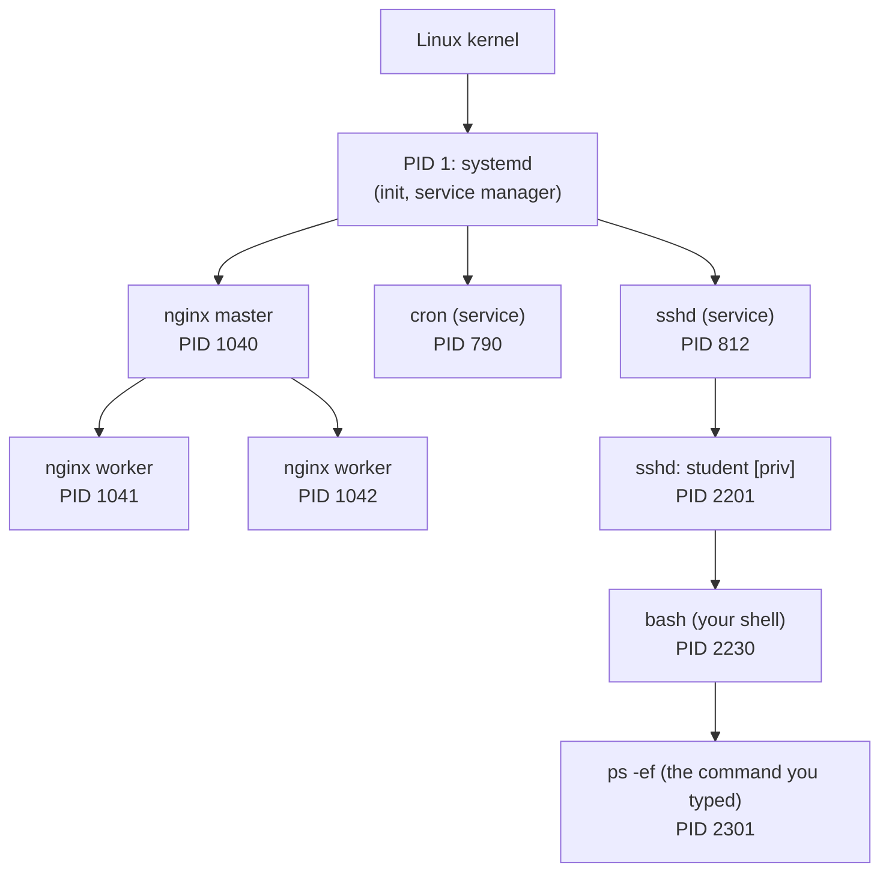
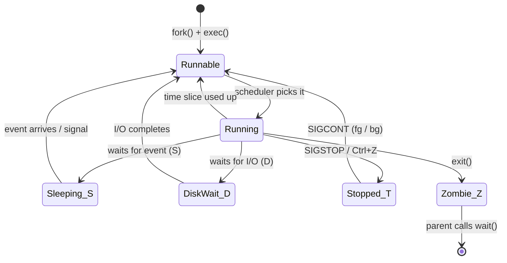
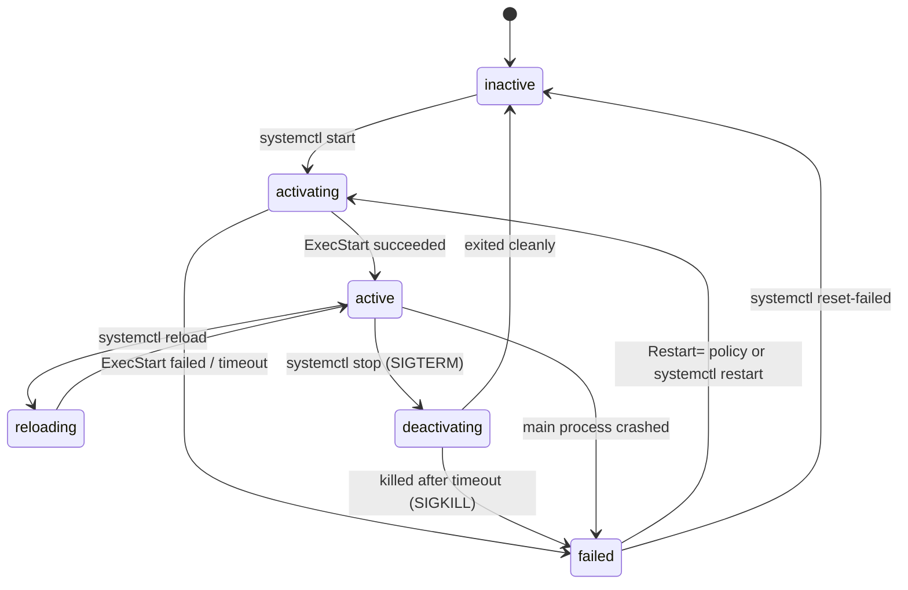

# Day 08: Processes and Services

!!! info "Lesson overview"
    | | |
    |---|---|
    | **Module** | 2 — System Administration |
    | **Difficulty** | :material-signal-cellular-2: Intermediate |
    | **Estimated time** | 3–4 hours (80 min reading, 80 min demonstrations, 60–90 min lab and quiz) |
    | **Platforms** | Ubuntu 24.04 LTS (Bash 5.2, procps-ng 4.0.4, systemd 255) · Windows 11 (Windows PowerShell 5.1 and PowerShell 7.4+) |
    | **Lab** | [Lab 08: Runaway Process](../../labs/lab-08.md) |

## Learning Objectives

By the end of this lesson you will be able to:

1. Explain the difference between a **program**, a **process**, a **thread** and a **service** (daemon), and describe **PID**, **PPID** and the process tree on Linux and Windows.
2. Read Linux **process states** (`R`, `S`, `D`, `T`, `Z`) and recognise what a zombie or an uninterruptible process means in an incident.
3. Run commands in the **foreground and background**, and manage **jobs** with `&`, `jobs`, `fg`, `bg`, ++ctrl+z++ and `nohup`.
4. List, sort and filter processes with `ps`, `top`, `htop`, `pgrep` and `/proc`, and with `Get-Process` and `Get-CimInstance Win32_Process` — including parent process and full command line.
5. Stop processes **safely**: choose between `SIGTERM`, `SIGHUP` and `SIGKILL`, use `kill`, `pkill`, `Stop-Process -WhatIf`, `taskkill`, and collect evidence **before** ending anything.
6. Change scheduling priority with `nice` and `renice`, and explain why a normal user can lower but not raise priority.
7. Manage **systemd services** with `systemctl` (`status`, `start`, `stop`, `restart`, `reload`, `enable`, `disable`, `is-active`, `is-enabled`, `--failed`, `mask`) and read their logs with `journalctl -u`.
8. Manage **Windows services** with `Get-Service`, `Start-Service`, `Stop-Service`, `Restart-Service`, `Set-Service` and `sc.exe`, and find service events in the System log.

## Prerequisites

- [Day 05](../module-1/day-05.md): pipelines, `grep`/`Select-String`, `Where-Object`, `Sort-Object`, exit codes.
- [Day 06](day-06.md): users, UIDs, `sudo` and the Administrators group (processes always run *as* a user).
- [Day 07](day-07.md): permissions — they decide which processes you may signal and which service files you may edit.
- A Linux system **with systemd as PID 1** for the service sections: an Ubuntu VM, or WSL2 with systemd enabled (`/etc/wsl.conf` → `[boot]` `systemd=true`, then `wsl --shutdown`). Containers usually do **not** run systemd.
- A Windows 11 VM or lab PC. Service changes need an **elevated** PowerShell window.

!!! warning "Production safety"
    Ending a process or stopping a service is a **change**. On a production system it can drop users' sessions, corrupt data that was being written, or stop dependent services. Today's demos use processes you start yourself. Follow your change process at work.

## Introduction and Concepts

### Program, process, thread, service

| Term | Meaning | Example |
|---|---|---|
| **Program** | A file on disk containing instructions | `/usr/bin/sleep`, `C:\Windows\System32\notepad.exe` |
| **Process** | A *running instance* of a program, with its own memory, open files, user identity and ID | Two terminal windows each running `bash` = two processes, one program |
| **Thread** | A unit of execution *inside* a process; threads share the process's memory | A web server process with 32 worker threads |
| **Service / daemon** | A long-running background process started by the system, not by a user at a prompt | `sshd`, `cron`, `systemd-journald`; Windows `Spooler`, `WinRM`, `W32Time` |

The operating system kernel gives every process a numeric **process ID (PID)**. On Linux, every process except PID 1 also records its **parent process ID (PPID)**: the process that created it. The result is a **process tree**:



When you type a command, Bash **forks** a copy of itself and the copy **executes** the program; the new process's PPID is your shell's PID. When the command finishes, it returns an **exit status** (Day 05) to its parent.

Windows also gives each process a PID and records the **parent PID** at creation time, but it does not maintain a strict tree: if the parent exits, the PID may later be reused by an unrelated process, so a "parent" in Windows tools is a *hint*, not a guarantee. Windows services are started by the **Service Control Manager (SCM)**, `services.exe`.

### Linux process states

The `STAT` column of `ps` and the `S` column of `top` show the state:

| Code | State | Meaning | What it tells you |
|---|---|---|---|
| `R` | Running / runnable | On a CPU or waiting in the run queue | Many `R` processes plus high load = CPU contention |
| `S` | Interruptible sleep | Waiting for an event (input, timer, network) | Normal: most processes are `S` |
| `D` | Uninterruptible sleep | Waiting for I/O inside the kernel; ignores signals, even `SIGKILL` | Many `D` processes = storage or NFS problem (Day 28) |
| `T` | Stopped | Paused by a job-control signal (`SIGSTOP`, ++ctrl+z++) or a debugger (`t`) | Someone paused it; `SIGCONT` resumes |
| `Z` | Zombie (defunct) | Finished, but the parent has not yet read its exit status | Uses no CPU or memory; a growing number means a buggy parent |
| `I` | Idle kernel thread | Kernel worker that is idle | Ignore in normal analysis |

Extra characters after the state letter: `s` session leader, `+` in the foreground process group of its terminal, `l` multi-threaded, `<` high priority, `N` low priority (positive nice value), `L` pages locked in memory.



**Zombies cannot be killed** — they are already dead. You remove a zombie by making its *parent* collect it (often by restarting the parent). If the parent itself exits, the zombie is adopted by PID 1 (systemd), which reaps it.

### Foreground, background and jobs

A command you type normally runs in the **foreground**: the shell waits and the keyboard belongs to the command. Adding `&` runs it in the **background**: the shell prints a **job number** and PID and gives you the prompt back. Job control is a feature of **interactive** Bash:

| Action | Bash | Effect |
|---|---|---|
| Start in background | `command &` | Prints `[1] 4321` (job 1, PID 4321) |
| Pause the foreground job | ++ctrl+z++ | Sends `SIGTSTP`; job becomes *Stopped* |
| Interrupt the foreground job | ++ctrl+c++ | Sends `SIGINT`; most programs exit |
| List jobs | `jobs -l` | Job numbers, PIDs, states |
| Resume in background | `bg %1` | Sends `SIGCONT`; keeps running without the keyboard |
| Bring to foreground | `fg %1` | Job gets the keyboard again |
| Survive logout | `nohup command &` · `disown %1` | Ignore `SIGHUP` when the terminal closes |
| Last background PID | `$!` | Use it in scripts: `kill "$!"` |

PowerShell's closest equivalent is **background jobs** (`Start-Job`, `Get-Job`, `Receive-Job`, `Stop-Job`) and, in PowerShell 7, the `&` background operator (`Get-Process &` creates a job). PowerShell jobs run in a separate PowerShell process or thread; they are covered properly with automation on Day 25.

### Signals: how Linux asks processes to stop

Linux communicates with processes through **signals**. A process can *handle* (catch) most signals and clean up first; two can never be caught.

| Signal | Number | Default action | Typical use |
|---|---|---|---|
| `SIGHUP` | 1 | Terminate | "Terminal hung up"; many daemons use it to **reload configuration** |
| `SIGINT` | 2 | Terminate | ++ctrl+c++ |
| `SIGQUIT` | 3 | Terminate + core dump | ++ctrl+backslash++ |
| `SIGKILL` | 9 | Terminate — **cannot be caught or ignored** | Last resort: no clean-up, data in memory is lost |
| `SIGTERM` | 15 | Terminate (catchable) | **Default** of `kill`, `pkill` and `systemctl stop`: "please shut down cleanly" |
| `SIGCONT` | 18 | Continue a stopped process | `fg`, `bg` |
| `SIGSTOP` | 19 | Stop — **cannot be caught or ignored** | Freeze a process (for example to preserve evidence) |
| `SIGTSTP` | 20 | Stop (catchable) | ++ctrl+z++ |

Numbers shown are for Linux on x86-64 and ARM; use **names** (`-TERM`, `-KILL`) in scripts because numbers differ on some other Unix systems. The professional escalation is always: **`SIGTERM` → wait → `SIGKILL` only if needed**.

Windows has no signals. `Stop-Process` and `taskkill /F` call the Win32 `TerminateProcess` function, which is the equivalent of `SIGKILL`: no clean-up. `taskkill` **without** `/F` sends a close request to a process's windows (roughly comparable to `SIGTERM` for GUI applications); console and background processes usually ignore it. Services are stopped politely through the SCM (`Stop-Service`).

### Priority: nice values

The Linux scheduler shares CPU time according to each process's **nice value**, from **−20** (highest priority, least "nice" to others) to **19** (lowest priority). New processes inherit their parent's value, normally `0`. A **normal user can only increase** the nice value of their own processes (be nicer); **only root** can lower it, even back to where it was. Windows uses **priority classes** (`Idle`, `BelowNormal`, `Normal`, `AboveNormal`, `High`, `RealTime`) visible as `Get-Process`'s `PriorityClass` property.

### Services: systemd units and the Windows SCM

On Ubuntu, **systemd** (PID 1) starts and supervises services. Each service is described by a **unit file**, for example `/usr/lib/systemd/system/ssh.service` (package default) or `/etc/systemd/system/myapp.service` (local, takes precedence). Two independent questions describe a unit:

- **Is it running now?** — the *active state*: `active (running)`, `active (exited)` (one-shot task finished successfully), `inactive (dead)`, `failed`, `activating`, `deactivating`, `reloading`.
- **Will it start at boot?** — the *enablement state*: `enabled`, `disabled`, `static` (cannot be enabled; started by another unit), `masked` (linked to `/dev/null`; cannot be started at all), `alias`, `indirect`.



On Windows, services are registered in the registry under `HKLM\SYSTEM\CurrentControlSet\Services` and controlled by the **SCM**. A service has a **status** (`Running`, `Stopped`, `Paused`, `StartPending`, `StopPending`…) and a **start type** (`Automatic`, `Automatic (Delayed Start)`, `Manual`, `Disabled`). Several services can share one `svchost.exe` process, so "service" and "process" are not one-to-one on Windows.

| Concept | Linux (systemd) | Windows (SCM) |
|---|---|---|
| Manager | `systemd`, PID 1 | `services.exe` |
| Definition | Unit file (`.service`) | Registry key + binary path |
| Running? | `systemctl is-active NAME` | `(Get-Service NAME).Status` |
| Starts at boot? | `systemctl is-enabled NAME` | `(Get-Service NAME).StartType` |
| Logs | `journalctl -u NAME` | Application/System event logs, app's own logs |
| Restart on crash | `Restart=on-failure` in the unit | Recovery actions (`sc.exe failure`) |
| Account | `User=` in the unit (default root) | `LocalSystem`, `LocalService`, `NetworkService`, a virtual or domain account |

## Linux Command Reference

| Command | Purpose | Package / availability | Needs root? |
|---|---|---|---|
| `ps` | Snapshot of processes | procps (always installed) | No (all processes are visible unless `/proc` is mounted with `hidepid`) |
| `top` | Live, sorted process view | procps | No |
| `htop` | Friendlier interactive viewer with tree and mouse support | htop (pulled in by Ubuntu Server's `ubuntu-server` metapackage; otherwise `sudo apt install htop`) | No |
| `pstree` | Process tree | psmisc | No |
| `pgrep` / `pkill` | Find / signal processes by name, user or command line | procps | Only for others' processes |
| `kill` | Send a signal to PIDs or jobs | Bash built-in and procps `/usr/bin/kill` | Only for others' processes |
| `killall` | Signal processes by exact name | psmisc | Only for others' processes |
| `jobs`, `fg`, `bg`, `disown` | Job control in the current shell | Bash built-ins | No |
| `nohup` | Run a command immune to `SIGHUP` | coreutils | No |
| `timeout` | Run a command with a time limit | coreutils | No |
| `nice` / `renice` | Start with / change a nice value | coreutils / util-linux (bsdutils) | Root to lower the value |
| `/proc/PID/` | Kernel's live view of each process | Kernel (procfs) | Root for other users' sensitive files |
| `lsof` / `fuser` | Which process has a file or port open | lsof / psmisc (both in `ubuntu-standard`) | Root to see all processes |
| `systemctl` | Control systemd units | systemd | Root for changes (prompts via polkit or use `sudo`) |
| `journalctl` | Read the systemd journal | systemd | `adm`, `systemd-journal` or root for system logs |

## PowerShell Command Reference

| Cmdlet / tool | Aliases | Purpose | 5.1 | 7.x | Admin? |
|---|---|---|---|---|---|
| `Get-Process` | `gps`, `ps` (Windows only) | List processes as objects | Yes | Yes (all OS) | `-IncludeUserName` and other users' `-Module`/`-FileVersionInfo` need elevation on Windows |
| `Stop-Process` | `spps`, `kill` (Windows only) | End processes | Yes | Yes (all OS) | Others' processes need elevation |
| `Start-Process` | `saps`, `start` (Windows only) | Start a program (new window, `-Verb RunAs`, `-Wait`) | Yes | Yes | `-Verb RunAs` prompts for elevation (Windows) |
| `Wait-Process` | — | Wait until processes exit | Yes | Yes | No |
| `Get-CimInstance Win32_Process` | `gcim` | Process details incl. `ParentProcessId`, `CommandLine`, owner | Yes | Yes (**Windows only**) | No (some command lines need elevation) |
| `Get-Service` | `gsv` | List services | Yes | **Windows only** | No |
| `Start-Service` / `Stop-Service` / `Restart-Service` | `sasv` / `spsv` / — | Control services | Yes | **Windows only** | **Yes** |
| `Set-Service` | — | Change start type, description, status | Yes | **Windows only** (adds `AutomaticDelayedStart`, `-Credential`, `-Force`) | **Yes** |
| `Get-WinEvent` | — | Read event logs (SCM events) | Yes | **Windows only** | Security log needs elevation |
| `Get-Counter` | — | Performance counters (`% Processor Time`) | Yes | **Windows only** (7.x) | No |
| `sc.exe` | — (`sc` is an **alias for `Set-Content`** in Windows PowerShell 5.1) | Native SCM tool: query, config, failure actions | Yes | Yes | Changes need elevation |
| `tasklist` / `taskkill` | — | Native process list / end process | Yes | Yes | Others' processes need elevation |
| `Start-Job` / `Get-Job` / `Receive-Job` | `sajb` / `gjb` / `rcjb` | Background jobs | Yes | Yes | No |

!!! note "`sc` is not `sc.exe` in Windows PowerShell 5.1"
    In Windows PowerShell 5.1, `sc` is an alias for `Set-Content`, so `sc query spooler` writes a file named `query` instead of querying a service. Always type **`sc.exe`**. PowerShell 7 removed the `sc` alias, but writing `sc.exe` works everywhere.

## Detailed Command Explanations

### `ps` — a snapshot of processes

`ps` reads `/proc` once and prints a table. Ubuntu's `ps` (procps-ng) accepts three option styles, which is why examples online look inconsistent:

- **BSD style, no dash:** `ps aux` — `a` all users' processes with a terminal, `u` user-oriented columns, `x` include processes without a terminal. Columns: `USER PID %CPU %MEM VSZ RSS TTY STAT START TIME COMMAND`.
- **UNIX/POSIX style, one dash:** `ps -ef` — `-e` every process, `-f` full format. Columns: `UID PID PPID C STIME TTY TIME CMD`. Shows the PPID, which `ps aux` does not.
- **Custom columns:** `ps -eo pid,ppid,user,%cpu,%mem,stat,etime,cmd --sort=-%cpu` — choose exactly the fields you need and sort (prefix `-` for descending). `ps -p 1234 -o …` limits output to given PIDs, `ps -u student` to a user, `ps -C nginx` to a command name, `ps --ppid 1040` to children of a PID. `ps -ejH` or `ps axjf` (BSD) draw a tree; `pstree -p` is easier to read.

Two columns need care:

- `%CPU` in `ps` is the **average since the process started** (CPU time ÷ elapsed time), not the current usage. A process that was busy for one minute after boot and idle for a week shows almost 0%. Use `top` (or the course's `process-monitor.sh`) for *current* CPU.
- `VSZ` is virtual size (everything mapped, including unused and shared memory); `RSS` (resident set size, KiB) is the physical memory in use, closer to what "memory used" means. `%MEM` = RSS ÷ total RAM.

### `top` and `htop` — live views

`top` refreshes every 3 seconds. Its header shows uptime and **load average** (1, 5, 15 minutes: the average number of runnable plus uninterruptible processes — compare it with the number of CPU cores), task counts by state, CPU breakdown (`us` user, `sy` system, `ni` niced, `id` idle, `wa` I/O wait, `st` stolen by the hypervisor) and memory.

Useful keys inside `top`: ++shift+p++ sort by CPU, ++shift+m++ sort by memory, ++shift+t++ by time, `1` per-CPU lines, `c` toggle full command line, `u` filter by user, `k` kill (asks for PID and signal), `r` renice, `H` show threads, `f` choose fields, `W` save settings to `~/.config/procps/toprc`, `q` quit.

`top -b -n 1` runs **batch mode** for one iteration and prints plain text — ideal for scripts and for pasting into tickets: `top -b -n 1 -o %MEM | head -15`. `-p PID` watches given PIDs, `-u USER` one user, `-d SECONDS` the delay.

`top` shows `%CPU` **per core** by default (Irix mode): a process using two full cores shows `200.0`. Press ++shift+i++ to toggle Solaris mode (divide by the number of CPUs).

`htop` offers colour meters, a tree view (++f5++), search (++f3++), filter (++f4++), sorting (++f6++), kill (++f9++) and renice (++f7++/++f8++). It is installed on Ubuntu Server via the `ubuntu-server` metapackage but not necessarily on Desktop, minimal or cloud images; it is a convenience, so scripts should rely on `ps` and `top`.

### `pgrep` and `pkill` — find and signal by pattern

`pgrep PATTERN` prints the PIDs of processes whose **name** matches a regular expression. Useful options (procps-ng 4.0.4): `-l` print the name too, `-a` print the full command line, `-f` match against the **full command line** instead of the name, `-x` exact name match, `-u USER` effective user, `-n` newest only, `-o` oldest only, `-c` count. Exit status: `0` match found, `1` none — handy in `if` tests.

`pkill` takes the same selection options and sends a signal (default `SIGTERM`; `-HUP`, `-KILL`, `--signal NAME`). `-e` (echo) prints what was signalled. **Always run `pgrep -a` with the same pattern first**: patterns are regular expressions and `-f` matches anywhere in the command line, so `pkill -f sleep` would also hit `bash -c "... sleep ..."`.

`killall NAME` (psmisc) signals processes by exact name; `killall -i` asks for confirmation. On some other Unix systems `killall` kills **every** process, so prefer `pkill` in portable notes.

### `kill` — send a signal

Despite its name, `kill` *sends a signal*; ending the process is just the default action of `SIGTERM`.

```text
kill [-s SIGNAL | -SIGNAL] PID|%JOB...
kill -l [NUMBER]
```

`kill 1234` sends `SIGTERM`; `kill -HUP 1234` asks a daemon to reload; `kill -KILL 1234` (or `kill -9`) forces termination; `kill -STOP` / `kill -CONT` freeze and resume; `kill -0 1234` sends **no** signal but tests whether the PID exists and you may signal it (exit status 0 or 1) — useful in scripts. `kill %1` targets job 1 of the current shell. `kill -l` lists signal names and `kill -l 15` translates a number into a name.

A process killed by a signal returns exit status **128 + signal number** to its parent: `143` for `SIGTERM`, `137` for `SIGKILL`, `130` for ++ctrl+c++. Seeing `137` in a container or CI log usually means "killed", often by the out-of-memory killer.

You may signal only processes that run as **your** user; root may signal any process.

### `jobs`, `fg`, `bg`, `nohup`, `disown`, `timeout`

`jobs -l` lists the current shell's jobs with PIDs. `%1`, `%+` (current), `%-` (previous) and `%sleep` (job whose command starts with `sleep`) are **job specifications** that `fg`, `bg`, `kill` and `wait` accept.

When your terminal or SSH session closes, the shell sends `SIGHUP` to its jobs, which normally ends them. `nohup command > out.log 2>&1 &` starts a command that ignores `SIGHUP` (without redirection, output goes to `nohup.out`). `disown %1` removes an already-running job from the shell's job table so it is not sent `SIGHUP`. For anything important, a **systemd service** or a terminal multiplexer (`tmux`) is better than `nohup`.

`timeout 30 command` sends `SIGTERM` after 30 seconds (`-k 5` adds a `SIGKILL` 5 seconds later) and returns **124** when the time limit was hit — essential for scripts that call commands which might hang.

### `nice` and `renice` — scheduling priority

`nice -n 10 command` starts a command with nice value 10. `renice -n 5 -p PID` changes a running process (`-u USER` for all of a user's processes, `-g` for a process group). In `ps`, the `NI` column shows the nice value and the `N` stat flag marks positive values. Use high nice values for backups, compressions and report jobs on busy servers: `nice -n 19 tar czf backup.tgz /srv/data`. For disk-heavy jobs, `ionice -c 3` (util-linux) also lowers I/O priority.

### `/proc/PID` — the kernel's view

Every process has a directory `/proc/PID/`:

| Entry | Content |
|---|---|
| `status` | Name, state, PPID, UIDs (real, effective, saved, filesystem), memory (`VmRSS`), threads |
| `cmdline` | Full command line, arguments separated by NUL bytes (`tr '\0' ' ' < /proc/PID/cmdline`) |
| `exe` | Symbolic link to the executable; shows `(deleted)` if the file was removed after start |
| `cwd` | Link to the current working directory |
| `environ` | Environment variables (owner or root only) |
| `fd/` | Open file descriptors: files, sockets, pipes |
| `stat` | Raw counters, including CPU time in clock ticks (used by `top`) |
| `limits` | Resource limits (open files, processes) |

`/proc/self` is the process reading it. `/proc` is the source of truth that `ps`, `top`, `pgrep` and `lsof` all read.

### `lsof` and `fuser` — who is using this?

`lsof -p PID` lists a process's open files; `lsof /var/log/syslog` shows who has a file open; `sudo lsof -i :443` shows which process holds port 443 (Day 14 goes further with `ss`). `fuser -v /mnt/usb` shows processes using a mount point — the usual reason for `umount: target is busy` (Day 09). Both need root to see other users' processes.

### `systemctl` — control systemd services

```text
systemctl status UNIT            # state, main PID, memory, CGroup tree and the last 10 log lines
systemctl start | stop | restart UNIT
systemctl reload UNIT            # re-read configuration without stopping (only if the unit supports it)
systemctl reload-or-restart UNIT
systemctl enable [--now] UNIT    # start at boot (and now)
systemctl disable [--now] UNIT
systemctl is-active | is-enabled | is-failed UNIT   # one word + exit status, for scripts
systemctl list-units --type=service [--state=running|failed]
systemctl --failed               # same as list-units --state=failed
systemctl list-unit-files --type=service
systemctl cat UNIT               # show the unit file(s) actually in use
systemctl show UNIT -p MainPID,ActiveState,SubState,Restart
systemctl daemon-reload          # after editing unit files
systemctl reset-failed [UNIT]
systemctl mask | unmask UNIT
```

- The `.service` suffix is optional: `systemctl status ssh` = `systemctl status ssh.service`. On Ubuntu the OpenSSH unit is `ssh.service` (on RHEL-family systems it is `sshd.service`).
- Read-only commands (`status`, `is-active`, `list-units`) work as a normal user. Changes need root: use `sudo systemctl …`.
- `stop` sends `SIGTERM` to the service's processes, waits (`TimeoutStopSec=`, 90 s by default) and then sends `SIGKILL`. Prefer `systemctl stop` to `kill` for services, otherwise systemd may restart the service or record it as failed.
- `restart` = stop + start (short outage). `reload` keeps the process and asks it to re-read its configuration (for example `nginx`, `ssh`); it fails if the unit has no `ExecReload=`.
- **`mask`** links the unit to `/dev/null`, so it cannot be started even as a dependency. It is stronger than `disable` and is easy to forget — always `unmask` and document it.
- `systemctl status` shows the **unit's log lines**, so it is the first command in any service investigation.

### `journalctl -u` — service logs

The systemd journal stores logs from every service. Key options:

| Option | Meaning |
|---|---|
| `-u UNIT` | Only this unit (repeatable) |
| `-n 50` | Last 50 lines (default 10 with `-n` alone) |
| `-f` | Follow new lines (like `tail -f`) |
| `-e` | Jump to the end in the pager |
| `-b` / `-b -1` | This boot / the previous boot |
| `--since "1 hour ago"` · `--since 09:00 --until 09:30` | Time window |
| `-p err` | Priority `err` and more severe (`emerg` 0 … `debug` 7) |
| `-x` | Add explanatory catalog text |
| `-o short-iso` · `-o json` | Output format |
| `--no-pager` | Plain output for scripts and tickets |

Reading the full system journal needs membership of `adm` or `systemd-journal` (or `sudo`). Day 16 covers logs in depth.

### `Get-Process` — processes as objects

`Get-Process` returns `System.Diagnostics.Process` objects. The default table shows `NPM(K)` (non-paged memory), `PM(M)` (pageable memory), `WS(M)` (**working set**: physical memory recently used, the closest to Linux RSS), `CPU(s)` (**total processor seconds** used since the process started — *not* a percentage), `Id` and `SI` (session ID; 0 = services).

- `Get-Process -Name chrome, notepad` (wildcards allowed), `Get-Process -Id 1234`, `Get-Process -Id $PID` (the current PowerShell).
- Sort and select: <code>Get-Process &#124; Sort-Object CPU -Descending &#124; Select-Object -First 10 Name, Id, CPU, WS</code>.
- Useful properties: `Path`, `StartTime`, `PriorityClass`, `Threads`, `Handles`, `Responding`, `MainWindowTitle`, `Company`.
- `-IncludeUserName` adds `UserName` but **requires an elevated session on Windows**. Without elevation, use `Get-CimInstance Win32_Process` and its `GetOwner` method.
- `-Module` lists loaded DLLs; `-FileVersionInfo` shows the executable's version information. For processes you do not own, both require elevation.
- **PowerShell 7.x** adds `Parent` and `CommandLine` properties to process objects (`(Get-Process -Id $PID).Parent`). Windows PowerShell 5.1 has neither: use `Win32_Process`.
- A 32-bit PowerShell cannot read `Path`/`MainModule` of 64-bit processes; use 64-bit PowerShell.

Because `CPU(s)` is cumulative, "which process is using CPU **now**" needs two samples:

```powershell
$a = Get-Process | Select-Object Id, Name, @{n='Cpu';e={$_.CPU}}
Start-Sleep -Seconds 2
$b = Get-Process
$b | ForEach-Object {
    $old = $a | Where-Object Id -eq $_.Id
    if ($old -and $null -ne $_.CPU -and $null -ne $old.Cpu) {
        [pscustomobject]@{ Name = $_.Name; Id = $_.Id; CpuPct = [math]::Round(($_.CPU - $old.Cpu) / 2 * 100, 1) }
    }
} | Sort-Object CpuPct -Descending | Select-Object -First 5
```

`CpuPct` here is a percentage of **one** logical processor, like Linux `top`. Alternatives: `Get-Counter '\Process(*)\% Processor Time'` (counter names are **localised** — this English path fails on a German or French Windows) or `Get-CimInstance Win32_PerfFormattedData_PerfProc_Process` (`PercentProcessorTime`, also per core). The course's `Process-Monitor.ps1` uses the two-sample method because it works in every language and in 5.1 and 7.

### `Get-CimInstance Win32_Process` — parent and command line

`Win32_Process` (Windows only, 5.1 and 7) exposes what an investigator needs: `ProcessId`, `ParentProcessId`, `Name`, `ExecutablePath`, `CommandLine`, `CreationDate`, and the `GetOwner()` method:

```powershell
Get-CimInstance -ClassName Win32_Process -Filter "Name = 'powershell.exe'" |
    Select-Object ProcessId, ParentProcessId, CreationDate, CommandLine
Get-CimInstance Win32_Process -Filter "ProcessId = $PID" | Invoke-CimMethod -MethodName GetOwner
```

`-Filter` uses WQL syntax (`=`, `LIKE 'power%'` with `%` as wildcard) and is evaluated by WMI, so it is much faster than piping everything to `Where-Object`. Command lines of processes owned by other users may be empty unless you are elevated.

### `Stop-Process`, `taskkill` — ending Windows processes

`Stop-Process -Id 1234` or `Stop-Process -Name notepad` ends processes immediately (TerminateProcess — no clean-up, unsaved work is lost). Key parameters: `-WhatIf` (preview), `-Confirm`, `-PassThru` (output the process object), `-Force` (do not prompt when stopping a process you do not own). By default `Stop-Process` **prompts** before stopping a process that is not owned by the current user. Stopping `csrss`, `wininit` or `lsass` crashes Windows; stopping `svchost` can stop many services at once.

`Stop-Process` returns as soon as the request is sent; use `Wait-Process -Id 1234 -Timeout 10` (or the `HasExited` property) to confirm the process has gone.

`taskkill /PID 1234` asks the process to close; `taskkill /PID 1234 /F` forces it; `/T` also ends child processes (the whole tree); `/IM notepad.exe` selects by image name; `/FI "MEMUSAGE gt 500000"` filters. `tasklist /V` (verbose: user, window title, CPU time), `tasklist /SVC` (services hosted in each process) and `tasklist /M modulename.dll` are quick native views, available in cmd and PowerShell.

### `Start-Process` and `Wait-Process`

`Start-Process -FilePath notepad.exe -PassThru` starts a program and returns its process object (so you know its `Id`). `-ArgumentList`, `-WorkingDirectory`, `-WindowStyle Hidden|Minimized`, `-Wait` (wait until it exits), `-NoNewWindow` (console apps in the same window), `-RedirectStandardOutput file.txt` and `-Verb RunAs` (Windows: request elevation through UAC) are the parameters you will use most. `Wait-Process -Name setup -Timeout 600` waits for a process to exit and raises an error after the timeout.

### `Get-Service` and service control cmdlets

`Get-Service` returns `ServiceController` objects: `Name` (short name, e.g. `Spooler`), `DisplayName` ("Print Spooler"), `Status`, `StartType` (available in both 5.1 and 7), `ServiceType`, `DependentServices` and `ServicesDependedOn`.

- `Get-Service -Name Win*`, `Get-Service -DisplayName '*Update*'`.
- <code>Get-Service &#124; Where-Object Status -eq 'Stopped' &#124; Where-Object StartType -eq 'Automatic'</code> — the classic "automatic service that is not running" check (some, like `gupdate`-style or trigger-start services, stop on purpose; investigate before starting).
- `Get-Service -Name WinRM -RequiredServices` (what it needs) and `-DependentServices` (what needs it — these stop too if you stop it).
- **PowerShell 7** adds `UserName` (service account), `Description`, `BinaryPathName`, `StartupType` and `DelayedAutoStart` properties. In 5.1 read them from `Get-CimInstance Win32_Service` (`StartName`, `PathName`, `StartMode`, `ProcessId`, `State`).
- `Get-Service` exists only on Windows. PowerShell 7 dropped its `-ComputerName` parameter; use `Invoke-Command` (Day 26).

`Start-Service`, `Stop-Service` and `Restart-Service` need elevation. They accept names or piped objects, `-PassThru`, `-WhatIf`, `-Confirm`. `Stop-Service` refuses to stop a service that has running dependants unless you add `-Force` (which stops the dependants too — check `-DependentServices` first). `Set-Service -Name BITS -StartupType Manual` changes the start type (`Automatic`, `Manual`, `Disabled`; PowerShell 7 adds `AutomaticDelayedStart`). `Set-Service -Status Running|Stopped|Paused` also works but `Start-/Stop-Service` are clearer.

### `sc.exe` — the native Service Control tool

`sc.exe query Spooler` (status), `sc.exe qc Spooler` (configuration: start type, binary path, account, dependencies), `sc.exe queryex type= service state= all` (all services with PIDs), `sc.exe qfailure Spooler` (recovery actions), `sc.exe config NAME start= demand` and `sc.exe failure NAME reset= 86400 actions= restart/60000` (changes, elevated). Note the space **after** the `=` sign: `start= demand` is required syntax. `sc.exe sdshow NAME` prints a service's security descriptor, which matters in privilege-escalation audits (Day 19).

### `Get-WinEvent` — service events

The SCM writes to the **System** log with provider `Service Control Manager`. Useful event IDs:

| ID | Meaning |
|---|---|
| 7036 | Service entered the running / stopped state |
| 7034 | Service terminated unexpectedly (crash) |
| 7031 | Service terminated unexpectedly; a recovery action will be taken |
| 7040 | Start type changed (e.g. from automatic to disabled) |
| 7045 | **A new service was installed** — a key persistence indicator |
| 7000 / 7009 | Service failed to start / timed out while starting |

```powershell
Get-WinEvent -FilterHashtable @{ LogName = 'System'; ProviderName = 'Service Control Manager'; Id = 7034, 7031, 7045 } -MaxEvents 20
```

`-FilterHashtable` filters inside the event log service and is far faster than `Get-EventLog` or `Where-Object`. `Get-EventLog` exists only in Windows PowerShell 5.1.

## Syntax and Parameters

### Bash

```text
ps [aux | -ef] [-o FORMAT] [--sort=[-]KEY] [-p PID[,PID]] [-u USER] [-C NAME] [--ppid PID]
top [-b] [-n ITERATIONS] [-d SECONDS] [-p PID] [-u USER] [-o FIELD]
pgrep [-l | -a] [-f] [-x] [-u USER] [-n | -o] [-c] PATTERN
pkill [-SIGNAL | --signal NAME] [-e] [-f] [-x] [-u USER] PATTERN
kill [-s SIGNAL | -SIGNAL] PID | %JOB ...      kill -l [N]      kill -0 PID
nice [-n ADJUSTMENT] COMMAND [ARG]...
renice [-n] PRIORITY [-p PID... | -u USER... | -g PGRP...]
nohup COMMAND [ARG]... &         timeout [-k DURATION] DURATION COMMAND
systemctl [--now] {status|start|stop|restart|reload|enable|disable|is-active|is-enabled|mask|unmask} UNIT
systemctl list-units [--type=service] [--state=STATE] · systemctl --failed
journalctl [-u UNIT] [-n N] [-f] [-b [-1]] [--since TIME] [--until TIME] [-p PRIORITY] [-o FORMAT] [--no-pager]
```

| Option | Command | Meaning |
|---|---|---|
| `-e` / `aux` | ps | Every process (POSIX / BSD style) |
| `-f` | ps | Full format with PPID and start time |
| `-o pid,ppid,user,%cpu,%mem,stat,etime,cmd` | ps | Custom columns (`etime` = elapsed time since start) |
| `--sort=-%cpu` | ps | Sort descending by a column |
| `-b -n 1` | top | One batch-mode snapshot as text |
| `-o %MEM` | top | Sort field in batch mode |
| `-a` / `-l` | pgrep | Show full command line / name |
| `-f` | pgrep, pkill | Match the full command line |
| `-x` | pgrep, pkill | Exact name match |
| `-u USER` | pgrep, pkill, ps, top | Effective user filter |
| `-e` | pkill | Echo what was signalled |
| `-TERM` `-HUP` `-KILL` `-STOP` `-CONT` | kill, pkill | Signal to send (default `TERM`) |
| `-0` | kill | Test existence/permission only |
| `-n N` | nice, renice | Nice value / adjustment (−20 to 19) |
| `-k DURATION` | timeout | Send `KILL` this long after `TERM` |
| `--now` | systemctl enable/disable | Also start / stop immediately |
| `--state=failed` | systemctl list-units | Only failed units |
| `-u` `-n` `-f` `-b` `--since` `-p` | journalctl | Unit, lines, follow, boot, time, priority |

### PowerShell

```text
Get-Process [[-Name] <String[]>] [-Module] [-FileVersionInfo]
Get-Process -Id <Int32[]> [-IncludeUserName]
Stop-Process [-Id] <Int32[]> [-PassThru] [-Force] [-WhatIf] [-Confirm]
Stop-Process -Name <String[]> [-PassThru] [-Force] [-WhatIf] [-Confirm]
Start-Process [-FilePath] <String> [[-ArgumentList] <String[]>] [-WorkingDirectory <String>]
              [-PassThru] [-Wait] [-WindowStyle <ProcessWindowStyle>] [-NoNewWindow] [-Verb <String>]
Wait-Process [-Name] <String[]> | -Id <Int32[]> [[-Timeout] <Int32>]
Get-CimInstance -ClassName Win32_Process [-Filter <String>] [-Property <String[]>]
Get-Service [[-Name] <String[]>] [-DisplayName <String[]>] [-DependentServices] [-RequiredServices]
Start-Service | Stop-Service | Restart-Service [-Name] <String[]> [-Force] [-PassThru] [-WhatIf] [-Confirm]
Set-Service [-Name] <String> [-StartupType <Automatic|Manual|Disabled|AutomaticDelayedStart(7.x)>]
            [-Status <Running|Stopped|Paused>] [-Description <String>] [-PassThru] [-WhatIf]
Get-WinEvent -FilterHashtable <Hashtable[]> [-MaxEvents <Int64>]
```

| Parameter | Cmdlet | Meaning |
|---|---|---|
| `-Name` / `-Id` | Get-/Stop-Process | Select by name (wildcards; no `.exe`) or PID |
| `-IncludeUserName` | Get-Process | Add `UserName` (elevation required on Windows) |
| `-Module` | Get-Process | Loaded modules (DLLs) |
| `-WhatIf` / `-Confirm` | Stop-Process, *-Service | Preview / ask first |
| `-Force` | Stop-Process | No prompt for processes you do not own |
| `-Force` | Stop-Service, Restart-Service | Also stop dependent services |
| `-PassThru` | most | Output the affected object |
| `-Wait` | Start-Process | Wait for the started process to exit |
| `-Verb RunAs` | Start-Process | Start elevated (UAC prompt; Windows only) |
| `-Timeout` | Wait-Process | Seconds before giving up with an error |
| `-Filter` | Get-CimInstance | WQL filter evaluated by WMI |
| `-DependentServices` / `-RequiredServices` | Get-Service | Services that depend on / are needed by this one |
| `-StartupType` | Set-Service | Start type; `AutomaticDelayedStart` only in PowerShell 7 |
| `-FilterHashtable` | Get-WinEvent | `LogName`, `ProviderName`, `Id`, `Level`, `StartTime`, `EndTime` |

## Practical Demonstrations

**How the outputs were produced.** Bash demos 1–6 were run with Bash 5.2.21 and procps-ng 4.0.4 on Ubuntu 24.04.5 in a container, as a normal user (renamed `student`, UID 1000; host renamed `ubuntu-lab`). The container's own system processes are not shown: where a demo lists *all* processes, the listing is an **example** of a typical Ubuntu 24.04 VM. The container does not run systemd, so the `systemctl`/`journalctl` outputs in demos 7–8 are **examples** reviewed against the systemd 255 manual pages. PowerShell outputs are examples: the Windows cmdlets were checked against the Microsoft documentation source; `Get-Process` behaviour (including the `Parent` property) was confirmed with PowerShell 7.4.6 on Linux.

### Demo 1 — Three ways to list processes

=== "Bash"

    ```bash
    ps -ef | head -6
    ps aux --sort=-%mem | head -4
    ps -eo pid,ppid,user,%cpu,%mem,stat,etime,cmd --sort=-%cpu | head -5
    pstree -p $$
    ```

    **Expected output (example, Ubuntu 24.04 VM):**

    ```text
    UID          PID    PPID  C STIME TTY          TIME CMD
    root           1       0  0 09:02 ?        00:00:02 /sbin/init splash
    root           2       0  0 09:02 ?        00:00:00 [kthreadd]
    root         812       1  0 09:02 ?        00:00:00 sshd: /usr/sbin/sshd -D [listener] 0 of 10-100 startups
    root         790       1  0 09:02 ?        00:00:00 /usr/sbin/cron -f -P
    student     2230    2229  0 09:15 pts/0    00:00:00 -bash
    USER         PID %CPU %MEM    VSZ   RSS TTY      STAT START   TIME COMMAND
    mysql       1102  0.6  9.8 1789364 395212 ?      Ssl  09:02   0:21 /usr/sbin/mysqld
    root         402  0.0  1.1 288936 46316 ?        SLsl 09:02   0:01 /sbin/multipathd -d -s
      PID    PPID USER     %CPU %MEM STAT     ELAPSED CMD
     1102       1 mysql     0.6  9.8 Ssl        34:12 /usr/sbin/mysqld
     2230    2229 student   0.0  0.1 Ss         21:40 -bash
      812       1 root      0.0  0.2 Ss         34:13 sshd: /usr/sbin/sshd -D [listener] 0 of 10-100 startups
    bash(2230)───pstree(2311)
    ```

    `PPID 1` means the process was started by systemd (a service). `[kthreadd]` and other names in square brackets are **kernel threads**, which have no command line.

=== "PowerShell"

    ```powershell
    Get-Process | Select-Object -First 4
    Get-Process | Sort-Object WS -Descending | Select-Object -First 3 Name, Id, @{n='WS(MB)';e={[math]::Round($_.WS/1MB)}}, CPU
    Get-CimInstance Win32_Process -Filter "ProcessId = $PID" | Select-Object ProcessId, ParentProcessId, Name
    (Get-Process -Id $PID).Parent      # PowerShell 7.x only
    ```

    **Expected output (example):**

    ```text
    NPM(K)    PM(M)      WS(M)     CPU(s)      Id  SI ProcessName
    ------    -----      -----     ------      --  -- -----------
        18     5.46      20.12       0.06    6012   1 ApplicationFrameHost
        11     2.05       9.81       0.00    4520   0 AggregatorHost
        31    20.77      44.30       3.42    9124   1 explorer
         7     1.21       5.92       0.00     912   0 csrss

    Name    Id WS(MB)     CPU
    ----    -- ------     ---
    MsMpEng 3828    312  402.17
    chrome  10240   288   61.48
    explorer 9124    44    3.42

    ProcessId ParentProcessId Name
    --------- --------------- ----
         7760            9124 powershell.exe

     NPM(K)    PM(M)      WS(M)     CPU(s)      Id  SI ProcessName
     ------    -----      -----     ------      --  -- -----------
         31    20.77      44.30       3.42    9124   1 explorer
    ```

    The PowerShell window's parent is `explorer.exe` because it was started from the Start menu. `SI 0` marks processes in session 0, where services run.

### Demo 2 — Background jobs and stopped processes

=== "Bash"

    ```bash
    sleep 600 &
    jobs -l
    kill -STOP %1          # same effect as Ctrl+Z on a foreground job
    jobs
    ps -o pid,stat,cmd -p "$(jobs -p %1)"
    kill -CONT %1          # same as: bg %1
    jobs
    kill %1 ; wait %1 ; echo "exit status: $?"
    ```

    **Expected output (captured from interactive Bash sessions; PIDs will differ):**

    ```text
    [1] 1230
    [1]+  1230 Running                 sleep 600 &
    [1]+  Stopped                 sleep 600
      PID STAT CMD
     1230 T    sleep 600
    [1]+  Running                 sleep 600 &
    [1]+  Terminated              sleep 600
    exit status: 143
    ```

    `T` = stopped. Exit status `143` = 128 + 15: the job ended because of `SIGTERM`.

=== "PowerShell"

    ```powershell
    $job = Start-Job -Name lab-sleep -ScriptBlock { Start-Sleep -Seconds 600 }
    Get-Job
    Stop-Job -Name lab-sleep
    Get-Job -Name lab-sleep | Select-Object Name, State
    Remove-Job -Name lab-sleep
    ```

    **Expected output (example):**

    ```text
    Id     Name            PSJobTypeName   State         HasMoreData     Location             Command
    --     ----            -------------   -----         -----------     --------             -------
    1      lab-sleep       BackgroundJob   Running       True            localhost             Start-Sleep -Seconds 600

    Name      State
    ----      -----
    lab-sleep Stopped
    ```

    PowerShell jobs are not OS-level job control: each `Start-Job` runs in a separate PowerShell **process** (a child `powershell.exe`/`pwsh`). There is no equivalent of ++ctrl+z++.

### Demo 3 — Find and inspect a CPU hog

You start a deliberately busy process, then investigate it as if you had found it on a server.

=== "Bash"

    ```bash
    bash -c 'exec -a lab-cpu-hog bash -c "while :; do :; done"' &   # busy loop with a clear name
    pgrep -af lab-cpu
    H=$(pgrep -f lab-cpu-hog)
    ps -o pid,ppid,user,ni,%cpu,%mem,stat,etime,cmd -p "$H"
    top -b -n 1 -p "$H" | tail -2
    grep -E '^(Name|State|PPid|Uid|VmRSS|Threads)' /proc/"$H"/status
    tr '\0' ' ' < /proc/"$H"/cmdline; echo
    ls -l /proc/"$H"/exe /proc/"$H"/cwd
    ```

    **Expected output (captured; values will differ):**

    ```text
    3322 lab-cpu-hog -c while :; do :; done
      PID    PPID USER      NI %CPU %MEM STAT     ELAPSED CMD
     3322    3317 student    0 98.0  0.0 R          00:02 lab-cpu-hog -c while :; do :; done
      PID USER      PR  NI    VIRT    RES    SHR S  %CPU  %MEM     TIME+ COMMAND
     3322 student   20   0    4764   3556   3292 R 100.0   0.0   0:02.18 bash
    Name:   bash
    State:  R (running)
    PPid:   3317
    Uid:    1000    1000    1000    1000
    VmRSS:      3556 kB
    Threads:        1
    lab-cpu-hog -c while :; do :; done
    lrwxrwxrwx 1 student student 0 Nov 10 16:55 /proc/3322/cwd -> /home/student
    lrwxrwxrwx 1 student student 0 Nov 10 16:55 /proc/3322/exe -> /usr/bin/bash
    ```

    Note the **evidence trail**: the name shown in `ps` (`lab-cpu-hog`) is only `argv[0]`, which any program can set; `/proc/PID/exe` reveals the real executable (`/usr/bin/bash`), and `top` displays the kernel's name for it (`bash`). Malware uses exactly this trick to look like `[kworker]` or `sshd`. Leave the process running for Demo 4.

=== "PowerShell"

    ```powershell
    # A busy loop in a separate, minimised PowerShell window (use pwsh.exe for PowerShell 7)
    $hog = Start-Process -FilePath powershell.exe -ArgumentList '-NoProfile', '-Command', 'while ($true) {}' -WindowStyle Minimized -PassThru
    Start-Sleep -Seconds 3
    Get-Process -Id $hog.Id | Select-Object Id, ProcessName, CPU, StartTime, Path
    Get-CimInstance Win32_Process -Filter "ProcessId = $($hog.Id)" |
        Select-Object ProcessId, ParentProcessId, CreationDate, CommandLine
    $s1 = (Get-Process -Id $hog.Id).CPU; Start-Sleep -Seconds 2; $s2 = (Get-Process -Id $hog.Id).CPU
    'CPU now: {0:N0}% of one logical processor' -f (($s2 - $s1) / 2 * 100)
    ```

    **Expected output (example):**

    ```text
       Id ProcessName      CPU StartTime            Path
       -- -----------      --- ---------            ----
     8744 powershell      2.92 10-11-2026 16:42:05  C:\Windows\System32\WindowsPowerShell\v1.0\powershell.exe

    ProcessId ParentProcessId CreationDate        CommandLine
    --------- --------------- ------------        -----------
         8744            7760 10-11-2026 16:42:05 "C:\Windows\System32\WindowsPowerShell\v1.0\powershell.exe" -NoProfile -Command "while ($true) {}"
    CPU now: 99% of one logical processor
    ```

    Task Manager would show this process at about `100 ÷ number of logical CPUs` percent (for example 12–13% on an 8-thread laptop), because Task Manager divides by all processors. Leave `$hog` running for Demo 4.

### Demo 4 — Ending processes the right way

=== "Bash"

    ```bash
    # A worker that cleans up on SIGTERM and reloads on SIGHUP
    cat > ~/graceful.sh <<'EOF'
    #!/usr/bin/env bash
    trap 'echo "[$$] SIGTERM received - flushing and exiting cleanly"; exit 0' TERM
    trap 'echo "[$$] SIGHUP received - reloading configuration"' HUP
    echo "[$$] worker started"
    while :; do sleep 1; done
    EOF
    bash ~/graceful.sh & W=$!
    kill -HUP "$W"
    kill -TERM "$W"; wait "$W"; echo "exit status: $?"

    # A process that ignores SIGTERM
    bash -c 'trap "" TERM; while :; do sleep 1; done' & S=$!
    kill "$S"; sleep 2; ps -o pid,stat,cmd -p "$S"
    kill -KILL "$S"; wait "$S"; echo "exit status: $?"

    # The CPU hog from Demo 3
    kill "$H"; sleep 1; ps -p "$H" || echo "gone"
    ```

    **Expected output (captured):**

    ```text
    [1330] worker started
    [1330] SIGHUP received - reloading configuration
    [1330] SIGTERM received - flushing and exiting cleanly
    exit status: 0
      PID STAT CMD
     1335 S    bash -c trap "" TERM; while :; do sleep 1; done
    exit status: 137
        PID TTY          TIME CMD
    gone
    ```

    The first worker used `SIGTERM` to exit cleanly with status 0. The second ignored `SIGTERM`, so after a grace period it needed `SIGKILL` (exit status 137 = 128 + 9).

=== "PowerShell"

    ```powershell
    Stop-Process -Id $hog.Id -WhatIf
    Stop-Process -Id $hog.Id -PassThru | Select-Object Id, ProcessName, HasExited
    Wait-Process -Id $hog.Id -Timeout 10
    Get-Process -Id $hog.Id -ErrorAction SilentlyContinue   # nothing = gone
    taskkill /?  | Select-String '/F', '/T'
    ```

    **Expected output (example):**

    ```text
    What if: Performing the operation "Stop-Process" on target "powershell (8744)".

       Id ProcessName HasExited
       -- ----------- ---------
     8744 powershell       True

        /F                     Specifies to forcefully terminate the process(es).
        /T                     Terminates the specified process and any child processes which were started by it.
    ```

    `Stop-Process` is always a forced termination. For a GUI application that may have unsaved data, try `$p.CloseMainWindow()` (or `taskkill /PID n` without `/F`) first, then `Stop-Process` if it does not exit.

### Demo 5 — Priorities with nice and renice

=== "Bash"

    ```bash
    nice -n 15 sleep 30 &
    ps -o pid,ni,cmd -p $!
    renice -n 19 -p $!            # lower priority further: allowed
    renice -n 0 -p $!             # raise it again as a normal user: refused
    sudo renice -n 0 -p $!        # root may
    ```

    **Expected output (captured; the last line was run as root):**

    ```text
      PID  NI CMD
     3294  15 sleep 30
    3294 (process ID) old priority 15, new priority 19
    renice: failed to set priority for 3294 (process ID): Permission denied
    3294 (process ID) old priority 19, new priority 0
    ```

=== "PowerShell"

    ```powershell
    $p = Start-Process -FilePath notepad.exe -PassThru
    $p.PriorityClass
    $p.PriorityClass = 'BelowNormal'
    (Get-Process -Id $p.Id).PriorityClass
    Stop-Process -Id $p.Id
    ```

    **Expected output (example):**

    ```text
    Normal
    BelowNormal
    ```

    Raising a process to `High` or `RealTime` needs elevation; `RealTime` can starve the system and should not be used for normal work.

### Demo 6 — Red flags: deleted executables and zombies

=== "Bash"

    ```bash
    cp /usr/bin/sleep /tmp/lab-updater && /tmp/lab-updater 300 & sleep 0.2
    rm /tmp/lab-updater                       # delete the binary while it runs
    ls -l /proc/*/exe 2>/dev/null | grep '(deleted)'
    pkill -x lab-updater

    bash -c 'sleep 1 & exec sleep 6' &        # parent that never reaps its child
    sleep 2; ps -o pid,ppid,stat,cmd --ppid $!
    ```

    **Expected output (captured):**

    ```text
    lrwxrwxrwx 1 student student 0 Nov 10 16:43 /proc/1323/exe -> /tmp/lab-updater (deleted)
      PID    PPID STAT CMD
     1402    1400 Z    [sleep] <defunct>
    ```

    A process running from a **deleted** file in `/tmp` is a classic sign of malware that removed itself after launch (legitimate cases exist: a package upgrade replaces a binary while the old version is still running — those point into `/usr`). The zombie disappears when its parent exits after 6 seconds.

=== "PowerShell"

    ```powershell
    # Processes whose executable is in a user-writable location
    Get-CimInstance Win32_Process |
        Where-Object { $_.ExecutablePath -match '\\(Temp|AppData|ProgramData|Users\\Public)\\' } |
        Select-Object ProcessId, ParentProcessId, Name, ExecutablePath
    # Executables that no longer exist on disk
    Get-CimInstance Win32_Process | Where-Object { $_.ExecutablePath -and -not (Test-Path -LiteralPath $_.ExecutablePath) } |
        Select-Object ProcessId, Name, ExecutablePath
    ```

    **Expected output (example):**

    ```text
    ProcessId ParentProcessId Name         ExecutablePath
    --------- --------------- ----         --------------
         5120            9124 Teams.exe    C:\Users\student\AppData\Local\Microsoft\Teams\current\Teams.exe
         6340            9124 updater.exe  C:\Users\student\AppData\Local\Temp\updater.exe
    ```

    Many legitimate per-user apps live in `AppData`, so this is a **lead**, not a verdict: check the signer (`Get-AuthenticodeSignature`), the parent and the command line. Windows has no zombie state; a process whose handle is still held by another process lingers in the process table until the handle closes.

### Demo 7 — Inspect and control a service

=== "Bash"

    ```bash
    systemctl status cron --no-pager
    systemctl is-active cron ; systemctl is-enabled cron
    systemctl list-units --type=service --state=failed --no-pager
    sudo systemctl restart cron
    systemctl show cron -p MainPID,ActiveState,SubState,ExecMainStartTimestamp
    ```

    **Expected output (example, Ubuntu 24.04 VM):**

    ```text
    ● cron.service - Regular background program processing daemon
         Loaded: loaded (/usr/lib/systemd/system/cron.service; enabled; preset: enabled)
         Active: active (running) since Tue 2026-11-10 09:02:11 IST; 7h ago
           Docs: man:cron(8)
       Main PID: 790 (cron)
          Tasks: 1 (limit: 4558)
         Memory: 364.0K (peak: 1.9M)
            CPU: 102ms
         CGroup: /system.slice/cron.service
                 └─790 /usr/sbin/cron -f -P

    Nov 10 16:17:01 ubuntu-lab CRON[3011]: pam_unix(cron:session): session closed for user root
    active
    enabled
      UNIT LOAD ACTIVE SUB DESCRIPTION
    0 loaded units listed.
    MainPID=3120
    ActiveState=active
    SubState=running
    ExecMainStartTimestamp=Tue 2026-11-10 16:45:02 IST
    ```

    How to read `status`: the dot is green/`●` for active, red for failed; **Loaded** shows the unit file path, whether it is enabled and the vendor preset; **Active** shows state and since when; **Main PID** and **CGroup** list the service's processes; the last lines come from the journal. After the restart, `MainPID` changed (790 → 3120).

=== "PowerShell"

    ```powershell
    Get-Service -Name Spooler | Select-Object Name, DisplayName, Status, StartType
    Get-Service -Name LanmanServer -DependentServices
    Get-Service | Where-Object { $_.StartType -eq 'Automatic' -and $_.Status -ne 'Running' } |
        Select-Object Name, Status, StartType
    Restart-Service -Name Spooler -WhatIf
    sc.exe qc Spooler
    ```

    **Expected output (example):**

    ```text
    Name    DisplayName   Status StartType
    ----    -----------   ------ ---------
    Spooler Print Spooler Running Automatic

    Status   Name               DisplayName
    ------   ----               -----------
    Stopped  Browser            Computer Browser

    Name           Status StartType
    ----           ------ ---------
    edgeupdate    Stopped Automatic
    sppsvc        Stopped Automatic

    What if: Performing the operation "Restart-Service" on target "Print Spooler (Spooler)".
    [SC] QueryServiceConfig SUCCESS

    SERVICE_NAME: Spooler
            TYPE               : 110  WIN32_OWN_PROCESS (interactive)
            START_TYPE         : 2   AUTO_START
            ERROR_CONTROL      : 1   NORMAL
            BINARY_PATH_NAME   : C:\Windows\System32\spoolsv.exe
            LOAD_ORDER_GROUP   : SpoolerGroup
            TAG                : 0
            DISPLAY_NAME       : Print Spooler
            DEPENDENCIES       : RPCSS
                               : http
            SERVICE_START_NAME : LocalSystem
    ```

    `edgeupdate` and `sppsvc` stop by design after doing their work (`sppsvc` is set to *Automatic (Delayed Start)* on most builds), so "automatic but stopped" is a list to **investigate**, not to start blindly.

### Demo 8 — Read a service's logs

=== "Bash"

    ```bash
    journalctl -u ssh -n 5 --no-pager
    journalctl -u ssh --since "1 hour ago" -p warning --no-pager
    journalctl -b -p err -n 5 --no-pager
    journalctl -u cron -f          # follow; Ctrl+C to stop
    ```

    **Expected output (example):**

    ```text
    Nov 10 09:02:12 ubuntu-lab systemd[1]: Starting ssh.service - OpenBSD Secure Shell server...
    Nov 10 09:02:12 ubuntu-lab sshd[812]: Server listening on 0.0.0.0 port 22.
    Nov 10 09:02:12 ubuntu-lab systemd[1]: Started ssh.service - OpenBSD Secure Shell server.
    Nov 10 15:40:03 ubuntu-lab sshd[2229]: Accepted publickey for student from 192.168.56.1 port 50122 ssh2: ED25519 SHA256:…
    Nov 10 16:20:41 ubuntu-lab sshd[3050]: Invalid user admin from 192.168.56.77 port 41130
    Nov 10 16:20:43 ubuntu-lab sshd[3050]: Connection closed by invalid user admin 192.168.56.77 port 41130 [preauth]
    -- No entries --
    Nov 10 09:02:05 ubuntu-lab kernel: ACPI BIOS Error (bug): Could not resolve symbol [\_SB.PCI0.GPP0], AE_NOT_FOUND (20230628/dswload2-162)
    ```

    On Ubuntu 24.04 the SSH server may be **socket-activated** (`ssh.socket` listens and starts `ssh.service` on the first connection), so also check `systemctl status ssh.socket`.

=== "PowerShell"

    ```powershell
    Get-WinEvent -FilterHashtable @{ LogName = 'System'; ProviderName = 'Service Control Manager'; Id = 7036 } -MaxEvents 3 |
        Select-Object TimeCreated, Id, Message
    Get-WinEvent -FilterHashtable @{ LogName = 'System'; ProviderName = 'Service Control Manager'; Id = 7034, 7031, 7045 } -MaxEvents 5 -ErrorAction SilentlyContinue |
        Format-List TimeCreated, Id, Message
    ```

    **Expected output (example):**

    ```text
    TimeCreated          Id Message
    -----------          -- -------
    10-11-2026 16:45:02 7036 The Print Spooler service entered the running state.
    10-11-2026 16:45:01 7036 The Print Spooler service entered the stopped state.
    10-11-2026 16:31:17 7036 The Windows Update service entered the running state.

    TimeCreated : 09-11-2026 21:14:55
    Id          : 7045
    Message     : A service was installed in the system.

                  Service Name:  Contoso Backup Agent
                  Service File Name:  "C:\Program Files\Contoso\Backup\agent.exe"
                  Service Type:  user mode service
                  Service Start Type:  auto start
                  Service Account:  LocalSystem
    ```

    `-ErrorAction SilentlyContinue` hides the *No events were found* error when there is nothing to report.

## Linux vs PowerShell Comparison

| Task | Bash (Ubuntu) | PowerShell (Windows) | Notes |
|---|---|---|---|
| List all processes | `ps -ef` · `ps aux` | `Get-Process` · `tasklist` | |
| Top CPU now | `top -b -n 1 -o %CPU` | two samples of `Get-Process` CPU · `Get-Counter '\Process(*)\% Processor Time'` | `CPU(s)` and `ps %CPU` are averages/totals |
| Top memory | `ps aux --sort=-%mem` | <code>Get-Process &#124; Sort-Object WS -Descending</code> | RSS ≈ working set |
| Interactive view | `top` · `htop` | Task Manager · Resource Monitor (`resmon`) | No built-in console equivalent |
| Find by name | `pgrep -l NAME` | `Get-Process -Name NAME` | No `.exe` in PowerShell names |
| Full command line | `pgrep -af PATTERN` · `/proc/PID/cmdline` | `Win32_Process.CommandLine` · `(Get-Process).CommandLine` (7.x) | |
| Parent process | `ps -o ppid= -p PID` · `pstree -p` | `Win32_Process.ParentProcessId` · `.Parent` (7.x) | |
| Owner | `ps -o user= -p PID` | `Get-Process -IncludeUserName` (elevated) · `GetOwner()` | |
| Graceful stop | `kill PID` (SIGTERM) | `CloseMainWindow()` · `taskkill /PID n` | Windows has no signals |
| Force stop | `kill -KILL PID` | `Stop-Process -Id n` · `taskkill /F /PID n` | |
| Kill a tree | `kill -- -PGID` · `pkill -P PPID` | `taskkill /T /F /PID n` | |
| Preview | `pgrep -a PATTERN` | `Stop-Process … -WhatIf` | |
| Background job | `cmd &` · `jobs` · `fg` · `bg` | `Start-Job` · `Get-Job` · `Receive-Job` | Different mechanisms |
| Priority | `nice` · `renice` | `.PriorityClass` | |
| Wait for exit | `wait PID` (own children) · `tail --pid=PID -f /dev/null` | `Wait-Process -Id n` | |
| Service status | `systemctl status NAME` | `Get-Service NAME` · `sc.exe query NAME` | |
| Start / stop / restart | `sudo systemctl start/stop/restart NAME` | `Start-/Stop-/Restart-Service NAME` (elevated) | |
| Reload config | `sudo systemctl reload NAME` | — (service-specific) | |
| Start at boot | `sudo systemctl enable --now NAME` | `Set-Service NAME -StartupType Automatic` | |
| Prevent start | `sudo systemctl disable NAME` · `mask` | `Set-Service NAME -StartupType Disabled` | `mask` is stronger |
| Failed services | `systemctl --failed` | <code>Get-Service &#124; Where-Object { $_.StartType -eq 'Automatic' -and $_.Status -ne 'Running' }</code> | Not identical concepts |
| Service logs | `journalctl -u NAME` | `Get-WinEvent` System log, provider *Service Control Manager* | |
| Dependencies | `systemctl list-dependencies NAME` | `Get-Service NAME -RequiredServices` / `-DependentServices` | |

## Real-World IT Scenarios

1. **"The server is slow."** Load average is 7.8 on a 4-core VM. `top` sorted by CPU shows a report generator at 380% (four cores). The process is legitimate but scheduled at the wrong time: the admin lowers its priority with `renice -n 15`, users recover immediately, and the change ticket moves the job to 02:00 with `nice -n 19` in the cron entry.
2. **Web service down after a config change.** `systemctl status nginx` shows `failed`, and the journal lines say `unknown directive "server_nmae"`. The engineer fixes the typo, runs `sudo nginx -t` (configuration test), then `sudo systemctl restart nginx`. Next time they use `reload`, which refuses to apply a broken configuration while the old workers keep serving.
3. **Hung application on a terminal server.** A user's accounting app is "Not Responding". The help desk finds it with <code>Get-Process -Name acct* &#124; Select-Object Id, Responding, StartTime</code>, confirms it belongs to that user's session (`SI`), and ends only that PID — not every `acct.exe` on the server.
4. **Print queue stuck.** `Get-Service Spooler` shows `Running` but jobs do not print. `Restart-Service Spooler` (after confirming with the users) clears the hang; the System log shows the matching 7036 events as evidence in the ticket.
5. **Out-of-memory kill.** A Java service restarts nightly. `journalctl -u app --since yesterday` shows `Main process exited, code=killed, status=9/KILL`, and `journalctl -k` shows the kernel's *Out of memory: Killed process* message. The fix is memory sizing, not "restart it more often".

## Cybersecurity Application

- **Collect before you kill.** Ending a malicious process destroys volatile evidence: its memory, network connections, open files and command line. Record `ps -o pid,ppid,user,lstart,cmd -p PID`, `ls -l /proc/PID/exe /proc/PID/cwd`, `cat /proc/PID/cmdline`, `ls -l /proc/PID/fd`, and `sudo ss -tnp` / on Windows `Get-CimInstance Win32_Process` (command line, parent, creation date) and `Get-NetTCPConnection -OwningProcess PID`. If you must stop it from doing damage while preserving memory, **`kill -STOP`** freezes it (Windows: isolate the host with EDR or network controls). Follow your incident-response plan.
- **Suspicious parent–child pairs.** `WINWORD.EXE` or `EXCEL.EXE` → `powershell.exe -enc …`, `w3wp.exe` (IIS) → `cmd.exe`, `sshd`/`nginx`/`www-data` → `bash -i` or `nc` are high-confidence attack indicators. `Win32_Process.ParentProcessId` and `ps -o ppid` / `pstree -p` reveal them; Sysmon event ID 1 and Windows Security event 4688 record them historically (Days 16–17).
- **Masquerading.** Malware names itself `svchost.exe`, `kworker` or `[kthreadd]`. Check the **path**: genuine `svchost.exe` runs only from `C:\Windows\System32\` with parent `services.exe`; genuine kernel threads have **no** `/proc/PID/exe` target and parent PID 2. Demo 3 showed how `argv[0]` can be faked.
- **Processes from writable or deleted locations.** Executables in `/tmp`, `/dev/shm`, `/var/tmp`, `%TEMP%`, `C:\Users\Public` or with `(deleted)` in `/proc/PID/exe` deserve investigation (Demo 6).
- **Persistence through services.** Attackers install services (Windows event **7045**; a new unit file in `/etc/systemd/system/`) or change an existing service's binary path. Review `systemctl list-unit-files --state=enabled`, `find /etc/systemd/system -newer /etc/hostname -name '*.service'`, and `Get-CimInstance Win32_Service | Select-Object Name, StartName, PathName` for unquoted paths with spaces or binaries in user-writable folders (Day 19 audits these).
- **Security tools are processes too.** An attacker's first move is often to stop the antivirus or EDR service. Alerts for 7036 *"…Defender… entered the stopped state"* or `systemctl stop auditd` are worth paging someone at night. Never disable security services yourself as a troubleshooting shortcut.

## Network Analyst Application

- **Which process owns that port?** `sudo ss -tlnp` (Linux; `-p` needs root to see other users' processes) and <code>Get-NetTCPConnection -State Listen &#124; Select-Object LocalAddress, LocalPort, OwningProcess</code> (Windows-only cmdlet) map listening ports to PIDs; join to `ps -p PID` / `Get-Process -Id PID` for the name and path. Day 14 builds a full port monitor.
- **Network services are units.** DNS (`systemd-resolved`), DHCP clients, `NetworkManager`/`systemd-networkd`, `ssh`, `chrony` (time) are all systemd services: when name resolution fails, `systemctl status systemd-resolved` and `journalctl -u systemd-resolved -n 50` are part of the diagnosis (Day 13). On Windows, the `Dnscache`, `Dhcp`, `WinRM` and `W32Time` services play the same roles.
- **Capture tools run as processes.** Long captures (`tcpdump -w`, Day 15) are started with `nohup` or as transient units (`sudo systemd-run --unit=lab-capture tcpdump -i eth0 -w /tmp/lab.pcap`) so they survive an SSH disconnect, then stopped cleanly with `SIGTERM` so the capture file is flushed — `SIGKILL` can leave a truncated `.pcap`.
- **Connection storms.** A process opening thousands of connections (a misconfigured monitoring agent, a worm) shows up as high `ss -tnp` counts per PID; `lsof -i -a -p PID` lists them.

## System Administrator Application

- **Service health checks:** `systemctl --failed` and the "automatic but not running" PowerShell query are standard morning checks and monitoring probes; `systemctl is-active NAME` and `(Get-Service NAME).Status` give one-word answers for scripts.
- **Safe restarts:** check dependants (`systemctl list-dependencies --reverse NAME`, `Get-Service NAME -DependentServices`), prefer `reload` where supported, and announce restarts of user-facing services.
- **Self-healing services:** `Restart=on-failure` with `RestartSec=5s` in a systemd unit, or `sc.exe failure NAME reset= 86400 actions= restart/60000/restart/60000//` on Windows, recover automatically from crashes — while still logging each failure for root-cause analysis.
- **Long jobs:** run maintenance with `nice -n 19` (and `ionice -c 3`), add `timeout` so a hung step cannot block the night, and use systemd timers or Task Scheduler (Day 25) instead of `nohup` in a forgotten SSH session.
- **Capacity monitoring:** the course's `process-monitor.sh` / `Process-Monitor.ps1` (below) produce thresholded top-N reports with exit code 3 for monitoring systems.

## Common Mistakes

| Mistake | What happens | Correct approach |
|---|---|---|
| Reaching for `kill -9` first | No clean-up: corrupt files, stale lock/PID files, lost transactions | `kill PID` (SIGTERM), wait, then `-KILL` only if needed |
| `pkill -f python` on a shared server | Kills every user's Python process | `pgrep -af PATTERN` first; add `-u USER`, `-x` or a precise pattern |
| Killing a service's process instead of using `systemctl` | systemd restarts it, or records it as failed | `sudo systemctl stop NAME` |
| Reading `ps %CPU` as current usage | Busy-now processes look idle or vice versa | Use `top` or two samples |
| Reading `Get-Process` `CPU` as a percentage | It is total processor **seconds** | Sample twice and divide by the interval |
| Typing `sc query spooler` in Windows PowerShell 5.1 | Creates a file named `query` (Set-Content) | `sc.exe query spooler` |
| `Stop-Process -Name svchost` | Stops many services at once, possibly the whole session | Find the service with `tasklist /SVC` and use `Restart-Service` |
| Trying to kill a zombie | Nothing happens: it is already dead | Fix or restart the **parent** |
| `systemctl disable` and expecting it to stop now | Service keeps running until reboot | `disable --now` (or `stop` too) |
| Editing a unit file and restarting without `daemon-reload` | Old definition is still used; warning in `status` | `sudo systemctl daemon-reload` first |
| `mask` "temporarily" and forgetting | Service can never start, even as a dependency | `unmask`; document every mask |
| Starting every "automatic but stopped" Windows service | Some stop by design; you waste time or cause problems | Check the description and events first |
| Using `nohup` for a production daemon | No supervision, no logs, no restart after reboot | Write a systemd unit or a Windows service / scheduled task |

## Troubleshooting Guide

| Symptom / error | Likely cause | Fix |
|---|---|---|
| `kill: (1234) - Operation not permitted` | The process belongs to another user | `ps -o user= -p 1234`; use `sudo` only if it is your job to stop it |
| `kill: (1234) - No such process` | Already exited, or wrong PID | `pgrep -a` again; PIDs are reused |
| Process survives `kill -9` | State `D` (waiting for I/O) or it is a zombie (`Z`) | `D`: investigate storage/NFS (`dmesg`); `Z`: deal with the parent |
| `renice: failed to set priority … Permission denied` | Normal users cannot lower nice values | Use `sudo`, or only increase the value |
| `System has not been booted with systemd as init system (PID 1). Can't operate.` | Container, or WSL2 without systemd | Enable systemd in WSL2 (`/etc/wsl.conf`), or use a VM |
| `Failed to restart X.service: Unit X.service not found.` | Wrong name (`sshd` vs `ssh`) | <code>systemctl list-units --type=service --all &#124; grep -i NAME</code> |
| `Job for X.service failed because the control process exited with error code.` | Service failed to start | `systemctl status X` and `journalctl -xeu X` |
| `Failed to reload X.service: Job type reload is not applicable` | Unit has no `ExecReload=` | Use `restart` (plan the outage) |
| `Warning: The unit file … changed on disk. Run 'systemctl daemon-reload'` | Unit edited | `sudo systemctl daemon-reload` |
| `Unit X.service is masked.` | Someone masked it | `sudo systemctl unmask X` after checking why |
| `Stop-Process : Cannot stop process "x (1234)" because of the following error: Access is denied` | Other user's/protected process, not elevated | Elevated window; protected processes (antivirus) cannot be stopped by design |
| `Get-Process : Cannot find a process with the name "notepad.exe"` | `.exe` included | `Get-Process -Name notepad` |
| `Get-Process : The 'IncludeUserName' parameter requires elevated user rights` | Not elevated | Run as Administrator, or use `Win32_Process` `GetOwner()` |
| `Stop-Service : Cannot stop service 'X' because it has dependent services` | Dependants are running | `Get-Service X -DependentServices`; then `-Force` if acceptable |
| `Start-Service : Service 'X' cannot be started due to the following error: Cannot start service X on computer '.'` | Disabled, bad binary path, account/password problem | <code>Get-Service X &#124; Select-Object StartType</code>; `sc.exe qc X`; System log 7000/7009 |
| `Get-Service : The term 'Get-Service' is not recognized` | PowerShell 7 on Linux/macOS | Use `systemctl` |

## Hands-on Lab

Complete **[Lab 08: Runaway Process](../../labs/lab-08.md)**. A monitoring alert says a lab server is at 100% CPU and its web service is down. You will:

1. Run the course's `process-monitor` script to capture a baseline and confirm the alert (exit code 3).
2. Identify the runaway process by CPU, then collect evidence (owner, parent, command line, executable, start time) **before** touching it.
3. Lower its priority, then end it with `SIGTERM` (escalating only if needed) / `Stop-Process -WhatIf` first.
4. Diagnose a deliberately broken systemd unit `lab08-web.service` with `systemctl status` and `journalctl -u`, fix it, enable it and verify (Windows: investigate a service's configuration, dependencies and events read-only, and use `-WhatIf` for changes).
5. Write a short incident note with timestamps and remove everything you created.

## Practice Questions

1. What is the difference between a program and a process? Give an example where one program runs as several processes.
2. What do the PID and PPID of a process tell you, and which command shows both for every process?
3. Explain the states `R`, `S`, `D`, `T` and `Z`. Which two cannot be ended with `kill -9`, and why?
4. Why is `%CPU` in `ps` misleading for finding what is busy *now*, and which command shows current usage?
5. What is the difference between `SIGTERM` and `SIGKILL`, and in which order should you use them?
6. A script reports that a child process exited with status 137. What happened?
7. Write a Bash command that shows the PID and full command line of every process whose command line contains `backup`, without signalling anything.
8. You are a normal user and ran `renice -n 10` on your job. Can you set it back to 0? Why?
9. What is the difference between `systemctl stop`, `disable` and `mask`?
10. Which two commands would you run first when `nginx.service` has failed?
11. In PowerShell, what unit is the `CPU` property of `Get-Process`, and how do you calculate current CPU percentage?
12. How do you find the parent process and command line of a process in Windows PowerShell 5.1?
13. Why should you type `sc.exe` and not `sc` in Windows PowerShell 5.1?
14. Which Windows event ID indicates that a new service was installed, and why do security teams care?
15. What evidence should you collect before ending a suspicious process?

??? success "Practice answers"
    1. A program is a file on disk; a process is a running instance with its own PID, memory and user. Example: each terminal tab runs its own `bash` process from the single `/usr/bin/bash` program; Chrome runs one process per tab from one `chrome.exe`.
    2. PID identifies the process; PPID identifies the process that created it, so you can follow the chain of who started what. `ps -ef` (or `ps -eo pid,ppid,cmd`).
    3. `R` running/runnable, `S` interruptible sleep (waiting for an event), `D` uninterruptible sleep (waiting for I/O inside the kernel), `T` stopped, `Z` zombie (exited, not yet reaped). `D` processes cannot act on signals until the I/O completes, and `Z` processes are already dead — only their exit status remains for the parent to collect.
    4. It is the average since the process started (CPU time ÷ lifetime). Use `top` (or `top -b -n 1`), `htop`, or two samples such as `process-monitor.sh`.
    5. `SIGTERM` (15) asks the process to exit and can be caught, so it can clean up. `SIGKILL` (9) cannot be caught and ends it immediately without clean-up. Send `SIGTERM`, wait a few seconds, and use `SIGKILL` only if it is still running.
    6. 137 = 128 + 9: the child was killed by `SIGKILL` — by someone, by `timeout -k`, by systemd after a stop timeout, or by the kernel's out-of-memory killer.
    7. `pgrep -af backup` (or `ps -eo pid,cmd | grep [b]ackup`).
    8. No. Normal users may only increase the nice value of their own processes; lowering it (raising priority), even back to 0, requires root.
    9. `stop` ends it now (it can start again at boot or as a dependency); `disable` removes the boot-time start links but does not stop it; `mask` links the unit to `/dev/null` so nothing can start it until `unmask`.
    10. `systemctl status nginx` and `journalctl -u nginx -n 50` (or `journalctl -xeu nginx`). For nginx, also `sudo nginx -t` to test the configuration.
    11. Total processor time in **seconds** since the process started. Read it twice, `Δseconds ÷ interval × 100` = percent of one logical processor (divide by `[Environment]::ProcessorCount` for Task-Manager-style percent).
    12. `Get-CimInstance Win32_Process -Filter "ProcessId = 1234" | Select-Object ParentProcessId, CommandLine`. (PowerShell 7 also offers `.Parent` and `.CommandLine` on `Get-Process` objects.)
    13. In 5.1, `sc` is an alias for `Set-Content`, so `sc query x` writes a file instead of querying the Service Control Manager.
    14. Event ID **7045** in the System log (provider *Service Control Manager*). Installing a service is a common persistence and lateral-movement technique (for example remote execution tools create a temporary service).
    15. Owner, PID, PPID and the parent's identity, full command line, executable path (and whether it was deleted), start time, working directory, open files and network connections, plus a timestamp — and ideally a memory capture per your IR procedure.

## Quiz

**Q1.** Which command lists every process with its parent PID?

- A. `ps aux`
- B. `ps -ef`
- C. `top -n 1`
- D. `jobs -l`

??? question "Answer and explanation"
    **B.** `ps -ef` uses the full POSIX format, which includes `PPID`. `ps aux` shows user-oriented columns without PPID; `jobs` lists only the current shell's jobs.

**Q2.** A process shows state `Z` in `ps`. What should you do?

- A. `kill -9` the process
- B. Reboot immediately
- C. Investigate and, if necessary, restart its parent process
- D. Delete its executable

??? question "Answer and explanation"
    **C.** A zombie has already exited; only its entry remains until the parent calls `wait()`. Signals cannot remove it. A few short-lived zombies are harmless; a growing number points to a buggy parent.

**Q3.** What does `kill 2481` send by default?

- A. `SIGKILL`
- B. `SIGHUP`
- C. `SIGTERM`
- D. `SIGINT`

??? question "Answer and explanation"
    **C.** `SIGTERM` (15) is the default for `kill` and `pkill`, and it is what `systemctl stop` sends first. It lets the process clean up.

**Q4.** In Windows PowerShell, `Get-Process` shows `CPU(s) 402.17` for `MsMpEng`. What does that mean?

- A. It is using 402% CPU right now
- B. It has used 402 seconds of processor time since it started
- C. It has 402 threads
- D. It uses 402 MB of memory

??? question "Answer and explanation"
    **B.** The `CPU` property is cumulative processor seconds. To know current usage you must sample twice and compare.

**Q5.** You edited `/etc/systemd/system/app.service`. What must you run before `systemctl restart app`?

- A. `systemctl reload app`
- B. `systemctl daemon-reload`
- C. `systemctl enable app`
- D. `journalctl -u app`

??? question "Answer and explanation"
    **B.** `daemon-reload` makes systemd re-read unit files. `reload app` asks the *service* to re-read its own configuration, which is different.

**Q6.** Which command makes a service start at boot **and** starts it now?

- A. `systemctl start --boot app`
- B. `systemctl enable app`
- C. `systemctl enable --now app`
- D. `systemctl unmask app`

??? question "Answer and explanation"
    **C.** `enable` alone only affects future boots; `--now` also starts it.

**Q7.** Which is the safest way to stop the Print Spooler service on Windows?

- A. `Stop-Process -Name spoolsv -Force`
- B. `Stop-Service -Name Spooler` from an elevated session, after checking dependants
- C. `sc stop spooler` in Windows PowerShell 5.1
- D. `taskkill /IM svchost.exe /F`

??? question "Answer and explanation"
    **B.** Services should be stopped through the Service Control Manager. A kills the process behind the SCM's back, C runs `Set-Content` in 5.1 (needs `sc.exe`), and D would end many unrelated services.

**Q8.** Which property gives the parent process ID in **Windows PowerShell 5.1**?

- A. `(Get-Process -Id n).Parent`
- B. `(Get-Process -Id n).ParentId`
- C. `(Get-CimInstance Win32_Process -Filter "ProcessId = n").ParentProcessId`
- D. `(Get-Service -Id n).Parent`

??? question "Answer and explanation"
    **C.** `Win32_Process.ParentProcessId` works in 5.1 and 7. The `Parent` property exists only on process objects in PowerShell 7.x.

**Q9.** A normal user runs `renice -n -5 -p 4242` on their own process. What happens?

- A. Priority increases
- B. `Permission denied`
- C. The process is killed
- D. Nothing; renice only affects new processes

??? question "Answer and explanation"
    **B.** Lowering a nice value (raising priority) requires root (the `CAP_SYS_NICE` capability).

**Q10.** During an investigation you find `/proc/7781/exe -> /dev/shm/.x (deleted)` with parent `www-data`'s `php-fpm`. What is the best first action?

- A. `kill -9 7781` immediately and delete the logs
- B. Collect evidence (command line, connections, open files, parent, timestamps), freeze with `kill -STOP` if needed, and escalate per the incident plan
- C. Reboot the server
- D. Ignore it; deleted executables are normal

??? question "Answer and explanation"
    **B.** A process from a deleted file in a world-writable memory filesystem, spawned by a web server, is a strong compromise indicator. Killing or rebooting destroys volatile evidence; `SIGSTOP` contains it while preserving memory.

## Homework

1. **Process census:** on Ubuntu, count processes by state (`ps -eo stat= | cut -c1 | sort | uniq -c`) and by user (`ps -eo user= | sort | uniq -c | sort -rn`). On Windows, count processes per session (<code>Get-Process &#124; Group-Object SI</code>) and list the five largest by working set. Write two sentences about what you see.
2. **Signal handling:** extend Demo 4's `graceful.sh` so that on `SIGTERM` it writes `stopped at <UTC time>` to `~/worker.log` before exiting, and on `SIGUSR1` it prints how many seconds it has been running. Test it with `kill -USR1` and `kill -TERM`.
3. **Service inventory:** produce a CSV of all services with name, state and start mode — Linux: `systemctl list-units --type=service --all --no-legend --plain`; Windows: `Get-CimInstance Win32_Service` with `Name, State, StartMode, StartName, PathName`. Find every service that runs as `LocalSystem` / `root` from a path outside `C:\Windows` / `/usr`.
4. **Parent hunt (Windows):** list every `powershell.exe`/`pwsh.exe`/`cmd.exe` process with its parent's name, using one pipeline.
5. **Script review:** read `scripts/linux/process-monitor.sh` and `scripts/powershell/Process-Monitor.ps1`. Explain in your own words how each calculates current CPU usage, and run each with `-c 1` / `-CpuThreshold 1` to see exit code 3.

??? success "Homework answer key (items 3–5)"
    ```bash
    # 3. Linux service inventory as CSV (unit,load,active,sub)
    systemctl list-units --type=service --all --no-legend --plain |
        awk '{print $1","$2","$3","$4}' > ~/services.csv
    # Root services whose ExecStart is outside /usr (review each one)
    for u in $(systemctl list-units --type=service --state=running --no-legend --plain | awk '{print $1}'); do
        exe=$(systemctl show "$u" -p ExecStart --value | sed -n 's/.*path=\([^ ;]*\).*/\1/p')
        user=$(systemctl show "$u" -p User --value)
        [[ -z "$user" && -n "$exe" && "$exe" != /usr/* ]] && echo "$u $exe"
    done
    ```

    ```powershell
    # 3. Windows service inventory
    Get-CimInstance Win32_Service |
        Select-Object Name, State, StartMode, StartName, PathName |
        Export-Csv -Path $HOME\services.csv -NoTypeInformation
    Get-CimInstance Win32_Service |
        Where-Object { $_.StartName -eq 'LocalSystem' -and $_.PathName -notmatch '^"?C:\\Windows\\' } |
        Select-Object Name, PathName

    # 4. Shells with their parents
    $all = Get-CimInstance Win32_Process
    $byId = @{}; foreach ($p in $all) { $byId[[int]$p.ProcessId] = $p }
    $all | Where-Object Name -in 'powershell.exe', 'pwsh.exe', 'cmd.exe' |
        Select-Object ProcessId, Name,
            @{ n = 'Parent'; e = { $pp = $byId[[int]$_.ParentProcessId]; if ($pp) { $pp.Name } else { '(exited)' } } },
            CommandLine
    ```

    5. The Bash script reads `utime + stime` (fields 14 and 15 of `/proc/PID/stat`) for every process, sleeps for the interval, reads them again and converts the difference from clock ticks (`getconf CLK_TCK`) into percent of one core. The PowerShell script reads each process's `TotalProcessorTime` twice and divides the difference by the measured elapsed time. Both then compare the result with the threshold and exit with 3 if any process is at or above it.

## Professional Tips

- **Name things you start.** Background jobs, transient units (`systemd-run --unit=lab-…`) and scheduled tasks with clear names are easy to find and safe to clean up.
- **Use `pgrep` and `pkill` with the same arguments.** Run `pgrep -a …` first; when the list is exactly what you expect, press ++up++ and change `pgrep -a` to `pkill`.
- **Prefer `systemctl` over signals for services**, and prefer `reload` over `restart` where the service supports it.
- **Put `timeout` in scripts** around any network call or external command that could hang.
- **Learn `systemctl status` by heart.** Loaded line, Active line, Main PID, CGroup, last log lines: it answers 80% of "is it running and why not?" questions.
- **Use `Win32_Process` for investigations on Windows**, even in PowerShell 7: it gives parent, command line and creation time in one object, and it works over CIM sessions to remote machines (Day 26).
- **Record what you ended and why.** PID, command line, owner and time in the ticket turn "I killed something" into an auditable action.

## Command Cheat Sheet

```bash
# ---- Bash (Ubuntu 24.04) ----
ps -ef ; ps aux                                   # all processes (POSIX / BSD style)
ps -eo pid,ppid,user,%cpu,%mem,stat,etime,cmd --sort=-%cpu | head
pstree -p ; ps -o pid,ppid,stat,cmd -p PID        # tree ; one process
top ; top -b -n 1 -o %MEM | head -15 ; htop       # live ; snapshot ; friendlier
pgrep -af PATTERN ; pgrep -u USER -l              # find by command line ; by user
kill PID ; kill -HUP PID ; kill -KILL PID         # TERM ; reload ; force
kill -STOP PID ; kill -CONT PID ; kill -0 PID     # freeze ; resume ; exists?
pkill -e -x NAME ; kill -l                        # signal by exact name ; list signals
cmd & ; jobs -l ; fg %1 ; bg %1 ; disown %1       # job control
nohup cmd > out.log 2>&1 & ; timeout 30 cmd       # survive logout ; time limit
nice -n 19 cmd ; renice -n 10 -p PID              # low priority
cat /proc/PID/status ; ls -l /proc/PID/exe        # kernel view
systemctl status NAME ; systemctl --failed        # service state ; failed units
sudo systemctl start|stop|restart|reload NAME
sudo systemctl enable --now NAME ; sudo systemctl disable --now NAME
systemctl is-active NAME ; systemctl is-enabled NAME
sudo systemctl daemon-reload                      # after editing unit files
journalctl -u NAME -n 50 --no-pager ; journalctl -u NAME -f
journalctl -b -p err ; journalctl -u NAME --since "1 hour ago"
```

```powershell
# ---- PowerShell (5.1 / 7.x; services and CIM are Windows only) ----
Get-Process | Sort-Object CPU -Descending | Select-Object -First 10 Name, Id, CPU, WS
Get-Process -Name notepad ; Get-Process -Id $PID
Get-Process -IncludeUserName                       # elevated only
(Get-Process -Id $PID).Parent                      # PowerShell 7.x
Get-CimInstance Win32_Process -Filter "ProcessId = 1234" | Select-Object ParentProcessId, CommandLine
Stop-Process -Id 1234 -WhatIf ; Stop-Process -Id 1234 -PassThru
Wait-Process -Id 1234 -Timeout 10
Start-Process notepad.exe -PassThru ; Start-Process pwsh -Verb RunAs
taskkill /PID 1234 /T /F ; tasklist /SVC
Get-Service ; Get-Service -Name Spooler | Select-Object Name, Status, StartType
Get-Service -Name WinRM -DependentServices
Restart-Service -Name Spooler -WhatIf              # elevated to run for real
Set-Service -Name BITS -StartupType Manual         # elevated
sc.exe query Spooler ; sc.exe qc Spooler ; sc.exe qfailure Spooler
Get-WinEvent -FilterHashtable @{LogName='System'; ProviderName='Service Control Manager'; Id=7034,7036,7045} -MaxEvents 20
Start-Job { Start-Sleep 60 } ; Get-Job ; Stop-Job -Id 1 ; Remove-Job -Id 1
```

## Completion Checklist

- [ ] I can explain program, process, thread and service, and PID/PPID.
- [ ] I can read the `STAT` column and explain `R`, `S`, `D`, `T` and `Z`.
- [ ] I can run, list, stop, resume and foreground jobs, and use `nohup` and `timeout`.
- [ ] I can find processes with `ps`, `top`, `pgrep` and `/proc`, and with `Get-Process` and `Win32_Process`.
- [ ] I know why `ps %CPU` and `Get-Process CPU` are not current usage, and how to measure current CPU.
- [ ] I end processes with `SIGTERM` first and `SIGKILL` only if needed, and preview with `pgrep -a` / `-WhatIf`.
- [ ] I can use `nice` and `renice` and know the root restriction.
- [ ] I can check, start, stop, restart, reload, enable, disable and mask services with `systemctl`, and read their logs with `journalctl -u`.
- [ ] I can manage Windows services with `Get-Service`, `Restart-Service`, `Set-Service` and `sc.exe`, and find SCM events.
- [ ] I know the security red flags: suspicious parents, masquerading names, deleted or writable-path executables, new services.
- [ ] I completed Lab 08 and checked it against the solution.
- [ ] I answered the practice questions and the quiz, and completed the homework.

## Further Reading

- Linux man pages: [ps(1)](https://man7.org/linux/man-pages/man1/ps.1.html), [top(1)](https://man7.org/linux/man-pages/man1/top.1.html), [pgrep(1)](https://man7.org/linux/man-pages/man1/pgrep.1.html), [kill(1)](https://man7.org/linux/man-pages/man1/kill.1.html), [signal(7)](https://man7.org/linux/man-pages/man7/signal.7.html), [nice(1)](https://man7.org/linux/man-pages/man1/nice.1.html), [renice(1)](https://man7.org/linux/man-pages/man1/renice.1.html), [nohup(1)](https://man7.org/linux/man-pages/man1/nohup.1.html), [timeout(1)](https://man7.org/linux/man-pages/man1/timeout.1.html), [proc(5)](https://man7.org/linux/man-pages/man5/proc.5.html)
- systemd: [systemctl(1)](https://man7.org/linux/man-pages/man1/systemctl.1.html), [journalctl(1)](https://man7.org/linux/man-pages/man1/journalctl.1.html), [systemd.service(5)](https://man7.org/linux/man-pages/man5/systemd.service.5.html), [systemd.unit(5)](https://man7.org/linux/man-pages/man5/systemd.unit.5.html)
- Bash manual: Job Control — <https://www.gnu.org/software/bash/manual/bash.html#Job-Control>
- Ubuntu Server documentation — <https://documentation.ubuntu.com/server/>
- PowerShell: [Get-Process](https://learn.microsoft.com/en-us/powershell/module/microsoft.powershell.management/get-process), [Stop-Process](https://learn.microsoft.com/en-us/powershell/module/microsoft.powershell.management/stop-process), [Start-Process](https://learn.microsoft.com/en-us/powershell/module/microsoft.powershell.management/start-process), [Wait-Process](https://learn.microsoft.com/en-us/powershell/module/microsoft.powershell.management/wait-process), [Get-Service](https://learn.microsoft.com/en-us/powershell/module/microsoft.powershell.management/get-service), [Restart-Service](https://learn.microsoft.com/en-us/powershell/module/microsoft.powershell.management/restart-service), [Set-Service](https://learn.microsoft.com/en-us/powershell/module/microsoft.powershell.management/set-service), [Get-WinEvent](https://learn.microsoft.com/en-us/powershell/module/microsoft.powershell.diagnostics/get-winevent), [about_Jobs](https://learn.microsoft.com/en-us/powershell/module/microsoft.powershell.core/about/about_jobs)
- Win32_Process class — <https://learn.microsoft.com/en-us/windows/win32/cimwin32prov/win32-process>
- Windows commands: [sc.exe query](https://learn.microsoft.com/en-us/windows-server/administration/windows-commands/sc-query), [sc.exe config](https://learn.microsoft.com/en-us/windows-server/administration/windows-commands/sc-config), [tasklist](https://learn.microsoft.com/en-us/windows-server/administration/windows-commands/tasklist), [taskkill](https://learn.microsoft.com/en-us/windows-server/administration/windows-commands/taskkill)

---

**Previous:** [Day 07: File Permissions and Access Control](day-07.md) · **Next:** [Day 09: Disk and Storage Management](day-09.md)
