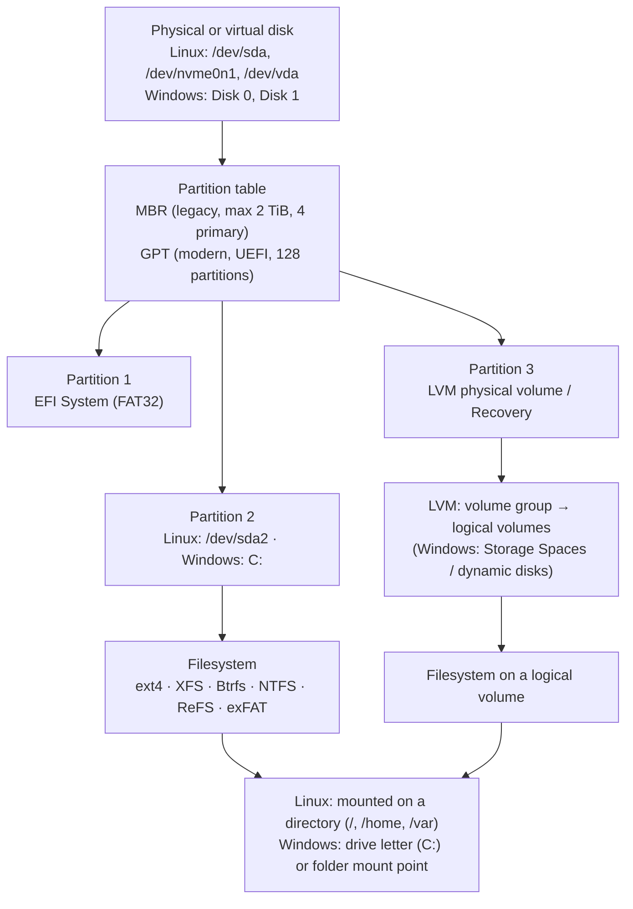
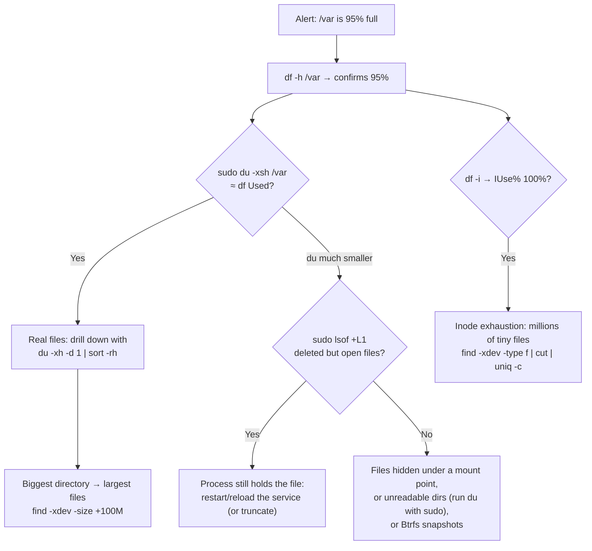

# Day 09: Disk and Storage Management

!!! info "Lesson overview"
    | | |
    |---|---|
    | **Module** | 2 — System Administration |
    | **Difficulty** | :material-signal-cellular-2: Intermediate |
    | **Estimated time** | 3–4 hours (80 min reading, 80 min demonstrations, 60–90 min lab and quiz) |
    | **Platforms** | Ubuntu 24.04 LTS (Bash 5.2, GNU coreutils 9.4, util-linux 2.39, systemd 255) · Windows 11 (Windows PowerShell 5.1 and PowerShell 7.4+) |
    | **Lab** | [Lab 09: Disk Full](../../labs/lab-09.md) |

## Learning Objectives

By the end of this lesson you will be able to:

1. Explain the storage stack: **physical disk → partition table (MBR/GPT) → partition → filesystem → mount point or drive letter**, and name the common filesystems on each platform (ext4, XFS, Btrfs, vfat, NTFS, ReFS, exFAT).
2. Identify disks, partitions and filesystems with `lsblk`, `blkid` and `findmnt` on Linux, and with `Get-Disk`, `Get-Partition`, `Get-Volume` and `Get-PSDrive` on Windows.
3. Measure free space per filesystem with `df` (including `-h`, `-T`, `-i`, `--output`) and per folder with `du`, and do the same in PowerShell with `Get-Volume`, `Win32_LogicalDisk`, `System.IO.DriveInfo` and `Get-ChildItem | Measure-Object`.
4. Explain why **`df` and `du` disagree** (deleted-but-open files, reserved blocks, files hidden under mount points, sparse files) and find the cause.
5. Recognise **inode exhaustion** ("No space left on device" with free space showing) and fix it.
6. Mount and unmount filesystems safely, read and **verify** `/etc/fstab` with UUIDs and `nofail`, and practise on a **disposable loop device or VHDX** instead of a real disk.
7. Describe LVM (`pvs`, `vgs`, `lvs`, `lvextend -r`), swap (`swapon --show`, page file) and disk health checks (`Repair-Volume -Scan`, `chkdsk /scan`, `e2fsck -n`, SMART).
8. Run a structured **disk-full investigation** and clean up safely with previews and backups, using the course `disk-monitor` scripts for repeatable measurements.

## Prerequisites

- [Day 02](../module-1/day-02.md): the Linux filesystem hierarchy, Windows folders and safe deletion.
- [Day 04](../module-1/day-04.md): `find -size`/`-mtime` and `Get-ChildItem -Recurse`.
- [Day 05](../module-1/day-05.md): pipelines, `sort`, `Sort-Object`, `Measure-Object` and exit codes.
- [Day 07](day-07.md) and [Day 08](day-08.md): permissions (why `du` reports "Permission denied") and processes (which process holds a file open).
- An Ubuntu 24.04 **VM or WSL2** with `sudo` rights, and a Windows 11 **lab VM or PC**. Partitioning, formatting and mounting need `sudo` / an **elevated** PowerShell window.

!!! danger "Partitioning and formatting destroy data"
    `mkfs`, `fdisk`, `parted`, `wipefs`, `Format-Volume`, `Clear-Disk`, `Initialize-Disk` and `diskpart clean` erase data **immediately and without a recycle bin**. In this course you only ever run them against a **loop device backed by a file** (Linux) or a **VHDX file** (Windows) that you created a minute earlier. Check the device name **twice** with `lsblk` / `Get-Disk` before any of these commands, and take a VM snapshot first.

## Introduction and Concepts

### The storage stack

Every operating system builds storage in layers. Learn the layers once and the commands on both platforms make sense:



| Layer | Linux | Windows | What can go wrong |
|---|---|---|---|
| Disk | Block device in `/dev`: `sda` (SATA/SAS/USB), `nvme0n1` (NVMe), `vda` (KVM virtio), `xvda` (Xen/older AWS), `loop0` (file-backed) | `Disk 0`, `Disk 1` in Disk Management, `Get-Disk` | Failing hardware, disk not presented to the VM |
| Partition table | GPT or MBR (`lsblk -o NAME,PTTYPE`, `sudo fdisk -l`) | `PartitionStyle` = GPT/MBR/RAW (`Get-Disk`) | MBR cannot use space beyond 2 TiB |
| Partition | `sda1`, `nvme0n1p2` (note the `p`) | Partition numbers, types System/Reserved/Basic/Recovery | Partition smaller than the disk after a VM disk was enlarged |
| Volume manager | LVM (`pvs`, `vgs`, `lvs`) — Ubuntu Server's installer uses it by default | Storage Spaces, dynamic disks | Free space left unallocated in the volume group |
| Filesystem | ext4 (Ubuntu default), XFS (RHEL default), Btrfs, vfat (EFI), tmpfs (RAM) | NTFS (system), ReFS (servers), FAT32/exFAT (USB) | Full, out of inodes, corrupted, mounted read-only after errors |
| Access path | **Mount point** directory: `/`, `/home`, `/var/log` | **Drive letter** (`C:`) or folder mount point | Wrong mount, mount missing after reboot |

!!! note "Device names are not stable; UUIDs are"
    `/dev/sdb` today can be `/dev/sdc` after a reboot or after adding a disk. Every filesystem has a **UUID** (shown by `blkid` and `lsblk -f`), and `/etc/fstab` should refer to filesystems by `UUID=` (or `LABEL=`), never by `/dev/sdX`. Windows uses volume GUIDs (`\\?\Volume{...}\`) internally for the same reason; drive letters are just convenient names.

### Filesystems you will meet

| Filesystem | Where | Notes |
|---|---|---|
| **ext4** | Ubuntu, Debian default | Journaling, mature, can grow online and shrink offline; reserves 5% of blocks for root by default; fixed number of **inodes** chosen at `mkfs` time |
| **XFS** | RHEL, Rocky, Alma default | Excellent for large files and parallel I/O; can grow online but **cannot shrink**; inodes allocated dynamically |
| **Btrfs** | Fedora, openSUSE defaults; optional on Ubuntu | Copy-on-write, snapshots, checksums, subvolumes; `df` can be misleading — use `btrfs filesystem usage` |
| **vfat / FAT32** | EFI System Partition on both platforms; USB sticks | No permissions, 4 GiB maximum file size |
| **tmpfs** | `/run`, `/dev/shm`, often `/tmp` on other distributions | Lives in RAM (and swap); contents vanish at reboot |
| **squashfs** | Snap packages on Ubuntu (`/snap/...`) | Read-only, always 100% "used" — **ignore it** in disk alerts |
| **overlay** | Docker/container root filesystems | Layers; usage belongs to the host's `/var/lib/docker` |
| **NTFS** | Windows system and data volumes | ACLs (Day 07), compression, encryption (EFS), shadow copies, alternate data streams |
| **ReFS** | Windows Server data volumes, Dev Drive on Windows 11 | Integrity streams, resilient to corruption; not bootable |
| **exFAT** | Removable media on both platforms | No 4 GiB limit; no permissions |

### Mounting (Linux) versus drive letters (Windows)

On Linux there is **one tree** (Day 02). A filesystem becomes visible when it is **mounted** on a directory, the *mount point*. Anything that was inside that directory before the mount is **hidden** (not deleted) until you unmount again. That is a classic cause of "the disk is full but I cannot find the files" (see [Demo 7](#demo-7-files-hidden-under-a-mount-point-and-busy-unmounts)).

Mounts that should exist at every boot are listed in **`/etc/fstab`**, one line per filesystem, six fields:

```text
# <file system>                            <mount point>  <type>  <options>          <dump>  <pass>
UUID=68ba8b44-1527-41ae-a2f1-58db26b56338  /srv/data      ext4    defaults,nofail    0       2
```

| Field | Meaning |
|---|---|
| 1 — spec | What to mount: `UUID=…`, `LABEL=…`, a device, or `server:/export` for NFS |
| 2 — file | The mount point directory (must exist) |
| 3 — vfstype | `ext4`, `xfs`, `vfat`, `nfs`, `swap`… |
| 4 — mntops | Comma-separated options: `defaults` (= `rw,suid,dev,exec,auto,nouser,async`), `ro`, `noexec`, `nosuid`, `nodev`, `nofail` (boot continues if the device is missing), `x-systemd.device-timeout=10s` |
| 5 — freq | Legacy `dump` backup flag; use `0` |
| 6 — passno | `fsck` order at boot: `1` for `/`, `2` for other local filesystems, `0` to skip |

On systemd systems (Ubuntu 24.04), `systemd-fstab-generator` turns each line into a `.mount` unit at boot and after `sudo systemctl daemon-reload`. A wrong line **without `nofail`** for a required filesystem can drop the server into **emergency mode** at the next boot. Always run `sudo findmnt --verify` and `sudo mount -a` after editing fstab, *before* rebooting.

Windows assigns a **drive letter** to each volume (or mounts a volume into an empty NTFS folder). There is no fstab: the Mount Manager remembers letters in the registry (`HKLM\SYSTEM\MountedDevices`), and you change them with Disk Management, `Set-Partition -NewDriveLetter` or `diskpart`.

### Measuring space: `df` versus `du`

Two different questions, two different tools:

| Question | Linux | Windows / PowerShell | How it measures |
|---|---|---|---|
| *How full is each filesystem?* | `df -h` | `Get-Volume`, `Get-PSDrive`, `Win32_LogicalDisk` | Asks the **filesystem** for its block counters (`statfs()` system call) — fast, includes everything |
| *Which folders use the space?* | `du -sh DIR` | <code>Get-ChildItem -Recurse -File &#124; Measure-Object Length -Sum</code> | **Walks the directory tree** and adds up file sizes — slow, includes only what it can see and read |

When the two numbers disagree, the difference is information:



Four reasons for a mismatch:

1. **Deleted but still open.** Deleting a file removes its *name*. The data blocks are freed only when the **last process closes it**. If someone deletes a 20 GB log that a service is still writing to, `du` no longer sees it, but `df` still counts it until the service restarts. `sudo lsof +L1` lists open files with a link count below 1 (deleted). On Windows, an open file normally cannot be deleted at all ("The process cannot access the file because it is being used by another process").
2. **Reserved blocks.** ext4 reserves **5%** of blocks for root so that the system and root can still work when users fill the disk. `Size` minus `Used` is therefore larger than `Avail`. `df` calculates `Use%` as `Used / (Used + Avail)` and rounds **up**, which is why a filesystem can show 100% for normal users while root can still write. View with `sudo tune2fs -l /dev/X | grep -i reserved`.
3. **Hidden under a mount point.** Files written to `/var/log` *before* a separate filesystem was mounted on `/var/log` are still on the root filesystem, invisible to `du` while the mount is in place.
4. **Sparse files and apparent size.** A VM disk image or database file may have a large **apparent size** (`ls -l`, `du --apparent-size`) but occupy few blocks (`du`). The opposite is also true: a million 1-byte files use a million 4 KiB blocks.

### Inodes

On ext4 every file and directory needs one **inode** (the metadata record holding owner, permissions, timestamps and block pointers — you met it in `stat` on Day 02 and Day 07). The number of inodes is fixed when the filesystem is created. A mail spool, PHP session folder or cache with millions of tiny files can use **all inodes** while gigabytes of blocks are still free: every new file then fails with *No space left on device*. `df -i` shows inode usage. XFS and Btrfs allocate inodes dynamically, so it is mostly an ext4 problem. NTFS stores metadata in the Master File Table (MFT), which grows as needed.

### LVM in one paragraph

**Logical Volume Manager** adds a flexible layer between partitions and filesystems: **physical volumes** (PVs, partitions or whole disks) are pooled into a **volume group** (VG), from which you carve **logical volumes** (LVs) that hold filesystems. LVs can be grown online (`sudo lvextend -r -L +5G /dev/ubuntu-vg/ubuntu-lv` — `-r` also grows the filesystem) and can span several disks. The Ubuntu Server installer creates `ubuntu-vg/ubuntu-lv` by default and, depending on the installer version and disk size, may leave part of the volume group **unallocated** — a common reason a new server "only has 100 GB" on a 500 GB disk. Check with `sudo vgs` (column `VFree`). Windows offers the same idea with **Storage Spaces** (`Get-StoragePool`, `Get-VirtualDisk`).

### Swap and the page file

When RAM is full, the kernel moves rarely used memory pages to **swap** (a swap partition or a file such as Ubuntu's `/swap.img`). Windows uses the **page file** (`C:\pagefile.sys`) plus `swapfile.sys` and `hiberfil.sys` (hibernation). These files are large, hidden and **must not be deleted by hand**. Configure them through the OS (`swapon`/`swapoff` and fstab on Linux; *System Properties → Advanced → Performance → Virtual memory* on Windows). Show them with `swapon --show` and `free -h`, or `Get-CimInstance Win32_PageFileUsage`.

### Disk health

Space is only half of storage management. A disk can be half empty and failing:

- **Linux:** `dmesg`/`journalctl -k` show I/O errors (`blk_update_request: I/O error`, `EXT4-fs error`); ext4 may remount itself **read-only** after errors (`errors=remount-ro` is the Ubuntu default for `/`). `sudo e2fsck -n /dev/X` checks an **unmounted** ext4 filesystem read-only; never run `fsck` on a mounted filesystem. `smartctl` (package `smartmontools`, not installed by default) reads a physical disk's SMART health data.
- **Windows:** `Get-PhysicalDisk` shows `HealthStatus`; `Get-StorageReliabilityCounter` (elevated) shows wear, temperature and error counters where the driver supports them; `Repair-Volume -DriveLetter C -Scan` and `chkdsk C: /scan` check NTFS **online** without taking the volume offline. Event Viewer → *System* → sources `disk`, `Ntfs`, `stornvme` log hardware problems.

## Linux Command Reference

| Command | Purpose | Package / availability | Needs root? |
|---|---|---|---|
| `df` | Filesystem size, used, available, use% and inodes | coreutils | No |
| `du` | Disk usage of files and directories | coreutils | No (root to read every directory) |
| `lsblk` | Tree of block devices, partitions, sizes, filesystems, mount points | util-linux | No (some columns need root or udev) |
| `blkid` | Filesystem type, UUID and LABEL of block devices | util-linux | Root for uncached devices |
| `findmnt` | Show mounted filesystems as a tree; `--verify` checks fstab | util-linux | No (`--verify` as root to check devices) |
| `mount` / `umount` | Attach / detach a filesystem; remount with new options | util-linux | Yes (except `user` mounts) |
| `fdisk` / `sfdisk` / `parted` | Partition a disk (MBR and GPT) | fdisk / parted packages (default on Ubuntu Server) | Yes |
| `mkfs.ext4` / `mkfs.xfs` | Create a filesystem (**destroys data**) | e2fsprogs / xfsprogs | Yes |
| `tune2fs` / `e2fsck` / `resize2fs` | Inspect, check and resize ext2/3/4 | e2fsprogs | Yes |
| `losetup` | Attach a file as a block device (`/dev/loopN`) for practice | util-linux | Yes |
| `pvs` / `vgs` / `lvs` / `lvextend` | LVM inspection and growth | lvm2 (default on Ubuntu Server) | Yes |
| `swapon` / `free` | Swap devices and memory usage | util-linux / procps | `--show` no; changes yes |
| `lsof +L1` | Open files that have been deleted | lsof | Root to see other users' processes |
| `ncdu` | Interactive `du` browser | ncdu (`sudo apt install ncdu`, universe) | No |
| `journalctl --disk-usage` / `--vacuum-size` | Journal size and cleanup | systemd | Vacuum: yes |

## PowerShell Command Reference

| Cmdlet / tool | Aliases | Purpose | Works in 5.1 | Works in 7.x | Admin? |
|---|---|---|---|---|---|
| `Get-PSDrive` | `gdr` | PowerShell drives, with **Used** and **Free** for file system drives | Yes | Yes (all OS; on Linux the drive is `/`) | No |
| `Get-Volume` | — | Volumes: letter, label, filesystem, health, size, remaining | Yes | Yes (**Windows only**, Storage module) | No for reading |
| `Get-Disk` | — | Disks: number, model, size, partition style, health | Yes | Windows only | Usually no for reading; yes for changes |
| `Get-Partition` | — | Partitions: disk, number, letter, offset, size, type | Yes | Windows only | Reading usually no |
| `Get-PhysicalDisk` / `Get-StorageReliabilityCounter` | — | Media type (SSD/HDD), bus, health / wear and error counters | Yes | Windows only | Counters: yes |
| `Get-CimInstance Win32_LogicalDisk` | — | Classic WMI view of drives (`Size`, `FreeSpace`) — also works remotely | Yes | Windows only | No |
| `[System.IO.DriveInfo]::GetDrives()` | — | .NET drive list with total, free and available bytes | Yes | Yes (all OS) | No |
| <code>Get-ChildItem -Recurse -File &#124; Measure-Object Length -Sum</code> | `gci`, `measure` | Folder size (the PowerShell `du`) | Yes | Yes | No (Admin for protected folders) |
| `Initialize-Disk`, `New-Partition`, `Format-Volume`, `Resize-Partition`, `Set-Partition` | — | Prepare, partition, format, resize, re-letter (**destructive**) | Yes | Windows only | **Yes** |
| `Mount-DiskImage` / `Dismount-DiskImage` | — | Attach / detach ISO, VHD, VHDX files | Yes | Windows only | Yes for VHD/VHDX |
| `Repair-Volume` | — | Scan or repair a volume (`-Scan`, `-SpotFix`, `-OfflineScanAndFix`) | Yes | Windows only | Yes |
| `Optimize-Volume` | — | Analyse, defragment (HDD) or TRIM (SSD) | Yes | Windows only | Yes |
| `chkdsk.exe`, `fsutil.exe`, `diskpart.exe` | — | Native disk tools | Yes | Yes (Windows) | Mostly yes |
| `Get-CimInstance Win32_PageFileUsage` | — | Page file location and usage | Yes | Windows only | No |

The storage cmdlets (`Get-Disk`, `Get-Volume`, `Get-Partition` and friends) come from the **Storage** module that ships with Windows 8 / Server 2012 and later. They work in both Windows PowerShell 5.1 and PowerShell 7 **on Windows**, but do not exist in PowerShell on Linux or macOS, where you use `Get-PSDrive`, `DriveInfo` or the native `df`.

## Detailed Command Explanations

### `lsblk` — what disks and partitions exist?

`lsblk` reads `/sys` and prints every block device as a tree: disks, their partitions, LVM volumes and loop devices, with size, type and mount points. Useful forms:

- `lsblk` — default columns `NAME MAJ:MIN RM SIZE RO TYPE MOUNTPOINTS` (`RM` removable, `RO` read-only).
- `lsblk -f` — filesystem view: `FSTYPE`, `FSVER`, `LABEL`, `UUID`, `FSAVAIL`, `FSUSE%`, `MOUNTPOINTS`.
- `lsblk -o NAME,SIZE,TYPE,FSTYPE,MOUNTPOINTS,MODEL` — choose columns; `lsblk -d` lists disks only (no partitions); `-o NAME,ROTA` shows `1` for spinning disks and `0` for SSDs.
- `lsblk -p` prints full paths (`/dev/sda1`), handy for copy-paste.

`TYPE` is `disk`, `part`, `lvm`, `loop`, `rom` or `crypt` (LUKS). `lsblk` takes filesystem information from **udev**. In containers without udev the `FSTYPE`/`UUID` columns can be empty; use `blkid` there.

### `blkid` — filesystem identity

`sudo blkid` prints each block device with `UUID`, `LABEL`, `TYPE` (filesystem) and, for GPT, `PARTUUID`. `blkid -s UUID -o value /dev/sdb1` prints just the UUID, ideal for building an fstab line in a script. Without root, `blkid` may show only cached results.

### `findmnt` — what is mounted where, with which options?

`findmnt` reads `/proc/self/mountinfo` and shows mounts as a **tree**, which makes nested mounts obvious. Options you will use:

- `findmnt -T /var/log/app` — which filesystem holds this **path** (`-T`, `--target`). The fastest answer to "which disk is this folder on?".
- `findmnt -t ext4,xfs` — only these types; `findmnt --real` hides pseudo filesystems (util-linux 2.38+).
- `findmnt -o TARGET,SOURCE,FSTYPE,OPTIONS` — choose columns; `-n` no header; `-r` raw output for scripts.
- `sudo findmnt --verify` — parses `/etc/fstab` and reports syntax errors, missing mount points, unknown UUIDs and unknown filesystem types. Run it **every time** you edit fstab. Exit status `0` = no errors.

`mount` without arguments also lists mounts, but as a long unsorted list. Prefer `findmnt`.

### `df` — how full is each filesystem?

`df` reports, per mounted filesystem: total size, used, available, use% and mount point. Without options sizes are in 1 KiB blocks; always add `-h`.

- `-h` human-readable (powers of 1024: `K`, `M`, `G`); `-H` powers of 1000 (matches disk vendors' marketing sizes).
- `-T` adds the filesystem type; `-t ext4` / `-x tmpfs -x squashfs` include / exclude types.
- `-i` shows **inodes** instead of blocks.
- `--output=source,fstype,size,used,avail,pcent,ipcent,target` picks columns (GNU only; cannot be combined with `-P`).
- `-P` POSIX format, one line per filesystem even with long device names — safe for parsing in older scripts.
- `df -h /var/log` shows only the filesystem that **contains** that path.
- `--total` adds a total line.

### `du` — which directories use the space?

`du` walks directories and adds up the **allocated blocks** of the files it finds.

- `du -sh DIR` — summary (`-s`) of one directory, human-readable.
- `du -h -d 1 DIR` (`--max-depth=1`) — one line per sub-directory; pipe to `sort -rh | head` for the biggest first. `sort -h` understands `K`, `M`, `G` suffixes.
- `du -x` — stay on **one filesystem** (do not descend into other mounts such as `/proc`, `/mnt/backup` or `/snap`). Always use it when investigating one full filesystem.
- `du -a` — include files, not only directories; `du -c` prints a grand total; `du -t 100M` (`--threshold`) hides entries smaller than 100 MiB.
- `du --apparent-size` — the file **length** instead of allocated blocks (differs for sparse and tiny files).
- `du --exclude='*.iso'` — skip a pattern.

`du` must read every directory, so run it as root (`sudo du ...`) to include protected directories, or redirect the "Permission denied" noise with `2>/dev/null` and remember the total is incomplete.

### `mount` and `umount`

- `sudo mount /dev/loop0 /mnt/lab09` — mount a device on an existing directory; the type is usually auto-detected (`-t ext4` to force).
- `sudo mount -o ro,noexec /dev/sdb1 /mnt/evidence` — mount read-only and forbid executing programs, the correct way to examine a suspect disk.
- `sudo mount -o remount,ro /srv/data` — change options of a mounted filesystem without unmounting.
- `sudo mount -a` — mount everything in fstab that is not yet mounted (the test after editing fstab).
- `sudo umount /mnt/lab09` — unmount (note the spelling: **umount**). Fails with `target is busy` when a process has its current directory or an open file on it; find it with `sudo fuser -vm /mnt/lab09` or `sudo lsof /mnt/lab09`. Avoid `umount -l` (lazy) except in emergencies: it hides the problem.

On Ubuntu 24.04 desktop, removable media is mounted automatically under `/media/<user>/<label>` by udisks2; `udisksctl mount -b /dev/sdb1` does it from the command line without `sudo`.

### Partitioning and creating filesystems (lab only)

The workflow on a new, empty disk (or practice loop device) is:

1. Identify the **empty** disk: `lsblk`, `sudo fdisk -l /dev/sdX` (look for no partitions).
2. Create a partition table and partition: `sudo parted /dev/sdX --script mklabel gpt mkpart data ext4 1MiB 100%` (or interactive `sudo fdisk /dev/sdX`: `g` new GPT, `n` new partition, `w` write).
3. Create the filesystem: `sudo mkfs.ext4 -L data /dev/sdX1` (`-L` label; `-N` or `-i` to choose the inode count for millions of small files; `-m 1` to reserve 1% instead of 5%).
4. Create the mount point, mount it, add an fstab line by **UUID** with `nofail`, then `sudo findmnt --verify` and `sudo mount -a`.

Growing later: grow the virtual disk in the hypervisor → `sudo growpart /dev/sda 3` (package `cloud-guest-utils`) or `parted resizepart` → `sudo pvresize /dev/sda3` (if LVM) → `sudo lvextend -r -l +100%FREE /dev/ubuntu-vg/ubuntu-lv`, or `sudo resize2fs /dev/sda3` (ext4) / `sudo xfs_growfs /mountpoint` (XFS) without LVM.

### `tune2fs`, `e2fsck` and reserved blocks

`sudo tune2fs -l /dev/X` lists the superblock: block count, block size, **reserved block count**, inode count, mount count and last check time — **read-only**. `sudo tune2fs -m 1 /dev/X` changes the reserve to 1%, which on a 2 TB *data* volume frees about 80 GB. Keep the default 5% on `/`. `sudo e2fsck -n /dev/X` performs a read-only check of an **unmounted** filesystem (`-n` answers "no" to every repair question); `-f` forces a full check, `-p` repairs automatically. Repairs are done from rescue mode or by unmounting first.

### `lsof +L1` — deleted but still open

`sudo lsof +L1` lists open files whose link count is less than one, which means they were deleted while a process kept them open. The `SIZE/OFF` column shows how much space is still held, `COMMAND`/`PID` who holds it. Without `lsof`, the same information is in `/proc`: `sudo find /proc/[0-9]*/fd -lname '*(deleted)' -printf '%p -> %l\n'`.

To release the space, **restart or reload the service** that owns the file (the right fix — logrotate uses `postrotate` reload or `copytruncate` for exactly this reason). If a restart is not possible right now, an emergency option is to truncate the open file through its descriptor: `sudo truncate -s 0 /proc/PID/fd/N`. That discards the data, so copy it first if it may be evidence.

### LVM: `pvs`, `vgs`, `lvs`, `lvextend`

- `sudo pvs` — physical volumes, their VG and free space.
- `sudo vgs` — volume groups: `VSize` and **`VFree`** (unallocated space you can give to an LV).
- `sudo lvs` — logical volumes and their sizes; the device path is `/dev/VG/LV` or `/dev/mapper/VG-LV`.
- `sudo lvextend -r -L +10G /dev/ubuntu-vg/ubuntu-lv` — add 10 GiB and resize the filesystem in the same step (`-r` = `--resizefs`). `-l +100%FREE` uses all free space in the VG.

Growing ext4 and XFS online is routine and safe. **Shrinking** is risky (XFS cannot shrink at all) and needs a backup and downtime.

### `swapon` and `free`

`swapon --show` lists swap devices/files with size and usage; `free -h` shows RAM and swap totals. Heavy swap use plus a slow system means memory pressure (Day 08 tools show which process). Ubuntu 24.04 desktop and server installs normally create `/swap.img`; cloud images often have no swap.

### `journalctl --disk-usage` and safe cleanup targets

`journalctl --disk-usage` shows how much the systemd journal uses in `/var/log/journal`. `sudo journalctl --vacuum-size=500M` or `--vacuum-time=14d` removes old **archived** journal files; make the limit permanent with `SystemMaxUse=` in `/etc/systemd/journald.conf`. Other safe, well-known targets: `sudo apt clean` (downloaded package files in `/var/cache/apt/archives`, Day 10), old kernels via `sudo apt autoremove` (Day 10), rotated and compressed logs (`*.gz`) after checking retention requirements, and `snap` revisions (`snap list --all`). Never delete files in `/var/lib` (package and database state) to make space.

### `Get-PSDrive` — quick free space in any PowerShell

`Get-PSDrive -PSProvider FileSystem` lists file system drives with `Used (GB)` and `Free (GB)` columns. It works in 5.1 and 7, and also on Linux (one drive called `/`). The object properties `Used` and `Free` are **bytes**. It also lists non-disk drives (`HKLM:`, `Env:`, `Cert:`) when you omit `-PSProvider`.

### `Get-Volume`, `Get-Disk`, `Get-Partition` — the Windows storage stack

These three cmdlets map exactly to the layers in the diagram:

- `Get-Disk` — `Number`, `FriendlyName`, `SerialNumber`, `HealthStatus`, `OperationalStatus`, `Total Size`, `Partition Style` (GPT, MBR or **RAW** = never initialised). A RAW disk is a new, empty disk.
- `Get-Partition` — `DiskNumber`, `PartitionNumber`, `DriveLetter`, `Offset`, `Size`, `Type` (System, Reserved, Basic, Recovery). `Get-Partition -DriveLetter C | Get-Disk` walks from a letter to its disk.
- `Get-Volume` — `DriveLetter`, `FriendlyName` (label), `FileSystemType`, `DriveType`, `HealthStatus`, `SizeRemaining`, `Size`. `Get-Volume -DriveLetter C | Get-Partition | Get-Disk` walks down the stack.

The objects pipe into each other, which is the PowerShell way of answering "which physical disk is `D:` on?".

### `Win32_LogicalDisk` and `DriveInfo` — portable free-space checks

`Get-CimInstance -ClassName Win32_LogicalDisk -Filter "DriveType=3"` returns local disks (`DriveType` 2 removable, 3 local, 4 network, 5 CD) with `DeviceID` (`C:`), `VolumeName`, `Size` and `FreeSpace` in bytes. It is the classic choice for **remote** checks (`-ComputerName`, Day 26) and older scripts.

`[System.IO.DriveInfo]::GetDrives()` is pure .NET: `Name`, `DriveType`, `DriveFormat`, `TotalSize`, `TotalFreeSpace`, `AvailableFreeSpace` (free space available to *this user*, which honours quotas). It works in 5.1, 7, Windows and Linux, which is why the course `Disk-Monitor.ps1` uses it.

### Folder sizes in PowerShell

PowerShell has no `du` cmdlet. The idiom is:

```powershell
Get-ChildItem -Path C:\Logs -Recurse -File -Force -ErrorAction SilentlyContinue |
    Measure-Object -Property Length -Sum
```

`-File` skips folders (which have no `Length`), `-Force` includes hidden and system files, and `-ErrorAction SilentlyContinue` suppresses "Access denied" for protected folders — the total is then incomplete, as with `du` without `sudo`. `Length` is the **logical** size, like `du --apparent-size`: compressed NTFS files and cloud placeholder files (OneDrive "Files On-Demand") report their full length although they use less disk. Per-folder breakdowns use a loop over `Get-ChildItem -Directory` (see [Demo 3](#demo-3-drill-down-from-the-full-filesystem-to-the-folder)).

!!! warning "Junctions and symbolic links"
    Windows profiles contain junctions such as `C:\Users\student\Application Data` that point back into the profile. PowerShell 7 does not follow directory links during `-Recurse` unless you add `-FollowSymlink`; Windows PowerShell 5.1 skips the classic profile junctions because they deny listing, but other links may be counted twice. Script-grade size tools (like `Disk-Monitor.ps1`) skip reparse points explicitly.

### Windows partitioning cmdlets (lab only)

On an **empty** disk (in this course: a VHDX file), the PowerShell workflow is:

```powershell
Get-Disk | Where-Object PartitionStyle -eq 'RAW'                     # 1. find the new, empty disk
Initialize-Disk -Number 2 -PartitionStyle GPT                        # 2. partition table
New-Partition -DiskNumber 2 -UseMaximumSize -AssignDriveLetter       # 3. partition + letter
Format-Volume -DriveLetter R -FileSystem NTFS -NewFileSystemLabel LAB09   # 4. filesystem (asks to confirm)
```

`Resize-Partition -DriveLetter R -Size (Get-PartitionSupportedSize -DriveLetter R).SizeMax` grows a partition into free space after the disk was enlarged; `Set-Partition -DriveLetter R -NewDriveLetter S` changes the letter. All of these need an elevated session. Most of the changing cmdlets accept `-WhatIf` and `-Confirm`; check with `Get-Help <cmdlet> -Parameter WhatIf` on your build before relying on it.

### `Repair-Volume`, `chkdsk` and `Optimize-Volume`

- `Repair-Volume -DriveLetter C -Scan` performs an **online** scan and records problems for later repair; `-SpotFix` fixes recorded problems with a brief dismount; `-OfflineScanAndFix` takes the volume offline (scheduled at reboot for `C:`).
- `chkdsk C: /scan` is the native equivalent of an online scan; `chkdsk D: /f` fixes errors and needs exclusive access. Never interrupt a running repair.
- `Optimize-Volume -DriveLetter C -Analyze -Verbose` reports fragmentation; on SSDs Windows performs **TRIM** (`-ReTrim`) instead of defragmentation. Windows runs both on a schedule by default.

### Windows cleanup tools

Disk full on `C:` is usually caused by user profiles, `C:\Windows\SoftwareDistribution\Download` (update cache), the component store `C:\Windows\WinSxS`, temp folders, crash dumps (`C:\Windows\MEMORY.DMP`, `C:\Windows\Minidump`), and hibernation. Safe tools:

- **Storage Sense** (*Settings → System → Storage*) and **Disk Cleanup** (`cleanmgr.exe`) remove temporary and update files.
- `Dism.exe /Online /Cleanup-Image /AnalyzeComponentStore` (elevated, **read-only**) reports how much of WinSxS can be reclaimed; `/StartComponentCleanup` performs the supported cleanup. Never delete files from WinSxS by hand.
- `powercfg /hibernate off` removes `hiberfil.sys` on machines that do not need hibernation (this is a configuration change; record it).

## Syntax and Parameters

### Bash

```text
df [-h | -H] [-T] [-i] [-t TYPE] [-x TYPE] [--output[=FIELDS]] [--total] [FILE...]
du [-s] [-h] [-a] [-c] [-x] [-d N] [-t SIZE] [--apparent-size] [--exclude=PATTERN] [FILE...]
lsblk [-f] [-d] [-p] [-o COLUMNS] [DEVICE...]
blkid [-s TAG] [-o value|export] [DEVICE...]
findmnt [-T PATH] [-t TYPES] [--real] [-o COLUMNS] [-n] [-r] [--verify] [TARGET]
mount [-t TYPE] [-o OPTIONS] DEVICE DIR      ·  mount -o remount,OPTIONS DIR  ·  mount -a
umount DIR | DEVICE
losetup [-f] [--show] [-d DEVICE] [FILE]
mkfs.ext4 [-L LABEL] [-m PERCENT] [-N INODES] DEVICE
tune2fs -l DEVICE  ·  tune2fs -m PERCENT DEVICE
e2fsck -n DEVICE
lvextend -r (-L +SIZE | -l +100%FREE) VG/LV
```

| Option | Command | Meaning |
|---|---|---|
| `-h` / `-H` | df, du | Human-readable, powers of 1024 / 1000 |
| `-T` | df | Show filesystem type |
| `-i` | df | Inodes instead of blocks |
| `-x TYPE` / `-t TYPE` | df | Exclude / include a filesystem type (repeatable) |
| `--output=` | df | Columns: `source,fstype,itotal,iused,iavail,ipcent,size,used,avail,pcent,file,target` |
| `-s` | du | Summary: one total per argument |
| `-d N` | du | Depth (`--max-depth`); `-d 1` = immediate sub-directories |
| `-x` | du, find | Stay on one filesystem |
| `-a` | du | Include files |
| `-t SIZE` | du | Threshold: hide entries smaller than SIZE |
| `--apparent-size` | du | File length instead of allocated blocks |
| `-f` | lsblk | Filesystem columns (FSTYPE, LABEL, UUID, FSAVAIL, FSUSE%) |
| `-o` | lsblk, findmnt | Choose output columns |
| `-T PATH` | findmnt | Filesystem containing PATH |
| `--verify` | findmnt | Check fstab for errors |
| `-o remount,ro` | mount | Change options of a mounted filesystem |
| `-a` | mount | Mount all fstab entries not yet mounted |
| `-f --show` | losetup | Use the first free loop device and print its name |
| `-L`, `-m`, `-N` | mkfs.ext4 | Label, reserved-block percent, number of inodes |
| `-n` | e2fsck | Read-only check: answer "no" to all questions |
| `-r` | lvextend | Resize the filesystem together with the LV |

### PowerShell

```text
Get-PSDrive [[-Name] <String[]>] [-PSProvider <String[]>]
Get-Volume [[-DriveLetter] <Char[]>] [-FileSystemLabel <String[]>]
Get-Disk [[-Number] <UInt32[]>] [-FriendlyName <String[]>]
Get-Partition [-DiskNumber <UInt32[]>] [-DriveLetter <Char[]>] [-PartitionNumber <UInt32[]>]
Get-CimInstance -ClassName Win32_LogicalDisk [-Filter <String>] [-ComputerName <String[]>]
Get-ChildItem -Path <String> -Recurse -File [-Force] [-ErrorAction SilentlyContinue] |
    Measure-Object -Property Length -Sum
Initialize-Disk -Number <UInt32> [-PartitionStyle <GPT|MBR>]
New-Partition -DiskNumber <UInt32> (-Size <UInt64> | -UseMaximumSize) [-AssignDriveLetter | -DriveLetter <Char>]
Format-Volume -DriveLetter <Char> [-FileSystem <NTFS|ReFS|exFAT|FAT32>] [-NewFileSystemLabel <String>] [-Confirm:$false]
Resize-Partition -DriveLetter <Char> -Size <UInt64>
Mount-DiskImage -ImagePath <String>  ·  Dismount-DiskImage -ImagePath <String>
Repair-Volume -DriveLetter <Char> (-Scan | -SpotFix | -OfflineScanAndFix)
```

| Parameter | Cmdlet | Meaning |
|---|---|---|
| `-PSProvider FileSystem` | Get-PSDrive | Only disk drives (not registry, env, cert) |
| `-DriveLetter` | Get-Volume, Get-Partition, Format-Volume… | A letter without colon: `C`, not `C:` |
| `-Filter "DriveType=3"` | Win32_LogicalDisk | WQL filter: local fixed disks only |
| `-Recurse -File -Force` | Get-ChildItem | All files including hidden/system, at every depth |
| `-Property Length -Sum` | Measure-Object | Add up file lengths (bytes) |
| `-PartitionStyle` | Initialize-Disk | `GPT` (default, recommended) or `MBR` |
| `-UseMaximumSize` | New-Partition | Use all free space |
| `-AssignDriveLetter` | New-Partition | Pick the next free letter |
| `-FileSystem`, `-NewFileSystemLabel` | Format-Volume | Filesystem and label |
| `-Scan`, `-SpotFix`, `-OfflineScanAndFix` | Repair-Volume | Online scan / quick fix / full offline repair |
| `-ImagePath` | Mount-DiskImage | Full path to an `.iso`, `.vhd` or `.vhdx` |

Size values in PowerShell can use the numeric suffixes `KB`, `MB`, `GB`, `TB` (powers of 1024): `New-Partition -Size 200MB`, `$bytes / 1GB`.

## Practical Demonstrations

Linux outputs for Demos 1 and 3–7 were **captured** on 2026-11-11 by running the commands as root on Ubuntu 24.04.5 (GNU coreutils 9.4, util-linux 2.39.3) in a container, using a 200 MiB **file-backed loop device** formatted as ext4 and mounted on `/mnt/lab09` (and a 20 MiB one with only 1,024 inodes for Demo 6). The host was renamed `ubuntu-lab`, and listings of the container's own filesystems were replaced by the loop devices. Output for real disks (`sda`, `nvme0n1`, LVM) and all Windows output are **examples** of the standard formats, checked against the official documentation; your sizes, names and UUIDs will differ.

### Demo 1 — How full is each filesystem?

=== "Bash"

    ```bash
    df -h
    df -hT -x tmpfs -x squashfs -x devtmpfs
    df -h /mnt/lab09                  # only the filesystem that holds this path
    df -i /mnt/lab09                  # inodes
    ```

    **Expected output (example, Ubuntu 24.04 VM with LVM):**

    ```text
    Filesystem                         Size  Used Avail Use% Mounted on
    tmpfs                              392M  1.6M  390M   1% /run
    /dev/mapper/ubuntu--vg-ubuntu--lv   48G   31G   15G  68% /
    tmpfs                              2.0G     0  2.0G   0% /dev/shm
    tmpfs                              5.0M     0  5.0M   0% /run/lock
    /dev/sda2                          2.0G  183M  1.7G  11% /boot
    /dev/sda1                          1.1G  6.2M  1.1G   1% /boot/efi
    tmpfs                              392M   12K  392M   1% /run/user/1000
    Filesystem                        Type  Size  Used Avail Use% Mounted on
    /dev/mapper/ubuntu--vg-ubuntu--lv ext4   48G   31G   15G  68% /
    /dev/sda2                         ext4  2.0G  183M  1.7G  11% /boot
    /dev/sda1                         vfat  1.1G  6.2M  1.1G   1% /boot/efi
    ```

    **Captured output (practice loop device):**

    ```text
    Filesystem      Size  Used Avail Use% Mounted on
    /dev/loop0      172M   24K  158M   1% /mnt/lab09
    Filesystem     Inodes IUsed IFree IUse% Mounted on
    /dev/loop0      51200    11 51189    1% /mnt/lab09
    ```

    The 200 MiB file shows only 172M `Size` (filesystem metadata and the journal take the rest) and 158M `Avail` with almost nothing used: the missing ~10 MiB are the **5% reserved blocks** (`tune2fs -l` reported `Reserved block count: 2560` of `51200` 4 KiB blocks). The `ubuntu--vg-ubuntu--lv` name doubles each hyphen because device-mapper uses `-` to separate VG and LV names.

=== "PowerShell"

    ```powershell
    Get-PSDrive -PSProvider FileSystem
    Get-Volume | Where-Object DriveLetter | Sort-Object DriveLetter
    Get-CimInstance -ClassName Win32_LogicalDisk -Filter "DriveType=3" |
        Select-Object DeviceID, VolumeName,
            @{ n = 'SizeGB'; e = { [math]::Round($_.Size / 1GB, 1) } },
            @{ n = 'FreeGB'; e = { [math]::Round($_.FreeSpace / 1GB, 1) } },
            @{ n = 'UsedPct'; e = { [math]::Round(100 - $_.FreeSpace / $_.Size * 100, 1) } }
    ```

    **Expected output (example):**

    ```text
    Name           Used (GB)     Free (GB) Provider      Root               CurrentLocation
    ----           ---------     --------- --------      ----               ---------------
    C                 162.41         74.12 FileSystem    C:\                 Users\student
    D                  12.80        487.15 FileSystem    D:\

    DriveLetter FriendlyName FileSystemType DriveType HealthStatus OperationalStatus SizeRemaining      Size
    ----------- ------------ -------------- --------- ------------ ----------------- -------------      ----
    C           Windows      NTFS           Fixed     Healthy      OK                     74.12 GB 236.53 GB
    D           Data         NTFS           Fixed     Healthy      OK                    487.15 GB    500 GB

    DeviceID VolumeName SizeGB FreeGB UsedPct
    -------- ---------- ------ ------ -------
    C:       Windows     236.5   74.1    68.7
    D:       Data          500  487.2     2.6
    ```

    In PowerShell 7 on **Linux**, `Get-PSDrive -PSProvider FileSystem` shows a single drive named `/` with `Used` and `Free`; `Get-Volume` and `Win32_LogicalDisk` do not exist there.

### Demo 2 — Which disks, partitions and filesystems exist?

=== "Bash"

    ```bash
    lsblk
    lsblk -f
    lsblk -d -o NAME,SIZE,ROTA,TRAN,MODEL
    sudo blkid /dev/sda2
    findmnt -T /var/log
    findmnt --real -o TARGET,SOURCE,FSTYPE,OPTIONS
    ```

    **Expected output (example, Ubuntu 24.04 Server VM):**

    ```text
    NAME                      MAJ:MIN RM  SIZE RO TYPE MOUNTPOINTS
    sda                         8:0    0  100G  0 disk
    ├─sda1                      8:1    0    1G  0 part /boot/efi
    ├─sda2                      8:2    0    2G  0 part /boot
    └─sda3                      8:3    0   97G  0 part
      └─ubuntu--vg-ubuntu--lv 252:0    0 48.5G  0 lvm  /
    sr0                        11:0    1 1024M  0 rom
    NAME                      FSTYPE      FSVER    LABEL UUID                                   FSAVAIL FSUSE% MOUNTPOINTS
    sda
    ├─sda1                    vfat        FAT32          5A1C-3F2B                                 1G     1% /boot/efi
    ├─sda2                    ext4        1.0            0f3c9d0e-2a5b-4f6e-9c1d-7b8a9e0f1a2b    1.7G     9% /boot
    └─sda3                    LVM2_member LVM2 001       Xy3k9P-AbCd-EfGh-IjKl-MnOp-QrSt-UvWxYz
      └─ubuntu--vg-ubuntu--lv ext4        1.0            9d2e1f40-8c7b-4a3d-b2e1-0f9e8d7c6b5a     15G    64% /
    NAME   SIZE ROTA TRAN MODEL
    sda    100G    0 sata VBOX HARDDISK
    /dev/sda2: UUID="0f3c9d0e-2a5b-4f6e-9c1d-7b8a9e0f1a2b" BLOCK_SIZE="4096" TYPE="ext4" PARTUUID="1d2e3f4a-05"
    TARGET SOURCE                            FSTYPE OPTIONS
    /      /dev/mapper/ubuntu--vg-ubuntu--lv ext4   rw,relatime
    ```

    Read it bottom-up: `/` is an **ext4** filesystem on the **LVM** logical volume `ubuntu-lv`, which lives on partition `sda3` (an `LVM2_member`) of disk `sda`. The LV is 48.5G although `sda3` is 97G: the rest is **unallocated in the volume group** (`sudo vgs` would show about 48G `VFree`) — the Ubuntu Server situation described in the concepts.

    **Captured output (practice loop device, container without udev):**

    ```text
    $ lsblk /dev/loop0
    NAME  MAJ:MIN RM  SIZE RO TYPE MOUNTPOINTS
    loop0   7:0    0  200M  0 loop /mnt/lab09
    $ sudo blkid /dev/loop0
    /dev/loop0: LABEL="lab09data" UUID="68ba8b44-1527-41ae-a2f1-58db26b56338" BLOCK_SIZE="4096" TYPE="ext4"
    $ findmnt -T /mnt/lab09/x -o TARGET,SOURCE,FSTYPE,OPTIONS
    TARGET     SOURCE     FSTYPE OPTIONS
    /mnt/lab09 /dev/loop0 ext4   rw,relatime
    ```

    `lsblk -f` showed empty `FSTYPE`/`UUID` columns in the container because they come from udev; `blkid` reads the device itself.

=== "PowerShell"

    ```powershell
    Get-Disk
    Get-Partition -DiskNumber 0
    Get-Volume -DriveLetter C | Get-Partition | Get-Disk | Select-Object Number, FriendlyName, PartitionStyle, HealthStatus
    Get-PhysicalDisk | Select-Object DeviceId, FriendlyName, MediaType, BusType, HealthStatus,
        @{ n = 'SizeGB'; e = { [math]::Round($_.Size / 1GB) } }
    ```

    **Expected output (example):**

    ```text
    Number Friendly Name           Serial Number   HealthStatus OperationalStatus Total Size Partition Style
    ------ -------------           -------------   ------------ ----------------- ---------- ---------------
    0      Samsung SSD 980 1TB     S64ANS0T123456A Healthy      Online             931.51 GB GPT

       DiskPath: \\?\scsi#disk&ven_nvme&prod_samsung_ssd_980#...

    PartitionNumber  DriveLetter Offset                                        Size Type
    ---------------  ----------- ------                                        ---- ----
    1                            1048576                                     100 MB System
    2                            105906176                                    16 MB Reserved
    3                C           122683392                                930.65 GB Basic
    4                            1000365748224                               765 MB Recovery

    Number FriendlyName        PartitionStyle HealthStatus
    ------ ------------        -------------- ------------
         0 Samsung SSD 980 1TB GPT            Healthy

    DeviceId FriendlyName        MediaType BusType HealthStatus SizeGB
    -------- ------------        --------- ------- ------------ ------
    0        Samsung SSD 980 1TB SSD       NVMe    Healthy         932
    ```

    The `System` partition is the EFI System Partition (FAT32), `Reserved` is the 16 MB Microsoft Reserved Partition (MSR) and `Recovery` holds Windows RE. Only `C:` has a letter. If `Get-Disk` returns *Access denied* in your environment, repeat it in an elevated window.

### Demo 3 — Drill down from the full filesystem to the folder

=== "Bash"

    ```bash
    sudo du -xh -d 1 /mnt/lab09 | sort -rh | head
    sudo du -xah /mnt/lab09 | sort -rh | head -5
    sudo find /mnt/lab09 -xdev -type f -size +10M -exec ls -lh {} +
    ```

    **Captured output (practice loop device after creating sample data):**

    ```text
    98M     /mnt/lab09
    73M     /mnt/lab09/app
    26M     /mnt/lab09/backups
    808K    /mnt/lab09/home
    16K     /mnt/lab09/lost+found
    98M     /mnt/lab09
    73M     /mnt/lab09/app
    61M     /mnt/lab09/app/logs
    60M     /mnt/lab09/app/logs/app.log
    26M     /mnt/lab09/backups
    -rw-r--r-- 1 root root 12M Nov 11 16:50 /mnt/lab09/app/cache/blob.bin
    -rw-r--r-- 1 root root 60M Nov 11 16:50 /mnt/lab09/app/logs/app.log
    -rw-r--r-- 1 root root 25M Nov 11 16:50 /mnt/lab09/backups/db-2026-11-01.tar.gz
    ```

    The method is always the same: start at the mount point, take the **biggest** line, repeat one level deeper (`du -xh -d 1 /mnt/lab09/app | sort -rh`) until you reach the files. `-x` keeps `du` and `find` on this filesystem; without it, `du /` would also count `/proc`, network mounts and backup disks.

=== "PowerShell"

    ```powershell
    $root = 'C:\LabData'          # the same sample folders and files, created on Windows
    Get-ChildItem -Path $root -Directory | ForEach-Object {
        $sum = (Get-ChildItem -LiteralPath $_.FullName -Recurse -File -Force -ErrorAction SilentlyContinue |
                Measure-Object -Property Length -Sum).Sum
        [pscustomobject]@{ Folder = $_.Name; SizeMB = [math]::Round($sum / 1MB, 1) }
    } | Sort-Object SizeMB -Descending

    Get-ChildItem -Path $root -Recurse -File -Force -ErrorAction SilentlyContinue |
        Where-Object Length -gt 10MB |
        Sort-Object Length -Descending |
        Select-Object FullName, @{ n = 'SizeMB'; e = { [math]::Round($_.Length / 1MB, 1) } }, LastWriteTime
    ```

    **Expected output (example, same sample data on Windows):**

    ```text
    Folder  SizeMB
    ------  ------
    app       72.0
    backups     25
    home       0.0

    FullName                                   SizeMB LastWriteTime
    --------                                   ------ -------------
    C:\LabData\app\logs\app.log                    60 11-11-2026 22:20:31
    C:\LabData\backups\db-2026-11-01.tar.gz        25 11-11-2026 22:20:31
    C:\LabData\app\cache\blob.bin                  12 11-11-2026 22:20:32
    ```

    `home` shows `0.0` MB although `du` reported 808K on Linux: 200 tiny files of a few bytes each have a tiny **length**, but on ext4 each one occupies a whole 4 KiB block. That is the apparent-size versus allocated-size difference.

### Demo 4 — Apparent size versus allocated size

The difference between a file's length and the disk blocks it occupies is easiest to see with tiny and sparse files.

=== "Bash"

    ```bash
    du -sh --apparent-size /mnt/lab09/home/student    # sum of file lengths
    du -sh /mnt/lab09/home/student                    # blocks actually allocated
    truncate -s 1G /mnt/lab09/app/sparse.img          # a 1 GiB file with no data blocks
    ls -lh /mnt/lab09/app/sparse.img
    du -h /mnt/lab09/app/sparse.img
    du -h --apparent-size /mnt/lab09/app/sparse.img
    ```

    **Captured output:**

    ```text
    1.7K    /mnt/lab09/home/student
    804K    /mnt/lab09/home/student
    -rw-r--r-- 1 root root 1.0G Nov 11 16:50 /mnt/lab09/app/sparse.img
    0       /mnt/lab09/app/sparse.img
    1.0G    /mnt/lab09/app/sparse.img
    ```

    200 files of about 9 bytes each are 1.7K of data but 804K of disk (200 × 4 KiB blocks). The sparse file claims 1.0G in `ls -l` on a filesystem that is only 172M in size — because none of its blocks were ever written. Copying it with a tool that does not preserve sparseness would suddenly need the full 1 GiB.

=== "PowerShell"

    ```powershell
    # Elevated: create a 1 GiB sparse file on NTFS (fsutil needs Administrator)
    $f = 'C:\LabData\app\sparse.img'
    fsutil file createnew $f 0
    fsutil sparse setflag $f
    fsutil file seteof $f 1073741824
    fsutil sparse queryflag C:\LabData\app\sparse.img
    (Get-Item C:\LabData\app\sparse.img).Length / 1GB
    # Folder summary: count, total length, largest file
    Get-ChildItem C:\LabData\home -Recurse -File -Force |
        Measure-Object -Property Length -Sum -Maximum |
        Select-Object Count, Sum, Maximum
    ```

    **Expected output (example):**

    ```text
    File C:\LabData\app\sparse.img is created
    This file is set as sparse
    1

    Count  Sum Maximum
    -----  --- -------
      200 1692      10
    ```

    PowerShell reports **lengths** (1,692 bytes in 200 files); Explorer's *Properties* dialog shows both *Size* and *Size on disk*. NTFS stores very small files directly inside their MFT record, so the overhead is smaller than on ext4.

### Demo 5 — "The disk is full but du finds nothing": deleted but open

=== "Bash"

    ```bash
    # A process keeps app.log open on file descriptor 3, then someone deletes the file
    ( exec 3</mnt/lab09/app/logs/app.log; sleep 120 ) &
    rm /mnt/lab09/app/logs/app.log
    df -h /mnt/lab09
    sudo du -sh /mnt/lab09
    sudo lsof +L1 | grep -E 'COMMAND|lab09'
    sudo find /proc/[0-9]*/fd -lname '*(deleted)' -printf '%p -> %l\n' 2>/dev/null | grep lab09
    ps -o pid,user,cmd -p 1055
    sudo truncate -s 0 /proc/1055/fd/3     # emergency only; the right fix is restarting the owner
    df -h /mnt/lab09
    ```

    **Captured output (PIDs from the capture; trimmed to the relevant lines):**

    ```text
    Filesystem      Size  Used Avail Use% Mounted on
    /dev/loop0      172M   98M   60M  63% /mnt/lab09
    38M     /mnt/lab09
    COMMAND  PID     USER   FD   TYPE DEVICE SIZE/OFF NLINK NODE NAME
    sleep   1055     root    3r   REG    7,0 62914560     0   16 /mnt/lab09/app/logs/app.log (deleted)
    /proc/1055/fd/3 -> /mnt/lab09/app/logs/app.log (deleted)
      PID USER     CMD
     1055 root     sleep 120
    Filesystem      Size  Used Avail Use% Mounted on
    /dev/loop0      172M   38M  120M  25% /mnt/lab09
    ```

    `df` still counted 98M after the delete, `du` only 38M: the 60 MiB (`SIZE/OFF 62914560`, `NLINK 0`) were held by PID 1055. After truncating through `/proc/PID/fd/3` the space came back immediately. On a real server you would restart or reload the service that owns the descriptor (`systemctl restart`, Day 08) instead.

=== "PowerShell"

    ```powershell
    # Windows normally refuses to delete an open file, so the "deleted but open" case is rare.
    # The Windows question is "which process locks this file?"
    $stream = [System.IO.File]::Open("$env:TEMP\lab09-lock.txt", 'OpenOrCreate', 'ReadWrite', 'None')
    Remove-Item "$env:TEMP\lab09-lock.txt"
    $stream.Close()
    Remove-Item "$env:TEMP\lab09-lock.txt"
    # Find the locking process for a file in use (Sysinternals handle.exe, if installed):
    # handle.exe -accepteula lab09-lock.txt
    ```

    **Expected output (example):**

    ```text
    Remove-Item : Cannot remove item C:\Users\student\AppData\Local\Temp\lab09-lock.txt: The process cannot access the
    file 'C:\Users\student\AppData\Local\Temp\lab09-lock.txt' because it is being used by another process.
    ```

    After `$stream.Close()` the second `Remove-Item` succeeds silently. *Resource Monitor* → *CPU* tab → *Associated Handles* search box, or Sysinternals **handle.exe**, shows which process holds a file.

### Demo 6 — Inode exhaustion

=== "Bash"

    ```bash
    # A 20 MiB practice filesystem created with only 1,024 inodes:  sudo mkfs.ext4 -N 1024 -L lab09small /dev/loop1
    cd /mnt/lab09i/spool
    for i in $(seq 1 1100); do : > "msg$i" || break; done
    df -h /mnt/lab09i
    df -i /mnt/lab09i
    echo test > /mnt/lab09i/new.txt
    sudo find /mnt/lab09i -xdev -type f | cut -d/ -f1-4 | sort | uniq -c | sort -rn | head -3
    ```

    **Captured output:**

    ```text
    bash: msg1013: No space left on device
    Filesystem      Size  Used Avail Use% Mounted on
    /dev/loop1       16M   52K   15M   1% /mnt/lab09i
    Filesystem     Inodes IUsed IFree IUse% Mounted on
    /dev/loop1       1024  1024     0  100% /mnt/lab09i
    bash: /mnt/lab09i/new.txt: No space left on device
    1012 /mnt/lab09i/spool
    ```

    `df -h` says 1% used and 15M available, yet nothing can be created: **every inode is used**. The `find | cut | uniq -c` pipeline (Day 05) counts files per directory and points straight at `spool`. Fix: delete or archive the small files (after checking what they are), fix the application that creates them, or rebuild the filesystem with more inodes (`mkfs.ext4 -i 4096` or `-N`) — the inode count cannot be raised on an existing ext4 filesystem.

=== "PowerShell"

    ```powershell
    # NTFS has no fixed inode table, but millions of small files still hurt (MFT growth, slow scans).
    # Count files per sub-folder to find the "small file explosion":
    Get-ChildItem C:\LabData -Directory | ForEach-Object {
        [pscustomobject]@{
            Folder = $_.Name
            Files  = @(Get-ChildItem -LiteralPath $_.FullName -Recurse -File -Force -ErrorAction SilentlyContinue).Count
        }
    } | Sort-Object Files -Descending
    fsutil fsinfo ntfsinfo C:     # elevated: MFT size and zone (look for "Mft Valid Data Length")
    ```

    **Expected output (example):**

    ```text
    Folder  Files
    ------  -----
    spool    1012
    home      200
    app         2
    ```

### Demo 7 — Files hidden under a mount point, and busy unmounts

=== "Bash"

    ```bash
    sudo mount /dev/loop0 /mnt/lab09
    ( cd /mnt/lab09 && sleep 30 ) &      # a shell "sitting" in the mount
    sudo umount /mnt/lab09
    sudo fuser -vm /mnt/lab09
    kill %1 ; sudo umount /mnt/lab09 && echo unmounted
    # Read-only remount, as the kernel does after filesystem errors:
    sudo mount /dev/loop0 /mnt/lab09
    sudo mount -o remount,ro /mnt/lab09
    touch /mnt/lab09/x
    findmnt -no OPTIONS /mnt/lab09
    sudo mount -o remount,rw /mnt/lab09
    ```

    **Captured output:**

    ```text
    umount: /mnt/lab09: target is busy.
                         USER        PID ACCESS COMMAND
    /mnt/lab09:          root     kernel mount /mnt/lab09
                         root       1131 ..c.. sleep
    unmounted
    touch: cannot touch '/mnt/lab09/x': Read-only file system
    ro,relatime
    ```

    `ACCESS c` means "current directory". After stopping that process the unmount works. To check whether files are **hidden under** a mount point without unmounting a production filesystem, bind-mount the parent filesystem elsewhere and look underneath: `sudo mkdir /mnt/rootfs && sudo mount --bind / /mnt/rootfs && sudo du -sh /mnt/rootfs/var/log` (then `sudo umount /mnt/rootfs`). A bind mount of `/` does not include the filesystems mounted below it, so you see the directory as it is on the root filesystem.

=== "PowerShell"

    ```powershell
    # Windows: a volume can be mounted in an empty NTFS folder instead of a drive letter
    Get-Partition | Where-Object { $_.AccessPaths -match '^[A-Z]:\\.+' } |
        Select-Object DiskNumber, PartitionNumber, AccessPaths
    mountvol                       # lists volume GUIDs and their mount points (cmd tool)
    ```

    **Expected output (example):**

    ```text
    DiskNumber PartitionNumber AccessPaths
    ---------- --------------- -----------
             1               2 {D:\Shares\Archive\, \\?\Volume{6f1d9c2e-...}\}
    ```

    A folder mount point (`D:\Shares\Archive\`) behaves like a Linux mount: Explorer shows a folder, but its free space is the space of **another** volume.

### Demo 8 — Verify fstab before you reboot

=== "Bash"

    ```bash
    sudo cp -a /etc/fstab /etc/fstab.bak.$(date +%F)      # 1. backup first
    uuid=$(sudo blkid -s UUID -o value /dev/loop0)
    echo "UUID=$uuid  /mnt/lab09  ext4  defaults,nofail  0  2" | sudo tee -a /etc/fstab
    sudo findmnt --verify                                  # 2. syntax and devices
    sudo systemctl daemon-reload                           # 3. regenerate mount units
    sudo mount -a && findmnt /mnt/lab09                    # 4. try it now, not at the next boot
    ```

    **Captured output (`--verify` run against a test file containing the line above plus a deliberately wrong one, `findmnt --verify --tab-file /tmp/fstab.test`):**

    ```text
    0 parse errors, 2 errors, 0 warnings
    /mnt/missing
       [E] unreachable on boot required target: No such file or directory
       [E] unreachable on boot required source: UUID=0000-bad
    ```

    The correct `UUID=… /mnt/lab09` line passed; the wrong line has a missing mount point and an unknown UUID and is **required at boot** (no `nofail`). On a real server that line would have sent the next boot into emergency mode. The exit status was `1`, so the check can gate a script.

=== "PowerShell"

    ```powershell
    # Windows has no fstab; check which volumes have letters and change one safely (elevated)
    Get-Partition | Where-Object DriveLetter | Select-Object DiskNumber, PartitionNumber, DriveLetter, Size
    Set-Partition -DriveLetter R -NewDriveLetter S -WhatIf
    ```

    **Expected output (example):**

    ```text
    DiskNumber PartitionNumber DriveLetter         Size
    ---------- --------------- -----------         ----
             0               3           C 999284146176
             2               2           R    250576896
    What if: Set-Partition: Partition 2 on disk 2 ...
    ```

    The exact `What if` text depends on the Windows build. Changing a letter breaks shortcuts, mapped paths and applications that stored the old path — the Windows equivalent of a wrong mount point.

## Linux vs PowerShell Comparison

| Task | Bash (Ubuntu) | PowerShell (Windows) | Notes |
|---|---|---|---|
| Free space per filesystem | `df -h` · `df -hT -x tmpfs -x squashfs` | `Get-Volume` · `Get-PSDrive -PSProvider FileSystem` | `Get-PSDrive` also works on Linux |
| Free space for one path | `df -h /var/log` | `Get-Volume -FilePath C:\Logs` (Storage module) · `(Get-Item C:\Logs).PSDrive` | |
| Inodes | `df -i` | — (NTFS MFT grows dynamically) | |
| Remote free space | `ssh host df -h` | `Get-CimInstance Win32_LogicalDisk -ComputerName SRV1` | Day 26 |
| Folder size | `du -sh DIR` | <code>Get-ChildItem DIR -Recurse -File -Force &#124; Measure-Object Length -Sum</code> | `du` counts blocks, PowerShell counts length |
| Biggest sub-folders | <code>du -xh -d 1 DIR &#124; sort -rh &#124; head</code> | `Get-ChildItem -Directory` + `Measure-Object` per folder | See Demo 3 |
| Biggest files | `find DIR -xdev -type f -size +100M -exec ls -lh {} +` | <code>Get-ChildItem -Recurse -File &#124; Sort-Object Length -Descending &#124; Select-Object -First 10</code> | |
| Disks | `lsblk -d` · `sudo fdisk -l` | `Get-Disk` · `Get-PhysicalDisk` | |
| Partitions | `lsblk` · `sudo parted -l` | `Get-Partition` | |
| Filesystem type, UUID, label | `lsblk -f` · `sudo blkid` | `Get-Volume` (`FileSystemType`, `FriendlyName`, `UniqueId`) | |
| Where is this path stored? | `findmnt -T PATH` | <code>Get-Item PATH &#124; Select-Object PSDrive</code> · `Get-Volume -FilePath` | |
| Mount / attach | `sudo mount DEV DIR` | Drive letter: `Set-Partition` / `Add-PartitionAccessPath`; images: `Mount-DiskImage` | |
| Unmount / detach | `sudo umount DIR` | `Remove-PartitionAccessPath` · `Dismount-DiskImage` | |
| Persistent mounts | `/etc/fstab` (UUID, `nofail`) + `findmnt --verify` | Mount Manager remembers letters automatically | |
| Create filesystem | `sudo mkfs.ext4 -L LABEL DEV` | `Format-Volume -FileSystem NTFS -NewFileSystemLabel LABEL` | Destructive on both |
| Grow | `lvextend -r` · `growpart` + `resize2fs`/`xfs_growfs` | `Resize-Partition` (+ `Get-PartitionSupportedSize`) | |
| Check filesystem | `sudo e2fsck -n DEV` (unmounted) | `Repair-Volume -Scan` · `chkdsk C: /scan` | |
| Disk health | `sudo smartctl -H /dev/sda` (smartmontools) | `Get-PhysicalDisk` · `Get-StorageReliabilityCounter` | |
| Swap / page file | `swapon --show` · `free -h` | `Get-CimInstance Win32_PageFileUsage` | |
| Who holds a file? | `sudo lsof FILE` · `sudo lsof +L1` · `fuser -vm DIR` | Resource Monitor handles · Sysinternals `handle.exe` | |
| Log space | `journalctl --disk-usage` · `--vacuum-size` | Event log `MaximumSizeInBytes` (`Get-WinEvent -ListLog *`) | Day 16 |
| Thresholded report | `disk-monitor.sh` | `Disk-Monitor.ps1` | Exit code 3 on breach |

## Real-World IT Scenarios

1. **The 3 a.m. "/var is 95% full" page.** The on-call admin runs `df -h /var`, then `sudo du -xh -d 1 /var | sort -rh | head`, follows `/var/log` → `/var/log/app` and finds a 38 GB debug log left enabled after a troubleshooting session. They compress yesterday's part (after checking retention policy), turn the log level back to `INFO`, add a logrotate rule, and record everything in the ticket.
2. **df says full, du says half.** A database server shows 100% on `/data`, but `du` finds only 60%. `sudo lsof +L1` reveals a 200 GB deleted log still held by the database process. A planned service restart in the maintenance window frees the space; the team switches log rotation to signal the service properly.
3. **"No space left on device" with 40% free.** A web server's PHP session directory holds 6 million tiny files. `df -i` shows `IUse% 100%`. A cleanup of expired sessions (by age, previewed with `find -mmin +1440 | head`) and fixing the session garbage-collection setting resolves it.
4. **New 500 GB VM with a 100 GB root.** After installing Ubuntu Server, `df -h /` shows 98G. `sudo vgs` shows 400G `VFree`. `sudo lvextend -r -l +100%FREE /dev/ubuntu-vg/ubuntu-lv` gives the filesystem the whole disk online, with no reboot.
5. **Windows file server, D: at 92%.** The admin uses `Get-ChildItem -Directory` + `Measure-Object` on `D:\Shares`, finds a department share with 300 GB of video exports, reports it to the data owner (deleting other people's data is not the admin's decision), and adds an FSRM quota after agreement.
6. **C: full on a VDI image.** `Dism.exe /Online /Cleanup-Image /AnalyzeComponentStore` reports 8 GB reclaimable in WinSxS, and `C:\Windows\SoftwareDistribution\Download` holds 6 GB. Disk Cleanup's *Windows Update Cleanup* and `/StartComponentCleanup` reclaim it in a supported way.
7. **The server that did not come back.** After adding a USB backup disk to `/etc/fstab` by `/dev/sdb1` without `nofail`, the disk was absent at the next reboot and the server stopped in emergency mode. The fix — and the lesson — is `UUID=` plus `nofail`, verified with `findmnt --verify` before rebooting.

## Cybersecurity Application

- **Disk exhaustion is an attack and an outage.** Attackers (or noisy bugs) fill `/var/log` or `/tmp` to stop logging or crash services. Separate filesystems for `/var/log` and `/tmp`, journal size limits (`SystemMaxUse=`) and disk alerts at 80/90% are defensive controls, not only housekeeping.
- **Hardening mount options.** CIS benchmarks recommend `nodev,nosuid,noexec` on `/tmp`, `/dev/shm` and removable media so that dropped binaries and setuid files cannot run there (Day 19 audits this with `findmnt -o TARGET,OPTIONS`). Changing these options on a running server is a change: test first.
- **Evidence handling.** Examine a suspect disk **read-only** (`mount -o ro,noexec,nosuid`) or, better, from a forensic image taken with a write-blocker. Never run `fsck` or `chkdsk /f` on evidence — repairs change the data. Record `lsblk -f`, `blkid` and `sha256sum` of images in the case notes.
- **Hidden data.** Files can hide under mount points (Demo 7), in deleted-but-open files (Demo 5, a known anti-forensics trick for running malware that deletes itself), in NTFS **alternate data streams** (`Get-Item file -Stream *`), and in huge sparse files. Disk-usage discrepancies are worth investigating.
- **Large, recent files are a signal.** A sudden multi-gigabyte `.7z`/`.rar` in `C:\Users\Public` or `/tmp` is a classic **data-staging** indicator before exfiltration: `find / -xdev -type f -size +500M -mmin -120` / `Get-ChildItem -Recurse -File | Where-Object { $_.Length -gt 500MB -and $_.LastWriteTime -gt (Get-Date).AddHours(-2) }`.
- **Encryption at rest.** LUKS (`TYPE crypt` in `lsblk`) and BitLocker (`manage-bde -status`, `Get-BitLockerVolume`) protect lost disks; checking that they are enabled is part of endpoint audits.

## Network Analyst Application

- **Packet captures are huge.** A busy 1 Gbit/s link can produce gigabytes per minute. Before starting `tcpdump`/Wireshark (Days 15 and 27), check `df -h` on the capture directory and use ring buffers (`tcpdump -C 100 -W 10`, `dumpcap -b filesize:102400 -b files:10`) so a capture never fills the disk.
- **Network storage looks like local storage.** NFS and SMB/CIFS mounts appear in `df -hT` with types `nfs4` or `cifs`, and network drives as `DriveType 4` in `Win32_LogicalDisk`. A hung NFS server makes `df` itself hang; use `df -l` (local only) or `timeout 5 df -h` in monitoring scripts.
- **Syslog and flow collectors** (central log servers, NetFlow/IPFIX collectors) are disk-bound. Watching inode and space usage on their spool directories prevents silent data loss.
- **Firmware and config backups** for routers and switches (TFTP/SCP targets) need dated folders and retention — the `du -h -d 1 | sort -rh` and `Measure-Object` techniques show which device's backups are growing.

## System Administrator Application

- **Thresholds and trends.** Alert at 80% (warning) and 90% (critical) of space and inodes, and record usage daily so you can predict "full in 12 days" instead of reacting at 100%. The course's `disk-monitor` scripts implement this with exit code 3 for schedulers (Day 25) and the daily report (Day 29).
- **Capacity planning.** Know where growth happens: `/var/log`, `/var/lib/docker`, `/var/lib/mysql`, `/home`; on Windows user profiles, `C:\ProgramData`, IIS logs in `C:\inetpub\logs`, and SQL Server data folders.
- **Separate filesystems** for data and logs protect the operating system: a full `/var/lib/postgresql` on its own LV cannot stop SSH logins.
- **Safe cleanup policy.** Prefer rotation and retention settings over manual deletes; preview every delete (`find ... -print | head`, `-WhatIf`); never delete package or database state; ask data owners before removing user data.
- **Change management for storage.** Partitioning, formatting, resizing and fstab edits are **changes**: snapshot or backup first, document the before state (`lsblk -f`, `df -h`, `Get-Volume`), verify after.

## Common Mistakes

| Mistake | What happens | Correct approach |
|---|---|---|
| Running `mkfs` / `Format-Volume` on the wrong device | Immediate, unrecoverable data loss | Identify with `lsblk` / `Get-Disk` twice; practise on loop devices / VHDX; snapshot first |
| fstab entry by `/dev/sdb1` without `nofail` | Boot stops in emergency mode when the device is missing or renamed | `UUID=…` + `nofail`; `sudo findmnt --verify` and `sudo mount -a` before rebooting |
| `du -sh /` without `-x` | Counts `/proc`, `/sys`, network and backup mounts; slow and misleading | `sudo du -xh -d 1 /` |
| Deleting a log a service still writes to | Space not freed; log lost | Truncate safely or restart/reload the service; configure logrotate |
| Trusting `df` on Btrfs | Wrong free-space estimate | `sudo btrfs filesystem usage /` |
| Alerting on squashfs `/snap/...` at 100% | False alarms every day | Exclude `squashfs` and `tmpfs` (`df -x squashfs -x tmpfs`) |
| Running `fsck` on a mounted filesystem | Filesystem corruption | Unmount first or use rescue mode; `e2fsck -n` for read-only checks |
| Deleting files in `C:\Windows\WinSxS` or `C:\Windows\Installer` by hand | Broken updates, repairs and uninstallers | Disk Cleanup, Storage Sense, `Dism /StartComponentCleanup` |
| Using `Get-ChildItem -Recurse` without `-Force` for sizes | Hidden files missing from the total | Add `-Force`; accept that protected folders need elevation |
| Comparing `ls -l` size with free space for sparse files | Panic about a "1 TB file" on a 100 GB disk | `du` (allocated) vs `du --apparent-size` |
| Treating `Use%` 100% as "root cannot write" | Confusing for normal users vs root | Reserved blocks: root can still use the 5% reserve |
| `umount -l` to "fix" a busy unmount | Processes keep writing to a detached filesystem | Find the user with `fuser -vm` / `lsof`, stop it, then `umount` |

## Troubleshooting Guide

| Symptom / error | Likely cause | Fix |
|---|---|---|
| `No space left on device`, `df -h` shows space | Inodes exhausted, or a quota | `df -i`; count files per directory; `quota -s` / `repquota` if quotas are used |
| `df` and `du` differ a lot | Deleted-but-open files, hidden under a mount, unreadable directories | `sudo lsof +L1`; bind-mount check; run `du` with `sudo` |
| `umount: /mnt/x: target is busy.` | A process uses the filesystem (cwd or open file) | `sudo fuser -vm /mnt/x` or `sudo lsof /mnt/x`; stop it; retry |
| `mount: /mnt/x: wrong fs type, bad option, bad superblock on /dev/sdb1, missing codepage or helper program, or other error.` | Wrong `-t`, filesystem not created, missing helper (`nfs-common`, `cifs-utils`), or corruption | `sudo blkid /dev/sdb1`; <code>sudo dmesg &#124; tail</code>; install the helper |
| `Read-only file system` on a disk that should be writable | Kernel remounted after I/O errors, or mounted `ro` | `sudo dmesg`/`journalctl -k` for I/O errors; check the disk; plan `fsck` from rescue mode |
| Boot drops to `You are in emergency mode` | Bad fstab line | Log in, `findmnt --verify`, fix or comment the line (or add `nofail`), `systemctl daemon-reload`, reboot |
| `mount: (hint) your fstab has been modified, but systemd still uses the old version` | fstab edited without reload | `sudo systemctl daemon-reload` |
| `du: cannot read directory '...': Permission denied` | Normal user | `sudo du ...` or accept an incomplete total |
| New disk not visible in `lsblk` | Not attached to the VM, or needs a rescan | Check hypervisor; <code>echo 1 &#124; sudo tee /sys/class/scsi_device/&#42;/device/rescan</code> (SCSI) or reboot |
| Root LV smaller than the disk | Unallocated VG space or partition not grown | `sudo vgs`; `growpart` + `pvresize` + `lvextend -r` |
| `Get-Volume : The term 'Get-Volume' is not recognized` | PowerShell on Linux/macOS | Use `Get-PSDrive`, `[System.IO.DriveInfo]::GetDrives()` or `df` |
| `Get-Disk` / `Initialize-Disk` *Access denied* | Not elevated | Run PowerShell as Administrator |
| `Format-Volume` / `New-Partition`: *The disk has not been initialized* | Disk is RAW | `Initialize-Disk -Number N -PartitionStyle GPT` |
| `Get-ChildItem : Access to the path ... is denied` during size scans | Protected folders | `-ErrorAction SilentlyContinue` (incomplete total) or run elevated |
| C: full after updates | Update cache, component store, old Windows (`C:\Windows.old`) | Disk Cleanup (*Clean up system files*), Storage Sense, `Dism /AnalyzeComponentStore` |

## Hands-on Lab

Complete **[Lab 09: Disk Full](../../labs/lab-09.md)**. A monitoring alert reports a data filesystem at 95%. On a **file-backed practice disk** (Linux loop device; Windows VHDX) you will confirm the alert with `disk-monitor`, drill down with `du`/`Measure-Object`, find a runaway log, a deleted-but-open file and an inode-eating spool directory, clean up with previews and a backup, add the practice disk to fstab safely with `nofail` and verify it, and write a capacity note.

Summary of tasks:

1. Build the practice disk and seed the "incident" data.
2. Confirm the alert with `df`/`Get-Volume` and the `disk-monitor` script (exit code 3).
3. Find the largest directories and files.
4. Explain the `df`/`du` gap and release the space held by a deleted log.
5. Diagnose inode exhaustion on the spool filesystem.
6. Clean up safely (archive, preview, delete) and re-measure (exit code 0).
7. Mount the practice disk persistently via UUID with `nofail`, verify, then remove everything.

## Practice Questions

1. Name the five layers between a physical disk and the path `/var/log` (or `C:\Logs`).
2. What is the difference between MBR and GPT, and which limit of MBR matters most today?
3. Why should `/etc/fstab` use `UUID=` instead of `/dev/sdb1`? How do you find a filesystem's UUID?
4. Write the command that shows free space for only the filesystem that contains `/var/lib/docker`, with its type.
5. Write a Bash pipeline that lists the ten largest directories directly under `/var`, staying on one filesystem.
6. Write the PowerShell equivalent of question 5 for `C:\ProgramData` (sizes in MB, largest first).
7. `df -h /data` shows 100% but `sudo du -sh /data` shows 55%. Give two possible causes and the command that checks each.
8. A user gets *No space left on device* although `df -h` shows 30% free. What do you check and what is the likely cause?
9. What does the `nofail` option do in fstab, and why is `sudo findmnt --verify` important?
10. Why does `df` show `Avail` smaller than `Size − Used` on ext4?
11. What is the difference between `du` and `du --apparent-size`? Give an example where they differ greatly.
12. Which PowerShell cmdlets walk from drive letter `D` to the physical disk it lives on?
13. Which command grows the LV `ubuntu-vg/ubuntu-lv` by all free space in its VG **and** grows its filesystem?
14. Why must you never run `fsck` on a mounted filesystem, and what is the safe way to check one?
15. Which two Windows tools check an NTFS volume online without dismounting it?

??? success "Practice answers"
    1. Disk → partition table → partition → (optional LVM / Storage Spaces) → filesystem → mount point (Linux) or drive letter / folder mount (Windows).
    2. MBR is the legacy scheme (4 primary partitions, extended partitions, 32-bit sector addresses); GPT is the UEFI standard with 128 partitions by default, a backup header and CRC checks. MBR cannot address more than **2 TiB** (with 512-byte sectors).
    3. Device names can change between boots or when disks are added; UUIDs belong to the filesystem. `sudo blkid` or `lsblk -f` (or `blkid -s UUID -o value /dev/sdb1`).
    4. `df -hT /var/lib/docker`
    5. <code>sudo du -xh -d 1 /var 2&gt;/dev/null &#124; sort -rh &#124; head -n 11</code> (11 lines because the first is `/var` itself).
    6. `Get-ChildItem C:\ProgramData -Directory -Force | ForEach-Object { $s = (Get-ChildItem -LiteralPath $_.FullName -Recurse -File -Force -ErrorAction SilentlyContinue | Measure-Object Length -Sum).Sum; [pscustomobject]@{ Folder = $_.Name; SizeMB = [math]::Round($s / 1MB, 1) } } | Sort-Object SizeMB -Descending | Select-Object -First 10`
    7. (a) Deleted files still held open — `sudo lsof +L1`. (b) Files hidden under a mount point inside `/data` — bind-mount `/data`'s filesystem elsewhere and run `du` there. Also possible: Btrfs snapshots, or `du` run without permissions.
    8. `df -i` — inode exhaustion from many small files is the likely cause (also check quotas). Count files per directory with <code>find DIR -xdev -type f &#124; cut -d/ -f1-4 &#124; sort &#124; uniq -c &#124; sort -rn</code>.
    9. `nofail` lets the boot continue when that device is missing. `findmnt --verify` checks syntax, mount points, UUIDs and filesystem types **before** a reboot turns a typo into emergency mode.
    10. 5% of the blocks are reserved for root by default. `Use%` is `Used / (Used + Avail)`, so normal users see the filesystem as full earlier than root.
    11. `du` reports allocated blocks; `--apparent-size` reports file lengths. A 1 GiB sparse VM image may use 0 blocks; 10,000 one-byte files have 10 KB apparent size but use about 40 MB of 4 KiB blocks.
    12. `Get-Volume -DriveLetter D | Get-Partition | Get-Disk` (or `Get-Partition -DriveLetter D | Get-Disk`).
    13. `sudo lvextend -r -l +100%FREE /dev/ubuntu-vg/ubuntu-lv`
    14. `fsck` changes on-disk structures while the kernel also changes them, which corrupts the filesystem. Unmount first (or boot to rescue mode), or run `e2fsck -n` for a read-only check.
    15. `Repair-Volume -DriveLetter X -Scan` and `chkdsk X: /scan` (both elevated).

## Quiz

**Q1.** Which command answers "which filesystem holds `/var/log/nginx`, and with which options is it mounted?"

- A. `du -sh /var/log/nginx`
- B. `findmnt -T /var/log/nginx`
- C. `lsblk /var/log/nginx`
- D. `blkid /var/log/nginx`

??? question "Answer and explanation"
    **B.** `findmnt -T PATH` (`--target`) finds the mount that contains the path and shows source, type and options. `du` measures usage, while `lsblk` and `blkid` take devices, not paths.

**Q2.** `df -h` shows `/` at 40%, but creating any file fails with *No space left on device*. What is the most likely cause?

- A. The disk is failing
- B. All inodes are used
- C. The filesystem is mounted with `noexec`
- D. `du` needs to be run as root

??? question "Answer and explanation"
    **B.** Free blocks but no free inodes means no new files or directories can be created. Confirm with `df -i`. `noexec` blocks running programs, not creating files; a failing disk usually produces I/O errors or a read-only remount.

**Q3.** An administrator deleted a 30 GB log file, but `df` shows no change. What is the correct fix?

- A. Run `rm -f` again
- B. Reboot immediately
- C. Find the process holding it with `sudo lsof +L1` and restart or reload that service
- D. Run `fsck` on the mounted filesystem

??? question "Answer and explanation"
    **C.** The blocks are freed when the last open descriptor is closed. A controlled restart/reload of the owning service frees the space. A reboot works too but is a much bigger change; `fsck` on a mounted filesystem is dangerous.

**Q4.** Which fstab line is the safest for a USB backup disk that is not always connected?

- A. `/dev/sdb1 /backup ext4 defaults 0 2`
- B. `UUID=3f1c… /backup ext4 defaults,nofail 0 2`
- C. `UUID=3f1c… /backup ext4 defaults 0 1`
- D. `LABEL=backup / ext4 defaults 0 1`

??? question "Answer and explanation"
    **B.** It identifies the filesystem by UUID (stable) and uses `nofail` so boot continues when the disk is absent. A uses an unstable device name, C makes the disk required and checks it first, and D would mount the disk over `/`.

**Q5.** In PowerShell, which command lists local fixed disks with their free space and works against remote computers as well?

- A. `Get-PSDrive -PSProvider FileSystem`
- B. `Get-CimInstance Win32_LogicalDisk -Filter "DriveType=3"`
- C. `Get-ChildItem C:\ -Recurse`
- D. `Get-Disk`

??? question "Answer and explanation"
    **B.** `Win32_LogicalDisk` returns `Size` and `FreeSpace` per logical disk and accepts `-ComputerName` / `-CimSession`. `Get-PSDrive` is local only, `Get-ChildItem` measures files, and `Get-Disk` reports physical disks, not free space.

**Q6.** Why should disk alerts exclude `squashfs` filesystems on Ubuntu?

- A. They are network filesystems
- B. They are read-only snap images that always show 100% used
- C. They are swap areas
- D. `df` cannot read them

??? question "Answer and explanation"
    **B.** Each installed snap revision is a compressed, read-only squashfs image mounted under `/snap`. It is always "full" by design and never grows, so alerting on it only creates noise.

**Q7.** You must check an ext4 filesystem for errors on a production server. Which approach is correct?

- A. `sudo fsck -y /dev/sda2` while it is mounted on `/boot`
- B. `sudo e2fsck -n /dev/sda2` after unmounting it, or from rescue mode
- C. `sudo mkfs.ext4 /dev/sda2`
- D. `sudo tune2fs -m 0 /dev/sda2`

??? question "Answer and explanation"
    **B.** Checks require the filesystem to be unmounted; `-n` makes the first check read-only so you can review the problems before deciding on repairs. A risks corruption, C destroys the data, and D only changes the reserved-block percentage.

**Q8.** What does `Get-ChildItem C:\Data -Recurse -File | Measure-Object Length -Sum` report for a folder full of OneDrive "online-only" files?

- A. Zero, because the files are not on disk
- B. Their full logical length, although they use almost no local disk space
- C. Their compressed size
- D. An error

??? question "Answer and explanation"
    **B.** `Length` is the logical file size. Placeholder (cloud) files, compressed and sparse files report their full length. Explorer's *Size on disk* (or `du` on Linux) shows the allocated space.

## Homework

1. **Document your storage stack.** For your Ubuntu VM and your Windows PC, draw (on paper or in Markdown) the full stack from disk to every mount point/drive letter, using `lsblk -f`, `findmnt --real`, `df -hT`, `sudo vgs`, and `Get-Disk`, `Get-Partition`, `Get-Volume`. Note the partition style, filesystem types, and any unallocated space.
2. **Top-10 report.** Write a one-liner in each shell that prints the 10 largest files under your home directory with size in MB and last write time, staying on one filesystem.
3. **Inode budget.** Create a 50 MiB loop-device filesystem with `-N 2000` inodes, fill it with tiny files until it fails, record `df -h` and `df -i`, then answer: how many bytes were used when the inodes ran out?
4. **Read the man pages.** In `man df`, `man du` and `man findmnt`, find: the `df` option that limits output to local filesystems; the `du` option that counts hard-linked files more than once; the `findmnt` option that polls for mount changes. In `Get-Help Get-Volume -Full`, find the parameter that selects a volume by the path of a file on it.
5. **Policy draft (150 words).** Write a short disk-cleanup policy for a team: thresholds, who may delete what, preview and backup rules, and which locations are never cleaned by hand.

??? success "Homework answer key (items 2–4)"
    ```bash
    find ~ -xdev -type f -printf '%s\t%TY-%Tm-%Td %TH:%TM\t%p\n' 2>/dev/null |
        sort -rn | head -n 10 | awk -F'\t' '{ printf "%8.1f MB  %s  %s\n", $1/1048576, $2, $3 }'
    ```

    ```powershell
    Get-ChildItem $HOME -Recurse -File -Force -ErrorAction SilentlyContinue |
        Sort-Object Length -Descending | Select-Object -First 10 FullName,
            @{ n = 'SizeMB'; e = { [math]::Round($_.Length / 1MB, 1) } }, LastWriteTime
    ```

    PowerShell `Get-ChildItem -Recurse` does not cross into other volumes unless they are mounted as folders or linked; `-Force` includes hidden files.

    - Item 3: very little — typically well under 1 MiB of data blocks, because each empty file uses an inode but no data block. The exact `Used` figure is mostly filesystem metadata (journal and directory blocks).
    - Item 4: `df -l` (`--local`); `du -l` (`--count-links`); `findmnt --poll` (`-p`); `Get-Volume -FilePath <path>`.

## Professional Tips

- **Make `du -xh -d 1 | sort -rh | head` muscle memory.** It answers 90% of disk-full tickets within a minute; `ncdu -x /` is the interactive version when you can install it.
- **Exclude the noise** (`tmpfs`, `squashfs`, `overlay`, `devtmpfs`) in monitoring, but **include inodes**. Many monitoring setups check only space.
- **Never "fix" a full disk by deleting what you do not understand.** Ask: what is it, who owns it, is it still open, is it evidence, is there a retention rule?
- **Keep a little air.** Leave LVM free space (`VFree`) for emergencies and snapshots instead of allocating 100% up front; grow when needed.
- **Prefer rotation over deletion.** Logrotate (`/etc/logrotate.d/`), journald limits and Windows event-log maximum sizes keep logs bounded automatically.
- **Write it down before you change it.** `lsblk -f`, `df -hT`, `cat /etc/fstab` / `Get-Disk`, `Get-Partition`, `Get-Volume` in the change ticket make a storage rollback possible.
- **Practise destructive tools on files.** Loop devices (`losetup`) and VHDX files cost nothing and make `mkfs`, `parted`, `Format-Volume` and fstab mistakes harmless.

## Command Cheat Sheet

```bash
# ---- Bash (Ubuntu 24.04) ----
df -hT -x tmpfs -x squashfs              # space per real filesystem, with types
df -i ; df -h /var/log                   # inodes ; filesystem holding a path
sudo du -xh -d 1 /var | sort -rh | head  # biggest sub-directories, one filesystem
sudo du -sh DIR ; du -sh --apparent-size DIR
sudo find / -xdev -type f -size +500M -exec ls -lh {} +   # big files
lsblk ; lsblk -f ; sudo blkid            # devices ; filesystems, UUIDs
findmnt -T PATH ; findmnt --real         # which mount holds PATH ; real mounts
sudo findmnt --verify ; sudo mount -a    # check fstab ; test it now
sudo mount -o ro,noexec DEV DIR ; sudo umount DIR
sudo fuser -vm DIR ; sudo lsof +L1       # who is busy ; deleted-but-open files
sudo vgs ; sudo lvextend -r -l +100%FREE VG/LV
swapon --show ; free -h ; journalctl --disk-usage
bash disk-monitor.sh -p /var -n 5        # course script: thresholds + top dirs
```

```powershell
# ---- PowerShell (5.1 / 7.x; storage cmdlets Windows only) ----
Get-PSDrive -PSProvider FileSystem                      # used / free (all OS)
Get-Volume ; Get-Disk ; Get-Partition                   # the storage stack
Get-Volume -DriveLetter C | Get-Partition | Get-Disk    # letter -> disk
Get-CimInstance Win32_LogicalDisk -Filter "DriveType=3" # classic, remote-capable
[System.IO.DriveInfo]::GetDrives()                      # .NET, cross-platform
Get-ChildItem DIR -Recurse -File -Force -ErrorAction SilentlyContinue | Measure-Object Length -Sum
Get-ChildItem DIR -Recurse -File | Sort-Object Length -Descending | Select-Object -First 10 FullName, Length
Get-PhysicalDisk ; Repair-Volume -DriveLetter C -Scan   # health ; online scan (elevated)
Mount-DiskImage -ImagePath C:\lab09\lab09.vhdx          # attach practice disk (elevated)
.\Disk-Monitor.ps1 -FolderPath C:\Users -Top 5          # course script
```

## Completion Checklist

- [ ] I can draw the storage stack from disk to mount point / drive letter on both platforms.
- [ ] I can identify disks, partitions, filesystems and UUIDs with `lsblk`, `blkid`, `findmnt` and `Get-Disk`, `Get-Partition`, `Get-Volume`.
- [ ] I can measure free space with `df -h`/`df -i` and `Get-Volume`/`Get-PSDrive`/`Win32_LogicalDisk`.
- [ ] I can find the largest directories and files with `du`/`find` and `Get-ChildItem | Measure-Object`.
- [ ] I can explain and diagnose `df`/`du` mismatches, including deleted-but-open files.
- [ ] I can recognise and diagnose inode exhaustion.
- [ ] I mounted, unmounted and remounted a practice filesystem, and verified an fstab entry with `findmnt --verify`.
- [ ] I know what LVM, swap/page file and online volume scans are for.
- [ ] I ran `disk-monitor.sh` / `Disk-Monitor.ps1` and understood exit code 3.
- [ ] I completed Lab 09 and checked it against the solution.
- [ ] I answered the practice questions and the quiz, and completed the homework.

## Further Reading

- Linux man pages: [df(1)](https://man7.org/linux/man-pages/man1/df.1.html), [du(1)](https://man7.org/linux/man-pages/man1/du.1.html), [lsblk(8)](https://man7.org/linux/man-pages/man8/lsblk.8.html), [blkid(8)](https://man7.org/linux/man-pages/man8/blkid.8.html), [findmnt(8)](https://man7.org/linux/man-pages/man8/findmnt.8.html), [mount(8)](https://man7.org/linux/man-pages/man8/mount.8.html), [umount(8)](https://man7.org/linux/man-pages/man8/umount.8.html), [fstab(5)](https://man7.org/linux/man-pages/man5/fstab.5.html), [losetup(8)](https://man7.org/linux/man-pages/man8/losetup.8.html), [fdisk(8)](https://man7.org/linux/man-pages/man8/fdisk.8.html), [lvextend(8)](https://man7.org/linux/man-pages/man8/lvextend.8.html), [lsof(8)](https://man7.org/linux/man-pages/man8/lsof.8.html), [swapon(8)](https://man7.org/linux/man-pages/man8/swapon.8.html)
- e2fsprogs: [mkfs.ext4 / mke2fs(8)](https://man7.org/linux/man-pages/man8/mke2fs.8.html), [tune2fs(8)](https://man7.org/linux/man-pages/man8/tune2fs.8.html), [e2fsck(8)](https://man7.org/linux/man-pages/man8/e2fsck.8.html)
- systemd: [systemd.mount(5)](https://man7.org/linux/man-pages/man5/systemd.mount.5.html), [journalctl(1)](https://man7.org/linux/man-pages/man1/journalctl.1.html)
- Ubuntu documentation — <https://documentation.ubuntu.com/server/>
- PowerShell Storage module: [Get-Volume](https://learn.microsoft.com/en-us/powershell/module/storage/get-volume), [Get-Disk](https://learn.microsoft.com/en-us/powershell/module/storage/get-disk), [Get-Partition](https://learn.microsoft.com/en-us/powershell/module/storage/get-partition), [Initialize-Disk](https://learn.microsoft.com/en-us/powershell/module/storage/initialize-disk), [New-Partition](https://learn.microsoft.com/en-us/powershell/module/storage/new-partition), [Format-Volume](https://learn.microsoft.com/en-us/powershell/module/storage/format-volume), [Resize-Partition](https://learn.microsoft.com/en-us/powershell/module/storage/resize-partition), [Mount-DiskImage](https://learn.microsoft.com/en-us/powershell/module/storage/mount-diskimage), [Repair-Volume](https://learn.microsoft.com/en-us/powershell/module/storage/repair-volume)
- PowerShell: [Get-PSDrive](https://learn.microsoft.com/en-us/powershell/module/microsoft.powershell.management/get-psdrive), [Measure-Object](https://learn.microsoft.com/en-us/powershell/module/microsoft.powershell.utility/measure-object), [Win32_LogicalDisk](https://learn.microsoft.com/en-us/windows/win32/cimwin32prov/win32-logicaldisk), [System.IO.DriveInfo](https://learn.microsoft.com/en-us/dotnet/api/system.io.driveinfo)
- Windows commands: [chkdsk](https://learn.microsoft.com/en-us/windows-server/administration/windows-commands/chkdsk), [diskpart](https://learn.microsoft.com/en-us/windows-server/administration/windows-commands/diskpart), [fsutil](https://learn.microsoft.com/en-us/windows-server/administration/windows-commands/fsutil), [mountvol](https://learn.microsoft.com/en-us/windows-server/administration/windows-commands/mountvol), [Clean up the WinSxS folder](https://learn.microsoft.com/en-us/windows-hardware/manufacture/desktop/clean-up-the-winsxs-folder)

---

**Previous:** [Day 08: Processes and Services](day-08.md) · **Next:** [Day 10: Software and Package Management](day-10.md)
