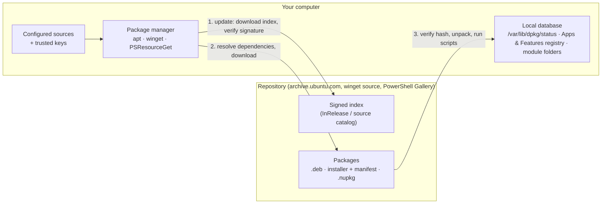

# Day 10: Software and Package Management

!!! info "Lesson overview"
    | | |
    |---|---|
    | **Module** | 2 — System Administration |
    | **Difficulty** | :material-signal-cellular-2: Intermediate |
    | **Estimated time** | 3–4 hours (75 min reading, 80 min demonstrations, 60–90 min lab and quiz) |
    | **Platforms** | Ubuntu 24.04 LTS (APT 2.8, dpkg 1.22, snapd) · Windows 11 (winget 1.x, Windows PowerShell 5.1 and PowerShell 7.4+) · RHEL-family notes (dnf, rpm) |
    | **Lab** | [Lab 10: Software Inventory](../../labs/lab-10.md) |

## Learning Objectives

By the end of this lesson you will be able to:

1. Explain what a **package**, a **package manager**, a **repository**, a **dependency** and a **signature** are, and why administrators install software through package managers instead of downloading installers by hand.
2. Keep an Ubuntu system up to date with `apt update`, `apt list --upgradable`, `apt upgrade` and `apt full-upgrade`, and know when a **reboot** or **service restart** is required.
3. Find, inspect, install, hold, remove, **purge** and auto-remove packages with `apt`, `apt-cache`, `apt-mark` and `dpkg`, and answer "which package owns this file?" and "which files did this package install?".
4. Read the repository configuration (`/etc/apt/sources.list.d/*.sources`, keyrings, `signed-by`), the APT and dpkg logs, and automatic security updates (`unattended-upgrades`).
5. Recognise the equivalents on other platforms: **snap** on Ubuntu, **dnf/rpm** on RHEL-family systems.
6. Use **winget** on Windows to search, show, install, upgrade, uninstall, export and import applications, and build a reliable **software inventory** from the Uninstall registry keys — without the slow and risky `Win32_Product` class.
7. Check Windows updates, pending reboots, optional features and capabilities with `Get-HotFix`, registry checks, `Get-WindowsOptionalFeature` and `Get-WindowsCapability`.
8. Install, update and remove **PowerShell modules** safely with PowerShellGet (`Install-Module`) and **PSResourceGet** (`Install-PSResource`), using `-Scope CurrentUser` and reviewing code before trusting a repository.

## Prerequisites

- [Day 04](../module-1/day-04.md) and [Day 05](../module-1/day-05.md): `grep`, pipelines, `Select-String`, `Where-Object`, `Sort-Object`, exit codes.
- [Day 06](day-06.md) and [Day 07](day-07.md): `sudo`, the Administrators group, and why system-wide changes need elevation.
- [Day 08](day-08.md): services (`systemctl`, `Get-Service`) — updates often need a service restart.
- [Day 09](day-09.md): disk space — `/var/cache/apt` and old kernels are common space consumers.
- An Ubuntu 24.04 **VM** (or WSL2) with `sudo` rights and internet access to the Ubuntu archive, and a Windows 11 **lab VM or PC** with winget (App Installer) and internet access.

!!! warning "Installing and updating software are changes"
    Every install, upgrade and removal changes the system and can restart services or require a reboot. On production systems they belong in a change window with a rollback plan. In this lesson, simulate first (`apt -s`, `winget show`, `-WhatIf`), install only small, well-known packages, and work on a **lab VM with a snapshot**.

## Introduction and Concepts

### What a package manager does

A **package** is an archive containing a program's files plus **metadata**: name, version, architecture, description, **dependencies** (other packages it needs), maintainer scripts and a list of configuration files. A **package manager** installs packages, resolves dependencies, records exactly which files belong to which package, upgrades and removes them cleanly, and verifies **signatures** so that you only install software published by a source you trust.



Why professionals use package managers instead of "download and double-click":

| Property | Package manager | Manual installer |
|---|---|---|
| **Trust** | Index and packages are signed; checksums verified automatically | You must check the publisher and hash yourself |
| **Dependencies** | Resolved and installed automatically | Missing libraries discovered at run time |
| **Updates** | One command updates everything, including **security fixes** | Every program has its own updater (or none) |
| **Inventory** | Exact list of installed packages and versions | Scattered across registry keys and folders |
| **Removal** | Removes exactly the files it installed | Leftovers, broken uninstallers |
| **Automation** | Scriptable and repeatable on 1 or 1,000 machines | Clicking through wizards |

### The package ecosystems you will meet

| Platform | Low-level tool | High-level tool | Package format | Main sources |
|---|---|---|---|---|
| Ubuntu, Debian | `dpkg` | `apt` (`apt-get`, `apt-cache` for scripts) | `.deb` | Ubuntu archive (`main`, `restricted`, `universe`, `multiverse`), PPAs, vendor repos |
| Ubuntu (also others) | — | `snap` | `.snap` (squashfs) | Snap Store (Canonical) |
| RHEL, Rocky, Alma, Fedora | `rpm` | `dnf` (`yum` on RHEL 7) | `.rpm` | BaseOS, AppStream, EPEL, vendor repos |
| SUSE | `rpm` | `zypper` | `.rpm` | SUSE repositories |
| Windows 10 1809+ / 11 | Windows Installer (`msiexec`), MSIX/Appx | **winget** | `.msi`, `.exe`, `.msix` + YAML manifest | `winget` community repository, `msstore` (Microsoft Store) |
| Windows (third party) | — | Chocolatey, Scoop | `.nupkg` and others | community repositories |
| PowerShell | — | **PowerShellGet** (`Install-Module`) and **PSResourceGet** (`Install-PSResource`) | `.nupkg` | PowerShell Gallery (`PSGallery`), private feeds |

### How APT is organised on Ubuntu 24.04

- **Repositories** are listed in `/etc/apt/sources.list.d/`. Ubuntu 24.04 uses the **deb822** format in `/etc/apt/sources.list.d/ubuntu.sources`; the classic one-line `/etc/apt/sources.list` is empty or contains only a pointer comment.

    ```text
    Types: deb
    URIs: http://archive.ubuntu.com/ubuntu/
    Suites: noble noble-updates noble-backports
    Components: main restricted universe multiverse
    Signed-By: /usr/share/keyrings/ubuntu-archive-keyring.gpg

    Types: deb
    URIs: http://security.ubuntu.com/ubuntu/
    Suites: noble-security
    Components: main restricted universe multiverse
    Signed-By: /usr/share/keyrings/ubuntu-archive-keyring.gpg
    ```

- **Suites (pockets):** `noble` is the release as shipped, `noble-security` carries security fixes, `noble-updates` carries security fixes plus bug fixes, and `noble-backports` newer versions with less testing.
- **Components:** `main` (Canonical-supported free software), `restricted` (supported non-free drivers), `universe` (community-maintained; security fixes for it are part of Ubuntu Pro/ESM), `multiverse` (non-free, unsupported).
- **Signatures:** `apt update` downloads each repository's signed `InRelease` index and checks it against the key named in **`Signed-By`**. Third-party repositories keep their key in `/etc/apt/keyrings/` and reference it with `signed-by=` so the key is trusted **only for that repository**. The old `apt-key add` command, which trusted a key for *every* repository, is deprecated.
- **Local state:** the package lists downloaded by `apt update` live in `/var/lib/apt/lists/`, the installed-package database in `/var/lib/dpkg/status`, downloaded `.deb` files in `/var/cache/apt/archives/`, and the logs in `/var/log/apt/history.log`, `/var/log/apt/term.log` and `/var/log/dpkg.log`.

!!! note "`apt` versus `apt-get`"
    `apt` is the friendly interactive command (progress bars, colours, `apt list`, `apt search`). `apt-get` and `apt-cache` have a **stable output format** for scripts. When you pipe `apt` output, it warns *"apt does not have a stable CLI interface. Use with caution in scripts."* — in scripts use `apt-get`, `apt-cache` and `dpkg-query`.

### Update versus upgrade

The two words are used differently on each platform, which confuses everyone at first:

| Action | Ubuntu (APT) | Windows (winget) |
|---|---|---|
| Refresh the catalogue of available versions | `sudo apt update` (downloads indexes; installs **nothing**) | `winget source update` (also happens automatically) |
| Show what can be upgraded | `apt list --upgradable` | `winget upgrade` (no arguments = list) |
| Install newer versions, never removing packages | `sudo apt upgrade` | `winget upgrade --id X` |
| Upgrade, allowing new dependencies and removals | `sudo apt full-upgrade` | — |
| Upgrade everything | `sudo apt upgrade` / `full-upgrade` | `winget upgrade --all` |
| Move to a new OS release | `sudo do-release-upgrade` | Windows feature update (Windows Update) |

`apt upgrade` installs new versions but **keeps back** upgrades that would remove a package or need a new one (for example a new kernel package). `apt full-upgrade` allows those changes; read its summary carefully before answering *Y*. Ubuntu also **phases** some updates: a fix is rolled out to a growing percentage of machines over several days, so `apt` may report *"The following upgrades have been deferred due to phasing"*. That is normal; security updates from `noble-security` are not phased.

### Remove versus purge, manual versus automatic

- `apt remove PKG` deletes the package's files but **keeps its configuration files** (for example `/etc/nginx/`). `dpkg -l` then shows the status **`rc`** (removed, config-files remain).
- `apt purge PKG` removes the configuration files too (only those the package declared as *conffiles*; data in `/var/lib` or user files may still remain).
- Packages you asked for are marked **manual**; packages pulled in as dependencies are **automatic**. When nothing needs an automatic package any more, `apt autoremove` removes it (also old kernels). Always read the list `autoremove` prints — a package you use directly but never installed explicitly can disappear. Mark it manual with `apt-mark manual PKG`.
- `apt-mark hold PKG` freezes a package at its current version (for example a database server you upgrade only in planned windows); `apt-mark unhold` releases it. `apt-mark showhold` lists holds.

### Automatic security updates, restarts and reboots

- **unattended-upgrades** is installed and enabled by default on Ubuntu Server and Desktop. A systemd timer (`apt-daily.timer` and `apt-daily-upgrade.timer`) runs it daily and installs updates from `noble-security` (configured in `/etc/apt/apt.conf.d/50unattended-upgrades` and `20auto-upgrades`). Its log is `/var/log/unattended-upgrades/unattended-upgrades.log`.
- **needrestart** (default on Ubuntu Server) runs after upgrades and restarts, or offers to restart, services that still use old library versions.
- A **reboot** is needed after kernel and some core-library updates. Ubuntu signals it with the file **`/var/run/reboot-required`**, and `/var/run/reboot-required.pkgs` lists the packages that caused it. Monitoring scripts check for that file.
- Windows signals a pending reboot through registry keys such as `HKLM:\SOFTWARE\Microsoft\Windows\CurrentVersion\WindowsUpdate\Auto Update\RebootRequired` and `HKLM:\SOFTWARE\Microsoft\Windows\CurrentVersion\Component Based Servicing\RebootPending`.

### Snap packages

Ubuntu also ships **snaps**: self-contained packages that bundle their own dependencies, run confined (AppArmor), update automatically (`snap refresh`, by default up to four times a day) and keep previous revisions for `snap revert`. Firefox on Ubuntu 24.04 is a snap. Each installed revision is a read-only squashfs image mounted under `/snap/NAME/REVISION` — the always-100% filesystems you excluded from disk alerts on Day 09. `snap list`, `snap info NAME`, `snap refresh --list` and `snap changes` are the inventory and history commands.

### RHEL-family systems: dnf and rpm

On Rocky Linux, AlmaLinux, RHEL and Fedora the same ideas use different names. You will meet them in mixed environments:

| Task | Ubuntu | RHEL family |
|---|---|---|
| Refresh metadata | `sudo apt update` | automatic (`sudo dnf makecache`) |
| List available updates | `apt list --upgradable` | `dnf check-update` (exit code **100** = updates available) |
| Upgrade all | `sudo apt upgrade` | `sudo dnf upgrade` |
| Install / remove | `sudo apt install PKG` / `remove` | `sudo dnf install PKG` / `remove` |
| Package info | `apt show PKG` | `dnf info PKG` |
| Which package provides a file? | `dpkg -S /path` (installed) | `rpm -qf /path` (installed) · `dnf provides /path` (repositories) |
| Files of a package | `dpkg -L PKG` | `rpm -ql PKG` |
| All installed | `dpkg -l` · `apt list --installed` | `rpm -qa` · `dnf list installed` |
| Verify files | `dpkg --verify PKG` | `rpm -V PKG` |
| History and undo | `/var/log/apt/history.log` | `dnf history` · `sudo dnf history undo N` |

### Windows: several installers, one inventory problem

Windows software arrives in many ways: MSI packages (Windows Installer), EXE installers (Inno Setup, NSIS, vendor-specific), MSIX/Appx (Store-style apps), portable ZIPs, and Windows **features and capabilities** that are part of the OS. There is no single package database like `/var/lib/dpkg/status`. In practice you combine:

- **winget**, the Windows Package Manager (part of *App Installer*, preinstalled on Windows 11 and current Windows 10). It reads YAML manifests from the community `winget` repository and the `msstore` source, downloads the vendor's installer, **checks its SHA-256 hash against the manifest**, and runs it silently. `winget list` also shows software that winget did not install, by correlating the Apps & Features entries.
- The **Uninstall registry keys** — the data behind *Settings → Apps → Installed apps*:
    - `HKLM:\SOFTWARE\Microsoft\Windows\CurrentVersion\Uninstall\*` (64-bit, all users)
    - `HKLM:\SOFTWARE\WOW6432Node\Microsoft\Windows\CurrentVersion\Uninstall\*` (32-bit apps on 64-bit Windows)
    - `HKCU:\SOFTWARE\Microsoft\Windows\CurrentVersion\Uninstall\*` (per-user installs)
- `Get-AppxPackage` for MSIX/Store apps, `Get-HotFix` for installed updates, `Get-WindowsOptionalFeature` / `Get-WindowsCapability` for OS components.

!!! danger "Do not use `Win32_Product` for inventory"
    `Get-CimInstance Win32_Product` (or `Get-WmiObject`) looks convenient, but querying it makes Windows Installer **run a consistency check on every MSI product**, which is slow (minutes) and can trigger **repairs** that reset application configuration — visible as `MsiInstaller` event 1035 in the Application log. Use the Uninstall registry keys, `winget list` or `Get-Package` (Windows PowerShell 5.1) instead.

### PowerShell modules: PowerShellGet and PSResourceGet

PowerShell itself is extended with **modules** (Day 23). They are published as NuGet packages on the **PowerShell Gallery** (`PSGallery`) and installed with:

| Tool | Cmdlets | Ships with | Notes |
|---|---|---|---|
| **PowerShellGet 2.x** (+ PackageManagement) | `Find-Module`, `Install-Module`, `Get-InstalledModule`, `Update-Module`, `Uninstall-Module`, `Save-Module` | Windows PowerShell 5.1 ships the very old **1.0.0.1**; PowerShell 7 includes 2.2.5 | Update it in 5.1 (`Install-Module PowerShellGet -Scope CurrentUser -Force`) before heavy use |
| **PSResourceGet** (`Microsoft.PowerShell.PSResourceGet`) | `Find-PSResource`, `Install-PSResource`, `Get-InstalledPSResource`, `Update-PSResource`, `Uninstall-PSResource`, `Save-PSResource`, `Get-PSResourceRepository`, `Set-PSResourceRepository` | Included with **PowerShell 7.4 and later**; installable on 5.1 from the Gallery | The successor to PowerShellGet: faster, no PackageManagement dependency, `CurrentUser` scope by default |

`PSGallery` is **untrusted** by default, so both tools ask for confirmation before installing. Anyone can publish to the Gallery: treat a module like any other code — check the author, download count, project link and source, and if in doubt **`Save-PSResource` / `Save-Module` it to a folder and read it** before installing. Install for yourself with `-Scope CurrentUser` (no elevation; folder `Documents\PowerShell\Modules` in 7, `Documents\WindowsPowerShell\Modules` in 5.1, `~/.local/share/powershell/Modules` on Linux) unless every user needs it.

## Linux Command Reference

| Command | Purpose | Package / availability | Needs root? |
|---|---|---|---|
| `apt update` | Download fresh package indexes from all sources | apt | Yes |
| `apt list --upgradable` / `--installed` | List upgradable / installed packages | apt | No |
| `apt upgrade` / `apt full-upgrade` | Install available upgrades (full: may add/remove packages) | apt | Yes |
| `apt install PKG` / `apt install ./file.deb` | Install from repositories / a local file, with dependencies | apt | Yes |
| `apt remove` / `apt purge` / `apt autoremove` | Remove (keep config) / remove with config / remove unneeded dependencies | apt | Yes |
| `apt search` / `apt show` / `apt policy` | Find packages / details / versions and their sources | apt | No |
| `apt-get -s ...` | **Simulate** any operation (no changes) | apt | No |
| `apt-cache depends` / `rdepends` / `madison` | Dependencies / reverse dependencies / versions per repository | apt | No |
| `apt-mark hold` / `unhold` / `showhold` / `showmanual` / `manual` / `auto` | Freeze versions; manual vs automatic marks | apt | Changes: yes |
| `dpkg -l` | List packages with status (`ii`, `rc`, `hi`…) | dpkg | No |
| `dpkg -L PKG` / `dpkg -S PATH` / `dpkg -s PKG` | Files of a package / owner of a file / status and metadata | dpkg | No |
| `dpkg-query -W -f='...'` | Custom inventory output for scripts | dpkg | No |
| `dpkg --verify PKG` | Compare installed files with package checksums | dpkg | No (root for unreadable files) |
| `dpkg-deb --info` / `--contents` | Inspect a `.deb` before installing | dpkg | No |
| `unattended-upgrade --dry-run` | Preview automatic security upgrades | unattended-upgrades (default) | Yes |
| `snap list` / `info` / `refresh` / `revert` | Snap inventory and updates | snapd (default) | Changes: yes |
| `dnf` / `rpm` | RHEL-family equivalents | dnf, rpm | Changes: yes |

## PowerShell Command Reference

| Command / cmdlet | Aliases | Purpose | Works in 5.1 | Works in 7.x | Admin? |
|---|---|---|---|---|---|
| `winget search` / `show` | — | Find packages / show manifest details (publisher, URL, SHA-256) | Yes (native tool) | Yes (Windows) | No |
| `winget install` / `upgrade` / `uninstall` | — | Install / upgrade / remove applications | Yes | Yes (Windows) | Depends on installer (UAC prompt for machine-wide) |
| `winget list` / `winget upgrade` (no args) | — | Installed apps / available upgrades | Yes | Yes (Windows) | No |
| `winget export` / `import` | — | Save / restore a list of apps as JSON | Yes | Yes (Windows) | Import: depends |
| `winget pin` | — | Prevent upgrades of a package (winget 1.5+) | Yes | Yes (Windows) | No |
| <code>Get-ItemProperty HKLM:\...\Uninstall\&#42;</code> | `gp` | Software inventory from the registry | Yes | Yes (Windows) | No |
| `Get-Package` | — | Installed MSI/programs/modules via PackageManagement | Yes (`msi`, `Programs` providers) | Only NuGet/PowerShellGet providers | No |
| `Get-AppxPackage` | — | MSIX/Store apps for the current user (`-AllUsers` elevated) | Yes | Yes on Windows (if it fails: `Import-Module Appx -UseWindowsPowerShell`) | `-AllUsers`: yes |
| `Get-HotFix` | — | Installed Windows updates (`Win32_QuickFixEngineering`) | Yes | Yes (Windows) | No |
| `Get-WindowsOptionalFeature -Online` / `Enable-…` | — | Optional features (Hyper-V, WSL, Telnet client…) | Yes | Yes (Windows) | **Yes** |
| `Get-WindowsCapability -Online` / `Add-…` | — | Features on Demand (OpenSSH, RSAT…) | Yes | Yes (Windows) | **Yes** |
| `Find-Module` / `Install-Module` / `Get-InstalledModule` / `Update-Module` / `Uninstall-Module` | — | PowerShellGet module management | Yes (update PowerShellGet first) | Yes | `-Scope AllUsers`: yes |
| `Find-PSResource` / `Install-PSResource` / `Get-InstalledPSResource` / `Update-PSResource` / `Uninstall-PSResource` / `Save-PSResource` | — | PSResourceGet module management | After installing the module | **Built in from 7.4** | `-Scope AllUsers`: yes |
| `Get-PSResourceRepository` / `Set-PSResourceRepository` | — | Repositories and their trust | After installing | Yes (7.4+) | No |
| `Get-FileHash` / `Get-AuthenticodeSignature` | — | Verify a download's hash / digital signature | Yes | Yes (signature: Windows) | No |
| `msiexec.exe` | — | Install/uninstall/log MSI packages directly | Yes | Yes (Windows) | Usually yes |

## Detailed Command Explanations

### `apt update` — refresh what is available

`sudo apt update` contacts every configured repository, downloads changed index files, **verifies their signatures**, and reports how many packages can be upgraded. It never installs anything. Run it before every install or upgrade so that you get current versions and current security fixes. Errors here are important: `NO_PUBKEY` or *"The repository … is not signed"* mean that a repository's key is missing or wrong — **do not** work around it with `[trusted=yes]`.

### `apt list`, `apt search`, `apt show`, `apt policy`

- `apt list --upgradable` — one line per upgradable package: `name/suites new-version arch [upgradable from: old-version]`. Suites containing `-security` mark **security updates**.
- `apt list --installed` — everything installed; add a pattern: `apt list --installed 'openssh*'`.
- `apt search --names-only '^ncdu$'` — search names (regular expression); without `--names-only` descriptions are searched too.
- `apt show PKG` — version, section, size, dependencies, homepage, description, and `APT-Sources` (where it would come from).
- `apt policy PKG` — **Installed** and **Candidate** versions and every available version with its priority and repository. The `***` marks the installed one. The first command to run when you wonder "which version will I get and from where?".

### `apt install`, simulation and versions

- `sudo apt install PKG...` — installs packages and their dependencies, shows a summary (`N newly installed`, download and disk size) and asks for confirmation. `-y` answers yes (scripts only, after testing).
- `apt-get -s install PKG` (or `apt install -s`) — **simulate**: prints `Inst`/`Conf` lines and changes nothing. No root needed.
- `sudo apt install ./file.deb` — installs a local `.deb` **with** dependency resolution (the leading `./` tells apt it is a file). Plain `sudo dpkg -i file.deb` does not resolve dependencies.
- `sudo apt install PKG=VERSION` — install a specific version (also used for downgrades); list versions with `apt-cache madison PKG` or `apt policy PKG`.
- `sudo apt install --only-upgrade PKG` — upgrade one package only if it is already installed.
- `sudo apt reinstall PKG` — reinstall the same version (fixes deleted or modified files).

### `apt upgrade`, `apt full-upgrade` and kept-back packages

`sudo apt upgrade` upgrades everything it can without removing packages; packages that need new dependencies are listed as **kept back**. `sudo apt full-upgrade` resolves those, possibly installing new packages (new kernels) and removing obsolete ones. Always read the *"The following packages will be REMOVED"* section. `apt-get -s upgrade | grep ^Inst` gives a script-friendly preview.

### `apt remove`, `apt purge`, `apt autoremove`, `apt clean`

- `sudo apt remove PKG` — removes the program, keeps configuration (`dpkg -l` status `rc`).
- `sudo apt purge PKG` — removes configuration files as well. `dpkg -l | grep '^rc'` lists removed-but-not-purged packages; `sudo apt purge $(dpkg -l | awk '/^rc/ {print $2}')` cleans them up after review.
- `sudo apt autoremove` — removes automatic dependencies nothing needs any more, and old kernels. Preview with `apt-get -s autoremove`.
- `sudo apt clean` — deletes the downloaded `.deb` files in `/var/cache/apt/archives/` (safe; Day 09). `apt autoclean` deletes only those that can no longer be downloaded.

### `apt-mark` — holds and install reasons

`sudo apt-mark hold PKG` prevents upgrades of that package (`apt upgrade` reports it as *kept back* or *held*). `apt-mark showhold` lists holds — check it before blaming the repository for "missing" updates. `apt-mark showmanual` lists packages installed on purpose, a good baseline for rebuilding a server. `apt-mark auto PKG` / `manual PKG` change the reason, which controls `autoremove`.

### `dpkg` — the package database

- `dpkg -l [PATTERN]` — list packages. The first two letters are the **desired** and **current** state: `ii` installed, `rc` removed with config left, `hi` held, `iU`/`iF` unpacked or half-configured (an interrupted install: fix with `sudo dpkg --configure -a`).
- `dpkg -L PKG` — files the package installed.
- `dpkg -S /path/to/file` — which package owns a file. If no package owns it, the file was installed by hand, by a script, or created at run time — interesting during audits.
- `dpkg -s PKG` — status, version, dependencies, conffiles.
- `dpkg-query -W -f='${Package}\t${Version}\t${Installed-Size}\n'` — your own inventory format (`Installed-Size` is in KiB).
- `dpkg --verify PKG` (`-V`) — compares installed files with the MD5 checksums recorded at install time. Output uses `rpm -V` style flags: `??5??????` = **checksum differs**, `c` = configuration file, `missing` = file deleted. Modified conffiles are normal after an admin edits them; a modified binary in `/usr/bin` is a red flag.
- `dpkg-deb --info file.deb` / `--contents file.deb` — inspect a downloaded package (metadata, maintainer scripts, files) **before** installing it.

### Repository and key management

- List sources: `ls /etc/apt/sources.list.d/` and `cat /etc/apt/sources.list.d/*.sources` (deb822) or `*.list` (one-line format).
- Add a vendor repository the modern way (example structure, use the vendor's documented URLs and key fingerprint):

    ```bash
    sudo install -d -m 0755 /etc/apt/keyrings
    curl -fsSL https://vendor.example/repo.gpg | sudo tee /etc/apt/keyrings/vendor.asc > /dev/null
    gpg --show-keys /etc/apt/keyrings/vendor.asc            # compare the fingerprint with the vendor's website
    echo "deb [signed-by=/etc/apt/keyrings/vendor.asc] https://vendor.example/apt stable main" |
        sudo tee /etc/apt/sources.list.d/vendor.list
    sudo apt update
    ```

- **PPAs** (`sudo add-apt-repository ppa:owner/name`) are personal repositories on Launchpad. They are not reviewed by Ubuntu; each one you add is a party you trust with root on every update.

### `unattended-upgrades`, `needrestart` and reboot checks

- `systemctl list-timers 'apt-daily*'` — when automatic downloads and upgrades run.
- `sudo unattended-upgrade --dry-run --debug` — what the next automatic run would install.
- `cat /etc/apt/apt.conf.d/20auto-upgrades` — `APT::Periodic::Unattended-Upgrade "1";` means enabled.
- `less /var/log/unattended-upgrades/unattended-upgrades.log` — what it did.
- `[ -f /var/run/reboot-required ] && cat /var/run/reboot-required.pkgs` — reboot needed and why.
- `sudo needrestart -r l` — list services that should be restarted (no changes).

### APT and dpkg logs

`/var/log/apt/history.log` records every APT transaction with `Start-Date`, `Commandline`, `Requested-By` (the sudo user) and the `Install:`/`Upgrade:`/`Remove:`/`Purge:` lists — the first place to look when "something changed overnight". `/var/log/apt/term.log` holds the full terminal output, and `/var/log/dpkg.log` one line per package state change. Older logs are rotated to `history.log.1.gz` and read with `zcat`/`zgrep`.

### `snap`

`snap list` (installed snaps, revision, channel, publisher), `snap info NAME` (channels and versions), `sudo snap install NAME`, `sudo snap refresh` (update now), `snap refresh --list` (pending updates), `sudo snap revert NAME` (back to the previous revision), `sudo snap remove NAME`, `snap changes` (history). `sudo snap refresh --hold=24h NAME` postpones automatic updates.

### `winget` — the Windows Package Manager

`winget` is a native executable, so it behaves the same in Windows PowerShell 5.1, PowerShell 7 and cmd. Key subcommands:

- `winget search TEXT` — searches names, IDs, monikers and tags across sources; columns `Name`, `Id`, `Version`, `Match`, `Source`.
- `winget show --id Git.Git -e` — the manifest: publisher, homepage, license, installer type, **installer URL and SHA-256**. `-e` (`--exact`) avoids matching similar IDs.
- `winget install --id Git.Git -e --source winget` — installs. Useful options: `--version`, `--scope user|machine`, `--silent`, `--accept-package-agreements`, `--accept-source-agreements` (unattended use), `--location`, `--override` (custom installer arguments).
- `winget list` — installed apps, including those not installed by winget (shown with a winget ID only if it can match them). `winget list --id Git.Git -e` checks one.
- `winget upgrade` — with no arguments, lists apps that have newer versions; `winget upgrade --id X -e` upgrades one; `winget upgrade --all` upgrades all (use carefully); `--include-unknown` also considers apps whose installed version cannot be determined.
- `winget uninstall --id X -e` — runs the app's uninstaller.
- `winget export -o apps.json` / `winget import -i apps.json` — save and rebuild a machine's app set; ideal for documented workstation builds.
- `winget pin add --id X` — keep an app at its version (winget 1.5+).
- `winget source list` — sources (`winget`, `msstore`); `winget --info` — version, logs folder, policies.
- `winget hash FILE` — SHA-256 of a local installer.

winget returns **0** on success and a non-zero HRESULT-style code (for example `0x8A150014` = *no package found*) on failure, so `$LASTEXITCODE` works in scripts. For object output in PowerShell, Microsoft publishes the **Microsoft.WinGet.Client** module (`Get-WinGetPackage`, `Find-WinGetPackage`, `Install-WinGetPackage`, `Update-WinGetPackage`) on the PowerShell Gallery.

### Software inventory from the registry

```powershell
$paths = 'HKLM:\SOFTWARE\Microsoft\Windows\CurrentVersion\Uninstall\*',
         'HKLM:\SOFTWARE\WOW6432Node\Microsoft\Windows\CurrentVersion\Uninstall\*',
         'HKCU:\SOFTWARE\Microsoft\Windows\CurrentVersion\Uninstall\*'
Get-ItemProperty -Path $paths -ErrorAction SilentlyContinue |
    Where-Object { $_.DisplayName -and -not $_.SystemComponent } |
    Select-Object DisplayName, DisplayVersion, Publisher, InstallDate, PSChildName |
    Sort-Object DisplayName
```

Each sub-key is one installed program. Useful values: `DisplayName`, `DisplayVersion`, `Publisher`, `InstallDate` (`yyyyMMdd` text), `UninstallString`, `QuietUninstallString`, `InstallLocation`, `EstimatedSize` (KB). `SystemComponent = 1` hides entries from the Apps list (runtimes, components); `PSChildName` is the key name — for MSI products the **ProductCode GUID**. The same paths work remotely with `Invoke-Command` (Day 26).

### `Get-Package` (PackageManagement)

In **Windows PowerShell 5.1**, `Get-Package` lists software from several providers: `msi` (Windows Installer products, read without the `Win32_Product` side effects), `Programs` (Uninstall registry entries) and `PowerShellGet` (modules). `Get-Package -ProviderName Programs, msi | Sort-Object Name`. In PowerShell 7, the `msi` and `Programs` providers are **not available**, so use the registry query or winget there.

### `Get-HotFix`, pending reboots, features and capabilities

- `Get-HotFix | Sort-Object InstalledOn -Descending | Select-Object -First 5` — recent updates (`HotFixID` such as `KB5044284`, `Description`, `InstalledOn`). It reads `Win32_QuickFixEngineering`, which does not include every kind of update (for example Defender definitions or Store app updates); *Settings → Windows Update → Update history* is the full view.
- Pending reboot: `Test-Path 'HKLM:\SOFTWARE\Microsoft\Windows\CurrentVersion\WindowsUpdate\Auto Update\RebootRequired'` or `…\Component Based Servicing\RebootPending`.
- `Get-WindowsOptionalFeature -Online | Where-Object State -eq Enabled` (elevated) — enabled optional features; `Enable-WindowsOptionalFeature -Online -FeatureName Microsoft-Windows-Subsystem-Linux` turns one on (may need a restart).
- `Get-WindowsCapability -Online -Name OpenSSH*` (elevated) — Features on Demand such as the OpenSSH client/server and RSAT tools; `Add-WindowsCapability -Online -Name OpenSSH.Server~~~~0.0.1.0` installs one.
- On Windows Server, roles and features use `Get-WindowsFeature` / `Install-WindowsFeature` (ServerManager module).

### `Install-Module` and `Install-PSResource`

```powershell
Find-PSResource -Name PSScriptAnalyzer -Repository PSGallery          # 7.4+: built in
Install-PSResource -Name PSScriptAnalyzer -Scope CurrentUser          # prompts: untrusted repository
Get-InstalledPSResource -Name PSScriptAnalyzer
Update-PSResource -Name PSScriptAnalyzer
Uninstall-PSResource -Name PSScriptAnalyzer

Find-Module -Name PSScriptAnalyzer                                    # PowerShellGet (5.1 and 7)
Install-Module -Name PSScriptAnalyzer -Scope CurrentUser
Get-InstalledModule
```

- `-Scope CurrentUser` installs without elevation for you only; `AllUsers` needs an elevated session. PSResourceGet defaults to `CurrentUser`. For `Install-Module` the default depends on the PowerShellGet version: 1.x (the version built into 5.1) defaults to `AllUsers` and therefore fails without elevation, 2.x defaults to `CurrentUser` — so always state `-Scope` explicitly.
- `-Version` (PowerShellGet: `-RequiredVersion`, `-MinimumVersion`) pins versions; PSResourceGet accepts NuGet ranges like `'[1.21,2.0)'`.
- `Save-PSResource -Name X -Path .\review` / `Save-Module -Name X -Path .\review` downloads without installing — read the code, then install.
- `Set-PSResourceRepository -Name PSGallery -Trusted` stops the prompt. Organisations usually prefer an **internal repository** with approved modules instead of trusting the public Gallery everywhere.
- Windows PowerShell 5.1 needs TLS 1.2 for the Gallery on older systems: `[Net.ServicePointManager]::SecurityProtocol = [Net.ServicePointManager]::SecurityProtocol -bor [Net.SecurityProtocolType]::Tls12`.

### Verifying downloads manually: `Get-FileHash`, `Get-AuthenticodeSignature`, `sha256sum`

When you must download an installer yourself, compare its hash with the value the vendor publishes (`Get-FileHash .\setup.exe -Algorithm SHA256` / `sha256sum setup.tar.gz`) and check its digital signature (`Get-AuthenticodeSignature .\setup.exe` — `Status` must be `Valid` and `SignerCertificate.Subject` the expected publisher). A hash from the **same** web page as the download only proves the download was not corrupted, not that the site was not compromised; signatures and signed repositories are stronger.

## Syntax and Parameters

### Bash

```text
apt update
apt list [--installed | --upgradable | --all-versions] [PATTERN]
apt search [--names-only] REGEX
apt show PKG   ·   apt policy [PKG]
apt install [-y] [-s] [--no-install-recommends] [--only-upgrade] PKG[=VERSION]... | ./FILE.deb
apt upgrade [-y] [-s]   ·   apt full-upgrade [-y] [-s]
apt remove | purge | autoremove [-y] [-s] [PKG...]
apt-mark hold | unhold | showhold | showmanual | manual | auto [PKG...]
apt-cache depends | rdepends [--installed] | madison PKG
dpkg -l [PATTERN]   ·   dpkg -L PKG   ·   dpkg -S PATH   ·   dpkg -s PKG   ·   dpkg --verify [PKG]
dpkg-query -W -f='${Package}\t${Version}\n' [PATTERN]
dpkg-deb --info | --contents FILE.deb
snap list | info NAME | refresh [--list] | revert NAME | changes
dnf check-update | upgrade | install | remove | info | provides | history   ·   rpm -qa | -qi | -ql | -qf | -V
```

| Option | Command | Meaning |
|---|---|---|
| `-s` | apt, apt-get | Simulate: print actions, change nothing |
| `-y` | apt | Assume yes (unattended; scripts only) |
| `--no-install-recommends` | apt install | Install only hard dependencies, not *Recommends* (smaller servers) |
| `--only-upgrade` | apt install | Upgrade if installed; never install new |
| `PKG=VERSION` | apt install | Specific version / downgrade |
| `--installed` / `--upgradable` | apt list | Filter the list |
| `--names-only` | apt search | Search package names only |
| `-l`, `-L`, `-S`, `-s` | dpkg | List / files of / owner of file / status |
| `--verify` (`-V`) | dpkg | Check installed files against recorded checksums |
| `-W -f` | dpkg-query | Show packages with a custom format |
| `--installed` | apt-cache rdepends | Only installed reverse dependencies |

### PowerShell and winget

```text
winget search <query> [--id <id>] [--name <name>] [--source <source>] [-e]
winget show --id <id> [-e] [--versions]
winget install --id <id> [-e] [--version <v>] [--scope user|machine] [--source <s>] [--silent]
               [--accept-package-agreements] [--accept-source-agreements]
winget list [--id <id>] [-e] [--source <source>]
winget upgrade [--id <id> [-e] | --all] [--include-unknown]
winget uninstall --id <id> [-e]
winget export -o <file.json>   ·   winget import -i <file.json>   ·   winget pin add --id <id>
Get-ItemProperty -Path <UninstallKeyPath>\* [-ErrorAction SilentlyContinue]
Get-Package [-ProviderName <String[]>] [-Name <String[]>]                     # 5.1: msi, Programs
Get-HotFix [[-Id] <String[]>] [-ComputerName <String[]>]
Get-WindowsOptionalFeature -Online [-FeatureName <String>]
Get-WindowsCapability -Online [-Name <String>]
Install-Module -Name <String[]> [-Scope CurrentUser|AllUsers] [-RequiredVersion <String>] [-Repository <String>]
Install-PSResource -Name <String[]> [-Version <String>] [-Scope CurrentUser|AllUsers] [-Repository <String[]>] [-TrustRepository]
Get-InstalledPSResource [[-Name] <String[]>]  ·  Update-PSResource  ·  Uninstall-PSResource  ·  Save-PSResource -Path <String>
Set-PSResourceRepository -Name <String> -Trusted
```

| Parameter / option | Command | Meaning |
|---|---|---|
| `--id`, `-e` / `--exact` | winget | Select by package ID, exact match (always use in scripts) |
| `--source winget` | winget | Restrict to the community repository (not the Store) |
| `--scope user` / `machine` | winget install | Per-user or machine-wide installation (if the installer supports it) |
| `--silent` | winget install | No installer UI |
| `--accept-package-agreements`, `--accept-source-agreements` | winget | Non-interactive acceptance for automation |
| `--all`, `--include-unknown` | winget upgrade | Upgrade everything / include unknown versions |
| `-ProviderName` | Get-Package | `msi`, `Programs` (5.1), `PowerShellGet`, `NuGet` |
| `-Online` | `*-WindowsOptionalFeature` / `*-WindowsCapability` | Act on the running OS (not an offline image) |
| `-Scope` | Install-Module / Install-PSResource | `CurrentUser` (no admin) or `AllUsers` |
| `-Version` | Install-PSResource | Exact version or NuGet range (`'[1.0,2.0)'`) |
| `-TrustRepository` | Install-PSResource | Do not prompt for this install only |
| `-Trusted` | Set-PSResourceRepository | Mark a repository trusted permanently |

## Practical Demonstrations

The Bash outputs in Demos 1–6 were **captured** on 2026-11-11 by running the commands as root on Ubuntu 24.04.5 in a minimized container with access to the Ubuntu archive (host renamed; long progress lines shortened, APT options specific to the capture environment removed from `Commandline:` lines). The demo package `lab10-hello` was built locally with `dpkg-deb` — Lab 10 shows how. Windows and winget outputs are **examples** of the standard formats, checked against the official documentation; your package versions, IDs and counts will differ.

### Demo 1 — What needs updating?

=== "Bash"

    ```bash
    sudo apt update
    apt list --upgradable 2>/dev/null | head -5
    apt list --upgradable 2>/dev/null | grep -c -- '-security'
    apt-get -s upgrade | grep '^Inst' | head -3
    [ -f /var/run/reboot-required ] && cat /var/run/reboot-required.pkgs || echo "no reboot required"
    ```

    **Captured output (trimmed):**

    ```text
    Get:17 http://archive.ubuntu.com/ubuntu noble-updates/main amd64 Packages [1785 kB]
    Fetched 28.6 MB in 4s (7178 kB/s)
    Reading package lists... Done
    Listing...
    apt/noble-updates,noble-security 2.8.4ubuntu0.1 amd64 [upgradable from: 2.8.3]
    ca-certificates-java/noble-updates,noble-security 20240118ubuntu0.24.04.2 all [upgradable from: 20240118]
    ca-certificates/noble-updates,noble-security 20260816ubuntu0.24.04.2 all [upgradable from: 20260816ubuntu0.24.04.1]
    libapt-pkg6.0t64/noble-updates,noble-security 2.8.4ubuntu0.1 amd64 [upgradable from: 2.8.3]
    19
    Inst libperl5.38t64 [5.38.2-3.2ubuntu0.6] (5.38.2-3.2ubuntu0.7 Ubuntu:24.04/noble-updates, Ubuntu:24.04/noble-security [amd64]) [perl:amd64 ]
    Inst perl [5.38.2-3.2ubuntu0.6] (5.38.2-3.2ubuntu0.7 Ubuntu:24.04/noble-updates, Ubuntu:24.04/noble-security [amd64]) []
    Inst perl-base [5.38.2-3.2ubuntu0.6] (5.38.2-3.2ubuntu0.7 Ubuntu:24.04/noble-updates, Ubuntu:24.04/noble-security [amd64]) []
    no reboot required
    ```

    22 packages were upgradable, 19 of them from `noble-security`. The `Inst` lines of the simulation show `[installed version] (new version source)` and change nothing.

=== "PowerShell"

    ```powershell
    winget upgrade
    Get-HotFix | Sort-Object InstalledOn -Descending | Select-Object -First 3 HotFixID, Description, InstalledOn
    $rebootKeys = 'HKLM:\SOFTWARE\Microsoft\Windows\CurrentVersion\WindowsUpdate\Auto Update\RebootRequired',
                  'HKLM:\SOFTWARE\Microsoft\Windows\CurrentVersion\Component Based Servicing\RebootPending'
    if ($rebootKeys | Where-Object { Test-Path $_ }) { 'Reboot pending' } else { 'No reboot pending' }
    ```

    **Expected output (example):**

    ```text
    Name                      Id                        Version      Available    Source
    ------------------------------------------------------------------------------------
    Git                       Git.Git                   2.46.0       2.47.1       winget
    Microsoft Visual Studio C Microsoft.VisualStudioCode 1.94.2      1.95.3       winget
    2 upgrades available.

    HotFixID  Description     InstalledOn
    --------  -----------     -----------
    KB5046617 Security Update 13-11-2026 00:00:00
    KB5045934 Update          06-11-2026 00:00:00
    KB5043113 Security Update 16-10-2026 00:00:00

    No reboot pending
    ```

    winget truncates long names in its table; use `--id` values in commands. Windows Update itself is managed through *Settings → Windows Update*, WSUS, Intune or Windows Update for Business; there is no built-in PowerShell cmdlet that searches for and installs Windows updates (the community **PSWindowsUpdate** module is popular — review it like any third-party code).

### Demo 2 — Inspect before you install

=== "Bash"

    ```bash
    apt search --names-only '^ncdu$'
    apt show tree
    apt policy tree
    apt-cache depends tree
    apt-get -s install tree
    ```

    **Captured output (trimmed):**

    ```text
    ncdu/noble 1.19-0.1 amd64
      ncurses disk usage viewer

    Package: tree
    Version: 2.1.1-2ubuntu3.24.04.2
    Priority: optional
    Section: universe/utils
    Origin: Ubuntu
    Installed-Size: 111 kB
    Depends: libc6 (>= 2.38)
    Download-Size: 47.4 kB
    APT-Sources: http://archive.ubuntu.com/ubuntu noble-updates/universe amd64 Packages
    Description: displays an indented directory tree, in color

    tree:
      Installed: (none)
      Candidate: 2.1.1-2ubuntu3.24.04.2
      Version table:
         2.1.1-2ubuntu3.24.04.2 500
            500 http://archive.ubuntu.com/ubuntu noble-updates/universe amd64 Packages
         2.1.1-2ubuntu3 500
            500 http://archive.ubuntu.com/ubuntu noble/universe amd64 Packages
    tree
      Depends: libc6
    Inst tree (2.1.1-2ubuntu3.24.04.2 Ubuntu:24.04/noble-updates [amd64])
    Conf tree (2.1.1-2ubuntu3.24.04.2 Ubuntu:24.04/noble-updates [amd64])
    ```

    `tree` is in **universe** (community-maintained). `apt policy` shows two versions: the original `noble` one and the newer `noble-updates` one, which is the candidate. The simulation would install exactly one package.

=== "PowerShell"

    ```powershell
    winget search --id Git.Git
    winget show --id Git.Git -e
    winget install --id Git.Git -e --source winget --scope machine --silent `
        --accept-package-agreements --accept-source-agreements
    $LASTEXITCODE
    ```

    **Expected output (example, shortened):**

    ```text
    Name Id      Version Source
    ----------------------------
    Git  Git.Git 2.47.1  winget

    Found Git [Git.Git]
    Version: 2.47.1
    Publisher: The Git Development Community
    Publisher Url: https://gitforwindows.org/
    License: GPL-2.0-only
    Installer:
      Installer Type: inno
      Installer Url: https://github.com/git-for-windows/git/releases/download/v2.47.1.windows.1/Git-2.47.1-64-bit.exe
      Installer SHA256: 0229e3acb535d0dc5f0d4a7e33c3e2c2f2b1a1d7b1e5c6c0a8f4e0d4b2a9c7e1

    Found Git [Git.Git] Version 2.47.1
    This application is licensed to you by its owner.
    Microsoft is not responsible for, nor does it grant any licenses to, third-party packages.
    Downloading https://github.com/git-for-windows/git/releases/download/v2.47.1.windows.1/Git-2.47.1-64-bit.exe
    Successfully verified installer hash
    Starting package install...
    Successfully installed
    0
    ```

    The SHA-256 above is illustrative. *Successfully verified installer hash* is winget comparing the downloaded file with the manifest. A machine-wide install triggers a UAC prompt in a non-elevated window.

### Demo 3 — Install, find files, find owners, hold

=== "Bash"

    ```bash
    sudo apt install -y tree
    dpkg -l tree
    dpkg -L tree | head -8
    dpkg -S /usr/bin/tree /usr/bin/ls
    sudo apt-mark hold tree
    apt-mark showhold
    sudo apt-mark unhold tree
    ```

    **Captured output (progress lines removed):**

    ```text
    Get:1 http://archive.ubuntu.com/ubuntu noble-updates/universe amd64 tree amd64 2.1.1-2ubuntu3.24.04.2 [47.4 kB]
    Fetched 47.4 kB in 0s (96.6 kB/s)
    Selecting previously unselected package tree.
    Preparing to unpack .../tree_2.1.1-2ubuntu3.24.04.2_amd64.deb ...
    Unpacking tree (2.1.1-2ubuntu3.24.04.2) ...
    Setting up tree (2.1.1-2ubuntu3.24.04.2) ...
    Desired=Unknown/Install/Remove/Purge/Hold
    | Status=Not/Inst/Conf-files/Unpacked/halF-conf/Half-inst/trig-aWait/Trig-pend
    |/ Err?=(none)/Reinst-required (Status,Err: uppercase=bad)
    ||/ Name           Version                Architecture Description
    +++-==============-======================-============-=============================================
    ii  tree           2.1.1-2ubuntu3.24.04.2 amd64        displays an indented directory tree, in color
    /.
    /usr
    /usr/bin
    /usr/bin/tree
    /usr/share
    /usr/share/doc
    /usr/share/doc/tree
    /usr/share/doc/tree/README.gz
    tree: /usr/bin/tree
    coreutils: /usr/bin/ls
    tree set on hold.
    tree
    Canceled hold on tree.
    ```

=== "PowerShell"

    ```powershell
    winget list --id Git.Git -e
    $paths = 'HKLM:\SOFTWARE\Microsoft\Windows\CurrentVersion\Uninstall\*',
             'HKLM:\SOFTWARE\WOW6432Node\Microsoft\Windows\CurrentVersion\Uninstall\*',
             'HKCU:\SOFTWARE\Microsoft\Windows\CurrentVersion\Uninstall\*'
    Get-ItemProperty $paths -ErrorAction SilentlyContinue | Where-Object DisplayName -like 'Git*' |
        Select-Object DisplayName, DisplayVersion, Publisher, InstallLocation, UninstallString
    (Get-Command git.exe).Source            # which file runs when you type git
    winget pin add --id Git.Git
    winget pin list
    winget pin remove --id Git.Git
    ```

    **Expected output (example):**

    ```text
    Name Id      Version Source
    ----------------------------
    Git  Git.Git 2.47.1  winget

    DisplayName     : Git
    DisplayVersion  : 2.47.1
    Publisher       : The Git Development Community
    InstallLocation : C:\Program Files\Git\
    UninstallString : "C:\Program Files\Git\unins000.exe"

    C:\Program Files\Git\cmd\git.exe
    Found Git [Git.Git]
    Pin added successfully
    Name Id      Version Source Pin type
    -------------------------------------
    Git  Git.Git 2.47.1  winget Pinning
    Found Git [Git.Git]
    Pin removed successfully
    ```

    Windows has no general "which package owns this file?" database. `InstallLocation` plus the file's signature (`Get-AuthenticodeSignature`) and version info (`(Get-Item file).VersionInfo`) are the practical substitutes.

### Demo 4 — Remove versus purge, and what autoremove does

=== "Bash"

    ```bash
    sudo apt install -y ./lab10-hello_1.0-1_all.deb     # local package that depends on tree
    lab10-hello
    dpkg -L lab10-hello
    apt-mark showauto | grep -x tree                    # tree came in as a dependency
    echo 'greeting="Edited by admin"' | sudo tee /etc/lab10-hello/hello.conf
    sudo apt remove -y lab10-hello
    dpkg -l lab10-hello | tail -1
    ls -l /etc/lab10-hello
    apt-get -s autoremove | tail -2
    sudo apt purge -y lab10-hello
    dpkg -l lab10-hello
    sudo apt autoremove -y
    ```

    **Captured output (progress lines removed):**

    ```text
    Selecting previously unselected package tree.
    Unpacking tree (2.1.1-2ubuntu3.24.04.2) ...
    Selecting previously unselected package lab10-hello.
    Unpacking lab10-hello (1.0-1) ...
    Setting up tree (2.1.1-2ubuntu3.24.04.2) ...
    Setting up lab10-hello (1.0-1) ...
    Hello from Lab 10
    /.
    /etc
    /etc/lab10-hello
    /etc/lab10-hello/hello.conf
    /usr
    /usr/bin
    /usr/bin/lab10-hello
    tree
    Removing lab10-hello (1.0-1) ...
    rc  lab10-hello    1.0-1        all          Lab 10 demo package
    total 4
    -rw-r--r-- 1 root root 27 Nov 11 17:06 hello.conf
    0 upgraded, 0 newly installed, 1 to remove and 22 not upgraded.
    Remv tree [2.1.1-2ubuntu3.24.04.2]
    Purging configuration files for lab10-hello (1.0-1) ...
    dpkg-query: no packages found matching lab10-hello
    Removing tree (2.1.1-2ubuntu3.24.04.2) ...
    ```

    `remove` left the edited `hello.conf` and the status `rc`; `purge` deleted it. Because `tree` was installed only as a dependency (automatic), `autoremove` removed it afterwards — the simulation showed that first.

=== "PowerShell"

    ```powershell
    winget uninstall --id Git.Git -e
    # Leftovers: user settings are not removed by most uninstallers
    Test-Path "$HOME\.gitconfig"
    Get-ItemProperty $paths -ErrorAction SilentlyContinue | Where-Object DisplayName -like 'Git*' |
        Measure-Object | Select-Object -ExpandProperty Count
    ```

    **Expected output (example):**

    ```text
    Found Git [Git.Git]
    Starting package uninstall...
    Successfully uninstalled
    True
    0
    ```

    Like `apt remove`, most Windows uninstallers keep user data and settings (`.gitconfig`, `%APPDATA%` folders); there is no general `purge`. Remove leftovers deliberately and only after checking them.

### Demo 5 — Inventory and history

=== "Bash"

    ```bash
    dpkg-query -W -f='${db:Status-Abbrev} ${Package}\n' | grep -c '^ii'
    apt-mark showmanual | wc -l
    dpkg-query -W -f='${Installed-Size}\t${Package}\t${Version}\n' | sort -rn | head -5
    tail -n 9 /var/log/apt/history.log
    grep -E ' (install|remove|purge) ' /var/log/dpkg.log | tail -5
    ```

    **Captured output:**

    ```text
    837
    837
    198271  openjdk-21-jre-headless 21.0.12.1+1-1~24.04.4
    194555  pandoc  3.1.3+ds-2
    147835  libreoffice-core        4:24.2.7-0ubuntu0.24.04.7
    140245  libllvm20       1:20.1.2-0ubuntu1~24.04.3
    120829  libllvm17t64    1:17.0.6-9ubuntu1
    Start-Date: 2026-11-11  17:06:48
    Commandline: apt purge -y lab10-hello
    Purge: lab10-hello:amd64 ()
    End-Date: 2026-11-11  17:06:48

    Start-Date: 2026-11-11  17:06:50
    Commandline: apt autoremove -y
    Remove: tree:amd64 (2.1.1-2ubuntu3.24.04.2)
    End-Date: 2026-11-11  17:06:50
    2026-11-11 17:06:41 install tree:amd64 <none> 2.1.1-2ubuntu3.24.04.2
    2026-11-11 17:06:41 install lab10-hello:all <none> 1.0-1
    2026-11-11 17:06:44 remove lab10-hello:all 1.0-1 <none>
    2026-11-11 17:06:48 purge lab10-hello:all 1.0-1 <none>
    2026-11-11 17:06:50 remove tree:amd64 2.1.1-2ubuntu3.24.04.2 <none>
    ```

    In this container every package happened to be marked manual (837 of 837) because the image was built that way; on a normal Ubuntu install `showmanual` lists a few hundred and `ii` a few thousand. `Installed-Size` is in KiB: the Java runtime uses about 194 MiB. When `sudo` is used, `history.log` also records `Requested-By: student (1000)`.

=== "PowerShell"

    ```powershell
    $paths = 'HKLM:\SOFTWARE\Microsoft\Windows\CurrentVersion\Uninstall\*',
             'HKLM:\SOFTWARE\WOW6432Node\Microsoft\Windows\CurrentVersion\Uninstall\*',
             'HKCU:\SOFTWARE\Microsoft\Windows\CurrentVersion\Uninstall\*'
    $inventory = Get-ItemProperty $paths -ErrorAction SilentlyContinue |
        Where-Object { $_.DisplayName -and -not $_.SystemComponent } |
        Select-Object DisplayName, DisplayVersion, Publisher, InstallDate,
            @{ n = 'SizeMB'; e = { if ($_.EstimatedSize) { [math]::Round($_.EstimatedSize / 1KB, 1) } } } |
        Sort-Object DisplayName -Unique
    $inventory.Count
    $inventory | Sort-Object SizeMB -Descending | Select-Object -First 3 DisplayName, DisplayVersion, SizeMB
    $inventory | Export-Csv "$HOME\software-inventory.csv" -NoTypeInformation
    winget export -o "$HOME\winget-apps.json"
    Get-WinEvent -FilterHashtable @{ LogName = 'Application'; ProviderName = 'MsiInstaller'; Id = 1033, 1034 } -MaxEvents 3 |
        Select-Object TimeCreated, Id, Message
    ```

    **Expected output (example):**

    ```text
    86

    DisplayName                           DisplayVersion SizeMB
    -----------                           -------------- ------
    Microsoft Visual Studio Code (User)   1.95.3          389.6
    Microsoft Edge                        131.0.2903.70   612.3
    Python 3.12.7 (64-bit)                3.12.7150.0     101.2

    Exported package(s) to: C:\Users\student\winget-apps.json

    TimeCreated          Id Message
    -----------          -- -------
    11-11-2026 21:02:11 1033 Windows Installer installed the product. Product Name: Python 3.12.7 Core Interpreter ...
    11-11-2026 20:41:56 1034 Windows Installer removed the product. Product Name: Git ...
    ```

    `EstimatedSize` is in KB and set by the installer, so it is approximate (and the list above is sorted by it). MSI installs and removals are logged as `MsiInstaller` events 1033 (installed) and 1034 (removed); EXE installers may log nothing.

### Demo 6 — Verify installed files

=== "Bash"

    ```bash
    sudo apt install -y ./lab10-hello_1.0-1_all.deb
    echo 'greeting="Edited by admin"' | sudo tee /etc/lab10-hello/hello.conf
    dpkg --verify lab10-hello; echo "exit: $?"
    dpkg --verify coreutils | head -3
    ```

    **Captured output:**

    ```text
    ??5?????? c /etc/lab10-hello/hello.conf
    exit: 0
    missing     /usr/share/doc/coreutils/AUTHORS
    missing     /usr/share/doc/coreutils/NEWS.gz
    missing     /usr/share/doc/coreutils/README.Debian
    ```

    `??5??????` = the checksum (the `5` column, MD5) differs, `c` = it is a configuration file — expected after an edit. The `missing` lines are documentation removed on purpose by the **minimized** container image; on a full install they would be a sign of tampering or a broken package (`sudo apt reinstall coreutils`). `dpkg --verify` exits 0 even when it reports differences, so scripts must test whether it printed anything.

=== "PowerShell"

    ```powershell
    Get-AuthenticodeSignature "C:\Program Files\Git\cmd\git.exe" | Select-Object Status, StatusMessage,
        @{ n = 'Signer'; e = { $_.SignerCertificate.Subject } }
    Get-FileHash "C:\Program Files\Git\cmd\git.exe" -Algorithm SHA256
    sfc /verifyonly         # elevated: checks protected Windows system files, no repair
    ```

    **Expected output (example):**

    ```text
    Status StatusMessage     Signer
    ------ -------------     ------
     Valid Signature verified. CN=Johannes Schindelin, O=Johannes Schindelin, ...

    Algorithm       Hash                                                                   Path
    ---------       ----                                                                   ----
    SHA256          4F1A…                                                                  C:\Program Files\Git\cmd\git.exe

    Windows Resource Protection did not find any integrity violations.
    ```

    For Windows system files, `sfc /verifyonly` (and `sfc /scannow` / `DISM /Online /Cleanup-Image /RestoreHealth` for repair) plays the role of `dpkg --verify`. For applications, check signatures.

### Demo 7 — PowerShell modules the safe way

=== "Bash"

    ```bash
    # PowerShell 7 on Ubuntu is itself installed from Microsoft's APT repository or as a snap:
    apt policy powershell 2>/dev/null | head -3
    snap list powershell 2>/dev/null
    pwsh -NoProfile -Command 'Get-Module -ListAvailable Microsoft.PowerShell.PSResourceGet | Select-Object Name, Version'
    ```

    **Expected output (example, PowerShell 7.4 installed from packages.microsoft.com):**

    ```text
    powershell:
      Installed: 7.4.6-1.deb
      Candidate: 7.4.6-1.deb

    Name                               Version
    ----                               -------
    Microsoft.PowerShell.PSResourceGet 1.0.5
    ```

=== "PowerShell"

    ```powershell
    Get-PSResourceRepository
    Find-PSResource -Name PSScriptAnalyzer -Repository PSGallery |
        Select-Object Name, Version, Author, PublishedDate
    Save-PSResource -Name PSScriptAnalyzer -Path "$HOME\module-review" -TrustRepository   # download only
    Get-ChildItem "$HOME\module-review" -Recurse -Filter *.psd1 | Select-Object -First 1 FullName
    Install-PSResource -Name PSScriptAnalyzer -Scope CurrentUser
    Get-InstalledPSResource -Name PSScriptAnalyzer | Select-Object Name, Version, InstalledLocation
    ```

    **Expected output (example, PowerShell 7.4):**

    ```text
    Name      Uri                                      Trusted Priority
    ----      ---                                      ------- --------
    PSGallery https://www.powershellgallery.com/api/v2 False   50

    Name             Version Author                PublishedDate
    ----             ------- ------                -------------
    PSScriptAnalyzer 1.23.0  Microsoft Corporation 28-09-2024 18:30:12

    FullName
    --------
    C:\Users\student\module-review\PSScriptAnalyzer\1.23.0\PSScriptAnalyzer.psd1

    Untrusted repository
    You are installing the modules from an untrusted repository. If you trust this repository, change its Trusted value by running the Set-PSResourceRepository cmdlet. Are you sure you want to install the PSResource from 'PSGallery'?
    [Y] Yes  [A] Yes to All  [N] No  [L] No to All  [S] Suspend  [?] Help (default is "N"): Y

    Name             Version InstalledLocation
    ----             ------- -----------------
    PSScriptAnalyzer 1.23.0  C:\Users\student\Documents\PowerShell\Modules
    ```

    In Windows PowerShell 5.1, run `Install-Module Microsoft.PowerShell.PSResourceGet -Scope CurrentUser` once (or use `Find-Module` / `Install-Module -Scope CurrentUser` from PowerShellGet), then the same commands work.

## Linux vs PowerShell Comparison

| Task | Bash (Ubuntu) | PowerShell / Windows | Notes |
|---|---|---|---|
| Refresh catalogue | `sudo apt update` | `winget source update` | winget refreshes automatically |
| List upgrades | `apt list --upgradable` | `winget upgrade` | |
| Security updates only | <code>apt list --upgradable &#124; grep -- -security</code> · unattended-upgrades | Windows Update (security/quality updates) | Different update channels |
| Upgrade all | `sudo apt upgrade` / `full-upgrade` | `winget upgrade --all` + Windows Update | |
| Search | `apt search --names-only REGEX` | `winget search TEXT` | |
| Details | `apt show PKG` · `apt policy PKG` | `winget show --id ID -e` | winget shows the installer hash |
| Simulate | `apt-get -s install PKG` | `winget show` (no simulate); `-WhatIf` for cmdlets | |
| Install | `sudo apt install PKG` | `winget install --id ID -e` | |
| Install local file | `sudo apt install ./file.deb` | `msiexec /i file.msi /qn /L*v log.txt` · `winget install --manifest DIR` | |
| Specific version | `sudo apt install PKG=VER` | `winget install --id ID -e --version VER` | |
| Hold / pin | `sudo apt-mark hold PKG` | `winget pin add --id ID` | |
| Remove | `sudo apt remove PKG` | `winget uninstall --id ID -e` | Both usually keep settings |
| Remove with config | `sudo apt purge PKG` | — (delete leftovers manually after review) | |
| Unneeded dependencies | `sudo apt autoremove` | — | |
| Installed inventory | `dpkg -l` · `apt list --installed` · `dpkg-query -W` | Uninstall registry keys · `winget list` · `Get-Package` (5.1) | Never `Win32_Product` |
| Export / rebuild | `apt-mark showmanual > list` · `xargs sudo apt install < list` | `winget export -o f.json` · `winget import -i f.json` | |
| Which package owns a file? | `dpkg -S PATH` | — (`InstallLocation`, signature) | |
| Files of a package | `dpkg -L PKG` | — (`InstallLocation`) | |
| Verify integrity | `dpkg --verify PKG` | `Get-AuthenticodeSignature` · `sfc /verifyonly` | |
| History | `/var/log/apt/history.log` · `/var/log/dpkg.log` | `MsiInstaller` events 1033/1034 · `Get-HotFix` · Update history | |
| Reboot required? | `/var/run/reboot-required` | `RebootRequired` / `RebootPending` registry keys | |
| OS components | `apt install` (everything is a package) | `Get-WindowsOptionalFeature` · `Get-WindowsCapability` | |
| Shell modules | — (`pip`, `npm` for language ecosystems) | `Install-PSResource` · `Install-Module` | `-Scope CurrentUser` |
| RHEL family | `dnf`, `rpm -qa`, `rpm -qf`, `dnf history undo` | — | |

## Real-World IT Scenarios

1. **Patch Tuesday on Linux too.** Every week the team runs `sudo apt update && apt list --upgradable` on a test server, applies `sudo apt full-upgrade` there first, runs the smoke tests, then rolls the same updates to production in waves. Servers report `/var/run/reboot-required` to monitoring so reboots are scheduled, not forgotten.
2. **"Something changed last night."** An application broke at 03:00. `grep -A4 "Start-Date: 2026-11-11" /var/log/apt/history.log` shows that unattended-upgrades upgraded `libssl3t64` at 02:47. needrestart restarted the service; the vendor's binary had been built against a specific library version. The team pins (`apt-mark hold`) the library on that server, opens a vendor ticket and documents the exception.
3. **New laptop in 20 minutes.** The help desk keeps a `winget export` JSON for each role (developer, finance, support). A new laptop gets `winget import -i developer.json --accept-package-agreements --accept-source-agreements`, then `winget upgrade --all` monthly.
4. **Licence and vulnerability audit.** Security asks "which machines run 7-Zip older than 24.07?" (an example version). An admin collects the Uninstall-key inventory from all machines with `Invoke-Command` (Day 26), exports CSV and filters `DisplayVersion` — without touching `Win32_Product`, which would have triggered MSI repairs on hundreds of PCs.
5. **Config survived the reinstall.** A broken nginx was reinstalled with `apt remove` + `apt install` and came back with the same broken configuration, because `remove` keeps conffiles. `apt purge nginx nginx-common` (after backing up `/etc/nginx`) gave a clean start.
6. **Rogue repository.** A developer added a PPA and a vendor repository with `[trusted=yes]` to get a newer tool. During a review, `grep -r trusted=yes /etc/apt/sources.list.d/` finds it; the team removes it, installs the vendor key into `/etc/apt/keyrings` with `signed-by=`, and adds the rule to the hardening baseline.
7. **PowerShell module supply chain.** A script used `Install-Module SomeHelper -Force` from the public Gallery on every run. The team switches to an internal repository with reviewed, pinned versions and `Install-PSResource -Repository Internal -Version '[2.1.0]'`.

## Cybersecurity Application

- **Patching is the most effective control.** Most compromises exploit known, already-fixed vulnerabilities. Measuring patch latency (`apt list --upgradable | grep -c -- -security`, `Get-HotFix`, winget upgrade counts) and enforcing automatic security updates is core security work.
- **Trust boundaries.** Every repository, PPA, winget source and PowerShell repository you add can run code as root/SYSTEM during installs (maintainer scripts, installer EXEs). Prefer official sources, `signed-by` keys scoped to one repository, and internal mirrors. Never use `[trusted=yes]`, `--allow-unauthenticated` or `Set-PSResourceRepository -Trusted` on the public Gallery as a workaround.
- **Integrity checking.** `dpkg --verify` / `rpm -V` find modified binaries (a classic rootkit trick is replacing `/usr/bin/ps` or `ls`), and `dpkg -S` finds executables that **no package owns** — attackers' tools usually belong to no package: `find /usr/bin /usr/sbin -type f -exec dpkg -S {} + 2>&1 | grep 'no path found'`. On Windows, unsigned executables in `C:\ProgramData` or user profiles deserve a look (`Get-AuthenticodeSignature`).
- **Software inventory finds risk.** Unapproved remote-access tools (AnyDesk, TeamViewer), old Java or browser versions, and "portable" tools in user folders show up in inventories. SOC teams correlate new `MsiInstaller` 1033 events and `history.log` entries with user activity.
- **Living off the package manager.** `winget`, `msiexec /i https://…`, `apt install` and `Install-Module` are legitimate tools that attackers also use to fetch payloads. Process-creation logging (Day 17) should record who ran them and with which arguments.
- **Remove what you do not need.** Every installed package is attack surface. `apt purge` unused services and remove unused Windows features (`Disable-WindowsOptionalFeature`) as part of hardening (Day 19).

## Network Analyst Application

- **Installing analysis tools correctly:** `sudo apt install tcpdump wireshark-common tshark nmap dnsutils` (Ubuntu) and `winget install --id WiresharkFoundation.Wireshark -e` / `winget install --id Insecure.Nmap -e` (Windows) give signed, updatable tools for Days 11–15. During the Wireshark install on Ubuntu you are asked whether non-root users may capture; answering *Yes* adds a `wireshark` group (Day 06) instead of running the GUI as root.
- **Repository traffic in captures:** APT fetches over HTTP from `archive.ubuntu.com`/`security.ubuntu.com` (integrity comes from signatures, not TLS), snap and winget over HTTPS. Recognising these flows prevents false alarms when you analyse traffic (Day 27).
- **Proxies and mirrors:** in corporate networks, `apt` uses `Acquire::http::Proxy` (in `/etc/apt/apt.conf.d/`), winget follows the system proxy, and PowerShell repositories can be internal feeds. "Updates fail only on the server VLAN" is often a proxy or firewall rule, testable with `curl -I http://archive.ubuntu.com/ubuntu/dists/noble/InRelease` and `Test-NetConnection cdn.winget.microsoft.com -Port 443` (Day 12).
- **Firmware and network OS updates** follow the same discipline — inventory versions, check vendor advisories, stage, verify hashes — even though they do not use apt or winget.

## System Administrator Application

- **Baseline and rebuild:** keep `apt-mark showmanual` and `winget export` output (plus PowerShell module lists from `Get-InstalledPSResource`) in version control for each server role, so a server can be rebuilt identically.
- **Change windows and staging:** test updates on a staging system, snapshot VMs before major upgrades, schedule reboots, and keep the `history.log` / event-log evidence in the change ticket.
- **Holds with an expiry:** every `apt-mark hold` or `winget pin` needs an owner, a reason and a review date, otherwise held packages quietly become unpatched packages.
- **Clean up regularly:** `apt autoremove` (old kernels fill `/boot`), `apt clean`, removal of unused Windows features and apps — measured with Day 09 tools.
- **Standard sources:** document which repositories, PPAs and winget/PowerShell sources are approved; audit `/etc/apt/sources.list.d/` and `winget source list` as part of configuration management.

## Common Mistakes

| Mistake | What happens | Correct approach |
|---|---|---|
| `apt upgrade` without `apt update` first | Installs only what the stale index knows about; security fixes missed | `sudo apt update && sudo apt upgrade` |
| Answering *Y* to `full-upgrade` without reading the REMOVED list | Needed packages (or the desktop) removed | Read the summary; simulate with `-s` first |
| Using `apt` output in scripts | "Unstable CLI" warning; format may change | `apt-get`, `apt-cache`, `dpkg-query` |
| `sudo dpkg -i file.deb` for a package with dependencies | `dpkg: dependency problems ... leaving unconfigured` | `sudo apt install ./file.deb` (or `sudo apt -f install` to repair) |
| `apt remove` to "reset" a broken configuration | Same config comes back on reinstall | Back up, then `apt purge` |
| Running `apt autoremove -y` blindly | A tool you used but never installed explicitly disappears | Read the list; `apt-mark manual PKG` |
| Adding repositories with `[trusted=yes]` or `apt-key add` | Unsigned or globally trusted sources: supply-chain risk | `signed-by=/etc/apt/keyrings/…` |
| Forgetting holds | "Why is this server not getting updates?" | `apt-mark showhold` / `winget pin list` in every patch review |
| `Get-CimInstance Win32_Product` for inventory | Minutes per machine and possible MSI self-repairs | Uninstall registry keys, `winget list`, `Get-Package` (5.1) |
| `winget install git` without `--id … -e` | Wrong or ambiguous package selected | `winget install --id Git.Git -e --source winget` |
| `Install-Module X -Force` from the public Gallery in production scripts | Unreviewed code runs with your rights | Reviewed internal repository, pinned versions, `Save-PSResource` for review |
| Installing modules with `-Scope AllUsers` by habit | Needs elevation; affects everyone | `-Scope CurrentUser` unless all users need it |
| Ignoring `/var/run/reboot-required` | Kernel fixes are not active until reboot | Schedule the reboot; monitor the file |

## Troubleshooting Guide

| Symptom / error | Likely cause | Fix |
|---|---|---|
| `E: Could not get lock /var/lib/dpkg/lock-frontend. It is held by process 1234 (unattended-upgr)` | Automatic updates are running | Wait for them to finish (`ps -p 1234 -o cmd`); **do not** delete lock files |
| `E: Unable to locate package foo` | Typo, `apt update` not run, or package in a disabled component (`universe`) | `sudo apt update`; `apt search`; check `Components:` in `ubuntu.sources` |
| `W: GPG error: … NO_PUBKEY 1234ABCD…` / `The repository … is not signed` | Repository key missing or expired | Install the vendor's current key into `/etc/apt/keyrings/` and reference it with `signed-by=`; remove the repository if you cannot verify it |
| `E: dpkg was interrupted, you must manually run 'sudo dpkg --configure -a' to correct the problem.` | An install was interrupted (power, SSH drop) | `sudo dpkg --configure -a`, then `sudo apt -f install` |
| `The following packages have been kept back:` | `apt upgrade` will not add/remove packages, or phased updates | Review; `sudo apt full-upgrade` or `sudo apt install PKG` explicitly; phasing resolves itself |
| `Unmet dependencies` / `held broken packages` | Mixed repositories, holds or third-party packages | `apt policy PKG`; `apt-mark showhold`; remove conflicting third-party repository |
| `dpkg: error processing archive … trying to overwrite '/usr/bin/x', which is also in package y` | Two packages ship the same file | Remove one; ask the vendor; avoid `--force-overwrite` |
| `/boot` full during kernel upgrade | Old kernels not removed | `sudo apt autoremove --purge` (Day 09) |
| `winget : The term 'winget' is not recognized` | App Installer missing or not registered for this user (common on fresh Server or after sysprep) | Install/update *App Installer* from the Microsoft Store; on servers follow Microsoft's winget install guidance |
| `No package found matching input criteria.` | Wrong ID or source | `winget search TEXT`; use `--id` and `-e`; check `winget source list` |
| `Installer hash does not match` | Vendor replaced the file or download was tampered with | Do not override; `winget source update` and retry later; report it |
| `Install-Module : Unable to resolve package source 'https://www.powershellgallery.com/api/v2'` (5.1) | Old PowerShellGet / TLS 1.0 | Enable TLS 1.2 for the session; update PowerShellGet; check proxy |
| `Install-PSResource : … is not recognized` in 5.1 | PSResourceGet not installed | `Install-Module Microsoft.PowerShell.PSResourceGet -Scope CurrentUser` |
| `Administrator rights are required to install modules in '…\Program Files\…'` | `-Scope AllUsers` without elevation | Use `-Scope CurrentUser` or an elevated session |
| `Get-Package` shows no programs in PowerShell 7 | `Programs`/`msi` providers are 5.1-only | Use the Uninstall registry query or `winget list` |

## Hands-on Lab

Complete **[Lab 10: Software Inventory](../../labs/lab-10.md)**. Before a security audit you will produce a software inventory and patch status for an Ubuntu VM and a Windows PC, install a small tool the right way (inspect, simulate, install, verify), build and install a local `.deb` package, prove the difference between `remove` and `purge`, investigate history logs, use a hold, and export a reproducible baseline (`apt-mark showmanual`, `winget export`, PowerShell module list).

Summary of tasks:

1. Inventory: package counts, manual packages, the five largest packages; Windows Uninstall-key inventory to CSV and `winget list`.
2. Patch status: upgradable and security updates, pending reboot, recent hotfixes.
3. Install a tool safely (`tree` / a winget package) with inspect → simulate → install → verify.
4. Build, inspect and install the `lab10-hello` package; edit its config; compare `remove` and `purge`; `autoremove`.
5. Hold and unhold; read `history.log`, `dpkg.log` and `MsiInstaller` events.
6. Export the baseline and install a PowerShell module with `-Scope CurrentUser`.
7. Write the audit summary and clean up.

## Practice Questions

1. What is the difference between `apt update` and `apt upgrade`? Which one installs software?
2. Why does `apt upgrade` sometimes report packages as *kept back*, and what are your options?
3. Which command shows the installed and candidate version of `openssh-server` and the repositories they come from?
4. Write the command that lists the files installed by the package `curl`, and the command that shows which package owns `/usr/bin/ssh`.
5. What does the status `rc` mean in `dpkg -l`, and how do you clean up all such packages after review?
6. Explain the difference between manual and automatic packages and why it matters for `apt autoremove`.
7. Why is `signed-by=` with a key in `/etc/apt/keyrings/` better than `apt-key add`?
8. How do you find out whether an Ubuntu server needs a reboot after updates, and why?
9. Write the winget command that installs Visual Studio Code by exact ID from the community source, silently, without prompts.
10. Why should you not use `Win32_Product` for software inventory? What should you use instead?
11. Which three registry paths contain the Uninstall information, and why are three needed?
12. What is the difference between `Install-Module` and `Install-PSResource`, and which one ships with PowerShell 7.4?
13. Why is `-Scope CurrentUser` recommended for module installation?
14. On a Rocky Linux server, which commands list available updates (and what exit code means updates exist), and which package owns `/usr/sbin/sshd`?
15. `dpkg --verify` prints `??5?????? c /etc/ssh/sshd_config`. Is this a problem? What if it printed `??5??????   /usr/sbin/sshd`?

??? success "Practice answers"
    1. `apt update` refreshes the package indexes (what versions exist); it installs nothing. `apt upgrade` installs newer versions of installed packages.
    2. The upgrade needs new packages or removals (often new kernels), or it is a phased update, or the package is held. Options: review and run `sudo apt full-upgrade`, `sudo apt install PKG` explicitly, check `apt-mark showhold`, or wait for phasing.
    3. `apt policy openssh-server`
    4. `dpkg -L curl` and `dpkg -S /usr/bin/ssh` (→ `openssh-client`).
    5. Removed, configuration files remain. Review with `dpkg -l | grep '^rc'`, then `sudo apt purge $(dpkg -l | awk '/^rc/ {print $2}')`.
    6. Manual = you asked for it; automatic = pulled in as a dependency. `autoremove` removes automatic packages no manual package needs, so a tool you use directly but that is marked automatic can be removed; mark it `apt-mark manual`.
    7. `signed-by` trusts the key **only** for that repository; `apt-key add` added it to a global keyring trusted for **all** repositories, so a compromised third-party key could sign packages pretending to be from Ubuntu. `apt-key` is deprecated.
    8. Check `/var/run/reboot-required` (and `reboot-required.pkgs` for the reason). Kernel and core-library fixes are only active after a reboot (or restart of the affected services; `needrestart` lists those).
    9. `winget install --id Microsoft.VisualStudioCode -e --source winget --silent --accept-package-agreements --accept-source-agreements`
    10. Querying it triggers a Windows Installer consistency check of every MSI product — slow and capable of triggering repairs (event 1035). Use the Uninstall registry keys, `winget list`, or `Get-Package -ProviderName Programs, msi` in 5.1.
    11. `HKLM:\SOFTWARE\Microsoft\Windows\CurrentVersion\Uninstall` (64-bit machine-wide), `HKLM:\SOFTWARE\WOW6432Node\Microsoft\Windows\CurrentVersion\Uninstall` (32-bit apps on 64-bit Windows), `HKCU:\SOFTWARE\Microsoft\Windows\CurrentVersion\Uninstall` (per-user installs). Each holds different programs.
    12. `Install-Module` is PowerShellGet (v1/v2, depends on PackageManagement); `Install-PSResource` is its successor PSResourceGet — faster, no PackageManagement, `CurrentUser` by default. PSResourceGet ships with PowerShell 7.4+.
    13. No elevation is needed, it affects only your account, and a bad module cannot change the system-wide module folder.
    14. `dnf check-update` (exit code 100 = updates available, 0 = none) and `rpm -qf /usr/sbin/sshd` (→ `openssh-server`).
    15. The first is a modified **configuration** file — normal after an admin edit (confirm it against change records). A modified **binary** like `/usr/sbin/sshd` is a serious integrity alert: investigate for compromise, compare with a clean system, reinstall from the repository only after collecting evidence.

## Quiz

**Q1.** Which command installs nothing but refreshes the list of available package versions on Ubuntu?

- A. `sudo apt upgrade`
- B. `sudo apt update`
- C. `sudo apt full-upgrade`
- D. `sudo apt install --refresh`

??? question "Answer and explanation"
    **B.** `apt update` downloads and verifies the repository indexes. A and C install upgrades; D does not exist.

**Q2.** You removed nginx with `sudo apt remove nginx`, reinstalled it, and the old broken configuration is back. Why?

- A. `apt` caches configurations in `/var/cache/apt`
- B. `remove` keeps configuration files; only `purge` deletes them
- C. nginx stores its config in the kernel
- D. `apt install` restores the last backup automatically

??? question "Answer and explanation"
    **B.** `remove` deletes program files but leaves conffiles (status `rc`), so a reinstall reuses them. Back up `/etc/nginx`, then `apt purge` for a clean configuration.

**Q3.** Which command answers "which package installed `/usr/bin/tree`?"

- A. `dpkg -L /usr/bin/tree`
- B. `apt show /usr/bin/tree`
- C. `dpkg -S /usr/bin/tree`
- D. `which -p tree`

??? question "Answer and explanation"
    **C.** `dpkg -S PATH` searches the installed-package file lists. `dpkg -L` takes a package name and lists its files; `apt show` takes a package name.

**Q4.** Why should scripts use `winget install --id Git.Git -e` instead of `winget install git`?

- A. `--id` installs faster
- B. Exact ID matching guarantees the intended package, while a name search can match several or the wrong one
- C. Without `--id` winget installs from the Store only
- D. `-e` enables encryption

??? question "Answer and explanation"
    **B.** `--id` with `-e`/`--exact` selects exactly one manifest. Free-text queries can be ambiguous (winget then asks you to refine) or match a similarly named package.

**Q5.** A colleague wants to inventory installed software on 300 Windows PCs with `Get-CimInstance Win32_Product`. What is the best advice?

- A. Good idea; it is the official inventory class
- B. Use it, but only with `-Filter`
- C. Avoid it: it triggers MSI consistency checks and possible repairs; read the Uninstall registry keys (or use `winget list`) instead
- D. Use `Get-HotFix` instead

??? question "Answer and explanation"
    **C.** `Win32_Product` enumeration makes Windows Installer validate (and possibly repair) every MSI product, which is slow and has side effects even with a filter. The registry keys are fast and read-only. `Get-HotFix` lists updates, not applications.

**Q6.** Which statement about PSResourceGet is correct?

- A. It only works in Windows PowerShell 5.1
- B. It ships with PowerShell 7.4 and later, installs to `CurrentUser` by default, and can be installed on 5.1 from the Gallery
- C. It replaces winget
- D. It trusts the PowerShell Gallery by default

??? question "Answer and explanation"
    **B.** PSResourceGet (`Install-PSResource`) is the successor to PowerShellGet, included from 7.4, also usable on 5.1. `PSGallery` is untrusted by default, so it prompts. winget manages applications, not modules.

**Q7.** `apt` reports *"Could not get lock /var/lib/dpkg/lock-frontend. It is held by process 2211 (unattended-upgr)"*. What do you do?

- A. Delete the lock file
- B. `kill -9 2211`
- C. Wait for unattended-upgrades to finish, then retry
- D. Reboot immediately

??? question "Answer and explanation"
    **C.** Automatic security updates are running. Deleting the lock or killing the process can leave dpkg half-configured (`dpkg --configure -a` would then be needed). Waiting is safe; check progress in `/var/log/unattended-upgrades/`.

**Q8.** What is the safest way to add a third-party APT repository?

- A. Add it with `[trusted=yes]` so it never fails
- B. Import its key with `apt-key add`
- C. Store its key in `/etc/apt/keyrings/`, verify the fingerprint, and reference it with `signed-by=` on that repository only
- D. Download the `.deb` files manually forever

??? question "Answer and explanation"
    **C.** The key is trusted only for that repository and only after you verified its fingerprint. A disables signature checking; B trusts the key globally (and is deprecated); D loses automatic security updates.

## Homework

1. **Patch report.** On your Ubuntu VM, write a one-line Bash command that prints `upgradable=N security=M reboot=yes|no`. On Windows, write a PowerShell snippet that prints the number of winget upgrades, the date of the newest hotfix, and whether a reboot is pending.
2. **Orphan hunt.** List executables in `/usr/local/bin`, `/opt` and `/usr/bin` that **no package owns** (`dpkg -S` reports *no path found*). For each, find out where it came from.
3. **Rebuild list.** Produce `manual-packages.txt` with `apt-mark showmanual` on your VM. On a second (fresh) VM, install the same packages from the list after a simulation (`xargs -a manual-packages.txt sudo apt-get -s install`). What differences do you see?
4. **Inventory comparison.** On Windows, compare the registry inventory with `winget list`: which entries appear in only one of them, and why?
5. **RHEL reading.** Read the `dnf` and `rpm` man pages (or Red Hat documentation) and write the RHEL equivalent of every command in today's cheat sheet.

??? success "Homework answer key (items 1–2)"
    ```bash
    printf 'upgradable=%s security=%s reboot=%s\n' \
        "$(apt list --upgradable 2>/dev/null | grep -c upgradable)" \
        "$(apt list --upgradable 2>/dev/null | grep -c -- '-security')" \
        "$([ -f /var/run/reboot-required ] && echo yes || echo no)"
    ```

    ```powershell
    $upgrades = @(winget upgrade | Select-String -Pattern '\bwinget$').Count
    $newest = (Get-HotFix | Sort-Object InstalledOn -Descending | Select-Object -First 1).InstalledOn
    $pending = @('HKLM:\SOFTWARE\Microsoft\Windows\CurrentVersion\WindowsUpdate\Auto Update\RebootRequired',
                 'HKLM:\SOFTWARE\Microsoft\Windows\CurrentVersion\Component Based Servicing\RebootPending' |
                 Where-Object { Test-Path $_ }).Count -gt 0
    "upgrades=$upgrades newestHotfix=$newest rebootPending=$pending"
    ```

    The winget count parses text (lines ending in the source name `winget`); for robust automation use `Get-WinGetPackage | Where-Object IsUpdateAvailable` from the Microsoft.WinGet.Client module.

    ```bash
    for f in /usr/local/bin/* /usr/bin/* /opt/*/bin/*; do
        [ -f "$f" ] || continue
        dpkg -S "$f" > /dev/null 2>&1 || echo "no package owns: $f"
    done
    ```

    Files under `/usr/local` and `/opt` are expected to be unowned (manual installs); unowned files in `/usr/bin` deserve investigation (alternatives symlinks resolve to owned files; check with `readlink -f`).

## Professional Tips

- **Simulate first, always:** `apt-get -s`, `apt -s full-upgrade`, `winget show`, `Save-PSResource`. The few seconds save hours.
- **Pin exact IDs and versions in automation** (`--id … -e`, `PKG=VERSION`, `-Version '[x.y.z]'`) so builds are reproducible; upgrade deliberately.
- **Read `history.log` before guessing.** Most "it broke overnight" mysteries are answered by the package logs.
- **Keep sources minimal and documented.** Every extra PPA or repository is a dependency and a risk; audit them like firewall rules.
- **Separate update channels:** OS security updates automatic, application upgrades scheduled, major version upgrades as projects.
- **Prefer `apt-get`/`dpkg-query` in scripts and `apt` interactively**; prefer the Microsoft.WinGet.Client module over parsing winget text when you need objects.
- **Measure patch compliance** as a number (security updates pending, days since last update) and report it — what gets measured gets patched.

## Command Cheat Sheet

```bash
# ---- Bash (Ubuntu 24.04) ----
sudo apt update && apt list --upgradable          # refresh, then see upgrades
apt list --upgradable 2>/dev/null | grep -c -- -security
sudo apt upgrade ; sudo apt full-upgrade          # upgrade (full: may add/remove)
apt search --names-only '^name$' ; apt show PKG ; apt policy PKG
apt-get -s install PKG                            # simulate
sudo apt install PKG ; sudo apt install ./file.deb
sudo apt remove PKG ; sudo apt purge PKG ; sudo apt autoremove
sudo apt-mark hold PKG ; apt-mark showhold ; apt-mark showmanual
dpkg -l ; dpkg -L PKG ; dpkg -S /path ; dpkg -s PKG ; dpkg --verify PKG
dpkg-query -W -f='${Package}\t${Version}\n'
less /var/log/apt/history.log ; cat /var/run/reboot-required.pkgs
snap list ; snap refresh --list                   # snaps
dnf check-update ; rpm -qf /path ; dnf history     # RHEL family
```

```powershell
# ---- PowerShell / Windows ----
winget search TEXT ; winget show --id ID -e        # find ; inspect (hash, URL)
winget install --id ID -e --source winget          # install
winget list ; winget upgrade ; winget upgrade --id ID -e
winget uninstall --id ID -e ; winget pin add --id ID
winget export -o apps.json ; winget import -i apps.json
Get-ItemProperty 'HKLM:\SOFTWARE\Microsoft\Windows\CurrentVersion\Uninstall\*',
    'HKLM:\SOFTWARE\WOW6432Node\Microsoft\Windows\CurrentVersion\Uninstall\*',
    'HKCU:\SOFTWARE\Microsoft\Windows\CurrentVersion\Uninstall\*' -ErrorAction SilentlyContinue |
    Where-Object DisplayName | Select-Object DisplayName, DisplayVersion, Publisher
Get-Package -ProviderName Programs, msi             # Windows PowerShell 5.1 only
Get-HotFix | Sort-Object InstalledOn -Descending    # updates
Get-WindowsCapability -Online -Name OpenSSH*        # elevated
Find-PSResource NAME ; Install-PSResource NAME -Scope CurrentUser ; Get-InstalledPSResource
Install-Module NAME -Scope CurrentUser ; Get-InstalledModule   # PowerShellGet
Get-FileHash file -Algorithm SHA256 ; Get-AuthenticodeSignature file
```

## Completion Checklist

- [ ] I can explain packages, repositories, dependencies and signatures, and why package managers are preferred.
- [ ] I can update an Ubuntu system and explain `update`, `upgrade`, `full-upgrade`, kept-back and phased updates.
- [ ] I can find, inspect, simulate, install, hold, remove, purge and autoremove packages.
- [ ] I can answer "which package owns this file?" and "which files does this package have?" with `dpkg`.
- [ ] I can read `ubuntu.sources`, explain `signed-by`, and find changes in `history.log` and `dpkg.log`.
- [ ] I know how automatic security updates and reboot-required signalling work.
- [ ] I can use winget to search, show, install, upgrade, pin, uninstall, export and import.
- [ ] I can build a Windows software inventory from the Uninstall keys and know why not to use `Win32_Product`.
- [ ] I can check hotfixes, pending reboots, optional features and capabilities.
- [ ] I can install PowerShell modules with PSResourceGet/PowerShellGet using `-Scope CurrentUser` after review.
- [ ] I completed Lab 10 and checked it against the solution.
- [ ] I answered the practice questions and the quiz, and completed the homework.
- [ ] I completed the [Module 2 test](../../assessments/module-2-test.md).

## Further Reading

- Ubuntu Server documentation: [Package management](https://documentation.ubuntu.com/server/how-to/software/package-management/), [Automatic updates](https://documentation.ubuntu.com/server/how-to/software/automatic-updates/)
- Linux man pages: [apt(8)](https://manpages.ubuntu.com/manpages/noble/man8/apt.8.html), [apt-get(8)](https://manpages.ubuntu.com/manpages/noble/man8/apt-get.8.html), [apt-mark(8)](https://manpages.ubuntu.com/manpages/noble/man8/apt-mark.8.html), [sources.list(5)](https://manpages.ubuntu.com/manpages/noble/man5/sources.list.5.html), [dpkg(1)](https://man7.org/linux/man-pages/man1/dpkg.1.html), [dpkg-query(1)](https://man7.org/linux/man-pages/man1/dpkg-query.1.html), [dpkg-deb(1)](https://man7.org/linux/man-pages/man1/dpkg-deb.1.html)
- Snap documentation — <https://snapcraft.io/docs>
- RHEL: [Managing software with the DNF tool](https://docs.redhat.com/en/documentation/red_hat_enterprise_linux/9/html/managing_software_with_the_dnf_tool/index)
- Windows Package Manager: [Use winget](https://learn.microsoft.com/en-us/windows/package-manager/winget/), [install](https://learn.microsoft.com/en-us/windows/package-manager/winget/install), [upgrade](https://learn.microsoft.com/en-us/windows/package-manager/winget/upgrade), [export](https://learn.microsoft.com/en-us/windows/package-manager/winget/export), [pin](https://learn.microsoft.com/en-us/windows/package-manager/winget/pinning)
- PowerShell: [PSResourceGet module](https://learn.microsoft.com/en-us/powershell/module/microsoft.powershell.psresourceget/), [Install-PSResource](https://learn.microsoft.com/en-us/powershell/module/microsoft.powershell.psresourceget/install-psresource), [Install-Module](https://learn.microsoft.com/en-us/powershell/module/powershellget/install-module), [Get-Package](https://learn.microsoft.com/en-us/powershell/module/packagemanagement/get-package), [Get-HotFix](https://learn.microsoft.com/en-us/powershell/module/microsoft.powershell.management/get-hotfix), [Get-WindowsCapability](https://learn.microsoft.com/en-us/powershell/module/dism/get-windowscapability), [Get-WindowsOptionalFeature](https://learn.microsoft.com/en-us/powershell/module/dism/get-windowsoptionalfeature), [Get-AuthenticodeSignature](https://learn.microsoft.com/en-us/powershell/module/microsoft.powershell.security/get-authenticodesignature)
- Windows Installer: [msiexec](https://learn.microsoft.com/en-us/windows-server/administration/windows-commands/msiexec), [Uninstall registry key](https://learn.microsoft.com/en-us/windows/win32/msi/uninstall-registry-key)

---

**Previous:** [Day 09: Disk and Storage Management](day-09.md) · **Next:** Day 11: IP Configuration (see the [release schedule](../schedule.md))
