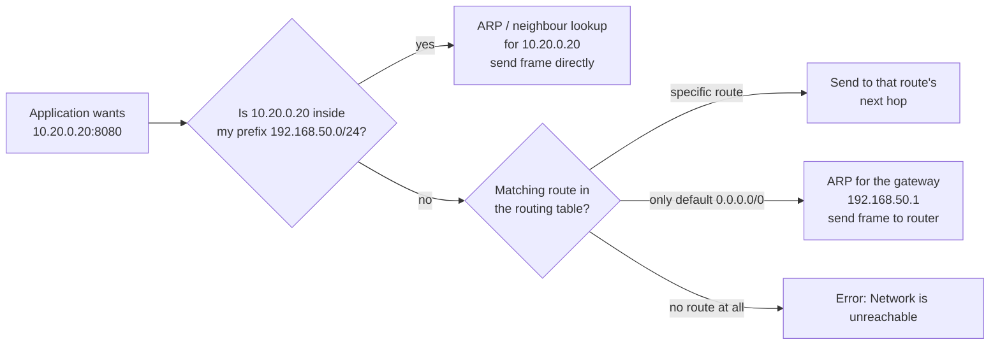

# Day 11: IP Configuration

!!! info "Lesson overview"
    | | |
    |---|---|
    | **Module** | 3 — Networking & Troubleshooting |
    | **Difficulty** | :material-signal-cellular-2: Intermediate |
    | **Estimated time** | 3–4 hours (80 min reading, 80 min demonstrations, 60–90 min lab and quiz) |
    | **Platforms** | Ubuntu 24.04 LTS (iproute2 6.1, netplan 1.1, systemd-networkd / NetworkManager) · Windows 11 (NetTCPIP module, Windows PowerShell 5.1 and PowerShell 7.4+) |
    | **Lab** | [Lab 11: Address Audit](../../labs/lab-11.md) |

## Learning Objectives

By the end of this lesson you will be able to:

1. Explain what an **IP address**, a **prefix length / subnet mask**, a **network address**, a **broadcast address**, a **default gateway** and a **route** are, and why a host needs all of them to talk beyond its own subnet.
2. Calculate the network, first and last usable host, broadcast address and host count for any IPv4 prefix (`/24`, `/26`, `/30`...) and decide whether two addresses are on the same subnet.
3. Recognise special address ranges at a glance: loopback, RFC 1918 private ranges, CGNAT, link-local / **APIPA** (`169.254.x.x`), documentation ranges, and the main IPv6 address types (`::1`, `fe80::/10`, `fd00::/8`, `2000::/3`).
4. Read the full IP configuration of a Linux host with `ip addr`, `ip link`, `ip route`, `ip neigh` and `ip route get`, using the brief (`-br`), one-line (`-o`) and JSON (`-j`) formats.
5. Read the full IP configuration of a Windows host with `ipconfig /all`, `Get-NetIPConfiguration`, `Get-NetIPAddress`, `Get-NetAdapter`, `Get-NetIPInterface`, `Get-NetRoute`, `Find-NetRoute` and `Get-NetNeighbor`.
6. Make **temporary** (runtime) changes safely, and know where **persistent** configuration lives: netplan YAML on Ubuntu (`netplan get`, `generate`, `try`, `apply`), NetworkManager (`nmcli`), and the persistent store behind `New-NetIPAddress` / `Set-NetIPInterface` on Windows.
7. Diagnose the classic configuration faults: wrong prefix, wrong gateway, missing default route, interface down, DHCP failure (APIPA), duplicate address and MTU mismatch.

## Prerequisites

- [Day 01](../module-1/day-01.md)–[Day 10](../module-2/day-10.md) completed. In particular you can read command output carefully (Day 3), filter with `grep` / `Select-String` and `Where-Object` (Days 4–5), and you know that configuration changes need a backup first (Day 7).
- An Ubuntu 24.04 machine (VM or WSL2) where you have `sudo`, and a Windows 11 machine. A **VM is strongly preferred** for the change demonstrations: you can lose your own connection with a wrong command, and a VM console still works when the network does not.
- `iproute2` is installed on every Ubuntu system. `ipcalc` is optional (`sudo apt install ipcalc`).
- WSL2 note: in the default NAT mode, WSL2 has its own virtual network (`eth0` with a `172.x` address behind Windows). Reading commands work; changes inside WSL do not change the Windows host. That makes WSL2 a convenient, safe place to practise.

## Introduction and Concepts

### Why IP configuration comes first

Every network investigation in this module follows the same order: **link → IP configuration → gateway → name resolution → port → application**. Today is the second step. If a host has the wrong address, the wrong prefix or no default route, nothing above it can work, and time spent on DNS or firewalls is wasted. Experienced engineers read the IP configuration *first*, even when the ticket says "the website is down".

### The four values every host needs

| Value | Example | What it does |
|---|---|---|
| **IP address** | `192.168.50.10` | Identifies this interface on the network |
| **Prefix length / subnet mask** | `/24` = `255.255.255.0` | Says which addresses are on the *same* local network (reachable directly) |
| **Default gateway** | `192.168.50.1` | The router that receives everything not on the local network |
| **DNS servers** | `192.168.50.1`, `8.8.8.8` | Translate names to addresses (Day 13) |

An address alone is not enough. With `192.168.50.10/24` the host knows that `192.168.50.0`–`192.168.50.255` are local; it reaches them directly by sending an Ethernet frame to the neighbour's MAC address. For any other destination it sends the packet to the **gateway's** MAC address and lets the router forward it.



### IPv4 addresses and prefixes in plain English

An IPv4 address is 32 bits, written as four decimal numbers (octets) from 0 to 255. The **prefix length** says how many of the leading bits are the **network part**; the rest are the **host part**.

| Prefix | Mask | Addresses in the block | Usable hosts | Typical use |
|---|---|---|---|---|
| `/8` | `255.0.0.0` | 16,777,216 | 16,777,214 | Huge private block `10.0.0.0/8` |
| `/16` | `255.255.0.0` | 65,536 | 65,534 | Campus / cloud VPC |
| `/24` | `255.255.255.0` | 256 | 254 | The classic office or server VLAN |
| `/25` | `255.255.255.128` | 128 | 126 | Half a /24 |
| `/26` | `255.255.255.192` | 64 | 62 | Small server segment |
| `/27` | `255.255.255.224` | 32 | 30 | DMZ, management network |
| `/28` | `255.255.255.240` | 16 | 14 | Small cloud subnet |
| `/29` | `255.255.255.248` | 8 | 6 | Small WAN or firewall transit |
| `/30` | `255.255.255.252` | 4 | 2 | Traditional point-to-point link |
| `/31` | `255.255.255.254` | 2 | 2 (RFC 3021, point-to-point only) | Modern router-to-router link |
| `/32` | `255.255.255.255` | 1 | 1 (the host itself) | Loopback/VIP, host route, firewall rule for one host |

Rules you will use constantly:

- **Block size** = 2^(32 − prefix). For a `/26` that is 2^6 = 64.
- The **network address** is the first address of the block and the **broadcast address** is the last. Neither can be given to a host (except on `/31` and `/32`).
- **Usable hosts** = block size − 2.
- Blocks always start at a multiple of the block size. `/26` blocks inside a `/24` start at `.0`, `.64`, `.128` and `.192`.

**Worked example — `10.20.0.130/26`:** the block size is 64, and 130 lies between 128 and 191, so the network is `10.20.0.128`, the first host `10.20.0.129`, the last host `10.20.0.190`, the broadcast `10.20.0.191`, with 62 usable hosts. `10.20.0.100` is **not** on the same subnet (it is in the `.64` block), so traffic between those two hosts must go through a router, even though the first three octets match.

### Special IPv4 ranges

| Range | Name | What seeing it tells you |
|---|---|---|
| `127.0.0.0/8` | Loopback | Traffic never leaves the host. `127.0.0.1` = this machine. |
| `10.0.0.0/8`, `172.16.0.0/12`, `192.168.0.0/16` | **RFC 1918 private** | Internal network; reaches the internet only through NAT |
| `100.64.0.0/10` | Carrier-grade NAT (RFC 6598) | ISP or cloud shared address space; also used by some VPNs |
| `169.254.0.0/16` | **Link-local / APIPA** | The host asked for DHCP and **got no answer**, so it gave itself an address. Almost always a fault. |
| `192.0.2.0/24`, `198.51.100.0/24`, `203.0.113.0/24` | Documentation (RFC 5737) | Safe for examples; never on a real network |
| `224.0.0.0/4` | Multicast | One-to-many traffic (routing protocols, mDNS) |
| `255.255.255.255` | Limited broadcast | "Everyone on this link" (used by DHCP) |
| `0.0.0.0` | "This host / any" | In a route it means default; in a listener it means all interfaces (Day 14) |

!!! warning "`172.16.0.0/12` is not `172.0.0.0/8`"
    The private range is `172.16.0.0` to `172.31.255.255` only. `172.217.x.x` is public (it belongs to an internet company). Misreading this makes analysts call public addresses "internal" in incident reports.

### IPv6 in one page

IPv6 addresses are 128 bits, written as eight groups of four hex digits. Two shortening rules apply: leading zeros in a group can be dropped, and **one** run of all-zero groups can be replaced by `::`. So `fd00:0050:0000:0000:0000:0000:0000:0010` becomes `fd00:50::10`.

| Prefix | Type | Notes |
|---|---|---|
| `::1/128` | Loopback | Same role as `127.0.0.1` |
| `fe80::/10` | **Link-local** | Every IPv6 interface has one automatically. Only valid on that link, so it needs a zone (`fe80::1%eth0`, `fe80::1%12` on Windows). Not a fault, unlike APIPA. |
| `fc00::/7` (in practice `fd00::/8`) | Unique local addresses (ULA) | The IPv6 "private" range |
| `2000::/3` | Global unicast | Public internet addresses |
| `ff00::/8` | Multicast | IPv6 has **no broadcast**; neighbour discovery uses multicast |

IPv6 hosts normally use a `/64` per LAN and configure themselves with **SLAAC** (router advertisements), DHCPv6, or both. A host often has several IPv6 addresses at once: link-local, a stable global address and one or more **temporary (privacy) addresses** that change over time. The default gateway is usually the router's **link-local** address, for example `fe80::1`.

### MAC addresses, ARP and the neighbour cache

IP addresses are logical. On Ethernet and Wi-Fi the frame is delivered to a **MAC address** (48 bits, e.g. `02:fc:00:00:00:01`). The host finds the MAC for a local IP with **ARP** (IPv4) or **Neighbour Discovery** (IPv6) and caches the answer:

- Linux: `ip neigh` shows states such as `REACHABLE`, `STALE`, `DELAY`, `INCOMPLETE` (asked, no answer yet) and `FAILED` (asked, nobody answered).
- Windows: `Get-NetNeighbor` (or `arp -a`) shows `Reachable`, `Stale`, `Permanent`, `Incomplete`, `Unreachable`.

An `INCOMPLETE` or `FAILED` entry for your **gateway** is one of the most useful clues in the whole module: the gateway address is wrong, the gateway is down, or you are on the wrong VLAN.

### The routing table and longest-prefix match

Every host has a routing table, not just routers. For each packet the kernel picks the route with the **longest matching prefix**; the default route `0.0.0.0/0` matches everything but is the least specific, so it is used only when nothing better matches. When two routes have the same prefix length, the lower **metric** wins.

| Destination | Matching routes | Chosen |
|---|---|---|
| `192.168.50.77` | `192.168.50.0/24` (connected), `0.0.0.0/0` | `/24` → deliver directly |
| `172.16.4.4` | `172.16.0.0/16 via 192.168.50.1`, `0.0.0.0/0` | `/16` → that next hop |
| `8.8.8.8` | `0.0.0.0/0 via 192.168.50.1` | default |

A **connected route** appears automatically when you assign an address with a prefix (`192.168.50.10/24` creates `192.168.50.0/24 dev eth0 proto kernel scope link`). That is why a wrong prefix breaks things: assign `/32` and the connected route disappears, so the host cannot even reach its own gateway.

### MTU

The **Maximum Transmission Unit** is the largest IP packet an interface sends without fragmentation: 1500 bytes on standard Ethernet, often 1400–1460 on VPNs and tunnels, and 9000 with jumbo frames on storage networks. An MTU mismatch produces a nasty symptom: small packets (ping, TCP handshakes) work, large transfers hang. Day 12 shows how to test the path MTU.

### DHCP, static configuration and APIPA

- **DHCP** (Dynamic Host Configuration Protocol): the client broadcasts a request and a DHCP server leases it an address, prefix, gateway, DNS servers and lease time (DORA: Discover, Offer, Request, Acknowledge). Desktops, laptops and most cloud VMs use DHCP.
- **Static**: the administrator writes the values into the configuration. Servers, routers, printers and DNS/DHCP servers themselves usually have static addresses or DHCP **reservations**.
- **APIPA / link-local IPv4**: when Windows gets no DHCP answer it assigns itself `169.254.x.x/16` (shown as *Autoconfiguration IPv4 Address* in `ipconfig /all`). Linux usually just shows **no** IPv4 address on the interface (NetworkManager can use link-local IPv4 when configured to).

### Runtime versus persistent configuration

This distinction prevents more outages than any single command:

| | Linux (Ubuntu) | Windows |
|---|---|---|
| **Runtime only** (lost on reboot or link reset) | `ip addr add`, `ip route add`, `ip link set` | `New-NetIPAddress -PolicyStore ActiveStore`, `route add` without `-p` |
| **Persistent** | Netplan YAML in `/etc/netplan/*.yaml` → rendered for **systemd-networkd** (servers) or **NetworkManager** (desktops); `nmcli connection modify` on desktops | `New-NetIPAddress` / `New-NetRoute` (default: active **and** persistent store), adapter properties in the GUI, `route -p add` |

Use runtime changes to test a fix, and persistent configuration to keep it. A change made only with `ip` disappears at the next reboot, which turns into a mystery outage weeks later.

### Who manages the network on Ubuntu?

| Edition | Netplan renderer | Persistent tool | Check |
|---|---|---|---|
| Ubuntu Server 24.04 | `networkd` | Netplan YAML, then `sudo netplan apply` | `networkctl status` |
| Ubuntu Desktop 24.04 | `NetworkManager` | Settings GUI or `nmcli`; Netplan still holds the definitions | `nmcli device status` |
| Cloud images | `networkd`, YAML written by **cloud-init** (`50-cloud-init.yaml`) | Change cloud-init config or add a higher-numbered YAML file | `cloud-init status` |
| WSL2 | Managed by Windows (`/etc/wsl.conf`, `.wslconfig`) | Do not configure WSL networking with netplan | — |

`ifconfig`, `route`, `netstat` and `arp` come from the old **net-tools** package. They are not installed on Ubuntu 24.04 by default, do not show all addresses (secondary addresses and many IPv6 details are missing) and are documented as obsolete. Read them if you meet them on old systems; use `ip` and `ss` yourself.

## Linux Command Reference

| Command | Purpose | Package / availability | Needs root? |
|---|---|---|---|
| `ip addr` (`ip a`) | Show/add/delete IP addresses | iproute2 (always installed) | Only to change |
| `ip link` | Show interfaces, state, MAC, MTU; bring links up/down | iproute2 | Only to change |
| `ip -s link` | Interface counters: bytes, packets, errors, drops | iproute2 | No |
| `ip route` (`ip r`) | Show/add/delete/replace routes | iproute2 | Only to change |
| `ip route get ADDR` | Ask the kernel which route, interface and source address it would use | iproute2 | No |
| `ip neigh` (`ip n`) | ARP / IPv6 neighbour cache | iproute2 | Only to flush/change |
| `ip -br`, `-o`, `-j`, `-c`, `-4`, `-6` | Brief, one-line, JSON, colour output; IPv4/IPv6 only | iproute2 | No |
| `hostname -I` | All addresses of the host, one line | hostname | No |
| `netplan get` / `generate` / `try` / `apply` / `status` | Read, render, test-with-rollback and apply persistent configuration | netplan.io (Ubuntu) | Yes for `try`/`apply` |
| `networkctl` | Status of links managed by systemd-networkd (servers) | systemd | No |
| `nmcli` | NetworkManager CLI (desktops) | network-manager (Ubuntu Desktop) | Only to change |
| `ipcalc` | Subnet calculator | ipcalc (optional, `apt install ipcalc`) | No |
| `ethtool IFACE` | Link speed, duplex, driver (physical NICs) | ethtool | Partly |
| `ifconfig`, `route -n`, `arp -n` | Legacy equivalents | net-tools (not installed by default; obsolete) | Only to change |

## PowerShell Command Reference

All `Net*` cmdlets below come from the **NetTCPIP**, **NetAdapter** and **NetConnection** modules. They are **Windows-only** (Windows 8 / Server 2012 and later) and work in **both** Windows PowerShell 5.1 and PowerShell 7 on Windows. On PowerShell 7 for Linux and macOS they do not exist; use the native `ip` command or the .NET class shown in the last row.

| Cmdlet / command | Alias | Purpose | 5.1 | 7.x | Admin? |
|---|---|---|---|---|---|
| `Get-NetIPConfiguration` | `gip` | Per-interface summary: addresses, gateway, DNS, profile | Yes | Windows only | No |
| `Get-NetIPAddress` | — | Every IP address with prefix, origin (DHCP/Manual/WellKnown), state, lifetimes | Yes | Windows only | No |
| `Get-NetAdapter` | — | Adapters: name, description, status, MAC, link speed | Yes | Windows only | No |
| `Get-NetAdapterStatistics` | — | Bytes, unicast packets, discards and errors per adapter | Yes | Windows only | No |
| `Get-NetIPInterface` | — | Per-family interface settings: DHCP on/off, MTU (`NlMtu`), interface metric, forwarding | Yes | Windows only | No |
| `Get-NetRoute` | — | Routing table | Yes | Windows only | No |
| `Find-NetRoute -RemoteIPAddress` | — | Which source address and route Windows would use (like `ip route get`) | Yes | Windows only | No |
| `Get-NetNeighbor` | — | ARP / neighbour cache | Yes | Windows only | No |
| `Get-NetConnectionProfile` | — | Network category (Public/Private/DomainAuthenticated) per interface | Yes | Windows only | No |
| `New-NetIPAddress` / `Remove-NetIPAddress` / `Set-NetIPAddress` | — | Add/remove/change static addresses (and default gateway) | Yes | Windows only | **Yes** |
| `New-NetRoute` / `Remove-NetRoute` | — | Add/remove routes | Yes | Windows only | **Yes** |
| `Set-NetIPInterface` | — | Enable DHCP, set MTU or metric | Yes | Windows only | **Yes** |
| `ipconfig /all`, `/release`, `/renew` | — | Classic full configuration, DHCP lease release/renew | Yes | Yes (native exe) | `/release`/`/renew`: no on most systems |
| `route print`, `arp -a`, `getmac`, `netsh interface ipv4 show config` | — | Classic routing table, ARP cache, MACs, configuration | Yes | Yes (native exe) | Only to change |
| `[System.Net.NetworkInformation.NetworkInterface]::GetAllNetworkInterfaces()` | — | .NET interface and address list | Yes | **Yes, all OS** | No |

## Detailed Command Explanations

### `ip addr` — which addresses does this host have?

`ip addr show` (short forms `ip addr`, `ip a`) lists every interface with its addresses. Read each block from top to bottom:

```text
8: eth0@if7: <BROADCAST,MULTICAST,UP,LOWER_UP> mtu 1500 qdisc noqueue state UP group default qlen 1000
    link/ether ee:1a:33:22:b9:33 brd ff:ff:ff:ff:ff:ff
    inet 192.168.50.10/24 scope global eth0
       valid_lft forever preferred_lft forever
```

- `8:` is the interface index; `eth0` the name. Modern Ubuntu uses **predictable names** such as `enp0s3` (PCI bus 0, slot 3), `ens160` (VMware) or `wlp2s0` (Wi-Fi). `@if7` appears on virtual pairs (veth) and VLANs and names the peer.
- `<...UP,LOWER_UP>`: `UP` means administratively enabled; `LOWER_UP` means the physical layer has a carrier (cable plugged in, Wi-Fi associated). `UP` without `LOWER_UP` = enabled but no link: check the cable, switch port or virtual NIC connection.
- `mtu 1500`, `state UP`: the MTU and the operational state.
- `link/ether` is the MAC address.
- `inet 192.168.50.10/24` is an IPv4 address with its prefix. `inet6` lines are IPv6.
- `scope global` means usable for communication anywhere; `scope link` means valid only on this link (e.g. `fe80::`); `scope host` is loopback.
- `dynamic` (when shown) means the address came from DHCP or SLAAC, and `valid_lft 86077sec` is the lease time remaining. `forever` means static.
- `secondary` marks an additional address in the same subnet.

Useful variants: `ip -br addr` (one line per interface: name, state, addresses), `ip -4 addr` / `ip -6 addr`, `ip addr show dev eth0`, `ip -o addr` (one line per address, ideal for `grep`/`awk`), `ip -j addr` (JSON for scripts and `jq`), `ip -c addr` (colours).

### `ip link` — interface state, MAC and MTU

`ip link` shows the layer-2 side: names, state, MAC, MTU. `ip -br link` is the fastest overview. `ip -s link show dev eth0` adds counters; non-zero and **growing** `errors` or `dropped` values point at cabling, duplex, driver or buffer problems rather than IP configuration. `ip -d link` adds driver details (veth, VLAN ID, bridge membership).

Changing link settings needs root and is **runtime only**: `sudo ip link set dev eth0 down|up`, `sudo ip link set dev eth0 mtu 1400`.

!!! danger "Never bring down the interface you are connected through"
    `sudo ip link set eth0 down` over SSH disconnects you immediately, and nothing will bring it back up except the console. The same applies to `Disable-NetAdapter` and `Remove-NetIPAddress` in a remote PowerShell session. Practise these on a VM with console access, or on a second interface.

### `ip route` and `ip route get` — where do packets go?

`ip route` prints the main IPv4 routing table; `ip -6 route` the IPv6 one.

```text
default via 192.168.50.1 dev eth0 proto dhcp src 192.168.50.10 metric 100
192.168.50.0/24 dev eth0 proto kernel scope link src 192.168.50.10
```

- `default via 192.168.50.1 dev eth0`: the default gateway and the interface used to reach it.
- `proto dhcp` / `proto static` / `proto kernel` / `proto ra`: who created the route. `kernel` = connected route from an address; `ra` = IPv6 router advertisement.
- `metric 100`: preference among equal prefixes; lower wins. A laptop on both Ethernet and Wi-Fi typically has two default routes with metrics 100 and 600.
- `scope link`: the destination is directly attached (no gateway).

`ip route get 10.20.0.20` asks the kernel to make the routing decision and print it, including the **source address** it would use. This is the single most useful "why does traffic go *that* way?" command, especially on hosts with several interfaces or a VPN.

`ip route show table local` shows the kernel's local and broadcast entries for the host's own addresses. `ip rule` shows policy routing (multiple tables), which you will meet on VPN servers and cloud instances.

Runtime changes (root): `ip route add 172.16.0.0/16 via 192.168.50.1`, `ip route del 172.16.0.0/16`, `ip route replace default via 192.168.50.1` (adds or replaces in one step, which is safer than delete-then-add).

### `ip neigh` — the ARP / neighbour cache

`ip neigh show` lists IP → MAC mappings with a state. `ip neigh show dev eth0`, `ip -4 neigh`, `ip neigh flush dev eth0` (root, clears dynamic entries so they are relearned). Two MAC addresses answering for the same IP over time, or the gateway's MAC suddenly changing, are signs of an **address conflict** or **ARP spoofing**.

### Netplan — persistent configuration on Ubuntu

Netplan reads YAML files in `/etc/netplan/` (processed in lexical order; later files override earlier ones) and renders them for the chosen backend. Commands:

| Command | What it does | Safe on a remote session? |
|---|---|---|
| `sudo netplan get` | Prints the merged configuration of all YAML files | Yes (read-only) |
| `sudo netplan generate` | Validates and renders backend files under `/run`; reports YAML and semantic errors | Yes (does not apply) |
| `sudo netplan try` | Applies the configuration and **rolls it back automatically after 120 s** unless you press ++enter++ | **Yes, this is the safe way** |
| `sudo netplan apply` | Applies immediately with no rollback | Only after `try` succeeded |
| `sudo netplan status` | Shows the live state of netplan-managed interfaces (available in the netplan 1.x shipped with 24.04; needs systemd-networkd running) | Yes |

A static server configuration looks like this:

```yaml
# /etc/netplan/60-static.yaml   (permissions 600, owner root)
network:
  version: 2
  renderer: networkd
  ethernets:
    enp0s8:
      dhcp4: false
      addresses:
        - 192.168.56.20/24
      routes:
        - to: default
          via: 192.168.56.1
      nameservers:
        addresses: [192.168.56.1]
        search: [lab.internal]
```

Rules that trip people up: YAML indentation uses **spaces only** and must be consistent; every address needs its **prefix length**; `gateway4:` is **deprecated** (use a `routes:` entry with `to: default`); files should be mode **600** because they can contain Wi-Fi and VPN secrets.

### `nmcli` — NetworkManager on desktops

`nmcli device status` lists devices and their connection, `nmcli connection show` lists saved profiles, and `nmcli -f IP4 device show enp0s3` prints the IPv4 part of a device. Changes: `nmcli connection modify "Wired connection 1" ipv4.method manual ipv4.addresses 192.168.56.20/24 ipv4.gateway 192.168.56.1`, then `nmcli connection up "Wired connection 1"`. On Ubuntu Server, NetworkManager is not installed, so use netplan.

### `ipconfig` — the classic Windows view

`ipconfig` shows each adapter's IPv4/IPv6 addresses, mask and gateway. `ipconfig /all` adds the description, MAC (*Physical Address*), DHCP enabled/server/lease times, DNS servers and suffix, and whether the address is *Autoconfiguration* (APIPA). `ipconfig /release` and `/renew` drop and request a DHCP lease (`/release6`, `/renew6` for IPv6). `ipconfig /displaydns` and `/flushdns` belong to Day 13. It works in every shell and on every Windows version, which makes it the lowest common denominator for help-desk instructions.

### `Get-NetIPConfiguration` — the PowerShell summary

`Get-NetIPConfiguration` (alias `gip`) returns one object per connected interface with `InterfaceAlias`, `InterfaceIndex`, `InterfaceDescription`, `NetProfile`, `IPv4Address`, `IPv6Address`, `IPv4DefaultGateway`, `IPv6DefaultGateway` and `DNSServer`. Add `-Detailed` for MTU, MAC, DHCP state and profile category; `-All` to include disconnected adapters; `-InterfaceAlias 'Ethernet'` for one adapter.

Because they are objects, you can extract exactly what a report needs: `(Get-NetIPConfiguration -InterfaceAlias Ethernet).IPv4DefaultGateway.NextHop`.

### `Get-NetIPAddress` — every address and where it came from

`Get-NetIPAddress` returns one object per address. The properties that make it more useful than `ipconfig`:

| Property | Values | Meaning |
|---|---|---|
| `PrefixOrigin` | `Dhcp`, `Manual`, `WellKnown`, `RouterAdvertisement`, `Other` | How the prefix was obtained. `WellKnown` + `169.254.*` = APIPA. |
| `SuffixOrigin` | `Dhcp`, `Manual`, `Link`, `Random`, `WellKnown` | How the host part was chosen. `Random` = IPv6 temporary/privacy address. |
| `AddressState` | `Preferred`, `Deprecated`, `Tentative`, `Duplicate`, `Invalid` | `Duplicate` = **address conflict detected**. `Tentative` = still being checked. |
| `ValidLifetime` / `PreferredLifetime` | TimeSpan | Remaining DHCP/SLAAC lifetime; `Infinite` for static |
| `PolicyStore` | `ActiveStore`, `PersistentStore` | Runtime vs saved configuration (use `-PolicyStore` to query) |

Filter with parameters, not `Where-Object`, where possible: `Get-NetIPAddress -AddressFamily IPv4 -InterfaceAlias Ethernet`, `Get-NetIPAddress -AddressState Duplicate`, `Get-NetIPAddress -PrefixOrigin Dhcp`.

### `Get-NetAdapter` and `Get-NetIPInterface`

`Get-NetAdapter` is the layer-2 view: `Name` (the alias other cmdlets use), `InterfaceDescription` (the driver), `ifIndex`, `Status` (`Up`, `Disconnected`, `Disabled`), `MacAddress` and `LinkSpeed`. `-Physical` hides virtual adapters (Hyper-V, VPN, WSL). `Get-NetAdapterStatistics` provides counters similar to `ip -s link`.

`Get-NetIPInterface` holds per-**address-family** settings: `Dhcp` (`Enabled`/`Disabled`), `NlMtu` (the IP MTU), `InterfaceMetric` (lower = preferred), `ConnectionState`, and `Forwarding`. It is where you check "is DHCP on?" and "why does Windows prefer Wi-Fi over Ethernet?".

### `Get-NetRoute` and `Find-NetRoute`

`Get-NetRoute -AddressFamily IPv4` lists `DestinationPrefix`, `NextHop`, `RouteMetric`, `InterfaceAlias` and `ifIndex`. The default route is `0.0.0.0/0` (IPv4) and `::/0` (IPv6); a `NextHop` of `0.0.0.0` means "directly connected". Windows chooses among equal prefixes by **route metric + interface metric**.

`Find-NetRoute -RemoteIPAddress 10.20.0.20` returns two objects: the local IP address Windows would use as the source, and the selected route. It is the Windows equivalent of `ip route get`.

`route print` shows the same data in the classic format, including *Persistent Routes* added with `route -p add`.

### `Get-NetNeighbor` — the Windows ARP cache

`Get-NetNeighbor -AddressFamily IPv4` lists `IPAddress`, `LinkLayerAddress` (MAC) and `State`. Filter the gateway with `Get-NetNeighbor -IPAddress 192.168.56.1`. `arp -a` is the classic view. `Unreachable` or `Incomplete` for the gateway means the same as `FAILED`/`INCOMPLETE` on Linux.

### Changing configuration on Windows: `New-NetIPAddress` and friends

These cmdlets need an **elevated** session and support `-WhatIf` and `-Confirm`.

```powershell
# Static address + default gateway (writes to the active AND persistent store by default)
New-NetIPAddress -InterfaceAlias 'Ethernet 2' -IPAddress 192.168.56.20 -PrefixLength 24 -DefaultGateway 192.168.56.1
# Back to DHCP
Remove-NetIPAddress -InterfaceAlias 'Ethernet 2' -AddressFamily IPv4 -Confirm:$false
Remove-NetRoute -InterfaceAlias 'Ethernet 2' -DestinationPrefix 0.0.0.0/0 -Confirm:$false
Set-NetIPInterface -InterfaceAlias 'Ethernet 2' -AddressFamily IPv4 -Dhcp Enabled
# Runtime-only test address (gone after reboot)
New-NetIPAddress -InterfaceAlias 'Ethernet 2' -IPAddress 192.168.56.21 -PrefixLength 24 -PolicyStore ActiveStore
```

Common errors: *"Inconsistent parameters PolicyStore PersistentStore and Dhcp Enabled"* (DHCP is still on, so disable it first with `Set-NetIPInterface -Dhcp Disabled`), and *"Instance DefaultGateway already exists"* (remove the old `0.0.0.0/0` route first). DNS servers are set separately with `Set-DnsClientServerAddress` (Day 13).

### Cross-platform PowerShell: the .NET view

On PowerShell 7 for Linux there are no `Net*` cmdlets, but .NET exposes interfaces and addresses on every OS:

```powershell
[System.Net.NetworkInformation.NetworkInterface]::GetAllNetworkInterfaces() |
    ForEach-Object {
        $nic = $_
        $nic.GetIPProperties().UnicastAddresses | ForEach-Object {
            [pscustomobject]@{ Name = $nic.Name; Status = $nic.OperationalStatus
                               Address = $_.Address.IPAddressToString; Prefix = $_.PrefixLength }
        }
    }
```

**Expected output (captured, PowerShell 7.4.6 on the Ubuntu 24.04 capture host, whose `eth0` uses a documentation address):**

```text
Name Status Address   Prefix
---- ------ -------   ------
lo       Up 127.0.0.1      8
eth0     Up 192.0.2.2     24
```

This works in 5.1 too (`PrefixLength` needs .NET Framework 4.6+), which makes it handy in inventory scripts that run everywhere. On Linux, the lifetime and origin properties (`PrefixOrigin`, `DhcpLeaseLifetime`) are empty because .NET only fills them on Windows.

## Syntax and Parameters

### Linux

```text
ip [ -4 | -6 ] [ -br ] [ -o ] [ -j [ -p ] ] [ -c ] [ -s ] [ -d ] OBJECT COMMAND
ip addr  { show [ dev IFACE ] | add ADDR/PREFIX dev IFACE | del ADDR/PREFIX dev IFACE | flush dev IFACE }
ip link  { show [ dev IFACE ] | set dev IFACE { up | down | mtu N } }
ip route { show [ table T ] | get ADDR | add PREFIX via GW [ dev IFACE ] [ metric N ] | replace ... | del PREFIX }
ip neigh { show [ dev IFACE ] | flush dev IFACE }
netplan { get [ KEY ] | generate | try [ --timeout SECONDS ] | apply | status }
ipcalc ADDRESS/PREFIX
```

| Option | Meaning |
|---|---|
| `-br` / `-brief` | One line per interface: name, state, addresses |
| `-o` / `-oneline` | One line per record (`\` replaces newlines), for `grep`/`awk` |
| `-j` / `-json` (`-p` pretty) | JSON output for scripts |
| `-c` / `-color` | Colour the output (`-c=never` in scripts) |
| `-4` / `-6` | Restrict to IPv4 or IPv6 |
| `-s` | Statistics (counters); repeat (`-s -s`) for more detail |
| `-d` | Details (link type, VLAN ID, driver specifics) |
| `scope global/link/host` | Address scope |
| `via GW` | Next hop for a route |
| `metric N` | Route preference (lower wins among equal prefixes) |
| `replace` | Add or overwrite a route atomically |
| `netplan try --timeout N` | Roll back automatically after *N* seconds (default 120) unless confirmed |

### PowerShell

```text
Get-NetIPConfiguration [[-InterfaceAlias] <String>] [-InterfaceIndex <Int32>] [-All] [-Detailed]
Get-NetIPAddress [[-IPAddress] <String[]>] [-InterfaceAlias <String[]>] [-InterfaceIndex <UInt32[]>]
                 [-AddressFamily <IPv4|IPv6>] [-Type <Unicast|Anycast>] [-PrefixOrigin <...>]
                 [-AddressState <Preferred|Deprecated|Tentative|Duplicate|Invalid>] [-PolicyStore <String>]
Get-NetAdapter [[-Name] <String[]>] [-Physical] [-IncludeHidden]
Get-NetIPInterface [[-InterfaceAlias] <String[]>] [-AddressFamily <IPv4|IPv6>] [-Dhcp <Enabled|Disabled>]
Get-NetRoute [-DestinationPrefix <String[]>] [-InterfaceAlias <String[]>] [-AddressFamily <IPv4|IPv6>] [-NextHop <String[]>]
Find-NetRoute -RemoteIPAddress <String>
Get-NetNeighbor [[-IPAddress] <String[]>] [-InterfaceAlias <String[]>] [-AddressFamily <IPv4|IPv6>] [-State <...>]
New-NetIPAddress -IPAddress <String> -InterfaceAlias <String> [-PrefixLength <Byte>] [-DefaultGateway <String>]
                 [-PolicyStore <ActiveStore|PersistentStore>] [-WhatIf] [-Confirm]
Set-NetIPInterface -InterfaceAlias <String> [-AddressFamily <IPv4|IPv6>] [-Dhcp <Enabled|Disabled>]
                   [-NlMtuBytes <UInt32>] [-InterfaceMetric <UInt32>] [-WhatIf] [-Confirm]
ipconfig [ /all | /release [adapter] | /renew [adapter] | /release6 | /renew6 ]
route print [-4 | -6]
```

| Parameter | Cmdlet | Meaning |
|---|---|---|
| `-Detailed` | Get-NetIPConfiguration | Adds MTU, MAC, DHCP, profile category |
| `-All` | Get-NetIPConfiguration | Include disconnected interfaces |
| `-AddressFamily` | Most `Net*` cmdlets | `IPv4` or `IPv6` |
| `-PrefixOrigin` / `-AddressState` | Get-NetIPAddress | Filter DHCP/manual/APIPA and duplicates |
| `-Physical` | Get-NetAdapter | Physical adapters only |
| `-Dhcp` | Get-/Set-NetIPInterface | Query or enable/disable DHCP per family |
| `-NlMtuBytes` | Set-NetIPInterface | Set the IP MTU |
| `-InterfaceMetric` | Set-NetIPInterface | Prefer one interface over another |
| `-PolicyStore ActiveStore` | New-NetIPAddress, New-NetRoute | Runtime only, not saved |
| `-DefaultGateway` | New-NetIPAddress | Creates the `0.0.0.0/0` route at the same time |
| `-RemoteIPAddress` | Find-NetRoute | Destination to evaluate |

## Practical Demonstrations

The Linux outputs below were **captured** on Ubuntu 24.04.5 (iproute2, iputils 20240117, netplan.io 1.1.2, ipcalc) inside network namespaces that model a small network: a *client* (`192.168.50.10/24`), a *router* (`192.168.50.1` and `10.20.0.1`) and a *server* (`10.20.0.20/24`). That is why interfaces are called `eth0@if7`; on a VM you will see `enp0s3` or `ens33`. MAC addresses are random. IPv6 was not available on the capture host, so IPv6 output is labelled as an example. Output from the Windows-only `Net*` cmdlets and `ipconfig` is an **example** in the documented format (no Windows host was available for this release); your adapter names, addresses and indexes will differ. The cross-platform .NET snippets were executed with PowerShell 7.4.6 on Linux and are marked as captured.

### Demo 1 — The complete picture in four commands

=== "Bash"

    ```bash
    ip -br link
    ip -br addr
    ip route
    ip neigh
    ```

    **Expected output (captured):**

    ```text
    lo               UNKNOWN        00:00:00:00:00:00 <LOOPBACK,UP,LOWER_UP>
    eth0@if7         UP             ee:1a:33:22:b9:33 <BROADCAST,MULTICAST,UP,LOWER_UP>
    lo               UNKNOWN        127.0.0.1/8
    eth0@if7         UP             192.168.50.10/24
    default via 192.168.50.1 dev eth0
    192.168.50.0/24 dev eth0 proto kernel scope link src 192.168.50.10
    192.168.50.1 dev eth0 lladdr 4e:48:a5:bb:48:6e REACHABLE
    ```

    In ten seconds you know: the link is up with carrier, the address and prefix, the connected subnet, the default gateway, and that the gateway answered ARP recently. `lo` shows `UNKNOWN` as its state; that is normal for loopback.

=== "PowerShell"

    ```powershell
    Get-NetAdapter | Select-Object Name, InterfaceDescription, Status, MacAddress, LinkSpeed
    Get-NetIPConfiguration -InterfaceAlias Ethernet
    Get-NetNeighbor -AddressFamily IPv4 -InterfaceAlias Ethernet -State Reachable, Stale
    ```

    **Expected output (example):**

    ```text
    Name     InterfaceDescription                Status MacAddress        LinkSpeed
    ----     --------------------                ------ ----------        ---------
    Ethernet Intel(R) Ethernet Connection I219-V Up     00-15-5D-01-0A-14 1 Gbps
    Wi-Fi    Intel(R) Wi-Fi 6 AX201 160MHz       Disconnected 7C-B2-7D-11-22-33 0 bps

    InterfaceAlias       : Ethernet
    InterfaceIndex       : 12
    InterfaceDescription : Intel(R) Ethernet Connection I219-V
    NetProfile.Name      : lab.internal
    IPv4Address          : 192.168.56.30
    IPv6DefaultGateway   :
    IPv4DefaultGateway   : 192.168.56.1
    DNSServer            : 192.168.56.1

    ifIndex IPAddress      LinkLayerAddress  State     PolicyStore
    ------- ---------      ----------------  -----     -----------
    12      192.168.56.1   52-54-00-12-35-02 Reachable ActiveStore
    ```

### Demo 2 — Reading one interface in detail

=== "Bash"

    ```bash
    ip -4 addr show dev eth0
    ip -s link show dev eth0
    hostname -I
    ```

    **Expected output (captured):**

    ```text
    8: eth0@if7: <BROADCAST,MULTICAST,UP,LOWER_UP> mtu 1500 qdisc noqueue state UP group default qlen 1000 link-netns router
        inet 192.168.50.10/24 scope global eth0
           valid_lft forever preferred_lft forever
    8: eth0@if7: <BROADCAST,MULTICAST,UP,LOWER_UP> mtu 1500 qdisc noqueue state UP mode DEFAULT group default qlen 1000
        link/ether ee:1a:33:22:b9:33 brd ff:ff:ff:ff:ff:ff link-netns router
        RX:  bytes packets errors dropped  missed   mcast
               378       5      0       0       0       0
        TX:  bytes packets errors dropped carrier collsns
               378       5      0       0       0       0
    192.168.50.10
    ```

    `valid_lft forever` = a static address. A DHCP address would show `dynamic` and a countdown such as `valid_lft 86077sec`. On a typical Ubuntu Desktop with DHCP and IPv6 you would see something like this (example):

    ```text
    2: enp0s3: <BROADCAST,MULTICAST,UP,LOWER_UP> mtu 1500 qdisc fq_codel state UP group default qlen 1000
        link/ether 08:00:27:3a:5c:11 brd ff:ff:ff:ff:ff:ff
        inet 10.0.2.15/24 brd 10.0.2.255 scope global dynamic noprefixroute enp0s3
           valid_lft 86077sec preferred_lft 86077sec
        inet6 fd00::a00:27ff:fe3a:5c11/64 scope global dynamic mngtmpaddr noprefixroute
           valid_lft 86300sec preferred_lft 14300sec
        inet6 fe80::a00:27ff:fe3a:5c11/64 scope link noprefixroute
           valid_lft forever preferred_lft forever
    ```

=== "PowerShell"

    ```powershell
    Get-NetIPAddress -InterfaceAlias Ethernet |
        Format-Table IPAddress, PrefixLength, PrefixOrigin, SuffixOrigin, AddressState, ValidLifetime
    Get-NetIPInterface -InterfaceAlias Ethernet | Format-Table AddressFamily, Dhcp, NlMtu, InterfaceMetric, ConnectionState
    ipconfig /all
    ```

    **Expected output (example):**

    ```text
    IPAddress                   PrefixLength PrefixOrigin        SuffixOrigin AddressState ValidLifetime
    ---------                   ------------ ------------        ------------ ------------ -------------
    fe80::4d2a:91c3:8b1e:2f07%12          64 WellKnown           Link         Preferred    Infinite
    192.168.56.30                         24 Dhcp                Dhcp         Preferred    23:41:07

    AddressFamily Dhcp    NlMtu InterfaceMetric ConnectionState
    ------------- ----    ----- --------------- ---------------
    IPv6          Enabled  1500              25 Connected
    IPv4          Enabled  1500              25 Connected

    Ethernet adapter Ethernet:

       Connection-specific DNS Suffix  . : lab.internal
       Description . . . . . . . . . . . : Intel(R) Ethernet Connection I219-V
       Physical Address. . . . . . . . . : 00-15-5D-01-0A-14
       DHCP Enabled. . . . . . . . . . . : Yes
       Autoconfiguration Enabled . . . . : Yes
       Link-local IPv6 Address . . . . . : fe80::4d2a:91c3:8b1e:2f07%12(Preferred)
       IPv4 Address. . . . . . . . . . . : 192.168.56.30(Preferred)
       Subnet Mask . . . . . . . . . . . : 255.255.255.0
       Lease Obtained. . . . . . . . . . : 12 November 2026 09:14:02
       Lease Expires . . . . . . . . . . : 13 November 2026 09:14:02
       Default Gateway . . . . . . . . . : 192.168.56.1
       DHCP Server . . . . . . . . . . . : 192.168.56.1
       DNS Servers . . . . . . . . . . . : 192.168.56.1
       NetBIOS over Tcpip. . . . . . . . : Enabled
    ```

    `%12` after the link-local address is the **zone index** (interface index 12).

### Demo 3 — Which route will be used? Longest-prefix match in action

=== "Bash"

    ```bash
    ip route get 10.20.0.20       # remote network: via the gateway
    ip route get 192.168.50.77    # same subnet: directly
    ip route get 127.0.0.1        # loopback
    sudo ip route add 172.16.0.0/16 via 192.168.50.1
    ip route
    ip route get 172.16.4.4
    sudo ip route del 172.16.0.0/16
    ```

    **Expected output (captured):**

    ```text
    10.20.0.20 via 192.168.50.1 dev eth0 src 192.168.50.10 uid 0
        cache
    192.168.50.77 dev eth0 src 192.168.50.10 uid 0
        cache
    local 127.0.0.1 dev lo src 127.0.0.1 uid 0
        cache <local>
    default via 192.168.50.1 dev eth0
    172.16.0.0/16 via 192.168.50.1 dev eth0
    192.168.50.0/24 dev eth0 proto kernel scope link src 192.168.50.10
    172.16.4.4 via 192.168.50.1 dev eth0 src 192.168.50.10 uid 0
        cache
    ```

    `uid 0` appears because the capture ran as root; as a normal user you see your own UID.

=== "PowerShell"

    ```powershell
    Get-NetRoute -AddressFamily IPv4 |
        Sort-Object DestinationPrefix |
        Format-Table DestinationPrefix, NextHop, RouteMetric, InterfaceAlias -AutoSize
    Find-NetRoute -RemoteIPAddress 10.20.0.20 | Select-Object -Property IPAddress, InterfaceAlias, DestinationPrefix, NextHop
    ```

    **Expected output (example, abbreviated):**

    ```text
    DestinationPrefix  NextHop      RouteMetric InterfaceAlias
    -----------------  -------      ----------- --------------
    0.0.0.0/0          192.168.56.1           0 Ethernet
    127.0.0.0/8        0.0.0.0              256 Loopback Pseudo-Interface 1
    192.168.56.0/24    0.0.0.0              256 Ethernet
    192.168.56.30/32   0.0.0.0              256 Ethernet
    192.168.56.255/32  0.0.0.0              256 Ethernet
    224.0.0.0/4        0.0.0.0              256 Ethernet
    255.255.255.255/32 0.0.0.0              256 Ethernet

    IPAddress      InterfaceAlias DestinationPrefix NextHop
    ---------      -------------- ----------------- -------
    192.168.56.30  Ethernet
                   Ethernet       0.0.0.0/0         192.168.56.1
    ```

    The first object from `Find-NetRoute` is the **source address**; the second is the **route**. Windows keeps host routes (`/32`) and broadcast routes in the main table, which Linux keeps in the separate `local` table (`ip route show table local`).

### Demo 4 — Temporary changes and how to undo them

Run these only on a **lab VM** (or a namespace like the capture host). Save the current state first, so you can compare and roll back.

=== "Bash"

    ```bash
    ip addr > ~/addr-before.txt ; ip route > ~/routes-before.txt
    sudo ip addr add 192.168.50.11/24 dev eth0
    ip -br -4 addr show dev eth0
    ip -4 addr show dev eth0
    ip route > ~/routes-after.txt ; diff ~/routes-before.txt ~/routes-after.txt
    sudo ip addr del 192.168.50.11/24 dev eth0
    sudo ip addr add 192.168.50.10/24 dev eth0         # already there
    sudo ip route add 172.16.0.0/16 via 10.99.0.1      # gateway not on any local subnet
    ```

    **Expected output (captured):**

    ```text
    eth0@if7         UP             192.168.50.10/24 192.168.50.11/24
    8: eth0@if7: <BROADCAST,MULTICAST,UP,LOWER_UP> mtu 1500 qdisc noqueue state UP group default qlen 1000 link-netns router
        inet 192.168.50.10/24 scope global eth0
           valid_lft forever preferred_lft forever
        inet 192.168.50.11/24 scope global secondary eth0
           valid_lft forever preferred_lft forever
    Error: ipv4: Address already assigned.
    Error: Nexthop has invalid gateway.
    ```

    `diff` prints nothing because adding a second address in the **same** subnet does not create a new connected route. *"Nexthop has invalid gateway"* is the kernel refusing a gateway that is not on a directly connected network, which is exactly the protection you want.

=== "PowerShell"

    ```powershell
    # Elevated session, lab VM, second adapter only
    Get-NetIPConfiguration -InterfaceAlias 'Ethernet 2' | Out-File $HOME\ipconfig-before.txt
    New-NetIPAddress -InterfaceAlias 'Ethernet 2' -IPAddress 192.168.56.21 -PrefixLength 24 -PolicyStore ActiveStore -WhatIf
    New-NetIPAddress -InterfaceAlias 'Ethernet 2' -IPAddress 192.168.56.21 -PrefixLength 24 -PolicyStore ActiveStore
    Get-NetIPAddress -InterfaceAlias 'Ethernet 2' -AddressFamily IPv4 | Format-Table IPAddress, PrefixLength, PrefixOrigin, PolicyStore
    Remove-NetIPAddress -InterfaceAlias 'Ethernet 2' -IPAddress 192.168.56.21 -Confirm:$false
    ```

    **Expected output (example):**

    ```text
    What if: Performing the operation "Create" on target "IPAddress: 192.168.56.21 PrefixLength 24".

    IPAddress     PrefixLength PrefixOrigin PolicyStore
    ---------     ------------ ------------ -----------
    192.168.56.21           24       Manual ActiveStore
    192.168.56.30           24         Dhcp ActiveStore
    ```

### Demo 5 — Breaking it on purpose: wrong prefix, missing route, link down

=== "Bash"

    ```bash
    # (a) Missing default route
    sudo ip route del default
    ping -c1 -W1 10.20.0.20
    ip route get 10.20.0.20
    sudo ip route add default via 192.168.50.1

    # (b) Wrong prefix: /32 instead of /24
    sudo ip addr del 192.168.50.10/24 dev eth0
    sudo ip addr add 192.168.50.10/32 dev eth0
    ip route                          # empty: no connected route, default route gone too
    ping -c1 -W1 192.168.50.1
    sudo ip route add default via 192.168.50.1
    # repair: put the /24 back, then the default route
    sudo ip addr del 192.168.50.10/32 dev eth0
    sudo ip addr add 192.168.50.10/24 dev eth0
    sudo ip route add default via 192.168.50.1

    # (c) Link down and up again
    sudo ip link set eth0 down ; ip -br addr ; ip route
    sudo ip link set eth0 up   ; ip route
    ```

    **Expected output (captured):**

    ```text
    ping: connect: Network is unreachable
    RTNETLINK answers: Network is unreachable
    ping: connect: Network is unreachable
    Error: Nexthop has invalid gateway.
    lo               UNKNOWN        127.0.0.1/8
    eth0@if7         DOWN           192.168.50.10/24
    192.168.50.0/24 dev eth0 proto kernel scope link src 192.168.50.10
    ```

    Two lessons: the address **stays** on a downed interface but all its routes vanish; and after `ip link set up` the kernel restores only the **connected** route, not the default route you added by hand. On a netplan-managed server, `systemd-networkd` would re-add configured routes; a runtime-only change is simply lost. That is why "it broke after the cable was unplugged" is often a runtime-only route.

=== "PowerShell"

    ```powershell
    # Spot common faults on Windows without changing anything
    Get-NetIPAddress -AddressFamily IPv4 |
        Where-Object { $_.IPAddress -like '169.254.*' -or $_.AddressState -eq 'Duplicate' } |
        Format-Table InterfaceAlias, IPAddress, PrefixOrigin, AddressState
    Get-NetIPConfiguration | Where-Object { -not $_.IPv4DefaultGateway } |
        Select-Object InterfaceAlias, IPv4Address
    Get-NetAdapter | Where-Object Status -ne 'Up' | Select-Object Name, Status
    ```

    **Expected output (example, a laptop whose Wi-Fi got no DHCP lease):**

    ```text
    InterfaceAlias IPAddress       PrefixOrigin AddressState
    -------------- ---------       ------------ ------------
    Wi-Fi          169.254.81.177     WellKnown    Preferred

    InterfaceAlias IPv4Address
    -------------- -----------
    Wi-Fi          {169.254.81.177}

    Name      Status
    ----      ------
    Ethernet  Disconnected
    ```

    An APIPA address **and** no default gateway: the DHCP server was not reachable. Next steps: `ipconfig /renew "Wi-Fi"`, then check the Wi-Fi association, VLAN or DHCP scope (it may be full).

### Demo 6 — Neighbour cache: the gateway that never answers

=== "Bash"

    ```bash
    sudo ip route replace default via 192.168.50.254    # a gateway address nobody owns
    ping -c3 -W1 10.20.0.20
    ip neigh show
    ping -c4 192.168.50.99                               # a local address nobody owns
    ip neigh show 192.168.50.99
    sudo ip route replace default via 192.168.50.1       # repair
    ```

    **Expected output (captured):**

    ```text
    PING 10.20.0.20 (10.20.0.20) 56(84) bytes of data.

    --- 10.20.0.20 ping statistics ---
    3 packets transmitted, 0 received, 100% packet loss, time 2055ms

    192.168.50.254 dev eth0 INCOMPLETE
    PING 192.168.50.99 (192.168.50.99) 56(84) bytes of data.
    From 192.168.50.10 icmp_seq=1 Destination Host Unreachable
    From 192.168.50.10 icmp_seq=2 Destination Host Unreachable
    From 192.168.50.10 icmp_seq=3 Destination Host Unreachable
    From 192.168.50.10 icmp_seq=4 Destination Host Unreachable

    --- 192.168.50.99 ping statistics ---
    4 packets transmitted, 0 received, +4 errors, 100% packet loss, time 3055ms
    pipe 4
    192.168.50.99 dev eth0 FAILED
    ```

    *"Destination Host Unreachable"* **from your own address** means your host could not resolve the next hop's MAC: the problem is local (wrong gateway, wrong VLAN, neighbour down), not somewhere on the internet.

=== "PowerShell"

    ```powershell
    $gw = (Get-NetIPConfiguration -InterfaceAlias Ethernet).IPv4DefaultGateway.NextHop
    Get-NetNeighbor -IPAddress $gw | Format-Table IPAddress, LinkLayerAddress, State
    arp -a -N 192.168.56.30
    ```

    **Expected output (example, healthy):**

    ```text
    IPAddress    LinkLayerAddress  State
    ---------    ----------------  -----
    192.168.56.1 52-54-00-12-35-02 Reachable

    Interface: 192.168.56.30 --- 0xc
      Internet Address      Physical Address      Type
      192.168.56.1          52-54-00-12-35-02     dynamic
      192.168.56.255        ff-ff-ff-ff-ff-ff     static
      224.0.0.22            01-00-5e-00-00-16     static
    ```

    A gateway in state `Unreachable` with `LinkLayerAddress` `00-00-00-00-00-00` is the Windows version of `FAILED`.

### Demo 7 — Subnet maths and scriptable output

=== "Bash"

    ```bash
    ipcalc 10.20.0.130/26
    ip -o -4 addr show | awk '{print $2, $4}'
    ip -j -4 addr show dev eth0 | python3 -c 'import json,sys; d=json.load(sys.stdin)[0]; print(d["ifname"], [a["local"]+"/"+str(a["prefixlen"]) for a in d["addr_info"]])'
    ```

    **Expected output (captured):**

    ```text
    Address:   10.20.0.130          00001010.00010100.00000000.10 000010
    Netmask:   255.255.255.192 = 26 11111111.11111111.11111111.11 000000
    Wildcard:  0.0.0.63             00000000.00000000.00000000.00 111111
    =>
    Network:   10.20.0.128/26       00001010.00010100.00000000.10 000000
    HostMin:   10.20.0.129          00001010.00010100.00000000.10 000001
    HostMax:   10.20.0.190          00001010.00010100.00000000.10 111110
    Broadcast: 10.20.0.191          00001010.00010100.00000000.10 111111
    Hosts/Net: 62                    Class A, Private Internet

    lo 127.0.0.1/8
    eth0 192.168.50.10/24
    eth0 ['192.168.50.10/24']
    ```

    With `jq` installed (Day 24), the last line becomes `ip -j addr | jq -r '.[] | .ifname + " " + (.addr_info[].local)'`.

=== "PowerShell"

    ```powershell
    # Subnet maths with .NET (works in 5.1 and 7, all OS)
    $ip = [System.Net.IPAddress]::Parse('10.20.0.130'); $prefix = 26
    $mask = [uint32]([math]::Pow(2,32) - [math]::Pow(2, 32 - $prefix))
    $bytes = $ip.GetAddressBytes(); [array]::Reverse($bytes)
    $addr  = [BitConverter]::ToUInt32($bytes, 0)
    $net   = $addr -band $mask ; $bcast = $net -bor (-bnot $mask -band [uint32]::MaxValue)
    $toIp  = { param($n) $b = [BitConverter]::GetBytes([uint32]$n); [array]::Reverse($b); [System.Net.IPAddress]::new($b).ToString() }
    [pscustomobject]@{ Network = & $toIp $net; FirstHost = & $toIp ($net + 1); LastHost = & $toIp ($bcast - 1)
                       Broadcast = & $toIp $bcast; Hosts = $bcast - $net - 1 }
    # Inventory as CSV
    Get-NetIPAddress -AddressFamily IPv4 | Select-Object InterfaceAlias, IPAddress, PrefixLength, PrefixOrigin |
        Export-Csv -Path $HOME\ip-inventory.csv -NoTypeInformation
    ```

    **Expected output (captured with PowerShell 7.4.6 on Linux; the subnet maths runs unchanged in 5.1):**

    ```text
    Network     FirstHost   LastHost    Broadcast   Hosts
    -------     ---------   --------    ---------   -----
    10.20.0.128 10.20.0.129 10.20.0.190 10.20.0.191    62
    ```

### Demo 8 — Validating netplan YAML before it can hurt you

`netplan generate` checks syntax and renders backend files without touching the running network. The capture used `--root-dir` to validate a file in a scratch directory instead of `/etc/netplan` (the systemd reload messages it prints in a container are omitted).

=== "Bash"

    ```bash
    sudo cp -a /etc/netplan "/root/netplan-backup-$(date +%F)"     # backup first
    sudo netplan get                                               # merged view
    sudo netplan generate                                          # validate
    sudo netplan try                                               # apply with automatic rollback
    ```

    **Expected output (captured, three broken files validated with `netplan generate`):**

    ```text
    .../etc/netplan/60-lab11.yaml:7:9: Error in network definition: address '192.168.56.20' is missing /prefixlength
            - 192.168.56.20
            ^

    ** (generate:1334): WARNING **: 16:43:42.717: `gateway4` has been deprecated, use default routes instead.
    See the 'Default routes' section of the documentation for more details.

    .../etc/netplan/60-lab11.yaml:6:16: Invalid YAML: inconsistent indentation:
          addresses: [192.168.56.20/24]
                   ^
    ```

    And with the correct file from the *Netplan* section above, `netplan generate` renders this systemd-networkd file (captured):

    ```text
    /run/systemd/network/10-netplan-enp0s8.network
    [Match]
    Name=enp0s8

    [Network]
    LinkLocalAddressing=ipv6
    Address=192.168.56.20/24
    DNS=192.168.56.1
    Domains=lab.internal

    [Route]
    Destination=0.0.0.0/0
    Gateway=192.168.56.1
    ```

    `netplan try` prints *"Do you want to keep these settings? Press ENTER before the timeout to accept the new configuration. Changes will revert in 120 seconds."* (example). If the change cut you off, simply wait.

=== "PowerShell"

    ```powershell
    # Windows has no YAML; "validate before apply" means -WhatIf and a saved snapshot
    Get-NetIPConfiguration -Detailed | Out-File "$HOME\netcfg-$(Get-Date -Format yyyyMMdd-HHmm).txt"
    Get-NetIPInterface -InterfaceAlias 'Ethernet 2' -AddressFamily IPv4 | Select-Object Dhcp
    Set-NetIPInterface -InterfaceAlias 'Ethernet 2' -AddressFamily IPv4 -Dhcp Disabled -WhatIf
    New-NetIPAddress -InterfaceAlias 'Ethernet 2' -IPAddress 192.168.56.20 -PrefixLength 24 -DefaultGateway 192.168.56.1 -WhatIf
    ```

    **Expected output (example):**

    ```text
    Dhcp
    ----
    Enabled
    What if: Performing operation "Modify" on Target "Ethernet 2 IPv4".
    What if: Performing the operation "Create" on target "IPAddress: 192.168.56.20 PrefixLength 24 DefaultGateway 192.168.56.1".
    ```

## Linux vs PowerShell Comparison

| Task | Bash (Ubuntu) | PowerShell (Windows) | Notes |
|---|---|---|---|
| Quick overview | `ip -br addr` · `ip -br link` | `Get-NetIPConfiguration` · `ipconfig` | |
| Full details | `ip addr` · `ip -d link` | `ipconfig /all` · `Get-NetIPConfiguration -Detailed` | |
| All addresses with origin | `ip addr` (`dynamic` = DHCP/SLAAC) | `Get-NetIPAddress` (`PrefixOrigin`) | Windows shows the origin explicitly |
| Interfaces, MAC, speed | `ip link` · `ethtool IFACE` | `Get-NetAdapter` | |
| Counters / errors | `ip -s link` | `Get-NetAdapterStatistics` | |
| MTU | `ip link show dev IFACE` | `Get-NetIPInterface` (`NlMtu`) | |
| Routing table | `ip route` · `ip -6 route` | `Get-NetRoute` · `route print` | Windows lists host/broadcast routes in the main table |
| Route for a destination | `ip route get ADDR` | `Find-NetRoute -RemoteIPAddress ADDR` | |
| ARP / neighbours | `ip neigh` | `Get-NetNeighbor` · `arp -a` | |
| Add a temporary address | `sudo ip addr add A/P dev IFACE` | `New-NetIPAddress ... -PolicyStore ActiveStore` | Elevated |
| Add a persistent static address | Netplan YAML + `sudo netplan try` | `New-NetIPAddress ... -DefaultGateway GW` | |
| Back to DHCP | YAML `dhcp4: true` + `netplan apply` · `nmcli con mod ... ipv4.method auto` | `Set-NetIPInterface -Dhcp Enabled` (after removing static IP/route) | |
| Renew DHCP | `sudo networkctl renew IFACE` (networkd) · `nmcli con up ID` | `ipconfig /renew` | |
| Add a route | `sudo ip route add P via GW` | `New-NetRoute -DestinationPrefix P -NextHop GW -InterfaceAlias A` · `route -p add` | |
| Interface up/down | `sudo ip link set IFACE up/down` | `Enable-/Disable-NetAdapter -Name A` | Never on the interface you are connected through |
| Machine-readable | `ip -j addr` (JSON) · `ip -o` | Objects · `ConvertTo-Json` · `Export-Csv` | |
| Cross-platform | `ip` | `[System.Net.NetworkInformation.NetworkInterface]` (.NET) | `Net*` cmdlets are Windows-only |
| Network profile | — (firewall zones, Day 18) | `Get-NetConnectionProfile` | Public profile = stricter firewall |
| Subnet calculator | `ipcalc` | .NET maths (Demo 7) | |

## Real-World IT Scenarios

1. **"The new server can ping its neighbours but nothing else."** `ip route` shows no `default` line: the engineer configured the address with `ip addr add` during the build and never wrote netplan. Fix: add the route in netplan, `netplan try`, then `netplan apply`.
2. **"Half the office cannot get on the network."** Help-desk tickets show `169.254.x.x` addresses on many PCs. `Get-NetIPAddress -PrefixOrigin WellKnown` confirms APIPA. The cause is a DHCP scope that ran out of leases after a guest-Wi-Fi change. Expanding the scope and running `ipconfig /renew` fixes it.
3. **"The file server is reachable from some subnets only."** A colleague set the server to `10.20.0.130/24` instead of `/26`. The server thinks `10.20.0.10` is local, ARPs for it and never reaches the router: hosts in `10.20.0.0/26` cannot get replies. `ipcalc` and `ip route get` show the mismatch in seconds.
4. **"After the VPN connects, the printer stops working."** `ip route get 192.168.1.50` (or `Find-NetRoute`) shows that the VPN pushed a more specific route covering the home printer's subnet. Longest-prefix match explains it; split tunnelling configuration is the fix.
5. **"Large uploads hang, small pages load fine."** The interface MTU is 1500 but a GRE tunnel on the path only carries 1400. Day 12 confirms it with `ping -M do -s 1472`; the fix is a lower MTU (netplan `mtu: 1400`) or MSS clamping on the router.
6. **"IP address conflict" pop-up on Windows.** `Get-NetIPAddress -AddressState Duplicate` identifies the address; on the Linux side, `ip neigh` shows the other device's MAC, and the switch's MAC table locates its port.

## Cybersecurity Application

- **Scope and asset context:** before investigating an alert, record the host's addresses, subnets and gateway. "10.20.0.130 talked to 172.217.x.x" means nothing until you know which address belongs to which segment and whether `172.217.x.x` is public (it is — it is not inside `172.16.0.0/12`).
- **Rogue configuration:** an unexpected secondary address (`ip addr` shows `secondary`), an extra default route, or an interface in **promiscuous** mode (`ip -d link` shows `promiscuity 1`) can indicate a sniffer, a pivot host or a misconfigured VPN. On Windows, look for unexpected `Manual` addresses or routes with `Get-NetIPAddress` and `Get-NetRoute`.
- **ARP spoofing / man-in-the-middle:** the gateway's MAC in `ip neigh` / `Get-NetNeighbor` changing to the MAC of another workstation is a classic sign of an ARP poisoning attack (for example during authorised penetration tests). Record the gateway MAC as part of a baseline.
- **Rogue DHCP:** a DHCP server on a user's device can hand out a malicious gateway or DNS server. `ipconfig /all` shows the *DHCP Server* address; compare it with the authorised one. Switches mitigate this with DHCP snooping.
- **Evidence collection:** in incident response, capture `ip addr`, `ip route`, `ip neigh` (or `Get-NetIPConfiguration -Detailed`, `Get-NetRoute`, `Get-NetNeighbor`) to a file **early**, because ARP entries and DHCP leases change within minutes. Add a UTC timestamp (Day 1).
- **Network profile on Windows:** a laptop that classifies the hotel Wi-Fi as `Private` instead of `Public` (`Get-NetConnectionProfile`) opens file and printer sharing rules to strangers (Day 18).

## Network Analyst Application

- Build a **subnet plan** before any capture or scan: which ranges are user VLANs, server VLANs, management and DMZ. Day 15 captures and Day 27 investigations are filtered by these prefixes.
- Use `ip route get` / `Find-NetRoute` to prove which interface and source address a test will use **before** you run a capture on the wrong interface.
- Recognise address types in captures instantly: `169.254.*` (DHCP failure), `fe80::` (link-local IPv6, normal), `224.0.0.251` / `ff02::fb` (mDNS), `255.255.255.255` (DHCP broadcast).
- Interface counters (`ip -s link`, `Get-NetAdapterStatistics`) separate **layer-1/2** problems (errors, drops) from IP problems before you blame the network design.
- Watch for **asymmetric routing**: a host with two interfaces may receive on one and reply from the other, and stateful firewalls then drop the reply. `ip route get ADDR from SRC` and policy routing (`ip rule`) are the tools.

## System Administrator Application

- **Standard build:** every server gets its static configuration through netplan (or cloud-init), files at mode 600, applied with `netplan try`. Windows servers get `New-NetIPAddress` + `Set-DnsClientServerAddress` in a build script, never hand-typed in the GUI.
- **Change safety:** snapshot the configuration (`ip addr; ip route` to a file, or `Get-NetIPConfiguration -Detailed | Out-File`), use a console or out-of-band access (iLO, iDRAC, hypervisor console) for any change to the management interface, and prefer `netplan try` / `-WhatIf`.
- **Documentation:** a ticket-ready summary of address, prefix, gateway, DNS and MAC for each server (Lab 11 builds one) is the first page of any runbook.
- **Inventory at scale:** `ip -j addr` and `Get-NetIPAddress | Export-Csv` feed CMDBs and IP address management (IPAM) tools; `Invoke-Command` (Day 26) runs the PowerShell version on hundreds of servers.
- **Interface metric control:** on servers with a backup network, set the metric so the production interface carries the default route (`Set-NetIPInterface -InterfaceMetric`, netplan `routes: ... metric:`).

## Common Mistakes

| Mistake | What happens | Correct approach |
|---|---|---|
| Using `ifconfig` / `route` on Ubuntu 24.04 | `command not found`, or incomplete output (no secondary addresses) | Use `ip addr`, `ip route` |
| Forgetting the prefix: `ip addr add 192.168.50.10 dev eth0` | Address added as `/32`; no connected route; gateway unreachable | Always type `ADDR/PREFIX` |
| Netplan address without `/24` | `Error in network definition: address ... is missing /prefixlength` | `- 192.168.56.20/24` |
| Using `gateway4:` in new netplan files | Deprecation warning; future breakage | `routes: [{to: default, via: GW}]` |
| Tabs or uneven spaces in YAML | `Invalid YAML: inconsistent indentation` | Spaces only, 2 per level; run `netplan generate` |
| `netplan apply` over SSH without testing | You lock yourself out | `netplan try`; keep console access |
| Testing a fix with `ip` and never making it persistent | Works until the next reboot or link flap | Write the netplan YAML (or `New-NetIPAddress` persistent store) |
| `ip link set eth0 down` / `Disable-NetAdapter` remotely | Session drops, no way back | Only on a second interface or with console access |
| Assuming `169.254.x.x` is a valid address | Users "connected" but cannot reach anything | Treat APIPA as a DHCP fault |
| Reading `172.x.x.x` as private | Public addresses mislabelled in reports | Private is only `172.16.0.0/12` |
| Static IP inside the DHCP pool | Random duplicate-address conflicts | Static addresses outside the pool, or DHCP reservations |
| `New-NetIPAddress` while DHCP is still enabled, or with an existing default gateway | `Inconsistent parameters ... Dhcp Enabled` / `Instance DefaultGateway already exists` | `Set-NetIPInterface -Dhcp Disabled`; remove the old `0.0.0.0/0` route first |
| Expecting `Get-NetIPAddress` on PowerShell 7 for Linux | `The term 'Get-NetIPAddress' is not recognized` | Use `ip` or the .NET `NetworkInterface` class |

## Troubleshooting Guide

| Symptom | Likely cause | Check | Fix |
|---|---|---|---|
| `ping: connect: Network is unreachable` | No route for the destination (no default route, or no address on the subnet) | `ip route`, `ip route get ADDR` | Add the default route / correct the prefix; make it persistent |
| `Error: Nexthop has invalid gateway.` | The gateway is not inside any connected subnet | `ip -br addr` — is the prefix right? | Correct the address/prefix first, then add the route |
| `Destination Host Unreachable` from your own IP | ARP for the next hop failed | `ip neigh` → `FAILED`/`INCOMPLETE` | Correct the gateway; check VLAN, cable, neighbour |
| Interface `UP` but no `LOWER_UP`; `NO-CARRIER` | No physical link | `ip link`, `ethtool IFACE`, `Get-NetAdapter` `Disconnected` | Cable, switch port, virtual NIC "connected" checkbox |
| No IPv4 address on Linux, `169.254.x.x` on Windows | DHCP failed | `journalctl -u systemd-networkd`, `ipconfig /all` | `networkctl renew IFACE` / `ipconfig /renew`; check DHCP server, scope, VLAN |
| `AddressState Duplicate` / Windows conflict message | Another device uses the address | `Get-NetIPAddress -AddressState Duplicate`, `ip neigh` | Find the device (switch MAC table); reassign |
| Works until reboot | Runtime-only change | Compare `netplan get` with `ip addr` | Persist in netplan / persistent store |
| Traffic uses the wrong interface | Lower metric or more specific route elsewhere | `ip route get`, `Find-NetRoute`, metrics | Adjust metrics or routes |
| Large transfers hang, small requests work | MTU mismatch | `ip link` MTU, Day 12 `ping -M do` | Set the MTU consistently / MSS clamping |
| `Permissions for /etc/netplan/... are too open` | YAML readable by others | `ls -l /etc/netplan` | `sudo chmod 600 /etc/netplan/*.yaml` |
| `netplan apply` "does nothing" on Desktop | NetworkManager owns the device | `nmcli device status` | Use `nmcli` or the Settings app |
| `Access is denied` / `Administrator privilege required` | Non-elevated session | Title bar says *Administrator*? | Run elevated only for the change |

## Hands-on Lab

Complete **[Lab 11: Address Audit](../../labs/lab-11.md)**. You will produce a ticket-ready IP configuration record for a Linux host and a Windows host, solve subnet questions from a real addressing plan, and — on Linux, inside an isolated network namespace — diagnose and repair three broken configurations (wrong prefix, wrong gateway, missing default route), then validate a persistent netplan file without applying it.

Summary of tasks:

1. Record interfaces, addresses, prefixes, gateway, MAC, MTU and DHCP state on both platforms.
2. Answer subnet questions for the `10.20.0.0/24` plan with and without `ipcalc`.
3. Build the isolated lab namespace and fix three faults layer by layer.
4. Write and validate a static netplan file with `netplan generate --root-dir` (no change to the real network).
5. Export a CSV/JSON inventory and compare before/after snapshots.

## Practice Questions

1. What four values does a host need to communicate with a server on another network, and what is each for?
2. Calculate the network, first host, last host, broadcast and number of usable hosts for `192.168.10.77/27`.
3. Are `10.20.0.60/26` and `10.20.0.70/26` on the same subnet? Explain.
4. What does a `169.254.x.x` address on a Windows laptop tell you, and what are your first two checks?
5. In `ip addr` output, what is the difference between `UP` and `LOWER_UP`?
6. Which Linux command shows the route, interface and source address the kernel would use to reach `8.8.8.8`, and what is the Windows equivalent?
7. You run `sudo ip route add default via 10.0.0.1` and get `Error: Nexthop has invalid gateway.` What is wrong?
8. Why is `fe80::1` as a default gateway normal in IPv6, while `169.254.1.1` as an IPv4 address is a fault?
9. Which `Get-NetIPAddress` properties tell you whether an address came from DHCP and whether it is a duplicate?
10. What is the difference between `netplan generate`, `netplan try` and `netplan apply`?
11. You added a static route with `ip route add` and it vanished after the interface flapped. Why, and how do you make it permanent on Ubuntu Server?
12. Write a PowerShell command that lists every IPv4 address with its interface, prefix length and origin, and exports it to CSV.
13. Is `172.20.5.9` private? Is `172.40.5.9`? Explain.
14. What does `Destination Host Unreachable` from your own IP address mean, and which command confirms it?

??? success "Practice answers"
    1. **IP address** (identifies the interface), **prefix length/subnet mask** (defines which addresses are local), **default gateway** (router for non-local destinations) and **DNS servers** (name resolution). Without the gateway, only the local subnet is reachable; without DNS, names fail but IPs work.
    2. `/27` = block size 32. 77 lies in the block 64–95. Network `192.168.10.64`, first host `.65`, last host `.94`, broadcast `.95`, 30 usable hosts.
    3. **No.** `/26` blocks start at 0, 64, 128, 192. `.60` is in `10.20.0.0/26`; `.70` is in `10.20.0.64/26`. They must communicate through a router.
    4. **APIPA**: the laptop asked for DHCP and received no answer, so it assigned itself a link-local address. Check the physical/Wi-Fi connection (`Get-NetAdapter`, association), then try `ipconfig /renew` and check the DHCP server/scope and VLAN.
    5. `UP` = the interface is administratively enabled. `LOWER_UP` = the lower layer has a carrier (link detected). `UP` without `LOWER_UP` means enabled but no cable/link.
    6. `ip route get 8.8.8.8`. Windows: `Find-NetRoute -RemoteIPAddress 8.8.8.8`.
    7. The gateway `10.0.0.1` is not inside any directly connected subnet on the host (the address or prefix is wrong, or the address is missing). The kernel refuses gateways it cannot reach directly.
    8. IPv6 routers advertise themselves with their **link-local** address; every IPv6 interface has one and they are valid on the link. IPv4 `169.254.x.x` means DHCP failed and the host gave itself an unroutable address.
    9. `PrefixOrigin` / `SuffixOrigin` (`Dhcp`, `Manual`, `WellKnown`, `RouterAdvertisement`) and `AddressState` (`Duplicate`).
    10. `generate` validates and renders backend configuration without applying; `try` applies and **rolls back automatically** after a timeout unless confirmed; `apply` applies immediately with no rollback.
    11. Routes added with `ip route add` are **runtime-only**. When the link goes down, its routes are removed, and only the connected route returns automatically. Add the route to the netplan YAML (`routes:`), then `sudo netplan try` and `sudo netplan apply`.
    12. `Get-NetIPAddress -AddressFamily IPv4 | Select-Object InterfaceAlias, IPAddress, PrefixLength, PrefixOrigin | Export-Csv -Path ip.csv -NoTypeInformation`
    13. `172.20.5.9` **is** private (inside `172.16.0.0/12`, which covers `172.16.0.0`–`172.31.255.255`). `172.40.5.9` is **not** private; it is a public address.
    14. Your host could not resolve the MAC address of the next hop (ARP failed), so the fault is local: wrong gateway, wrong VLAN, or the neighbour is down. `ip neigh` shows `FAILED`/`INCOMPLETE` (Windows: `Get-NetNeighbor` `Unreachable`/`Incomplete`).

## Quiz

**Q1.** A host has `192.168.1.20/24` and default gateway `192.168.2.1`. What happens?

- A. Everything works; the gateway can be anywhere
- B. Local traffic works, but the default route cannot be used because the gateway is not on a connected subnet
- C. The host cannot reach anything, not even its own subnet
- D. DNS fails but IP traffic works

??? question "Answer and explanation"
    **B.** The connected route `192.168.1.0/24` still works, so neighbours are reachable. A gateway must be directly reachable; Linux refuses it (`Nexthop has invalid gateway`), and Windows cannot ARP for it.

**Q2.** How many usable host addresses does a `/28` provide?

- A. 16
- B. 14
- C. 30
- D. 8

??? question "Answer and explanation"
    **B.** 2^(32−28) = 16 addresses, minus the network and broadcast addresses = 14.

**Q3.** Which Windows command shows that an address was assigned by DHCP and when its lease expires?

- A. `Get-NetAdapter`
- B. `Get-NetRoute`
- C. `Get-NetIPAddress` (`PrefixOrigin`, `ValidLifetime`) or `ipconfig /all`
- D. `Get-NetNeighbor`

??? question "Answer and explanation"
    **C.** `Get-NetIPAddress` shows the origin (`Dhcp`) and remaining lifetime; `ipconfig /all` shows *DHCP Enabled*, *Lease Obtained* and *Lease Expires*. `Get-NetAdapter` is layer 2, `Get-NetRoute` the routing table, `Get-NetNeighbor` the ARP cache.

**Q4.** Routes `10.0.0.0/8 via A`, `10.20.0.0/16 via B` and `default via C` exist. Which next hop is used for `10.20.5.5`?

- A. A
- B. B
- C. C
- D. The one with the lowest metric regardless of prefix

??? question "Answer and explanation"
    **B.** Longest-prefix match: `/16` is more specific than `/8` and `/0`. Metrics only decide between routes with the **same** prefix.

**Q5.** Which is the safest way to apply a new netplan configuration on a remote server?

- A. `sudo netplan apply`
- B. `sudo netplan try`, then confirm with ++enter++
- C. Edit the YAML and reboot
- D. `sudo ip link set eth0 down && sudo ip link set eth0 up`

??? question "Answer and explanation"
    **B.** `netplan try` reverts automatically after the timeout if you lose access and cannot confirm. Running `netplan generate` first catches YAML errors too.

**Q6.** On PowerShell 7 running on Ubuntu, `Get-NetIPConfiguration` fails. Why?

- A. It needs `-Detailed`
- B. The NetTCPIP module is Windows-only
- C. It was removed in PowerShell 7
- D. It requires root

??? question "Answer and explanation"
    **B.** The `Net*` networking modules are Windows components (CIM/WMI-based). They work in PowerShell 7 **on Windows**, but not on Linux or macOS. Use `ip` or `[System.Net.NetworkInformation.NetworkInterface]`.

**Q7.** `ip neigh` shows `192.168.50.1 dev eth0 FAILED` and `192.168.50.1` is your default gateway. What is the most likely conclusion?

- A. DNS is misconfigured
- B. The remote web server is down
- C. The host cannot reach its gateway at layer 2: wrong gateway address, wrong VLAN, cable/Wi-Fi problem or the router is down
- D. The firewall on the web server blocks ICMP

??? question "Answer and explanation"
    **C.** ARP for the gateway got no answer. Nothing beyond the gateway can be tested until that is fixed, so DNS, firewalls and remote servers are irrelevant for now.

**Q8.** Which statement about `New-NetIPAddress` is true?

- A. By default it changes only the running configuration
- B. By default it writes to both the active and the persistent store; `-PolicyStore ActiveStore` makes a runtime-only change
- C. It works without elevation
- D. It also sets DNS servers

??? question "Answer and explanation"
    **B.** Without `-PolicyStore`, the address survives a reboot. It needs an elevated session, and DNS servers are set with `Set-DnsClientServerAddress`.

## Homework

1. **Document your own machines.** For every machine you use (Ubuntu VM, WSL2, Windows host), record interface name, MAC, address/prefix, gateway, DNS servers, DHCP or static, MTU. Use only command output. Note any differences between WSL2 and the Windows host and explain them.
2. **Subnet drill.** Without a calculator, then verify with `ipcalc` or the PowerShell snippet from Demo 7: `172.16.45.200/20`, `10.1.1.1/30`, `192.168.0.129/25`, `10.250.3.14/23`. For each give network, first host, last host, broadcast and usable hosts.
3. **Netplan file review.** Write a netplan YAML for a server with two NICs: `enp0s3` on DHCP (management) and `enp0s8` static `10.20.0.25/26`, gateway `10.20.0.1` used only for `10.30.0.0/16` (no default via this NIC). Validate it with `netplan generate --root-dir` in a scratch folder.
4. **Windows inventory script.** Write a one-liner that prints, for each connected adapter, `Name, IPv4, Prefix, Gateway, DNS, DHCP` as a table, using `Get-NetIPConfiguration` and `Get-NetIPInterface`.

??? success "Homework answer key (items 2–4)"
    **Item 2**

    | Address | Network | First | Last | Broadcast | Hosts |
    |---|---|---|---|---|---|
    | `172.16.45.200/20` | `172.16.32.0` | `172.16.32.1` | `172.16.47.254` | `172.16.47.255` | 4094 |
    | `10.1.1.1/30` | `10.1.1.0` | `10.1.1.1` | `10.1.1.2` | `10.1.1.3` | 2 |
    | `192.168.0.129/25` | `192.168.0.128` | `192.168.0.129` | `192.168.0.254` | `192.168.0.255` | 126 |
    | `10.250.3.14/23` | `10.250.2.0` | `10.250.2.1` | `10.250.3.254` | `10.250.3.255` | 510 |

    For `/20` the block size in the third octet is 16 (32, 48...), so 45 lies in 32–47. For `/23` it is 2 in the third octet, so 3 lies in 2–3.

    **Item 3**

    ```yaml
    network:
      version: 2
      renderer: networkd
      ethernets:
        enp0s3:
          dhcp4: true
        enp0s8:
          dhcp4: false
          addresses: [10.20.0.25/26]
          routes:
            - to: 10.30.0.0/16
              via: 10.20.0.1
    ```

    **Item 4**

    ```powershell
    Get-NetIPConfiguration | Where-Object { $_.NetAdapter.Status -eq 'Up' } | ForEach-Object {
        $dhcp = (Get-NetIPInterface -InterfaceIndex $_.InterfaceIndex -AddressFamily IPv4).Dhcp
        [pscustomobject]@{
            Name    = $_.InterfaceAlias
            IPv4    = ($_.IPv4Address.IPAddress -join ', ')
            Prefix  = ($_.IPv4Address.PrefixLength -join ', ')
            Gateway = ($_.IPv4DefaultGateway.NextHop -join ', ')
            DNS     = (($_.DNSServer | Where-Object AddressFamily -eq 2).ServerAddresses -join ', ')
            DHCP    = $dhcp
        }
    } | Format-Table -AutoSize
    ```

    `AddressFamily` 2 is IPv4 and 23 is IPv6 in the DNS client objects.

## Professional Tips

- **Read before you change, and save what you read.** `ip addr; ip route; ip neigh` (or `Get-NetIPConfiguration -Detailed`) into a timestamped file is your rollback plan and your evidence.
- **Make `ip -br addr` muscle memory.** It answers "which interfaces, which state, which addresses" in one screen.
- **Use `ip route get` before blaming the network.** It shows the exact path decision, including VPN and policy routes.
- **Persist only what you have tested.** Test with `ip`, persist with netplan, apply with `netplan try`.
- **Keep static addresses out of DHCP pools** and record them in an IPAM spreadsheet or tool. Use reservations for printers and appliances.
- **Script with JSON/objects, not screen scraping.** `ip -j` and PowerShell objects survive output-format changes between versions.
- **Label interfaces and profiles clearly.** Rename Windows adapters (`Rename-NetAdapter -Name 'Ethernet 2' -NewName 'MGMT'`) and use descriptive netplan interface comments.

## Command Cheat Sheet

```bash
# ---- Bash (Ubuntu 24.04, iproute2) ----
ip -br addr ; ip -br link                  # one-line overview
ip addr show dev enp0s3                    # one interface in detail
ip -s link show dev enp0s3                 # counters: errors, drops
ip route ; ip -6 route                     # routing tables
ip route get 8.8.8.8                       # which route/interface/source?
ip neigh                                   # ARP / neighbour cache
hostname -I                                # all addresses
sudo ip addr add 192.168.56.21/24 dev enp0s8   # runtime only
sudo ip route replace default via 192.168.56.1 # runtime only
ip -j addr ; ip -o -4 addr                 # JSON ; one line per address
sudo netplan get ; sudo netplan generate   # read merged config ; validate
sudo netplan try ; sudo netplan apply      # apply with rollback ; apply
nmcli device status                        # NetworkManager (Desktop)
ipcalc 10.20.0.130/26                      # subnet calculator
```

```powershell
# ---- PowerShell (Windows, 5.1 and 7) ----
Get-NetIPConfiguration [-Detailed] [-All]                 # summary per interface (gip)
Get-NetIPAddress -AddressFamily IPv4                      # addresses, origin, state
Get-NetAdapter [-Physical] ; Get-NetAdapterStatistics     # layer 2, counters
Get-NetIPInterface -AddressFamily IPv4                    # DHCP, MTU, metric
Get-NetRoute -AddressFamily IPv4 ; route print            # routing table
Find-NetRoute -RemoteIPAddress 8.8.8.8                    # source + route
Get-NetNeighbor -AddressFamily IPv4 ; arp -a              # ARP cache
ipconfig /all ; ipconfig /renew                           # classic view ; renew DHCP
New-NetIPAddress -InterfaceAlias X -IPAddress A -PrefixLength 24 -DefaultGateway G -WhatIf   # elevated
Set-NetIPInterface -InterfaceAlias X -AddressFamily IPv4 -Dhcp Enabled                     # elevated
Get-NetIPAddress -AddressState Duplicate ; Get-NetIPAddress -PrefixOrigin WellKnown          # conflicts ; APIPA
[System.Net.NetworkInformation.NetworkInterface]::GetAllNetworkInterfaces()                 # cross-platform
```

## Completion Checklist

- [ ] I can explain address, prefix, network, broadcast, gateway and route, and why each matters.
- [ ] I can do subnet maths for any IPv4 prefix and decide whether two hosts share a subnet.
- [ ] I recognise loopback, RFC 1918, CGNAT, APIPA, documentation, multicast and the main IPv6 address types.
- [ ] I can read `ip addr`, `ip link`, `ip route`, `ip neigh` and `ip route get` output.
- [ ] I can read `ipconfig /all`, `Get-NetIPConfiguration`, `Get-NetIPAddress`, `Get-NetIPInterface`, `Get-NetRoute`, `Find-NetRoute` and `Get-NetNeighbor` output.
- [ ] I know the difference between runtime and persistent configuration on both platforms.
- [ ] I can validate netplan YAML with `netplan generate` and apply it safely with `netplan try`.
- [ ] I can diagnose a wrong prefix, wrong gateway, missing default route, APIPA and a duplicate address.
- [ ] I completed Lab 11 and checked it against the solution.
- [ ] I answered the practice questions and the quiz, and completed the homework.

## Further Reading

- Linux man pages: [ip(8)](https://man7.org/linux/man-pages/man8/ip.8.html), [ip-address(8)](https://man7.org/linux/man-pages/man8/ip-address.8.html), [ip-link(8)](https://man7.org/linux/man-pages/man8/ip-link.8.html), [ip-route(8)](https://man7.org/linux/man-pages/man8/ip-route.8.html), [ip-neighbour(8)](https://man7.org/linux/man-pages/man8/ip-neighbour.8.html), [hostname(1)](https://man7.org/linux/man-pages/man1/hostname.1.html)
- Ubuntu Server documentation — [Configuring networks](https://documentation.ubuntu.com/server/explanation/networking/configuring-networks/) and [About Netplan](https://documentation.ubuntu.com/server/explanation/networking/about-netplan/)
- Netplan documentation (YAML reference, `netplan try`) — <https://netplan.readthedocs.io/en/stable/>
- systemd-networkd: [networkctl(1)](https://man7.org/linux/man-pages/man1/networkctl.1.html), [systemd.network(5)](https://man7.org/linux/man-pages/man5/systemd.network.5.html)
- PowerShell NetTCPIP module: [Get-NetIPConfiguration](https://learn.microsoft.com/en-us/powershell/module/nettcpip/get-netipconfiguration), [Get-NetIPAddress](https://learn.microsoft.com/en-us/powershell/module/nettcpip/get-netipaddress), [New-NetIPAddress](https://learn.microsoft.com/en-us/powershell/module/nettcpip/new-netipaddress), [Get-NetIPInterface](https://learn.microsoft.com/en-us/powershell/module/nettcpip/get-netipinterface), [Get-NetRoute](https://learn.microsoft.com/en-us/powershell/module/nettcpip/get-netroute), [Find-NetRoute](https://learn.microsoft.com/en-us/powershell/module/nettcpip/find-netroute), [Get-NetNeighbor](https://learn.microsoft.com/en-us/powershell/module/nettcpip/get-netneighbor)
- [Get-NetAdapter](https://learn.microsoft.com/en-us/powershell/module/netadapter/get-netadapter) · [ipconfig](https://learn.microsoft.com/en-us/windows-server/administration/windows-commands/ipconfig) · [route](https://learn.microsoft.com/en-us/windows-server/administration/windows-commands/route_ws2008) · [arp](https://learn.microsoft.com/en-us/windows-server/administration/windows-commands/arp)
- .NET [NetworkInterface class](https://learn.microsoft.com/en-us/dotnet/api/system.net.networkinformation.networkinterface)
- RFC 1918 (private addresses), RFC 3927 (IPv4 link-local), RFC 4291 (IPv6 addressing) — <https://www.rfc-editor.org/>

---

**Previous:** [Day 10: Software and Package Management](../module-2/day-10.md) · **Next:** [Day 12: Connectivity Troubleshooting](day-12.md)
