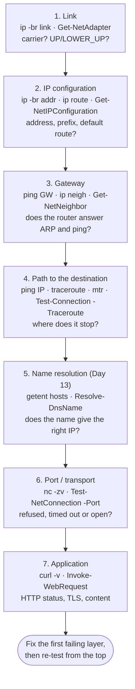
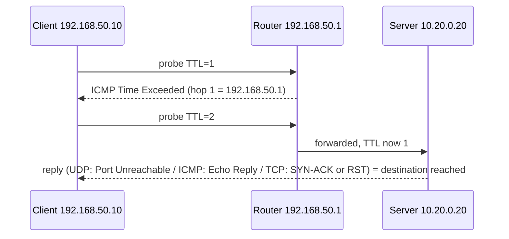

# Day 12: Connectivity Troubleshooting

!!! info "Lesson overview"
    | | |
    |---|---|
    | **Module** | 3 — Networking & Troubleshooting |
    | **Difficulty** | :material-signal-cellular-2: Intermediate |
    | **Estimated time** | 3–4 hours (75 min reading, 90 min demonstrations, 60–90 min lab and quiz) |
    | **Platforms** | Ubuntu 24.04 LTS (iputils 20240117, traceroute 2.1.5, mtr 0.95, OpenBSD netcat, curl 8.5) · Windows 11 (Windows PowerShell 5.1 and PowerShell 7.4+) |
    | **Lab** | [Lab 12: Can't Reach the Server](../../labs/lab-12.md) |

## Learning Objectives

By the end of this lesson you will be able to:

1. Apply a **layered troubleshooting method** — link, IP configuration, gateway, path, name resolution, port, application — and explain why skipping layers wastes time.
2. Use `ping` and `Test-Connection` correctly: count, interval, timeout and deadline, packet size, TTL, Don't Fragment, source address; read RTT, loss, jitter (`mdev`) and TTL; and use **exit codes** in scripts.
3. Interpret the ICMP messages you will meet: *Echo Reply*, *Destination Host/Net Unreachable* (and **who** sent them), *Time to live exceeded*, *Frag needed and DF set*, and silence.
4. Trace a path with `traceroute`, `tracepath`, `mtr`, `tracert`, `pathping`, `Test-Connection -Traceroute` and `Test-NetConnection -TraceRoute`; explain how TTL-based tracing works and why `* * *` and loss on an **intermediate** hop are often harmless.
5. Find a **path MTU** problem with `ping -M do -s`, `tracepath` and `Test-Connection -MtuSize`.
6. Test a **TCP port** with `nc -zv`, `curl -v`, `Test-NetConnection -Port` and `Test-Connection -TcpPort`, and tell the difference between **connection refused**, **timed out** and **network unreachable**.
7. Recognise the classic root causes: no default route, wrong gateway, router not forwarding, missing **return route**, firewall dropping ICMP or TCP, service not listening, MTU black hole and packet loss.

## Prerequisites

- [Day 11: IP Configuration](day-11.md): you can read addresses, prefixes, routes and the neighbour cache, and you know `ip route get` / `Find-NetRoute`.
- An Ubuntu 24.04 VM or WSL2 with `sudo`. Install the tools used today (they are small and read-only):

    ```bash
    sudo apt update && sudo apt install -y iputils-ping iputils-tracepath traceroute mtr-tiny netcat-openbsd curl
    ```

- A Windows 11 machine with Windows PowerShell 5.1; PowerShell 7.4+ recommended so you can compare the two `Test-Connection` versions.
- Read [Lab Environment & Safety](../../getting-started/lab-environment.md). Today's commands send packets to other systems. Test only **your own** hosts, your lab network, your default gateway, public services you are a normal client of (a DNS resolver, a website you browse) and `scanme.nmap.org`. Repeated or flood pings at other people's systems are abuse.

## Introduction and Concepts

### Troubleshoot in layers, bottom up

"The server is down" is a symptom, not a diagnosis. Professionals work up the stack and stop at the **first** layer that fails, because nothing above a broken layer can work:



Two rules make the method fast:

1. **Test by IP before by name.** If `ping 10.20.0.20` works and `ping app.lab.internal` does not, the problem is DNS (Day 13), not the network.
2. **Change one thing at a time** and re-test. Write down each result; your notes become the ticket update and the post-incident timeline.

You can also work **top-down** when the application layer gives a precise error (`curl: (7) Failed to connect ... Connection refused` already tells you the network path works and nothing is listening). The aim is the same: find the first layer that fails.

### ICMP: the network's error-reporting protocol

`ping` and most path tools use **ICMP** (Internet Control Message Protocol). ICMP is not TCP or UDP; it has *types* instead of ports.

| ICMP message (IPv4 type/code) | Sent by | What it means for you |
|---|---|---|
| Echo Request (8) / Echo Reply (0) | Source / destination | `ping` worked: the destination is alive **and** the return path works |
| Destination Unreachable — Net (3/0) | A router with no route | *"Destination Net Unreachable"* from that router: routing problem there |
| Destination Unreachable — Host (3/1) | The last router (ARP failed) or your own host | *"Destination Host Unreachable"*: the final hop could not reach the host on its link |
| Destination Unreachable — Port (3/3) | The destination host | UDP port closed (traceroute uses this to detect the end) |
| Destination Unreachable — Fragmentation needed (3/4) | A router whose next link has a smaller MTU | *"Frag needed and DF set (mtu = 1400)"*: path MTU discovery |
| Destination Unreachable — Administratively prohibited (3/13) | A firewall that rejects | Policy blocks you (`!X` in traceroute) |
| Time Exceeded (11/0) | A router that decremented TTL to 0 | Basis of traceroute; a loop if you see it repeatedly |

IPv6 uses ICMPv6 with similar messages, plus Neighbour Discovery. **Never block all ICMP**: blocking "Fragmentation needed" (or ICMPv6 *Packet Too Big*) breaks path MTU discovery and produces hanging connections.

### What a successful ping proves — and what it does not

A reply proves that the destination's IP stack is up, that routing works **in both directions**, and that ICMP echo is allowed. It does **not** prove that a TCP port is open, that the service is healthy, or that DNS works. Conversely, **no reply does not prove the host is down**: Windows Defender Firewall blocks inbound echo requests by default on many profiles, and many cloud security groups and corporate firewalls drop ICMP. Always follow a failed ping with a **port test** to a port the service should be listening on.

### TTL, hops and RTT

Each IP packet carries a **TTL** (time to live, IPv6: hop limit). Every router decrements it by one; at zero the router drops the packet and sends *Time Exceeded*. Operating systems start from typical values: **64** (Linux, macOS), **128** (Windows), **255** (many network devices). So a reply with `ttl=63` from a Linux server was one router away; `TTL=118` from a Windows host about ten. TTL is also a cheap OS fingerprint during investigations.

**RTT** (round-trip time) is the time from request to reply. `ping` summarises it as `min/avg/max/mdev`; `mdev` (mean deviation) is a simple **jitter** measure. Rough expectations: under 1 ms on the same LAN, 1–10 ms across a campus or city, 20–80 ms within a continent, 120–300 ms intercontinental or over satellite.

### How traceroute works



The tool sends probes with TTL 1, 2, 3 ... (three probes per hop by default) and lists who sent each *Time Exceeded*. Probe types differ between tools:

| Tool | Default probe | Needs root? | Notes |
|---|---|---|---|
| `traceroute` (Linux) | **UDP** to high ports (33434+) | No | `-I` ICMP echo and `-T` TCP SYN usually need `sudo` (raw sockets) |
| `tracepath` (Linux) | UDP | No | Also reports **path MTU** (`pmtu`) |
| `mtr` (Linux) | ICMP | No (setuid/capability helper `mtr-packet`) | Continuous traceroute + ping per hop; `-T` TCP, `-u` UDP |
| `tracert` (Windows) | **ICMP** echo | No | `-d` no DNS, `-h` max hops, `-w` timeout ms |
| `pathping` (Windows) | ICMP | No | Traceroute, then ~25 s of loss statistics per hop |
| `Test-Connection -Traceroute` (PowerShell 7) | ICMP | No | Objects per probe; PowerShell 7 only |
| `Test-NetConnection -TraceRoute` (Windows) | ICMP | No | List of hop addresses in `TraceRoute` |

Because firewalls treat UDP, ICMP and TCP differently, a path that "stops" with one probe type may complete with another. A **TCP trace to the service's own port** (`sudo traceroute -T -p 443 HOST`, `mtr -T -P 443 HOST`) follows the same rules as the real traffic.

### Reading `* * *` and per-hop loss correctly

- `*` means **no answer within the timeout** for that probe. Many routers do not send *Time Exceeded* at all, or rate-limit it, or send it from an address that is filtered.
- If an **intermediate** hop shows `*` or 40 % loss but **later hops and the destination show 0 %**, nothing is lost: that router simply deprioritises replies to probes addressed to itself (control-plane rate limiting). This is the single most common misreading of mtr reports.
- Real loss **starts at a hop and continues on every hop after it**, including the destination.
- `* * *` on every hop from some point onward means probes or replies are being dropped from there: a firewall, a missing route on the way back, or the destination ignoring that probe type.

### Path MTU and the black hole

When a packet larger than the next link's MTU has the **Don't Fragment** (DF) bit set — TCP sets it on almost every modern OS — the router drops it and returns *Fragmentation needed* with the smaller MTU. The sender lowers its packet size (**path MTU discovery**). If a firewall drops that ICMP message, the sender never learns, and large packets disappear: the **PMTU black hole**. Symptoms: the TCP handshake and small requests work; large downloads, TLS handshakes with big certificates, or SMB file copies hang.

Test it with full-size, unfragmentable pings: payload size = MTU − 28 (20-byte IPv4 header + 8-byte ICMP header), so **1472** for a 1500-byte MTU.

### Refused, timed out, unreachable

For TCP the client's error tells you a lot about **where** the problem is:

| Result | What happened on the wire | Usual cause |
|---|---|---|
| **Connected / succeeded** | SYN → SYN-ACK → ACK | Port open; the problem (if any) is in the application |
| **Connection refused** | SYN → **RST** (or ICMP port unreachable from a REJECT rule) | Host reachable, **nothing listening** on that port, or a firewall that rejects |
| **Timed out** | SYN → (silence) | A firewall **drops** the packets, the host is down, or the reply has no route back |
| **No route to host** | ICMP host unreachable / local ARP failure | Host down or not on the expected link; some firewalls send this on REJECT |
| **Network is unreachable** | Not sent at all | Your own host has no route (Day 11) |

"Refused" is good news for the network team: the path works and the host answered. "Timed out" means you need to find the device that silently drops.

### The return path

Communication needs a route **there and back**. A server with no default route (or a wrong one) receives your packets but cannot answer; from the client it looks exactly like a firewall drop. Asymmetric routing — replies leaving through a different firewall from the one requests came through — produces the same symptom because stateful firewalls drop replies for connections they never saw. When "the router can ping the server but the client cannot", check the server's routing table.

## Linux Command Reference

| Command | Purpose | Package / availability | Needs root? |
|---|---|---|---|
| `ping` | ICMP echo test: reachability, RTT, loss, TTL, MTU (`-M do`) | iputils-ping (installed by default) | No |
| `traceroute` | Hop-by-hop path (UDP default; `-I` ICMP, `-T` TCP) | traceroute (`sudo apt install traceroute`) | Only for `-I`/`-T` on most systems |
| `tracepath` | Path and **path MTU** without root | iputils-tracepath | No |
| `mtr` | Continuous traceroute with per-hop loss and latency; `--report` for tickets | mtr-tiny (servers) / mtr (desktop) | No |
| `nc -zv HOST PORT` | TCP port test (connect only) | netcat-openbsd (installed by default on Ubuntu) | No |
| `curl -v` / `curl -w` | Application test with connection details and timings | curl | No |
| `ip route get` / `ip neigh` | Route decision and gateway ARP state (Day 11) | iproute2 | No |
| `ss -tan` | Local TCP connection states (preview of Day 14) | iproute2 | No |
| `getent hosts NAME` | Resolve a name the way applications do (preview of Day 13) | libc | No |
| `arping -I IFACE ADDR` | ARP-level reachability and duplicate detection | iputils-arping | Yes |
| `sysctl net.ipv4.ip_forward` | Is this Linux box routing? | procps | Only to change |

## PowerShell Command Reference

| Cmdlet / command | Alias | Purpose | 5.1 | 7.x | Admin? |
|---|---|---|---|---|---|
| `Test-Connection` (5.1) | — | ICMP echo via WMI `Win32_PingStatus`; `-ComputerName`, `-Count`, `-Quiet` | Yes (Windows) | Replaced by the 7.x version | No |
| `Test-Connection` (7.x) | — | ICMP echo with `-TargetName`, `-Count`, `-Quiet`, `-Repeat`, `-TimeoutSeconds`, `-BufferSize`, `-DontFragment`; plus **`-Traceroute`**, **`-MtuSize`**, **`-TcpPort`** | No | **Yes, all OS** | No |
| `Test-NetConnection` | `tnc` | Ping + **TCP port** + route info; `-Port`, `-CommonTCPPort`, `-TraceRoute`, `-InformationLevel Detailed` | Yes | **Windows only** (NetTCPIP) | No |
| `ping.exe` | — | Classic ping: `-n` count, `-t` continuous, `-l` size, `-f` DF, `-i` TTL, `-w` timeout ms | Yes | Yes (Windows) | No |
| `tracert.exe` | — | ICMP traceroute: `-d`, `-h`, `-w` | Yes | Yes (Windows) | No |
| `pathping.exe` | — | Trace + per-hop loss statistics | Yes | Yes (Windows) | No |
| `Invoke-WebRequest` | `iwr` (`curl`/`wget` aliases in 5.1 only) | HTTP(S) application test | Yes | Yes | No |
| `[System.Net.Sockets.TcpClient]` | — | Cross-platform TCP connect with your own timeout | Yes | Yes | No |
| `Get-NetTCPConnection` | — | Local TCP states (Day 14) | Yes | Windows only | No |
| `Resolve-DnsName` | — | DNS lookup (Day 13) | Yes | Windows only | No |

!!! warning "Two different `Test-Connection` cmdlets"
    Windows PowerShell 5.1's `Test-Connection` returns `Win32_PingStatus` objects, takes `-ComputerName` and has no `-Traceroute`, `-MtuSize` or `-TcpPort`. PowerShell 7 rewrote it on .NET: the main parameter is `-TargetName` (`-ComputerName` still works as an alias), output objects have `Ping`, `Address`, `Latency`, `Status`, and it runs on Linux and macOS too. Scripts that must run on both use only `-Count` and `-Quiet`, or use `ping`/`Test-NetConnection`.

## Detailed Command Explanations

### `ping` — is the IP layer working end to end?

Linux `ping` runs until you press ++ctrl+c++ unless you give a count. Read the output line by line:

```text
64 bytes from 10.20.0.20: icmp_seq=1 ttl=63 time=0.045 ms
```

`64 bytes` = 56 bytes of payload + 8-byte ICMP header; `icmp_seq` numbers each request (gaps = lost packets); `ttl=63` = 64 − 1 router; `time` = RTT. The summary gives transmitted, received, `+N errors` (ICMP error replies), loss and `rtt min/avg/max/mdev`.

Options you will use every week:

| Option | Meaning |
|---|---|
| `-c N` | Send *N* requests and stop. Always use it in scripts and tickets. |
| `-i SEC` | Interval between requests (default 1 s). Values below 0.2 s may need privileges, depending on the system. |
| `-W SEC` | Time to wait for each reply |
| `-w SEC` | **Deadline**: stop after *SEC* seconds whatever happens |
| `-q` | Quiet: only the summary |
| `-s BYTES` | Payload size (default 56) |
| `-M do` | Set Don't Fragment and forbid local fragmentation (path MTU tests). `want` / `dont` / `probe` are the other modes. |
| `-t TTL` | Set the TTL (with `1` you see the first router's *Time to live exceeded*) |
| `-I IFACE` / `-I ADDR` | Send from a specific interface or source address |
| `-4` / `-6` | Force IPv4 or IPv6 |
| `-n` | Numeric output, no reverse DNS |
| `-D` / `-O` | Print timestamps / report replies that are still outstanding — useful for long-running monitoring |

**Exit status** (from the iputils manual, verified on the capture host): `0` at least one reply received, `1` no reply (with `-c` or `-w`), `2` other errors such as an unresolvable name. That makes `ping -c1 -W1 HOST >/dev/null && echo up` a valid check.

Ubuntu's `ping` is not setuid root; it uses the `cap_net_raw` file capability or unprivileged ICMP sockets, so normal users can run it.

### `traceroute` — which hops does the path cross?

`traceroute HOST` prints one line per hop with three RTTs. Useful options: `-n` (no DNS: much faster and avoids misleading names), `-q N` probes per hop, `-w SEC` wait time, `-m N` maximum hops (default 30), `-f N` first TTL, `-p PORT` destination port, `-I` ICMP, `-T` TCP SYN (default port 80; set it with `-p`), `-U` UDP to a fixed port. Annotations after RTTs: `!H` host unreachable, `!N` network unreachable, `!X` administratively prohibited, `!F` fragmentation needed.

### `tracepath` — path plus path MTU, no root

`tracepath -n HOST` sends UDP probes like traceroute and also discovers the **path MTU**. The final `Resume: pmtu 1400 hops 2 back 2` line says the largest packet that fits end to end is 1400 bytes, the destination is 2 hops away, and replies came back over 2 hops. A `pmtu` line appearing at a hop shows where the MTU drops.

### `mtr` — the best report for a ticket

`mtr` combines traceroute and ping, sending probes to every hop continuously. For tickets and escalation to an ISP, use report mode so the output is static text:

```bash
mtr --report --report-cycles 100 -n HOST     # short: mtr -rn -c 100 HOST
mtr -rwn -c 100 -T -P 443 HOST               # TCP to the service port, wide output
```

Columns: `Loss%`, `Snt` (sent), `Last`, `Avg`, `Best`, `Wrst` (worst) and `StDev` in milliseconds. Apply the rule from the concepts section: loss that does not continue to the final hop is not real loss.

### `nc -zv` and `curl` — test the port and the application

OpenBSD netcat (`nc`, the default on Ubuntu) connects and reports: `-z` scan only (no data), `-v` verbose, `-w SEC` timeout, `-u` UDP (UDP "success" is unreliable because there is no handshake). It distinguishes *succeeded*, *Connection refused* and *timed out* exactly as in the concepts table.

`curl` tests the whole application: `-v` shows DNS, connect, TLS and HTTP headers; `-I` fetches headers only; `--connect-timeout SEC` and `-m SEC` limit waiting; `-w` prints timings so you can see **which phase** is slow:

```bash
curl -sS -o /dev/null -w 'dns=%{time_namelookup} connect=%{time_connect} tls=%{time_appconnect} ttfb=%{time_starttransfer} total=%{time_total} code=%{http_code}\n' https://example.org/
```

A large `connect` time points at the network path; a large gap between `connect`/`tls` and `ttfb` (time to first byte) points at the server application.

### `Test-Connection` — PowerShell's ping

**Windows PowerShell 5.1** (Windows only):

```powershell
Test-Connection -ComputerName 10.20.0.20 -Count 2
Test-Connection -ComputerName 10.20.0.20 -Count 1 -Quiet      # $true / $false
Test-Connection -ComputerName srv1, srv2, srv3 -Count 1 -AsJob # parallel, returns a job
```

It returns `Win32_PingStatus` objects; properties include `Address`, `IPV4Address`, `ResponseTime` and `StatusCode` (0 = success). A failed ping throws a **non-terminating error** ("Testing connection to computer '...' failed: Error due to lack of resources" or "...: Request timed out"), so use `-Quiet` or `-ErrorAction SilentlyContinue` in scripts.

**PowerShell 7** (Windows, Linux, macOS):

| Parameter | Meaning |
|---|---|
| `-TargetName` (alias `-ComputerName`) | Host(s) to test |
| `-Count N` (default 4) / `-Repeat` | Number of pings / until ++ctrl+c++ |
| `-Delay SEC` / `-TimeoutSeconds SEC` | Interval / per-reply timeout (default 5) |
| `-BufferSize BYTES` / `-DontFragment` | Payload size (default 32) / set DF |
| `-IPv4` / `-IPv6` / `-ResolveDestination` | Address family / reverse-resolve names |
| `-Quiet` | Return only `$true` / `$false` |
| `-Traceroute` [`-MaxHops N`] | Trace the path (one object per probe) |
| `-MtuSize` | Discover the largest unfragmented payload |
| `-TcpPort N` | TCP connect test; returns `True` / `False` |

The output object (`Microsoft.PowerShell.Commands.TestConnectionCommand+PingStatus`) has `Ping`, `Source`, `Destination`, `Address`, `Latency`, `BufferSize`, `Status` (an `IPStatus` such as `Success`, `TimedOut`, `PacketTooBig`) and the raw `Reply`.

### `Test-NetConnection` — ping, port and route in one (Windows)

`Test-NetConnection` (alias `tnc`, NetTCPIP module, Windows only) combines the checks a help-desk engineer needs:

```powershell
Test-NetConnection -ComputerName 10.20.0.20                       # ping + basic info
Test-NetConnection -ComputerName 10.20.0.20 -Port 8080            # TCP port
Test-NetConnection -ComputerName fileserver -CommonTCPPort SMB    # HTTP, RDP, SMB or WINRM
Test-NetConnection -ComputerName 10.20.0.20 -TraceRoute -Hops 15
Test-NetConnection -ComputerName 10.20.0.20 -Port 8080 -InformationLevel Detailed
Test-NetConnection -ComputerName 10.20.0.20 -Port 8080 -InformationLevel Quiet   # $true/$false
```

Output properties: `ComputerName`, `RemoteAddress`, `RemotePort`, `InterfaceAlias`, `SourceAddress`, `PingSucceeded`, `PingReplyDetails` (RTT), `TcpTestSucceeded`, `TraceRoute` and, with `-InformationLevel Detailed`, `NameResolutionResults` and `NetRoute (NextHop)`. With **no** target it tests an internet beacon host operated by Microsoft — do not rely on that in restricted networks. A port test still pings first; when ICMP is blocked you see a ping warning even though `TcpTestSucceeded` is `True`. The port test waits for the TCP connect to fail, which can take about 20 seconds against a dropping firewall.

### `ping.exe`, `tracert` and `pathping`

Windows' native tools work in every shell and remote session:

| Command | Meaning |
|---|---|
| `ping -n 4 HOST` | Count (Windows default is 4; `-t` = until ++ctrl+c++) |
| `ping -l 1472 -f HOST` | 1472-byte payload with Don't Fragment: path MTU test |
| `ping -i 1 HOST` | TTL 1 → *TTL expired in transit* from the first router |
| `ping -w 1000 HOST` | Timeout per reply in **milliseconds** (Linux `-W` is seconds) |
| `ping -S SRCADDR HOST` | Source address |
| `tracert -d -h 20 -w 1000 HOST` | Trace without DNS, max 20 hops, 1 s timeout |
| `pathping -n -q 50 HOST` | Trace, then 50 probes per hop with loss per hop and per link |

Typical `ping.exe` results: `Reply from ...: bytes=32 time=3ms TTL=63`, `Request timed out.`, `Destination host unreachable.` (shown as *Reply from your-own-IP*: local ARP failure), `TTL expired in transit.`, `Packet needs to be fragmented but DF set.`, `General failure.` (local stack/adapter problem, or a VPN/firewall driver blocking).

### Cross-platform TCP test in PowerShell

When `Test-NetConnection` is unavailable (Linux, old servers) and you need a short timeout:

```powershell
$client = [System.Net.Sockets.TcpClient]::new()
try {
    $ok = $client.ConnectAsync('10.20.0.20', 8080).Wait(2000)   # 2 s timeout
    "Port 8080 open: $ok"
} catch { "Port 8080: $($_.Exception.GetBaseException().Message)" }
finally { $client.Dispose() }
```

`Wait(2000)` returns `$false` on timeout; a refused connection throws. The useful error is wrapped twice (method-call exception → `AggregateException` → `SocketException`), so `GetBaseException()` returns the socket error itself: its `Message` is *Connection refused* and its `SocketErrorCode` is `ConnectionRefused`.

## Syntax and Parameters

### Linux

```text
ping [-c count] [-i interval] [-W timeout] [-w deadline] [-s size] [-M do|want|dont|probe]
     [-t ttl] [-I iface|addr] [-4|-6] [-q] [-n] [-D] [-O] destination
traceroute [-n] [-I | -T | -U] [-p port] [-q nqueries] [-w wait] [-m max_ttl] [-f first_ttl] host
tracepath [-n] [-b] [-l pktlen] [-m max_hops] [-p port] destination
mtr [-r|--report] [-w|--report-wide] [-c|--report-cycles N] [-n] [-b] [-T|-u] [-P port] [-4|-6] host
nc -zv [-w timeout] [-u] host port[-port]
curl [-v] [-I] [-sS] [-o file] [--connect-timeout sec] [-m sec] [-w format] URL
```

| Option | Tool | Meaning |
|---|---|---|
| `-c` / `-w` / `-W` | ping | Count / overall deadline / per-reply timeout (seconds) |
| `-M do -s 1472` | ping | Unfragmentable full-size packet for a 1500-byte MTU |
| `-t 1` | ping | Expire at the first router |
| `-n` | traceroute, tracepath, mtr | No reverse DNS |
| `-I` / `-T` / `-U` | traceroute | ICMP echo / TCP SYN / UDP fixed port probes |
| `-r -c N` | mtr | Report mode with *N* cycles |
| `-T -P PORT` | mtr | TCP probes to *PORT* |
| `-z` / `-v` / `-w` | nc | Connect only / verbose / timeout |
| `-w '%{time_connect}'` | curl | Print timing variables |

### PowerShell

```text
# Windows PowerShell 5.1
Test-Connection [-ComputerName] <String[]> [-Count <Int32>] [-Delay <Int32>] [-BufferSize <Int32>]
                [-TimeToLive <Int32>] [-Source <String[]>] [-Quiet] [-AsJob]
# PowerShell 7.x
Test-Connection [-TargetName] <String[]> [-Ping] [-Count <Int32>] [-Delay <Int32>] [-BufferSize <Int32>]
                [-MaxHops <Int32>] [-TimeoutSeconds <Int32>] [-IPv4|-IPv6] [-ResolveDestination]
                [-DontFragment] [-Repeat] [-Quiet]
Test-Connection [-TargetName] <String[]> -Traceroute [-MaxHops <Int32>] [-TimeoutSeconds <Int32>]
Test-Connection [-TargetName] <String[]> -MtuSize [-TimeoutSeconds <Int32>]
Test-Connection [-TargetName] <String[]> -TcpPort <Int32> [-TimeoutSeconds <Int32>] [-Quiet]
# Windows only (NetTCPIP)
Test-NetConnection [[-ComputerName] <String>] [-Port <Int32> | -CommonTCPPort <HTTP|RDP|SMB|WINRM>]
                   [-TraceRoute [-Hops <Int32>]] [-InformationLevel <Quiet|Detailed>]
ping [-n count | -t] [-l size] [-f] [-i TTL] [-w timeout_ms] [-S srcaddr] [-4|-6] target
tracert [-d] [-h maximum_hops] [-w timeout_ms] target
pathping [-n] [-h maximum_hops] [-q num_queries] [-p period_ms] target
```

| Parameter | Cmdlet | Meaning |
|---|---|---|
| `-Quiet` | Test-Connection | `$true` if any reply (5.1 and 7); for `-TcpPort`, whether the connect succeeded |
| `-TcpPort` | Test-Connection (7 only) | TCP connect test |
| `-Traceroute` / `-MtuSize` | Test-Connection (7 only) | Path / largest unfragmented payload |
| `-DontFragment` | Test-Connection (7 only) | Set the DF bit with `-BufferSize` |
| `-Port` / `-CommonTCPPort` | Test-NetConnection | TCP port by number / by service name |
| `-InformationLevel Detailed` | Test-NetConnection | Adds name resolution and next hop |
| `-InformationLevel Quiet` | Test-NetConnection | Returns only a Boolean |
| `-TraceRoute -Hops` | Test-NetConnection | ICMP path with a hop limit |

## Practical Demonstrations

The Linux outputs were **captured** on Ubuntu 24.04.5 inside network namespaces modelling a client (`192.168.50.10/24`), a router (`192.168.50.1` / `10.20.0.1`) and a server (`10.20.0.20/24`) running a test web server on port 8080 — the same topology as [Lab 12](../../labs/lab-12.md). Latency is tiny because everything runs on one machine, and the `HOST: vm` label in mtr is the capture host's name. The `Test-Connection` outputs labelled *captured (PowerShell 7.4.6 on Linux)* ran from the same client namespace. `Test-NetConnection`, `ping.exe`, `tracert`, `pathping` and Windows PowerShell 5.1 outputs are **examples** in the documented format; no Windows host was available for this release.

### Demo 1 — A healthy ping and what each field means

=== "Bash"

    ```bash
    ping -c 4 10.20.0.20
    ping -c 3 -i 0.2 -q 10.20.0.20
    ping -c 2 -I 192.168.50.10 10.20.0.20 ; echo "exit=$?"
    ```

    **Expected output (captured):**

    ```text
    PING 10.20.0.20 (10.20.0.20) 56(84) bytes of data.
    64 bytes from 10.20.0.20: icmp_seq=1 ttl=63 time=0.045 ms
    64 bytes from 10.20.0.20: icmp_seq=2 ttl=63 time=0.047 ms
    64 bytes from 10.20.0.20: icmp_seq=3 ttl=63 time=0.052 ms
    64 bytes from 10.20.0.20: icmp_seq=4 ttl=63 time=0.045 ms

    --- 10.20.0.20 ping statistics ---
    4 packets transmitted, 4 received, 0% packet loss, time 3064ms
    rtt min/avg/max/mdev = 0.045/0.047/0.052/0.003 ms
    PING 10.20.0.20 (10.20.0.20) 56(84) bytes of data.

    --- 10.20.0.20 ping statistics ---
    3 packets transmitted, 3 received, 0% packet loss, time 405ms
    rtt min/avg/max/mdev = 0.017/0.040/0.053/0.016 ms
    PING 10.20.0.20 (10.20.0.20) from 192.168.50.10 : 56(84) bytes of data.
    64 bytes from 10.20.0.20: icmp_seq=1 ttl=63 time=0.027 ms
    64 bytes from 10.20.0.20: icmp_seq=2 ttl=63 time=0.066 ms

    --- 10.20.0.20 ping statistics ---
    2 packets transmitted, 2 received, 0% packet loss, time 1003ms
    rtt min/avg/max/mdev = 0.027/0.046/0.066/0.019 ms
    exit=0
    ```

    `56(84)` = 56 bytes of payload, 84 bytes including the IP and ICMP headers. `ttl=63` tells you one router is in the path.

=== "PowerShell"

    ```powershell
    # PowerShell 7 (any OS)
    Test-Connection -TargetName 10.20.0.20 -Count 2
    Test-Connection -TargetName 10.20.0.20 -Count 1 -Quiet
    Test-Connection -TargetName 10.20.0.20 -Count 1 | Get-Member -MemberType Property
    ```

    **Expected output (captured, PowerShell 7.4.6 on Linux):**

    ```text
       Destination: 10.20.0.20

    Ping Source           Address                   Latency BufferSize Status
                                                       (ms)        (B)
    ---- ------           -------                   ------- ---------- ------
       1 vm               10.20.0.20                      0         32 Success
       2 vm               10.20.0.20                      0         32 Success

    True

    Name           Definition
    ----           ----------
    Address        ipaddress Address {get;}
    BufferSize     int BufferSize {get;}
    Destination    string Destination {get;}
    DisplayAddress string DisplayAddress {get;}
    Latency        long Latency {get;}
    Ping           uint Ping {get;}
    Reply          System.Net.NetworkInformation.PingReply Reply {get;}
    Source         string Source {get;}
    Status         System.Net.NetworkInformation.IPStatus Status {get;}
    ```

    The same test in **Windows PowerShell 5.1** and with `ping.exe` (example):

    ```powershell
    Test-Connection -ComputerName 10.20.0.20 -Count 2
    ping -n 2 10.20.0.20
    ```

    ```text
    Source        Destination     IPV4Address      IPV6Address                              Bytes    Time(ms)
    ------        -----------     -----------      -----------                              -----    --------
    WIN11-LAB     10.20.0.20      10.20.0.20                                                32       1
    WIN11-LAB     10.20.0.20      10.20.0.20                                                32       1

    Pinging 10.20.0.20 with 32 bytes of data:
    Reply from 10.20.0.20: bytes=32 time=1ms TTL=63
    Reply from 10.20.0.20: bytes=32 time<1ms TTL=63

    Ping statistics for 10.20.0.20:
        Packets: Sent = 2, Received = 2, Lost = 0 (0% loss),
    Approximate round trip times in milli-seconds:
        Minimum = 0ms, Maximum = 1ms, Average = 0ms
    ```

### Demo 2 — Who is complaining? Reading ICMP errors

=== "Bash"

    ```bash
    ping -c2 192.168.50.99        # local subnet, nobody there
    ping -c2 10.20.0.99           # remote subnet, nobody there
    ping -c1 -W1 172.16.1.1       # no route on the router
    ping -c1 -t 1 10.20.0.20      # TTL expires at the first router
    ping -c1 -W1 bad.invalid ; echo "exit=$?"
    ```

    **Expected output (captured):**

    ```text
    PING 192.168.50.99 (192.168.50.99) 56(84) bytes of data.
    From 192.168.50.10 icmp_seq=1 Destination Host Unreachable
    From 192.168.50.10 icmp_seq=2 Destination Host Unreachable

    --- 192.168.50.99 ping statistics ---
    2 packets transmitted, 0 received, +2 errors, 100% packet loss, time 1018ms
    pipe 2
    PING 10.20.0.99 (10.20.0.99) 56(84) bytes of data.
    From 192.168.50.1 icmp_seq=1 Destination Host Unreachable
    From 192.168.50.1 icmp_seq=2 Destination Host Unreachable

    --- 10.20.0.99 ping statistics ---
    2 packets transmitted, 0 received, +2 errors, 100% packet loss, time 1018ms
    pipe 2
    PING 172.16.1.1 (172.16.1.1) 56(84) bytes of data.
    From 192.168.50.1 icmp_seq=1 Destination Net Unreachable

    --- 172.16.1.1 ping statistics ---
    1 packets transmitted, 0 received, +1 errors, 100% packet loss, time 0ms

    PING 10.20.0.20 (10.20.0.20) 56(84) bytes of data.
    From 192.168.50.1 icmp_seq=1 Time to live exceeded

    --- 10.20.0.20 ping statistics ---
    1 packets transmitted, 0 received, +1 errors, 100% packet loss, time 0ms

    ping: bad.invalid: Temporary failure in name resolution
    exit=2
    ```

    Read the **From** address: `192.168.50.10` (yourself) = local ARP failure; `192.168.50.1` (the router) = the router could not deliver (host) or had no route (net). The name failure is DNS, not connectivity, and gives exit code 2.

=== "PowerShell"

    ```powershell
    Test-Connection -TargetName 192.168.50.99 -Count 1
    Test-Connection -TargetName 192.168.50.99 -Count 1 -Quiet
    try { Test-Connection -TargetName bad.invalid -Count 1 -ErrorAction Stop } catch { $_.Exception.Message }
    ```

    **Expected output (captured, PowerShell 7.4.6 on Linux):**

    ```text
       Destination: 192.168.50.99

    Ping Source           Address                   Latency BufferSize Status
                                                       (ms)        (B)
    ---- ------           -------                   ------- ---------- ------
       1 vm               *                               *          * TimedOut

    False
    Testing connection to computer 'bad.invalid' failed: Cannot resolve the target name.
    ```

    PowerShell 7 reports only `TimedOut` here; it does not show **who** sent an ICMP error. For that detail use `ping.exe` on Windows (example):

    ```text
    Pinging 10.20.0.99 with 32 bytes of data:
    Reply from 192.168.56.1: Destination host unreachable.
    Reply from 192.168.56.1: Destination host unreachable.
    ```

    Note that `ping.exe` prints *Reply from* even for errors, and counts them as *Received* in its statistics — check the text, not just the loss percentage.

### Demo 3 — Tracing the path

=== "Bash"

    ```bash
    traceroute 10.20.0.20
    sudo traceroute -n -I 10.20.0.20
    sudo traceroute -n -T -p 8080 10.20.0.20
    tracepath -n 10.20.0.20
    traceroute -n -q1 -w1 -m3 172.16.1.1
    ```

    **Expected output (captured):**

    ```text
    traceroute to 10.20.0.20 (10.20.0.20), 30 hops max, 60 byte packets
     1  192.168.50.1 (192.168.50.1)  0.023 ms  0.002 ms  0.003 ms
     2  10.20.0.20 (10.20.0.20)  0.010 ms  0.004 ms  0.002 ms
    traceroute to 10.20.0.20 (10.20.0.20), 30 hops max, 60 byte packets
     1  192.168.50.1  0.033 ms  0.002 ms *
     2  10.20.0.20  0.008 ms  0.001 ms  0.002 ms
    traceroute to 10.20.0.20 (10.20.0.20), 30 hops max, 60 byte packets
     1  * * *
     2  10.20.0.20  0.096 ms  0.099 ms  0.103 ms
     1?: [LOCALHOST]                      pmtu 1500
     1:  192.168.50.1                                          0.055ms
     2:  10.20.0.20                                            0.010ms reached
         Resume: pmtu 1500 hops 2 back 2
    traceroute to 172.16.1.1 (172.16.1.1), 3 hops max, 60 byte packets
     1  192.168.50.1  0.045 ms !N
    ```

    The `*` in the ICMP trace and the `* * *` at hop 1 of the TCP trace are the router **rate-limiting** its *Time Exceeded* messages (Linux limits ICMP errors by default), not a fault: the destination answers every probe. `!N` = the router reported *network unreachable*.

=== "PowerShell"

    ```powershell
    Test-Connection -TargetName 10.20.0.20 -Traceroute       # PowerShell 7
    ```

    **Expected output (captured, PowerShell 7.4.6 on Linux):**

    ```text
       Target: 10.20.0.20

    Hop Hostname                  Ping Latency Status           Source       TargetAddress
                                          (ms)
    --- --------                  ---- ------- ------           ------       -------------
      1 0.0.0.0                      1       * TimedOut         vm           10.20.0.20
      1 0.0.0.0                      2       * TimedOut         vm           10.20.0.20
      1 0.0.0.0                      3       * TimedOut         vm           10.20.0.20
      2 10.20.0.20                   1       0 Success          vm           10.20.0.20
      2 10.20.0.20                   2       0 Success          vm           10.20.0.20
      2 10.20.0.20                   3       0 Success          vm           10.20.0.20
    ```

    Hop 1 timing out while hop 2 succeeds is the same "intermediate hop does not answer" pattern. On Windows (examples):

    ```powershell
    tracert -d 10.20.0.20
    Test-NetConnection -ComputerName 10.20.0.20 -TraceRoute | Select-Object -ExpandProperty TraceRoute
    ```

    ```text
    Tracing route to 10.20.0.20 over a maximum of 30 hops

      1    <1 ms    <1 ms    <1 ms  192.168.56.1
      2     1 ms    <1 ms    <1 ms  10.20.0.20

    Trace complete.
    192.168.56.1
    10.20.0.20
    ```

### Demo 4 — mtr: real loss versus rate limiting

=== "Bash"

    ```bash
    mtr --report --report-cycles 5 -n 10.20.0.20
    # Lab only: drop ~30% of forwarded packets to the server on the router, then measure
    sudo ip netns exec router iptables -A FORWARD -d 10.20.0.20 -m statistic --mode random --probability 0.3 -j DROP
    ping -c 20 -i 0.2 -q 10.20.0.20
    mtr --report --report-cycles 20 -n 10.20.0.20
    sudo ip netns exec router iptables -F FORWARD
    ```

    **Expected output (captured):**

    ```text
    Start: 2026-11-12T16:41:20+0000
    HOST: vm                          Loss%   Snt   Last   Avg  Best  Wrst StDev
      1.|-- 192.168.50.1              40.0%     5    0.1   0.1   0.1   0.1   0.0
      2.|-- 10.20.0.20                 0.0%     5    0.1   0.1   0.1   0.1   0.0
    PING 10.20.0.20 (10.20.0.20) 56(84) bytes of data.

    --- 10.20.0.20 ping statistics ---
    20 packets transmitted, 15 received, 25% packet loss, time 3879ms
    rtt min/avg/max/mdev = 0.046/0.065/0.136/0.020 ms
    Start: 2026-11-12T16:42:47+0000
    HOST: vm                          Loss%   Snt   Last   Avg  Best  Wrst StDev
      1.|-- 192.168.50.1               0.0%    20    0.1   0.1   0.1   0.1   0.1
      2.|-- 10.20.0.20                45.0%    20    0.1   0.1   0.1   0.6   0.2
    ```

    First report: 40 % "loss" at hop 1 but **0 %** at the destination → rate limiting, not a problem. Second report: loss appears at the **final** hop and the end-to-end ping confirms it → real loss between hop 1 and the server. With random loss, percentages vary between runs; use 100+ cycles for real tickets.

=== "PowerShell"

    ```powershell
    pathping -n -q 20 10.20.0.20
    ```

    **Expected output (example):**

    ```text
    Tracing route to 10.20.0.20 over a maximum of 30 hops

      0  192.168.56.30
      1  192.168.56.1
      2  10.20.0.20

    Computing statistics for 50 seconds...
                Source to Here   This Node/Link
    Hop  RTT    Lost/Sent = Pct  Lost/Sent = Pct  Address
      0                                           192.168.56.30
                                    0/  20 =  0%   |
      1    0ms     0/  20 =  0%     0/  20 =  0%  192.168.56.1
                                    6/  20 = 30%   |
      2    1ms     6/  20 = 30%     0/  20 =  0%  10.20.0.20

    Trace complete.
    ```

    `pathping` attributes the 30 % loss to the **link** between hop 1 and hop 2 (the `|` line), the same conclusion as mtr.

### Demo 5 — Path MTU

=== "Bash"

    ```bash
    # Lab only: lower the MTU on the router's server-side link to 1400
    sudo ip netns exec router ip link set dev eth1 mtu 1400
    ping -c2 -M do -s 1472 10.20.0.20     # 1472 + 28 = 1500
    ping -c1 -M do -s 1372 10.20.0.20     # 1372 + 28 = 1400
    tracepath -n 10.20.0.20
    ```

    **Expected output (captured):**

    ```text
    PING 10.20.0.20 (10.20.0.20) 1472(1500) bytes of data.
    From 192.168.50.1 icmp_seq=1 Frag needed and DF set (mtu = 1400)
    ping: local error: message too long, mtu=1400

    --- 10.20.0.20 ping statistics ---
    2 packets transmitted, 0 received, +2 errors, 100% packet loss, time 1022ms

    PING 10.20.0.20 (10.20.0.20) 1372(1400) bytes of data.
    1380 bytes from 10.20.0.20: icmp_seq=1 ttl=63 time=0.040 ms

    --- 10.20.0.20 ping statistics ---
    1 packets transmitted, 1 received, 0% packet loss, time 0ms
    rtt min/avg/max/mdev = 0.040/0.040/0.040/0.000 ms
     1?: [LOCALHOST]                      pmtu 1500
     1:  192.168.50.1                                          0.047ms
     1:  192.168.50.1                                          0.004ms
     2:  192.168.50.1                                          0.005ms pmtu 1400
     2:  10.20.0.20                                            0.010ms reached
         Resume: pmtu 1400 hops 2 back 2
    ```

    The first reply came from the router (*Frag needed*, MTU 1400); the second probe failed **locally** because the kernel had already cached the smaller path MTU. That is path MTU discovery working. If a firewall dropped the ICMP message, you would see only silence — the black hole. Restore with `ip link set dev eth1 mtu 1500`.

=== "PowerShell"

    ```powershell
    Test-Connection -TargetName 10.20.0.20 -MtuSize                              # PowerShell 7
    Test-Connection -TargetName 10.20.0.20 -Count 1 -BufferSize 1472 -DontFragment
    ```

    **Expected output (captured, PowerShell 7.4.6 on Linux, same 1400-byte bottleneck):**

    ```text
       Destination: 10.20.0.20

    Source           Address                   Latency Status           MtuSize
                                                  (ms)                      (B)
    ------           -------                   ------- ------           -------
    vm               10.20.0.20                      0 Success             1372

       Destination: 10.20.0.20

    Ping Source           Address                   Latency BufferSize Status
                                                       (ms)        (B)
    ---- ------           -------                   ------- ---------- ------
       1 vm               *                               0       1472 PacketTooBig
    ```

    On the capture host `-MtuSize` reported **1372**, the largest ICMP *payload* that fits (1400 − 28), and 1472 on the unrestricted 1500-byte path. Windows equivalent with `ping.exe` (example): `ping -f -l 1472 10.20.0.20` → `Packet needs to be fragmented but DF set.`

### Demo 6 — Port tests: open, refused, timed out

=== "Bash"

    ```bash
    nc -zv -w 2 10.20.0.20 8080            # web server listening
    nc -zv -w 2 10.20.0.20 8443            # nothing listening
    # Lab only: server firewall DROPs 8080
    sudo ip netns exec server iptables -A INPUT -p tcp --dport 8080 -j DROP
    nc -zv -w 2 10.20.0.20 8080
    curl -sS -m 3 http://10.20.0.20:8080/
    sudo ip netns exec server iptables -F INPUT
    curl -sS -o /dev/null -w 'dns=%{time_namelookup} connect=%{time_connect} ttfb=%{time_starttransfer} total=%{time_total} code=%{http_code}\n' http://10.20.0.20:8080/
    ```

    **Expected output (captured):**

    ```text
    Connection to 10.20.0.20 8080 port [tcp/http-alt] succeeded!
    nc: connect to 10.20.0.20 port 8443 (tcp) failed: Connection refused
    nc: connect to 10.20.0.20 port 8080 (tcp) timed out: Operation now in progress
    curl: (28) Connection timed out after 3002 milliseconds
    dns=0.000028 connect=0.000243 ttfb=0.001562 total=0.001916 code=200
    ```

    With a `REJECT` rule instead of `DROP`, the capture showed `Connection refused` from `nc` and `curl: (7) Failed to connect to 10.20.0.20 port 8080 after 0 ms: Couldn't connect to server` — a rejecting firewall looks like "nothing listening", a dropping firewall looks like a dead host.

=== "PowerShell"

    ```powershell
    Test-Connection -TargetName 10.20.0.20 -TcpPort 8080     # PowerShell 7
    Test-Connection -TargetName 10.20.0.20 -TcpPort 8443
    ```

    **Expected output (captured, PowerShell 7.4.6 on Linux):**

    ```text
    True
    False
    ```

    `Test-NetConnection` on Windows (example):

    ```powershell
    Test-NetConnection -ComputerName 10.20.0.20 -Port 8080
    Test-NetConnection -ComputerName 10.20.0.20 -Port 8443
    Test-NetConnection -ComputerName 10.20.0.20 -Port 8080 -InformationLevel Quiet
    ```

    ```text
    ComputerName     : 10.20.0.20
    RemoteAddress    : 10.20.0.20
    RemotePort       : 8080
    InterfaceAlias   : Ethernet
    SourceAddress    : 192.168.56.30
    TcpTestSucceeded : True

    WARNING: TCP connect to (10.20.0.20 : 8443) failed
    ComputerName           : 10.20.0.20
    RemoteAddress          : 10.20.0.20
    RemotePort             : 8443
    InterfaceAlias         : Ethernet
    SourceAddress          : 192.168.56.30
    PingSucceeded          : True
    PingReplyDetails (RTT) : 1 ms
    TcpTestSucceeded       : False

    True
    ```

    `Test-NetConnection` does not tell refused from timed out directly; a quick failure suggests refused, a ~20-second wait suggests a drop. The `TcpClient` snippet from the explanations above prints the exact socket error.

### Demo 7 — Two classic "ping fails" causes

=== "Bash"

    ```bash
    # (a) Router not forwarding
    sudo ip netns exec router sysctl -w net.ipv4.ip_forward=0
    ping -c2 -W1 10.20.0.20
    traceroute -n -w1 -q1 -m4 10.20.0.20
    sudo ip netns exec router sysctl -w net.ipv4.ip_forward=1
    # (b) Server has no route back (return path)
    sudo ip netns exec server ip route del default
    ping -c2 -W1 10.20.0.20
    sudo ip netns exec router ping -c1 -W1 10.20.0.20
    sudo ip netns exec server ip route add default via 10.20.0.1
    # (c) Server blocks ICMP but the service is fine
    sudo ip netns exec server iptables -A INPUT -p icmp --icmp-type echo-request -j DROP
    ping -c2 -W1 10.20.0.20
    nc -zv -w2 10.20.0.20 8080
    sudo ip netns exec server iptables -F INPUT
    ```

    **Expected output (captured):**

    ```text
    net.ipv4.ip_forward = 0
    PING 10.20.0.20 (10.20.0.20) 56(84) bytes of data.

    --- 10.20.0.20 ping statistics ---
    2 packets transmitted, 0 received, 100% packet loss, time 1021ms

    traceroute to 10.20.0.20 (10.20.0.20), 4 hops max, 60 byte packets
     1  *
     2  *
     3  *
     4  *
    net.ipv4.ip_forward = 1
    PING 10.20.0.20 (10.20.0.20) 56(84) bytes of data.

    --- 10.20.0.20 ping statistics ---
    2 packets transmitted, 0 received, 100% packet loss, time 1024ms

    PING 10.20.0.20 (10.20.0.20) 56(84) bytes of data.
    64 bytes from 10.20.0.20: icmp_seq=1 ttl=64 time=0.026 ms

    --- 10.20.0.20 ping statistics ---
    1 packets transmitted, 1 received, 0% packet loss, time 0ms
    rtt min/avg/max/mdev = 0.026/0.026/0.026/0.000 ms
    PING 10.20.0.20 (10.20.0.20) 56(84) bytes of data.

    --- 10.20.0.20 ping statistics ---
    2 packets transmitted, 0 received, 100% packet loss, time 1030ms

    Connection to 10.20.0.20 8080 port [tcp/http-alt] succeeded!
    ```

    All three look identical from a single `ping`: silence. The differences appear only when you test **from other points** (the router can reach the server in (b)) and **with other protocols** (TCP works in (c)). In (a) even hop 1 is silent because a Linux host that does not forward drops transit packets without sending ICMP — the client's own gateway being silent for traceroute while it answers a direct ping is the clue.

=== "PowerShell"

    ```powershell
    # A reusable Windows check that runs the layers in order and stops at the first failure
    $target = '10.20.0.20'; $port = 8080
    $cfg = Get-NetIPConfiguration | Where-Object IPv4DefaultGateway | Select-Object -First 1
    $steps = [ordered]@{
        'Link up'        = { (Get-NetAdapter -InterfaceIndex $cfg.InterfaceIndex).Status -eq 'Up' }
        'Has gateway'    = { [bool]$cfg.IPv4DefaultGateway }
        'Gateway ping'   = { Test-Connection -ComputerName $cfg.IPv4DefaultGateway.NextHop -Count 2 -Quiet }
        'Target ping'    = { Test-Connection -ComputerName $target -Count 2 -Quiet }
        "TCP $port"      = { Test-NetConnection -ComputerName $target -Port $port -InformationLevel Quiet -WarningAction SilentlyContinue }
    }
    foreach ($name in $steps.Keys) {
        $ok = & $steps[$name]
        '{0,-14} {1}' -f $name, $(if ($ok) { 'OK' } else { 'FAIL' })
        if (-not $ok -and $name -ne 'Target ping') { break }   # ICMP may be blocked: still try the port
    }
    ```

    **Expected output (example, server blocks ICMP but the service works):**

    ```text
    Link up        OK
    Has gateway    OK
    Gateway ping   OK
    Target ping    FAIL
    TCP 8080       OK
    ```

    The loop deliberately continues after a failed target ping, because ICMP filtering is common; every other failure stops the checks at that layer.

### Demo 8 — A bash one-liner checklist for tickets

=== "Bash"

    ```bash
    target=10.20.0.20 ; port=8080
    gw=$(ip route show default | awk '{print $3; exit}')
    printf '%-12s %s\n' "time"     "$(date -u -Iseconds)"
    printf '%-12s %s\n' "route"    "$(ip route get "$target" | head -1)"
    printf '%-12s %s\n' "gateway"  "$gw $(ping -c2 -W1 -q "$gw" >/dev/null && echo OK || echo FAIL)"
    printf '%-12s %s\n' "ping"     "$(ping -c3 -W1 -q "$target" | tail -2 | head -1)"
    printf '%-12s %s\n' "tcp/$port" "$(nc -zv -w2 "$target" "$port" 2>&1)"
    ```

    **Expected output (captured):**

    ```text
    time         2026-11-12T17:01:36+00:00
    route        10.20.0.20 via 192.168.50.1 dev eth0 src 192.168.50.10 uid 0
    gateway      192.168.50.1 OK
    ping         3 packets transmitted, 3 received, 0% packet loss, time 2045ms
    tcp/8080     Connection to 10.20.0.20 8080 port [tcp/http-alt] succeeded!
    ```

=== "PowerShell"

    ```powershell
    $r = Test-NetConnection -ComputerName 10.20.0.20 -Port 8080 -InformationLevel Detailed
    [pscustomobject]@{
        TimeUtc   = (Get-Date).ToUniversalTime().ToString('o')
        Source    = $r.SourceAddress.IPAddress
        NextHop   = $r.NetRoute.NextHop
        Ping      = $r.PingSucceeded
        RttMs     = $r.PingReplyDetails.RoundtripTime
        TcpOpen   = $r.TcpTestSucceeded
    } | Format-List
    ```

    **Expected output (example):**

    ```text
    TimeUtc : 2026-11-12T17:01:36.1234567Z
    Source  : 192.168.56.30
    NextHop : 192.168.56.1
    Ping    : True
    RttMs   : 1
    TcpOpen : True
    ```

## Linux vs PowerShell Comparison

| Task | Bash (Ubuntu) | PowerShell / Windows | Notes |
|---|---|---|---|
| Ping N times | `ping -c 4 HOST` | `Test-Connection HOST -Count 4` · `ping -n 4 HOST` | Linux pings forever without `-c` |
| Continuous | `ping HOST` | `ping -t HOST` · `Test-Connection HOST -Repeat` (7) | |
| Boolean check | `ping -c1 -W1 HOST >/dev/null` (exit code) | `Test-Connection HOST -Count 1 -Quiet` | |
| Per-reply timeout | `-W 1` (seconds) | `ping -w 1000` (ms) · `-TimeoutSeconds 1` (7) | Units differ |
| Payload size + DF | `ping -M do -s 1472` | `ping -f -l 1472` · `Test-Connection -BufferSize 1472 -DontFragment` (7) | |
| Path MTU | `tracepath -n HOST` | `Test-Connection HOST -MtuSize` (7) | |
| TTL | `ping -t 1` | `ping -i 1` · `-TimeToLive` (5.1) | Letters swapped between platforms |
| Source address | `ping -I ADDR` | `ping -S ADDR` · `-Source` (5.1, remote source) | |
| Trace | `traceroute -n` (UDP) · `sudo traceroute -n -I` | `tracert -d` (ICMP) · `Test-Connection -Traceroute` (7) | |
| Trace with TCP | `sudo traceroute -T -p 443` · `mtr -T -P 443` | — (use `Test-NetConnection -Port` + `tracert`) | |
| Per-hop loss | `mtr -rn -c 100` | `pathping -n` | |
| TCP port | `nc -zv -w2 HOST PORT` | `Test-NetConnection HOST -Port PORT` · `Test-Connection HOST -TcpPort PORT` (7) | |
| HTTP test | `curl -v URL` · `curl -w` timings | `Invoke-WebRequest URL` · `curl.exe -v URL` | `curl` is an alias for `Invoke-WebRequest` in 5.1; use `curl.exe` |
| Route used | `ip route get HOST` | `Find-NetRoute -RemoteIPAddress HOST` · `Test-NetConnection -InformationLevel Detailed` | |
| Gateway ARP | `ip neigh` | `Get-NetNeighbor` | |
| Is it routing? | `sysctl net.ipv4.ip_forward` | <code>Get-NetIPInterface &#124; Select-Object InterfaceAlias, Forwarding</code> | |

## Real-World IT Scenarios

1. **"The intranet is down" (it is not).** Users cannot open `intranet.lab.internal`. `ping 10.20.0.20` works and `nc -zv 10.20.0.20 443` succeeds; `ping intranet.lab.internal` fails with *Temporary failure in name resolution*. Ten seconds of layered testing hand the ticket to the DNS team (Day 13) instead of the server team.
2. **"The new subnet cannot reach the database."** Clients ping the database's gateway but not the database; the router can ping the database. The database server's routing table has a static route for the old client subnet only — a **return-path** problem. Adding the route (persistently) fixes it.
3. **"The VPN works, but file copies hang."** Logons and small files succeed; large SMB copies stall. `ping -f -l 1472` fails with *Packet needs to be fragmented but DF set*, `ping -f -l 1372` works: the tunnel MTU is 1400. MSS clamping on the VPN gateway fixes it for everyone.
4. **"The ISP is losing our packets!"** An mtr report shows 60 % loss at hop 4 inside the ISP — but 0 % at the destination. That is control-plane rate limiting; no escalation needed. A week later a report shows 8 % loss from hop 3 onward **including** the destination: that report goes to the ISP with 200 cycles and timestamps.
5. **"Monitoring says the server is down, users say it is fine."** A Windows Firewall policy change blocked inbound ICMP. The monitoring check is changed to a TCP check on the service port (`Test-NetConnection -Port 443 -InformationLevel Quiet`), which reflects what users actually need.
6. **"Connection refused after the patch."** `curl` fails instantly with *Connection refused*: the path is fine, so the server team checks the service (Day 8) and finds it failed to start after the update (Day 10).

## Cybersecurity Application

- **Reachability is part of exposure analysis.** "Can the guest Wi-Fi reach the database port?" is answered with `nc -zv` / `Test-NetConnection -Port` from the guest segment — a quick, authorised **segmentation test** before a formal assessment (Day 27).
- **Refused vs filtered** is exactly the *closed vs filtered* distinction that port scanners report. Understanding it here makes nmap output (Day 27) easy to interpret. Only test systems you are authorised to test; `scanme.nmap.org` exists for practice.
- **ICMP policy:** blocking all ICMP is not a security control; it breaks path MTU discovery and diagnostics. Good practice is to allow the needed ICMP types (echo for monitoring from trusted sources, *fragmentation needed* / *packet too big*, *time exceeded*) and rate-limit.
- **Detecting abuse:** a flood of ICMP echo requests, traceroute-style probes with incrementing TTL, or many TCP connections to sequential ports in firewall logs indicates scanning or reconnaissance (Days 17–20).
- **Covert channels and tunnels:** unusually large or frequent ICMP payloads, or DNS/ICMP traffic to a single external host, can carry exfiltrated data. Baselines of normal RTT and packet sizes help spot them.
- **Egress testing during incident response:** confirming that a compromised host **cannot** reach a command-and-control address after a firewall change (`Test-NetConnection C2-IP -Port 443` → `False`) is evidence that containment works.

## Network Analyst Application

- Collect **evidence that survives escalation**: an `mtr --report -c 100` or `pathping` output with timestamps and source address, run from both ends if possible, is what ISPs and vendors ask for first.
- Separate **latency, jitter and loss**: VoIP and video break with jitter above ~30 ms or loss above ~1 %, even when web browsing seems fine. `ping -c 100 -i 0.2 -q` gives min/avg/max/mdev quickly.
- Use the **same protocol and port** as the application when tracing (`mtr -T -P 443`), because policy routing, load balancers and firewalls treat ICMP differently.
- Always test **both directions**: asymmetric routing and return-path problems are invisible from one side.
- Record **TTL values**: a reply TTL changing from 63 to 59 for the same host means the path got longer (a failover, or traffic going through another site).
- Remember that loss on an intermediate hop is usually rate limiting; trust only loss that persists to the destination.

## System Administrator Application

- **Health checks:** monitor services with TCP or HTTP checks (`curl -fsS`, `Test-NetConnection -Port`, `Invoke-WebRequest`) rather than ping, and alert on the result your users actually need.
- **Pre-change and post-change tests:** before a firewall or routing change, record `nc -zv` / `Test-NetConnection` results for the critical ports; repeat them after the change and attach both to the ticket.
- **Scripts:** use exit codes (`ping -c1 -W1`, `nc -z -w2`) in Bash and `-Quiet` Booleans in PowerShell; never parse localised `ping.exe` text, which changes with the Windows display language.
- **Firewall-aware testing:** on Windows servers, check whether inbound ICMP is allowed (`Get-NetFirewallRule -DisplayName '*Echo Request*'`, Day 18) before concluding a host is down.
- **Remote sites:** keep a small "what good looks like" note per site: gateway RTT, path MTU, hop count and normal mtr output. Incidents are faster when you know the baseline.

## Common Mistakes

| Mistake | What happens | Correct approach |
|---|---|---|
| Concluding "host down" from a failed ping | Hosts that block ICMP are wrongly declared down | Follow with a TCP port test |
| Concluding "network fine" from a successful ping | The service port may be closed or filtered | Test the actual port and application |
| Reporting ISP loss from an intermediate hop | False escalation | Only loss that continues to the destination is real |
| `ping HOST` in a script without `-c` | The script never ends | `ping -c1 -W1 HOST` |
| Confusing `-W` (Linux, seconds) and `-w` (Windows, milliseconds; Linux deadline) | Tests wait far too long or too short | Check the platform's help |
| Using `curl` in Windows PowerShell 5.1 expecting curl | It runs `Invoke-WebRequest` with different parameters | Use `curl.exe` or `Invoke-WebRequest` explicitly |
| Using `-TcpPort` or `-Traceroute` in Windows PowerShell 5.1 | *A parameter cannot be found that matches parameter name 'TcpPort'* | Use `Test-NetConnection -Port` in 5.1 |
| Testing by name only | DNS and network faults look the same | Test by IP first, then by name |
| Blocking all ICMP "for security" | PMTU black holes, broken diagnostics | Allow essential ICMP types, rate-limit |
| Tracing only with ICMP/UDP | Path looks broken when the real TCP port is allowed (or vice versa) | `traceroute -T -p PORT`, `mtr -T -P PORT` |
| Flood pinging (`ping -f`) other people's systems | Abuse; possible legal and contractual consequences | Only on your own lab, only when needed |
| Forgetting the return path | Endless firewall debugging | Test from the router/peer and check the server's routes |

## Troubleshooting Guide

| Symptom | Likely cause | Next check | Fix |
|---|---|---|---|
| `connect: Network is unreachable` | No route on your host | `ip route`, `ip route get` (Day 11) | Default route / prefix |
| `Destination Host Unreachable` from your IP | Next hop does not answer ARP | `ip neigh`, gateway address | Correct gateway, VLAN, cable |
| `Destination Host Unreachable` from a router | Final router cannot reach the host on its link | Is the host up? Correct IP? | Host, switch port, address |
| `Destination Net Unreachable` from a router | That router has no route | Router's routing table | Add/repair the route |
| Silence; router can reach the host | Return path / server firewall | `ip route` on the server; firewall logs | Add the return route; adjust rules |
| Silence even at hop 1 for traceroute, gateway pings fine | Gateway not forwarding (`ip_forward=0`) or ACL | Router configuration | Enable forwarding / correct ACL |
| Ping fails, TCP works | ICMP filtered | Firewall policy | Accept, or use TCP monitoring |
| `Connection refused` | Nothing listening / REJECT rule | `ss -tlnp` on the server (Day 14), service status (Day 8) | Start/fix the service; correct the rule |
| `timed out` on TCP | DROP rule, host down or no return route | Trace with `-T -p PORT`; check firewalls | Correct the rule or route |
| `Frag needed and DF set (mtu = N)` / `Packet needs to be fragmented` | Smaller MTU on the path | `tracepath`, `ping -M do -s` | Lower MTU or MSS clamping; allow ICMP type 3/4 |
| Large transfers hang, no ICMP errors | PMTU black hole | Binary-search `ping -M do -s` sizes | Allow ICMP *fragmentation needed*; MSS clamping |
| Loss at the destination in mtr | Congested or faulty link | Where loss starts | Escalate with an mtr/pathping report |
| `Temporary failure in name resolution` / `Cannot resolve the target name` | DNS | Day 13 tools | DNS configuration |
| `General failure.` (ping.exe) | Local adapter/stack problem, VPN or security driver | `Get-NetAdapter`, VPN client | Reset adapter/VPN; check endpoint security policy |

## Hands-on Lab

Complete **[Lab 12: Can't Reach the Server](../../labs/lab-12.md)**. On Linux you build an isolated client/router/server lab with network namespaces and a test web server, then solve five escalating faults — router not forwarding, missing return route, ICMP blocked, TCP port dropped, service stopped — using only the layered method, and write an evidence-based ticket note for each. On Windows you test a local TCP listener with `Test-NetConnection` and both versions of `Test-Connection`, and interpret real-world output.

Summary of tasks:

1. Baseline: test every layer while the lab is healthy and save the evidence.
2. Five fault rounds: diagnose, identify the layer, fix, re-test.
3. Measure path MTU and per-hop loss.
4. Windows: open vs closed vs filtered port tests against a local listener.
5. Write a ticket note with evidence for one fault.

## Practice Questions

1. List the seven layers of the troubleshooting method used in this lesson, in order.
2. What does `ttl=63` in a Linux ping reply suggest, and what would `TTL=117` from a Windows host suggest?
3. A ping shows `From 192.168.50.10 icmp_seq=1 Destination Host Unreachable` and `192.168.50.10` is your own address. Where is the fault?
4. What is the difference between `ping -W 2` and `ping -w 2` on Linux?
5. Write a Bash command that exits 0 only if `10.20.0.20` answers one ping within one second, printing nothing.
6. Write the PowerShell 7 command that tests TCP port 443 on `web01` and returns only True/False, and the Windows PowerShell 5.1 equivalent.
7. An mtr report shows 50 % loss at hop 3 and 0 % at hops 4–7 (the destination). Is there a problem? Explain.
8. What payload size do you use with `ping -M do -s` to test a 1500-byte MTU, and why?
9. What does *Connection refused* tell you that *timed out* does not?
10. Why might a Windows server not answer ping even though it is running fine?
11. Your client cannot ping a server, but the router in between can. Name two likely causes.
12. Why is a TCP traceroute to the application's port sometimes more useful than a default traceroute?
13. Which PowerShell 7 parameters of `Test-Connection` do not exist in Windows PowerShell 5.1?
14. What is a PMTU black hole and what is the typical user-visible symptom?

??? success "Practice answers"
    1. Link → IP configuration → gateway → path to destination → name resolution → port/transport → application.
    2. Linux starts at 64, so 63 = one router in the path. Windows starts at 128, so 117 = 11 routers.
    3. On your **own** host or link: your host could not resolve the next hop's MAC via ARP (wrong gateway, VLAN, cable, neighbour down). Check `ip neigh`.
    4. `-W 2` waits up to 2 seconds for **each** reply; `-w 2` is a **deadline**: ping stops after 2 seconds in total.
    5. `ping -c1 -W1 -q 10.20.0.20 >/dev/null 2>&1` (exit code 0 = reply received).
    6. PowerShell 7: `Test-Connection -TargetName web01 -TcpPort 443 -Quiet` (without `-Quiet` it also returns a Boolean). Windows PowerShell 5.1: `Test-NetConnection -ComputerName web01 -Port 443 -InformationLevel Quiet`.
    7. No. Loss that does not continue to later hops is the router at hop 3 rate-limiting replies to probes aimed at itself. Real loss starts at a hop and persists to the destination.
    8. **1472** bytes: 1500 − 20 (IPv4 header) − 8 (ICMP header). `-M do` sets Don't Fragment so the packet cannot be split.
    9. *Refused* means the packet reached the host (or a rejecting firewall) and an answer came back: the path works and nothing listens (or a REJECT rule). *Timed out* gives no answer at all: drop, host down or broken return path.
    10. Windows Defender Firewall blocks inbound ICMP echo requests by default on many profiles; the server works but ignores ping. Test the service port instead.
    11. The server has no (or a wrong) route back to the client's subnet (**return path**), or the server's firewall allows the router's subnet but not the client's. (A router ACL/forwarding problem for transit traffic is a third possibility.)
    12. Firewalls and load balancers treat ICMP/UDP differently from the application's TCP port. A TCP SYN trace to that port follows the same policy as real traffic and shows where it is really blocked.
    13. `-TargetName` (as the main name), `-Traceroute`, `-MtuSize`, `-TcpPort`, `-Repeat`, `-TimeoutSeconds`, `-DontFragment`, `-IPv4`/`-IPv6`, `-ResolveDestination`, `-MaxHops`.
    14. A firewall drops the ICMP *fragmentation needed* (IPv6: *packet too big*) messages, so senders never learn the smaller path MTU and large packets silently disappear. Users see small requests and logins work while large downloads, uploads or file copies hang.

## Quiz

**Q1.** Which result proves that a TCP service on port 443 is reachable?

- A. `ping` succeeds
- B. `traceroute` reaches the host
- C. `nc -zv HOST 443` reports *succeeded* (or `Test-NetConnection -Port 443` shows `TcpTestSucceeded : True`)
- D. `ip route get` shows a route

??? question "Answer and explanation"
    **C.** Only a TCP connect to the port proves the port is reachable. Ping and traceroute test ICMP/UDP reachability, and a route only proves the local routing decision.

**Q2.** `ping` prints `From 192.168.50.1 icmp_seq=1 Destination Net Unreachable`. What does it mean?

- A. Your host has no route
- B. The router `192.168.50.1` has no route to the destination network
- C. The destination host is down
- D. DNS failed

??? question "Answer and explanation"
    **B.** The ICMP error came **from** the router, which means it received the packet but had no route onward. A missing local route gives *Network is unreachable* without any ICMP, and a down host on the final link gives *Destination Host Unreachable*.

**Q3.** An mtr report: hop 2 = 35 % loss, hop 3 = 0 %, destination (hop 6) = 0 %. What should you do?

- A. Escalate to the owner of hop 2
- B. Nothing: hop 2 is rate-limiting replies; end-to-end there is no loss
- C. Reboot your router
- D. Increase the MTU

??? question "Answer and explanation"
    **B.** If packets were really lost at hop 2, every later hop would show loss too. Intermediate-hop loss that disappears downstream is control-plane rate limiting.

**Q4.** Which command tests the path MTU on Linux **without root**?

- A. `sudo traceroute -T`
- B. `tracepath -n HOST`
- C. `mtr -T`
- D. `ip route`

??? question "Answer and explanation"
    **B.** `tracepath` uses UDP probes as a normal user and reports `pmtu`. `ping -M do -s SIZE` also works without root.

**Q5.** `Test-Connection -TargetName web01 -TcpPort 443` fails with *A parameter cannot be found that matches parameter name 'TargetName'*. Why?

- A. Port 443 is closed
- B. The command ran in Windows PowerShell 5.1, which has the older `Test-Connection` without `-TargetName` or `-TcpPort`
- C. `web01` cannot be resolved
- D. It needs administrator rights

??? question "Answer and explanation"
    **B.** Those parameters exist only in PowerShell 7. In 5.1 use `Test-NetConnection -ComputerName web01 -Port 443`.

**Q6.** A TCP connection attempt **times out**. Which cause is **least** likely?

- A. A firewall drops the SYN
- B. The server has no route back to the client
- C. The host is powered off
- D. The host is up and nothing is listening on the port

??? question "Answer and explanation"
    **D.** A reachable host with no listener answers with a **RST**, so the client sees *Connection refused* immediately. Drops, missing return routes and powered-off hosts produce silence (timeouts).

**Q7.** Why is `ping -M do -s 1472 HOST` failing but `ping -M do -s 1372 HOST` succeeding a useful finding?

- A. It shows DNS is slow
- B. It shows the path MTU is between 1400 and 1499 bytes, so full-size 1500-byte packets cannot pass unfragmented
- C. It shows the host blocks ICMP
- D. It shows the TTL is too low

??? question "Answer and explanation"
    **B.** 1372 + 28 = 1400 bytes fits; 1472 + 28 = 1500 does not. Narrow it down further with sizes in between, then fix the MTU or clamp the TCP MSS.

**Q8.** What does traceroute's annotation `!X` mean?

- A. The destination was reached
- B. Communication administratively prohibited — a filter rejected the probe
- C. The probe timed out
- D. Fragmentation needed

??? question "Answer and explanation"
    **B.** `!X` is the ICMP *administratively prohibited* code. `!H` = host unreachable, `!N` = network unreachable, `!F` = fragmentation needed; `*` = no answer.

## Homework

1. **Baseline your own network.** From your Ubuntu VM and your Windows PC, record: gateway RTT (100 pings, min/avg/max/mdev), RTT to your DNS resolver, path MTU to a public website you use, hop count and an `mtr --report -c 50` / `pathping` to that site. Save it as `network-baseline.md` with UTC timestamps.
2. **Protocol comparison.** Trace the same public website with `traceroute -n` (UDP), `sudo traceroute -n -I` (ICMP), `sudo traceroute -n -T -p 443` (TCP) and `tracert -d`. Explain any differences in the hops that answer.
3. **Write a port checker** in Bash and PowerShell that takes a host and a list of ports and prints `open`, `refused` or `filtered` for each. Bash: use `nc -zv -w2` and inspect the message; PowerShell: use the `TcpClient` pattern from the lesson.
4. **Explain to a non-technical manager** (150 words) why "the server does not answer ping" does not mean "the server is down".

??? success "Homework answer key (item 3)"
    ```bash
    #!/usr/bin/env bash
    # usage: ./portcheck.sh HOST PORT [PORT...]
    set -o nounset -o pipefail
    host=${1:?usage: portcheck.sh HOST PORT...}; shift
    for port in "$@"; do
        msg=$(nc -zv -w2 "$host" "$port" 2>&1)
        case "$msg" in
            *succeeded*) state=open ;;
            *refused*)   state=refused ;;
            *)           state=filtered ;;
        esac
        printf '%-6s %s\n' "$port" "$state"
    done
    ```

    ```powershell
    param([Parameter(Mandatory)][string]$HostName, [Parameter(Mandatory)][int[]]$Port)
    foreach ($p in $Port) {
        $client = [System.Net.Sockets.TcpClient]::new()
        try {
            $state = if ($client.ConnectAsync($HostName, $p).Wait(2000)) { 'open' } else { 'filtered' }
        } catch {
            $state = if ($_.Exception.GetBaseException().SocketErrorCode -eq 'ConnectionRefused') { 'refused' } else { 'error' }
        } finally { $client.Dispose() }
        '{0,-6} {1}' -f $p, $state
    }
    ```

    Both versions treat "no answer within 2 s" as **filtered**; a DNS failure shows as `filtered` in Bash and `error` in PowerShell. The PowerShell version compares the language-independent `SocketErrorCode` instead of the localised message text.

## Professional Tips

- **Write the layer down.** Every ticket update should name the layer that failed and the evidence: "L3 OK (ping 0 % loss, 1 ms), L4 FAIL (TCP 443 timed out at 10:02 UTC from 192.168.56.30)".
- **Ping the gateway first.** It is the cheapest, most informative single test: if it fails, everything else will.
- **Use numeric output (`-n`, `-d`) while troubleshooting.** Reverse DNS lookups slow tools down and can mislead.
- **Prefer TCP checks for monitoring and scripts**, ICMP for path diagnostics.
- **Keep `mtr` installed on every Linux server** (mtr-tiny is tiny) and know `pathping` on Windows; they produce the evidence ISPs accept.
- **Test from both ends and from the middle.** The router, the server and a second client each remove a possibility.
- **Be polite on the internet.** Use counts, sensible intervals and only targets you are allowed to test.

## Command Cheat Sheet

```bash
# ---- Bash (Ubuntu 24.04) ----
ping -c 4 HOST                       # basic test (always use -c)
ping -c1 -W1 -q HOST >/dev/null      # scriptable check (exit 0/1/2)
ping -c 100 -i 0.2 -q HOST           # loss and jitter summary
ping -c2 -M do -s 1472 HOST          # path MTU test for 1500
ping -c1 -t 1 HOST                   # who is the first router?
traceroute -n HOST                   # UDP trace
sudo traceroute -n -T -p 443 HOST    # TCP trace to the service port
tracepath -n HOST                    # trace + pmtu, no root
mtr -rn -c 100 HOST                  # per-hop loss report
mtr -rwn -c 100 -T -P 443 HOST       # TCP report, wide
nc -zv -w2 HOST PORT                 # succeeded / refused / timed out
curl -v --connect-timeout 3 URL      # application test
curl -sS -o /dev/null -w '%{time_connect} %{time_starttransfer} %{http_code}\n' URL
ip route get HOST ; ip neigh         # route decision ; gateway ARP
```

```powershell
# ---- PowerShell ----
Test-Connection HOST -Count 4                         # 5.1 (-ComputerName) and 7 (-TargetName)
Test-Connection HOST -Count 1 -Quiet                  # Boolean check
Test-Connection HOST -TcpPort 443                     # 7 only
Test-Connection HOST -Traceroute                      # 7 only
Test-Connection HOST -MtuSize                         # 7 only
Test-NetConnection HOST -Port 443                     # Windows (5.1 and 7)
Test-NetConnection HOST -Port 443 -InformationLevel Quiet
Test-NetConnection HOST -TraceRoute -Hops 15
ping -n 4 HOST ; ping -f -l 1472 HOST ; ping -i 1 HOST  # count ; MTU ; TTL
tracert -d HOST ; pathping -n HOST                    # trace ; per-hop loss
curl.exe -v URL ; Invoke-WebRequest URL -UseBasicParsing   # application test (-UseBasicParsing: 5.1)
```

## Completion Checklist

- [ ] I can apply the layered method and stop at the first failing layer.
- [ ] I can read ping output (TTL, RTT, loss, `mdev`) and use ping exit codes in scripts.
- [ ] I can interpret *Destination Host/Net Unreachable*, *Time to live exceeded* and *Frag needed* — and who sent them.
- [ ] I can trace a path with traceroute (UDP/ICMP/TCP), tracepath, mtr, tracert, pathping and `Test-Connection -Traceroute`.
- [ ] I can tell rate limiting from real loss in an mtr/pathping report.
- [ ] I can test the path MTU on both platforms.
- [ ] I can test a TCP port and explain refused vs timed out vs unreachable.
- [ ] I know the differences between `Test-Connection` in 5.1 and 7, and when to use `Test-NetConnection`.
- [ ] I completed Lab 12 and checked it against the solution.
- [ ] I answered the practice questions and the quiz, and completed the homework.

## Further Reading

- Linux man pages: [ping(8)](https://man7.org/linux/man-pages/man8/ping.8.html), [tracepath(8)](https://man7.org/linux/man-pages/man8/tracepath.8.html), [traceroute(8)](https://manpages.ubuntu.com/manpages/noble/man8/traceroute.db.8.html), [mtr(8)](https://manpages.ubuntu.com/manpages/noble/man8/mtr.8.html), [nc(1) (OpenBSD netcat)](https://manpages.ubuntu.com/manpages/noble/man1/nc_openbsd.1.html), [curl(1)](https://curl.se/docs/manpage.html), [icmp(7)](https://man7.org/linux/man-pages/man7/icmp.7.html)
- Ubuntu Server documentation — [Networking](https://documentation.ubuntu.com/server/explanation/networking/)
- PowerShell: [Test-Connection (7.4)](https://learn.microsoft.com/en-us/powershell/module/microsoft.powershell.management/test-connection?view=powershell-7.4), [Test-Connection (5.1)](https://learn.microsoft.com/en-us/powershell/module/microsoft.powershell.management/test-connection?view=powershell-5.1), [Test-NetConnection](https://learn.microsoft.com/en-us/powershell/module/nettcpip/test-netconnection)
- Windows commands: [ping](https://learn.microsoft.com/en-us/windows-server/administration/windows-commands/ping), [tracert](https://learn.microsoft.com/en-us/windows-server/administration/windows-commands/tracert), [pathping](https://learn.microsoft.com/en-us/windows-server/administration/windows-commands/pathping)
- Nmap Network Scanning — [Port scanning basics (open, closed, filtered)](https://nmap.org/book/man-port-scanning-basics.html)
- RFC 792 (ICMP), RFC 1191 (path MTU discovery), RFC 4443 (ICMPv6) — <https://www.rfc-editor.org/>

---

**Previous:** [Day 11: IP Configuration](day-11.md) · **Next:** Day 13: DNS Troubleshooting (see the [release schedule](../schedule.md))
