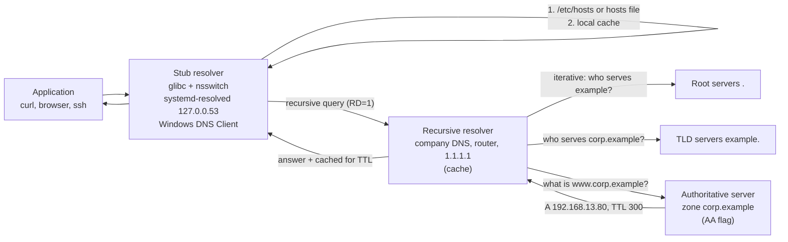
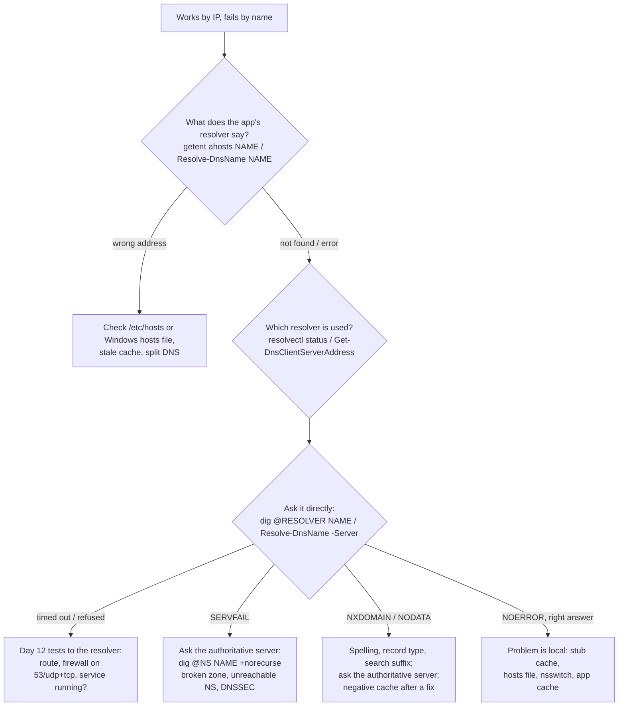

# Day 13: DNS Troubleshooting

!!! info "Lesson overview"
    | | |
    |---|---|
    | **Module** | 3 — Networking & Troubleshooting |
    | **Difficulty** | :material-signal-cellular-2: Intermediate |
    | **Estimated time** | 3–4 hours (75 min reading, 90 min demonstrations, 60–90 min lab and quiz) |
    | **Platforms** | Ubuntu 24.04 LTS (bind9-dnsutils 9.18: `dig`, `host`, `nslookup`; systemd-resolved 255) · Windows 11 (Windows PowerShell 5.1 and PowerShell 7.4+) |
    | **Lab** | [Lab 13: Name Resolution Failure](../../labs/lab-13.md) |

## Learning Objectives

By the end of this lesson you will be able to:

1. Explain how a name is resolved: **stub resolver → recursive resolver → root → TLD → authoritative server**, and where caching happens on the way.
2. Read and use the common **record types** — A, AAAA, CNAME, MX, NS, SOA, PTR, TXT, SRV and CAA — and say which one each application needs.
3. Tell the DNS outcomes apart precisely: **NOERROR with an answer**, **NODATA** (NOERROR, empty answer), **NXDOMAIN**, **SERVFAIL**, **REFUSED**, **connection refused** and **timeout**, and name the most likely cause of each.
4. Explain **TTL**, **negative caching** and the SOA *minimum* field, and predict how long a fix takes to reach users.
5. Find out **which resolver** a Linux or Windows machine really uses: `/etc/resolv.conf` and its systemd-resolved modes, `resolvectl status`, `/etc/nsswitch.conf`, `/etc/hosts`; `Get-DnsClientServerAddress`, `ipconfig /all`, the Windows hosts file and NRPT.
6. Query DNS precisely with `dig` (`@server`, `+short`, `+noall +answer`, `-x`, `+norecurse`, `+trace`, `+tcp`, `+dnssec`), `host`, `nslookup`, `getent` and `resolvectl query`; and with `Resolve-DnsName` (`-Type`, `-Server`, `-DnsOnly`, `-NoHostsFile`, `-CacheOnly`, `-QuickTimeout`) and `[System.Net.Dns]`.
7. Explain why **`dig` and `nslookup` can disagree with the application** (they bypass `/etc/hosts`, the system cache and search rules), and test the way the application resolves.
8. Run a structured DNS troubleshooting sequence and use the course's `dns-check` scripts to compare resolvers and verify reverse DNS.

## Prerequisites

- [Day 11: IP Configuration](day-11.md) and [Day 12: Connectivity Troubleshooting](day-12.md): you can read addresses and routes, and you know the layered method (link → IP → gateway → path → **name** → port → application). Today is the "name" layer.
- An Ubuntu 24.04 VM or WSL2 with `sudo`. The query tools are in the package `bind9-dnsutils` (`dnsutils` is a transitional name for the same package). Install it if `dig -v` reports *command not found*:

    ```bash
    sudo apt update && sudo apt install -y bind9-dnsutils
    ```

- For Lab 13 only: the BIND server package (`sudo apt install bind9`). The lab runs it inside isolated network namespaces.
- A Windows 11 machine with Windows PowerShell 5.1; PowerShell 7.4+ optional. `Resolve-DnsName` and the other DnsClient cmdlets are **Windows-only**.
- Read [Lab Environment & Safety](../../getting-started/lab-environment.md). DNS queries to the resolver you normally use, to well-known public resolvers and to domains you browse are normal client traffic. Do **not** attempt zone transfers (`AXFR`) or brute-force name enumeration against domains you do not own or have written permission to test.

## Introduction and Concepts

### Why "it works by IP but not by name" is so common

Applications almost never connect to addresses typed by users; they connect to **names**. Before a single TCP packet leaves the machine, the name must be turned into an address. If that step fails or returns the **wrong** address, every layer below it looks healthy — `ping 192.168.13.80` works, the route is fine, the port is open — and yet the user sees *"server not found"* or *"connection timed out"*. That is why DNS has its own day: it is the layer that most often fails **while everything else is green**.

The classic first test is therefore:

| Test | Works | Fails |
|---|---|---|
| Connect by IP address (`curl http://192.168.13.80:8080`) | Network, routing and service are fine | Go back to Day 12 |
| Connect by name (`curl http://app.corp.example:8080`) | DNS is fine too | **The problem is name resolution** — today |

### The DNS hierarchy

DNS is a distributed, hierarchical database. Every name is a path from a leaf up to the **root** (written as a final dot, usually invisible): `www.corp.example.` is `www` in the zone `corp.example`, which is delegated from `example`, which is delegated from the root `.`.

- **Root servers** (13 named server identities, `a.root-servers.net` … `m.root-servers.net`, operated as hundreds of anycast instances) know only who serves each top-level domain.
- **TLD servers** (for `com`, `org`, `in`, `uk` …) know only who serves each second-level domain.
- **Authoritative servers** hold the real records for a zone (`corp.example`). Their answers carry the **AA** (authoritative answer) flag.
- **Recursive resolvers** (your company DNS server, your router, your ISP, `1.1.1.1`, `8.8.8.8`) do the walking on behalf of clients and **cache** the results.
- The **stub resolver** is the small client library inside every operating system (glibc + systemd-resolved on Ubuntu, the DNS Client service on Windows). It only ever asks a recursive resolver and trusts what it is told.



The recursive resolver only walks the tree when it has nothing cached. Most of the time it answers from its **cache**, which is why a change you just made on the authoritative server may not be visible to users yet.

### Recursive and authoritative: two different jobs

| | Recursive resolver | Authoritative server |
|---|---|---|
| Answers questions about | Any name (it goes and finds out) | Only the zones it hosts |
| Typical clients | Your own users (`allow-recursion` restricts it) | The whole Internet (for public zones) |
| Flags in its answer | `ra` (recursion available), **no** `aa` | `aa` (authoritative answer) |
| Asked a name outside its zones | Recurses and answers | **REFUSED** (if recursion is disabled) |
| Caches | Yes, for the TTL | No (it *is* the source) |
| Linux software | BIND, Unbound, systemd-resolved (stub/forwarder), dnsmasq | BIND, NSD, Knot, PowerDNS |
| Windows | DNS Server role (often both jobs on a domain controller) | DNS Server role, Azure DNS, cloud providers |

A server that does both for the Internet (an "open resolver") is a security problem: it can be abused for amplification attacks. Company DNS servers allow recursion only for internal clients.

### Record types you must know

| Type | Holds | Example (from today's lab zone) | Who needs it |
|---|---|---|---|
| **A** | IPv4 address | `www.corp.example. 300 IN A 192.168.13.80` | Every IPv4 client |
| **AAAA** | IPv6 address | `www.corp.example. 300 IN AAAA 2001:db8:13::80` | IPv6 clients (tried **first** by many systems) |
| **CNAME** | Alias to another name | `intranet.corp.example. CNAME www.corp.example.` | Aliases, CDNs, SaaS custom domains |
| **MX** | Mail server for a domain, with preference | `corp.example. MX 10 mail.corp.example.` | Mail servers delivering to you |
| **NS** | Name servers of a zone | `corp.example. NS ns1.corp.example.` | Resolvers following delegations |
| **SOA** | Start of authority: primary server, contact, **serial**, timers, **negative TTL** | `ns1.corp.example. hostmaster.corp.example. 2026111301 3600 600 604800 60` | Secondary servers, negative caching |
| **PTR** | Reverse mapping, address → name | `80.13.168.192.in-addr.arpa. PTR www.corp.example.` | Logs, mail servers, SSH, audits |
| **TXT** | Free text: SPF, DKIM, DMARC, domain verification | `corp.example. TXT "v=spf1 mx -all"` | Mail security, cloud services |
| **SRV** | Service location: priority, weight, port, target | `_ldap._tcp.corp.example. SRV 0 100 389 dc1.corp.example.` | Active Directory, SIP, XMPP, Kerberos |
| **CAA** | Which certificate authorities may issue for the domain | `corp.example. CAA 0 issue "letsencrypt.org"` | Certificate authorities (before issuing) |

Rules worth memorising:

- A CNAME **cannot coexist** with other data at the same name, so the zone apex (`corp.example.` itself, which needs SOA and NS) cannot be a CNAME. Cloud DNS providers offer "ALIAS/ANAME" records to work around this.
- MX and NS must point to **names** that have A/AAAA records, never to a CNAME or an IP address.
- Reverse DNS lives in a separate tree: `192.168.13.80` becomes `80.13.168.192.in-addr.arpa.` (octets reversed); IPv6 uses `ip6.arpa.` with every hex nibble reversed. The **owner of the IP block** (often the ISP or cloud provider) controls PTR records, not the owner of the forward domain.

### TTL, caching and negative caching

Every record carries a **TTL** (time to live) in seconds. A resolver that fetched `www.corp.example A` with TTL 300 may answer from cache for up to 300 seconds; `dig` shows the **remaining** TTL counting down (`300`, then `296` four seconds later). Consequences:

- **A change is not instant.** After you change a record, users can see the old value for up to the old TTL. Professionals **lower the TTL** (for example from 86400 to 300) at least one old-TTL period **before** a planned migration, make the change, and raise it again afterwards.
- **Negative answers are cached too** (RFC 2308). When a name does not exist, the resolver caches the NXDOMAIN for the SOA's **minimum** field (the last SOA number) or the SOA record's own TTL, whichever is lower. If someone queried the new name *before* you created it, users keep getting NXDOMAIN until that negative TTL expires — or until you flush the resolver cache.
- **There are several caches**: the application (browsers and Java keep their own), the stub (systemd-resolved, the Windows DNS Client service), the recursive resolver, and sometimes a forwarder in between. A "flush" on one does not flush the others.

### The DNS outcomes — read the status, not just "it failed"

| What you see | Meaning | Typical cause | Next step |
|---|---|---|---|
| `status: NOERROR`, ANSWER ≥ 1 | Success | — | If the app still fails, compare the **answer** with what the app uses (`getent`, hosts file) |
| `status: NOERROR`, ANSWER: 0 (**NODATA**) | The name exists, but has no record of **this type** | Asked AAAA for an IPv4-only host; MX missing; typo in type | Ask for the right type; check the SOA in the AUTHORITY section |
| `status: NXDOMAIN` | The name does **not exist** (authoritative statement) | Typo, record deleted or never created, wrong search domain, negative cache | Ask the authoritative server directly; check spelling and search suffix |
| `status: SERVFAIL` | The resolver **could not** get an answer | Authoritative servers unreachable or broken zone, DNSSEC validation failure, lame delegation | Ask the authoritative servers directly (`dig @ns1 …`); check the zone |
| `status: REFUSED` | The server **will not** answer you | Asking an authoritative-only server for a foreign name; recursion not allowed for your network | Use the right resolver; check `allow-recursion`/ACLs |
| `connection refused` | Nothing listens on port 53 at that address (ICMP port unreachable) | Wrong server IP; DNS service stopped | Fix the resolver address; start the service |
| `timed out` / *no servers could be reached* | No answer at all | Firewall dropping UDP/TCP 53, server down, routing | Day 12 tests to the resolver; check firewalls |

!!! tip "SERVFAIL is about the resolver's journey, NXDOMAIN is about the name"
    NXDOMAIN is a confident, authoritative "this name does not exist". SERVFAIL means "I tried and something broke on the way". Treat them completely differently: NXDOMAIN → check the zone data; SERVFAIL → check the servers and the path to them.

### How Ubuntu 24.04 resolves a name

Most Linux programs call the glibc function `getaddrinfo()`. glibc reads **`/etc/nsswitch.conf`**, whose `hosts:` line lists the sources in order:

```text
hosts:          files mdns4_minimal [NOTFOUND=return] dns
```

- `files` = **`/etc/hosts`**, checked first. An entry there wins over DNS.
- `mdns4_minimal [NOTFOUND=return]` (desktop installs with Avahi) = multicast DNS for `*.local` names only; for a `.local` name that is not found, stop.
- `dns` = send a DNS query to the servers in **`/etc/resolv.conf`**.

On Ubuntu, **systemd-resolved** sits in the middle. `/etc/resolv.conf` is normally a symbolic link, and the target tells you the mode:

| `/etc/resolv.conf` points to | Mode | Programs reading resolv.conf talk to |
|---|---|---|
| `../run/systemd/resolve/stub-resolv.conf` (Ubuntu default) | **stub** | `nameserver 127.0.0.53` — the local systemd-resolved stub, which forwards to the real servers per link |
| `/run/systemd/resolve/resolv.conf` | **uplink** | The real upstream servers directly (resolved not in the path) |
| `/usr/lib/systemd/resolv.conf` | **static** | `127.0.0.53`, without search domains |
| A regular file | **foreign** | Whatever the file says; resolved only reads it |

So on a stock Ubuntu machine `cat /etc/resolv.conf` shows `127.0.0.53` — the real servers are visible only with **`resolvectl status`** (or `resolvectl dns`). They usually come from DHCP or Netplan (`nameservers:` in `/etc/netplan/*.yaml`, Day 11). Editing `/etc/resolv.conf` by hand on Ubuntu is wrong: the link is managed and your change is lost or ignored.

!!! warning "`dig` and `nslookup` do not resolve the way applications do"
    `dig`, `host` and `nslookup` are DNS **protocol** tools. They read only the `nameserver` lines of `/etc/resolv.conf` (or the `@server` you give them) and send a DNS packet. They **ignore** `/etc/hosts`, `nsswitch.conf`, mDNS and systemd-resolved's per-link routing. `dig` also ignores the `search` list unless you add `+search`. To see what an **application** will get, use `getent ahosts NAME` (glibc, the same path as most programs) or `resolvectl query NAME` (systemd-resolved).

### How Windows resolves a name

The Windows **DNS Client** service (`Dnscache`) is the stub resolver. Resolution order for a normal name:

1. The **local cache**, which is preloaded from the **hosts file** `C:\Windows\System32\drivers\etc\hosts`.
2. The **Name Resolution Policy Table (NRPT)** — rules (often from Group Policy, DirectAccess or VPN clients) that send specific namespaces to specific servers or require DNSSEC. `Get-DnsClientNrptPolicy` shows the effective rules.
3. DNS servers configured per interface (`Get-DnsClientServerAddress`), tried in order, with the DNS suffix search list (`Get-DnsClientGlobalSetting`, per-adapter suffixes).
4. For single-label names, depending on configuration: **LLMNR** and **NetBIOS** broadcasts — which is why a typo can sometimes "resolve" on a local network and why attackers abuse these protocols (see Cybersecurity Application).

`Resolve-DnsName` follows the same path by default; `-DnsOnly` limits it to DNS, `-NoHostsFile` skips the hosts file, `-CacheOnly` reads only the cache, and `-Server` sends the query straight to one server. `nslookup.exe`, like Linux `dig`, **always** queries a DNS server directly and ignores the hosts file and cache.

### A troubleshooting sequence that works



## Linux Command Reference

| Command | Purpose | Package / availability | Needs root? |
|---|---|---|---|
| `dig` | Full DNS query tool: any type, any server, flags, timing, trace | bind9-dnsutils | No |
| `host` | Short, readable lookups (forward, reverse, MX…) | bind9-host (pulled in by bind9-dnsutils) | No |
| `nslookup` | Interactive/one-shot lookups (familiar from Windows) | bind9-dnsutils | No |
| `getent hosts` / `getent ahosts` | Resolve **the way applications do** (nsswitch: hosts file, mDNS, DNS) | libc-bin (always installed) | No |
| `resolvectl status` / `dns` / `domain` | Show the real DNS servers and search domains per link | systemd (Ubuntu default) | No |
| `resolvectl query` | Resolve through systemd-resolved, showing which link/protocol answered | systemd | No |
| `resolvectl flush-caches` / `statistics` / `show-cache` | Flush the stub cache; cache hit statistics; dump the cache (systemd 254+) | systemd | Flush and show-cache: **sudo** |
| `/etc/resolv.conf` | Resolver configuration file (usually a link on Ubuntu) | — | Read: no |
| `/etc/nsswitch.conf` | Order of name sources | — | Read: no |
| `/etc/hosts` | Static name → address table, checked first | — | Edit: **sudo** |
| `named-checkzone` / `named-checkconf` | Validate a BIND zone file / configuration (server side) | bind9-utils | No |
| `rndc` | Control a BIND server (`reload`, `flush`, `flushname`, `flushtree`, `zonestatus`, `status`) | bind9-utils | Needs the rndc key |

## PowerShell Command Reference

| Cmdlet / tool | Aliases | Purpose | 5.1 | 7.x | Admin? |
|---|---|---|---|---|---|
| `Resolve-DnsName` | — | Full DNS query: type, server, DNS only, hosts file, cache only, quick timeout | Yes | Yes, **Windows only** | No |
| `Get-DnsClientServerAddress` | — | DNS servers per interface and address family | Yes | Yes, Windows only | No |
| `Set-DnsClientServerAddress` | — | Set or reset DNS servers on an interface (`-WhatIf`) | Yes | Yes, Windows only | **Yes** |
| `Get-DnsClientCache` | — | Show the DNS Client cache (incl. hosts file entries) | Yes | Yes, Windows only | No |
| `Clear-DnsClientCache` | — | Flush the DNS Client cache | Yes | Yes, Windows only | **Yes** |
| `Get-DnsClient` / `Get-DnsClientGlobalSetting` | — | Per-adapter suffix and registration settings / global suffix search list | Yes | Yes, Windows only | No |
| `Get-DnsClientNrptPolicy` | — | Effective Name Resolution Policy Table rules | Yes | Yes, Windows only | No |
| `ipconfig /all`, `/displaydns`, `/flushdns`, `/registerdns` | — | Native: show servers, show/flush cache, re-register the host's own DNS records | Yes | Yes | `/flushdns`, `/registerdns`: run elevated |
| `nslookup.exe` | — | Native DNS protocol tool (bypasses hosts file and cache) | Yes | Yes | No |
| `[System.Net.Dns]::GetHostAddresses()` / `GetHostEntry()` | — | .NET system resolver, forward and reverse — works on **every OS** | Yes | Yes (all OS) | No |

All `DnsClient` cmdlets come from the **DnsClient** module that ships with Windows 8 / Server 2012 and later; PowerShell 7 on Windows loads it natively. They do not exist in PowerShell 7 on Linux or macOS — use `dig` there, or `[System.Net.Dns]` for system-resolver lookups.

## Detailed Command Explanations

### `dig` — the DNS professional's microscope

`dig` (domain information groper) sends exactly one DNS question and prints the **whole** response: header, flags, question, answer, authority and additional sections, the server that answered, the transport and the time taken. It never consults `/etc/hosts`.

```text
dig [@server] [-t] TYPE NAME [+options]      dig -x ADDRESS
```

- `@192.168.13.53` — ask this server instead of the `nameserver` in `/etc/resolv.conf`.
- `TYPE` — `A` (default), `AAAA`, `MX`, `NS`, `SOA`, `TXT`, `SRV`, `CAA`, `PTR`, `ANY` (many servers now return a minimal answer to ANY, RFC 8482).
- `-x 192.168.13.80` — reverse lookup; builds `80.13.168.192.in-addr.arpa PTR` for you.
- `+short` — answers only. Great for scripts, useless for troubleshooting (you lose the status).
- `+noall +answer` — only the answer section with TTLs. Add `+comments` to keep the header line with the **status**, `+authority` for the SOA of negative answers, `+stats` for timing.
- `+norecurse` — clear the RD bit: "answer only from what you have". Against an authoritative server it confirms the zone data; against a resolver it shows whether a name is **cached**.
- `+trace` — walk the delegation from the root yourself, printing each referral; bypasses every cache.
- `+tcp` — use TCP instead of UDP; tests firewalls that block TCP/53 (needed for large answers, zone transfers and DNSSEC).
- `+dnssec` — set the DO bit to request signatures (RRSIG). The `ad` flag in the response means the **resolver** validated the answer.
- `+timeout=N +tries=N` — timeout per try and number of tries (defaults 5 seconds and 3 tries; `+time=N` is accepted as an abbreviation).
- `+search` — apply the `search` list from resolv.conf (off by default in `dig`).

**Header flags:** `qr` response · `aa` authoritative · `tc` truncated (retry over TCP) · `rd` recursion desired · `ra` recursion available · `ad` authenticated data (DNSSEC validated) · `cd` checking disabled.

**Exit codes:** `0` a response arrived (**even NXDOMAIN or SERVFAIL** — always read the status), `1` usage error, `8` batch file error, `9` no reply from any server, `10` internal error.

### `host` — quick, readable answers

`host NAME` prints A, AAAA and MX answers in plain sentences; `host ADDRESS` does a reverse lookup; `host -t TYPE NAME SERVER` asks one server for one type; `-W N` sets the timeout. Unlike `dig`, `host` **does** use the `search` list. It exits `1` when the name is not found, which makes it handy in quick scripts. Like `dig`, it ignores `/etc/hosts`.

### `nslookup` — familiar on both platforms, but limited

`nslookup NAME [SERVER]` and `nslookup -type=MX NAME` exist on Linux and Windows, which makes them useful in mixed teams. "Non-authoritative answer" simply means the answer came from a resolver's cache or recursion. On Windows, `nslookup.exe` first tries a reverse lookup of the server's own address and prints `Server: UnKnown` when there is no PTR — that is cosmetic, not the fault you are hunting. Neither version reads the hosts file. Prefer `dig` on Linux and `Resolve-DnsName` on Windows for anything you need to explain in a ticket.

### `getent hosts` and `getent ahosts` — resolve like the application

`getent` queries the Name Service Switch databases exactly as glibc programs do. `getent hosts NAME` returns the first matching address (from `/etc/hosts`, mDNS or DNS, in nsswitch order). `getent ahosts NAME` calls `getaddrinfo()` and lists every address with socket type (`STREAM`, `DGRAM`, `RAW`); `ahostsv4` / `ahostsv6` restrict the family. `getent hosts 192.168.13.80` does a reverse lookup the same way.

Exit codes: `0` found, `1` missing argument or unknown database, `2` **key not found**, `3` enumeration not supported. `getent` cannot tell NXDOMAIN from SERVFAIL or a timeout — for that you need `dig`. Note also that `getaddrinfo()` may skip AAAA results on a host without a global IPv6 address (the `AI_ADDRCONFIG` rule), so `getent ahosts` can show fewer addresses than `dig AAAA`.

### `resolvectl` — systemd-resolved's view (Ubuntu-specific)

- `resolvectl status` — global settings, the **resolv.conf mode** and, for every link, the current DNS server, all DNS servers, search domains, DNSSEC and DNS-over-TLS state.
- `resolvectl dns` / `resolvectl domain` — just the servers / just the search domains per link.
- `resolvectl query NAME` (`-t MX` for another type, `--cache=no` to bypass the cache) — resolve through resolved and show which link answered and whether the data was authenticated.
- `resolvectl flush-caches` — empty resolved's cache (sudo on Ubuntu, via polkit).
- `resolvectl statistics` — cache size, hits and misses, DNSSEC verdicts; `resolvectl reset-statistics` zeroes them.
- `resolvectl show-cache` (systemd 254+, so available on 24.04) — dump the cache contents (sudo).

systemd-resolved is present on Ubuntu, Fedora and many other distributions, but not everywhere (Alpine, many containers and some minimal images have no systemd). There, `/etc/resolv.conf` is a regular file and is the whole story.

### `/etc/hosts` and `/etc/nsswitch.conf`

`/etc/hosts` lines are `ADDRESS NAME [ALIASES...]`; the first matching line wins. Ubuntu ships `127.0.0.1 localhost` and `127.0.1.1 <hostname>`. A forgotten test entry such as `10.0.0.5 app.corp.example` silently overrides DNS for **every** program using glibc on that machine — one of the most common causes of "works on my colleague's PC but not on mine". Always back up before editing (`sudo cp -a /etc/hosts /etc/hosts.bak.$(date +%F)`) and comment every entry with a reason and date.

### `Resolve-DnsName` — PowerShell's `dig`

```text
Resolve-DnsName [-Name] <String> [[-Type] <RecordType>] [-Server <String[]>] [-DnsOnly]
                [-NoHostsFile] [-CacheOnly] [-NoRecursion] [-QuickTimeout] [-TcpOnly]
                [-DnssecOk] [-LlmnrOnly] [-NetbiosFallback]
```

It returns **objects** whose properties depend on the record type: `IPAddress` (A/AAAA), `NameHost` (CNAME/NS/PTR), `NameExchange` and `Preference` (MX), `Strings` (TXT), `NameTarget`, `Port`, `Priority`, `Weight` (SRV), `PrimaryServer`, `NameAdministrator`, `SerialNumber` (SOA). Every record also has `Name`, `Type`, `TTL` and **`Section`** (`Answer`, `Authority`, `Additional`). Filter on `Section -eq 'Answer'` in scripts, because a CNAME chain or the SOA of an empty answer is returned too.

Errors are terminating with `-ErrorAction Stop` and carry a meaningful `FullyQualifiedErrorId`: `DNS_ERROR_RCODE_NAME_ERROR` (NXDOMAIN, *DNS name does not exist*), `DNS_ERROR_RCODE_SERVER_FAILURE` (SERVFAIL), `DNS_ERROR_RCODE_REFUSED`, `ERROR_TIMEOUT` (*This operation returned because the timeout period expired*). The `RecordType` enumeration has no **CAA** value; use `nslookup -type=CAA` or `dig` for CAA records.

### `Get-DnsClientServerAddress`, `Set-DnsClientServerAddress`

`Get-DnsClientServerAddress -AddressFamily IPv4` lists the servers per interface (`InterfaceAlias`, `ServerAddresses`). Interfaces with no IPv6 DNS often show the built-in placeholders `fec0:0:0:ffff::1`, `::2`, `::3` — they are not real servers. `Set-DnsClientServerAddress -InterfaceAlias Ethernet -ServerAddresses 192.168.13.53, 192.168.13.54` sets static servers and `-ResetServerAddresses` returns to DHCP; both need an elevated session, and both support **`-WhatIf`**. Changing the DNS servers of a production machine is a change-managed action: record the old values first (`Get-DnsClientServerAddress | Export-Csv dns-before.csv`).

### `Get-DnsClientCache`, `Clear-DnsClientCache`, `ipconfig /displaydns /flushdns`

The DNS Client cache contains positive and negative answers and the hosts-file entries. `Get-DnsClientCache -Entry app.corp.example` shows one entry with its `Status`, `Type`, `TimeToLive` and `Data`; `Clear-DnsClientCache` (elevated) empties it, as does `ipconfig /flushdns`. Flushing the client cache does **not** flush the company DNS server's cache, and hosts-file entries reappear immediately because they are reloaded from the file.

### `[System.Net.Dns]` — cross-platform system lookups

`[System.Net.Dns]::GetHostAddresses('www.corp.example')` returns `IPAddress` objects using the operating system resolver (hosts file included), on Windows, Linux and macOS, in 5.1 and 7. `[System.Net.Dns]::GetHostEntry('192.168.13.80').HostName` does a reverse lookup. It cannot choose a server, a record type other than A/AAAA, or show TTLs — it is the PowerShell equivalent of `getent`, not of `dig`.

## Syntax and Parameters

### Linux

```text
dig [@SERVER] [-4|-6] [-p PORT] [-t TYPE] [-x ADDR] NAME [TYPE]
    [+short] [+noall] [+answer] [+authority] [+additional] [+comments] [+stats]
    [+norecurse] [+trace] [+tcp] [+dnssec] [+search] [+timeout=SEC] [+tries=N]
host [-t TYPE] [-W SEC] [-v] NAME|ADDRESS [SERVER]
nslookup [-type=TYPE] [-timeout=SEC] NAME|ADDRESS [SERVER]
getent hosts|ahosts|ahostsv4|ahostsv6 NAME|ADDRESS
resolvectl status [LINK] | dns | domain | query [-t TYPE] [--cache=no] NAME
resolvectl flush-caches | statistics | reset-statistics | show-cache
```

| Option | Tool | Meaning |
|---|---|---|
| `@SERVER` | dig | Server to query (address or name) |
| `+short` | dig | Answer data only |
| `+noall +answer` | dig | Turn every section off, then the answer back on |
| `+comments` / `+authority` / `+stats` | dig | Header with status / authority section (SOA of negative answers) / query time and server |
| `+norecurse` | dig | RD=0: no recursion; tests authority or cache contents |
| `+trace` | dig | Iterate from the root servers, printing each delegation |
| `+tcp` | dig | Query over TCP port 53 |
| `+dnssec` | dig | Request DNSSEC records (DO bit) |
| `+search` | dig | Apply the search domains from resolv.conf |
| `+timeout=N` / `+tries=N` | dig | Timeout per try / number of tries |
| `-x ADDR` | dig | Reverse lookup (PTR) |
| `-t TYPE` | dig, host, resolvectl query | Record type |
| `-W SEC` | host | Timeout |
| `ahosts` vs `hosts` | getent | All `getaddrinfo()` results vs first match |
| `--cache=no` | resolvectl query | Bypass the resolved cache |

### PowerShell

```text
Resolve-DnsName [-Name] <String> [[-Type] <RecordType>] [-Server <String[]>] [-DnsOnly] [-NoHostsFile]
                [-CacheOnly] [-NoRecursion] [-QuickTimeout] [-TcpOnly] [-DnssecOk]
Get-DnsClientServerAddress [-InterfaceAlias <String[]>] [-AddressFamily <IPv4|IPv6>]
Set-DnsClientServerAddress -InterfaceAlias <String> (-ServerAddresses <String[]> | -ResetServerAddresses) [-WhatIf] [-Confirm]
Get-DnsClientCache [-Entry <String[]>] [-Type <Type[]>] [-Status <Status[]>]
Clear-DnsClientCache [-WhatIf] [-Confirm]
Get-DnsClientNrptPolicy
[System.Net.Dns]::GetHostAddresses(<string>)   [System.Net.Dns]::GetHostEntry(<string|IPAddress>)
ipconfig /all | /displaydns | /flushdns | /registerdns
nslookup [-type=<TYPE>] <name> [<server>]
```

| Parameter | Cmdlet | Meaning |
|---|---|---|
| `-Type` | Resolve-DnsName | `A`, `AAAA`, `A_AAAA`, `CNAME`, `MX`, `NS`, `SOA`, `PTR`, `TXT`, `SRV`, `ANY`… (no CAA) |
| `-Server` | Resolve-DnsName | Query these servers directly (cache bypassed) |
| `-DnsOnly` | Resolve-DnsName | Use only DNS — no LLMNR or NetBIOS |
| `-NoHostsFile` | Resolve-DnsName | Do not use the hosts file |
| `-CacheOnly` | Resolve-DnsName | Answer only from the local cache |
| `-NoRecursion` | Resolve-DnsName | RD=0 (like `dig +norecurse`) |
| `-QuickTimeout` | Resolve-DnsName | Do not wait for the full timeout/retry sequence |
| `-TcpOnly` | Resolve-DnsName | Use TCP (like `dig +tcp`) |
| `-DnssecOk` | Resolve-DnsName | Request DNSSEC records |
| `-AddressFamily` | Get-DnsClientServerAddress | `IPv4` or `IPv6` |
| `-ServerAddresses` / `-ResetServerAddresses` | Set-DnsClientServerAddress | Static servers / back to DHCP-provided servers |
| `-Entry` | Get-DnsClientCache | One cached name |

## Practical Demonstrations

The Bash outputs marked **captured** were produced on 2026-11-13 in **Lab 13's own environment**: an Ubuntu 24.04.5 container with BIND 9.18.39 running inside isolated network namespaces — a client `192.168.13.10`, a recursive resolver `192.168.13.53`, an authoritative server `192.168.13.54` for the lab zone `corp.example`, and a web server `192.168.13.80`. The container has no systemd, so `resolvectl` outputs are **examples** of the Ubuntu 24.04 format. PowerShell outputs are **examples** of the Windows 11 format (not captured): values are chosen to match the same lab zone as if a Windows client used `192.168.13.53` as its DNS server. Cookie values and query IDs differ on every run.

### Demo 1 — Which resolver does this machine really use?

=== "Bash"

    ```bash
    ls -l /etc/resolv.conf
    grep -v '^#' /etc/resolv.conf
    resolvectl status
    grep '^hosts:' /etc/nsswitch.conf
    ```

    **Expected output (example, Ubuntu 24.04 desktop VM with DHCP):**

    ```text
    lrwxrwxrwx 1 root root 39 Apr 22  2024 /etc/resolv.conf -> ../run/systemd/resolve/stub-resolv.conf
    nameserver 127.0.0.53
    options edns0 trust-ad
    search corp.example
    Global
             Protocols: -LLMNR -mDNS -DNSOverTLS DNSSEC=no/unsupported
      resolv.conf mode: stub

    Link 2 (enp0s3)
        Current Scopes: DNS
             Protocols: +DefaultRoute -LLMNR -mDNS -DNSOverTLS DNSSEC=no/unsupported
    Current DNS Server: 192.168.13.53
           DNS Servers: 192.168.13.53 192.168.13.54
            DNS Domain: corp.example
    hosts:          files mdns4_minimal [NOTFOUND=return] dns
    ```

    Read it bottom-up: applications check `/etc/hosts` first (`files`), then ask DNS through `127.0.0.53`, and systemd-resolved forwards to `192.168.13.53` on link 2. On Ubuntu Server the `hosts:` line is usually just `files dns`.

=== "PowerShell"

    ```powershell
    Get-DnsClientServerAddress -AddressFamily IPv4 |
        Where-Object ServerAddresses | Select-Object InterfaceAlias, ServerAddresses
    Get-DnsClientGlobalSetting | Select-Object SuffixSearchList
    Get-Content $env:windir\System32\drivers\etc\hosts | Select-String -NotMatch '^\s*#' | Select-String '\S'
    ```

    **Expected output (example):**

    ```text
    InterfaceAlias ServerAddresses
    -------------- ---------------
    Ethernet       {192.168.13.53, 192.168.13.54}

    SuffixSearchList
    ----------------
    {corp.example}
    ```

    The hosts file produced no lines: on a clean Windows 11 installation every line is a comment. Anything listed here would override DNS for that name.

### Demo 2 — Reading a complete `dig` answer

=== "Bash"

    ```bash
    dig www.corp.example
    ```

    **Expected output (captured, Lab 13 client):**

    ```text
    ; <<>> DiG 9.18.39-0ubuntu0.24.04.9-Ubuntu <<>> www.corp.example
    ;; global options: +cmd
    ;; Got answer:
    ;; ->>HEADER<<- opcode: QUERY, status: NOERROR, id: 4301
    ;; flags: qr rd ra; QUERY: 1, ANSWER: 1, AUTHORITY: 0, ADDITIONAL: 1

    ;; OPT PSEUDOSECTION:
    ; EDNS: version: 0, flags:; udp: 1232
    ; COOKIE: 5e8bc02337c05193010000006af73fd4c317a2f51cd3035f (good)
    ;; QUESTION SECTION:
    ;www.corp.example.              IN      A

    ;; ANSWER SECTION:
    www.corp.example.       300     IN      A       192.168.13.80

    ;; Query time: 0 msec
    ;; SERVER: 192.168.13.53#53(192.168.13.53) (UDP)
    ;; WHEN: Fri Nov 13 16:50:28 UTC 2026
    ;; MSG SIZE  rcvd: 89
    ```

    Line by line: **status NOERROR** (success); **flags** `qr` (a response), `rd` (we asked for recursion), `ra` (the server offers it) and **no `aa`**, so this came from a resolver, not the zone's own server; **ANSWER: 1**; **EDNS udp 1232** is the safe UDP size agreed on DNS Flag Day 2020; the answer line is *name, remaining TTL, class, type, data*; **SERVER** proves which resolver answered and over which transport.

    Now ask the authoritative server directly:

    ```bash
    dig @192.168.13.54 www.corp.example +noall +comments +answer
    ```

    **Expected output (captured, trimmed):**

    ```text
    ;; ->>HEADER<<- opcode: QUERY, status: NOERROR, id: 13453
    ;; flags: qr aa rd; QUERY: 1, ANSWER: 1, AUTHORITY: 0, ADDITIONAL: 1
    ;; WARNING: recursion requested but not available
    www.corp.example.       300     IN      A       192.168.13.80
    ```

    `aa` is set (the zone's own data), `ra` is missing and dig warns that recursion is not available — correct for an authoritative-only server.

=== "PowerShell"

    ```powershell
    Resolve-DnsName -Name www.corp.example
    Resolve-DnsName -Name www.corp.example -Server 192.168.13.54 -DnsOnly | Format-List *
    ```

    **Expected output (example):**

    ```text
    Name                                           Type   TTL   Section    IPAddress
    ----                                           ----   ---   -------    ---------
    www.corp.example                               AAAA   300   Answer     2001:db8:13::80
    www.corp.example                               A      300   Answer     192.168.13.80

    Address    : 192.168.13.80
    IPAddress  : 192.168.13.80
    QueryType  : A
    IP4Address : 192.168.13.80
    Name       : www.corp.example
    Type       : A
    CharacterSet : Unicode
    Section    : Answer
    DataLength : 4
    TTL        : 300
    ```

    Without `-Type`, `Resolve-DnsName` asks for both A and AAAA (`A_AAAA`). The objects carry `Section`, `TTL` and `IPAddress` as properties, so `(Resolve-DnsName www.corp.example -Type A).IPAddress` gives just the address.

### Demo 3 — A tour of record types

=== "Bash"

    ```bash
    dig +short www.corp.example AAAA
    dig +noall +answer intranet.corp.example
    dig +short corp.example MX
    dig +short corp.example TXT
    dig +short _dmarc.corp.example TXT
    dig +short _ldap._tcp.corp.example SRV
    dig +short corp.example CAA
    dig @192.168.13.54 +noall +answer corp.example SOA
    ```

    **Expected output (captured, Lab 13 client):**

    ```text
    2001:db8:13::80
    intranet.corp.example.  294     IN      CNAME   www.corp.example.
    www.corp.example.       294     IN      A       192.168.13.80
    10 mail.corp.example.
    "v=spf1 mx -all"
    "v=DMARC1; p=reject; rua=mailto:dmarc@corp.example"
    0 100 389 dc1.corp.example.
    0 issue "letsencrypt.org"
    corp.example.           300     IN      SOA     ns1.corp.example. hostmaster.corp.example. 2026111301 3600 600 604800 60
    ```

    The CNAME answer contains **two** records: the alias and the A record of its target — the resolver follows the chain for you. The SOA fields are *primary server, contact mailbox (`hostmaster@corp.example`), serial, refresh, retry, expire, negative-caching TTL*. The TTLs of `294` show that the resolver served those from cache six seconds after an earlier query.

=== "PowerShell"

    ```powershell
    Resolve-DnsName intranet.corp.example -Type A
    Resolve-DnsName corp.example -Type MX | Where-Object Section -eq 'Answer' |
        Select-Object NameExchange, Preference
    (Resolve-DnsName corp.example -Type TXT).Strings
    Resolve-DnsName _ldap._tcp.corp.example -Type SRV | Where-Object Section -eq 'Answer' |
        Select-Object NameTarget, Port, Priority, Weight
    Resolve-DnsName corp.example -Type SOA | Select-Object PrimaryServer, NameAdministrator, SerialNumber
    ```

    **Expected output (example):**

    ```text
    Name                           Type   TTL   Section    NameHost
    ----                           ----   ---   -------    --------
    intranet.corp.example          CNAME  294   Answer     www.corp.example

    Name       : www.corp.example
    QueryType  : A
    TTL        : 294
    Section    : Answer
    IP4Address : 192.168.13.80

    NameExchange      Preference
    ------------      ----------
    mail.corp.example         10

    v=spf1 mx -all

    NameTarget        Port Priority Weight
    ----------        ---- -------- ------
    dc1.corp.example   389        0    100

    PrimaryServer    NameAdministrator       SerialNumber
    -------------    -----------------       ------------
    ns1.corp.example hostmaster.corp.example   2026111301
    ```

    The MX and SRV queries also return the A records of the targets in the `Additional` section — that is why the examples filter on `Section -eq 'Answer'`.

### Demo 4 — The failure statuses side by side

These five results were captured in Lab 13 by injecting one fault at a time (the lab shows how).

=== "Bash"

    ```bash
    dig nosuch.corp.example +noall +comments +authority     # 1. name does not exist
    dig mail.corp.example AAAA +noall +comments +authority  # 2. name exists, no AAAA
    dig app.corp.example +noall +comments                   # 3. zone broken on the authoritative server
    dig @192.168.13.54 www.google.com +noall +comments      # 4. authoritative-only server asked a foreign name
    dig app.corp.example                                    # 5. resolver firewalled (UDP/TCP 53 dropped)
    echo "exit code: $?"
    ```

    **Expected output (captured, comments and cookies trimmed):**

    ```text
    ;; ->>HEADER<<- opcode: QUERY, status: NXDOMAIN, id: 50918
    ;; flags: qr rd ra; QUERY: 1, ANSWER: 0, AUTHORITY: 1, ADDITIONAL: 1
    corp.example.           60      IN      SOA     ns1.corp.example. hostmaster.corp.example. 2026111301 3600 600 604800 60

    ;; ->>HEADER<<- opcode: QUERY, status: NOERROR, id: 36778
    ;; flags: qr rd ra; QUERY: 1, ANSWER: 0, AUTHORITY: 1, ADDITIONAL: 1
    corp.example.           60      IN      SOA     ns1.corp.example. hostmaster.corp.example. 2026111301 3600 600 604800 60

    ;; ->>HEADER<<- opcode: QUERY, status: SERVFAIL, id: 58938
    ;; flags: qr rd ra; QUERY: 1, ANSWER: 0, AUTHORITY: 0, ADDITIONAL: 1

    ;; ->>HEADER<<- opcode: QUERY, status: REFUSED, id: 7961
    ;; flags: qr rd; QUERY: 1, ANSWER: 0, AUTHORITY: 0, ADDITIONAL: 1

    ;; communications error to 192.168.13.53#53: timed out

    ; <<>> DiG 9.18.39-0ubuntu0.24.04.9-Ubuntu <<>> app.corp.example
    ;; global options: +cmd
    ;; no servers could be reached
    exit code: 9
    ```

    1. **NXDOMAIN** with the zone's SOA in the AUTHORITY section — that SOA's TTL (`60`) is how long the "does not exist" is cached.
    2. **NOERROR with ANSWER: 0** — NODATA. Same SOA, but the name exists. Nothing is broken; the host simply has no IPv6 address.
    3. **SERVFAIL** — the resolver could not get an answer. Here the authoritative server's zone file contained `192.168.13.256` and failed to load.
    4. **REFUSED** — and `ra` is absent. You asked a server that does not do recursion for a name outside its zones.
    5. **Timeout**, exit code 9. No DNS packet came back at all. A wrong server address with nothing listening produces `connection refused` instead (captured in Lab 13 round 1: `;; communications error to 192.168.13.80#53: connection refused`).

    `dig` exited `0` for cases 1–4: a **response** arrived. Scripts must parse the status, not the exit code.

=== "PowerShell"

    ```powershell
    foreach ($n in 'nosuch.corp.example', 'app.corp.example') {
        try   { Resolve-DnsName -Name $n -Type A -DnsOnly -ErrorAction Stop | Out-Null; "$n : OK" }
        catch { '{0} : {1}' -f $n, $_.FullyQualifiedErrorId.Split(',')[0] }
    }
    Resolve-DnsName -Name mail.corp.example -Type AAAA -DnsOnly | Select-Object Name, Type, Section
    Resolve-DnsName -Name app.corp.example -Server 192.168.13.53 -QuickTimeout
    ```

    **Expected output (example; the second name with the zone broken, the last command with UDP/TCP 53 dropped):**

    ```text
    nosuch.corp.example : DNS_ERROR_RCODE_NAME_ERROR
    app.corp.example : DNS_ERROR_RCODE_SERVER_FAILURE

    Name         Type Section
    ----         ---- -------
    corp.example SOA  Authority

    Resolve-DnsName : app.corp.example : This operation returned because the timeout period expired
    At line:1 char:1
    + Resolve-DnsName -Name app.corp.example -Server 192.168.13.53 -QuickTimeout
    + ~~~~~~~~~~~~~~~~~~~~~~~~~~~~~~~~~~~~~~~~~~~~~~~~~~~~~~~~~~~~~~~~~~~~~~~~~~
        + CategoryInfo          : OperationTimeout: (app.corp.example:String) [Resolve-DnsName], Win32Exception
        + FullyQualifiedErrorId : ERROR_TIMEOUT,Microsoft.DnsClient.Commands.ResolveDnsName
    ```

    NODATA is **not** an error in `Resolve-DnsName`: you get only the SOA from the Authority section, so check `Section`. The error IDs map directly to the DNS statuses — use them, not the localised message text.

### Demo 5 — Caching, TTL countdown and negative caching

=== "Bash"

    ```bash
    dig @192.168.13.53 +norecurse mail.corp.example +noall +comments +answer   # cached?
    dig +noall +answer mail.corp.example; sleep 4; dig +noall +answer mail.corp.example
    dig @192.168.13.53 +norecurse mail.corp.example +noall +comments +answer   # cached now?
    ```

    **Expected output (captured, resolver cache flushed first):**

    ```text
    ;; ->>HEADER<<- opcode: QUERY, status: NOERROR, id: 29192
    ;; flags: qr ra; QUERY: 1, ANSWER: 0, AUTHORITY: 13, ADDITIONAL: 1
    mail.corp.example.      300     IN      A       192.168.13.25
    mail.corp.example.      296     IN      A       192.168.13.25
    ;; ->>HEADER<<- opcode: QUERY, status: NOERROR, id: 58157
    ;; flags: qr ra; QUERY: 1, ANSWER: 1, AUTHORITY: 0, ADDITIONAL: 1
    mail.corp.example.      296     IN      A       192.168.13.25
    ```

    With `+norecurse` the resolver may answer only from its cache: the first time it had nothing (ANSWER 0, plus a referral to the 13 root servers in AUTHORITY), after one normal query it had the record with **296 seconds left**. The TTL counts down in the cache.

    Negative caching, captured during Lab 13 round 3. The record `app` was missing, a user asked for it (the resolver cached the NXDOMAIN), then the admin fixed the zone, bumped the serial to `2026111305` and reloaded:

    ```bash
    dig app.corp.example +noall +comments +authority     # via the resolver
    dig @192.168.13.54 +short app.corp.example           # authoritative server
    sudo rndc flushname app.corp.example                 # on the resolver (lab: inside its namespace)
    dig +short app.corp.example
    ```

    **Expected output (captured):**

    ```text
    ;; ->>HEADER<<- opcode: QUERY, status: NXDOMAIN, id: 25712
    corp.example.           55      IN      SOA     ns1.corp.example. hostmaster.corp.example. 2026111302 3600 600 604800 60
    192.168.13.80
    192.168.13.80
    ```

    The authoritative server already had the record, but the resolver kept serving the cached NXDOMAIN — note the **old serial 2026111302** in the cached SOA and its TTL of 55 seconds left. After `rndc flushname` (or after 60 seconds) users got the address. On a resolver you do not control, the only option is to wait for the negative TTL.

=== "PowerShell"

    ```powershell
    Resolve-DnsName mail.corp.example -Type A | Out-Null
    Get-DnsClientCache -Entry mail.corp.example | Select-Object Entry, Type, Status, TimeToLive, Data
    Resolve-DnsName mail.corp.example -Type A -CacheOnly
    Clear-DnsClientCache          # elevated session
    Resolve-DnsName mail.corp.example -Type A -CacheOnly
    ```

    **Expected output (example):**

    ```text
    Entry             Type Status  TimeToLive Data
    -----             ---- ------  ---------- ----
    mail.corp.example    1 Success        297 192.168.13.25

    Name                Type   TTL   Section    IPAddress
    ----                ----   ---   -------    ---------
    mail.corp.example   A      296   Answer     192.168.13.25

    Resolve-DnsName : mail.corp.example : No such host is known
    ```

    `Type 1` is the numeric code for A. After `Clear-DnsClientCache` the cache-only query fails. Negative answers appear in `Get-DnsClientCache` with a `Status` such as `NotExist`; flushing the **client** cache does not help when the company **resolver** is still caching the NXDOMAIN.

### Demo 6 — The hosts file beats DNS (and `dig` does not notice)

=== "Bash"

    ```bash
    grep app /etc/hosts
    getent hosts app.corp.example
    dig +short app.corp.example
    curl -sS -m 5 http://app.corp.example:8080/
    ```

    **Expected output (captured, Lab 13 round 2):**

    ```text
    192.168.13.99 app.corp.example app   # added during the 2025 migration
    192.168.13.99   app.corp.example app
    192.168.13.80
    curl: (7) Failed to connect to app.corp.example port 8080 after 3069 ms: Couldn't connect to server
    ```

    `dig` says DNS is correct (`192.168.13.80`) — and it is. The application uses glibc, which reads `/etc/hosts` first and gets a stale address. Whenever `dig` and the application disagree, compare with `getent`.

=== "PowerShell"

    ```powershell
    Select-String -Path $env:windir\System32\drivers\etc\hosts -Pattern 'app\.corp\.example'
    Resolve-DnsName app.corp.example -Type A | Select-Object Name, IPAddress, Section
    Resolve-DnsName app.corp.example -Type A -DnsOnly -NoHostsFile | Select-Object Name, IPAddress, Section
    nslookup app.corp.example
    ```

    **Expected output (example, with a stale entry in the Windows hosts file):**

    ```text
    C:\Windows\System32\drivers\etc\hosts:23:192.168.13.99 app.corp.example

    Name             IPAddress     Section
    ----             ---------     -------
    app.corp.example 192.168.13.99 Answer

    Name             IPAddress     Section
    ----             ---------     -------
    app.corp.example 192.168.13.80 Answer

    Server:  resolver.corp.example
    Address:  192.168.13.53

    Name:    app.corp.example
    Address:  192.168.13.80
    ```

    Same story on Windows: the default `Resolve-DnsName` (like browsers and every other application) returns the hosts-file value; `-NoHostsFile` and `nslookup` show DNS.

### Demo 7 — Reverse DNS and forward confirmation

=== "Bash"

    ```bash
    dig -x 192.168.13.80 +noall +answer
    host 192.168.13.25
    getent hosts 192.168.13.80
    dig +short www.corp.example           # does the PTR name point back?
    ```

    **Expected output (captured):**

    ```text
    80.13.168.192.in-addr.arpa. 300 IN      PTR     www.corp.example.
    25.13.168.192.in-addr.arpa domain name pointer mail.corp.example.
    192.168.13.80   www.corp.example
    192.168.13.80
    ```

    `192.168.13.80` → `www.corp.example` → `192.168.13.80`: this is **forward-confirmed reverse DNS** (FCrDNS), which mail servers check before accepting mail. `app.corp.example` also points to `.80`, but an address normally has a single PTR — the canonical name. When the PTR was removed (Lab 13 round 6) the result became `status: NXDOMAIN` for `80.13.168.192.in-addr.arpa` and `host` printed `Host 80.13.168.192.in-addr.arpa. not found: 3(NXDOMAIN)`.

=== "PowerShell"

    ```powershell
    Resolve-DnsName 192.168.13.80 -Type PTR | Select-Object Name, NameHost
    [System.Net.Dns]::GetHostEntry('192.168.13.80').HostName
    $ptr = (Resolve-DnsName 192.168.13.80 -Type PTR).NameHost
    (Resolve-DnsName $ptr -Type A).IPAddress -contains '192.168.13.80'
    ```

    **Expected output (example):**

    ```text
    Name                       NameHost
    ----                       --------
    80.13.168.192.in-addr.arpa www.corp.example

    www.corp.example
    True
    ```

    `Resolve-DnsName` builds the `in-addr.arpa` name when you pass an address with `-Type PTR`. `[System.Net.Dns]::GetHostEntry()` gives the same through the system resolver and also works in PowerShell 7 on Linux.

### Demo 8 — Search domains and walking the tree

=== "Bash"

    ```bash
    grep search /etc/resolv.conf
    dig +short www                 # no search list
    dig +search +short www
    host www
    dig +trace +nodnssec www.example.com
    ```

    **Expected output (first four captured on the Lab 13 client; the trace is an example from an Internet-connected VM, trimmed):**

    ```text
    search corp.example
    192.168.13.80
    www.corp.example has address 192.168.13.80
    www.corp.example has IPv6 address 2001:db8:13::80
    .                       518400  IN      NS      a.root-servers.net.
    .                       518400  IN      NS      b.root-servers.net.
    ;; Received 811 bytes from 127.0.0.53#53(127.0.0.53) in 4 ms

    com.                    172800  IN      NS      a.gtld-servers.net.
    com.                    172800  IN      NS      b.gtld-servers.net.
    ;; Received 1170 bytes from 198.41.0.4#53(a.root-servers.net) in 20 ms

    example.com.            172800  IN      NS      a.iana-servers.net.
    example.com.            172800  IN      NS      b.iana-servers.net.
    ;; Received 333 bytes from 192.5.6.30#53(a.gtld-servers.net) in 24 ms

    www.example.com.        300     IN      A       93.184.215.14
    ;; Received 60 bytes from 199.43.135.53#53(a.iana-servers.net) in 92 ms
    ```

    `dig +short www` printed **nothing** (dig asked for the single-label name `www.` literally), while `dig +search` and `host` applied the `search corp.example` line. With `+trace`, dig asks the root, then a `com` server, then the `example.com` servers itself; each `Received … from` line names the server that gave that referral. A trace that stops at one level points at the broken delegation. (Real addresses and TTLs change over time.)

=== "PowerShell"

    ```powershell
    Get-DnsClient | Where-Object ConnectionSpecificSuffix | Select-Object InterfaceAlias, ConnectionSpecificSuffix
    Resolve-DnsName www -Type A -DnsOnly
    Resolve-DnsName example.com -Type NS -Server a.root-servers.net -NoRecursion -DnsOnly |
        Select-Object Name, Type, Section, NameHost -First 3
    ```

    **Expected output (example):**

    ```text
    InterfaceAlias ConnectionSpecificSuffix
    -------------- ------------------------
    Ethernet       corp.example

    Name             Type   TTL   Section    IPAddress
    ----             ----   ---   -------    ---------
    www.corp.example A      300   Answer     192.168.13.80

    Name Type Section   NameHost
    ---- ---- -------   --------
    com  NS   Authority a.gtld-servers.net
    com  NS   Authority b.gtld-servers.net
    com  NS   Authority c.gtld-servers.net
    ```

    Windows applies the suffix list to the single-label name. There is no `+trace` in `Resolve-DnsName`, but `-NoRecursion` against a root server shows the referral it would give (the Authority section lists the `com` servers).

### Demo 9 — Check several resolvers at once with the course script

=== "Bash"

    ```bash
    cd ~/linux-powershell-professional-mastery/scripts/linux
    bash dns-check.sh -n app.corp.example,intranet.corp.example -t A \
         -s system,192.168.13.53,192.168.13.54 -r
    echo "exit code: $?"
    ```

    **Expected output (captured, Lab 13 client, healthy lab; host name `vm`):**

    ```text
    ==============================================
     DNS Check Report
    ==============================================
    Report time (UTC)    : 2026-11-13T16:55:33Z
    Host name            : vm
    Lookup tool          : dig (9.18.39-0ubuntu0.24.04.9-Ubuntu)
    Resolvers            : system 192.168.13.53 192.168.13.54
    Record types         : A
    Timeout              : 2s per query, 1 try
    Reverse check        : yes
    Status               : OK

    --- Lookups ---
    NAME                         TYPE  SERVER           STATUS          TTL     MS  ANSWERS
    app.corp.example             A     system           OK              n/a      5  192.168.13.80
    app.corp.example             A     192.168.13.53    OK              300      4  192.168.13.80
    app.corp.example             A     192.168.13.54    OK              300      0  192.168.13.80
    intranet.corp.example        A     system           OK              n/a      6  192.168.13.80
    intranet.corp.example        A     192.168.13.53    OK              300      0  192.168.13.80
    intranet.corp.example        A     192.168.13.54    OK              300      0  192.168.13.80

    --- Resolver consistency ---
    SAME    app.corp.example             A     3 resolvers agree
    SAME    intranet.corp.example        A     3 resolvers agree

    --- Reverse (PTR) check ---
    ADDRESS                                  PTR                                STATUS     CONFIRMED VIA
    192.168.13.80                            www.corp.example.                  OK         yes       192.168.13.53

    --- Problems ---
    None.
    exit code: 0
    ```

    With the stale hosts entry of Demo 6 the same command reports `DIFFER … system=192.168.13.99` and exits `3`. Details and more samples are in the [Script Library](../../projects/scripts.md).

=== "PowerShell"

    ```powershell
    Set-Location ~\linux-powershell-professional-mastery\scripts\powershell
    .\DNS-Check.ps1 -Name app.corp.example, intranet.corp.example -Type A -Server System, 192.168.13.53 -Reverse
    "exit code: $LASTEXITCODE"
    ```

    **Expected output (example of the layout; not captured on Windows):**

    ```text
    ==============================================
     DNS Check Report
    ==============================================
    Report time (UTC)    : 2026-11-13T17:10:02Z
    Computer name        : WIN11-LAB
    Lookup method        : Resolve-DnsName (DnsClient module)
    Resolvers            : System 192.168.13.53
    Record types         : A
    Reverse check        : yes
    Status               : OK
    PowerShell           : 5.1.26100.9168 (Desktop)

    --- Lookups ---
    NAME                         TYPE  SERVER           STATUS        TTL     MS  ANSWERS
    app.corp.example             A     System           OK            300     12  192.168.13.80
    app.corp.example             A     192.168.13.53    OK            300      3  192.168.13.80
    intranet.corp.example        A     System           OK            300      2  192.168.13.80
    intranet.corp.example        A     192.168.13.53    OK            300      2  192.168.13.80
    ...
    exit code: 0
    ```

## Linux vs PowerShell Comparison

| Task | Bash (Ubuntu) | PowerShell (Windows) | Notes |
|---|---|---|---|
| Which DNS servers? | `resolvectl status` · `resolvectl dns` | `Get-DnsClientServerAddress` · `ipconfig /all` | `/etc/resolv.conf` shows `127.0.0.53` on Ubuntu |
| Search domains | `resolvectl domain` · `search` in resolv.conf | `Get-DnsClientGlobalSetting` · `Get-DnsClient` | |
| Resolve like an app | `getent ahosts NAME` · `resolvectl query NAME` | `Resolve-DnsName NAME` · `[System.Net.Dns]::GetHostAddresses()` | Includes the hosts file |
| Pure DNS query | `dig NAME` | `Resolve-DnsName NAME -DnsOnly -NoHostsFile` · `nslookup` | |
| Ask one server | `dig @SERVER NAME` | `Resolve-DnsName NAME -Server SERVER` | |
| One record type | `dig NAME MX` | `Resolve-DnsName NAME -Type MX` | No CAA type in `Resolve-DnsName` |
| Answers only | `dig +short NAME` | `(Resolve-DnsName NAME -Type A).IPAddress` | |
| Reverse lookup | `dig -x ADDR` · `host ADDR` | `Resolve-DnsName ADDR -Type PTR` | |
| No recursion | `dig +norecurse` | `-NoRecursion` | |
| Over TCP | `dig +tcp` | `-TcpOnly` | |
| Trace from the root | `dig +trace` | — (use `-NoRecursion` against each level) | |
| Show cache | `sudo resolvectl show-cache` (254+) | `Get-DnsClientCache` · `ipconfig /displaydns` | |
| Flush cache | `sudo resolvectl flush-caches` | `Clear-DnsClientCache` · `ipconfig /flushdns` (elevated) | Only the local stub cache |
| Hosts file | `/etc/hosts` | `C:\Windows\System32\drivers\etc\hosts` | Both checked before DNS |
| Source order | `/etc/nsswitch.conf` | Cache/hosts → NRPT → DNS → LLMNR/NetBIOS | |
| Status of a failure | `status:` in the dig header | `FullyQualifiedErrorId` (`DNS_ERROR_RCODE_*`, `ERROR_TIMEOUT`) | |
| Cross-platform | `dig` | `[System.Net.Dns]` (system resolver only) | |

## Real-World IT Scenarios

1. **"The new intranet doesn't open — but only for some people."** The record was created at 09:00, but several users had tried the name at 08:50, so their resolver cached NXDOMAIN for the zone's negative TTL (one hour in this company). `dig @authoritative` showed the record; `dig` via the resolver showed NXDOMAIN with a cached SOA carrying the **old serial**. A `rndc flushname` on the resolver fixed it; the post-incident action was to lower the SOA minimum to 300 seconds.
2. **Migration to a new hosting provider.** Two days before the cut-over the team lowered the TTL of `www` from 86400 to 300. On the night they changed the A record, and within five minutes almost all traffic moved. A team that forgot this step watched traffic trickle to the old server for a full day.
3. **"Works on my PC, not on hers."** Her laptop's hosts file still contained a test entry from a project a year ago. `Resolve-DnsName app.corp.example` returned the hosts value; `-NoHostsFile` returned the right one. The fix was removing the line (after a backup) and adding a desktop compliance check that alerts on non-comment hosts entries.
4. **Mail rejected by a partner.** The partner's mail gateway refused messages because the outbound mail server's IP had no PTR record and the SPF TXT record did not list the new gateway. `dig -x`, `dig TXT` and `dig _dmarc TXT` produced the evidence; the ISP added the PTR and the team updated SPF.
5. **SERVFAIL for a single domain.** Everything resolved except one partner domain. `dig @8.8.8.8` also returned SERVFAIL; `dig +trace` stopped at the TLD with a referral to name servers that timed out — a lame delegation on the partner's side. The ticket went to the partner with the trace attached instead of being escalated internally for hours.
6. **Active Directory logons slow after a DHCP change.** Clients received a public resolver instead of the domain controllers, so `_ldap._tcp.dc._msdcs.corp.example SRV` lookups failed (NXDOMAIN on the Internet). `Get-DnsClientServerAddress` showed the cause in seconds.

## Cybersecurity Application

- **DNS tunnelling and exfiltration.** Malware can encode data in query names (`aGVsbG8gd29ybGQ.x7.badzone.example`) and read commands from TXT answers. Indicators in DNS logs: very long labels (close to 63 characters) and names (close to 253), high-entropy (random-looking) labels, unusually many unique subdomains under one domain, many TXT or NULL queries from one host, and steady query rates at odd hours. Tools such as Zeek and the resolver's query log make this visible (Days 16–20).
- **DGA malware and NXDOMAIN bursts.** Domain-generation algorithms try hundreds of random names until one is registered, so an infected host produces bursts of **NXDOMAIN** answers for gibberish names. A spike of NXDOMAIN from one client is one of the cheapest detections available.
- **Hosts-file tampering.** Malware and adware add hosts entries that redirect banking or update sites, or block security vendors (`0.0.0.0 update.security-vendor.example`). Baseline the hosts file on Linux (`sha256sum /etc/hosts`) and Windows (`Get-FileHash`), and alert on changes. Microsoft Defender can flag hosts files that redirect well-known domains.
- **Rogue or changed resolvers.** Malware that changes the DNS server setting (DNS hijacking) controls every name the victim resolves. Monitor `Get-DnsClientServerAddress` / `resolvectl dns` against an approved list (the `dns-check` scripts compare answers between resolvers).
- **LLMNR and NetBIOS poisoning.** When DNS fails for a single-label name, Windows may broadcast the question with LLMNR/NetBIOS, and an attacker on the LAN can answer and capture NTLM hashes. Security baselines disable LLMNR and NetBIOS over TCP/IP via Group Policy — one more reason to fix DNS failures properly.
- **DoH and DoT.** DNS over HTTPS (port 443) and DNS over TLS (port 853) encrypt queries. Good for privacy on untrusted networks, but browsers using their own DoH bypass company DNS filtering and logging. Windows 11 supports DoH for configured servers; systemd-resolved supports DoT (`DNSOverTLS=`), not DoH. Corporate policy should decide which is allowed.
- **Split-horizon leaks.** Internal names (`hr-db.corp.example`) published in the public zone, or an internal view answering external clients, give attackers a map of the network. Check what the public resolvers return for your internal names.
- **Zone transfers.** An authoritative server that answers `AXFR` to anyone hands out the whole zone. In the lab, `allow-transfer { none; };` makes `dig @192.168.13.54 corp.example AXFR` end with `; Transfer failed.` (captured). Test only servers you administer.
- **Dangling CNAMEs and subdomain takeover.** `shop.corp.example CNAME corp-shop.saas-provider.example` left in DNS after the SaaS account was cancelled lets anyone who registers that SaaS name serve content on your subdomain. Regularly resolve every CNAME target and remove records that point to deleted resources.
- **CAA** limits which certificate authorities may issue certificates for your domain, reducing mis-issuance risk; check it with `dig CAA`.

## Network Analyst Application

- **Capture DNS while reproducing the problem.** `sudo tcpdump -ni any port 53` (Day 15) shows which server is actually queried, whether answers come back, their RCODE and timing. A query with no response is a network problem; a response with SERVFAIL is a resolver problem.
- **UDP and TCP both matter.** DNS uses UDP/53 for most queries and **TCP/53** for truncated (`tc` flag) answers, zone transfers and large DNSSEC responses. Firewalls that allow only UDP break large answers intermittently. Test with `dig +tcp` / `Resolve-DnsName -TcpOnly`.
- **EDNS and fragmentation.** Answers larger than the path can carry in one UDP datagram get fragmented and dropped by some firewalls. Modern resolvers advertise 1232 bytes (as in the captures) to avoid this; a resolver that retries over TCP after `tc` is working as designed.
- **Measure resolver latency.** `;; Query time:` in dig and the `MS` column of the `dns-check` scripts show slow resolvers. A resolver that takes hundreds of milliseconds for cached names is overloaded or far away; every web page needs many lookups.
- **Anycast and geo-DNS.** Public resolvers and CDNs return different answers in different places — two correct resolvers can legitimately disagree for CDN names. Compare with that in mind before declaring a "DNS mismatch".
- **Reverse DNS in investigations.** PTR records turn addresses in firewall logs into names (`dig -x`), but anyone who controls an IP block controls its PTR — never trust a PTR alone; confirm it forward.

## System Administrator Application

- **Know where your servers' DNS comes from.** On Ubuntu: Netplan (`nameservers: addresses:` and `search:`) or DHCP, applied through systemd-resolved; never edit `/etc/resolv.conf` directly. On Windows: DHCP options or `Set-DnsClientServerAddress` (with `-WhatIf` first and the old values exported).
- **Change records safely.** Lower TTLs ahead of migrations; bump the SOA **serial** (`YYYYMMDDnn`) on every change so secondaries transfer it; validate with `named-checkzone` (BIND) before reloading; confirm on the authoritative server with `dig @ns +norecurse`; then confirm via the resolvers.
- **A failed reload keeps the old zone.** BIND keeps serving the previous version when a reload fails, so a broken file can sit unnoticed until the next restart — exactly what Lab 13 round 4 reproduces. Always read the reload result and the server log.
- **Mail DNS hygiene.** Every sending server needs an A record, a matching **PTR** (FCrDNS), inclusion in **SPF** (`v=spf1 …` TXT), a **DKIM** key TXT (`selector._domainkey`) and a **DMARC** policy (`_dmarc` TXT). Check all of them after any mail change.
- **Active Directory depends on DNS.** Domain join, logon and replication rely on `_ldap._tcp`, `_kerberos._tcp` SRV records. Clients must use the domain's DNS servers, not public ones; `ipconfig /registerdns` re-registers a host's own records.
- **Monitor DNS like a service.** Schedule `dns-check.sh` / `DNS-Check.ps1` (Day 25) against critical names and every resolver; exit code 3 raises an alert when a name stops resolving, resolvers disagree or a PTR goes missing.

## Common Mistakes

| Mistake | What happens | Correct approach |
|---|---|---|
| Trusting `nslookup`/`dig` when the app fails | They ignore `/etc/hosts`/hosts file and caches, so they "prove" DNS is fine | Also test with `getent ahosts` / `Resolve-DnsName` (default) |
| Editing `/etc/resolv.conf` on Ubuntu | Change lost or ignored (it is a managed symlink) | Netplan `nameservers:` or `resolvectl` per link |
| Reading `dig` exit code 0 as success | NXDOMAIN and SERVFAIL also exit 0 | Parse `status:` (or use `+short` only when you just need data) |
| Treating SERVFAIL like NXDOMAIN | Hours spent checking the record spelling | SERVFAIL → check authoritative servers, zone loading, DNSSEC |
| Forgetting negative caching | "I created the record but it still says NXDOMAIN" | Wait for the SOA minimum, or flush the resolver (`rndc flushname`) |
| Changing a record with a long TTL just before a migration | Users keep the old address for up to a day | Lower the TTL one old-TTL period in advance |
| `dig www` expecting the search domain | Empty answer or NXDOMAIN for `www.` | `dig +search www` or the full name |
| Pointing MX/NS at a CNAME or IP | Some mail servers and resolvers fail | MX/NS must name hosts with A/AAAA records |
| Forgetting to bump the SOA serial | Secondary servers keep the old zone | Increment the serial on every change |
| Flushing the client cache and expecting a fix | The company resolver still serves the old answer | Flush (or wait for) the resolver cache too |
| Testing only UDP | Large answers fail behind a UDP-only firewall rule | `dig +tcp` / `-TcpOnly` |
| Leaving test entries in hosts files | Silent wrong answers months later | Comment with reason and date; remove after the test; audit |

## Troubleshooting Guide

| Symptom | Likely cause | Fix / next step |
|---|---|---|
| `curl: (6) Could not resolve host` / *No such host is known* | Name not resolvable via the system resolver | `getent ahosts NAME` / `Resolve-DnsName NAME`, then work down the flowchart |
| `;; communications error to X#53: connection refused` | Nothing listening on port 53 at X | Correct the resolver address; check the DNS service |
| `;; communications error to X#53: timed out` / *no servers could be reached* (exit 9) | Firewall dropping 53, server down, no route | Day 12 tests to the resolver; firewall rules for UDP **and** TCP 53 |
| `status: SERVFAIL` | Resolver cannot reach or trust the authoritative answer | `dig @AUTHORITATIVE NAME +norecurse`; `named-checkzone`; `dig +trace`; DNSSEC (`+cd` to test) |
| `status: REFUSED` | Server does not offer recursion to you | Use the proper resolver; check `allow-recursion` / ACLs |
| `status: NXDOMAIN` but the record exists on the server | Negative cache, wrong zone, wrong server, typo | Ask the authoritative server; compare SOA serials; flush or wait |
| NOERROR with ANSWER: 0 | Wrong record type (NODATA) | Query the type the app needs (A vs AAAA vs MX) |
| `dig` correct, application wrong | Hosts file, stub cache, application cache, nsswitch | `getent`, `grep NAME /etc/hosts`, `resolvectl flush-caches`, restart the app |
| `cat /etc/resolv.conf` shows `127.0.0.53` | Normal on Ubuntu (stub mode) | `resolvectl status` for the real servers |
| `resolvectl: command not found` | No systemd-resolved (container, Alpine, minimal image) | Read `/etc/resolv.conf` directly |
| `Resolve-DnsName` not recognized | PowerShell on Linux/macOS, or very old Windows | `dig`, or `[System.Net.Dns]::GetHostAddresses()` |
| `Clear-DnsClientCache` access denied / `ipconfig /flushdns` fails | Not elevated | Run an elevated session |
| `nslookup` shows `Server: UnKnown` | The DNS server's address has no PTR | Cosmetic; add a PTR if you own the reverse zone |
| Single-label names resolve inconsistently on Windows | LLMNR/NetBIOS fallback or suffix list | `Resolve-DnsName NAME -DnsOnly`; fix suffixes; disable LLMNR per policy |

## Hands-on Lab

Complete **[Lab 13: Name Resolution Failure](../../labs/lab-13.md)**. On Linux you build a small corporate DNS in isolated network namespaces — a client, a recursive resolver, an authoritative BIND server for `corp.example` with forward and reverse zones, and a web server — and then fix six injected faults, each reported by users as *"the app works by IP but not by name"*.

Summary of tasks:

1. Baseline: map the resolution path and record healthy `dig`, `getent` and `dns-check.sh` results.
2. Six fault rounds: wrong nameserver, stale hosts entry, missing record (with negative caching), broken zone (SERVFAIL), resolver firewalled (timeout), missing PTR — each with evidence, root cause and fix.
3. Windows: find your resolvers, compare system, DNS-only and hosts-file-free lookups, inspect the cache, and (optional, elevated, with backup) prove that a hosts entry overrides DNS.
4. Run `DNS-Check.ps1` and write a ticket note.

## Practice Questions

1. Describe the path of a query for `www.corp.example` from a browser on Ubuntu to the authoritative server and back, naming every cache on the way.
2. What is the difference between a recursive resolver and an authoritative server? Which `dig` flags show you which one answered?
3. You see `status: NOERROR` and `ANSWER: 0`. What does that mean and what should you check?
4. Explain the difference between NXDOMAIN and SERVFAIL, and give one likely cause of each.
5. Why does `cat /etc/resolv.conf` show `nameserver 127.0.0.53` on Ubuntu, and how do you find the real DNS servers?
6. `dig app.corp.example` returns the correct address, but `curl http://app.corp.example` connects to the wrong server. What do you check first, and with which command?
7. Write the `dig` command that asks the server `192.168.13.54` for the MX records of `corp.example` and shows only the answer section with TTLs.
8. Write the PowerShell command that asks `192.168.13.53` for the A record of `app.corp.example` using DNS only and ignoring the hosts file.
9. A record was fixed 20 seconds ago, but users still get NXDOMAIN. The SOA ends in `… 3600 600 604800 900`. How long might users wait, and what can the resolver administrator do?
10. Why must you lower a TTL **before** a migration and not at the moment of the change?
11. What is forward-confirmed reverse DNS, and why do mail servers care?
12. Which record types does a mail domain need, and which one controls which servers may send mail for it?
13. `dig` exits with code 9. What happened? What exit code do you get for NXDOMAIN?
14. Name three indicators of DNS tunnelling in resolver logs.
15. Why does `Clear-DnsClientCache` not fix an NXDOMAIN that the company resolver is caching?
16. What does `Resolve-DnsName` return for a name that exists but has no AAAA record when you ask for `-Type AAAA`, and how do you detect that in a script?

??? success "Practice answers"
    1. Browser (may have its own cache) → glibc `getaddrinfo()` reads `nsswitch.conf` → `/etc/hosts` → systemd-resolved stub `127.0.0.53` (cache) → recursive resolver (cache) → if not cached: root servers → `example` TLD servers → `corp.example` authoritative server → answer back to the resolver (cached for the TTL) → resolved (cached) → application.
    2. A **recursive resolver** answers any name for its clients by walking the tree and caching; an **authoritative server** holds the zone data and answers only for its zones. `aa` set = authoritative answer; `ra` set without `aa` = answered by a resolver.
    3. **NODATA**: the name exists but has no record of the requested type. Check that you asked for the right type (A vs AAAA vs MX) and look at the SOA in the AUTHORITY section.
    4. **NXDOMAIN** — the authoritative statement that the name does not exist (typo, record not created/deleted, wrong suffix). **SERVFAIL** — the resolver failed to get an answer (authoritative servers unreachable, zone failed to load, DNSSEC validation failure, lame delegation).
    5. Ubuntu runs systemd-resolved in **stub** mode: `/etc/resolv.conf` links to `stub-resolv.conf`, which points programs to the local stub on `127.0.0.53`. `resolvectl status` (or `resolvectl dns`) shows the real servers per link.
    6. The hosts file and the system resolver path: `getent ahosts app.corp.example` and `grep app /etc/hosts`. `dig` ignores `/etc/hosts`; curl does not.
    7. `dig @192.168.13.54 corp.example MX +noall +answer`
    8. `Resolve-DnsName -Name app.corp.example -Type A -Server 192.168.13.53 -DnsOnly -NoHostsFile`
    9. The negative answer is cached for the lower of the SOA minimum (900 s) and the SOA record's TTL — up to 15 minutes. The resolver administrator can flush the name (`rndc flushname app.corp.example` on BIND, `Clear-DnsServerCache` / the cache node on Windows DNS Server); users can do nothing at their end except bypass that resolver.
    10. Resolvers cache the record for the TTL that was valid **when they fetched it**. If the TTL is 86400 when you change the record, some resolvers keep the old address for a day. Lowering it one old-TTL period in advance means every cache holds the short TTL by the time you change the record.
    11. The PTR of an address gives a name, and that name's A/AAAA record contains the same address. Mail servers use it as a basic legitimacy check; missing or mismatched PTRs get mail rejected or marked as spam.
    12. MX (where to deliver), A/AAAA for the mail hosts, PTR for sending IPs, TXT for **SPF** (`v=spf1 …` — lists the servers allowed to send), DKIM keys and DMARC policy (`_dmarc` TXT).
    13. Exit 9 = no reply from any server (timeout or connection refused). NXDOMAIN is a valid response, so dig exits **0** — read the status.
    14. Very long and high-entropy labels; many unique subdomains under one domain; many TXT/NULL queries; steady periodic query rates from one host; large volumes to a newly registered domain.
    15. It empties only the local DNS Client cache. The NXDOMAIN is cached on the recursive resolver, which the client asks again and which replies from its cache until the negative TTL expires or it is flushed.
    16. It returns only the **SOA record from the Authority section** (no error). In a script, filter `Where-Object { $_.Section -eq 'Answer' -and $_.Type -eq 'AAAA' }` and treat an empty result as NODATA.

## Quiz

**Q1.** `dig @ns1.corp.example www.corp.example` shows `flags: qr aa rd`. What does this tell you?

- A. The answer came from a resolver's cache
- B. The answer is authoritative and the server does not offer recursion
- C. The answer was truncated
- D. DNSSEC validation succeeded

??? question "Answer and explanation"
    **B.** `aa` = authoritative answer; `ra` is missing, so recursion is not available (dig also prints *recursion requested but not available*). `tc` would mean truncated and `ad` validated.

**Q2.** A user reports that a brand-new name does not resolve. `dig @authoritative` returns the record; `dig` via the company resolver returns NXDOMAIN with an SOA whose serial is older than the current one. What is the cause?

- A. The zone failed to load
- B. The resolver is caching a negative answer from before the record existed
- C. The client's hosts file
- D. The firewall blocks TCP 53

??? question "Answer and explanation"
    **B.** The cached SOA with the **old serial** in the AUTHORITY section is the fingerprint of negative caching. Flush the name on the resolver or wait for the negative TTL.

**Q3.** Which command shows the address a normal Linux program will use for `app.corp.example`?

- A. `dig +short app.corp.example`
- B. `nslookup app.corp.example`
- C. `getent ahosts app.corp.example`
- D. `host app.corp.example`

??? question "Answer and explanation"
    **C.** `getent ahosts` calls `getaddrinfo()` through nsswitch, including `/etc/hosts` — the same path as most applications. `dig`, `nslookup` and `host` send DNS packets directly and ignore the hosts file.

**Q4.** `dig app.corp.example` prints `;; communications error to 192.168.13.80#53: connection refused`. What is the most likely cause?

- A. The record does not exist
- B. The resolver address in resolv.conf points to a host that is not running DNS
- C. A firewall is silently dropping DNS
- D. DNSSEC failure

??? question "Answer and explanation"
    **B.** *Connection refused* means an ICMP port-unreachable came back: the host exists but nothing listens on port 53. A silent drop gives *timed out*; a missing record gives NXDOMAIN.

**Q5.** An authoritative-only server is asked for `www.google.com`. What status does it return?

- A. NXDOMAIN
- B. SERVFAIL
- C. REFUSED
- D. NOERROR with a referral to the root

??? question "Answer and explanation"
    **C.** With recursion disabled and no zone for that name, BIND answers REFUSED (captured in Demo 4). Asking the wrong kind of server is a frequent mistake after someone copies an NS address into a client's resolver settings.

**Q6.** Which PowerShell command bypasses the hosts file and asks only DNS?

- A. `Resolve-DnsName app.corp.example`
- B. `Resolve-DnsName app.corp.example -CacheOnly`
- C. `Resolve-DnsName app.corp.example -DnsOnly -NoHostsFile`
- D. `[System.Net.Dns]::GetHostAddresses('app.corp.example')`

??? question "Answer and explanation"
    **C.** `-NoHostsFile` skips the hosts file and `-DnsOnly` prevents LLMNR/NetBIOS fallback. A and D use the normal system path (hosts file included) and B reads only the cache.

**Q7.** You plan to move `www.corp.example` to a new IP on Saturday. Its TTL is 86400. What should you do and when?

- A. Change the record on Saturday and flush your PC's cache
- B. Lower the TTL to about 300 at least a day before Saturday, change the record on Saturday, raise the TTL afterwards
- C. Set the TTL to 0 permanently
- D. Add the new IP to every user's hosts file

??? question "Answer and explanation"
    **B.** Caches keep the TTL they received. Lowering it one old-TTL period (86400 s = one day) in advance ensures that on Saturday every cache expires within five minutes. TTL 0 permanently increases load and latency; hosts files create the stale-entry problem.

**Q8.** Which observation most strongly suggests DGA malware on a client?

- A. Many queries for `windowsupdate.com`
- B. A burst of NXDOMAIN answers for long random-looking names from one host
- C. A PTR lookup for the default gateway
- D. TTLs counting down in the cache

??? question "Answer and explanation"
    **B.** Domain-generation algorithms try many random names until one resolves, producing NXDOMAIN bursts. The other options are normal behaviour.

**Q9.** `dig app.corp.example` returns SERVFAIL. `dig @ns1 app.corp.example +norecurse` also returns SERVFAIL, and `named-checkzone` reports `bad dotted quad`. What happened?

- A. The record is missing
- B. The zone file has a syntax error, so the zone did not load on the authoritative server
- C. The client's firewall
- D. Negative caching

??? question "Answer and explanation"
    **B.** A zone that fails to load cannot be served, so the authoritative server answers SERVFAIL and the resolver passes SERVFAIL on (captured in Lab 13 round 4). Fix the file, validate with `named-checkzone`, reload and check the log.

**Q10.** Why should a script that uses `dig` not rely on `$?` alone?

- A. dig always exits 1
- B. dig exits 0 whenever any response arrives, including NXDOMAIN and SERVFAIL
- C. dig does not set an exit code
- D. dig exit codes are random

??? question "Answer and explanation"
    **B.** dig's exit code tells you whether a **response** arrived (0) or not (9). The DNS result is in the header's `status:` field, which the `dns-check.sh` script parses.

## Homework

1. **Map your own resolution path.** On Ubuntu record the `/etc/resolv.conf` link target, the resolv.conf mode, the real servers, the search domains and the `hosts:` line. On Windows record `Get-DnsClientServerAddress`, the suffix list and any non-comment hosts lines. Draw your path in the style of the first Mermaid diagram.
2. **Record-type safari (public domains you use).** For a domain you use daily (your company's or a large public site), find its NS, SOA (serial and negative TTL), MX, SPF/DMARC TXT and CAA records with `dig` and with `Resolve-DnsName`. Explain each in one line.
3. **TTL experiment.** Query the same public name twice through your resolver 10 seconds apart with `dig +noall +answer` and explain the TTL values. Then ask `dig +norecurse` against your resolver for a name you have never visited.
4. **Status flash cards.** Using the Lab 13 environment, reproduce NOERROR, NODATA, NXDOMAIN, SERVFAIL, REFUSED, connection refused and timeout, and write one line each: *what you saw, what it means, what you check next*.
5. **Script it.** Schedule (or just run) `dns-check.sh -n <three important names> -r -o ~/lpm-lab/reports` and `DNS-Check.ps1 … -OutputPath`, and explain each line of the *Problems* section if any appears.

??? success "Homework answer key (items 3–4)"
    - **Item 3:** the first answer shows the TTL remaining in the resolver's cache (it may already be below the zone's TTL if someone else asked recently); the second shows about 10 seconds less. A `+norecurse` query for a never-visited name returns no answer (and possibly a referral) because the resolver will not recurse and has nothing cached. Large public sites often have short TTLs (60–300 s).
    - **Item 4:**
        - *NOERROR + answer* — success; compare with `getent` if the app fails.
        - *NODATA* (NOERROR, ANSWER 0, SOA in authority) — wrong record type; ask for A/AAAA/MX as needed.
        - *NXDOMAIN* — name does not exist; check spelling, zone data on the authoritative server, negative cache.
        - *SERVFAIL* — resolver could not get an answer; ask the authoritative server, check zone loading and DNSSEC.
        - *REFUSED* — server will not serve you; use the right resolver or fix ACLs.
        - *connection refused* — nothing on port 53 at that address; fix the server address or start the service.
        - *timeout* — no reply at all; firewall/routing/service down; Day 12 tests and UDP+TCP 53 rules.

## Professional Tips

- **Always name the server in tickets.** "`dig @192.168.13.53 app.corp.example` → SERVFAIL; `dig @192.168.13.54 app.corp.example +norecurse` → SERVFAIL; `named-checkzone` → line 18 bad dotted quad" is a complete diagnosis. "DNS is broken" is not.
- **Use `+noall +answer +comments` as your default dig style** — you keep the status line and the TTLs without the noise. `alias digs='dig +noall +answer +comments'` is a common personal alias.
- **Compare three views:** the application's (`getent`/`Resolve-DnsName`), the resolver's (`dig`), and the authoritative server's (`dig @ns +norecurse`). The first view that differs locates the problem.
- **Keep TTLs moderate.** 300–3600 seconds for most records; 60–300 for records you may need to fail over; long TTLs only for things that never change. Keep the SOA negative TTL short (300–900) so mistakes heal quickly.
- **Never "fix" DNS with hosts files on servers** except as a documented, temporary, change-managed workaround with an expiry date.
- **Learn the resolver's own tools.** BIND: `rndc flushname` (one name), `rndc flushtree` (a name and everything below it), `rndc dumpdb -cache`, query logging. Windows DNS Server: `Get-DnsServerCache`, `Clear-DnsServerCache`, analytical logs. systemd-resolved: `resolvectl statistics` and `resolvectl monitor` (systemd 254+).
- **Script with objects on Windows and with `+short`/parsed status on Linux.** Never parse localised `nslookup` text.

## Command Cheat Sheet

```bash
# ---- Bash (Ubuntu 24.04) ----
resolvectl status ; resolvectl dns ; resolvectl domain   # real servers and search domains
ls -l /etc/resolv.conf ; grep '^hosts:' /etc/nsswitch.conf ; cat /etc/hosts
getent ahosts NAME ; getent hosts ADDR                   # resolve like applications do
dig NAME ; dig +noall +answer +comments NAME             # full / compact with status
dig @SERVER NAME TYPE ; dig +short NAME AAAA             # one server, one type ; data only
dig -x ADDR ; host ADDR                                  # reverse lookup
dig @NS NAME +norecurse                                  # authoritative data (aa) or cache test
dig +trace NAME ; dig +tcp NAME ; dig +search SHORTNAME  # walk the tree ; TCP ; search list
host -t MX DOMAIN ; nslookup -type=SOA DOMAIN
sudo resolvectl flush-caches ; resolvectl statistics     # stub cache
bash dns-check.sh -n NAME1,NAME2 -s system,IP1,IP2 -r    # compare resolvers + PTR
```

```powershell
# ---- PowerShell (Windows; DnsClient cmdlets are Windows-only) ----
Get-DnsClientServerAddress -AddressFamily IPv4 ; ipconfig /all
Get-DnsClientGlobalSetting | Select-Object SuffixSearchList
Resolve-DnsName NAME                                     # like an application (hosts + cache)
Resolve-DnsName NAME -Type MX -Server IP -DnsOnly -NoHostsFile
Resolve-DnsName ADDR -Type PTR ; Resolve-DnsName NAME -NoRecursion -Server NS
Resolve-DnsName NAME -TcpOnly ; Resolve-DnsName NAME -CacheOnly
Get-DnsClientCache -Entry NAME ; ipconfig /displaydns
Clear-DnsClientCache ; ipconfig /flushdns                 # elevated
Set-DnsClientServerAddress -InterfaceAlias Ethernet -ServerAddresses IP1,IP2 -WhatIf
[System.Net.Dns]::GetHostAddresses('NAME')               # cross-platform, system resolver
.\DNS-Check.ps1 -Name NAME1, NAME2 -Server System, IP1 -Reverse
```

## Completion Checklist

- [ ] I can draw the path stub → recursive → root → TLD → authoritative and name every cache.
- [ ] I know what A, AAAA, CNAME, MX, NS, SOA, PTR, TXT, SRV and CAA records hold.
- [ ] I can tell NOERROR, NODATA, NXDOMAIN, SERVFAIL, REFUSED, connection refused and timeout apart, with a next step for each.
- [ ] I can explain TTL, negative caching and why TTLs are lowered before migrations.
- [ ] I can find the real resolvers on Ubuntu (`resolvectl`) and Windows (`Get-DnsClientServerAddress`).
- [ ] I know why `dig`/`nslookup` can disagree with applications, and I test with `getent` / `Resolve-DnsName`.
- [ ] I can query any server and type with `dig` and `Resolve-DnsName`, including reverse lookups and `+norecurse`/`-NoRecursion`.
- [ ] I ran `dns-check.sh` / `DNS-Check.ps1` and can read their output.
- [ ] I completed Lab 13 and checked it against the solution.
- [ ] I answered the practice questions and the quiz, and completed the homework.

## Further Reading

- Linux man pages: [dig(1)](https://manpages.ubuntu.com/manpages/noble/man1/dig.1.html), [host(1)](https://manpages.ubuntu.com/manpages/noble/man1/host.1.html), [nslookup(1)](https://manpages.ubuntu.com/manpages/noble/man1/nslookup.1.html), [getent(1)](https://man7.org/linux/man-pages/man1/getent.1.html), [resolv.conf(5)](https://man7.org/linux/man-pages/man5/resolv.conf.5.html), [hosts(5)](https://man7.org/linux/man-pages/man5/hosts.5.html), [nsswitch.conf(5)](https://man7.org/linux/man-pages/man5/nsswitch.conf.5.html), [resolvectl(1)](https://man7.org/linux/man-pages/man1/resolvectl.1.html), [systemd-resolved.service(8)](https://man7.org/linux/man-pages/man8/systemd-resolved.service.8.html), [getaddrinfo(3)](https://man7.org/linux/man-pages/man3/getaddrinfo.3.html)
- BIND 9 Administrator Reference Manual — <https://bind9.readthedocs.io/>
- Ubuntu Server documentation — [Networking](https://documentation.ubuntu.com/server/explanation/networking/) and [Domain Name Service (DNS)](https://documentation.ubuntu.com/server/how-to/networking/install-dns/)
- PowerShell DnsClient module: [Resolve-DnsName](https://learn.microsoft.com/en-us/powershell/module/dnsclient/resolve-dnsname), [Get-DnsClientServerAddress](https://learn.microsoft.com/en-us/powershell/module/dnsclient/get-dnsclientserveraddress), [Set-DnsClientServerAddress](https://learn.microsoft.com/en-us/powershell/module/dnsclient/set-dnsclientserveraddress), [Get-DnsClientCache](https://learn.microsoft.com/en-us/powershell/module/dnsclient/get-dnsclientcache), [Clear-DnsClientCache](https://learn.microsoft.com/en-us/powershell/module/dnsclient/clear-dnsclientcache), [Get-DnsClientNrptPolicy](https://learn.microsoft.com/en-us/powershell/module/dnsclient/get-dnsclientnrptpolicy)
- Windows commands: [nslookup](https://learn.microsoft.com/en-us/windows-server/administration/windows-commands/nslookup), [ipconfig](https://learn.microsoft.com/en-us/windows-server/administration/windows-commands/ipconfig)
- .NET: [System.Net.Dns](https://learn.microsoft.com/en-us/dotnet/api/system.net.dns)
- Wireshark DNS display filter reference — <https://www.wireshark.org/docs/dfref/d/dns.html>
- RFC 1034 and 1035 (DNS), RFC 2308 (negative caching), RFC 6761 (special-use names such as `.example` and `.test`), RFC 8482 (minimal ANY responses), RFC 8484 (DoH), RFC 7858 (DoT) — <https://www.rfc-editor.org/>

---

**Previous:** [Day 12: Connectivity Troubleshooting](day-12.md) · **Next:** [Day 14: Ports, Sockets and Connections](day-14.md)
