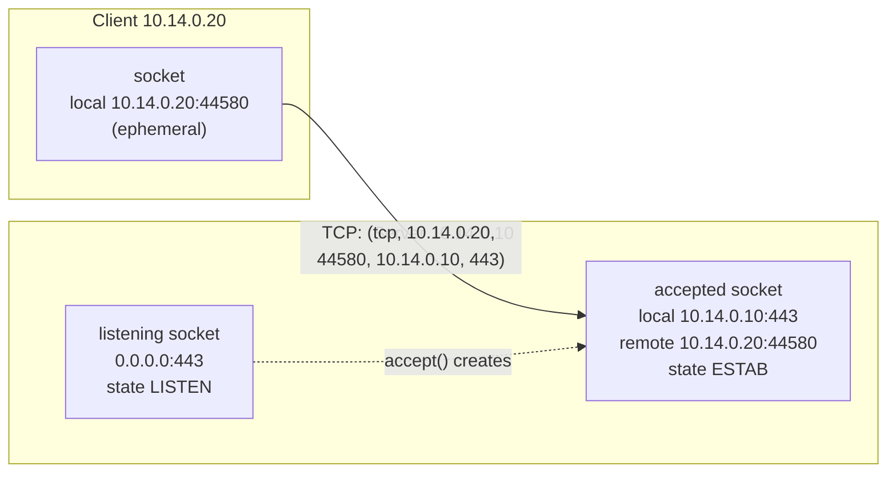
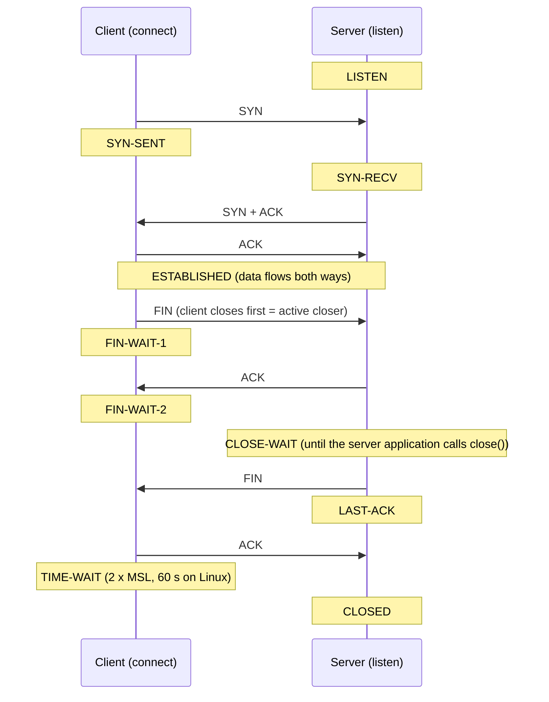
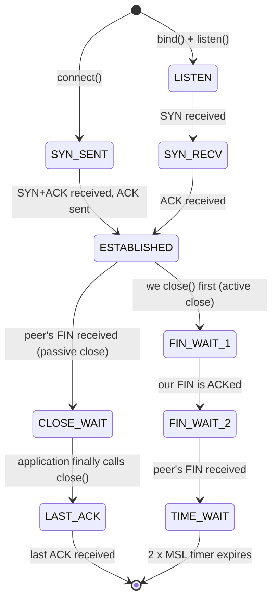

# Day 14: Ports, Sockets and Connections

!!! info "Lesson overview"
    | | |
    |---|---|
    | **Module** | 3 — Networking & Troubleshooting |
    | **Difficulty** | :material-signal-cellular-2: Intermediate |
    | **Estimated time** | 3–4 hours (75 min reading, 90 min demonstrations, 60–90 min lab and quiz) |
    | **Platforms** | Ubuntu 24.04 LTS (iproute2 `ss`, lsof 4.95, psmisc `fuser`, optional net-tools `netstat`) · Windows 11 (Windows PowerShell 5.1 and PowerShell 7.4+) |
    | **Lab** | [Lab 14: Who Owns Port 443?](../../labs/lab-14.md) |

## Learning Objectives

By the end of this lesson you will be able to:

1. Explain what a **port** and a **socket** are, how a TCP connection is identified by its **5-tuple** (protocol, local address, local port, remote address, remote port), and the difference between **well-known**, **registered** and **ephemeral** ports on Linux and Windows.
2. Tell **TCP** from **UDP** at the socket level, and a **listening** socket from an **established** connection — and decide from the addresses whether a connection is inbound or outbound.
3. Explain why binding to **`0.0.0.0`**, **`::`** or **`127.0.0.1`** matters for security, and read dual-stack (`[::]`) listeners correctly.
4. Describe the TCP **three-way handshake** and the connection **states** (LISTEN, SYN-SENT, SYN-RECV, ESTABLISHED, FIN-WAIT-1/2, CLOSE-WAIT, LAST-ACK, TIME-WAIT, CLOSED), and know which side holds **TIME-WAIT** and which side is guilty of **CLOSE-WAIT**.
5. Use `ss` fluently — `-t -u -l -n -p -a`, state filters, port/address expressions, `-H`, `-o`, `-e`, `-i`, `-s` — plus `lsof -i`, `fuser`, legacy `netstat` and `/proc/net/tcp` to find **which process owns a port**.
6. Use `Get-NetTCPConnection`, `Get-NetUDPEndpoint`, `Get-Process`, `Win32_Service`, `netstat -ano`, `tasklist /svc` and the cross-platform .NET `IPGlobalProperties` class to do the same on Windows (and in PowerShell 7 on Linux).
7. Diagnose *address already in use* (`EADDRINUSE`, Windows error **10048**), connection leaks, TIME-WAIT and ephemeral-port exhaustion, and listen-queue overflows.
8. Build a **listening-port baseline**, compare against it, and recognise suspicious listeners and outbound connections as indicators of compromise.

## Prerequisites

- [Day 12: Connectivity Troubleshooting](day-12.md): you can test a TCP port with `nc -zv`, `Test-NetConnection -Port` and `TcpClient`, and you know *refused* from *timed out*.
- [Day 13: DNS Troubleshooting](day-13.md): names are resolved **before** a socket is opened; today starts where DNS ends.
- [Day 08: Processes and Services](../module-2/day-08.md): PIDs, `ps`, `/proc/PID`, `systemctl`, `Get-Process`, `Get-Service`.
- An Ubuntu 24.04 VM or WSL2 with `sudo`. Install today's tools (all small and read-only):

    ```bash
    sudo apt update && sudo apt install -y iproute2 lsof psmisc netcat-openbsd curl netbase
    sudo apt install -y net-tools      # optional: the legacy netstat, for comparison only
    ```

- A Windows 11 machine with Windows PowerShell 5.1; PowerShell 7.4+ recommended. A normal (non-elevated) window is enough for almost everything today.
- Read [Lab Environment & Safety](../../getting-started/lab-environment.md). Today's commands only **read** your own socket tables. Port scanners such as Nmap are mentioned briefly; use them only against `localhost`, your own lab and `scanme.nmap.org` (Day 27 covers them properly).

## Introduction and Concepts

### Ports: addresses for applications

An IP address takes a packet to a **host**. A **port** — a 16-bit number from 0 to 65535 — takes it to one **application** on that host. TCP and UDP each have their own set of 65,536 ports: TCP 53 and UDP 53 are different things that happen to be used by the same service (DNS).

| Range | Name | Assigned by | Examples |
|---|---|---|---|
| 0–1023 | **Well-known** ("system") ports | IANA | 22 SSH, 25 SMTP, 53 DNS, 80 HTTP, 123 NTP (UDP), 443 HTTPS, 445 SMB |
| 1024–49151 | **Registered** ("user") ports | IANA (registration) | 1433 SQL Server, 3306 MySQL, 3389 RDP, 5432 PostgreSQL, 5985/5986 WinRM, 6379 Redis, 8080/8443 alternative HTTP(S) |
| 49152–65535 | **Dynamic / private / ephemeral** ports | Nobody (IANA recommendation) | Client side of outgoing connections |

The **ephemeral** port is the temporary source port the operating system picks when a program **connects out**. The OS range differs from the IANA recommendation on Linux:

| OS | Default ephemeral range | Where to see it |
|---|---|---|
| Linux (Ubuntu 24.04) | **32768–60999** (28,232 ports) | `sysctl net.ipv4.ip_local_port_range` or `/proc/sys/net/ipv4/ip_local_port_range` |
| Windows (Vista / Server 2008 and later) | **49152–65535** (16,384 ports) | `netsh int ipv4 show dynamicport tcp` · `Get-NetTCPSetting` (`DynamicPortRangeStartPort`, `DynamicPortRangeNumberOfPorts`) |

On Linux, ports below **1024** are **privileged**: only root (or a process with the `CAP_NET_BIND_SERVICE` capability) may listen on them. The limit is the sysctl `net.ipv4.ip_unprivileged_port_start` (default 1024), and it is set **per network namespace** — Lab 14 lowers it inside its own namespace only. Windows has no privileged-port rule; any user may listen on port 80 (Windows Defender Firewall still decides whether anyone can reach it).

`/etc/services` (package *netbase*) maps names to numbers. Tools use it to print `https` instead of `443` when you do **not** pass `-n`. Windows has the same file at `C:\Windows\System32\drivers\etc\services`. A name in that file is only a **convention**: anything can listen on any port, so "port 443" never proves "HTTPS" and "port 6379" never proves "Redis".

### Sockets and the 5-tuple

A **socket** is the operating-system object a program uses to send and receive network data. A program asks the kernel for a socket, then either:

- **binds** it to a local address and port and **listens** — a *server* waiting for connections; or
- **connects** it to a remote address and port — a *client*. The kernel picks the local address (by routing, Day 11) and an ephemeral local port.

Every TCP connection is identified uniquely by its **5-tuple**:



The listening socket stays in LISTEN and keeps accepting; each accepted connection is a **new** socket that shares the local port 443. That is why one web server can hold 10,000 connections on port 443 at once: their 5-tuples differ in the remote address or port.

**Reading direction from a socket list:** if the local port is a **listening** port of this host, the connection is **inbound** (someone connected to us). If the local port is **ephemeral** and the remote port is a service port, it is **outbound** (we connected to someone). This simple rule is how analysts spot a server "phoning home".

### TCP and UDP at the socket level

| | TCP | UDP |
|---|---|---|
| Connection | Yes: handshake, states, orderly close | No: each datagram stands alone |
| What `ss`/`netstat` show for servers | `LISTEN` sockets | `UNCONN` (Linux) / an endpoint with no state (Windows) |
| What they show for clients | `ESTAB` connections, plus closing states | Usually nothing lasting (a "connected" UDP socket shows `ESTAB` on Linux) |
| Port test from outside | Reliable: SYN → SYN-ACK (open) or RST (refused) | Unreliable: no answer can mean open *or* filtered |
| Typical services | HTTP(S), SSH, SMB, RDP, databases | DNS, NTP, DHCP, syslog, SNMP, QUIC/HTTP-3 (UDP 443) |
| Windows cmdlet | `Get-NetTCPConnection` | `Get-NetUDPEndpoint` |

### The three-way handshake and connection states



The full state machine, simplified to what you will see in `ss` and `Get-NetTCPConnection`:



| State (`ss` / `netstat` / `Get-NetTCPConnection`) | Meaning | When you should worry |
|---|---|---|
| `LISTEN` / `LISTEN` / `Listen` | Server socket waiting for connections | When you did not expect it (unknown process, wrong address) |
| `SYN-SENT` / `SYN_SENT` / `SynSent` | We sent SYN, no answer yet | Many of them = the destination drops our SYNs (filtered, down) |
| `SYN-RECV` / `SYN_RECV` / `SynReceived` | We received SYN, sent SYN-ACK, waiting for ACK | Thousands = SYN flood, or clients cannot receive our SYN-ACK |
| `ESTAB` / `ESTABLISHED` / `Established` | Connection open | Unexpected remote addresses or ports |
| `FIN-WAIT-1`, `FIN-WAIT-2` / `FinWait1`, `FinWait2` | We closed and wait for the peer | Many `FIN-WAIT-2` = peers that do not close (their CLOSE-WAIT bug) |
| `CLOSE-WAIT` / `CLOSE_WAIT` / `CloseWait` | Peer closed; **our application** has not | Always investigate if they accumulate: an application **leak** |
| `LAST-ACK` / `LAST_ACK` / `LastAck` | We closed after the peer; waiting for the last ACK | Rarely an issue |
| `TIME-WAIT` / `TIME_WAIT` / `TimeWait` | We closed **first**; holding the tuple so late packets die | Normal; only tens of thousands to *one* destination can exhaust ports |
| `UNCONN` (Linux UDP) | UDP socket bound, not connected | Same as a listener: unexpected ones deserve a look |
| — / — / `Bound` (Windows) | Socket bound to a port but not listening or connected yet | Windows-only state (`netstat -q` shows them too) |

!!! note "Who holds TIME-WAIT, who is guilty of CLOSE-WAIT"
    The side that **closes first** (the *active closer*) ends in **TIME-WAIT** for 2 × MSL — 60 seconds on Linux (fixed in the kernel; `tcp_fin_timeout` controls FIN-WAIT-2, not TIME-WAIT), 120 seconds by default on Windows (`TcpTimedWaitDelay`). TIME-WAIT is normal and protects the next connection that reuses the same 5-tuple.

    The side that **receives** the FIN goes to **CLOSE-WAIT** and stays there until *its application* calls `close()`. The kernel cannot fix this for the application. A growing number of CLOSE-WAIT sockets is almost always a bug in the program on **that** host (for example, a connection pool that never releases broken connections).

### Recv-Q and Send-Q: two meanings

`ss` and `netstat` show two queue columns whose meaning depends on the state:

| Socket state | `Recv-Q` | `Send-Q` |
|---|---|---|
| `LISTEN` | Connections that completed the handshake and wait for the application to `accept()` them (the **accept queue**) | The **backlog**: the maximum size of that queue (`listen(backlog)`, capped by `net.core.somaxconn`, 4096 on Ubuntu 24.04) |
| `ESTAB` and others | Bytes received by the kernel but **not yet read** by the application | Bytes sent but **not yet acknowledged** by the peer |

A LISTEN socket whose `Recv-Q` is at or above its `Send-Q` means the application is not accepting fast enough: new connections are dropped (counted in `nstat` as `TcpExtListenOverflows` / `TcpExtListenDrops`). A large `Recv-Q` on an ESTAB socket means the **application** is slow to read; a large `Send-Q` means the **network or the peer** is slow.

### Binding: `0.0.0.0`, `::`, `127.0.0.1` and specific addresses

The **local address** of a listening socket decides who can connect:

| Local address shown | Meaning | Reachable from |
|---|---|---|
| `127.0.0.1:PORT` (`ss`) · `127.0.0.1` (`Get-NetTCPConnection`) | IPv4 **loopback** only | Processes on this host |
| `[::1]:PORT` · `::1` | IPv6 loopback only | Processes on this host |
| `10.14.0.10:PORT` | One specific address of this host | Anyone who can reach that address |
| `0.0.0.0:PORT` (`ss`, `netstat`) · `0.0.0.0` (Windows) | **All IPv4 addresses** (wildcard) | Every network the host is attached to |
| `[::]:PORT` · `::` | All IPv6 addresses — and, on Linux, **also IPv4** unless the socket sets `IPV6_V6ONLY` (dual-stack; see below) | Every network |
| `*:PORT` (`ss`, often for UDP or dual-stack sockets) | Wildcard for any family | Every network |
| `127.0.0.53%lo:53` (`ss`) | Address bound to one interface (`%lo`) — here `systemd-resolved`'s stub resolver | This host |

The classic exposure mistake: a database, cache, admin console or debug port listening on `0.0.0.0` because that is the software's default, when it only needs `127.0.0.1`. The firewall may hide it today; a firewall change tomorrow exposes it. **Bind to the narrowest address that works**, and use the firewall as a second layer (Day 18).

**Dual-stack sockets.** On Linux, a program that listens on `[::]` usually accepts IPv4 connections too, as IPv4-mapped IPv6 addresses (`::ffff:10.14.0.20`), because the sysctl `net.ipv6.bindv6only` defaults to `0`. `ss` then shows only one line, `[::]:80` or `*:80`, but the service is reachable over **both** IPv4 and IPv6. Many daemons (nginx, sshd) open two separate sockets instead, `0.0.0.0:22` and `[::]:22`. On Windows, IPv4 and IPv6 listeners always appear as separate rows (`0.0.0.0` and `::`).

### Who owns a socket?

Sockets belong to **processes** through their file descriptors (Linux) or handles (Windows):

- **Linux:** each socket has an **inode** number. `/proc/net/tcp`, `/proc/net/tcp6`, `/proc/net/udp` and `/proc/net/udp6` list sockets with their inode and owning **UID**; `/proc/PID/fd/N -> socket:[INODE]` links a process to it. `ss -p`, `lsof -i` and `fuser` do this matching for you. Reading other users' `/proc/PID/fd` needs **root**, so without `sudo` you see the process only for your **own** sockets.
- **Windows:** the TCP/IP stack records the **owning process ID** of every socket. `Get-NetTCPConnection` exposes it as `OwningProcess` and `netstat -ano` as the last column; no admin rights are needed for the PID. `netstat -b` (executable names and the components involved) needs an **elevated** prompt. Many services share one `svchost.exe`, so map PIDs to services with `Win32_Service` or `tasklist /svc`.
- **systemd socket activation (Linux):** some ports are opened by **systemd** itself and handed to the service only when the first connection arrives (for example `ssh.socket` on Ubuntu 24.04, `cups.socket`). `ss -ltnp` then shows `systemd` (PID 1) as the owner. `systemctl list-sockets` shows which unit each socket activates.
- **Windows HTTP.sys:** IIS, WinRM (5985/5986) and other services listen through the kernel's HTTP driver, so the owner appears as **PID 4 (System)**. `netsh http show servicestate` reveals which application registered the URL.

### Common port problems at a glance

| Symptom | Mechanism | First command |
|---|---|---|
| *Address already in use* (`EADDRINUSE`, errno 98) / *Only one usage of each socket address…* (WSAEADDRINUSE, **10048**) | Another socket already holds the local address and port — or, for programs without `SO_REUSEADDR`, old TIME-WAIT connections on that port | `ss -ltnp 'sport = :PORT'` · `Get-NetTCPConnection -LocalPort PORT` |
| *Connection refused* from clients | Nothing listens on that address/port (or a REJECT rule) | `ss -ltn` on the server: is it listening, and on which address? |
| Works on the server (`curl localhost`), fails from other hosts | Listener bound to `127.0.0.1`, or firewall | `ss -ltn` · `Get-NetTCPConnection -State Listen` |
| Thousands of `CLOSE-WAIT` | Application never closes sockets after the peer closed | `ss -tnp state close-wait` → the process |
| Thousands of `TIME-WAIT` to one destination; *Cannot assign requested address* (`EADDRNOTAVAIL`) / Windows event 4227/4231 | Ephemeral ports exhausted by many short connections to the same destination | <code>ss -Htan state time-wait &#124; wc -l</code>, connection pooling, keep-alive |
| Intermittent connection failures under load, LISTEN `Recv-Q` ≥ `Send-Q` | Accept queue full | `ss -ltn` · `nstat -az TcpExtListenOverflows` |

## Linux Command Reference

| Command | Purpose | Package / availability | Needs root? |
|---|---|---|---|
| `ss` | Socket statistics: listeners, connections, states, processes, timers, TCP internals; filter by state, address and port | iproute2 (installed by default) | Only to see **other users'** processes (`-p`) and for `-K` |
| `netstat` | Legacy socket listing (`-tulnp`, `-ant`, `-s`) | net-tools (**not installed** by default on Ubuntu 24.04; `sudo apt install net-tools`) | Same as `ss` for `-p` |
| `lsof -i` | List open files that are network sockets; filter by port, protocol, state, host; also `lsof -p PID` | lsof (installed on Ubuntu Desktop and Server; `sudo apt install lsof`) | For other users' processes |
| `fuser -n tcp PORT` | Which PIDs use a port (`-v` verbose) | psmisc (`sudo apt install psmisc`) | For other users' processes; never use its `-k` (kill) option in investigations |
| `/proc/net/tcp`, `tcp6`, `udp`, `udp6` | Kernel socket tables in hex, with UID and inode | Kernel (always) | No |
| `/proc/PID/fd` | A process's file descriptors, incl. `socket:[INODE]` | Kernel (always) | For other users' processes |
| `getent services NAME_OR_PORT/PROTO` | Look up `/etc/services` | libc + netbase | No |
| `sysctl net.ipv4.ip_local_port_range` | Ephemeral port range | procps | Only to change |
| `nstat -az` | Kernel network counters (listen overflows, resets…) | iproute2 | No |
| `systemctl list-sockets` | Ports opened by systemd socket units | systemd | No |
| `nc -l` / `python3 -m http.server` | Start a test listener (lab use) | netcat-openbsd / python3 | Below port 1024 only |

## PowerShell Command Reference

| Cmdlet / command | Alias | Purpose | 5.1 | 7.x | Admin? |
|---|---|---|---|---|---|
| `Get-NetTCPConnection` | — | TCP listeners and connections with `State`, `LocalAddress/Port`, `RemoteAddress/Port`, **`OwningProcess`**, `CreationTime` | Yes | **Windows only** (NetTCPIP module) | No |
| `Get-NetUDPEndpoint` | — | UDP endpoints with `OwningProcess` | Yes | Windows only | No |
| `Get-Process -Id PID` | `gps`, `ps` (Windows) | Process name, path, start time for an `OwningProcess` | Yes | Yes (all OS) | No (`-IncludeUserName` needs admin) |
| `Get-CimInstance Win32_Service -Filter "ProcessId = PID"` | — | Which **services** run in that PID | Yes | Windows only | No |
| `netstat -ano` · `netstat -abno` | — | Native listing with PIDs; `-b` adds executables/components | Yes | Yes (Windows) | `-b` needs **admin** |
| `tasklist /svc /fi "PID eq N"` | — | Services hosted by a PID | Yes | Yes (Windows) | No |
| `Get-NetTCPSetting` | — | TCP settings per profile incl. `DynamicPortRangeStartPort` / `NumberOfPorts` | Yes | Windows only | No |
| `netsh int ipv4 show dynamicport tcp` | — | Ephemeral port range | Yes | Yes (Windows) | Only to **set** |
| `Test-NetConnection -Port` | `tnc` | Remote port test (Day 12) | Yes | Windows only | No |
| `[System.Net.NetworkInformation.IPGlobalProperties]` | — | `GetActiveTcpListeners()`, `GetActiveUdpListeners()`, `GetActiveTcpConnections()` — **no PIDs** | Yes | **Yes, all OS** | No |
| `[System.Net.Sockets.TcpListener]` | — | Start a test listener (lab use) | Yes | Yes | No |

!!! warning "Windows-only cmdlets"
    `Get-NetTCPConnection`, `Get-NetUDPEndpoint`, `Get-NetTCPSetting` and `Win32_Service` exist only on Windows (both 5.1 and 7). In PowerShell 7 on Linux or macOS, use `IPGlobalProperties` for listeners and connections — it does not report process IDs — or call `ss -ltnp` from PowerShell.

## Detailed Command Explanations

### `ss` — socket statistics

`ss` reads socket information directly from the kernel through the *netlink sock_diag* interface, which makes it fast even with 100,000 sockets. It replaced `netstat` years ago. Without options it lists **established** (non-listening) sockets of all types, including thousands of Unix domain sockets — so always choose what you want:

| Option | Meaning |
|---|---|
| `-t` / `-u` | TCP / UDP sockets only (combine: `-tu`) |
| `-l` | **Listening** sockets only (for UDP: bound, unconnected) |
| `-a` | **All**: listening and non-listening |
| `-n` | Numeric: do not translate ports to names from `/etc/services` (`443`, not `https`). Use it always while troubleshooting. |
| `-p` | Show the owning **process**: `users:(("nginx",pid=812,fd=6),...)` — complete only as root |
| `-4` / `-6` | IPv4 / IPv6 only |
| `-H` | No header line — for scripts |
| `-o` | Timer information (`timer:(timewait,59sec,0)`, retransmission and keep-alive timers) |
| `-e` | Extended: `uid`, socket `ino`de, `sk` cookie |
| `-i` | TCP internals: RTT, congestion window, retransmits, bytes acked, MSS, congestion algorithm |
| `-m` | Socket memory |
| `-s` | Summary counts per protocol and state (from kernel counters) |
| `-K` | **Kill** (forcibly close) the sockets matched by the filter — needs root and a kernel built with `CONFIG_INET_DIAG_DESTROY`. It is destructive: never use it while investigating; preview the same filter without `-K` first if you ever must |
| `-N NAME` | Run in network namespace `NAME` (like `ip netns exec NAME ss …`) |

The most common combinations:

```bash
ss -tulnp              # every TCP and UDP listener, numeric, with processes (sudo for all)
ss -tnp                # established TCP connections with processes
ss -tan                # every TCP socket incl. listeners and closing states
ss -s                  # one-screen summary
```

**State filters** follow the options: `ss -tn state established`, `ss -tn state close-wait`, `ss -tan state time-wait`. Groups exist: `connected` (all except listening and closed), `synchronized`, `bucket` (syn-recv and time-wait, which the kernel stores as "mini-sockets"), `big` (everything else), `all`. With a state filter, `ss` leaves out the State column because every row has the same state.

**Expressions** filter by port and address. Quote them, and put spaces around the parentheses:

```bash
ss -tn 'dport = :443'                              # connections TO remote port 443
ss -ltn 'sport = :443'                             # listeners on local port 443
ss -tan '( dport = :443 or sport = :443 )'         # anything involving 443
ss -tn state established 'dst 10.14.0.20'          # connections to one host
ss -tn 'dst 10.0.0.0/8 and dport != :22'           # to a subnet, except SSH
ss -tn '( sport >= :32768 )'                       # ephemeral local ports
```

`sport`/`dport` are local/remote **ports** (`:N`), `src`/`dst` local/remote **addresses** (`ADDR[/PREFIX][:PORT]`). Operators: `=` / `==` / `eq`, `!=` / `ne`, `<` / `lt`, `>` / `gt`, `<=` / `le`, `>=` / `ge`, `and`, `or`, `not`.

### `netstat` — the legacy tool you will still meet

`netstat` from *net-tools* is no longer installed on Ubuntu 24.04, but it is everywhere in older documentation, on other Unix systems — and `netstat.exe` on Windows is a completely different program with different options. On Linux, `netstat -tulnp` is the equivalent of `ss -tulnp`, `netstat -ant` of `ss -tan`, `netstat -s` of `nstat`. It reads `/proc/net/*` text files, which is slow with many sockets, and it writes states with underscores (`TIME_WAIT`, `CLOSE_WAIT`). Learn to read it; prefer `ss`.

### `lsof -i` — sockets as open files

`lsof` ("list open files") treats sockets as files of a process, so it answers both directions: *which process has this port?* and *which sockets does this process have?*

| Form | Meaning |
|---|---|
| `lsof -i` | All Internet sockets |
| `lsof -i :443` | Any socket whose local or remote port is 443 |
| `lsof -iTCP:443 -sTCP:LISTEN` | TCP **listeners** on 443 (`-s` filters by state; the state names are `LISTEN`, `ESTABLISHED`, `CLOSE_WAIT`, …) |
| `lsof -i @10.14.0.20` | Sockets connected to that host |
| `lsof -i UDP` · `lsof -i 4` · `lsof -i 6` | UDP only · IPv4 only · IPv6 only |
| `lsof -p PID -a -i` | Only the network sockets of one process (`-a` = AND the conditions) |
| `-n` / `-P` | Do not resolve host names / port names. Use both: `lsof -nP` |

Output columns: `COMMAND`, `PID`, `USER`, `FD` (`3u` = descriptor 3, read/write), `TYPE` (`IPv4`/`IPv6`), `DEVICE` (socket inode), `NODE` (`TCP`/`UDP`) and `NAME` (`*:443 (LISTEN)` or `local->remote (ESTABLISHED)`). `lsof` scans `/proc` for every process, so it is slower than `ss` on busy servers.

### `fuser` — which PID uses this port?

`fuser -v -n tcp 443` (or `fuser -v 443/tcp`) lists the processes using TCP port 443. The `F` in the ACCESS column means "open file". It is quick and script-friendly (`fuser -n tcp 443` prints just PIDs). Its `-k` option **kills** those processes; never use it during an investigation — you would destroy evidence and maybe a production service.

### `/proc/net/tcp` — the raw table

Every tool above ultimately reads the kernel. `/proc/net/tcp` is the readable form:

```text
  sl  local_address rem_address   st tx_queue rx_queue tr tm->when retrnsmt   uid  timeout inode
   1: 00000000:01BB 00000000:0000 0A 00000000:00000000 00:00000000 00000000 65534        0 5581 ...
```

- Addresses are hex `ADDRESS:PORT`; the IPv4 address is stored in **little-endian** byte order on x86, so `0100007F` = `127.0.0.1` and `00000000` = `0.0.0.0`. The port is plain hex: `01BB` = 443.
- `st` is the state in hex: `01` ESTABLISHED, `02` SYN_SENT, `03` SYN_RECV, `04` FIN_WAIT1, `05` FIN_WAIT2, `06` TIME_WAIT, `07` CLOSE, `08` CLOSE_WAIT, `09` LAST_ACK, `0A` LISTEN, `0B` CLOSING. For UDP, `07` means an unconnected (bound) socket.
- `uid` is the owner (65534 = `nobody`), `inode` matches `socket:[INODE]` in `/proc/PID/fd`.

You rarely parse it by hand, but it works when `ss`, `netstat` and `lsof` are all missing (minimal containers) — the course's `port-monitor.sh` falls back to it — and it explains why tools need root to show processes: the table itself contains only a UID and an inode.

### `Get-NetTCPConnection` — TCP sockets as objects (Windows)

`Get-NetTCPConnection` returns one `MSFT_NetTCPConnection` CIM object per TCP socket, in **both** Windows PowerShell 5.1 and PowerShell 7 on Windows. Useful properties: `LocalAddress`, `LocalPort`, `RemoteAddress`, `RemotePort`, `State`, `OwningProcess`, `CreationTime`, `AppliedSetting` (Internet, Datacenter…).

```powershell
Get-NetTCPConnection -State Listen                              # every listener
Get-NetTCPConnection -LocalPort 443 -State Listen               # who listens on 443?
Get-NetTCPConnection -State Established -RemotePort 443         # outbound HTTPS
Get-NetTCPConnection -OwningProcess 1172                        # all sockets of one PID
Get-NetTCPConnection -State CloseWait, TimeWait                 # closing states
```

`-State` accepts `Bound`, `Closed`, `CloseWait`, `Closing`, `DeleteTCB`, `Established`, `FinWait1`, `FinWait2`, `LastAck`, `Listen`, `SynReceived`, `SynSent`, `TimeWait`. When nothing matches, the cmdlet writes an error (*No MSFT_NetTCPConnection objects found with property…*); add `-ErrorAction SilentlyContinue` in scripts. `LocalAddress` is `0.0.0.0` / `::` for wildcard listeners. TIME-WAIT entries have `OwningProcess` **0**: the stack, not a process, holds them.

The PID is only a number. Turn it into something meaningful:

```powershell
$c = Get-NetTCPConnection -LocalPort 443 -State Listen
Get-Process -Id $c.OwningProcess | Select-Object Id, ProcessName, Path, StartTime
Get-CimInstance -ClassName Win32_Service -Filter "ProcessId = $($c.OwningProcess)" | Select-Object Name, DisplayName, StartMode
```

`Path` and `StartTime` may be empty for protected and system processes in a non-elevated session. PID **4** is the *System* process (kernel drivers such as SMB `srv2.sys` and HTTP.sys); PID **0** is the *System Idle Process* — you see it on TIME-WAIT entries.

A calculated property puts everything in one table:

```powershell
Get-NetTCPConnection -State Listen |
    Select-Object LocalAddress, LocalPort, OwningProcess,
        @{ n = 'Process'; e = { (Get-Process -Id $_.OwningProcess -ErrorAction SilentlyContinue).ProcessName } } |
    Sort-Object LocalPort
```

### `Get-NetUDPEndpoint` — UDP endpoints (Windows)

UDP has no states, so `Get-NetUDPEndpoint` shows `LocalAddress`, `LocalPort`, `OwningProcess` and `CreationTime`. Expect many entries: DNS client, mDNS (5353), LLMNR (5355), SSDP (1900), NetBIOS (137/138), and hundreds of ephemeral endpoints used by `svchost`, browsers and Teams. `Get-NetUDPEndpoint -LocalPort 53` finds a DNS server; `-LocalAddress 0.0.0.0` the IPv4 wildcard endpoints.

### `netstat -ano`, `netstat -b` and `tasklist /svc` (Windows native)

`netstat.exe` is part of Windows and works in every shell. The options differ from Linux:

| Option | Meaning |
|---|---|
| `-a` | All connections **and** listening ports |
| `-n` | Numeric addresses and ports |
| `-o` | Show the owning **PID** |
| `-b` | Show the executable (and components) — **requires an elevated prompt** and is slow |
| `-p tcp` / `-p udp` / `-p tcpv6` | One protocol |
| `-q` | Also bound, non-listening ports |
| `-s` | Per-protocol statistics |
| `INTERVAL` | Repeat every *N* seconds |

States are written `LISTENING`, `ESTABLISHED`, `TIME_WAIT`, `CLOSE_WAIT`. Filtering text: `netstat -ano | Select-String ':443 '` or `findstr :443`. Then map the PID: `tasklist /fi "PID eq 1172"` and `tasklist /svc /fi "PID eq 1172"`. `netstat` output is text and its headers are **localised**; prefer `Get-NetTCPConnection` in scripts.

### Dynamic port range on Windows: `netsh` and `Get-NetTCPSetting`

```powershell
netsh int ipv4 show dynamicport tcp
Get-NetTCPSetting | Select-Object SettingName, DynamicPortRangeStartPort, DynamicPortRangeNumberOfPorts
```

The first command prints `Start Port : 49152` and `Number of Ports : 16384` on a default system. Changing the range (`netsh int ipv4 set dynamicport tcp start=… num=…`) needs an elevated prompt and is a server-tuning decision for heavy proxy or middleware hosts — not a fix to try blindly. Some products (Hyper-V, WinNAT, Docker) **reserve** port ranges; `netsh int ipv4 show excludedportrange protocol=tcp` lists them and explains "access denied" errors when binding to a free-looking port.

### Cross-platform: `IPGlobalProperties` in PowerShell 7

```powershell
$ip = [System.Net.NetworkInformation.IPGlobalProperties]::GetIPGlobalProperties()
$ip.GetActiveTcpListeners() | Sort-Object Port | Select-Object Address, Port
$ip.GetActiveUdpListeners() | Sort-Object Port | Select-Object Address, Port
$ip.GetActiveTcpConnections() | Group-Object State | Select-Object Count, Name
```

These .NET methods work in Windows PowerShell 5.1 and PowerShell 7 on every OS (on Linux, .NET reads `/proc/net/*`). They return `IPEndPoint` objects (`Address`, `Port`) and `TcpConnectionInformation` objects (`LocalEndPoint`, `RemoteEndPoint`, `State`) — but **no process IDs**. Use them for portable scripts; use `Get-NetTCPConnection` on Windows or `ss -p` on Linux when you need the owner. The course's `Port-Monitor.ps1` uses exactly this split.

## Syntax and Parameters

### Linux

```text
ss [-t] [-u] [-l | -a] [-n] [-p] [-4 | -6] [-H] [-o] [-e] [-i] [-m] [-s] [-K] [-N NETNS]
   [state STATE-FILTER] [EXPRESSION]
     STATE-FILTER := all | connected | synchronized | bucket | big | listening | established |
                     syn-sent | syn-recv | fin-wait-1 | fin-wait-2 | time-wait | closed |
                     close-wait | last-ack | closing
     EXPRESSION   := sport OP :PORT | dport OP :PORT | src ADDR[/LEN][:PORT] | dst ADDR[/LEN][:PORT]
                     joined with and / or / not and ( ... )
netstat [-t] [-u] [-l | -a] [-n] [-p] [-s]
lsof [-n] [-P] -i [4|6][PROTOCOL][@HOST][:PORT] [-sTCP:STATE] [-a -p PID]
fuser [-v] -n tcp|udp PORT        |  fuser [-v] PORT/tcp
getent services NAME|PORT[/PROTO]
sysctl net.ipv4.ip_local_port_range
```

| Option | Tool | Meaning |
|---|---|---|
| `-tulnp` | ss, netstat | TCP + UDP, listening, numeric, processes — the standard "what is listening?" |
| `-tan` | ss, netstat | All TCP sockets numeric (states included) |
| `state close-wait` | ss | Only sockets in CLOSE-WAIT (no State column printed) |
| `'( dport = :443 or sport = :443 )'` | ss | Expression filter: anything involving port 443 |
| `-H` | ss | No header (scripts) |
| `-o` / `-e` / `-i` | ss | Timers / uid and inode / TCP internals |
| `-s` | ss | Summary counters |
| `-K` | ss | Forcibly close matching sockets (root; destructive) |
| `-iTCP:PORT -sTCP:LISTEN` | lsof | TCP listeners on PORT |
| `-i @HOST` | lsof | Sockets to/from HOST |
| `-n -P` | lsof | No host / port name lookups |
| `-v -n tcp PORT` | fuser | Verbose list of processes using TCP PORT |

### PowerShell

```text
Get-NetTCPConnection [[-LocalAddress] <String[]>] [[-LocalPort] <UInt16[]>] [-RemoteAddress <String[]>]
                     [-RemotePort <UInt16[]>] [-State <State[]>] [-AppliedSetting <AppliedSetting[]>]
                     [-OwningProcess <UInt32[]>] [-CreationTime <DateTime[]>] [-CimSession <CimSession[]>]
Get-NetUDPEndpoint   [[-LocalAddress] <String[]>] [[-LocalPort] <UInt16[]>] [-OwningProcess <UInt32[]>]
                     [-CreationTime <DateTime[]>] [-CimSession <CimSession[]>]
Get-NetTCPSetting    [[-SettingName] <String[]>] ...
Get-Process -Id <Int32[]>
Get-CimInstance -ClassName Win32_Service -Filter "ProcessId = <PID>"
netstat [-a] [-b] [-e] [-n] [-o] [-p <Protocol>] [-q] [-r] [-s] [<interval>]
tasklist [/svc] [/fi "PID eq <PID>"]
netsh int ipv4 show dynamicport tcp|udp
```

| Parameter | Cmdlet | Meaning |
|---|---|---|
| `-State Listen` | Get-NetTCPConnection | Listening sockets (other values: `Established`, `TimeWait`, `CloseWait`, `SynSent`, `Bound`, …) |
| `-LocalPort` / `-RemotePort` | Get-NetTCPConnection, Get-NetUDPEndpoint | Filter by port (arrays allowed: `-LocalPort 80, 443`) |
| `-LocalAddress` / `-RemoteAddress` | Get-NetTCPConnection | Filter by address (`0.0.0.0`, `::`, `127.0.0.1`, …) |
| `-OwningProcess` | Get-NetTCPConnection, Get-NetUDPEndpoint | All sockets of one PID |
| `-CimSession` | Get-NetTCPConnection | Query a remote computer (Day 26) |
| `OwningProcess` (property) | both | PID; `0` for TIME-WAIT, `4` for kernel listeners |
| `-ano` | netstat | All, numeric, PIDs |
| `-b` | netstat | Executable names (elevated only) |
| `/svc` | tasklist | Services in each process |

## Practical Demonstrations

The Linux outputs below were **captured** on 2026-11-13 by running the commands as root on Ubuntu 24.04.5 in a container, inside the network namespaces used by [Lab 14](../../labs/lab-14.md) (`lab14-app` = 10.14.0.10, `lab14-client` = 10.14.0.20; lab processes run as `nobody`), with iproute2 6.1.0 `ss`, lsof 4.95.0, psmisc `fuser`, net-tools `netstat`, OpenBSD netcat and curl 8.5; the host name was replaced by `ubuntu-lab`. To keep the commands short, they use the variables from the lab — `A="sudo ip netns exec lab14-app"` and `C="sudo ip netns exec lab14-client"`; on a normal VM you simply run the commands on the host (with `sudo` where `-p` or another user's `/proc` is needed). The container had no IPv6 and no systemd, so IPv6/dual-stack and `systemctl` outputs are **examples**. All PowerShell and Windows outputs are **examples** (not executed on Windows for this release).

### Demo 1 — Port numbers, names and the ephemeral range

=== "Bash"

    ```bash
    grep -E '^(ssh|domain|http|https|microsoft-ds|ms-wbt-server)\s' /etc/services
    getent services 443/tcp
    getent services 4444/tcp; echo "exit: $?"
    sysctl net.ipv4.ip_local_port_range net.ipv4.ip_unprivileged_port_start
    ```

    **Expected output (captured):**

    ```text
    ssh             22/tcp                          # SSH Remote Login Protocol
    domain          53/tcp                          # Domain Name Server
    domain          53/udp
    http            80/tcp          www             # WorldWideWeb HTTP
    https           443/tcp                         # http protocol over TLS/SSL
    https           443/udp                         # HTTP/3
    microsoft-ds    445/tcp                         # Microsoft Naked CIFS
    ms-wbt-server   3389/tcp
    https                 443/tcp
    exit: 2
    net.ipv4.ip_local_port_range = 32768    60999
    net.ipv4.ip_unprivileged_port_start = 1024
    ```

    (`sysctl` separates the two numbers with a tab.) `getent` exits with **2** when a key is not found: 4444 has no entry in Ubuntu's `/etc/services` — which tells you nothing about what may be listening on it. (The `ip_unprivileged_port_start` value shown is the host's; inside `lab14-app` the lab sets it to 80.)

=== "PowerShell"

    ```powershell
    Select-String -Path "$env:windir\System32\drivers\etc\services" -Pattern '^(https|ms-wbt-server|microsoft-ds)\s'
    netsh int ipv4 show dynamicport tcp
    Get-NetTCPSetting -SettingName Internet | Select-Object SettingName, DynamicPortRangeStartPort, DynamicPortRangeNumberOfPorts
    ```

    **Expected output (example):**

    ```text
    C:\Windows\System32\drivers\etc\services:52:https            443/tcp                           #MCom
    C:\Windows\System32\drivers\etc\services:64:microsoft-ds     445/tcp
    C:\Windows\System32\drivers\etc\services:140:ms-wbt-server   3389/tcp                          #Microsoft Terminal Server (RDP)

    Protocol tcp Dynamic Port Range
    ---------------------------------
    Start Port      : 49152
    Number of Ports : 16384

    SettingName DynamicPortRangeStartPort DynamicPortRangeNumberOfPorts
    ----------- ------------------------- -----------------------------
    Internet                        49152                         16384
    ```

    Line numbers and comments in the Windows `services` file vary between builds.

### Demo 2 — What is listening, and on which address?

=== "Bash"

    ```bash
    $A ss -ltn                  # TCP listeners, numeric
    $A ss -ltnp                 # ... with processes (root sees all)
    $A ss -lunp                 # UDP endpoints
    $A netstat -tlnp            # the legacy equivalent
    ```

    **Expected output (captured, lab14-app with the incident running):**

    ```text
    State  Recv-Q Send-Q Local Address:Port Peer Address:PortProcess
    LISTEN 0      5          127.0.0.1:6379      0.0.0.0:*
    LISTEN 0      5            0.0.0.0:443       0.0.0.0:*
    LISTEN 0      5            0.0.0.0:8443      0.0.0.0:*
    State  Recv-Q Send-Q Local Address:Port Peer Address:PortProcess
    LISTEN 0      1            0.0.0.0:4444      0.0.0.0:*    users:(("nc",pid=1307,fd=3))
    LISTEN 0      16           0.0.0.0:9090      0.0.0.0:*    users:(("python3",pid=1309,fd=3))
    LISTEN 0      5          127.0.0.1:6379      0.0.0.0:*    users:(("python3",pid=1127,fd=3))
    LISTEN 0      5            0.0.0.0:443       0.0.0.0:*    users:(("python3",pid=1125,fd=3))
    LISTEN 0      5            0.0.0.0:8443      0.0.0.0:*    users:(("python3",pid=1126,fd=3))
    State  Recv-Q Send-Q Local Address:Port Peer Address:PortProcess
    UNCONN 0      0          127.0.0.1:5514      0.0.0.0:*    users:(("nc",pid=1590,fd=3))
    Active Internet connections (only servers)
    Proto Recv-Q Send-Q Local Address           Foreign Address         State       PID/Program name
    tcp        0      0 127.0.0.1:6379          0.0.0.0:*               LISTEN      1127/python3
    tcp        0      0 0.0.0.0:443             0.0.0.0:*               LISTEN      1125/python3
    tcp        0      0 0.0.0.0:8443            0.0.0.0:*               LISTEN      1126/python3
    ```

    (The first listing was taken before the incident injector added 4444 and 9090; the UDP endpoint was a test `nc -lu 127.0.0.1 5514`.) Read the **Local Address** column first: `0.0.0.0` = every IPv4 address, `127.0.0.1` = this host only. For LISTEN rows, `Send-Q` is the backlog: Python's `http.server` uses 5, `leaky.py` 16, `nc` 1.

    **Expected output (example, a typical Ubuntu 24.04 server with IPv6 and systemd):**

    ```text
    $ sudo ss -tulnp
    Netid State  Recv-Q Send-Q    Local Address:Port  Peer Address:Port Process
    udp   UNCONN 0      0            127.0.0.54:53         0.0.0.0:*     users:(("systemd-resolve",pid=612,fd=16))
    udp   UNCONN 0      0         127.0.0.53%lo:53         0.0.0.0:*     users:(("systemd-resolve",pid=612,fd=14))
    udp   UNCONN 0      0       10.0.2.15%enp0s3:68        0.0.0.0:*     users:(("systemd-network",pid=590,fd=22))
    tcp   LISTEN 0      4096      127.0.0.53%lo:53         0.0.0.0:*     users:(("systemd-resolve",pid=612,fd=15))
    tcp   LISTEN 0      4096         127.0.0.54:53         0.0.0.0:*     users:(("systemd-resolve",pid=612,fd=17))
    tcp   LISTEN 0      4096            0.0.0.0:22         0.0.0.0:*     users:(("sshd",pid=1031,fd=3),("systemd",pid=1,fd=101))
    tcp   LISTEN 0      511                   *:80               *:*     users:(("apache2",pid=1250,fd=4),("apache2",pid=1249,fd=4))
    tcp   LISTEN 0      4096               [::]:22            [::]:*     users:(("sshd",pid=1031,fd=4),("systemd",pid=1,fd=102))
    ```

    `systemd` appearing next to `sshd` on port 22 is **socket activation** (`ssh.socket`). `*:80` from Apache is a dual-stack socket: one listener serves IPv4 and IPv6. `%lo` and `%enp0s3` mean the socket is bound to that interface.

=== "PowerShell"

    ```powershell
    Get-NetTCPConnection -State Listen |
        Select-Object LocalAddress, LocalPort, OwningProcess,
            @{ n = 'Process'; e = { (Get-Process -Id $_.OwningProcess -ErrorAction SilentlyContinue).ProcessName } } |
        Sort-Object LocalPort, LocalAddress | Format-Table -AutoSize
    Get-NetUDPEndpoint -LocalPort 53, 123, 5353 -ErrorAction SilentlyContinue | Select-Object LocalAddress, LocalPort, OwningProcess
    ```

    **Expected output (example, Windows 11):**

    ```text
    LocalAddress LocalPort OwningProcess Process
    ------------ --------- ------------- -------
    0.0.0.0            135          1172 svchost
    ::                 135          1172 svchost
    192.168.1.50       139             4 System
    ::                 445             4 System
    0.0.0.0           5040          6712 svchost
    127.0.0.1        48443          7316 powershell
    0.0.0.0          49664           988 lsass
    ::               49664           988 lsass
    0.0.0.0          49665           812 wininit
    0.0.0.0          49666          1648 svchost
    0.0.0.0          49667          2140 svchost
    0.0.0.0          49668          2960 spoolsv
    0.0.0.0          49669           964 services

    LocalAddress LocalPort OwningProcess
    ------------ --------- -------------
    0.0.0.0            123          3412
    ::                 123          3412
    0.0.0.0           5353          2280
    ```

    Windows lists IPv4 and IPv6 listeners as separate rows. The 4966x listeners are **dynamic RPC** endpoints of system services (`lsass`, `wininit`, `services`, `spoolsv`); they move between reboots, which is why a baseline must be built and reviewed per host.

### Demo 3 — Who owns port 443?

=== "Bash"

    ```bash
    $A ss -ltnp 'sport = :443'
    $A lsof -nP -iTCP:443 -sTCP:LISTEN
    $A fuser -v -n tcp 443
    ps -o pid,ppid,user,lstart,cmd -p 1125
    sudo ls -l /proc/1125/fd | grep socket
    $A awk 'NR == 1 || $10 == 5581' /proc/net/tcp
    printf '%d %d\n' 0x01BB 0x20FB
    ```

    **Expected output (captured):**

    ```text
    State  Recv-Q Send-Q Local Address:Port Peer Address:PortProcess
    LISTEN 0      5            0.0.0.0:443       0.0.0.0:*    users:(("python3",pid=1125,fd=3))
    COMMAND  PID   USER   FD   TYPE DEVICE SIZE/OFF NODE NAME
    python3 1125 nobody    3u  IPv4   5581      0t0  TCP *:443 (LISTEN)
                         USER        PID ACCESS COMMAND
    443/tcp:             nobody     1125 F.... python3
      PID  PPID USER                      STARTED CMD
     1125     1 nobody   Fri Nov 13 16:49:59 2026 python3 -m http.server 443 --bind 0.0.0.0 --directory /srv/lab14/www
    lrwx------ 1 nobody nogroup 64 Nov 13 16:50 3 -> socket:[5581]
      sl  local_address rem_address   st tx_queue rx_queue tr tm->when retrnsmt   uid  timeout inode
       1: 00000000:01BB 00000000:0000 0A 00000000:00000000 00:00000000 00000000 65534        0 5581 1 000000002aadb0a7 100 0 0 10 0
    443 8443
    ```

    Four tools, one answer: PID 1125, user `nobody`, file descriptor 3, socket inode 5581. `lsof` writes the wildcard as `*:443`; `ss` writes `0.0.0.0:443`. The `/proc/net/tcp` line shows the raw facts: `00000000:01BB` (0.0.0.0:443), state `0A` (LISTEN), uid 65534, inode 5581.

=== "PowerShell"

    ```powershell
    $c = Get-NetTCPConnection -LocalPort 135 -State Listen | Select-Object -First 1
    $c | Select-Object LocalAddress, LocalPort, State, OwningProcess, CreationTime
    Get-Process -Id $c.OwningProcess | Select-Object Id, ProcessName, StartTime
    Get-CimInstance -ClassName Win32_Service -Filter "ProcessId = $($c.OwningProcess)" | Select-Object Name, State, StartMode
    netstat -ano | Select-String ':135 '
    tasklist /svc /fi "PID eq $($c.OwningProcess)"
    ```

    **Expected output (example):**

    ```text
    LocalAddress LocalPort  State OwningProcess CreationTime
    ------------ ---------  ----- ------------- ------------
    0.0.0.0            135 Listen          1172 13-11-2026 08:01:12

      Id ProcessName StartTime
      -- ----------- ---------
    1172 svchost     13-11-2026 08:01:11

    Name         State   StartMode
    ----         -----   ---------
    RpcEptMapper Running Auto
    RpcSs        Running Auto

      TCP    0.0.0.0:135            0.0.0.0:0              LISTENING       1172
      TCP    [::]:135               [::]:0                 LISTENING       1172

    Image Name                     PID Services
    ========================= ======== ============================================
    svchost.exe                   1172 RpcEptMapper, RpcSs
    ```

    `StartTime` and `Path` of system processes may be empty in a non-elevated window. One PID with two services is normal for `svchost.exe`. For the full executable path of any listener, an elevated `netstat -abno` adds lines such as `[svchost.exe]` and the service name in brackets under each connection.

### Demo 4 — Address already in use, and the TIME-WAIT trap

=== "Bash"

    ```bash
    $A setpriv --reuid=nobody --regid=nogroup --clear-groups python3 /srv/lab14/bin/webapp.py; echo "exit: $?"
    $A setpriv --reuid=nobody --regid=nogroup --clear-groups nc -l 0.0.0.0 443; echo "nc exit: $?"
    # The TIME-WAIT trap, in a scratch namespace:
    sudo ip netns add lab14-t; sudo ip -n lab14-t link set lo up
    T="sudo ip netns exec lab14-t"
    $T python3 -m http.server 8000 --bind 127.0.0.1 > /dev/null 2>&1 &   # start a server ...
    sleep 1; $T curl -s -o /dev/null http://127.0.0.1:8000/                # ... use it once ...
    sudo pkill -f 'http.server 8000 --bind 127.0.0.1'                     # ... and stop it
    $T ss -tan
    $T python3 -c '
    import socket
    s = socket.socket()
    try:
        s.bind(("0.0.0.0", 8000)); print("bind without SO_REUSEADDR: OK")
    except OSError as e:
        print("bind without SO_REUSEADDR:", e)
    s = socket.socket(); s.setsockopt(socket.SOL_SOCKET, socket.SO_REUSEADDR, 1)
    s.bind(("0.0.0.0", 8000)); print("bind with SO_REUSEADDR: OK")'
    sudo ip netns del lab14-t
    ```

    **Expected output (captured):**

    ```text
    webapp: cannot bind 0.0.0.0:443: [Errno 98] Address already in use
    exit: 1
    nc: Address already in use
    nc exit: 1
    State     Recv-Q Send-Q Local Address:Port Peer Address:Port Process
    TIME-WAIT 0      0          127.0.0.1:8000    127.0.0.1:57438
    bind without SO_REUSEADDR: [Errno 98] Address already in use
    bind with SO_REUSEADDR: OK
    ```

    The second case surprises many people: **nothing listens on port 8000** any more, but a program that does not set `SO_REUSEADDR` cannot bind it for about 60 seconds, because a connection on that port is in TIME-WAIT. Production servers (nginx, Apache, OpenSSH, Python's `http.server`) set `SO_REUSEADDR`; home-grown services often forget. So when you see *Address already in use*, check **both**: `ss -ltnp 'sport = :PORT'` (a listener) and `ss -tan 'sport = :PORT'` (leftover connections).

=== "PowerShell"

    ```powershell
    $first = [System.Net.Sockets.TcpListener]::new([System.Net.IPAddress]::Loopback, 48443)
    $first.Start()
    $second = [System.Net.Sockets.TcpListener]::new([System.Net.IPAddress]::Loopback, 48443)
    try { $second.Start() }
    catch {
        $e = $_.Exception.GetBaseException()
        '{0} | {1} | {2}' -f $e.SocketErrorCode, $e.ErrorCode, $e.Message
    }
    Get-NetTCPConnection -LocalPort 48443 -State Listen | Select-Object LocalAddress, LocalPort, OwningProcess
    "My PID: $PID"
    $first.Stop()
    ```

    **Expected output (example):**

    ```text
    AddressAlreadyInUse | 10048 | Only one usage of each socket address (protocol/network address/port) is normally permitted.

    LocalAddress LocalPort OwningProcess
    ------------ --------- -------------
    127.0.0.1        48443          7316

    My PID: 7316
    ```

    Windows error **10048** (`WSAEADDRINUSE`) is the Windows form of `EADDRINUSE`. IIS, for example, logs it as *The process cannot access the file because it is being used by another process* when a site's binding is taken — check the port owner with `Get-NetTCPConnection -LocalPort 443 -State Listen` (often PID 4: another HTTP.sys registration) before you reinstall anything.

### Demo 5 — Established connections, direction and filters

=== "Bash"

    ```bash
    $A ss -tnp state established
    $A ss -tnpe 'dport = :9001'
    $A lsof -nP -i @10.14.0.20
    $A ss -tan '( dport = :443 or sport = :443 )'
    $A ss -ti 'dport = :9001'
    ```

    **Expected output (captured):**

    ```text
    Recv-Q Send-Q Local Address:Port  Peer Address:PortProcess
    0      0         10.14.0.10:47324   10.14.0.20:9001 users:(("nc",pid=1312,fd=3))
    State Recv-Q Send-Q Local Address:Port  Peer Address:PortProcess
    ESTAB 0      0         10.14.0.10:47324   10.14.0.20:9001 users:(("nc",pid=1312,fd=3)) uid:65534 ino:6105 sk:1004 cgroup:unreachable:1 <->
    COMMAND  PID   USER   FD   TYPE DEVICE SIZE/OFF NODE NAME
    nc      1312 nobody    3u  IPv4   6105      0t0  TCP 10.14.0.10:47324->10.14.0.20:9001 (ESTABLISHED)
    State     Recv-Q Send-Q Local Address:Port Peer Address:Port Process
    LISTEN    0      5            0.0.0.0:443       0.0.0.0:*
    TIME-WAIT 0      0         10.14.0.10:443    10.14.0.20:41612
    State Recv-Q Send-Q Local Address:Port  Peer Address:PortProcess
    ESTAB 0      0         10.14.0.10:47324   10.14.0.20:9001
             bbr wscale:10,10 rto:204 rtt:0.035/0.017 mss:1448 pmtu:1500 rcvmss:536 advmss:1448 cwnd:10 bytes_acked:1 segs_out:2 segs_in:1 ... send 3.31Gbps lastsnd:35652 lastrcv:35652 lastack:35652 ... minrtt:0.035 snd_wnd:65160
    ```

    (The `-i` line is shortened with `...`.) The established connection is **outbound**: the local port 47324 is ephemeral (inside 32768–60999) and the remote port 9001 is a fixed service port on another host. `-e` added the UID (65534 = `nobody`) and the socket inode; `cgroup:unreachable` appears because the container had no cgroup v2 mount. `-i` shows the TCP internals — RTT 0.035 ms, MSS 1448, congestion window 10 segments, and `lastsnd`/`lastrcv` of 35 seconds: a connection that is open but idle, typical for a waiting *beacon*. The congestion algorithm was `bbr` on the capture host; Ubuntu's default is `cubic`.

=== "PowerShell"

    ```powershell
    Get-NetTCPConnection -State Established |
        Where-Object { $_.RemoteAddress -notin '127.0.0.1', '::1' } |
        Select-Object LocalAddress, LocalPort, RemoteAddress, RemotePort, OwningProcess,
            @{ n = 'Process'; e = { (Get-Process -Id $_.OwningProcess -ErrorAction SilentlyContinue).ProcessName } } |
        Sort-Object RemotePort | Format-Table -AutoSize
    ```

    **Expected output (example):**

    ```text
    LocalAddress LocalPort RemoteAddress   RemotePort OwningProcess Process
    ------------ --------- -------------   ---------- ------------- -------
    192.168.1.50     52114 20.42.65.92            443          3920 svchost
    192.168.1.50     52130 140.82.113.25          443         11804 msedge
    192.168.1.50     52201 52.112.95.5            443          9012 ms-teams
    192.168.1.50     51877 192.168.1.10           445             4 System
    ```

    Every row here is outbound (ephemeral local port, service remote port). The SMB connection to a file server (`445`) belongs to PID 4 because the SMB *client* is also a kernel component.

### Demo 6 — CLOSE-WAIT, FIN-WAIT-2, TIME-WAIT and the accept queue

=== "Bash"

    ```bash
    for i in 1 2 3; do $C nc -z -w1 10.14.0.10 9090; done; sleep 1
    $A ss -tn state close-wait '( sport = :9090 )' -p
    $C ss -tan
    $A ss -tano state time-wait
    $A ss -tan | awk 'NR > 1 { print $1 }' | sort | uniq -c | sort -rn
    # Accept queue: a listener with backlog 2 that never calls accept(), and 5 clients
    $A python3 -c 'import socket, time; s = socket.socket(); s.bind(("0.0.0.0", 7070)); s.listen(2); time.sleep(30)' &
    for i in 1 2 3 4 5; do (sleep 8 | $C nc -w 6 10.14.0.10 7070 &); done; sleep 2
    $A ss -ltn 'sport = :7070'
    $C ss -tn 'dport = :7070'
    $A nstat -az TcpExtListenOverflows TcpExtListenDrops
    ```

    **Expected output (captured):**

    ```text
    Recv-Q Send-Q Local Address:Port Peer Address:Port Process
    1      0         10.14.0.10:9090   10.14.0.20:48200 users:(("python3",pid=1309,fd=5))
    1      0         10.14.0.10:9090   10.14.0.20:48216 users:(("python3",pid=1309,fd=6))
    1      0         10.14.0.10:9090   10.14.0.20:48198 users:(("python3",pid=1309,fd=4))
    State      Recv-Q Send-Q Local Address:Port  Peer Address:Port Process
    LISTEN     0      1         10.14.0.20:9001       0.0.0.0:*
    FIN-WAIT-2 0      0         10.14.0.20:48198   10.14.0.10:9090
    FIN-WAIT-2 0      0         10.14.0.20:48200   10.14.0.10:9090
    FIN-WAIT-2 0      0         10.14.0.20:48216   10.14.0.10:9090
    ESTAB      0      0         10.14.0.20:9001    10.14.0.10:47324
    TIME-WAIT  0      0         10.14.0.20:42818   10.14.0.10:8443
    Recv-Q Send-Q Local Address:Port  Peer Address:Port Process
    0      0         10.14.0.10:443     10.14.0.20:38594 timer:(timewait,59sec,0)
    0      0         10.14.0.10:443     10.14.0.20:35018 timer:(timewait,34sec,0)
    0      0         10.14.0.10:443     10.14.0.20:38622 timer:(timewait,59sec,0)
    0      0         10.14.0.10:443     10.14.0.20:38604 timer:(timewait,59sec,0)
    0      0          127.0.0.1:51268    127.0.0.1:6379  timer:(timewait,34sec,0)
    0      0         10.14.0.10:443     10.14.0.20:38614 timer:(timewait,59sec,0)
          6 TIME-WAIT
          5 LISTEN
          3 CLOSE-WAIT
          1 ESTAB
    State  Recv-Q Send-Q Local Address:Port Peer Address:PortProcess
    LISTEN 3      2            0.0.0.0:7070      0.0.0.0:*
    State    Recv-Q Send-Q Local Address:Port  Peer Address:PortProcess
    ESTAB    0      0         10.14.0.20:57842   10.14.0.10:7070
    ESTAB    0      0         10.14.0.20:57844   10.14.0.10:7070
    ESTAB    0      0         10.14.0.20:57854   10.14.0.10:7070
    SYN-SENT 0      1         10.14.0.20:57866   10.14.0.10:7070
    SYN-SENT 0      1         10.14.0.20:57874   10.14.0.10:7070
    #kernel
    TcpExtListenOverflows           4                  0.0
    TcpExtListenDrops               4                  0.0
    ```

    (The TIME-WAIT list was taken after five `curl` requests to the 443 test server, which closes each connection itself.) Read the pairs:

    - **CLOSE-WAIT ↔ FIN-WAIT-2:** the client closed; the server's kernel acknowledged; `leaky.py` never called `close()`. The `Recv-Q 1` on each CLOSE-WAIT socket is the received FIN, which counts as one sequence number. These sockets will stay until the process exits — a leak.
    - **TIME-WAIT** sits on the side that closed first (the server, for these HTTP/1.0 responses), with a countdown from 60 seconds.
    - **Accept queue:** the listener's backlog is 2 (`Send-Q`), and 3 connections are queued (`Recv-Q` — Linux allows backlog + 1). The client thinks 3 connections are established; the 4th and 5th are stuck in SYN-SENT and retrying, and the kernel counted the overflows. On a real server this looks like *random* slow or failed connections under load.

=== "PowerShell"

    ```powershell
    $listener = [System.Net.Sockets.TcpListener]::new([System.Net.IPAddress]::Loopback, 48443); $listener.Start()
    $client = [System.Net.Sockets.TcpClient]::new(); $client.Connect('127.0.0.1', 48443)
    $server = $listener.AcceptTcpClient()
    $client.Close(); Start-Sleep -Seconds 1          # client closes first; we "forget" to close $server
    Get-NetTCPConnection -LocalAddress 127.0.0.1 -ErrorAction SilentlyContinue |
        Where-Object { 48443 -in $_.LocalPort, $_.RemotePort } | Select-Object LocalPort, RemotePort, State, OwningProcess
    $server.Close(); Start-Sleep -Seconds 1
    Get-NetTCPConnection -State TimeWait -RemotePort 48443 -ErrorAction SilentlyContinue | Select-Object LocalPort, RemotePort, State, OwningProcess
    Get-NetTCPConnection | Group-Object State | Sort-Object Count -Descending | Select-Object Count, Name
    $listener.Stop()
    ```

    **Expected output (example):**

    ```text
    LocalPort RemotePort     State OwningProcess
    --------- ----------     ----- -------------
        48443          0    Listen          7316
        52114      48443  FinWait2          7316
        48443      52114 CloseWait          7316

    LocalPort RemotePort    State OwningProcess
    --------- ----------    ----- -------------
        52114      48443 TimeWait             0

    Count Name
    ----- ----
       58 Established
       31 Listen
       12 TimeWait
        9 Bound
        1 CloseWait
    ```

    The same pairs as on Linux, in PowerShell spelling. `Bound` is a Windows state for sockets bound to a port before they connect or listen.

### Demo 7 — A listening-port baseline and a diff

=== "Bash"

    ```bash
    $A ss -Hltun | awk '{print $1, $5}' | sort -u > baseline.txt     # before the incident
    bash inject.sh                                                    # (Lab 14 incident injector)
    $A ss -Hltun | awk '{print $1, $5}' | sort -u > now.txt
    diff baseline.txt now.txt
    comm -13 baseline.txt now.txt                                     # only the NEW lines
    $A bash scripts/linux/port-monitor.sh -e -a 443 -b ports-baseline.txt -c; echo "exit: $?"
    ```

    **Expected output (captured, Lab 14 run):**

    ```text
    1a2,3
    > tcp 0.0.0.0:4444
    > tcp 0.0.0.0:9090
    tcp 0.0.0.0:4444
    tcp 0.0.0.0:9090
    ...
    Exposed listeners    : 2 (allowed on all addresses: 443)
    Baseline             : /root/lab14/ports-baseline.txt (NEW 2, GONE 0)
    Status               : ALERT
    ...
    --- Compared with baseline ---
    NEW   tcp 0.0.0.0 4444
    NEW   tcp 0.0.0.0 9090
    exit: 3
    ```

    `-H` removes the header so the files contain data only; `awk '{print $1, $5}'` keeps protocol and local address:port (not the process, which changes on every restart). `comm -13` prints lines only in the second file. The course script does the same comparison, adds owners and an exposure check, and exits with **3** so cron or a monitoring agent can alert.

=== "PowerShell"

    ```powershell
    $props = 'LocalAddress', 'LocalPort'
    Get-NetTCPConnection -State Listen | Select-Object -Property $props -Unique |
        Export-Csv -Path $HOME\listen-baseline.csv -NoTypeInformation
    # ... later ...
    $now  = Get-NetTCPConnection -State Listen | Select-Object -Property $props -Unique
    $base = Import-Csv -Path $HOME\listen-baseline.csv
    Compare-Object -ReferenceObject $base -DifferenceObject $now -Property $props
    .\Port-Monitor.ps1 -Protocol Tcp -BaselinePath $HOME\port-baseline.txt -CheckExposure -AllowedPort 135, 445; "exit: $LASTEXITCODE"
    ```

    **Expected output (example):**

    ```text
    LocalAddress LocalPort SideIndicator
    ------------ --------- -------------
    0.0.0.0      4444      =>
    0.0.0.0      49670     =>
    0.0.0.0      49671     <=
    ...
    --- Compared with baseline ---
    NEW   tcp 0.0.0.0 4444
    NEW   tcp 0.0.0.0 49670
    GONE  tcp 0.0.0.0 49671
    exit: 3
    ```

    `=>` is new, `<=` disappeared. The 4967x changes are dynamic RPC ports that moved after a service restart — typical baseline "noise" you learn to recognise and document; `4444` is the finding.

### Demo 8 — Cross-platform listeners in PowerShell 7 (Linux)

=== "Bash"

    ```bash
    sudo ss -Hltn | awk '{print $4}' | sort -t: -k2 -n
    ```

    **Expected output (example):**

    ```text
    127.0.0.53%lo:53
    127.0.0.54:53
    0.0.0.0:22
    [::]:22
    ```

=== "PowerShell"

    ```powershell
    # PowerShell 7 on Ubuntu: Get-NetTCPConnection does not exist here
    Get-Command Get-NetTCPConnection -ErrorAction SilentlyContinue      # nothing
    $ip = [System.Net.NetworkInformation.IPGlobalProperties]::GetIPGlobalProperties()
    $ip.GetActiveTcpListeners() | Sort-Object Port | Select-Object Address, Port
    $ip.GetActiveTcpConnections() | Group-Object State | Select-Object Count, Name
    # Need the owner? Ask ss from PowerShell:
    sudo ss -Hltnp 'sport = :22'
    ```

    **Expected output (example):**

    ```text
    Address        Port
    -------        ----
    127.0.0.54       53
    127.0.0.53       53
    0.0.0.0          22
    ::               22

    Count Name
    ----- ----
        2 Established
    LISTEN 0      4096     0.0.0.0:22      0.0.0.0:*    users:(("sshd",pid=1031,fd=3),("systemd",pid=1,fd=101))
    ```

    `IPGlobalProperties` returns addresses without the `%lo` interface suffix and has no process column. That is enough for a baseline (`Port-Monitor.ps1` uses it on Linux and macOS); for ownership, call the native tool.

## Linux vs PowerShell Comparison

| Task | Bash (Ubuntu) | PowerShell (Windows) | Notes |
|---|---|---|---|
| All listeners with owners | `sudo ss -tulnp` | <code>Get-NetTCPConnection -State Listen</code> + `Get-NetUDPEndpoint` | Owner: `users:(…)` vs `OwningProcess` |
| Who listens on port 443? | `sudo ss -ltnp 'sport = :443'` · `sudo lsof -nP -iTCP:443 -sTCP:LISTEN` · `sudo fuser -v -n tcp 443` | `Get-NetTCPConnection -LocalPort 443 -State Listen` | PID only on Windows; then `Get-Process` |
| PID → details | `ps -o pid,ppid,user,lstart,args -p PID` · `/proc/PID/` | `Get-Process -Id PID` · `Get-CimInstance Win32_Service -Filter "ProcessId = PID"` | |
| PID → services | `systemctl status PID` (shows the unit) | `tasklist /svc /fi "PID eq PID"` | One svchost can host many services |
| All sockets of a process | `sudo lsof -nP -a -p PID -i` · <code>sudo ss -tanp &#124; grep pid=PID</code> | `Get-NetTCPConnection -OwningProcess PID` | |
| Established connections | `ss -tn state established` | `Get-NetTCPConnection -State Established` | |
| Connections to one host / port | `ss -tn 'dst 10.0.0.5'` · `ss -tn 'dport = :443'` | `Get-NetTCPConnection -RemoteAddress 10.0.0.5` · `-RemotePort 443` | |
| Count by state | <code>ss -tan &#124; awk 'NR>1{print $1}' &#124; sort &#124; uniq -c</code> | <code>Get-NetTCPConnection &#124; Group-Object State</code> | |
| CLOSE-WAIT / TIME-WAIT | `ss -tnp state close-wait` · `ss -tno state time-wait` | `Get-NetTCPConnection -State CloseWait, TimeWait` | TIME-WAIT owner: none / PID 0 |
| TIME-WAIT duration | 60 s (kernel constant) | 120 s default (`TcpTimedWaitDelay`) | |
| Ephemeral range | `sysctl net.ipv4.ip_local_port_range` (32768–60999) | `netsh int ipv4 show dynamicport tcp` (49152–65535) | |
| Privileged ports | < 1024 need root / `CAP_NET_BIND_SERVICE` | None | Linux sysctl `ip_unprivileged_port_start` |
| Port names | `/etc/services` · `getent services 443/tcp` | `C:\Windows\System32\drivers\etc\services` | Convention only |
| Legacy tool | `netstat -tulnp` (net-tools) | `netstat -ano` (`-b` elevated) | Different options |
| Summary counters | `ss -s` · `nstat -az` | `netstat -s` · <code>Get-NetTCPConnection &#124; Group-Object State</code> | |
| Raw table | `/proc/net/tcp`, `tcp6`, `udp`, `udp6` | — | |
| Cross-platform API | — | `[System.Net.NetworkInformation.IPGlobalProperties]` (no PIDs) | Works in PS 7 on Linux |
| Address in use error | `EADDRINUSE` (errno 98) | `WSAEADDRINUSE` (10048) | |
| Force-close a socket | `sudo ss -K FILTER` (destructive) | No built-in cmdlet; stop the owning process | Investigate first |
| Baseline + diff | `ss -Hltun` → file, `diff`/`comm` · `port-monitor.sh -s/-b` | `Export-Csv` + `Compare-Object` · `Port-Monitor.ps1 -SaveBaselinePath/-BaselinePath` | Same baseline format for both scripts |

## Real-World IT Scenarios

1. **The deployment that cannot start.** A new web service fails with *Address already in use*. `ss -ltnp 'sport = :443'` shows a forgotten test server started months ago by a developer from `/home/dev/tmp`. Instead of rebooting the server ("that fixed it last time"), the administrator documents the owner, agrees with the developer, stops it by PID and adds the port to the host's baseline. On Windows, the same symptom for IIS is usually PID 4: another HTTP.sys URL reservation (`netsh http show servicestate`) or a product such as a VPN client or Skype for Business that grabbed 443.
2. **"It works on the server but not from my PC."** `curl http://localhost:8080` succeeds on the server, but users get *Connection refused*. `ss -ltn` shows `127.0.0.1:8080`: the application's configuration file says `bind: 127.0.0.1`. Changing the bind address (and opening the firewall deliberately) fixes it. The reverse case — an admin console on `0.0.0.0` that should be local — is a security finding.
3. **The slowly dying application.** A Java application stops answering every few days until restarted. `ss -tan state close-wait | wc -l` grows by hundreds per hour, all with the database as peer: the database closes idle connections after 8 hours, and the connection pool never closes its side. The fix is in the application (pool validation, idle timeout), not the network.
4. **Ephemeral port exhaustion.** A middleware server opens a new HTTPS connection for every API call to one backend: 400 calls per second × 60 s TIME-WAIT = 24,000 tuples to the same destination, close to the 28,232 ephemeral ports. Calls start failing with *Cannot assign requested address* (Linux) or event ID 4227 / 4231 from Tcpip (Windows). The fix is HTTP keep-alive / connection reuse, then — if still needed — a wider range or more destination addresses; disabling TIME-WAIT is not a fix.
5. **Accept-queue overflow under load.** During a sale, some customers see timeouts while CPU is low. `ss -ltn 'sport = :443'` shows `Recv-Q 129 Send-Q 128` and `nstat` shows rising `TcpExtListenOverflows`. The application's backlog and worker count are too small; raising `listen()` backlog (and `somaxconn` if needed) and adding workers solves it.
6. **Audit before a penetration test.** The security team asks for a list of every listening port on 40 servers with the owning service, and justification for every port bound to all addresses. `port-monitor.sh -e -a 22,443 -f csv -o /srv/audit` and `Port-Monitor.ps1 -CheckExposure -AllowedPort 135,445,3389 -Format Csv -OutputPath …` produce the evidence in minutes.

## Cybersecurity Application

- **Unexpected listeners are a classic indicator of compromise.** A *bind shell* opens a port (4444, 1337, 31337 and random high ports are common) and waits for the attacker. Your listening-port **baseline** turns "is this normal?" into a simple diff: anything NEW gets an owner, a command line, a parent process, a start time and a binary hash before anyone decides.
- **Reverse shells and beacons show up as ESTABLISHED, not LISTEN.** Firewalls usually block inbound connections, so malware connects **out**. Look for established connections from servers that should not initiate any: an ephemeral local port, an unusual remote port (4444, 8443 on a random IP, 53 to a non-DNS server), long-lived idle connections (`ss -ti` → large `lastsnd`/`lastrcv`), and owners such as `bash`, `sh`, `nc`, `python`, `powershell.exe`, `rundll32.exe` or a web-server user (`www-data`, `w3wp.exe`).
- **Map socket → process → parent.** `ps -o pid,ppid,args`, `/proc/PID/exe` (a `(deleted)` binary is a red flag), `/proc/PID/cwd` (`/tmp`, `/dev/shm`) on Linux; `Get-Process -Id`, `Get-CimInstance Win32_Process -Filter "ProcessId = N"` (`ParentProcessId`, `CommandLine`) on Windows. A `powershell.exe` child of `winword.exe` holding a connection is a textbook finding.
- **Collect before you kill.** Save `ss -tanp`, `ss -ltunp`, `ps -eo pid,ppid,user,lstart,args` (or `Get-NetTCPConnection`, `Get-Process`, `Win32_Process` exported to CSV) with UTC timestamps first. Stopping the process destroys the connection, the remote address and the process tree. Follow your incident-response procedure: isolation may be the right first step, not `kill`.
- **Do not trust port numbers or names.** Malware listens on 443 to look like HTTPS, and on 53 to look like DNS. `/etc/services` says what a port *usually* is; only the owner and its traffic tell you what it *is*.
- **Rootkits can lie to tools.** A compromised kernel or a trojaned `ss`/`netstat` can hide sockets. Compare the host's own view with an external one: a scan of the host from the network (`nmap -sT -p- HOST`, only on systems you are authorised to scan — Day 27) or flow logs from the firewall.
- **Hunting with Windows events:** Sysmon event ID 3 (*Network connection*) records process, image and destination for every connection; Windows Filtering Platform events 5156/5158 (when auditing is enabled) record allowed connections and binds. Day 17 and Day 20 use them.

## Network Analyst Application

- **Connect symptoms to TCP states.** Many `SYN-SENT` toward one destination = SYNs dropped (firewall, routing, host down — Day 12). Many `SYN-RECV` on a server = SYN-ACKs not acknowledged (asymmetric routing, SYN flood). `ESTAB` with growing `Send-Q` = the peer or the path is not acknowledging data (congestion, MTU black hole).
- **`ss -ti` is a free TCP analyser.** RTT, retransmissions (`retrans:`), congestion window, MSS and `pmtu` for each live connection let you prove "the network is slow" or "the application is slow" without a packet capture. Day 15 adds `tcpdump` and Wireshark for the cases where you need the packets themselves.
- **Know what a firewall sees.** A stateful firewall tracks the same 5-tuples and states; its "session table full" or "half-open limit" counters are the network side of today's TIME-WAIT and SYN-RECV problems.
- **Load balancers and NAT** change the tuple: behind a reverse proxy, the server's `ss` shows the proxy as the remote address and its ephemeral ports; the client's real address is in an HTTP header or the proxy's log. Ephemeral-port exhaustion often happens on the **proxy**, not the server.
- **UDP has no states.** For DNS, NTP or syslog problems, check that the endpoint exists (`ss -lun`, `Get-NetUDPEndpoint`) and then test the application itself (`dig`, `w32tm /stripchart`), because a UDP port test cannot tell open from filtered.

## System Administrator Application

- **Pre- and post-change port checks.** Before a change, save `ss -tulnp` / the `Port-Monitor` baseline; after the change, compare. A service that should listen and does not, or a new port that nobody expected, is caught before the users notice.
- **Least exposure by configuration.** Bind databases, caches, metrics and admin endpoints to `127.0.0.1` or a management interface; use the firewall (Day 18) as a second layer, not the only one. Verify with `ss -ltn` and a test from another host.
- **Restart services cleanly.** Services that must restart quickly should set `SO_REUSEADDR` (most do); for home-grown services, check before blaming the network. Use the service manager (`systemctl restart`, `Restart-Service`) instead of killing PIDs, so dependent units and socket activation stay consistent.
- **Capacity monitoring.** Track counts of ESTAB, TIME-WAIT and CLOSE-WAIT over time (the `-c` option of `port-monitor.sh`, `ConnectionSummary` in `Port-Monitor.ps1`, or `nstat`). A CLOSE-WAIT trend is a bug report for the developers; a TIME-WAIT trend toward one backend is a design discussion about connection reuse.
- **Know your platform's quirks.** Ubuntu 24.04 activates `ssh` through `ssh.socket`; port-change instructions for older releases (edit only `sshd_config`) do not apply directly. On Windows, reserved port ranges (Hyper-V, WinNAT) can make a free-looking port unbindable; check `netsh int ipv4 show excludedportrange protocol=tcp`.

## Common Mistakes

| Mistake | What happens | Correct approach |
|---|---|---|
| Running `ss -ltnp` without `sudo` and concluding "no process owns it" | The process column is empty for other users' sockets | `sudo ss -ltnp`; check with `sudo lsof` |
| Forgetting `-n` | Slow output and names (`https`, host names) that hide the real numbers | `ss -tulnp` / `lsof -nP` always |
| Treating the `/etc/services` name as proof | "Port 443 = our web server" — it may be anything | Check the owner (`-p`, `OwningProcess`) |
| Seeing `0.0.0.0` and thinking "not bound" | `0.0.0.0` means **all** IPv4 addresses — maximum exposure | Read it as "everywhere"; bind narrowly |
| Ignoring the `[::]` / `*` listener when auditing IPv4 | A dual-stack socket also accepts IPv4 | Check both families; test from another host |
| Killing processes with TIME-WAIT connections to "free" a port | TIME-WAIT has no process; nothing changes | Wait (60 s / 120 s) or fix the program to use `SO_REUSEADDR` |
| Blaming the network for CLOSE-WAIT | Weeks of packet captures | CLOSE-WAIT = the local application did not close; fix the code/pool |
| Using `fuser -k` or `ss -K` during an investigation | Evidence destroyed, production service killed | Read-only first; stop by PID through the service manager after approval |
| `pkill python3` to stop one test server | Kills every Python process of that user (or all, as root) | Stop by a saved PID after previewing it with `ps -p` |
| Parsing `netstat.exe` text in a script | Breaks on localised headers and state names | `Get-NetTCPConnection` objects |
| Expecting `Get-NetTCPConnection` on Linux PowerShell | *The term 'Get-NetTCPConnection' is not recognized* | `IPGlobalProperties` or `ss` |
| Building a baseline that includes PIDs or ephemeral client ports | Every comparison shows hundreds of false changes | Key on protocol + local address + port of **listeners** |

## Troubleshooting Guide

| Symptom / message | Likely cause | Fix |
|---|---|---|
| `bind: Address already in use` / `[Errno 98]` / `nc: Address already in use` | A listener owns the port, or TIME-WAIT connections block a program without `SO_REUSEADDR` | `sudo ss -ltnp 'sport = :PORT'`; `ss -tan 'sport = :PORT'`; stop the owner properly or wait 60 s |
| `Only one usage of each socket address (protocol/network address/port) is normally permitted` (10048) | Same on Windows | `Get-NetTCPConnection -LocalPort PORT`; `Get-Process -Id OWNER` |
| `An attempt was made to access a socket in a way forbidden by its access permissions` (10013) when binding on Windows | Port inside a reserved/excluded range (Hyper-V, WinNAT) or blocked by policy | `netsh int ipv4 show excludedportrange protocol=tcp`; choose another port |
| `Permission denied` binding port 80 as a normal user (Linux) | Privileged port (< 1024) | Run via the service manager with `AmbientCapabilities=CAP_NET_BIND_SERVICE`, use a port ≥ 1024 behind a reverse proxy, or bind as root and drop privileges |
| Service runs, clients get *Connection refused* | Listening on `127.0.0.1` or on another port/address | `ss -ltn` / `Get-NetTCPConnection -State Listen`; fix the bind address |
| Service runs, clients **time out** | Firewall drops, or routing (Day 12) | Local `ss` OK → check firewall (Day 18) and path |
| `ss -p` shows `users:` empty for a port | Not root, or the socket is owned by the kernel (e.g. NFS) | `sudo`; kernel sockets have no process |
| Port owned by `systemd` (PID 1) | Socket activation | `systemctl list-sockets`; manage the `.socket` unit |
| Port owned by PID 4 (`System`) on Windows | Kernel component: HTTP.sys (IIS, WinRM, SSRS…) or SMB | `netsh http show servicestate`; `Get-SmbServerConfiguration` |
| Thousands of CLOSE-WAIT | Application socket leak | `ss -tnp state close-wait` → process; restart as a workaround, fix the code |
| Thousands of TIME-WAIT, `Cannot assign requested address` | Ephemeral port exhaustion to one destination | Keep-alive / pooling; check `ip_local_port_range`; spread across backends |
| LISTEN `Recv-Q` ≥ `Send-Q`, `TcpExtListenOverflows` rising | Accept queue full | More workers / larger backlog; check `net.core.somaxconn` |
| `netstat: command not found` | net-tools not installed (Ubuntu 24.04 default) | Use `ss`, or `sudo apt install net-tools` |
| `netstat -b` → *The requested operation requires elevation* | Needs admin | Use `netstat -ano` + `Get-Process`, or an elevated prompt |
| `Get-NetTCPConnection : No MSFT_NetTCPConnection objects found` | Filter matched nothing | Normal; `-ErrorAction SilentlyContinue` |

## Hands-on Lab

Complete **[Lab 14: Who Owns Port 443?](../../labs/lab-14.md)**. In two isolated network namespaces, a deployment fails with *Address already in use*. You find the owner of port 443 with `ss`, `lsof`, `fuser` and `/proc`, audit which listeners are exposed on all addresses, fix both problems safely by saved PID, take a listening-port baseline, then investigate an "incident" — a new listener and an outbound beacon connection — collect evidence and contain it, and finally explain CLOSE-WAIT and TIME-WAIT. On Windows you reproduce the owner lookup, error 10048, the closing states and a `Compare-Object` baseline with listeners inside your own PowerShell session.

Summary of tasks:

1. Reproduce `EADDRINUSE` and find the owner of 443 with four tools.
2. Exposure audit: all-addresses vs loopback listeners, tested from a client.
3. Fix: stop the rogue server and rebind the admin API to loopback; start and verify the real service.
4. Baseline with `ss` and `port-monitor.sh`; detect, investigate and contain the injected listener and outbound connection.
5. Observe CLOSE-WAIT/FIN-WAIT-2 and TIME-WAIT pairs.
6. Windows: `Get-NetTCPConnection`, `netstat -ano`, `tasklist /svc`, `Compare-Object`, `Port-Monitor.ps1`.

## Practice Questions

1. What are the three IANA port ranges, and what is the default ephemeral range on Ubuntu 24.04 and on Windows 11?
2. Write the five values of the 5-tuple for a connection from your laptop (192.168.1.50, source port 52114) to a web server 203.0.113.10 on HTTPS.
3. What does `0.0.0.0:5432` in `ss -ltn` mean for a PostgreSQL server, and what would you prefer for a database used only by an application on the same host?
4. Write one `ss` command that shows every TCP and UDP listener with its owning process, numerically.
5. Write an `ss` command that lists only connections in CLOSE-WAIT, with processes.
6. A LISTEN socket shows `Recv-Q 129` and `Send-Q 128`. What does that mean?
7. Which side of a TCP connection ends in TIME-WAIT, and how long does it stay there on Linux and on Windows by default?
8. Give two `lsof` commands: one that shows TCP listeners on port 8080, and one that shows all network sockets of PID 2345.
9. Write a PowerShell command that shows the process name owning TCP port 3389.
10. Why does `Get-NetTCPConnection -State TimeWait` show `OwningProcess 0`?
11. A program reports *Address already in use* but `sudo ss -ltnp 'sport = :9000'` shows no listener. What else could cause it, and how do you check?
12. Why is `netstat -ano` preferred over `netstat -abno` for routine checks, and when do you need `-b`?
13. How can you tell from a socket listing whether an ESTABLISHED connection is inbound or outbound?
14. Which PowerShell approach lists TCP listeners in PowerShell 7 on Linux, and what information is missing compared with `Get-NetTCPConnection`?
15. Why should a port baseline not include PIDs or ephemeral client ports?
16. In `/proc/net/tcp`, what do `0100007F:1F90` and state `0A` mean?

??? success "Practice answers"
    1. Well-known 0–1023, registered 1024–49151, dynamic/private 49152–65535. Ubuntu 24.04: **32768–60999** (`net.ipv4.ip_local_port_range`); Windows 11: **49152–65535** (`netsh int ipv4 show dynamicport tcp`).
    2. Protocol TCP, local address 192.168.1.50, local port 52114, remote address 203.0.113.10, remote port 443.
    3. PostgreSQL accepts connections on **every IPv4 address** of the host. For a local-only database, bind to `127.0.0.1` (`listen_addresses = 'localhost'`) or a Unix socket, so it is unreachable from the network even if the firewall changes.
    4. `sudo ss -tulnp`
    5. `sudo ss -tnp state close-wait`
    6. The accept queue is full: 129 connections have completed the handshake but the application has not `accept()`ed them, and the backlog is 128. New connections are being dropped (check `nstat -az TcpExtListenOverflows`); the application is too slow or has too few workers.
    7. The side that closes **first** (the active closer). Linux: 60 seconds (fixed); Windows: 120 seconds by default (`TcpTimedWaitDelay`).
    8. `sudo lsof -nP -iTCP:8080 -sTCP:LISTEN` and `sudo lsof -nP -a -p 2345 -i`.
    9. `Get-Process -Id (Get-NetTCPConnection -LocalPort 3389 -State Listen | Select-Object -First 1).OwningProcess` — on most systems it is `svchost` hosting the `TermService` service (`Get-CimInstance Win32_Service -Filter "ProcessId = …"`).
    10. A TIME-WAIT entry is kept by the TCP stack after the socket was closed; no process owns it any more (the process may have exited). Windows reports PID 0 (System Idle Process).
    11. A connection on that port in **TIME-WAIT** (or another state) blocks a program that does not set `SO_REUSEADDR`; also a listener on a more specific/wildcard address of the same port, or a listener in **another** network namespace or container you are not looking at. Check `ss -tan 'sport = :9000'`, wait 60 s or set `SO_REUSEADDR`, and run `ss` in the right namespace.
    12. `-ano` is fast, needs no admin rights and gives the PID, which `Get-Process`/`tasklist /svc` turn into names. `-b` needs an elevated prompt and is slow; use it when you need the executable or component chain (for example several components inside one svchost).
    13. Compare the local port with the host's listeners: if the local port is a listening port, the connection is inbound; if the local port is ephemeral (and not listening) and the remote port is a service port, it is outbound. `lsof` also shows the direction as `local->remote`.
    14. `[System.Net.NetworkInformation.IPGlobalProperties]::GetIPGlobalProperties().GetActiveTcpListeners()`. It returns address and port only: no owning process, no creation time, no interface suffix.
    15. PIDs change at every restart and ephemeral ports at every connection, so the comparison would report hundreds of false changes. The security-relevant fact is *which protocol/address/port is open*.
    16. `0100007F` is `127.0.0.1` (little-endian hex) and `1F90` is port 8080; state `0A` is LISTEN — a listener on `127.0.0.1:8080`.

## Quiz

**Q1.** `ss -ltn` shows `127.0.0.1:8443`. A colleague on another host gets *Connection refused* on port 8443. What is the most likely reason?

- A. A firewall drops the packets
- B. The service listens on the loopback address only
- C. The service is not running
- D. Port 8443 is a privileged port

??? question "Answer and explanation"
    **B.** The listener exists but accepts only connections that originate on the host itself. A firewall drop would cause a **timeout**, not a refusal; a stopped service would not appear in `ss -ltn`; 8443 is not below 1024.

**Q2.** A server shows 3,000 sockets in `CLOSE-WAIT`, all to the database. Where is the bug?

- A. In the database server
- B. In the network between them
- C. In the application on the server that shows CLOSE-WAIT
- D. In the TCP stack; raise `tcp_fin_timeout`

??? question "Answer and explanation"
    **C.** CLOSE-WAIT means the peer (the database) has closed and the local application has not called `close()`. Only the application can leave that state. `tcp_fin_timeout` affects FIN-WAIT-2, not CLOSE-WAIT.

**Q3.** Which command shows the owning process of **every** listener on Linux?

- A. `ss -ltn`
- B. `ss -ltnp` as a normal user
- C. `sudo ss -tulnp`
- D. `netstat -an`

??? question "Answer and explanation"
    **C.** `-p` shows processes, `-tu` both protocols, `-l` listeners, `-n` numeric, and root is needed to see other users' processes. A lists no processes; B shows only your own processes; D has no `-p`.

**Q4.** On Windows, which pair finds the program behind TCP port 443?

- A. `Get-NetUDPEndpoint -LocalPort 443` and `Get-Service`
- B. `Get-NetTCPConnection -LocalPort 443 -State Listen` and `Get-Process -Id <OwningProcess>`
- C. `Test-NetConnection -Port 443` and `Get-Process`
- D. `netstat -r` and `tasklist`

??? question "Answer and explanation"
    **B.** `Get-NetTCPConnection` returns the `OwningProcess` PID, which `Get-Process` resolves. A is UDP; C tests a remote connection and reports no local owner; `netstat -r` prints the routing table.

**Q5.** Which statement about TIME-WAIT is correct?

- A. It appears on the side that received the first FIN
- B. It indicates a bug and should be disabled
- C. It appears on the side that closed first and normally expires after 60 s on Linux
- D. It can be cleared by killing the owning process

??? question "Answer and explanation"
    **C.** The active closer keeps TIME-WAIT for 2 × MSL to absorb late segments. It is normal; it has no owning process, so killing processes changes nothing.

**Q6.** `sudo ss -tnp state established` shows `10.14.0.10:40144 → 10.14.0.20:9001` owned by `nc`, on a web server whose only listener is 443. What is it?

- A. An inbound connection to port 40144
- B. An outbound connection from the web server to 10.14.0.20 port 9001
- C. A UDP endpoint
- D. A listening socket

??? question "Answer and explanation"
    **B.** The local port 40144 is ephemeral and not a listener, and the remote port 9001 is fixed: the web server initiated it. An unexpected outbound connection owned by `nc` deserves an investigation (collect evidence first).

**Q7.** Which error code does Windows return when a program binds to an address and port that is already in use?

- A. 10013
- B. 10048
- C. 10060
- D. 10061

??? question "Answer and explanation"
    **B.** 10048 = WSAEADDRINUSE. 10013 is access denied (for example an excluded port range), 10060 a connection timeout and 10061 connection refused.

**Q8.** In PowerShell 7 on Ubuntu, `Get-NetTCPConnection` is not recognised. What is the best portable alternative for a listener baseline?

- A. Install the NetTCPIP module from the PowerShell Gallery
- B. `[System.Net.NetworkInformation.IPGlobalProperties]::GetIPGlobalProperties().GetActiveTcpListeners()`
- C. `Test-Connection -TcpPort`
- D. `Get-Process -IncludeUserName`

??? question "Answer and explanation"
    **B.** The .NET class works on every OS (without PIDs). NetTCPIP is a Windows CIM module and cannot run on Linux; `Test-Connection -TcpPort` tests a remote port; `Get-Process` does not list sockets.

**Q9.** Why is `[::]:80` in `ss -ltn` on Linux important for an IPv4 exposure audit?

- A. It is IPv6 only, so it can be ignored
- B. With the default `bindv6only=0`, it usually accepts IPv4 connections too
- C. It means the port is closed
- D. It means the socket is bound to loopback

??? question "Answer and explanation"
    **B.** A dual-stack socket on `[::]` accepts IPv4-mapped connections unless the program sets `IPV6_V6ONLY` (or the sysctl `net.ipv6.bindv6only` is 1). Test from an IPv4 client to be sure.

**Q10.** You must stop an unexpected listener on port 4444 during an incident. What do you do first?

- A. `sudo fuser -k -n tcp 4444`
- B. `sudo ss -K 'sport = :4444'`
- C. Save the socket table, process list (with parent, user, start time, command line) and a UTC timestamp, then follow the incident procedure
- D. Reboot the server

??? question "Answer and explanation"
    **C.** Evidence first. A, B and D destroy the volatile evidence (connections, remote addresses, process tree) and may not even remove a persistent implant.

## Homework

1. **Baseline your own machines.** Run `sudo ss -tulnp` on your Ubuntu VM and `Get-NetTCPConnection -State Listen` + `Get-NetUDPEndpoint` on Windows. For **every** listener write: protocol, address, port, owner, service/unit, why it exists, and whether it must listen on all addresses. Save it as `port-baseline.md` and the machine-readable baselines with `port-monitor.sh -s` and `Port-Monitor.ps1 -SaveBaselinePath`.
2. **Find the socket-activated and kernel-owned ports.** On Ubuntu, run `systemctl list-sockets` and match the output with `ss -ltnp`. On Windows, find every listener owned by PID 4 and explain it (`netsh http show servicestate`, SMB).
3. **Write a one-liner per platform** that prints the number of TCP connections per state, sorted by count, and another that prints the top 5 remote addresses of established connections.
4. **Reproduce ephemeral-port exhaustion safely** between two network namespaces joined by a veth pair (as in Lab 14): start `nc -lk 10.99.0.2 8000` in the "server" namespace, narrow the ephemeral range **inside the client namespace only** (`sudo ip netns exec CLIENT sysctl -w net.ipv4.ip_local_port_range="40000 40009"`), make 13 quick connections with `nc -z -w1 10.99.0.2 8000` (the client closes first), then try `curl http://10.99.0.2:8000/`. Record the results and the number of TIME-WAIT sockets in the client namespace, explain them, and delete both namespaces. Why would the same test on `127.0.0.1` not run out of ports on Ubuntu 24.04?
5. **Explain to a developer** (150 words) why their service shows thousands of CLOSE-WAIT sockets and what to change in the code.

??? success "Homework answer key (items 3 and 4)"
    ```bash
    # Connections per state, sorted
    ss -tan | awk 'NR > 1 { print $1 }' | sort | uniq -c | sort -rn
    # Top 5 remote addresses of established connections (IPv4 and IPv6 safe)
    ss -Htn state established | awk '{ a = $4; sub(/:[0-9]+$/, "", a); print a }' | sort | uniq -c | sort -rn | head -5
    ```

    With a state filter, `ss` omits the State column, so the peer address is field 4 (Recv-Q, Send-Q, local, **peer**).

    ```powershell
    Get-NetTCPConnection | Group-Object State | Sort-Object Count -Descending | Select-Object Count, Name
    Get-NetTCPConnection -State Established | Group-Object RemoteAddress |
        Sort-Object Count -Descending | Select-Object -First 5 Count, Name
    ```

    **Item 4 (captured on 2026-11-13 in two namespaces on Ubuntu 24.04.5):** the first 10 `nc -z` connections print `Connection to 10.99.0.2 8000 port [tcp/*] succeeded!`, the client namespace then holds **10** TIME-WAIT sockets (local ports 40000–40009; the client closed first), the next attempts fail, and `curl` reports `curl: (7) Failed to connect to 10.99.0.2 port 8000 after 0 ms: Couldn't connect to server` — there is no free local port for that destination (`EADDRNOTAVAIL`). After 60 seconds the TIME-WAIT entries expire and connections work again. On `127.0.0.1` the test does not fail, because Ubuntu's default `net.ipv4.tcp_tw_reuse = 2` lets the kernel reuse TIME-WAIT ports for **loopback** connections only; and if the *server* closes first (as Python's `http.server` does), the TIME-WAIT entries sit on the server and the client never runs out.

## Professional Tips

- **Memorise `sudo ss -tulnp` and `Get-NetTCPConnection -State Listen`.** They are the first two commands of every "is it running / who is using it / what is exposed?" question.
- **Always read the local address column before the port column.** `0.0.0.0`, `[::]` and `*` are exposure; `127.0.0.1` and `::1` are not.
- **Quote `ss` expressions** and keep spaces around parentheses: `ss -tn '( dport = :443 or sport = :443 )'`.
- **Use objects on Windows, text tools on Linux, and don't mix them up.** Parse `Get-NetTCPConnection` properties, not `netstat.exe` text; parse `ss -H` output, not human tables with headers.
- **Keep a baseline per server role** in version control and review the diff after every change. A port nobody can explain is either a forgotten service or a finding.
- **Never "fix" CLOSE-WAIT or TIME-WAIT with kernel tweaks first.** CLOSE-WAIT is an application bug; TIME-WAIT is protection. Fix connection reuse and closing in the code.
- **Stop services through their manager** (`systemctl`, `Restart-Service`) and stop investigated processes only after evidence is saved and approval is given.

## Command Cheat Sheet

```bash
# ---- Bash (Ubuntu 24.04) ----
sudo ss -tulnp                                   # all TCP/UDP listeners + owners
sudo ss -ltnp 'sport = :443'                     # who listens on 443?
ss -tn state established                         # established connections
ss -tan '( dport = :443 or sport = :443 )'       # anything involving 443
sudo ss -tnp state close-wait                    # leaking application?
ss -tno state time-wait                          # TIME-WAIT with timers
ss -tan | awk 'NR>1{print $1}' | sort | uniq -c  # count by state
ss -ti 'dst 10.0.0.5'                            # RTT, cwnd, retransmits
ss -s ; nstat -az TcpExtListenOverflows          # summary ; accept-queue drops
sudo lsof -nP -iTCP:443 -sTCP:LISTEN             # owner via lsof
sudo lsof -nP -a -p PID -i                       # sockets of one process
sudo fuser -v -n tcp 443                         # PIDs using a port
ps -o pid,ppid,user,lstart,args -p PID           # who is that PID?
sysctl net.ipv4.ip_local_port_range              # ephemeral range
getent services 443/tcp                          # /etc/services lookup
ss -Hltun | awk '{print $1,$5}' | sort -u > base.txt   # baseline
bash port-monitor.sh -e -a 22,443 -b base-pm.txt -c    # course script
```

```powershell
# ---- PowerShell (Windows 5.1 / 7) ----
Get-NetTCPConnection -State Listen | Sort-Object LocalPort      # TCP listeners
Get-NetUDPEndpoint | Sort-Object LocalPort                      # UDP endpoints
Get-NetTCPConnection -LocalPort 443 -State Listen               # who listens on 443?
Get-Process -Id (Get-NetTCPConnection -LocalPort 443 -State Listen).OwningProcess
Get-CimInstance Win32_Service -Filter "ProcessId = 1172"        # services in a PID
tasklist /svc /fi "PID eq 1172"                                 # same, native
Get-NetTCPConnection -State Established -RemotePort 443         # outbound HTTPS
Get-NetTCPConnection | Group-Object State                       # count by state
Get-NetTCPConnection -State CloseWait, TimeWait                 # closing states
netstat -ano | Select-String ':443 '                            # native, with PIDs
netsh int ipv4 show dynamicport tcp                             # ephemeral range
[System.Net.NetworkInformation.IPGlobalProperties]::GetIPGlobalProperties().GetActiveTcpListeners()  # any OS
.\Port-Monitor.ps1 -CheckExposure -AllowedPort 135,445 -BaselinePath .\base.txt   # course script
```

## Completion Checklist

- [ ] I can explain ports, sockets and the 5-tuple, and name the IANA and OS ephemeral ranges.
- [ ] I can tell TCP from UDP, listeners from connections, and inbound from outbound in a socket list.
- [ ] I can explain the exposure difference between `0.0.0.0`, `::`/`*`, a specific address and `127.0.0.1`.
- [ ] I can describe the handshake and every TCP state, and say who holds TIME-WAIT and who causes CLOSE-WAIT.
- [ ] I can read `Recv-Q`/`Send-Q` for LISTEN and ESTAB sockets.
- [ ] I can find the owner of a port with `ss -p`, `lsof`, `fuser` and `/proc`, and with `Get-NetTCPConnection`, `netstat -ano`, `Win32_Service` and `tasklist /svc`.
- [ ] I can use `ss` state filters and expressions, and the `-o`, `-e`, `-i`, `-s` options.
- [ ] I can diagnose *address already in use*, CLOSE-WAIT leaks, TIME-WAIT/ephemeral exhaustion and accept-queue overflows.
- [ ] I can build and compare a listening-port baseline with plain commands and with the course scripts.
- [ ] I completed Lab 14 and checked it against the solution.
- [ ] I answered the practice questions and the quiz, and completed the homework.

## Further Reading

- Linux man pages: [ss(8)](https://man7.org/linux/man-pages/man8/ss.8.html), [lsof(8)](https://manpages.ubuntu.com/manpages/noble/man8/lsof.8.html), [fuser(1)](https://man7.org/linux/man-pages/man1/fuser.1.html), [netstat(8)](https://man7.org/linux/man-pages/man8/netstat.8.html), [tcp(7)](https://man7.org/linux/man-pages/man7/tcp.7.html) (incl. `ip_local_port_range` and TIME-WAIT notes), [udp(7)](https://man7.org/linux/man-pages/man7/udp.7.html), [socket(7)](https://man7.org/linux/man-pages/man7/socket.7.html) (`SO_REUSEADDR`), [ip(7)](https://man7.org/linux/man-pages/man7/ip.7.html), [ipv6(7)](https://man7.org/linux/man-pages/man7/ipv6.7.html) (`IPV6_V6ONLY`), [proc_net(5)](https://man7.org/linux/man-pages/man5/proc_net.5.html), [services(5)](https://man7.org/linux/man-pages/man5/services.5.html), [listen(2)](https://man7.org/linux/man-pages/man2/listen.2.html), [systemd.socket(5)](https://man7.org/linux/man-pages/man5/systemd.socket.5.html)
- Ubuntu Server documentation — [Networking](https://documentation.ubuntu.com/server/explanation/networking/)
- PowerShell / Windows: [Get-NetTCPConnection](https://learn.microsoft.com/en-us/powershell/module/nettcpip/get-nettcpconnection), [Get-NetUDPEndpoint](https://learn.microsoft.com/en-us/powershell/module/nettcpip/get-netudpendpoint), [Get-NetTCPSetting](https://learn.microsoft.com/en-us/powershell/module/nettcpip/get-nettcpsetting), [Get-Process](https://learn.microsoft.com/en-us/powershell/module/microsoft.powershell.management/get-process), [Get-CimInstance](https://learn.microsoft.com/en-us/powershell/module/cimcmdlets/get-ciminstance), [Compare-Object](https://learn.microsoft.com/en-us/powershell/module/microsoft.powershell.utility/compare-object)
- Windows commands: [netstat](https://learn.microsoft.com/en-us/windows-server/administration/windows-commands/netstat), [tasklist](https://learn.microsoft.com/en-us/windows-server/administration/windows-commands/tasklist), [netsh](https://learn.microsoft.com/en-us/windows-server/administration/windows-commands/netsh) · [The default dynamic port range for TCP/IP has changed](https://learn.microsoft.com/en-us/troubleshoot/windows-server/networking/default-dynamic-port-range-tcpip-chang) · [Windows Sockets error codes](https://learn.microsoft.com/en-us/windows/win32/winsock/windows-sockets-error-codes-2)
- .NET: [IPGlobalProperties](https://learn.microsoft.com/en-us/dotnet/api/system.net.networkinformation.ipglobalproperties), [TcpListener](https://learn.microsoft.com/en-us/dotnet/api/system.net.sockets.tcplistener)
- Nmap Network Scanning — [Port scanning basics](https://nmap.org/book/man-port-scanning-basics.html)
- IANA Service Name and Transport Protocol Port Number Registry — <https://www.iana.org/assignments/service-names-port-numbers/>; RFC 9293 (TCP), RFC 768 (UDP), RFC 6335 (port ranges) — <https://www.rfc-editor.org/>

---

**Previous:** [Day 13: DNS Troubleshooting](day-13.md) · **Next:** [Day 15: Network Interfaces and Diagnostics](day-15.md)
