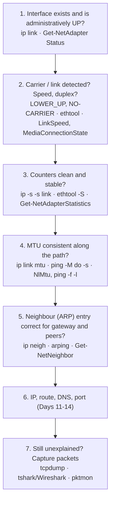
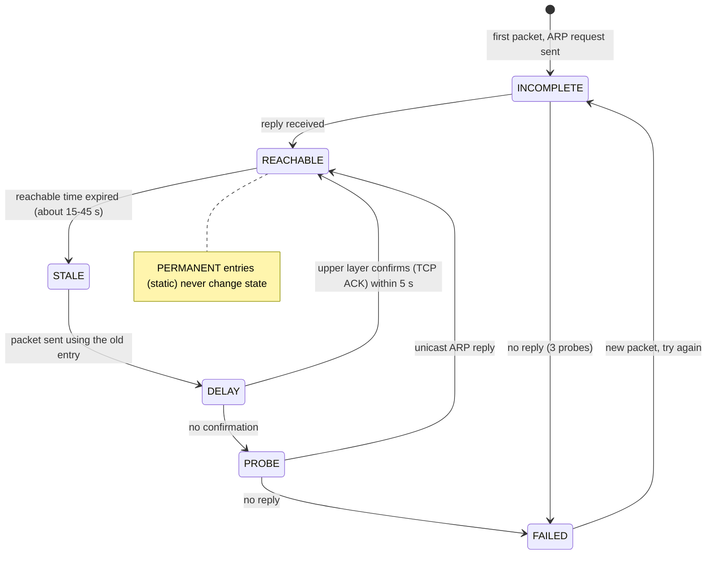
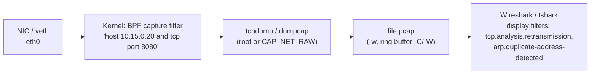

# Day 15: Network Interfaces and Diagnostics

!!! info "Lesson overview"
    | | |
    |---|---|
    | **Module** | 3 — Networking & Troubleshooting |
    | **Difficulty** | :material-signal-cellular-2: Intermediate |
    | **Estimated time** | 3–4 hours (75 min reading, 90 min demonstrations, 60–90 min lab and quiz) |
    | **Platforms** | Ubuntu 24.04 LTS (iproute2 6.1, ethtool 6.7, tcpdump 4.99, iputils-arping, optional tshark/Wireshark 4.2) · Windows 11 (Windows PowerShell 5.1 and PowerShell 7.4+) |
    | **Lab** | [Lab 15: Flapping Link, Silent Drops](../../labs/lab-15.md) |

## Learning Objectives

By the end of this lesson you will be able to:

1. Name the common **interface types** (physical Ethernet, Wi-Fi, loopback, veth, bridge, VLAN, bond/team, tunnel) and decode Linux **predictable interface names** such as `enp0s3`, `ens33`, `eno1` and `wlp2s0`.
2. Read the **link state** of an interface correctly: the administrative flag `UP`, the carrier flag `LOWER_UP`, `NO-CARRIER`, the `state` (operstate) field, the MTU and the MAC address — on Linux with `ip link` and on Windows with `Get-NetAdapter`.
3. Find **physical-layer and driver problems** with interface counters: `ip -s -s link`, `/sys/class/net/IFACE/statistics`, `ethtool -S`, `Get-NetAdapterStatistics` — and tell errors, drops, overruns and carrier changes apart.
4. Check **speed, duplex, auto-negotiation, driver and offloads** with `ethtool` and `Get-NetAdapter` / `Get-NetAdapterAdvancedProperty`, and know why virtual NICs report odd values.
5. Explain how **ARP** and the **neighbour cache** work, interpret the states REACHABLE, STALE, DELAY, PROBE, INCOMPLETE, FAILED and PERMANENT, and repair a wrong entry with `ip neigh` or `Remove-NetNeighbor` safely.
6. Detect a **duplicate IP address** with `arping -D`, a packet capture and Windows' own conflict detection.
7. Find an **MTU mismatch** and an MTU **black hole** with `ping -M do -s` / `ping -f -l` and interface counters.
8. Watch interfaces and neighbours change live with `ip monitor`, and see link flaps in counters and logs.
9. Capture traffic **legally and safely** with `tcpdump` (interfaces, BPF capture filters, `-w`/`-r` pcap files, ring buffers), analyse it with `tshark`/Wireshark display filters, and capture on Windows with `pktmon` and `netsh trace`.
10. Run a layered **interface diagnostic** with the course scripts `network-diagnostic.sh` and `Network-Diagnostic.ps1`.

## Prerequisites

- [Day 11: IP Configuration](day-11.md): `ip addr`, `ip route`, `ip neigh` basics, `Get-NetIPConfiguration`, `Get-NetNeighbor`.
- [Day 12: Connectivity Troubleshooting](day-12.md): the layered method, `ping`, path MTU with `ping -M do`, `tracepath`.
- [Day 14: Ports, Sockets and Connections](day-14.md): TCP handshake and states, because today you will **see** them in packets.
- An Ubuntu 24.04 VM or WSL2 with `sudo`. Install today's tools:

    ```bash
    sudo apt update && sudo apt install -y iproute2 ethtool tcpdump iputils-arping iputils-tracepath
    sudo apt install -y tshark       # optional: command-line Wireshark; answer "No" to non-root capture for now
    ```

- A Windows 11 machine with Windows PowerShell 5.1; PowerShell 7.4+ recommended. Most adapter cmdlets work in a normal window; changing adapters, neighbour entries and running `pktmon` or `netsh trace` need an **elevated** window. Wireshark for Windows (with Npcap) is optional.
- Read [Lab Environment & Safety](../../getting-started/lab-environment.md). **Capture only on systems and networks you own or are explicitly authorised to monitor.** Packet captures contain passwords, cookies and personal data: treat them as confidential evidence.

## Introduction and Concepts

### Where interface diagnostics fit

Days 11–14 worked from IP upwards: addresses, routes, DNS, ports. Many real outages start **below** IP — a bad cable, a switch port with the wrong MTU, a duplex mismatch, a laptop that took the server's address, a stale ARP entry. Those faults produce confusing symptoms higher up ("the share is slow", "big files hang", "it works for a minute then stops"). Today you learn to check the lower layers first and to look at the packets themselves when nothing else explains the symptom.



### Interface types

| Type | Linux example | Windows example | Notes |
|---|---|---|---|
| Physical Ethernet | `enp0s3`, `eno1`, `ens33` | `Ethernet`, `Ethernet 2` | Has a real carrier, speed and duplex |
| Wi-Fi | `wlp2s0` | `Wi-Fi` | Carrier means "associated"; states `DORMANT` during 802.1X authentication |
| Loopback | `lo` | *Loopback Pseudo-Interface 1* (hidden in `Get-NetAdapter`) | State `UNKNOWN` on Linux is normal |
| veth pair | `veth3f2a@if7`, `eth0@if3` in containers | — | A virtual cable: two ends, whatever enters one leaves the other |
| Bridge | `br0`, `docker0`, `virbr0` | *Hyper-V Virtual Ethernet Adapter (vEthernet)* | A software switch; ports are other interfaces |
| VLAN | `enp0s3.15`, `vlan15` | VLAN ID property of the NIC or a Hyper-V switch | 802.1Q tag on a parent interface |
| Bond / team | `bond0` | NIC Teaming (`Get-NetLbfoTeam`, Windows Server) or SET | Several NICs as one, for failover or bandwidth |
| Tunnel / VPN | `tun0`, `wg0`, `tailscale0` | *WireGuard Tunnel*, *Wintun*, VPN adapters | Lower MTU than Ethernet; no carrier in the physical sense |

**Predictable names on Linux.** systemd-udev names interfaces from hardware facts so that names survive reboots and hardware changes (see `systemd.net-naming-scheme(7)`). The prefix is the type — `en` Ethernet, `wl` WLAN, `ww` WWAN — followed by where the device sits:

| Name | Meaning |
|---|---|
| `eno1` | **o**nboard device index 1 (firmware-provided) |
| `ens33` | hot-plug **s**lot 33 (common in VMware VMs) |
| `enp0s3` | **p**CI bus 0, **s**lot 3 (VirtualBox default) |
| `enp3s0f1` | PCI bus 3, slot 0, **f**unction 1 (second port of a dual-port card) |
| `wlp2s0` | Wi-Fi on PCI bus 2, slot 0 |
| `enx0022b0a1b2c3` | named after the MAC address (often USB adapters) |
| `eth0` | Old kernel-order name; still used inside containers and on some cloud images |

### Administrative state, carrier and operstate

An interface has two separate "up" ideas, and confusing them is the most common beginner mistake:

| Concept | Linux | Windows | Who sets it |
|---|---|---|---|
| **Administrative state** — "should this interface be used?" | `UP` flag in `<...>` (set by `ip link set dev X up`) | `Status Disabled` vs anything else (`Enable-/Disable-NetAdapter`) | The administrator / network manager |
| **Carrier** — "is there a working link at the other end?" | `LOWER_UP` flag; `NO-CARRIER` when missing; `/sys/class/net/X/carrier` | `MediaConnectionState Connected/Disconnected`; `Status Up` vs `Disconnected` | The hardware: cable, switch port, Wi-Fi association, veth peer |
| **Operational state** (RFC 2863) | `state UP`, `DOWN`, `UNKNOWN`, `LOWERLAYERDOWN`, `DORMANT` | `ifOperStatus` (`Up`, `Down`, `NotPresent`, `LowerLayerDown`, `Dormant`) | The kernel combines both |

So `<NO-CARRIER,BROADCAST,MULTICAST,UP> ... state DOWN` means: *the administrator wants it up, but there is no link* — check the cable, the switch port or (in a VM) the virtual cable. `<BROADCAST,MULTICAST> ... state DOWN` without `UP` means *someone switched it off*. `state UNKNOWN` on `lo` and on many tunnel interfaces is normal: those drivers do not report an operational state.

### MTU and MAC

- **MTU** (maximum transmission unit) is the largest IP packet the interface sends without fragmentation: 1500 bytes on Ethernet, 9000 with **jumbo frames**, often 1420–1480 on VPN tunnels, 65536 on Linux loopback. Every device on one **Layer-2 segment** must agree. A smaller MTU **inside** the segment (a switch port, a hypervisor bridge) silently drops big frames — no ICMP "fragmentation needed" message comes back, because switches do not speak IP. The result is a classic **MTU black hole**: small requests work, big transfers hang.
- **MAC address** — 48 bits, written `02:15:00:00:00:20` (Linux) or `02-15-00-00-00-20` (Windows). The first three bytes of a burned-in address are the vendor's **OUI**. A second-lowest bit of `1` in the first byte (`02`, `06`, `0A`, `0E`…) means **locally administered**: set by software, as virtual NICs, containers and Wi-Fi **MAC randomisation** do.

### Interface counters

Every NIC driver counts what it sends and receives. Clean counters do not prove a healthy path, but **growing** error counters prove a problem on this link.

| Counter (Linux `ip -s -s link`) | Windows (`Get-NetAdapterStatistics`) | Usually means |
|---|---|---|
| RX/TX `bytes`, `packets` | `ReceivedBytes`, `SentBytes`, `ReceivedUnicastPackets` … | Traffic volume; compare two readings over time |
| RX `errors` (`crc`, `frame`, `length`) | `ReceivedPacketErrors` | Corrupted frames: bad cable, connector, SFP, duplex mismatch, electrical noise |
| RX `dropped` | `ReceivedDiscardedPackets` | Frame received but discarded by the kernel or driver: no buffer, unknown protocol or VLAN, **too big for the MTU**, filtering |
| RX `missed`, `overrun`, `fifo` | (driver-specific, `ethtool -S`-like data in `Get-NetAdapterStatistics` / advanced counters) | The NIC's ring buffer was full: the host could not keep up |
| TX `errors`, `aborted`, `fifo`, `window` | `OutboundPacketErrors` | Transmit failures in the driver or hardware |
| TX `dropped` | `OutboundDiscardedPackets` | Queue full, interface down while sending, traffic shaping |
| TX `carrier`, `heartbt` | — | Carrier lost while sending: cable or port problem |
| `collsns` | — | Collisions: only possible in **half duplex**; any value on a modern switched network means a duplex mismatch |
| TX `transns` / `/sys/class/net/X/carrier_changes` | (System log link-down/up events) | Number of **carrier changes** — the best evidence of a **flapping** link |

Always take **two readings** a few minutes apart: a counter that has not moved since boot is history; a counter that grows while users complain is the problem.

### ARP and the neighbour cache

To send an IPv4 packet to a host on the **same subnet** — or to the **default gateway** for any other destination — the sender needs the receiver's MAC address. **ARP** (Address Resolution Protocol) asks *"who has 10.15.0.20? tell 10.15.0.10"* as a broadcast; the owner replies *"10.15.0.20 is at 02:15:00:00:00:20"* by unicast. IPv6 uses **NDP** (Neighbor Discovery) over ICMPv6 instead, but the cache is the same idea. The kernel caches answers in the **neighbour table** and keeps checking that they are still valid:



| State (Linux `ip neigh`) | Windows (`Get-NetNeighbor`) | Meaning |
|---|---|---|
| `INCOMPLETE` | `Incomplete` | ARP request sent, no answer yet |
| `REACHABLE` | `Reachable` | Confirmed recently |
| `STALE` | `Stale` | Valid but not confirmed recently; it is still **used**, and re-checked on the next use |
| `DELAY` / `PROBE` | `Delay` / `Probe` | Being re-verified |
| `FAILED` | `Unreachable` | Nobody answered: the host is off, on another VLAN, or the address is wrong |
| `PERMANENT` | `Permanent` | **Static** entry, set by an administrator (or the system for broadcast/multicast addresses). Never re-checked — and never corrected if wrong |
| `NOARP` | — | Interface that does not use ARP (loopback, point-to-point tunnels) |

Two important consequences:

1. **A wrong static (PERMANENT) entry silently breaks a host.** Static ARP entries are sometimes added as a "security" measure or during a migration and then forgotten. When the gateway is replaced, every packet goes to the old MAC. `ip neigh flush` does **not** remove permanent entries.
2. **ARP has no authentication.** Any device on the segment can claim any address. That is how a **duplicate IP** happens by mistake, and how **ARP spoofing** (a man-in-the-middle attack) happens on purpose. Duplicate addresses show up as **two different MAC addresses** answering for one IP, and as a neighbour entry that changes MAC.

### Packet capture: tcpdump, Wireshark and pktmon

A packet capture shows what actually crossed the interface. The kernel copies each frame that matches a **capture filter** — written in **BPF** syntax, compiled into the kernel so unwanted packets are never copied — to the capture program. You can print packets live, or write them to a **pcap/pcapng** file and analyse them later with tcpdump, tshark or Wireshark.



| | Capture filter (BPF) | Display filter (Wireshark) |
|---|---|---|
| Used by | `tcpdump`, `tshark -f`, Wireshark capture options, `dumpcap` | Wireshark filter bar, `tshark -Y` |
| Applied | **While capturing**: unmatched packets are never saved | **After capturing**: hides packets, the file keeps them |
| Syntax | `host 10.15.0.20 and tcp port 8080`, `arp`, `icmp`, `net 10.15.0.0/24`, `not port 22` | `ip.addr == 10.15.0.20 && tcp.port == 8080`, `arp`, `icmp`, `tcp.flags.syn == 1`, `tcp.analysis.retransmission` |
| Purpose | Keep the file small and avoid capturing private data you do not need | Find the interesting packets quickly |

!!! danger "Capture legally and ethically"
    A capture can contain credentials, session cookies, e-mails and personal data. Capture **only** on systems and networks you own or have **written authorisation** to monitor; capture **only** the traffic you need (filters, short snap lengths); store pcap files as confidential evidence, delete them when the case is closed, and never send them to third parties without approval. In many countries unauthorised interception is a criminal offence.

## Linux Command Reference

| Command | Purpose | Package / availability | Needs root? |
|---|---|---|---|
| `ip link` / `ip -br link` / `ip -d link` | Interfaces, flags, state, MTU, MAC; brief form; details (type, VLAN ID, bridge, bond) | iproute2 (installed by default) | Only to **change** (`ip link set`) |
| `ip -s -s link show dev IF` | RX/TX counters with error details | iproute2 | No |
| `/sys/class/net/IF/…` | `operstate`, `carrier`, `carrier_changes`, `speed`, `duplex`, `mtu`, `address`, `statistics/*` | Kernel sysfs (always) | No |
| `ethtool IF` | Speed, duplex, auto-negotiation, port, link detected | ethtool (`sudo apt install ethtool`) | Some fields need root; `-s` (change) needs root |
| `ethtool -S IF` / `-i IF` / `-k IF` | Driver statistics / driver and firmware / offload features | ethtool | Usually no (driver-dependent) |
| `ip neigh` | Neighbour (ARP/NDP) cache: show, add, replace, delete, flush | iproute2 | Only to change |
| `arping` | Send ARP requests: test a neighbour, detect duplicates (`-D`), announce (`-U`) | iputils-arping (Ubuntu; a different `arping` package also exists) | Yes (raw sockets) |
| `ip monitor link neigh address route` | Live events from the kernel | iproute2 | No (inside your namespace) |
| `bridge link` / `bridge fdb` | Bridge ports and learned MAC table | iproute2 | No |
| `tcpdump` | Capture and decode packets; read/write pcap files | tcpdump (installed on Ubuntu Server; `sudo apt install tcpdump`) | **Yes** to capture; reading a file needs no root |
| `tshark` / Wireshark | Analyse captures with display filters and protocol dissectors | tshark / wireshark (universe) | To capture: root or the `wireshark` group |
| `tracepath` / `ping -M do -s` | Path MTU discovery / test a packet size with "don't fragment" | iputils-tracepath / iputils-ping | No |
| `journalctl -k` | Kernel messages (link up/down, driver errors) — Day 16 | systemd | Members of `adm`/`systemd-journal`, or root |

## PowerShell Command Reference

| Cmdlet / command | Alias | Purpose | 5.1 | 7.x | Admin? |
|---|---|---|---|---|---|
| `Get-NetAdapter` | — | Adapters with `Status`, `LinkSpeed`, `MacAddress`, `MediaConnectionState`, `ifIndex`, `InterfaceDescription`; `-Physical`, `-IncludeHidden` | Yes | **Windows only** (NetAdapter module) | No |
| `Get-NetAdapterStatistics` | — | Bytes, packets, **errors and discards** per adapter | Yes | Windows only | No |
| `Get-NetAdapterAdvancedProperty` / `Set-…` | — | Driver settings: *Speed & Duplex*, *Jumbo Packet*, offloads | Yes | Windows only | Get: no · **Set: yes** (resets the adapter) |
| `Get-NetAdapterBinding` | — | Protocols bound to an adapter (IPv4, IPv6, File and Printer Sharing…) | Yes | Windows only | No |
| `Restart-NetAdapter` / `Disable-NetAdapter` / `Enable-NetAdapter` | — | Bounce / switch off / on an adapter | Yes | Windows only | **Yes**; supports `-WhatIf` |
| `Get-NetIPInterface` | — | Per-interface IP settings incl. **`NlMtu`**, `ConnectionState`, `InterfaceMetric` | Yes | Windows only | No |
| `Get-NetNeighbor` | — | Neighbour cache (ARP/NDP) with `State` | Yes | Windows only | No |
| `Remove-NetNeighbor` / `New-NetNeighbor` | — | Delete / add a neighbour entry | Yes | Windows only | **Yes**; supports `-WhatIf` |
| `arp -a` / `arp -d` | — | Native ARP cache view / delete | Yes | Yes (Windows) | `-d` needs admin |
| `ping -f -l SIZE` | — | Native ping with *don't fragment* and payload size (MTU test) | Yes | Yes (Windows) | No |
| `pktmon` | — | Built-in packet monitor: filters, capture to ETL, per-component **drop counters**, convert to pcapng | Yes | Yes (Windows 10 2004+, Windows 11) | **Yes** |
| `netsh trace start capture=yes` | — | Built-in ETW packet trace (ETL file) | Yes | Yes (Windows) | **Yes** |
| `[System.Net.NetworkInformation.NetworkInterface]` | — | Interfaces, status, speed, MAC and `GetIPStatistics()` counters | Yes | **Yes, all OS** | No |

!!! warning "Windows-only cmdlets"
    The NetAdapter and NetTCPIP cmdlets (`Get-NetAdapter*`, `Get-NetIPInterface`, `Get-NetNeighbor`) exist only on Windows, in both Windows PowerShell 5.1 and PowerShell 7. In PowerShell 7 on Linux or macOS use the .NET `NetworkInterface` class, or call `ip`/`ethtool` from PowerShell. There is no PowerShell cmdlet that captures packets: on Windows use `pktmon`, `netsh trace` or Wireshark; on Linux, `tcpdump`.

## Detailed Command Explanations

### `ip link` — interfaces, flags and state (deeper than Day 11)

```bash
ip link show                 # every interface, full form
ip -br link                  # brief: name, state, MAC, flags
ip -d link show dev br0      # details: type-specific data (bridge, vlan, bond, veth)
ip -s -s link show dev eth0  # counters with error breakdown
ip -j link show dev eth0     # JSON, for scripts (jq / ConvertFrom-Json)
```

Read a line from left to right:

```text
2: eth0@if3: <BROADCAST,MULTICAST,UP,LOWER_UP> mtu 1500 qdisc noqueue state UP mode DEFAULT group default qlen 1000
    link/ether 02:15:00:00:00:10 brd ff:ff:ff:ff:ff:ff link-netns lab15-sw
```

| Part | Meaning |
|---|---|
| `2:` | Interface index (`ifindex`) |
| `eth0@if3` | Name; `@if3` = the **peer** is interface 3 (veth pairs, VLANs show their parent: `enp0s3.15@enp0s3`) |
| `<…UP,LOWER_UP>` | Flags: `UP` = administratively up, `LOWER_UP` = carrier present, `NO-CARRIER` = no link, `BROADCAST`/`MULTICAST` = capabilities, `PROMISC` = promiscuous mode (a capture or a bridge) |
| `mtu 1500` | Maximum IP packet size |
| `qdisc noqueue` | Queueing discipline (`fq_codel`, `mq` on real NICs) |
| `state UP` | Operational state: `UP`, `DOWN`, `UNKNOWN`, `LOWERLAYERDOWN`, `DORMANT` |
| `master br0` | (on bridge or bond ports) the interface it belongs to |
| `link/ether …` | MAC address and broadcast address |
| `link-netns lab15-sw` | The peer lives in another network namespace |

**Changing an interface** needs root and can cut you off if you are connected through it:

```bash
sudo ip link set dev enp0s3 down        # administrative down - NEVER on the interface your SSH session uses
sudo ip link set dev enp0s3 up
sudo ip link set dev enp0s3 mtu 9000    # temporary until reboot; make it permanent in Netplan
```

Changes with `ip` are **not persistent**. On Ubuntu the permanent configuration lives in Netplan (`/etc/netplan/*.yaml`, `mtu:`, Day 11) or NetworkManager (`nmcli connection modify … 802-3-ethernet.mtu 9000`). Test with `sudo netplan try`, which rolls back automatically if you lose access.

### `ip -s -s link` and `/sys/class/net` — counters

One `-s` prints bytes, packets, errors, dropped, missed, multicast; the second `-s` breaks errors down (RX: `length`, `crc`, `frame`, `fifo`, `overrun`; TX: `aborted`, `fifo`, `window`, `heartbt`, `transns`). The same numbers are in `/sys/class/net/IF/statistics/` as one file per counter — perfect for scripts and monitoring:

```bash
cat /sys/class/net/enp0s3/statistics/rx_errors
cat /sys/class/net/enp0s3/carrier_changes        # link flaps since the driver loaded
cat /sys/class/net/enp0s3/operstate              # up / down / unknown / dormant
cat /sys/class/net/enp0s3/speed                  # Mb/s; "Invalid argument" or -1 when there is no link
```

`carrier_changes` counts both directions: an interface that came up once at boot shows 1 or 2; a value of hundreds means the link has been **flapping**.

### `ethtool` — the physical layer

`ethtool` talks to the **driver**. Its most useful forms:

| Command | Shows |
|---|---|
| `ethtool IF` | Supported/advertised link modes, **Speed**, **Duplex**, **Auto-negotiation**, Port, *Link detected* |
| `ethtool -S IF` | Driver-specific statistics (for example `rx_crc_errors`, `rx_missed_errors`, `tx_timeout_count`, per-queue counters) |
| `ethtool -i IF` | Driver name and version, firmware, PCI bus address |
| `ethtool -k IF` | Offload features (TSO, GSO, GRO, checksumming). Capital `-K` changes them (root) |
| `ethtool -g IF` | Ring-buffer sizes (relevant when `missed`/`overrun` grow) |
| `ethtool -s IF speed 1000 duplex full autoneg off` | **Changes** link settings (root). Forcing speed/duplex on one side only causes a duplex mismatch; change it only with the network team, from the console |

On **virtual NICs** (veth, virtio, VMware vmxnet3, Hyper-V) speed and duplex are reported by the hypervisor and mean little: veth always shows `10000Mb/s Full`, virtio often `Unknown!`. Errors and drops still count.

**Offloads** let the NIC (or the virtual NIC) segment big TCP buffers into wire-sized frames (TSO/GSO) and merge received frames (GRO). Two side effects matter for diagnostics: a capture on the **sending host** may show "packets" of 64 KiB that never existed on the wire, and checksums may look wrong in a capture taken on the sender (`cksum incorrect`) because the NIC fills them in later. Lab 15 turns offloads off on its virtual cables so that the MTU fault behaves as on real hardware.

### `ip neigh` — the neighbour cache in depth

```bash
ip neigh show                             # everything
ip neigh show dev eth0 nud stale          # filter by state (nud = neighbour unreachability detection)
ip -s neigh show 10.15.0.20               # with usage timers and probe counter
sudo ip neigh del 10.15.0.1 dev eth0      # delete ONE entry - re-learned on the next packet
sudo ip neigh replace 10.15.0.1 lladdr 02:15:00:00:00:01 nud permanent dev eth0   # static entry (rarely a good idea)
sudo ip neigh flush dev eth0              # remove all DYNAMIC entries on eth0 (not PERMANENT ones)
```

Deleting or flushing entries is safe in the sense that they are re-learned within milliseconds, but on a busy server `flush` triggers an ARP storm and a brief stall for every peer. Prefer `del` for the single entry you have proved wrong, and **save the table first** (`ip neigh show > neigh-before.txt`). Timers are per interface: `sysctl net.ipv4.neigh.eth0.base_reachable_time_ms` (30000 ms; the real reachable time is randomised between 0.5× and 1.5×) and `gc_stale_time` (60 s).

### `arping` — talk ARP directly

`ping` tests IP; `arping` tests **Layer 2**: it works even when a firewall blocks ICMP, and it shows **which MAC** answers. On Ubuntu 24.04 the `iputils-arping` package provides it (the separate `arping` package by Thomas Habets has different options).

| Command | Purpose |
|---|---|
| `sudo arping -I eth0 -c 3 10.15.0.20` | Who answers for this address? More than one MAC = duplicate |
| `sudo arping -D -I eth0 -c 2 10.15.0.20` | **Duplicate address detection**: sends probes from `0.0.0.0`; exit **0** = nobody else uses it, exit **1** = a reply came, the address is taken |
| `sudo arping -U -I eth0 -c 2 10.15.0.20` | **Unsolicited (gratuitous) ARP**: announce "this IP is at my MAC" so that neighbours update their caches (after a fail-over or a fix) |

Run `-D` **before** assigning a static address by hand, and from the legitimate owner when you suspect a conflict. NetworkManager (`ipv4.dad-timeout`) and systemd-networkd (`DuplicateAddressDetection=`) can do the same check automatically.

### `ip monitor` — watch the kernel live

`ip monitor` prints every change to links, addresses, routes and neighbours as it happens; `ip -timestamp monitor link neigh` adds a timestamp to each event. Leave it running in a second terminal while you reproduce a problem: a flapping link prints `NO-CARRIER` / `LOWER_UP` pairs, a neighbour entry going `STALE → PROBE → FAILED` shows a host that stopped answering, and a route that disappears shows a DHCP or VPN client at work. Stop it with ++ctrl+c++.

### `tcpdump` — capture and decode

| Option | Meaning |
|---|---|
| `-D` | List interfaces that can be captured on |
| `-i IF` / `-i any` | Interface to capture on (`any` = all, with a "cooked" header: no Ethernet MACs) |
| `-n` | No name resolution for addresses **and** ports (in tcpdump 4.99 `-n` covers both; older docs use `-nn`) — always use it |
| `-c N` | Stop after N packets |
| `-e` | Print the Ethernet header (source and destination **MAC**) — essential for ARP and duplicate-IP problems |
| `-v`, `-vv` | More decoding (TTL, IP ID, flags, options) |
| `-A` / `-X` | Payload as ASCII / hex and ASCII |
| `-s LEN` | Snap length: bytes saved per packet (default 262144 = whole packet). `-s 128` keeps headers only — smaller files, less private data |
| `-w FILE` / `-r FILE` | Write raw packets to a pcap file / read a pcap file (reading needs no root) |
| `-C MB -W N` | Ring buffer: new file every MB million bytes, keep N files (`file.pcap0`, `file.pcap1`, …) |
| `-G SECONDS` | Rotate by time (use a `strftime` pattern in the file name) |
| `-Q in`/`out` | Capture only one direction (Linux) |
| `-Z USER` | User to drop privileges to after opening the interface. Ubuntu's tcpdump drops to the **`tcpdump`** user by default, so files it creates **later** (ring buffers, `-G`) must be in a directory that user can write |
| `-tttt` | Full date and time on every line |

**BPF capture filter primitives** (see `pcap-filter(7)`): `host H`, `src host H`, `dst host H`, `net 10.15.0.0/24`, `port 443`, `portrange 8000-8100`, `tcp`, `udp`, `icmp`, `arp`, `ether host 02:15:00:00:00:66`, `vlan 15`, `greater 1000` / `less 100` (packet length), and header access such as `tcp[tcpflags] & (tcp-syn|tcp-rst) != 0` or `icmp[icmptype] == icmp-echo`. Combine with `and`, `or`, `not` and parentheses; **quote** the whole filter. Always exclude your own remote session when capturing on a server: `not port 22`.

tcpdump needs root (or the `CAP_NET_RAW` and `CAP_NET_ADMIN` capabilities). On Ubuntu it also runs under an **AppArmor** profile that limits where and under which names it may write files; keep the `.pcap` extension and, if writing fails with *Permission denied*, check the kernel log for an `apparmor="DENIED"` line before changing anything.

### `tshark` and Wireshark — analysis with display filters

Wireshark (GUI) and `tshark` (its command-line version) dissect hundreds of protocols and add **expert analysis**: retransmissions, duplicate ACKs, zero windows, ARP conflicts. Useful command-line forms:

```bash
tshark -n -r file.pcap                                   # summary, one line per packet
tshark -n -r file.pcap -Y 'tcp.analysis.retransmission'  # display filter
tshark -n -r file.pcap -Y 'arp.duplicate-address-detected'
tshark -n -r file.pcap -Y 'arp.opcode == 2' -T fields -e arp.src.proto_ipv4 -e arp.src.hw_mac
tshark -n -r file.pcap -q -z conv,tcp                    # statistics: TCP conversations
capinfos file.pcap                                       # file summary (packets, duration, snaplen)
```

Capturing with Wireshark as a normal user on Ubuntu requires the `wireshark` group (`sudo dpkg-reconfigure wireshark-common`, then `sudo usermod -aG wireshark $USER` and log in again) — only on machines where you are allowed to capture. Common display filters: `ip.addr == 10.15.0.20`, `tcp.port == 8080`, `tcp.flags.syn == 1 && tcp.flags.ack == 0`, `tcp.flags.reset == 1`, `icmp.type == 3`, `dns`, `eth.addr == 02:15:00:00:00:66`, `frame.len > 1400`.

### `Get-NetAdapter` — adapters as objects (Windows)

```powershell
Get-NetAdapter                                           # visible adapters
Get-NetAdapter -Physical                                 # real hardware only
Get-NetAdapter -IncludeHidden                            # also hidden/virtual (WAN miniports, filters)
Get-NetAdapter -Name Ethernet | Format-List Name, InterfaceDescription, ifIndex, Status, MediaConnectionState, LinkSpeed, FullDuplex, MtuSize, MacAddress, DriverVersion, DriverDate
```

`Status` is `Up`, `Disconnected` (no carrier — the cable or Wi-Fi), `Disabled` (administratively off) or `Not Present`. `LinkSpeed` is a string such as `1 Gbps`; the numeric `Speed` property is in bits per second. `MtuSize` is the **link** MTU including the driver's view; the **IP** MTU that Windows uses is `NlMtu` from `Get-NetIPInterface`.

### `Get-NetAdapterStatistics` — counters (Windows)

```powershell
Get-NetAdapterStatistics -Name Ethernet | Format-List ReceivedBytes, SentBytes, ReceivedUnicastPackets, SentUnicastPackets, ReceivedDiscardedPackets, ReceivedPacketErrors, OutboundDiscardedPackets, OutboundPacketErrors
```

As on Linux, take two readings and compare. `ReceivedDiscardedPackets` often grows slowly on a healthy PC (frames for protocols nobody listens to); `ReceivedPacketErrors` should stay at 0 on a wired link.

### `Get-NetAdapterAdvancedProperty` and the adapter cmdlets (Windows)

Driver settings appear as advanced properties; names depend on the driver, but **registry keywords** are standardised (`*SpeedDuplex`, `*JumboPacket`, `*LsoV2IPv4`, `*FlowControl`):

```powershell
Get-NetAdapterAdvancedProperty -Name Ethernet | Format-Table DisplayName, DisplayValue, RegistryKeyword -AutoSize
Get-NetAdapterAdvancedProperty -Name Ethernet -RegistryKeyword '*JumboPacket'
Set-NetAdapterAdvancedProperty -Name Ethernet -RegistryKeyword '*JumboPacket' -RegistryValue 9014 -WhatIf   # elevated; resets the link
```

`Restart-NetAdapter -Name Ethernet` bounces the adapter (a common "fix" for driver hangs); `Disable-NetAdapter` switches it off. Both need an elevated window, both support `-WhatIf` and `-Confirm`, and both **cut off remote sessions** that use that adapter — never run them over RDP or PowerShell remoting on the only adapter. `Get-NetAdapterBinding -Name Ethernet` shows which protocols are bound (an unbound IPv4 protocol, `ms_tcpip`, explains a "connected" adapter without an IP address).

### `Get-NetNeighbor` and `Remove-NetNeighbor` (Windows)

```powershell
Get-NetNeighbor -AddressFamily IPv4 -InterfaceAlias Ethernet
Get-NetNeighbor -IPAddress 192.168.1.1 | Format-List IPAddress, LinkLayerAddress, State, InterfaceAlias
Remove-NetNeighbor -IPAddress 192.168.1.1 -InterfaceAlias Ethernet -WhatIf      # preview, then run elevated without -WhatIf
```

`State` values: `Unreachable`, `Incomplete`, `Probe`, `Delay`, `Stale`, `Reachable`, `Permanent`. Entries for multicast and broadcast addresses (`224.0.0.22`, `255.255.255.255`, `ff-ff-ff-ff-ff-ff`) are `Permanent` by design. The native `arp -a` shows the same table per interface with the type `dynamic` or `static`.

Windows also detects **duplicate IPv4 addresses** by itself when an address is configured: the address gets `AddressState Duplicate` in `Get-NetIPAddress`, the user sees a "Windows has detected an IP address conflict" notification, and the System log records **Tcpip event 4199** with the other system's MAC address.

### `pktmon` and `netsh trace` — packet capture on Windows (elevated)

`pktmon` (Packet Monitor) is built into Windows 10 version 2004 and later and Windows 11. It captures at several points of the network stack and **counts drops per component**, which tells you *where* a packet died:

```powershell
pktmon filter add LabWeb -i 192.168.1.20 -p 443      # capture only this host and port
pktmon filter list
pktmon start --capture --pkt-size 128 --file-name "$HOME\lab15\web.etl"
# ... reproduce the problem ...
pktmon counters                                       # packets and DROPS per component
pktmon stop
pktmon etl2pcap "$HOME\lab15\web.etl" --out "$HOME\lab15\web.pcapng"   # open in Wireshark
pktmon filter remove
```

`netsh trace start capture=yes tracefile=C:\Temp\net.etl maxsize=512` / `netsh trace stop` is the older built-in method; it also collects a large diagnostic `.cab`. Its ETL files are not pcap; Microsoft's separate `etl2pcapng` tool converts them. For everyday work, **Wireshark with Npcap** is the most convenient Windows capture tool; install it only where policy allows.

### Cross-platform: `NetworkInterface` in PowerShell 7

```powershell
[System.Net.NetworkInformation.NetworkInterface]::GetAllNetworkInterfaces() |
    Select-Object Name, NetworkInterfaceType, OperationalStatus, Speed,
        @{ n = 'MAC'; e = { $_.GetPhysicalAddress().ToString() } }
$nic = [System.Net.NetworkInformation.NetworkInterface]::GetAllNetworkInterfaces() | Where-Object Name -eq 'eth0'
$nic.GetIPStatistics() | Select-Object BytesReceived, BytesSent, IncomingPacketsDiscarded, IncomingPacketsWithErrors, OutgoingPacketsDiscarded, OutgoingPacketsWithErrors
$nic.GetIPProperties().GetIPv4Properties().Mtu
```

These work in Windows PowerShell 5.1 and in PowerShell 7 on every OS (on Linux .NET reads `/proc` and `/sys`). A few statistics properties are not available on Linux or macOS and throw `PlatformNotSupportedException` when read, so select only the ones you need. The course's `Network-Diagnostic.ps1` uses `Get-NetAdapter*` on Windows and this class elsewhere.

## Syntax and Parameters

### Linux

```text
ip [-br] [-d] [-s [-s]] [-j] [-timestamp] link show [dev IFACE] [up] [type TYPE]
ip link set dev IFACE { up | down | mtu N | address MAC | promisc on|off }
ip [-s] neigh { show | flush } [dev IFACE] [nud STATE] [ADDRESS]
ip neigh { add | replace | del } ADDRESS [lladdr MAC] [nud permanent|reachable|stale] dev IFACE
ip [-timestamp] monitor [link] [address] [route] [neigh]
ethtool [-S | -i | -k | -g] IFACE           ethtool -s IFACE speed N duplex half|full autoneg on|off
arping [-D | -U | -A] [-q] [-c COUNT] [-w DEADLINE] -I IFACE ADDRESS
tcpdump [-D] [-i IFACE] [-n] [-e] [-v] [-A | -X] [-c N] [-s SNAPLEN] [-tttt] [-Q in|out]
        [-w FILE [-C MB -W N | -G SEC]] [-r FILE] [-Z USER] ['BPF FILTER']
tshark [-n] [-i IFACE -f 'BPF'] [-r FILE] [-Y 'DISPLAY FILTER'] [-T fields -e FIELD ...] [-q -z STAT]
ping -M do -s PAYLOAD [-c N] HOST            tracepath -n HOST
```

| Option | Tool | Meaning |
|---|---|---|
| `-br` | ip | Brief one-line-per-interface output |
| `-d` | ip | Details (veth peer, bridge, VLAN ID, bond mode) |
| `-s -s` | ip | Statistics with error breakdown |
| `nud STATE` | ip neigh | Filter or set the neighbour state |
| `-D` / `-U` | arping | Duplicate address detection / gratuitous announcement |
| `-S` / `-i` / `-k` | ethtool | Driver statistics / driver info / offloads |
| `-e` | tcpdump | Show MAC addresses |
| `-w` / `-r` | tcpdump | Write / read pcap |
| `-C -W` | tcpdump | Ring buffer of W files of C million bytes |
| `-Y` | tshark | Display filter |
| `-M do -s` | ping | Don't fragment, payload size (IP size = payload + 28) |

### PowerShell

```text
Get-NetAdapter [[-Name] <String[]>] [-InterfaceDescription <String[]>] [-InterfaceIndex <UInt32[]>]
               [-Physical] [-IncludeHidden] [-CimSession <CimSession[]>]
Get-NetAdapterStatistics [[-Name] <String[]>] [-InterfaceDescription <String[]>] [-IncludeHidden]
Get-NetAdapterAdvancedProperty [[-Name] <String[]>] [-DisplayName <String[]>] [-RegistryKeyword <String[]>] [-AllProperties]
Set-NetAdapterAdvancedProperty [-Name] <String[]> (-DisplayName <String[]> -DisplayValue <String> |
               -RegistryKeyword <String[]> -RegistryValue <String[]>) [-NoRestart] [-WhatIf] [-Confirm]
Restart-NetAdapter | Disable-NetAdapter | Enable-NetAdapter [-Name] <String[]> [-WhatIf] [-Confirm]
Get-NetIPInterface [-InterfaceAlias <String[]>] [-AddressFamily IPv4|IPv6]
Get-NetNeighbor [[-IPAddress] <String[]>] [-InterfaceAlias <String[]>] [-State <State[]>] [-AddressFamily IPv4|IPv6]
Remove-NetNeighbor [-IPAddress <String[]>] [-InterfaceAlias <String[]>] [-WhatIf] [-Confirm]
ping -f -l <size> <host>         arp -a [-N <if_addr>]         arp -d <ip>
pktmon filter add [<name>] [-i <ip>] [-p <port>] ...   pktmon start --capture [--pkt-size N] [--file-name F]
pktmon counters | stop | etl2pcap <etl> --out <pcapng> | filter remove
netsh trace start capture=yes tracefile=<file.etl> [maxsize=<MB>]   netsh trace stop
```

| Parameter | Cmdlet | Meaning |
|---|---|---|
| `-Physical` | Get-NetAdapter | Hardware adapters only (no Hyper-V, VPN or loopback adapters) |
| `-IncludeHidden` | Get-NetAdapter, Get-NetAdapterStatistics | Also hidden adapters |
| `-RegistryKeyword` | Get/Set-NetAdapterAdvancedProperty | Driver-independent setting name (`*JumboPacket`, `*SpeedDuplex`) |
| `-NoRestart` | Set-NetAdapterAdvancedProperty | Do not restart the adapter now (setting applies at the next restart) |
| `-State` | Get-NetNeighbor | `Reachable`, `Stale`, `Unreachable`, `Permanent`, … |
| `-WhatIf` | Set-/Restart-/Disable-NetAdapter, Remove-NetNeighbor | Preview without changing anything |
| `-f -l 1472` | ping.exe | Don't fragment, 1472-byte payload (= 1500-byte packet) |
| `--pkt-size 128` | pktmon | Bytes kept per packet (0 = whole packet) |

## Practical Demonstrations

The Linux outputs below were **captured** on 2026-11-14 by running the commands as root on Ubuntu 24.04.5 in a container, inside the network namespaces built by [Lab 15](../../labs/lab-15.md): a software switch `lab15-sw` (bridge `br0`, gateway 10.15.0.1, MAC `02:15:00:00:00:01`) with ports `p-client`, `p-srv` and `p-rogue`, a client `lab15-client` (10.15.0.10, MAC `…:10`), a file server `lab15-srv` (10.15.0.20, MAC `…:20`) and a spare host `lab15-rogue` (MAC `…:66`), connected by veth pairs (iproute2 6.1.0, ethtool 6.7, tcpdump 4.99.4, iputils-arping 20240117, tshark 4.2.2). To keep the commands short, they use `C="sudo ip netns exec lab15-client"`, `V="sudo ip netns exec lab15-srv"` and `W="sudo ip netns exec lab15-sw"`; on a normal VM you run the commands directly on the host (with `sudo` where needed). Paths under the capture host's root home directory are shown as `/home/student`. The container has no physical NIC, no Wi-Fi, no VLAN kernel module and no systemd, so physical-NIC, VLAN, Wi-Fi and kernel-log outputs are **examples**. All PowerShell and Windows outputs are **examples** (not executed on Windows for this release).

### Demo 1 — Interfaces, flags and details

=== "Bash"

    ```bash
    $C ip link show
    $C ip -br link
    $W ip -br link
    $W bridge link
    $C ip -d link show eth0
    ```

    **Expected output (captured):**

    ```text
    1: lo: <LOOPBACK,UP,LOWER_UP> mtu 65536 qdisc noqueue state UNKNOWN mode DEFAULT group default qlen 1000
        link/loopback 00:00:00:00:00:00 brd 00:00:00:00:00:00
    2: eth0@if3: <BROADCAST,MULTICAST,UP,LOWER_UP> mtu 1500 qdisc noqueue state UP mode DEFAULT group default qlen 1000
        link/ether 02:15:00:00:00:10 brd ff:ff:ff:ff:ff:ff link-netns lab15-sw
    lo               UNKNOWN        00:00:00:00:00:00 <LOOPBACK,UP,LOWER_UP>
    eth0@if3         UP             02:15:00:00:00:10 <BROADCAST,MULTICAST,UP,LOWER_UP>
    lo               UNKNOWN        00:00:00:00:00:00 <LOOPBACK,UP,LOWER_UP>
    br0              UP             02:15:00:00:00:01 <BROADCAST,MULTICAST,UP,LOWER_UP>
    p-client@if2     UP             c6:04:ba:b1:da:2d <BROADCAST,MULTICAST,UP,LOWER_UP>
    p-srv@if2        UP             de:1b:8f:81:c7:cf <BROADCAST,MULTICAST,UP,LOWER_UP>
    p-rogue@if2      UP             22:d1:04:e9:1f:93 <BROADCAST,MULTICAST,UP,LOWER_UP>
    3: p-client@br0: <BROADCAST,MULTICAST,UP,LOWER_UP> mtu 1500 master br0 state forwarding priority 32 cost 2
    4: p-srv@br0: <BROADCAST,MULTICAST,UP,LOWER_UP> mtu 1500 master br0 state forwarding priority 32 cost 2
    5: p-rogue@br0: <BROADCAST,MULTICAST,UP,LOWER_UP> mtu 1500 master br0 state forwarding priority 32 cost 2
    2: eth0@if3: <BROADCAST,MULTICAST,UP,LOWER_UP> mtu 1500 qdisc noqueue state UP mode DEFAULT group default qlen 1000
        link/ether 02:15:00:00:00:10 brd ff:ff:ff:ff:ff:ff link-netns lab15-sw promiscuity 0  allmulti 0 minmtu 68 maxmtu 65535
        veth numtxqueues 4 numrxqueues 4 gso_max_size 65536 gso_max_segs 65535 tso_max_size 524280 tso_max_segs 65535 gro_max_size 65536
    ```

    `lo` in state `UNKNOWN` is normal. `-d` reveals the type (`veth`) that the normal listing hides. The switch-side ports have random, locally administered MACs (`c6:…`, `de:…`, `22:…` — second-lowest bit of the first byte set).

    **Expected output (example, a VirtualBox VM with a VLAN interface and a bond):**

    ```text
    $ ip -br link
    lo               UNKNOWN        00:00:00:00:00:00 <LOOPBACK,UP,LOWER_UP>
    enp0s3           UP             08:00:27:3a:5c:11 <BROADCAST,MULTICAST,UP,LOWER_UP>
    enp0s8           DOWN           08:00:27:9e:41:02 <NO-CARRIER,BROADCAST,MULTICAST,UP>
    enp0s3.15@enp0s3 UP             08:00:27:3a:5c:11 <BROADCAST,MULTICAST,UP,LOWER_UP>
    $ ip -d link show enp0s3.15
    4: enp0s3.15@enp0s3: <BROADCAST,MULTICAST,UP,LOWER_UP> mtu 1500 qdisc noqueue state UP mode DEFAULT group default qlen 1000
        link/ether 08:00:27:3a:5c:11 brd ff:ff:ff:ff:ff:ff promiscuity 0 minmtu 0 maxmtu 65535
        vlan protocol 802.1Q id 15 <REORDER_HDR> ...
    ```

    `enp0s8` is administratively `UP` but has `NO-CARRIER`: the virtual cable is not connected in the VM settings.

=== "PowerShell"

    ```powershell
    Get-NetAdapter | Sort-Object ifIndex | Format-Table Name, InterfaceDescription, ifIndex, Status, LinkSpeed, MacAddress -AutoSize
    Get-NetAdapter -Name Ethernet | Format-List Name, Status, MediaConnectionState, LinkSpeed, FullDuplex, MtuSize, DriverVersion
    Get-NetAdapter -IncludeHidden | Measure-Object | Select-Object Count
    ```

    **Expected output (example, Windows 11 laptop with Hyper-V):**

    ```text
    Name                       InterfaceDescription                  ifIndex Status       LinkSpeed MacAddress
    ----                       --------------------                  ------- ------       --------- ----------
    Wi-Fi                      Intel(R) Wi-Fi 6E AX211 160MHz              9 Up           866.7 Mbps 4C-77-CB-12-34-56
    Ethernet                   Intel(R) Ethernet Connection I219-LM       12 Disconnected 0 bps     8C-04-BA-AB-CD-EF
    vEthernet (Default Switch) Hyper-V Virtual Ethernet Adapter           27 Up           10 Gbps   00-15-5D-01-02-03

    Name                 : Ethernet
    Status               : Disconnected
    MediaConnectionState : Disconnected
    LinkSpeed            : 0 bps
    FullDuplex           : False
    MtuSize              : 1500
    DriverVersion        : 12.19.2.45

    Count
    -----
       21
    ```

    `Disconnected` = no cable or no link (Linux `NO-CARRIER`); `Disabled` would mean someone switched it off. Hidden adapters (WAN Miniports, filter drivers, Bluetooth PAN) explain why `-IncludeHidden` returns many more.

### Demo 2 — Counters, carrier changes and ethtool

=== "Bash"

    ```bash
    $C ip -s -s link show eth0
    $C bash -c 'cd /sys/class/net/eth0; for f in operstate carrier carrier_changes mtu address speed duplex \
        statistics/rx_errors statistics/rx_dropped statistics/tx_errors; do printf "%-22s %s\n" "$f" "$(cat "$f")"; done'
    $C ethtool eth0
    $C ethtool -i eth0 | head -3
    $C ethtool -k eth0 | head -5
    ```

    **Expected output (captured):**

    ```text
    2: eth0@if3: <BROADCAST,MULTICAST,UP,LOWER_UP> mtu 1500 qdisc noqueue state UP mode DEFAULT group default qlen 1000
        link/ether 02:15:00:00:00:10 brd ff:ff:ff:ff:ff:ff link-netns lab15-sw
        RX:  bytes packets errors dropped  missed   mcast
              1571      20      0       0       0       0
        RX errors:  length    crc   frame    fifo overrun
                         0      0       0       0       0
        TX:  bytes packets errors dropped carrier collsns
              1312      17      0       0       0       0
        TX errors: aborted   fifo  window heartbt transns
                         0      0       0       0       2
    operstate              up
    carrier                1
    carrier_changes        2
    mtu                    1500
    address                02:15:00:00:00:10
    speed                  10000
    duplex                 full
    statistics/rx_errors   0
    statistics/rx_dropped  0
    statistics/tx_errors   0
    Settings for eth0:
            Supported ports: [  ]
            Supported link modes:   Not reported
            Supported pause frame use: No
            Supports auto-negotiation: No
            Supported FEC modes: Not reported
            Advertised link modes:  Not reported
            Advertised pause frame use: No
            Advertised auto-negotiation: No
            Advertised FEC modes: Not reported
            Speed: 10000Mb/s
            Duplex: Full
            Auto-negotiation: off
            Port: Twisted Pair
            PHYAD: 0
            Transceiver: internal
            MDI-X: Unknown
            Link detected: yes
    driver: veth
    version: 1.0
    firmware-version:
    Features for eth0:
    rx-checksumming: on
    tx-checksumming: on
            tx-checksum-ipv4: off [fixed]
            tx-checksum-ip-generic: on
    ```

    `transns 2` and `carrier_changes 2` are the same counter: the link went down and up once while the lab was built. The veth "10000Mb/s Full" is invented by the driver.

    **Expected output (example, physical Intel NIC with a failing cable):**

    ```text
    $ sudo ethtool enp0s31f6 | grep -E 'Speed|Duplex|Auto-negotiation|Link detected'
            Speed: 100Mb/s
            Duplex: Full
            Auto-negotiation: on
            Link detected: yes
    $ sudo ethtool -S enp0s31f6 | grep -E 'rx_crc_errors|rx_missed_errors|tx_carrier_errors'
         rx_crc_errors: 18342
         rx_missed_errors: 0
         tx_carrier_errors: 0
    ```

    A gigabit NIC that negotiated **100 Mb/s** plus growing **CRC errors** is the signature of a damaged cable (often a broken pair: gigabit needs all four pairs, 100 Mb/s only two).

=== "PowerShell"

    ```powershell
    Get-NetAdapterStatistics -Name Ethernet | Format-List ReceivedBytes, SentBytes, ReceivedUnicastPackets, ReceivedDiscardedPackets, ReceivedPacketErrors, OutboundDiscardedPackets, OutboundPacketErrors
    Get-NetAdapterAdvancedProperty -Name Ethernet | Where-Object RegistryKeyword -in '*SpeedDuplex', '*JumboPacket', '*LsoV2IPv4' | Format-Table DisplayName, DisplayValue, RegistryKeyword -AutoSize
    ```

    **Expected output (example):**

    ```text
    ReceivedBytes            : 4831127734
    SentBytes                : 391022871
    ReceivedUnicastPackets   : 3874120
    ReceivedDiscardedPackets : 112
    ReceivedPacketErrors     : 0
    OutboundDiscardedPackets : 0
    OutboundPacketErrors     : 0

    DisplayName                   DisplayValue  RegistryKeyword
    -----------                   ------------  ---------------
    Speed & Duplex                Auto Negotiation *SpeedDuplex
    Jumbo Packet                  Disabled      *JumboPacket
    Large Send Offload V2 (IPv4)  Enabled       *LsoV2IPv4
    ```

    A small `ReceivedDiscardedPackets` value on a desktop is normal; errors should stay at 0. Display names and values are **driver-specific** (Realtek and Intel use different wording); the registry keywords are not.

### Demo 3 — A flapping link, live

The lab's fault injector takes the switch port of the file server down for 2 seconds every 8 seconds.

=== "Bash"

    ```bash
    $V cat /sys/class/net/eth0/carrier_changes
    $V ip -timestamp monitor link                  # second terminal; Ctrl+C to stop
    $C ping -D -O -i 0.5 -W 1 -c 30 10.15.0.20     # -D timestamps, -O report missing replies
    $V cat /sys/class/net/eth0/carrier_changes
    $V ethtool eth0 | grep 'Link detected'
    date -u -d @1794674780.693919                   # convert a ping -D timestamp
    ```

    **Expected output (captured, shortened):**

    ```text
    2
    Timestamp: Sat Nov 14 16:46:28 2026 196169 usec
    2: eth0@if4: <NO-CARRIER,BROADCAST,MULTICAST,UP> mtu 1500 qdisc noqueue state DOWN group default
        link/ether 02:15:00:00:00:20 brd ff:ff:ff:ff:ff:ff link-netns lab15-sw
    Timestamp: Sat Nov 14 16:46:30 2026 200527 usec
    2: eth0@if4: <BROADCAST,MULTICAST,UP,LOWER_UP> mtu 1500 qdisc noqueue state UP group default
        link/ether 02:15:00:00:00:20 brd ff:ff:ff:ff:ff:ff link-netns lab15-sw
    PING 10.15.0.20 (10.15.0.20) 56(84) bytes of data.
    [1794674780.693919] no answer yet for icmp_seq=1
    [1794674781.205945] no answer yet for icmp_seq=2
    [1794674781.718028] no answer yet for icmp_seq=3
    [1794674782.229989] no answer yet for icmp_seq=4
    [1794674782.230175] 64 bytes from 10.15.0.20: icmp_seq=5 ttl=64 time=0.109 ms
    ...
    [1794674787.862089] 64 bytes from 10.15.0.20: icmp_seq=16 ttl=64 time=0.064 ms
    [1794674788.885947] no answer yet for icmp_seq=17
    ...
    --- 10.15.0.20 ping statistics ---
    30 packets transmitted, 22 received, 26.6667% packet loss, time 14841ms
    7
            Link detected: no
    Sat Nov 14 16:46:20 UTC 2026
    ```

    The pattern — about 2 seconds of loss every 8 seconds, `carrier_changes` jumping from 2 to 7, `NO-CARRIER` events in `ip monitor` — is a **flapping link**, not "random packet loss". Interface **error** counters stay at 0: a link that is down drops nothing, it just is not there.

    **Expected output (example, the same fault on a real server's kernel log):**

    ```text
    $ journalctl -k --since "10 min ago" | grep -i 'link is'
    Nov 14 16:46:28 ubuntu-lab kernel: e1000e 0000:00:1f.6 enp0s31f6: NIC Link is Down
    Nov 14 16:46:30 ubuntu-lab kernel: e1000e 0000:00:1f.6 enp0s31f6: NIC Link is Up 1000 Mbps Full Duplex, Flow Control: Rx/Tx
    ```

=== "PowerShell"

    ```powershell
    Get-WinEvent -FilterHashtable @{ LogName = 'System'; StartTime = (Get-Date).AddHours(-1) } |
        Where-Object Message -match 'link is (dis)?connected|link has been established' |
        Select-Object TimeCreated, ProviderName, Id, Message -First 6
    1..20 | ForEach-Object { '{0:HH:mm:ss} {1}' -f (Get-Date), (Get-NetAdapter -Name Ethernet).Status; Start-Sleep -Seconds 1 }
    ```

    **Expected output (example):**

    ```text
    TimeCreated          ProviderName Id Message
    -----------          ------------ -- -------
    14/11/2026 16:46:30  e1iexpress   32 Intel(R) Ethernet Connection I219-LM: Network link has been established at 1Gbps full duplex.
    14/11/2026 16:46:28  e1iexpress   27 Intel(R) Ethernet Connection I219-LM: Network link is disconnected.
    16:46:27 Up
    16:46:28 Disconnected
    16:46:29 Disconnected
    16:46:30 Up
    ```

    Link events are written by the **driver**, so the provider name and event IDs depend on the NIC vendor. Day 16 covers `Get-WinEvent` properly.

### Demo 4 — Neighbour states, live

=== "Bash"

    ```bash
    $C ip -timestamp monitor neigh &                 # watch in the background (or a second terminal)
    $C ping -c1 -q 10.15.0.20; $C ip neigh show 10.15.0.20
    sleep 48; $C ip neigh show 10.15.0.20
    $C ping -c1 -q 10.15.0.20; $C ip neigh show 10.15.0.20
    $C ping -c1 -W1 -q 10.15.0.77; $C ip neigh show 10.15.0.77; sleep 4; $C ip neigh show 10.15.0.77
    ```

    **Expected output (captured; lines printed by the background `ip monitor` are prefixed with `monitor:` here for readability, and the 10.15.0.77 lines come from a separate run):**

    ```text
    10.15.0.20 dev eth0 lladdr 02:15:00:00:00:20 REACHABLE
    10.15.0.20 dev eth0 lladdr 02:15:00:00:00:20 STALE
    10.15.0.20 dev eth0 lladdr 02:15:00:00:00:20 DELAY
    10.15.0.77 dev eth0 INCOMPLETE
    10.15.0.77 dev eth0 FAILED
    monitor: Timestamp: Sat Nov 14 16:49:14 2026 980206 usec
    monitor: 10.15.0.20 dev eth0 lladdr 02:15:00:00:00:20 REACHABLE
    monitor: Timestamp: Sat Nov 14 16:49:58 2026 230061 usec
    monitor: 10.15.0.20 dev eth0 lladdr 02:15:00:00:00:20 STALE
    monitor: Timestamp: Sat Nov 14 16:50:08 2026 214074 usec
    monitor: 10.15.0.20 dev eth0 lladdr 02:15:00:00:00:20 PROBE
    monitor: Timestamp: Sat Nov 14 16:50:08 2026 214148 usec
    monitor: 10.15.0.20 dev eth0 lladdr 02:15:00:00:00:20 REACHABLE
    ```

    The entry became STALE about 43 seconds after it was confirmed (randomised reachable time), was used again (`DELAY`), had no TCP traffic to confirm it, was probed with a unicast ARP (`PROBE`) and answered (`REACHABLE`). 10.15.0.77 does not exist: `INCOMPLETE` while asking, `FAILED` after three unanswered requests.

=== "PowerShell"

    ```powershell
    Get-NetNeighbor -AddressFamily IPv4 -InterfaceAlias Ethernet | Sort-Object State | Format-Table IPAddress, LinkLayerAddress, State -AutoSize
    arp -a -N 192.168.1.50
    ```

    **Expected output (example):**

    ```text
    IPAddress       LinkLayerAddress  State
    ---------       ----------------  -----
    192.168.1.1     F0-9F-C2-11-22-33 Reachable
    192.168.1.20    00-15-5D-0A-0B-0C Stale
    192.168.1.77    00-00-00-00-00-00 Unreachable
    224.0.0.22      01-00-5E-00-00-16 Permanent
    239.255.255.250 01-00-5E-7F-FF-FA Permanent
    255.255.255.255 FF-FF-FF-FF-FF-FF Permanent

    Interface: 192.168.1.50 --- 0xc
      Internet Address      Physical Address      Type
      192.168.1.1           f0-9f-c2-11-22-33     dynamic
      192.168.1.20          00-15-5d-0a-0b-0c     dynamic
      224.0.0.22            01-00-5e-00-00-16     static
      255.255.255.255       ff-ff-ff-ff-ff-ff     static
    ```

    `arp -a` does not list unreachable entries; `Get-NetNeighbor` does, with an all-zero MAC.

### Demo 5 — MTU mismatch and the black hole

The injector set the switch port `p-srv` to MTU 1400 while both hosts use 1500.

=== "Bash"

    ```bash
    $C curl -sS -m 5 http://10.15.0.20:8080/                       # small page
    $C curl -sS -m 8 -o /dev/null -w '%{http_code} %{size_download} bytes\n' http://10.15.0.20:8080/backup.img
    for s in 1472 1450 1400 1373 1372; do
        if $C ping -c1 -W1 -M do -s "$s" -q 10.15.0.20 >/dev/null; then echo "$s bytes payload ($((s+28)) IP): OK"
        else echo "$s bytes payload ($((s+28)) IP): no reply"; fi
    done
    $C tracepath -n -m 3 10.15.0.20
    $W ip -s link show p-srv
    ```

    **Expected output (captured):**

    ```text
    lab15 file server OK
    curl: (28) Operation timed out after 8002 milliseconds with 0 out of 2097152 bytes received
    200 0 bytes
    1472 bytes payload (1500 IP): no reply
    1450 bytes payload (1478 IP): no reply
    1400 bytes payload (1428 IP): no reply
    1373 bytes payload (1401 IP): no reply
    1372 bytes payload (1400 IP): OK
     1?: [LOCALHOST]                      pmtu 1500
     1:  no reply
     2:  no reply
     3:  no reply
         Too many hops: pmtu 1500
         Resume: pmtu 1500
    4: p-srv@if2: <BROADCAST,MULTICAST,UP,LOWER_UP> mtu 1400 qdisc noqueue master br0 state UP mode DEFAULT group default qlen 1000
        link/ether 46:a0:7c:22:ce:a2 brd ff:ff:ff:ff:ff:ff link-netns lab15-srv
        RX:  bytes packets errors dropped  missed   mcast
           2203877    1546      0      47       0       0
        TX:  bytes packets errors dropped carrier collsns
             26038     328      0       0       0       0
    ```

    The HTTP headers (206 bytes) arrive, the first full-size data segment does not, and `curl` times out. The largest packet that passes is exactly **1400** bytes. `tracepath` cannot find the problem: a switch drops oversize frames **silently**, without the ICMP *fragmentation needed* message that path-MTU discovery relies on. The only trace is the **RX dropped** counter on the switch port (47) — which is why you ask the network team for switch-port counters.

=== "PowerShell"

    ```powershell
    ping -f -l 1472 -n 2 10.15.0.20
    ping -f -l 1372 -n 2 10.15.0.20
    Get-NetIPInterface -AddressFamily IPv4 | Sort-Object NlMtu | Format-Table InterfaceAlias, NlMtu, ConnectionState -AutoSize
    ```

    **Expected output (example):**

    ```text
    Pinging 10.15.0.20 with 1472 bytes of data:
    Request timed out.
    Request timed out.

    Ping statistics for 10.15.0.20:
        Packets: Sent = 2, Received = 0, Lost = 2 (100% loss),

    Pinging 10.15.0.20 with 1372 bytes of data:
    Reply from 10.15.0.20: bytes=1372 time<1ms TTL=64
    Reply from 10.15.0.20: bytes=1372 time<1ms TTL=64

    InterfaceAlias              NlMtu ConnectionState
    --------------              ----- ---------------
    Lab VPN                      1400       Connected
    Ethernet                     1500       Connected
    Loopback Pseudo-Interface 1 4294967295  Connected
    ```

    When a router (not a switch) has the smaller MTU, Windows shows *Packet needs to be fragmented but DF set.* instead of a timeout — that is the healthy case, because path-MTU discovery can work.

### Demo 6 — Capturing the stall with tcpdump and tshark

=== "Bash"

    ```bash
    $V tcpdump -i eth0 -n -s 128 -w ~/lab15/r2-srv.pcap 'tcp port 50000' &     # capture on the server
    TD=$!                                                                     # PID of the sudo running tcpdump
    $C curl -sS -m 6 --local-port 50000 -o /dev/null http://10.15.0.20:8080/backup.img
    sudo kill -INT "$TD"; wait                                                # sudo passes Ctrl+C on: clean stop
    tcpdump -n -r ~/lab15/r2-srv.pcap -c 9
    tshark -n -r ~/lab15/r2-srv.pcap -Y 'tcp.analysis.retransmission' | head -3
    capinfos -c -s ~/lab15/r2-srv.pcap
    ```

    **Expected output (captured, TCP options shortened):**

    ```text
    tcpdump: listening on eth0, link-type EN10MB (Ethernet), snapshot length 128 bytes
    48 packets captured
    48 packets received by filter
    0 packets dropped by kernel
    16:47:42.559886 IP 10.15.0.10.50000 > 10.15.0.20.8080: Flags [S], seq 1683263269, win 64240, options [mss 1460,...], length 0
    16:47:42.559915 IP 10.15.0.20.8080 > 10.15.0.10.50000: Flags [S.], seq 2630772437, ack 1683263270, win 65160, options [mss 1460,...], length 0
    16:47:42.559939 IP 10.15.0.10.50000 > 10.15.0.20.8080: Flags [.], ack 1, win 63, length 0
    16:47:42.560044 IP 10.15.0.10.50000 > 10.15.0.20.8080: Flags [P.], seq 1:89, ack 1, win 63, length 88: HTTP: GET /backup.img HTTP/1.1
    16:47:42.560050 IP 10.15.0.20.8080 > 10.15.0.10.50000: Flags [.], ack 89, win 64, length 0
    16:47:42.563561 IP 10.15.0.20.8080 > 10.15.0.10.50000: Flags [P.], seq 1:207, ack 89, win 64, length 206: HTTP: HTTP/1.0 200 OK
    16:47:42.563586 IP 10.15.0.10.50000 > 10.15.0.20.8080: Flags [.], ack 207, win 63, length 0
    16:47:42.563651 IP 10.15.0.20.8080 > 10.15.0.10.50000: Flags [.], seq 207:1655, ack 89, win 64, length 1448: HTTP
    16:47:42.563651 IP 10.15.0.20.8080 > 10.15.0.10.50000: Flags [.], seq 1655:3103, ack 89, win 64, length 1448: HTTP
       19   0.003805   10.15.0.20 → 10.15.0.10   TCP 1514 [TCP Retransmission] 8080 → 50000 [ACK] Seq=14687 Ack=89 Win=65536 Len=1448 TSval=661518060 TSecr=1288068367
       20   0.003805   10.15.0.20 → 10.15.0.10   TCP 1514 [TCP Retransmission] 8080 → 50000 [ACK] Seq=14687 Ack=89 Win=65536 Len=1448 TSval=661518060 TSecr=1288068367
       21   0.003853   10.15.0.20 → 10.15.0.10   TCP 1514 [TCP Retransmission] 8080 → 50000 [ACK] Seq=14687 Ack=89 Win=65536 Len=1448 TSval=661518060 TSecr=1288068367
    File name:           /home/student/lab15/r2-srv.pcap
    Packet size limit:   inferred: 128 bytes
    Number of packets:   48
    File size:           6394 bytes
    ```

    Both sides announce **MSS 1460** (they believe the MTU is 1500), the server sends 1448-byte segments (1514-byte frames), the client never acknowledges them, and the server retransmits again and again. A fixed source port (`--local-port 50000`) and a matching capture filter keep the file free of other connections; `-s 128` stores headers only.

=== "PowerShell"

    ```powershell
    # Elevated Windows PowerShell or PowerShell 7 on Windows 10 2004+ / Windows 11
    New-Item -ItemType Directory -Path $HOME\lab15 -Force | Out-Null
    pktmon filter add LabWeb -i 10.15.0.20 -p 8080
    pktmon start --capture --pkt-size 128 --file-name "$HOME\lab15\web.etl"
    Invoke-WebRequest -Uri http://10.15.0.20:8080/backup.img -OutFile $env:TEMP\b.img -TimeoutSec 8
    pktmon counters
    pktmon stop
    pktmon etl2pcap "$HOME\lab15\web.etl" --out "$HOME\lab15\web.pcapng"
    pktmon filter remove
    ```

    **Expected output (example, shortened; the counters table layout varies between Windows builds):**

    ```text
    Filter added.
    Logger Parameters:
        Logger name:        PktMon
        Logging mode:       Circular
        Log file:           C:\Users\student\lab15\web.etl
        Max file size:      512 MB
    Invoke-WebRequest : The operation has timed out.
    Name                         ID  Counter  Direction  Packets  Bytes | Direction  Packets  Bytes
    ----                         --  -------  ---------  -------  ----- | ---------  -------  -----
    Intel(R) Ethernet I219-LM     8  Upper        Tx         37  6.230 |    Rx          31  6.105
    Processed 42 packets.
    Converted file : C:\Users\student\lab15\web.pcapng
    All filters removed.
    ```

    Open the `.pcapng` in Wireshark and apply `tcp.analysis.retransmission`. In Windows PowerShell 5.1, `Invoke-WebRequest` may also need `-UseBasicParsing`.

### Demo 7 — Duplicate IP address

The injector gives the spare host `lab15-rogue` the file server's address 10.15.0.20 and makes it announce it.

=== "Bash"

    ```bash
    $C tcpdump -i eth0 -n -e -w ~/lab15/r3-client.pcap arp & TD=$!     # capture ARP on the client (stop later: sudo kill -INT "$TD")
    $C ip neigh show 10.15.0.20
    $C curl -sS -m 5 http://10.15.0.20:8080/
    $C ping -c 2 -W 1 -q 10.15.0.20
    $V arping -D -q -c 2 -I eth0 10.15.0.20; echo "exit: $?"
    $C arping -c 2 -I eth0 10.15.0.20
    $W bridge fdb show br br0 dynamic
    tcpdump -n -e -r ~/lab15/r3-client.pcap
    tshark -n -r ~/lab15/r3-client.pcap -Y 'arp.opcode == 2' -T fields -e arp.src.proto_ipv4 -e arp.src.hw_mac
    ```

    **Expected output (captured):**

    ```text
    10.15.0.20 dev eth0 lladdr 02:15:00:00:00:66 STALE
    curl: (7) Failed to connect to 10.15.0.20 port 8080 after 0 ms: Couldn't connect to server
    2 packets transmitted, 2 received, 0% packet loss, time 1019ms
    exit: 1
    ARPING 10.15.0.20 from 10.15.0.10 eth0
    Unicast reply from 10.15.0.20 [02:15:00:00:00:66]  0.556ms
    Unicast reply from 10.15.0.20 [02:15:00:00:00:20]  0.570ms
    Unicast reply from 10.15.0.20 [02:15:00:00:00:20]  0.587ms
    Sent 2 probes (1 broadcast(s))
    Received 3 response(s)
    02:15:00:00:00:10 dev p-client master br0
    02:15:00:00:00:20 dev p-srv master br0
    02:15:00:00:00:66 dev p-rogue master br0
    16:48:24.490218 02:15:00:00:00:66 > ff:ff:ff:ff:ff:ff, ethertype ARP (0x0806), length 42: Request who-has 10.15.0.20 (ff:ff:ff:ff:ff:ff) tell 10.15.0.20, length 28
    16:48:25.490319 02:15:00:00:00:66 > ff:ff:ff:ff:ff:ff, ethertype ARP (0x0806), length 42: Request who-has 10.15.0.20 (ff:ff:ff:ff:ff:ff) tell 10.15.0.20, length 28
    16:48:27.547717 02:15:00:00:00:20 > ff:ff:ff:ff:ff:ff, ethertype ARP (0x0806), length 42: Request who-has 10.15.0.20 (ff:ff:ff:ff:ff:ff) tell 0.0.0.0, length 28
    16:48:27.577908 02:15:00:00:00:66 > 02:15:00:00:00:10, ethertype ARP (0x0806), length 42: Reply 10.15.0.20 is-at 02:15:00:00:00:66, length 28
    16:48:27.577912 02:15:00:00:00:20 > 02:15:00:00:00:10, ethertype ARP (0x0806), length 42: Reply 10.15.0.20 is-at 02:15:00:00:00:20, length 28
    10.15.0.20      02:15:00:00:00:66
    10.15.0.20      02:15:00:00:00:20
    ```

    (Three lines of unrelated ARP were removed from the tcpdump listing; the `tshark` output also listed the client's own reply.) The two gratuitous ARPs (`tell 10.15.0.20` from `…:66`) poisoned the client's cache. **Ping still works** — the impostor answers ICMP — but the web connection is refused, because the impostor runs no web server. `arping -D` from the real server exits **1** (address in use), `arping` from the client receives replies from **two MACs**, and the switch's forwarding table shows that MAC `…:66` sits behind port `p-rogue`: that is the port to shut.

=== "PowerShell"

    ```powershell
    Get-NetIPAddress -AddressFamily IPv4 | Where-Object AddressState -ne 'Preferred' | Select-Object InterfaceAlias, IPAddress, AddressState
    Get-WinEvent -FilterHashtable @{ LogName = 'System'; ProviderName = 'Tcpip'; Id = 4199 } -MaxEvents 1 | Format-List TimeCreated, Message
    Get-NetNeighbor -IPAddress 10.15.0.20 | Select-Object IPAddress, LinkLayerAddress, State
    ```

    **Expected output (example):**

    ```text
    InterfaceAlias IPAddress  AddressState
    -------------- ---------  ------------
    Ethernet       10.15.0.20    Duplicate

    TimeCreated : 14/11/2026 16:48:27
    Message     : The system detected an address conflict for IP address 10.15.0.20 with the system having network hardware address 02-15-00-00-00-66. Network operations on this system may be disrupted as a result.

    IPAddress  LinkLayerAddress  State
    ---------  ----------------  -----
    10.15.0.20 02-15-00-00-00-66 Stale
    ```

    The first two commands run on the Windows machine that **owns** the address; the last on a client. Wireshark's expert info flags the same situation with the display filter `arp.duplicate-address-detected`.

### Demo 8 — A wrong static ARP entry for the gateway

=== "Bash"

    ```bash
    $C ping -c 2 -W 1 -q 10.15.0.20          # same subnet: works
    $C ping -c 2 -W 1 -q 10.15.99.1          # behind the gateway: fails
    $C ip route get 10.15.99.1
    $C ip neigh show nud permanent
    $W ip link show br0 | grep link/ether     # the gateway's real MAC
    $C tcpdump -i eth0 -n -e -c 3 host 10.15.99.1
    $C ip neigh show > ~/lab15/neigh-backup-client.txt    # back up, then fix ONE entry
    $C ip neigh del 10.15.0.1 dev eth0
    $C ping -c 2 -W 1 -q 10.15.99.1; $C ip neigh show 10.15.0.1
    ```

    **Expected output (captured):**

    ```text
    2 packets transmitted, 2 received, 0% packet loss, time 1029ms
    2 packets transmitted, 0 received, 100% packet loss, time 1019ms
    10.15.99.1 via 10.15.0.1 dev eth0 src 10.15.0.10 uid 0
        cache
    10.15.0.1 dev eth0 lladdr 02:15:00:00:00:99 PERMANENT
        link/ether 02:15:00:00:00:01 brd ff:ff:ff:ff:ff:ff
    16:49:01.399213 02:15:00:00:00:10 > 02:15:00:00:00:99, ethertype IPv4 (0x0800), length 98: 10.15.0.10 > 10.15.99.1: ICMP echo request, id 4979, seq 1, length 64
    16:49:02.421955 02:15:00:00:00:10 > 02:15:00:00:00:99, ethertype IPv4 (0x0800), length 98: 10.15.0.10 > 10.15.99.1: ICMP echo request, id 4979, seq 2, length 64
    16:49:03.445947 02:15:00:00:00:10 > 02:15:00:00:00:99, ethertype IPv4 (0x0800), length 98: 10.15.0.10 > 10.15.99.1: ICMP echo request, id 4979, seq 3, length 64
    2 packets transmitted, 2 received, 0% packet loss, time 1003ms
    10.15.0.1 dev eth0 lladdr 02:15:00:00:00:01 REACHABLE
    ```

    The route is right; the frames go to MAC `…:99`, which does not exist. `tcpdump -e` proves it in one line. Note that `ip neigh flush dev eth0` would **not** have helped: in a test run it removed the dynamic entries and left the PERMANENT one in place.

=== "PowerShell"

    ```powershell
    Get-NetNeighbor -State Permanent -AddressFamily IPv4 | Where-Object IPAddress -notmatch '^(224|239|255)\.' |
        Select-Object IPAddress, LinkLayerAddress, InterfaceAlias
    Get-NetNeighbor -AddressFamily IPv4 | Export-Csv $HOME\lab15\neigh-before.csv -NoTypeInformation
    Remove-NetNeighbor -IPAddress 10.15.0.1 -InterfaceAlias Ethernet -WhatIf
    Remove-NetNeighbor -IPAddress 10.15.0.1 -InterfaceAlias Ethernet -Confirm:$false     # elevated
    ```

    **Expected output (example):**

    ```text
    IPAddress LinkLayerAddress  InterfaceAlias
    --------- ----------------  --------------
    10.15.0.1 02-15-00-00-00-99 Ethernet

    What if: Deleting NetNeighbor IPAddress = 10.15.0.1, InterfaceAlias = Ethernet ...
    ```

    Static entries created with `New-NetNeighbor` (or the older `arp -s` / `netsh interface ipv4 add neighbors`) are persistent across reboots unless created with `-PolicyStore ActiveStore`.

### Demo 9 — Ring-buffer capture and the privilege drop

=== "Bash"

    ```bash
    $C tcpdump -i eth0 -n -w ~/lab15/ring.pcap -C 1 -W 3 host 10.15.0.20       # fails: see below
    sudo install -d -o tcpdump -g tcpdump -m 0750 /var/tmp/lab15-pcap
    $C tcpdump -i eth0 -n -w /var/tmp/lab15-pcap/ring.pcap -C 1 -W 3 host 10.15.0.20 &
    TD=$!
    for i in 1 2 3; do $C curl -s -o /dev/null http://10.15.0.20:8080/backup.img; done
    sudo kill -INT "$TD"; wait; sudo ls -l /var/tmp/lab15-pcap/
    ```

    **Expected output (captured):**

    ```text
    tcpdump: /home/student/lab15/ring.pcap0: Permission denied
    tcpdump: listening on eth0, link-type EN10MB (Ethernet), snapshot length 262144 bytes
    5302 packets captured
    5302 packets received by filter
    0 packets dropped by kernel
    total 2668
    -rw-r--r-- 1 tcpdump tcpdump  722306 Nov 14 16:50 ring.pcap0
    -rw-r--r-- 1 tcpdump tcpdump 1000542 Nov 14 16:50 ring.pcap1
    -rw-r--r-- 1 tcpdump tcpdump 1001376 Nov 14 16:50 ring.pcap2
    ```

    With `-C`, tcpdump creates the files **after** it has dropped root privileges to the `tcpdump` user, which cannot write to your home directory. A dedicated directory owned by `tcpdump` solves it without weakening anything. The ring kept three files; `ring.pcap0` was already overwritten once (it is the newest). Ring buffers let you capture for hours waiting for an intermittent fault without filling the disk.

=== "PowerShell"

    ```powershell
    # Elevated. netsh trace writes a circular ETL file of at most 256 MB
    netsh trace start capture=yes tracefile="$HOME\lab15\net.etl" maxsize=256 filemode=circular
    # ... wait for the intermittent fault ...
    netsh trace stop
    ```

    **Expected output (example, shortened):**

    ```text
    Trace configuration:
    -------------------------------------------------------------------
    Status:             Running
    Trace File:         C:\Users\student\lab15\net.etl
    Append:             Off
    Circular:           On
    Max Size:           256 MB
    Report:             Off

    Merging traces ... done
    Generating data collection ... done
    The trace file and additional troubleshooting information have been compiled as "C:\Users\student\lab15\net.cab".
    File location = C:\Users\student\lab15\net.etl
    Tracing session was successfully stopped.
    ```

### Demo 10 — Cross-platform interface statistics and the course script

=== "Bash"

    ```bash
    bash scripts/linux/network-diagnostic.sh -h
    $C bash scripts/linux/network-diagnostic.sh -t 10.15.0.20 -p 8080
    ```

    The script checks the default-route interface (or `-i IFACE`): link state, MTU, MAC and addresses; error and drop counters (FAIL above `-e MAXERR`); default route and gateway; the gateway's neighbour entry and a ping; DNS resolution of `-n NAME`; and a TCP connection to `-t HOST -p PORT`. It is read-only and exits with **3** when a check fails. See the [Script Library](../../projects/scripts.md) for options and captured sample output.

=== "PowerShell"

    ```powershell
    [System.Net.NetworkInformation.NetworkInterface]::GetAllNetworkInterfaces() |
        Where-Object OperationalStatus -eq 'Up' |
        ForEach-Object {
            $s = $_.GetIPStatistics()
            [pscustomobject]@{ Name = $_.Name; Type = $_.NetworkInterfaceType
                SpeedMbps = if ($_.Speed -gt 0) { $_.Speed / 1e6 } else { 'n/a' }
                InErrors = $s.IncomingPacketsWithErrors; InDiscards = $s.IncomingPacketsDiscarded }
        }
    .\scripts\powershell\Network-Diagnostic.ps1 -Target 10.15.0.20 -Port 8080
    ```

    **Expected output (example, PowerShell 7 on Ubuntu):**

    ```text
    Name Type        SpeedMbps InErrors InDiscards
    ---- ----        --------- -------- ----------
    lo   Loopback        n/a              0          0
    eth0 Ethernet        10000            0          0
    ```

    On Linux, .NET reports `Speed` as -1 when the driver gives no speed, as for `lo`; the calculated property turns that into `n/a`. `Network-Diagnostic.ps1` takes `-InterfaceAlias`, `-Target`, `-Port` (default 443), `-DnsName`, `-MaxErrors` (default 0), `-Format Text|Csv|Json` and `-OutputPath`, with the same exit codes as the Bash script.

## Linux vs PowerShell Comparison

| Task | Bash (Ubuntu) | PowerShell (Windows) | Notes |
|---|---|---|---|
| List interfaces | `ip -br link` · `ip link show` | `Get-NetAdapter` (`-Physical`, `-IncludeHidden`) | Windows names are friendly names (`Ethernet`, `Wi-Fi`) |
| Interface type and details | `ip -d link show IF` | <code>Get-NetAdapter -Name IF &#124; Format-List *</code> | |
| Administratively up/down | `UP` flag · `sudo ip link set dev IF up/down` | `Status Disabled` · `Enable-/Disable-NetAdapter` (elevated, `-WhatIf`) | Never on your remote-session interface |
| Carrier / link | `LOWER_UP` / `NO-CARRIER` · `/sys/class/net/IF/carrier` · `ethtool IF` | `MediaConnectionState` · `Status Disconnected` | |
| Speed / duplex | `ethtool IF` · `/sys/class/net/IF/speed` | `LinkSpeed`, `FullDuplex` · `*SpeedDuplex` advanced property | Virtual NICs report arbitrary values |
| Counters | `ip -s -s link show IF` · `/sys/class/net/IF/statistics/*` · `ethtool -S IF` | `Get-NetAdapterStatistics` | Take two readings |
| Link flaps | `carrier_changes` · `ip monitor link` · `journalctl -k` | System log driver events · polling `Get-NetAdapter` | |
| Driver / firmware | `ethtool -i IF` | `DriverVersion`, `DriverDate`, `DriverProvider` | |
| Offloads / jumbo frames | `ethtool -k IF` · `ip link set dev IF mtu 9000` | `Get-NetAdapterAdvancedProperty` (`*LsoV2IPv4`, `*JumboPacket`) | Changes reset the link |
| IP MTU | `ip link show IF` (`mtu`) | `Get-NetIPInterface` (`NlMtu`) | |
| MTU test | `ping -M do -s 1472 HOST` · `tracepath -n HOST` | `ping -f -l 1472 HOST` | IP size = payload + 28 |
| Neighbour cache | `ip neigh show` | `Get-NetNeighbor` · `arp -a` | |
| Filter by state | `ip neigh show nud stale` | `Get-NetNeighbor -State Stale` | |
| Delete one entry | `sudo ip neigh del IP dev IF` | `Remove-NetNeighbor -IPAddress IP -InterfaceAlias IF -WhatIf` | Back up first |
| Static entry | `sudo ip neigh replace IP lladdr MAC nud permanent dev IF` | `New-NetNeighbor -IPAddress IP -LinkLayerAddress MAC -InterfaceAlias IF` | Rarely a good idea |
| Duplicate IP | `sudo arping -D -I IF IP` (exit 1 = duplicate) | `AddressState Duplicate` · Tcpip event 4199 | |
| Announce after fail-over | `sudo arping -U -I IF IP` | (automatic on address configuration) | |
| Watch live | `ip -timestamp monitor link neigh` | Poll `Get-NetAdapter`/`Get-NetNeighbor` in a loop | No event cmdlet |
| Capture | `sudo tcpdump -i IF -n -w file.pcap 'FILTER'` | `pktmon start --capture` · `netsh trace start capture=yes` · Wireshark/Npcap | All need root/admin |
| Analyse | `tcpdump -r` · `tshark -r -Y` · Wireshark | Wireshark (after `pktmon etl2pcap`) | |
| Cross-platform API | — | `[System.Net.NetworkInformation.NetworkInterface]` | Works in PS 7 on Linux |
| Course script | `network-diagnostic.sh` | `Network-Diagnostic.ps1` | Exit 3 = a check failed |

## Real-World IT Scenarios

1. **"The network is slow on the second floor."** A help-desk ticket names one PC. `Get-NetAdapter` shows `LinkSpeed 100 Mbps` on a gigabit NIC; `Get-NetAdapterStatistics` shows `ReceivedPacketErrors` rising. The patch cable has a damaged pair, so the NIC fell back to 100 Mb/s and still sees errors. A new cable fixes it in two minutes — without anyone touching the "slow" file server.
2. **Backups that hang at 0%.** After a switch replacement, small web pages and SSH logins work, but backup jobs and large file copies hang. `ping -M do -s 1472` fails, `-s 1372` works. The new switch's uplink port was configured with a smaller MTU than the old one (or jumbo frames were enabled on the servers but not on the switch). The network team aligns the MTU; nobody restarts the backup server.
3. **The server that disappears every few seconds.** Monitoring shows short outages of a hypervisor host. `carrier_changes` grows by one every few minutes, `journalctl -k` shows `NIC Link is Down` / `Up` pairs, and the switch log shows the same port flapping. The SFP module is replaced; the bond's second link had hidden the problem from most users.
4. **"I can ping it, but the application says connection refused."** A new laptop received a static IP from an old spreadsheet — the address of a printer server. `arping` shows two MACs, the server's `Get-NetIPAddress` shows `Duplicate` and Tcpip event 4199 names the laptop's MAC. The switch's MAC table points to the laptop's port. The laptop is moved to DHCP and the spreadsheet is retired.
5. **Router replaced, one server cut off.** After a gateway hardware swap, one old Linux server cannot reach anything outside its subnet. `ip neigh show nud permanent` reveals a static ARP entry for the gateway, added years ago as a "security hardening" measure. It is deleted, and the hardening standard is updated to use switch features (Dynamic ARP Inspection) instead of host-side static entries.
6. **Proving it is not the network.** A vendor insists that "packets are being lost". A ten-minute `tcpdump -s 128 -w` capture on both ends shows every request arriving and the application taking 9 seconds to answer. The pcap files, with timestamps, close the discussion.

## Cybersecurity Application

- **ARP spoofing and man-in-the-middle.** An attacker on the same segment sends forged ARP replies so that victims send gateway traffic to the attacker's MAC. Indicators: the gateway's neighbour entry changes MAC (`ip monitor neigh`, `Get-NetNeighbor` over time), two MACs answering `arping`, many gratuitous ARPs in a capture, and Wireshark's `arp.duplicate-address-detected` expert flag. Network-side defences: Dynamic ARP Inspection, DHCP snooping, port security, 802.1X.
- **Promiscuous mode can indicate a sniffer.** `ip link` shows `PROMISC` and the kernel logs `device eth0 entered promiscuous mode` when someone captures without `-p`. On a server that should never capture, that is worth an investigation (it is also normal on bridge ports and for authorised monitoring tools).
- **Rogue devices.** An unknown MAC in `bridge fdb` or the switch's MAC table, an unexpected OUI, or a locally administered MAC on a port that should host a printer are triage leads. Maintain an inventory of MAC addresses for servers and infrastructure.
- **Captures are evidence — and a liability.** Record who captured what, when, where and why; hash the pcap (`sha256sum file.pcap`, `Get-FileHash`); store it access-controlled; capture with short snap lengths when headers are enough. Never capture on networks you are not authorised to monitor.
- **Hunting in captures.** Display filters such as `dns.qry.name contains "xyz"`, `http.request`, `tls.handshake.extensions_server_name`, `tcp.flags.syn == 1 && tcp.flags.ack == 0` (connection attempts) and `frame.len > 1000 && udp.port == 53` (possible DNS tunnelling) turn a pcap into answers. Day 20 and Day 27 build on this.
- **Tampering with interfaces.** Attackers who disable a NIC binding, add a static ARP entry or change an MTU leave traces in the configuration you can baseline: save `ip -d link`, `ip neigh show nud permanent`, `Get-NetAdapter`, `Get-NetNeighbor -State Permanent` and `Get-NetAdapterBinding` with your host baselines.

## Network Analyst Application

- **Work bottom-up and prove each layer.** Carrier → speed/duplex → counters → MTU → neighbour → IP. Each step has a one-line command and a yes/no answer; write them in the ticket.
- **Counters live on both ends.** The host counters show what the host saw; the **switch port** counters (CRC errors, giants, drops, flaps) are often the decisive evidence. In the lab, the MTU drops appeared only on the switch port `p-srv`.
- **Duplex mismatch** — one side forced to 100/full, the other auto-negotiating and falling back to half — gives late collisions and CRC errors that grow with load. The fix is to auto-negotiate on both sides (or force both).
- **Capture at the right place.** On the sender you see what the application tried to send (with offloads, possibly super-sized frames and "incorrect" checksums); on the receiver you see what arrived; in between (a SPAN/mirror port or a TAP) you see the wire. Comparing two captures of the same connection pinpoints where packets disappear.
- **Read TCP in a capture.** SYN / SYN-ACK / ACK, then data and ACKs. Retransmissions of the same sequence number = loss after the sender; duplicate ACKs = a missing segment; zero window = the receiver application is slow; RST = refused or aborted (Day 14's states, now visible as packets).
- **MTU for tunnels.** VPNs, VXLAN and GRE add headers; their interfaces need a lower MTU (or MSS clamping on the router). A "VPN works for chat but not for file shares" ticket is almost always MTU.

## System Administrator Application

- **Know your interfaces.** Document for every server: interface names, MACs, MTU, speed, bond/VLAN layout and the switch port. `ip -d -br link`, `ethtool -i` and `Get-NetAdapter | Format-List` provide most of it.
- **Monitor counters and flaps.** Export `/sys/class/net/*/statistics/*`, `carrier_changes` and `Get-NetAdapterStatistics` to your monitoring (Prometheus node exporter and Windows exporter do this). Alert on **growth**, not on absolute values.
- **Change MTU and adapter settings like any change.** Plan them with the network team, apply from the console (not over the link you change), use `netplan try` on Ubuntu and `-WhatIf` on Windows, and verify with `ping -M do` / `ping -f -l` end to end.
- **Avoid static ARP entries.** They break silently during hardware changes. If policy requires them, document them, keep them in configuration management, and include them in change checklists for gateway replacements.
- **Fail-over announcements.** After moving a service IP (keepalived, Pacemaker, manual migration), send gratuitous ARP (`arping -U`) so that neighbours update immediately; clustering software usually does this for you.
- **Use the course script before escalating.** `network-diagnostic.sh` / `Network-Diagnostic.ps1` give a consistent first-line report — link, counters, gateway, DNS, port — that the network team can act on.

## Common Mistakes

| Mistake | What happens | Correct approach |
|---|---|---|
| Reading `UP` as "link is up" | The interface is enabled but has `NO-CARRIER` | Check `LOWER_UP` / `state UP` / `carrier`, or `MediaConnectionState` |
| `sudo ip link set dev enp0s3 down` over SSH | You lock yourself out | Use the console; prefer `netplan try`; never bounce the management interface remotely |
| Judging counters from one reading | Old errors from months ago cause panic, or a live problem is missed | Two readings minutes apart; compare the delta |
| Trusting speed/duplex on a VM | `10000Mb/s` or `Unknown!` means nothing | Use counters and tests, not the reported speed, on virtual NICs |
| `ip neigh flush` to fix a wrong static entry | PERMANENT entries survive the flush | `ip neigh del IP dev IF` for the proved-wrong entry |
| Flushing the whole ARP cache on a busy server | ARP storm and a stall for every peer | Delete one entry; save the table first |
| Testing MTU with plain `ping -s 1472` (no `-M do`) | Linux fragments the packet locally and it "works" | `ping -M do -s` (Linux) / `ping -f -l` (Windows) |
| Expecting `tracepath` to find every MTU problem | Switches drop silently; tracepath reports 1500 | Binary search with `ping -M do -s`; check switch-port counters |
| Capturing without `-n` | Slow output, DNS lookups that pollute the capture | `tcpdump -n` always |
| Capturing everything on a server, including your SSH session | Huge files, a feedback loop of your own traffic, private data | Precise BPF filter, `not port 22`, `-s 128`, `-c` |
| Writing ring buffers to your home directory on Ubuntu | `Permission denied` after the privilege drop | A directory owned by the `tcpdump` user (or `-Z root` only if policy allows) |
| Confusing capture and display filter syntax | `tcpdump 'ip.addr == 10.0.0.1'` fails; Wireshark ignores BPF in the display bar | BPF for capture (`host 10.0.0.1`), display filters for analysis (`ip.addr == 10.0.0.1`) |
| Running `Restart-NetAdapter` over RDP | Session drops; if the adapter does not come back, a site visit | Console/out-of-band access; `-WhatIf` first |
| Leaving `pktmon` filters or `netsh trace` running | Disk fills, performance drops | `pktmon stop`, `pktmon filter remove`, `netsh trace stop` |

## Troubleshooting Guide

| Symptom / message | Likely cause | Fix |
|---|---|---|
| `NO-CARRIER` / `state DOWN` with `UP` flag; `Status Disconnected` | Cable, switch port, VM virtual cable, Wi-Fi not associated | Check physically / in the hypervisor; `ethtool IF`; switch port status |
| `state DOWN` without `UP` flag; `Status Disabled` | Administratively disabled | `sudo ip link set dev IF up` / `Enable-NetAdapter` (elevated); find who disabled it |
| `carrier_changes` growing, short regular outages | Flapping link: cable, SFP, switch port, power saving (EEE) | Replace cable/SFP; check switch logs; disable Energy-Efficient Ethernet only with the network team |
| RX `crc`/`frame` errors, `ReceivedPacketErrors` growing | Physical damage, duplex mismatch, interference | Cable, port, auto-negotiation on both ends |
| `collsns` non-zero | Half duplex somewhere | Fix negotiation (both auto or both forced) |
| RX `missed`/`overrun` growing | NIC ring buffer full under load | `ethtool -g` / `-G` ring size, IRQ/CPU balancing, faster host |
| RX `dropped` growing slowly on a quiet host | Unknown protocols, VLAN-tagged frames, multicast with no listener | Usually harmless; correlate with symptoms |
| Small transfers work, big ones hang | MTU mismatch / black hole | `ping -M do -s`, align MTU, MSS clamping for tunnels |
| `ping: local error: message too long, mtu=1400` | Your own interface MTU is smaller than the test | Expected; the local MTU is the limit |
| `ping` OK but TCP refused or wrong host answers | Duplicate IP | `arping` (two MACs), `arping -D`, switch MAC table; remove the impostor |
| Same-subnet hosts OK, everything behind the gateway fails | Wrong gateway neighbour entry (static), wrong default route | `ip neigh show 10.x.x.1`, `ip route get`; delete the wrong entry |
| Neighbour `FAILED` / `Unreachable` for the gateway | Gateway down, wrong VLAN, wrong subnet | `arping` the gateway; check VLAN and addressing |
| `tcpdump: eth0: You don't have permission to capture on that device` | Not root | `sudo tcpdump`; capture only where authorised |
| `tcpdump: …pcap0: Permission denied` | Ring/rotated file written after the privilege drop | Directory owned by `tcpdump` user |
| `tshark: Couldn't run /usr/bin/dumpcap in child process: Permission denied` | User not in `wireshark` group | Capture with sudo tcpdump and analyse with tshark -r, or join the group where allowed |
| `pktmon : … requires elevation` / `Access is denied` | Not elevated | Elevated PowerShell |
| `Get-NetAdapter : The term … is not recognized` | PowerShell 7 on Linux/macOS | `NetworkInterface` class, or `ip`/`ethtool` |

## Hands-on Lab

Complete **[Lab 15: Flapping Link, Silent Drops](../../labs/lab-15.md)**. In four network namespaces joined by a software switch, users report that the file server "keeps disappearing", "large downloads hang" and "suddenly refuses connections", and that one client cannot reach the remote site. You take a baseline of interfaces, counters and neighbours, then diagnose and fix four injected faults one at a time — a flapping link, a switch port with the wrong MTU, a duplicate IP address and a wrong static ARP entry for the gateway — proving each with counters, `ip monitor`, `arping` and `tcpdump`/`tshark` captures. On Windows you collect the same evidence with `Get-NetAdapter`, `Get-NetAdapterStatistics`, `Get-NetNeighbor`, `ping -f -l` and `pktmon`.

Summary of tasks:

1. Baseline: interfaces, addresses, routes, counters, carrier changes and the switch's MAC table.
2. Round 1 — flapping link: timestamps, `ip monitor`, `carrier_changes`; stop the cause by saved PID.
3. Round 2 — MTU black hole: `ping -M do` binary search, switch-port drops, a pcap with retransmissions; fix the MTU.
4. Round 3 — duplicate IP: ARP capture, `arping -D`, the switch MAC table; contain the port and re-announce.
5. Round 4 — wrong static gateway ARP entry: `tcpdump -e`, back up, delete one entry.
6. Windows: adapter, counters, neighbours, MTU test and a `pktmon` capture converted to pcapng.

## Practice Questions

1. What do the Linux interface names `enp0s3`, `eno1`, `wlp2s0` and `enx0022b0a1b2c3` tell you?
2. An interface shows `<NO-CARRIER,BROADCAST,MULTICAST,UP> ... state DOWN`. What does that mean, and what would `<BROADCAST,MULTICAST> ... state DOWN` mean instead?
3. Which file in `/sys/class/net/IFACE/` is the best evidence of a flapping link, and which `ip -s -s link` field shows the same value?
4. RX `crc` errors are growing on a server NIC. Name two likely causes and the next check.
5. Why are speed and duplex values from `ethtool` unreliable on virtual machines and containers?
6. Write the commands to test whether a 1500-byte IP packet can reach 10.0.0.5 without fragmentation on Linux and on Windows.
7. Why does `tracepath` not detect an MTU mismatch on a switch port?
8. Describe the neighbour states REACHABLE, STALE, DELAY, PROBE and FAILED in one sentence each.
9. Why can `ip neigh flush dev eth0` fail to fix connectivity to a gateway, and what should you run instead?
10. Which `arping` options detect a duplicate address and announce your address, and what does exit code 1 mean with `-D`?
11. Write a `tcpdump` command that captures only ARP traffic on `eth0`, shows MAC addresses and stops after 20 packets.
12. Write a `tcpdump` command that saves headers only (128 bytes) of traffic to and from 10.15.0.20 on TCP port 445 to `smb.pcap`, without capturing your SSH session.
13. What is the difference between a capture filter and a display filter? Give one example of each for "host 10.0.0.5".
14. Which PowerShell cmdlets show an adapter's link speed, its error counters and its IP MTU?
15. How does Windows report a duplicate IPv4 address?
16. Why must you not run `Restart-NetAdapter` or `ip link set ... down` over a remote session?

??? success "Practice answers"
    1. `en` = Ethernet; `enp0s3` = PCI bus 0, slot 3; `eno1` = onboard device 1; `wl` = Wi-Fi, `wlp2s0` = PCI bus 2 slot 0; `enx…` = named after its MAC address (typically a USB adapter).
    2. The administrator enabled it (`UP`) but there is no carrier — cable, switch port, virtual cable or Wi-Fi association missing. Without the `UP` flag, the interface was **administratively disabled** (`ip link set … down`).
    3. `carrier_changes`; it is the `transns` value in the `TX errors` line of `ip -s -s link`. Compare two readings: a growing value means flapping.
    4. A damaged cable or connector/SFP, a duplex mismatch, electrical interference. Check `ethtool IF` (speed/duplex/auto-negotiation), `ethtool -S IF`, the switch port counters, then replace the cable.
    5. The virtual NIC has no physical PHY; the driver or hypervisor reports a fixed or unknown value (veth: 10000 Mb/s Full; virtio: Unknown). Use counters and end-to-end tests instead.
    6. Linux: `ping -M do -s 1472 -c 3 10.0.0.5`; Windows: `ping -f -l 1472 -n 3 10.0.0.5` (1472 + 8 ICMP + 20 IP = 1500).
    7. Path-MTU discovery relies on routers sending ICMP *fragmentation needed*. A switch is a Layer-2 device: it drops oversize frames silently, so `tracepath` never learns the smaller MTU and reports 1500.
    8. REACHABLE: confirmed recently. STALE: not confirmed for a while, still used, re-checked on next use. DELAY: used while stale, waiting a few seconds for confirmation from upper layers. PROBE: actively re-verified with unicast ARP. FAILED: no answer to the probes — host unreachable.
    9. Flush removes only dynamic entries; a wrong **PERMANENT** (static) entry stays. Save the table (`ip neigh show > before.txt`), then `sudo ip neigh del GATEWAY_IP dev eth0`.
    10. `arping -D -I IF IP` (duplicate address detection; exit 1 = a reply was received, the address is already in use; exit 0 = free) and `arping -U -I IF IP` (unsolicited/gratuitous announcement).
    11. `sudo tcpdump -i eth0 -n -e -c 20 arp`
    12. `sudo tcpdump -i eth0 -n -s 128 -w smb.pcap 'host 10.15.0.20 and tcp port 445 and not port 22'`
    13. A capture filter (BPF) decides what is saved while capturing: `host 10.0.0.5`. A display filter (Wireshark syntax) hides packets in an existing capture: `ip.addr == 10.0.0.5`.
    14. `Get-NetAdapter` (`LinkSpeed`), `Get-NetAdapterStatistics` (`ReceivedPacketErrors`, `ReceivedDiscardedPackets`, `OutboundPacketErrors`…) and `Get-NetIPInterface` (`NlMtu`).
    15. The address gets `AddressState Duplicate` (`Get-NetIPAddress`), the user sees an IP-conflict notification and the System log records Tcpip event ID 4199 with the other system's MAC address.
    16. The session runs over that interface: as soon as it goes down, you are disconnected and may not be able to bring it back. Use console or out-of-band access, `-WhatIf`, and tools with automatic rollback such as `netplan try`.

## Quiz

**Q1.** `ip link` shows `<BROADCAST,MULTICAST,UP,LOWER_UP> mtu 1500 ... state UP`, yet the server is unreachable. What has this output **proved**?

- A. The IP configuration is correct
- B. The interface is enabled and has a carrier (Layer 1/2 link)
- C. The default gateway is reachable
- D. There are no packet errors

??? question "Answer and explanation"
    **B.** `UP` = administratively enabled, `LOWER_UP` / `state UP` = carrier present. It says nothing about addresses, routes, neighbours or error counters — continue with `ip -s -s link`, `ip addr`, `ip route` and `ip neigh`.

**Q2.** `cat /sys/class/net/eno1/carrier_changes` returns 2 on Monday and 418 on Friday. What is the most likely problem?

- A. A duplicate IP address
- B. A flapping link (cable, SFP or switch port)
- C. An MTU mismatch
- D. A full ARP cache

??? question "Answer and explanation"
    **B.** Each carrier loss and recovery increments the counter. Hundreds of changes in a week are link flaps; confirm with `journalctl -k` (link down/up messages) and the switch port log, and replace the cable or SFP.

**Q3.** Small HTTP requests succeed, large downloads hang, `ping -M do -s 1372` works and `ping -M do -s 1472` gets no reply (no error message). Which conclusion is best?

- A. The server's web application is slow
- B. Something in the path silently drops packets larger than 1400 bytes: an MTU black hole
- C. DNS is misconfigured
- D. The TCP window is too small

??? question "Answer and explanation"
    **B.** The packet size threshold proves an MTU problem; no *fragmentation needed* reply means a device that drops silently (often a switch port or a tunnel without ICMP). Align the MTU, or clamp the MSS on tunnels.

**Q4.** A client's neighbour entry for 10.15.0.20 suddenly shows a different MAC, and `arping 10.15.0.20` gets replies from two MAC addresses. What is happening?

- A. The server has two NICs in a bond
- B. Duplicate IP address (accidental) or ARP spoofing (malicious)
- C. Normal STALE → REACHABLE transition
- D. The switch is flooding unknown unicast

??? question "Answer and explanation"
    **B.** One IP must map to one MAC on a segment. Two answers mean two devices claim it. Find the second MAC's switch port (MAC table), contain it, and decide whether it was a mistake or an attack. (A bond presents one MAC.)

**Q5.** Which command removes a wrong **static** ARP entry for the gateway 10.0.0.1 on `eth0` without touching other entries?

- A. `sudo ip neigh flush dev eth0`
- B. `sudo ip neigh del 10.0.0.1 dev eth0`
- C. `sudo ip link set dev eth0 down; sudo ip link set dev eth0 up`
- D. `sudo arping -U -I eth0 10.0.0.1`

??? question "Answer and explanation"
    **B.** `del` removes exactly that entry, static or dynamic. A `flush` leaves PERMANENT entries in place and flushes everything else; bouncing the interface interrupts all traffic; `arping -U` announces **your own** address, which would be wrong here.

**Q6.** What does `sudo tcpdump -i eth0 -n -e -c 10 arp` do?

- A. Captures 10 ARP packets on eth0 with MAC addresses and without name resolution
- B. Captures everything except ARP
- C. Writes 10 files of ARP traffic
- D. Sends 10 ARP requests

??? question "Answer and explanation"
    **A.** `-n` no name resolution, `-e` link-level header (MACs), `-c 10` stop after 10 packets, `arp` is the BPF capture filter. tcpdump never sends packets.

**Q7.** Which pair is correct?

- A. Capture filter `ip.addr == 10.0.0.5`; display filter `host 10.0.0.5`
- B. Capture filter `host 10.0.0.5`; display filter `ip.addr == 10.0.0.5`
- C. Both use the same syntax
- D. Display filters reduce the size of the saved file

??? question "Answer and explanation"
    **B.** Capture filters use BPF/pcap-filter syntax and decide what is saved; display filters use Wireshark syntax and only hide packets in an existing capture.

**Q8.** On Ubuntu, `sudo tcpdump -i eth0 -w ~/cap.pcap -C 10 -W 5` fails with `Permission denied` on `cap.pcap0`, although you used `sudo`. Why?

- A. tcpdump cannot write ring buffers on Linux
- B. tcpdump dropped its privileges to the `tcpdump` user before creating the rotated file, and that user cannot write to your home directory
- C. The disk is full
- D. `-C` requires `-G`

??? question "Answer and explanation"
    **B.** Ubuntu's tcpdump opens the capture device as root and then switches to the `tcpdump` user (`-Z`). Files created later — ring buffers, rotations — are written as that user. Use a directory owned by `tcpdump` (`sudo install -d -o tcpdump -g tcpdump /var/tmp/caps`).

**Q9.** Which Windows command set captures packets for host 10.15.0.20 and converts the result for Wireshark?

- A. `Get-NetAdapterStatistics` and `Export-Csv`
- B. `pktmon filter add -i 10.15.0.20`, `pktmon start --capture`, `pktmon stop`, `pktmon etl2pcap`
- C. `Test-NetConnection -TraceRoute`
- D. `Get-NetNeighbor | Out-File capture.pcap`

??? question "Answer and explanation"
    **B.** `pktmon` is the built-in packet monitor (elevated, Windows 10 2004+ / 11); `etl2pcap` converts its ETL file to pcapng. The other options do not capture packets.

**Q10.** `Get-NetAdapter` shows `Status Up` and `LinkSpeed 100 Mbps` for a gigabit NIC connected to a gigabit switch, and `ReceivedPacketErrors` grows. What is the best first action?

- A. Restart the adapter remotely
- B. Replace or test the cable and check the switch port
- C. Increase the MTU to 9000
- D. Clear the ARP cache

??? question "Answer and explanation"
    **B.** A speed fallback plus errors points to the cabling (often a broken pair). A remote restart risks losing the session and fixes nothing physical; MTU and ARP are unrelated.

## Homework

1. **Interface inventory.** For your Ubuntu VM and your Windows PC, record every interface: name, type, MAC, MTU, speed/duplex (and whether it is meaningful), driver, carrier changes / last link event. Save the commands and output in `interfaces.md`.
2. **Counter delta script.** Write a Bash one-liner or short script that reads `/sys/class/net/IFACE/statistics/{rx_errors,rx_dropped,tx_errors,tx_dropped}` twice, 10 seconds apart, and prints the difference. Write the PowerShell equivalent with `Get-NetAdapterStatistics`.
3. **Find your path MTU.** Using `ping -M do -s` (Linux) and `ping -f -l` (Windows), find the largest packet that reaches your default gateway and a public host you are allowed to test (for example `scanme.nmap.org`). If you have a VPN, repeat through the VPN and explain the difference.
4. **Neighbour watch.** Run `ip -timestamp monitor neigh` for five minutes on your VM while using the network, and explain each state change you see.
5. **Capture a TCP conversation.** On your own VM, capture an HTTP request to a local test server (`python3 -m http.server 8000 --bind 127.0.0.1`) with `sudo tcpdump -i lo -n -w http.pcap 'tcp port 8000'`, then identify the handshake, the request, the response and the close with `tcpdump -r` and `tshark -r -Y`. Delete the pcap afterwards.

??? success "Homework answer key (items 2 and 3)"
    ```bash
    # Counter delta (Bash)
    IF=enp0s3; f=(rx_errors rx_dropped tx_errors tx_dropped)
    declare -A a; for c in "${f[@]}"; do a[$c]=$(<"/sys/class/net/$IF/statistics/$c"); done
    sleep 10
    for c in "${f[@]}"; do printf '%-11s +%d\n' "$c" $(( $(<"/sys/class/net/$IF/statistics/$c") - a[$c] )); done
    ```

    ```powershell
    # Counter delta (PowerShell on Windows)
    $p = 'ReceivedPacketErrors', 'ReceivedDiscardedPackets', 'OutboundPacketErrors', 'OutboundDiscardedPackets'
    $a = Get-NetAdapterStatistics -Name Ethernet; Start-Sleep -Seconds 10; $b = Get-NetAdapterStatistics -Name Ethernet
    foreach ($n in $p) { '{0,-26} +{1}' -f $n, ($b.$n - $a.$n) }
    ```

    **Item 3:** on a normal Ethernet LAN the largest payload is **1472** (1500-byte packets). Through a WireGuard VPN with MTU 1420 it is typically **1392**; through PPPoE DSL, 1464 (1492 MTU). Through a path whose router sends *fragmentation needed*, Linux prints `Frag needed and DF set (mtu = …)` / Windows prints *Packet needs to be fragmented but DF set.* — the healthy behaviour. A silent timeout at a specific size is a black hole.

## Professional Tips

- **Memorise the bottom-up sequence**: `ip -br link` → `ethtool IF` → `ip -s -s link` (twice) → `ping -M do -s` → `ip neigh` → capture. On Windows: `Get-NetAdapter` → `Get-NetAdapterStatistics` (twice) → `ping -f -l` → `Get-NetNeighbor` → `pktmon`.
- **Keep `ip -timestamp monitor link neigh` running** in a second terminal whenever you reproduce an intermittent problem. Timestamps turn "it sometimes drops" into evidence.
- **Ask for the switch-port counters.** Host counters tell half the story; the switch tells the other half.
- **Capture small and precise.** `-n`, a tight BPF filter, `-s 128` when headers are enough, `-c` or a ring buffer, `not port 22`. Hash and label every pcap.
- **Capture on both ends** when you have to prove where packets disappear.
- **Prefer deleting one neighbour entry to flushing tables**, and save the table first.
- **Never change link settings over the link.** Use the console, `netplan try`, `-WhatIf`, and agree speed/duplex/MTU changes with the network team.

## Command Cheat Sheet

```bash
# ---- Bash (Ubuntu 24.04) ----
ip -br link                                     # interfaces, state, MAC
ip -d link show dev IF                          # type details (veth, bridge, vlan, bond)
ip -s -s link show dev IF                       # counters + error breakdown
cat /sys/class/net/IF/carrier_changes           # link flaps
sudo ethtool IF ; ethtool -i IF ; ethtool -S IF # speed/duplex, driver, driver stats
ethtool -k IF                                   # offloads
ip -timestamp monitor link neigh                # live events
ip neigh show ; ip neigh show nud permanent     # neighbour cache / static entries
sudo ip neigh del 10.0.0.1 dev IF               # delete ONE entry (back up first)
sudo arping -I IF -c 3 10.0.0.20                # who answers? (two MACs = duplicate)
sudo arping -D -I IF -c 2 10.0.0.20; echo $?    # 1 = address in use
sudo arping -U -I IF -c 2 MY_IP                 # announce after fail-over
ping -M do -s 1472 -c 3 HOST                    # 1500-byte packet, don't fragment
tracepath -n HOST                               # path MTU (needs ICMP from routers)
sudo tcpdump -D                                 # capturable interfaces
sudo tcpdump -i IF -n -e -c 20 arp              # ARP with MACs
sudo tcpdump -i IF -n -s 128 -w cap.pcap 'host 10.0.0.20 and not port 22'
tcpdump -n -r cap.pcap 'tcp[tcpflags] & (tcp-syn|tcp-rst) != 0'
tshark -n -r cap.pcap -Y 'tcp.analysis.retransmission'
bash network-diagnostic.sh -t HOST -p 443 -n www.example.com   # course script
```

```powershell
# ---- PowerShell (Windows 5.1 / 7) ----
Get-NetAdapter | Format-Table Name, Status, LinkSpeed, MacAddress, ifIndex
Get-NetAdapter -Physical ; Get-NetAdapter -IncludeHidden
Get-NetAdapterStatistics -Name Ethernet | Format-List *Errors, *Discarded*
Get-NetAdapterAdvancedProperty -Name Ethernet | Format-Table DisplayName, DisplayValue, RegistryKeyword
Get-NetAdapterBinding -Name Ethernet
Get-NetIPInterface -AddressFamily IPv4 | Format-Table InterfaceAlias, NlMtu, ConnectionState
ping -f -l 1472 -n 3 HOST                                      # MTU test
Get-NetNeighbor -AddressFamily IPv4 -State Reachable, Stale, Unreachable
Get-NetNeighbor -State Permanent                                # static entries
Remove-NetNeighbor -IPAddress 10.0.0.1 -InterfaceAlias Ethernet -WhatIf   # elevated without -WhatIf
Restart-NetAdapter -Name Ethernet -WhatIf                       # elevated; never over the same link
pktmon filter add Web -i 10.0.0.20 -p 443 ; pktmon start --capture --pkt-size 128   # elevated
pktmon stop ; pktmon etl2pcap PktMon.etl --out cap.pcapng ; pktmon filter remove
netsh trace start capture=yes tracefile=C:\Temp\net.etl maxsize=256 ; netsh trace stop
[System.Net.NetworkInformation.NetworkInterface]::GetAllNetworkInterfaces()  # any OS
.\Network-Diagnostic.ps1 -Target HOST -Port 443 -DnsName www.example.com     # course script
```

## Completion Checklist

- [ ] I can name the common interface types and decode predictable interface names.
- [ ] I can tell the administrative state (`UP`, `Disabled`) from the carrier (`LOWER_UP`, `NO-CARRIER`, `Disconnected`) and the operstate.
- [ ] I can read `ip -s -s link`, `/sys/class/net` statistics, `ethtool -S` and `Get-NetAdapterStatistics`, and compare two readings.
- [ ] I can check speed, duplex, auto-negotiation, driver and offloads, and I know their limits on virtual NICs.
- [ ] I can explain ARP, every neighbour state, and why static entries are dangerous.
- [ ] I can detect a duplicate IP with `arping`, a capture and Windows' conflict detection.
- [ ] I can find an MTU mismatch and explain why it can be a silent black hole.
- [ ] I can watch links and neighbours with `ip monitor`.
- [ ] I can capture safely with `tcpdump` (filters, `-w`/`-r`, ring buffers) and analyse with `tshark`/Wireshark display filters, and capture on Windows with `pktmon`.
- [ ] I completed Lab 15 and checked it against the solution.
- [ ] I answered the practice questions and the quiz, and completed the homework.

## Further Reading

- Linux man pages: [ip-link(8)](https://man7.org/linux/man-pages/man8/ip-link.8.html), [ip-neighbour(8)](https://man7.org/linux/man-pages/man8/ip-neighbour.8.html), [ip-monitor(8)](https://man7.org/linux/man-pages/man8/ip-monitor.8.html), [bridge(8)](https://man7.org/linux/man-pages/man8/bridge.8.html), [ethtool(8)](https://man7.org/linux/man-pages/man8/ethtool.8.html), [arp(7)](https://man7.org/linux/man-pages/man7/arp.7.html) (neighbour timers), [arping(8)](https://man7.org/linux/man-pages/man8/arping.8.html), [ping(8)](https://man7.org/linux/man-pages/man8/ping.8.html), [tracepath(8)](https://man7.org/linux/man-pages/man8/tracepath.8.html), [tcpdump(8)](https://www.tcpdump.org/manpages/tcpdump.1.html), [pcap-filter(7)](https://www.tcpdump.org/manpages/pcap-filter.7.html), [systemd.net-naming-scheme(7)](https://man7.org/linux/man-pages/man7/systemd.net-naming-scheme.7.html), [sysfs-class-net](https://www.kernel.org/doc/Documentation/ABI/testing/sysfs-class-net)
- Ubuntu Server documentation — [Networking](https://documentation.ubuntu.com/server/explanation/networking/) · [Netplan](https://netplan.readthedocs.io/)
- Wireshark: [User's Guide](https://www.wireshark.org/docs/wsug_html_chunked/) · [Capture filters](https://www.wireshark.org/docs/wsug_html_chunked/ChCapCaptureFilterSection.html) · [Display filters](https://www.wireshark.org/docs/wsug_html_chunked/ChWorkBuildDisplayFilterSection.html) · [Display filter reference](https://www.wireshark.org/docs/dfref/) · [tshark(1)](https://www.wireshark.org/docs/man-pages/tshark.html)
- PowerShell / Windows: [Get-NetAdapter](https://learn.microsoft.com/en-us/powershell/module/netadapter/get-netadapter), [Get-NetAdapterStatistics](https://learn.microsoft.com/en-us/powershell/module/netadapter/get-netadapterstatistics), [Get-NetAdapterAdvancedProperty](https://learn.microsoft.com/en-us/powershell/module/netadapter/get-netadapteradvancedproperty), [Restart-NetAdapter](https://learn.microsoft.com/en-us/powershell/module/netadapter/restart-netadapter), [Get-NetIPInterface](https://learn.microsoft.com/en-us/powershell/module/nettcpip/get-netipinterface), [Get-NetNeighbor](https://learn.microsoft.com/en-us/powershell/module/nettcpip/get-netneighbor), [Remove-NetNeighbor](https://learn.microsoft.com/en-us/powershell/module/nettcpip/remove-netneighbor)
- Windows tools: [Packet Monitor (pktmon)](https://learn.microsoft.com/en-us/windows-server/networking/technologies/pktmon/pktmon) · [pktmon command syntax](https://learn.microsoft.com/en-us/windows-server/administration/windows-commands/pktmon) · [netsh trace](https://learn.microsoft.com/en-us/windows-server/networking/technologies/netsh/netsh-contexts) · [arp](https://learn.microsoft.com/en-us/windows-server/administration/windows-commands/arp) · [ping](https://learn.microsoft.com/en-us/windows-server/administration/windows-commands/ping)
- .NET: [NetworkInterface](https://learn.microsoft.com/en-us/dotnet/api/system.net.networkinformation.networkinterface), [IPInterfaceStatistics](https://learn.microsoft.com/en-us/dotnet/api/system.net.networkinformation.ipinterfacestatistics)
- Nmap Network Scanning — [Host discovery with ARP](https://nmap.org/book/host-discovery-techniques.html)
- RFC 826 (ARP), RFC 5227 (IPv4 address conflict detection), RFC 1191 (path MTU discovery), RFC 4861 (IPv6 Neighbor Discovery), RFC 2863 (interface operational status) — <https://www.rfc-editor.org/>

---

**Previous:** [Day 14: Ports, Sockets and Connections](day-14.md) · **Next:** [Day 16: System Logs](../module-4/day-16.md)
