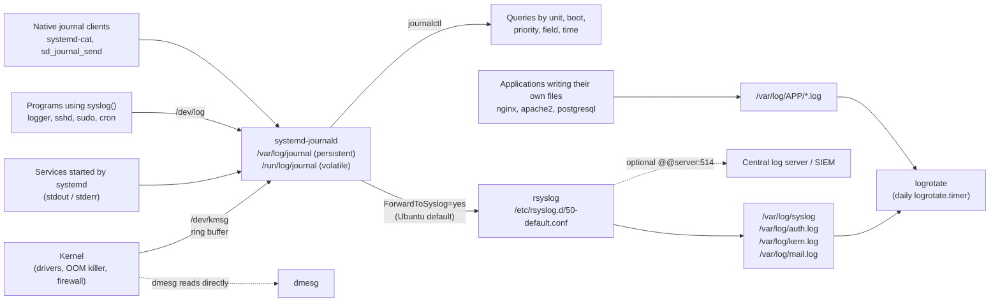
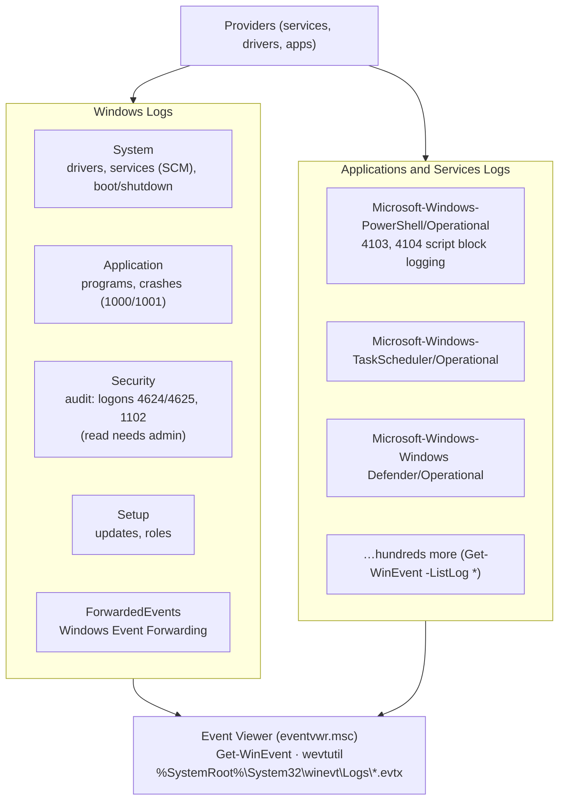

# Day 16: System Logs

!!! info "Lesson overview"
    | | |
    |---|---|
    | **Module** | 4 — Security, Logs & Monitoring |
    | **Difficulty** | :material-signal-cellular-2: Intermediate |
    | **Estimated time** | 3–4 hours (75 min reading, 90 min demonstrations, 60–90 min lab and quiz) |
    | **Platforms** | Ubuntu 24.04 LTS (systemd 255 `journalctl`, rsyslog 8.2312, logrotate 3.21, util-linux `dmesg`/`logger`) · Windows 11 (Windows PowerShell 5.1 and PowerShell 7.4+) |
    | **Lab** | [Lab 16: What Happened at 03:12?](../../labs/lab-16.md) |

## Learning Objectives

By the end of this lesson you will be able to:

1. Explain **why logs matter** for operations, security and compliance, and describe the Linux log pipeline: **kernel ring buffer → systemd-journald → rsyslog → `/var/log` files**, plus application logs.
2. Use the syslog **facilities** (`auth`, `daemon`, `kern`, `local0`…) and the eight **severities** (0 `emerg` to 7 `debug`) to read, write and filter messages.
3. Query the systemd journal with `journalctl`: by unit (`-u`), boot (`-b`, `--list-boots`), priority (`-p`), kernel (`-k`), identifier (`-t`), time (`--since`/`--until`), text (`-g`), fields (`_PID=`, `_COMM=`, `-F`) and output format (`-o short-iso`, `json`, `verbose`, `cat`).
4. Read the kernel log with `dmesg`, write test messages with `logger` and `systemd-cat`, and explain why **trusted journal fields** (those starting with `_`) cannot be faked by the sender.
5. Manage log growth and retention safely: `journalctl --disk-usage`, `--vacuum-*` (destructive), journald `Storage=`, and **logrotate** (`-d` dry run, `-f`, `rotate`, `compress`, `delaycompress`, `create`, `copytruncate`, `postrotate`). Read rotated files with `zcat` and `zgrep`.
6. Describe the **Windows Event Log** architecture (System, Application, Security, Setup, ForwardedEvents, *Applications and Services Logs*), event **levels** and the event IDs every administrator should know (6005, 6006, 6008, 41, 1074, 7036, 7045, 104, 1102).
7. Query events with `Get-WinEvent` (`-ListLog`, `-LogName`, `-MaxEvents`, `-FilterHashtable`, `-FilterXPath`, `-Path`), read event data with `ToXml()`, and know that `Get-EventLog` and `Write-EventLog` exist **only in Windows PowerShell 5.1**. Use `wevtutil` to list, query and **export** logs.
8. Build a **timeline** across several log sources, handle **time zones and clock skew**, and recognise **cleared or truncated logs** as an indicator of compromise.

## Prerequisites

- [Day 08: Processes and Services](../module-2/day-08.md): you have used `systemctl status` and `journalctl -u NAME -n 20`; today goes much deeper.
- [Day 04: Searching Files and Text](../module-1/day-04.md) and [Day 05: Command Help, History and Pipelines](../module-1/day-05.md): `grep -E`, `sort | uniq -c`, `awk`, `Select-String`, `Group-Object`, `Where-Object`.
- [Day 14: Ports, Sockets and Connections](../module-3/day-14.md): you know how to collect evidence before acting; logs are the next source of evidence.
- An Ubuntu 24.04 VM or WSL2 with `sudo`. Everything used today is installed by default on Ubuntu Server and Desktop; on minimal images install it with:

    ```bash
    sudo apt update && sudo apt install -y rsyslog logrotate util-linux bsdutils gzip
    ```

- A Windows 11 machine with Windows PowerShell 5.1; PowerShell 7.4+ recommended. Reading the System and Application logs needs no admin rights; reading the **Security** log and writing test events need an **elevated** window.
- Read [Lab Environment & Safety](../../getting-started/lab-environment.md). Today you **read** logs and write a few clearly labelled test messages. You never clear, vacuum or truncate a real log: those actions destroy evidence and are themselves logged as suspicious.

## Introduction and Concepts

### Why logs matter

A log is the system's memory. When a service stopped at 03:12, a user says "I didn't change anything", or the security team asks "did anyone log in from that address?", the answer is in the logs — or nowhere.

| Who | Uses logs to… |
|---|---|
| System administrator | Find why a service failed, why a server rebooted, why a disk filled up; confirm that a change worked |
| Network analyst | Correlate link flaps, DHCP and DNS errors, firewall drops and VPN sessions with user complaints |
| SOC analyst | Detect brute force, privilege escalation, new services, cleared logs; build an incident timeline |
| Auditor / compliance | Prove who did what and when (PCI DSS, ISO 27001 and most regulations require log retention and review) |

Three rules hold on every platform: **logs are evidence** (copy before you analyse, never edit originals), **time is everything** (know the time zone and whether the clock was right), and **absence is information** (a gap or a cleared log is a finding in itself).

### The Linux log pipeline

On Ubuntu 24.04 most messages pass through **systemd-journald**, which stores them in a structured, indexed binary journal and — on Ubuntu — forwards a copy to **rsyslog**, which writes the classic text files in `/var/log`:



Points to remember:

- The **kernel ring buffer** is a fixed-size memory buffer. `dmesg` reads it directly; journald copies it into the journal, where it survives the buffer wrapping around.
- **journald** collects from the kernel, from `/dev/log` (the classic syslog socket), from the stdout/stderr of every service, and from programs using its native API. It adds **trusted metadata** — PID, UID, command, systemd unit, boot ID — that the sender cannot forge.
- On Ubuntu, `/usr/lib/systemd/journald.conf.d/syslog.conf` sets **`ForwardToSyslog=yes`**, so rsyslog receives every message and writes text files according to `/etc/rsyslog.d/50-default.conf`. (Upstream systemd defaults to `no`; Fedora and RHEL 9 use rsyslog's `imjournal` module instead. Check your distribution.)
- **Persistence:** with the default `Storage=auto`, journald writes to `/var/log/journal/` if that directory exists, otherwise only to `/run/log/journal/`, which is lost at reboot. Ubuntu 24.04 ships `/var/log/journal`, so the journal is persistent and `journalctl -b -1` (the previous boot) works. On a host without it, `journalctl -b -1` prints *Specifying boot ID or boot offset has no effect, no persistent journal was found.*
- **Distribution differences:** Debian/Ubuntu write `/var/log/syslog` and `/var/log/auth.log`; RHEL, Rocky and Fedora write `/var/log/messages` and `/var/log/secure`. Some minimal and container images have no rsyslog at all — then the journal is the only source.

### Ubuntu's rsyslog rules and timestamp format

`/etc/rsyslog.d/50-default.conf` on Ubuntu 24.04 contains (comments removed):

```text
auth,authpriv.*                 /var/log/auth.log
*.*;auth,authpriv.none          -/var/log/syslog
kern.*                          -/var/log/kern.log
mail.*                          -/var/log/mail.log
mail.err                        /var/log/mail.err
*.emerg                         :omusrmsg:*
```

Each rule is `selector  action`. The selector is `facility.priority` (priority means "this level **and more severe**"), `*` means all, `none` excludes, `;` combines. The leading `-` means "do not sync after every line" (faster, but the last lines may be lost in a crash). So authentication messages go to `auth.log` only, everything else to `syslog`, kernel messages additionally to `kern.log`, and emergencies are broadcast to all logged-in users.

Since Ubuntu 23.10, rsyslog writes **RFC 3339 high-precision timestamps** with the UTC offset, not the old `Nov 14 16:44:18` form:

```text
2026-11-14T16:44:18.655792+00:00 ubuntu-lab lab16-app: write failed: No space left on device
```

That format has two big advantages: it contains the **year and time zone**, and it **sorts correctly as plain text**, so `sort` puts lines from several files into time order. Older Ubuntu releases, other distributions and many appliances still write the short BSD format without year and zone — keep that in mind when you merge logs from several systems.

### Facilities and severities

Every syslog message carries a **facility** (who sent it) and a **severity** (how bad it is). The severities are standard (RFC 5424) and are used by `journalctl -p`, `logger -p`, rsyslog selectors and `dmesg -l`:

| Code | Keyword (`journalctl -p`, `logger -p`) | Meaning | Example |
|---|---|---|---|
| 0 | `emerg` | System is unusable | Kernel panic imminent |
| 1 | `alert` | Action must be taken immediately | RAID array failed |
| 2 | `crit` | Critical condition | Application cannot open its database |
| 3 | `err` | Error | `No space left on device`, service failed |
| 4 | `warning` | Warning | Disk 91% full, certificate expires soon |
| 5 | `notice` | Normal but significant | Service configuration reloaded |
| 6 | `info` | Informational | Session opened, job finished |
| 7 | `debug` | Debug detail | Verbose program internals |

| Facility (code) | Used by |
|---|---|
| `kern` (0) | The kernel only |
| `user` (1) | Default for user programs (`logger` without `-p`) |
| `mail` (2) · `daemon` (3) · `cron` (9) | Mail servers · system daemons · cron |
| `auth` (4) · `authpriv` (10) | Logins, `sshd`, `sudo`, PAM — security-relevant, kept in `auth.log` |
| `syslog` (5) | rsyslog itself |
| `local0` – `local7` (16–23) | Free for your own applications, network devices and appliances |

The journal stores the numbers as fields: `PRIORITY=3`, `SYSLOG_FACILITY=16` (local0).

### The systemd journal: structured and trustworthy

A journal entry is not a line of text; it is a set of **fields**:

| Field | Meaning | Who sets it |
|---|---|---|
| `MESSAGE` | The text | Sender |
| `PRIORITY` | 0–7 | Sender |
| `SYSLOG_IDENTIFIER` | Tag, usually the program name (`sshd`, `lab16-app`) — filter with `-t` | Sender |
| `SYSLOG_PID` | PID the sender *claims* | Sender |
| `_PID`, `_UID`, `_GID`, `_COMM`, `_EXE`, `_CMDLINE` | Real process, user and command | **journald (trusted)** |
| `_SYSTEMD_UNIT` | Unit the process belongs to — what `-u` filters on | **journald (trusted)** |
| `_BOOT_ID`, `_HOSTNAME`, `_TRANSPORT` | Boot, host, how it arrived (`syslog`, `journal`, `stdout`, `kernel`) | **journald (trusted)** |
| `__REALTIME_TIMESTAMP` | Receive time in microseconds since 1970 (UTC) | journald |

Fields starting with **one underscore** are added by journald from the kernel's information about the sending process; a program cannot set them. This matters in investigations: anyone can run `logger -t sshd "Accepted password for root"` and create a convincing **text** line in `/var/log/auth.log`, but the journal entry will show `_COMM=logger` and the real `_UID`. Demo 4 shows a sender lying about its PID.

### Windows Event Logs

Windows has one central service, **Windows Event Log** (`EventLog`), and a structured format: every event has a **log**, a **provider** (source), an **event ID**, a **level**, a time, a computer, an optional user SID, and **event data** (named fields, viewable as XML).



| Level value | Name (Event Viewer) | Notes |
|---|---|---|
| 1 | Critical | e.g. Kernel-Power 41 |
| 2 | Error | Service failures, application crashes |
| 3 | Warning | Disk almost full, time sync problems |
| 4 | Information | Most events, including service state changes |
| 5 | Verbose | Detailed tracing in some Operational logs |
| 0 | LogAlways | Security audit events use level 0; Event Viewer shows them as *Information* with the keyword *Audit Success* / *Audit Failure* |

Event IDs every administrator should recognise:

| Log | Provider | ID | Meaning |
|---|---|---|---|
| System | EventLog | **6005** / **6006** | Event Log service started (≈ boot) / stopped (≈ clean shutdown) |
| System | EventLog | **6008** | *The previous system shutdown at … was unexpected* |
| System | Microsoft-Windows-Kernel-Power | **41** | System rebooted without cleanly shutting down (power loss, crash, hang) |
| System | User32 | **1074** | A process or user initiated a restart/shutdown — with the reason and account |
| System | Service Control Manager | **7036** / **7034** / **7031** | Service entered running/stopped state / terminated unexpectedly / terminated and recovery action taken |
| System | Service Control Manager | **7045** | **A new service was installed** — a classic persistence indicator |
| System | Microsoft-Windows-Eventlog | **104** | A log (System, Application…) was **cleared** |
| Security | Microsoft-Windows-Eventlog | **1102** | **The audit log was cleared** — almost always worth an incident ticket |
| Application | Application Error / Windows Error Reporting | **1000** / **1001** | Application crash / fault bucket |
| Security | Microsoft-Windows-Security-Auditing | 4624 / 4625 / 4672 | Successful / failed logon / special privileges — the subject of [Day 17](../schedule.md) |

The files live in `%SystemRoot%\System32\winevt\Logs\*.evtx`. Each log has a **maximum size** (System and Application default to 20 MB on Windows 11; Security to 20 MB as well, often raised by policy) and a **retention mode** — normally *overwrite as needed* (circular), so on a busy server the oldest events disappear within days. Central collection (Windows Event Forwarding into `ForwardedEvents`, or a SIEM agent) is how organisations keep history.

### Time: time zones, UTC and clock skew

Timelines break on time problems more often than on anything else:

- **Know the zone of every source.** Ubuntu's RFC 3339 lines carry an offset (`+00:00`, `+05:30`); `journalctl` prints **local time** unless you add `--utc`; `Get-WinEvent` shows `TimeCreated` in the viewer's local time (the stored value is UTC); many appliances log in local time without a zone. Convert everything to **UTC** before you compare.
- **Check the clock.** `timedatectl` (Linux) and `w32tm /query /status` (Windows) show whether time is synchronised. A host whose clock is two minutes slow makes the attacker appear to log in *after* the alert that detected them.
- **Daylight saving time** creates repeated or missing local hours — another reason for UTC.

### Retention, rotation and integrity

Logs grow without end, so every system limits them:

| Mechanism | Linux | Windows |
|---|---|---|
| Size limit | journald `SystemMaxUse=` (default 10% of the filesystem, capped at 4 GiB), `SystemKeepFree=` | Per-log `MaximumSizeInBytes` (Event Viewer → Properties, `wevtutil sl /ms:`) |
| Rotation | logrotate for text files: rename `syslog` → `syslog.1` → `syslog.2.gz` …; journald rotates journal files itself | Circular overwrite, or *Archive the log when full* (`AutoBackup`) |
| Manual clean-up | `journalctl --vacuum-size=`, `--vacuum-time=` (archived files only) — destructive | `wevtutil cl LOG /bu:backup.evtx`, `Clear-EventLog` (5.1) — destructive, logged as 104/1102 |
| Integrity | Forward to a central server; journald **Forward Secure Sealing** (`journalctl --setup-keys`, `--verify`) | Event forwarding / SIEM; Security log ACLs; 1102 on clearing |

!!! warning "Cleared logs are an indicator of compromise"
    Attackers erase their traces: `truncate -s 0 /var/log/auth.log`, deleting `~/.bash_history`, `wevtutil cl Security`, `Clear-EventLog`. Look for **gaps** (no lines for hours on a busy server), files that are **smaller than yesterday's**, `sudo` lines with `truncate`, `rm` or `shred` on log paths, journald *"journal corrupted or uncleanly shut down"* messages, and Windows events **104** and **1102**. Logs that were already forwarded to a central server survive local deletion — which is why forwarding is the first integrity control.

## Linux Command Reference

| Command | Purpose | Package / availability | Needs root? |
|---|---|---|---|
| `journalctl` | Query the systemd journal: units, boots, priorities, fields, time ranges, JSON output; disk usage, vacuum, verify | systemd (installed by default) | To read **all** entries: root, or membership of `adm`/`systemd-journal` (Ubuntu) |
| `dmesg` | Print the kernel ring buffer; `-T` human time, `-l` levels, `-w` follow | util-linux (default) | Yes on Ubuntu (`kernel.dmesg_restrict = 1`) |
| `logger` | Write a syslog message (`-t` tag, `-p facility.level`, `--id`) | bsdutils (default) | No |
| `systemd-cat` | Send a command's output to the journal (`-t`, `-p`) | systemd | No |
| `/var/log/syslog`, `auth.log`, `kern.log` | rsyslog text logs (Debian/Ubuntu names) | rsyslog | Group `adm` or root to read |
| `less`, `tail -f`, `grep`, `awk`, `sort`, `uniq` | Read and analyse text logs | coreutils, grep, gawk/mawk | No (file permissions decide) |
| `zcat`, `zgrep`, `zless` | Read gzip-compressed rotated logs (`syslog.2.gz`) | gzip | File permissions decide |
| `logrotate` | Rotate, compress and expire log files; `-d` dry run, `-v` verbose, `-f` force, `-s` state file | logrotate (default; run daily by `logrotate.timer`) | Yes for system logs |
| `last`, `lastb` | Login history from `/var/log/wtmp` / failed logins from `/var/log/btmp` | util-linux | `lastb`: root |
| `timedatectl` | Time zone and NTP synchronisation status | systemd | Only to change |
| `systemd-analyze cat-config systemd/journald.conf` | Show the effective journald configuration incl. drop-ins | systemd | No |

## PowerShell Command Reference

| Cmdlet / command | Alias | Purpose | 5.1 | 7.x | Admin? |
|---|---|---|---|---|---|
| `Get-WinEvent` | — | Query any event log, `.evtx` file or provider; `-ListLog`, `-FilterHashtable`, `-FilterXPath`, `-Path`, `-MaxEvents` | Yes | **Windows only** | Security log and some Operational logs |
| `Get-EventLog` | — | Classic logs only (System, Application, Security…) | **Yes — 5.1 only** | **Removed** (not available in PowerShell 6+) | Security log |
| `Write-EventLog`, `New-EventLog`, `Remove-EventLog`, `Limit-EventLog`, `Clear-EventLog`, `Show-EventLog` | — | Classic event log management | **5.1 only** | Removed | Yes (except `Show-EventLog`) |
| `New-WinEvent` | — | Write an event for a manifest-based provider | Yes | Windows only | Depends on provider |
| `eventcreate.exe` | — | Write a simple custom event (ID 1–1000) to Application or System | Yes | Yes (Windows) | **Yes** |
| `wevtutil.exe` | — | `el` list logs, `gli` log info, `qe` query, `epl` export, `sl` set size, `cl` **clear** | Yes | Yes (Windows) | Security / `sl` / `cl` |
| `eventvwr.msc` | — | Event Viewer GUI, custom views | Yes | Yes (Windows) | Security log |
| `Get-Content -Wait`, `Select-String` | `gc`, `sls` | Follow and search text logs (IIS, applications, Linux files) | Yes | Yes (all OS) | File permissions |
| `journalctl -o json` + `ConvertFrom-Json` | — | Read the Linux journal as objects in PowerShell 7 on Linux | — | Yes (Linux) | As for `journalctl` |
| `w32tm /query /status` | — | Time synchronisation status | Yes | Yes (Windows) | No |

!!! warning "Version and platform matrix"
    `Get-WinEvent` works in Windows PowerShell 5.1 and PowerShell 7 **on Windows**. The whole `*-EventLog` family (`Get-EventLog`, `Write-EventLog`, `New-EventLog`, `Limit-EventLog`, `Clear-EventLog`…) exists **only in Windows PowerShell 5.1**; in PowerShell 7 you get *The term 'Get-EventLog' is not recognized…*. Use `Get-WinEvent` for reading, `wevtutil` or the `EventLogConfiguration` object for settings, and `eventcreate.exe` or `New-WinEvent` for writing. On Linux and macOS, PowerShell 7 has no event-log cmdlets at all: call `journalctl` and convert its JSON.

## Detailed Command Explanations

### `journalctl` — querying the journal

Without options, `journalctl` shows **every** entry from the oldest, in a pager. Real work always starts with a filter. Filters of different kinds are combined with AND; the same field given twice is OR.

| Option | Meaning |
|---|---|
| `-u UNIT` | Messages of one systemd unit (`-u ssh`, `-u nginx.service`); repeat for several |
| `-t ID` | By `SYSLOG_IDENTIFIER` (the tag): `-t sshd`, `-t sudo`, `-t CRON` |
| `-b` / `-b -1` / `-b ID` | Current boot / previous boot / a specific boot ID |
| `--list-boots` | Table of boots with first and last entry — find the boot before an unexpected restart |
| `-p LEVEL` / `-p FROM..TO` | Priority and more severe (`-p err` = 0–3), or a range (`-p warning..err`) |
| `-k` | Kernel messages only (like `dmesg`, but kept across boots) |
| `--since` / `--until` | `"2026-11-13 03:00"`, `"03:00"`, `today`, `yesterday`, `"-1h"`, `"10 min ago"`, `now` |
| `-n N` · `-r` · `-e` · `-f` | Last N lines · newest first · jump to end · follow new entries |
| `-g PATTERN` | `--grep`: regular expression on `MESSAGE` (case-insensitive if the pattern is all lowercase) |
| `FIELD=VALUE` | Match a field exactly: `_PID=1234`, `_COMM=sshd`, `_UID=1001`, `_SYSTEMD_UNIT=ssh.service`, `SYSLOG_FACILITY=4` |
| `-F FIELD` | List every value a field has in the journal (`-F _SYSTEMD_UNIT`, `-F SYSLOG_IDENTIFIER`) |
| `-o FORMAT` | `short` (default), `short-iso`, `short-iso-precise`, `short-precise`, `cat` (message only), `verbose` (all fields), `json` (one object per line), `json-pretty`, `export` |
| `--output-fields=` | Limit JSON/verbose output to some fields |
| `--utc` | Print times in UTC |
| `-x` | Add explanatory catalog text where available |
| `--no-pager` · `-q` | Do not page (scripts) · suppress informational lines |
| `--disk-usage` | Space used by active and archived journal files |
| `--vacuum-size=`, `--vacuum-time=`, `--vacuum-files=` | **Delete** archived journal files until the condition holds — destructive, no dry-run |
| `--rotate` · `--flush` · `--verify` | Close and archive active files · move `/run` journal to `/var` · check file consistency (and seals) |

Examples you will use every week:

```bash
journalctl -u ssh --since "1 hour ago"          # one service, recent
journalctl -b -1 -p err                         # errors from the boot before the crash
journalctl -k -b -1 | tail -40                  # kernel messages just before the last reboot
journalctl -t sudo --since today                # who used sudo today
journalctl _COMM=sshd -g 'Failed password'      # sshd messages containing the text
journalctl -u nginx -o json --since -15m        # structured export for a script or SIEM
journalctl -f -p warning                        # live: warnings and worse from everything
```

**Permissions.** A normal user sees only their own user journal. On Ubuntu, members of **`adm`** and **`systemd-journal`** can read the whole system journal (systemd-tmpfiles sets ACLs on `/var/log/journal` for both groups); root always can. `journalctl` prints a *Hint* when you are not seeing everything — read it, and use `sudo` rather than concluding "there is nothing".

### `dmesg` — the kernel ring buffer

`dmesg` prints what the kernel has said since boot: hardware detection, driver errors, disk I/O errors, file system warnings, network link changes, the OOM killer, segfaults, AppArmor denials and firewall log lines.

| Option | Meaning |
|---|---|
| `-T` | Human-readable time. **Caveat:** computed from boot time; wrong after suspend/resume and on some VMs — use `journalctl -k` for reliable wall-clock times |
| `-l err,warn` (`--level`) | Only these levels (`emerg`, `alert`, `crit`, `err`, `warn`, `notice`, `info`, `debug`) |
| `-x` | Show facility and level of each line |
| `-H` | Human format with pager and colour |
| `-w` / `--follow` | Wait for new messages |
| `-c` / `-C` | **Read and clear** / **clear** the buffer — destructive, never during an investigation |

On Ubuntu, `kernel.dmesg_restrict = 1`, so a normal user gets *dmesg: read kernel buffer failed: Operation not permitted*; use `sudo dmesg` or `journalctl -k` as a member of `adm`. The ring buffer is small and is overwritten on a busy system, and it starts empty at every boot — the journal is the durable copy.

### `logger` and `systemd-cat` — writing messages

`logger` sends a message through the syslog socket. It is how shell scripts log, and how you test a logging pipeline:

```bash
logger -t backup -p local0.err "backup failed: /mnt/backup not mounted"
logger -t backup --id=$$ "started"          # include a PID in the syslog header
some_command 2>&1 | logger -t mytool        # log a command's output line by line
```

`-p` takes `facility.level` (default `user.notice`). `-t` sets the tag (`SYSLOG_IDENTIFIER`). `--id[=PID]` writes a PID into the message header — but, as Demo 4 shows, the journal still records the real sender in `_PID`. `systemd-cat -t TAG -p LEVEL COMMAND` runs a command and sends its stdout/stderr to the journal directly (no syslog facility). Inside a systemd service you do not need either: stdout and stderr go to the journal automatically.

### rsyslog and `/var/log`

rsyslog is the daemon that turns messages into text files and can **forward** them to a central server. You rarely edit `/etc/rsyslog.conf`; add your own rules as drop-in files in `/etc/rsyslog.d/` (for example `30-myapp.conf` with `local0.* /var/log/myapp.log`), check the syntax with `rsyslogd -N1`, and restart with `sudo systemctl restart rsyslog`. Forwarding to a log server is one line: `*.* @@logserver.example:514` (TCP; one `@` = UDP).

The `/var/log` directory on Ubuntu 24.04:

| Path | Contents |
|---|---|
| `syslog` | Almost everything except auth (Debian/Ubuntu; RHEL: `messages`) |
| `auth.log` | `sshd`, `sudo`, `su`, PAM, `systemd-logind` (RHEL: `secure`) — Day 17 |
| `kern.log` | Kernel messages |
| `dpkg.log`, `apt/history.log`, `apt/term.log` | Package changes (Day 10) |
| `journal/` | The persistent systemd journal (binary; read with `journalctl`) |
| `wtmp`, `btmp`, `lastlog` | Binary login records: `last`, `lastb` (root), `lastlog` |
| `ufw.log` | Firewall log when UFW logging is on (Day 18) |
| `nginx/`, `apache2/`, `postgresql/`, `mysql/` | Application logs, written by the applications themselves |
| `unattended-upgrades/`, `cloud-init.log`, `installer/` | Automatic updates, cloud provisioning, installation |
| `*.1`, `*.2.gz` … | Rotated copies (logrotate) |

Files are owned by `syslog` (or root) with group **`adm`** and mode `0640`: add administrators to `adm` (`sudo usermod -aG adm alice`) instead of giving them root to read logs.

### Reading text logs efficiently

```bash
sudo less +F /var/log/syslog                 # follow; Ctrl+C to stop following, F to resume
sudo tail -n 50 -f /var/log/auth.log         # last 50 lines, then follow
sudo grep -E 'error|fail' /var/log/syslog    # quick triage (case-sensitive!)
sudo zgrep -h 'Failed password' /var/log/auth.log*   # current AND rotated (.gz) files
sudo zcat /var/log/syslog.2.gz | less        # read one compressed file
```

`zgrep` and `zcat -f` read both compressed and plain files, so `zgrep PATTERN file*` searches a whole rotation set. Remember the order: `auth.log` is newest, then `auth.log.1`, then `auth.log.2.gz` and older. For counting and ranking, combine with `awk`, `sort | uniq -c | sort -rn` as on Day 04 and Day 05.

### `logrotate` — rotation, compression, expiry

logrotate runs once a day (`logrotate.timer` on Ubuntu 24.04) with `/etc/logrotate.conf`, which includes `/etc/logrotate.d/*`. Each block names files and options:

```text
/var/log/myapp/*.log {
    daily               # or weekly / monthly / size 100M
    rotate 14           # keep 14 old files, delete older
    compress            # gzip old files...
    delaycompress       # ...but leave the newest old file (.1) uncompressed
    missingok           # no error if the file is missing
    notifempty          # do not rotate empty files
    create 0640 root adm   # create a new empty file with these permissions
    postrotate          # tell the program to reopen its file
        systemctl kill -s HUP myapp.service
    endscript
}
```

| Directive | Meaning |
|---|---|
| `create MODE OWNER GROUP` | Rename the file and create a new empty one — the program must **reopen** it (hence `postrotate` sending `HUP`) |
| `copytruncate` | Copy the file, then truncate the original in place — for programs that cannot reopen; lines written between copy and truncate can be lost |
| `delaycompress` | Keeps `.1` uncompressed, because a program may still be writing to it until it reopens |
| `sharedscripts` | Run `postrotate` once for all matched files, not once per file |
| `su USER GROUP` | Rotate as this user (Ubuntu's global `su root adm`) |
| `maxage N` · `minsize` · `maxsize` · `dateext` | Remove older than N days · size conditions · date suffix instead of `.1` |

Always test first: **`logrotate -d CONFIG`** is a dry run that changes nothing (it prints what it would do), **`-v`** prints the same while really doing it, **`-f`** forces rotation even if it is not due, and **`-s STATEFILE`** uses a separate state file — essential when you test a private configuration, so you do not disturb `/var/lib/logrotate/status`.

### `Get-WinEvent` — the modern event reader (Windows)

`Get-WinEvent` reads classic logs, the hundreds of *Applications and Services* logs, saved `.evtx` files and ETW providers. It returns `EventLogRecord` objects with `TimeCreated`, `Id`, `LevelDisplayName`, `ProviderName`, `LogName`, `MachineName`, `UserId`, `Message` and `Properties`.

```powershell
Get-WinEvent -ListLog * | Where-Object RecordCount -gt 0 | Sort-Object RecordCount -Descending | Select-Object -First 10 LogName, RecordCount, MaximumSizeInBytes
Get-WinEvent -LogName System -MaxEvents 20                       # newest 20
Get-WinEvent -LogName 'Microsoft-Windows-PowerShell/Operational' -MaxEvents 5
```

**Filter at the source.** `Get-WinEvent -LogName System | Where-Object Id -eq 7036` reads *every* event and filters afterwards — slow on large logs and remote computers. `-FilterHashtable` (or `-FilterXPath`) sends the filter to the Event Log service:

```powershell
Get-WinEvent -FilterHashtable @{
    LogName      = 'System'
    ProviderName = 'Service Control Manager'
    Id           = 7036, 7045
    Level        = 2, 3, 4
    StartTime    = (Get-Date).AddHours(-24)
    EndTime      = Get-Date
}
```

| Hashtable key | Value |
|---|---|
| `LogName` | One or more log names (wildcards allowed) |
| `ProviderName` | Source / provider name(s) |
| `Path` | Path(s) to saved `.evtx` files (instead of `LogName`) |
| `Id` | Event ID(s) — an array is OR |
| `Level` | 1 Critical, 2 Error, 3 Warning, 4 Information, 5 Verbose (0 = LogAlways, used by Security audit events) |
| `StartTime` / `EndTime` | `[datetime]` values |
| `Keywords` | e.g. Audit Failure `4503599627370496` |
| `UserID` | SID or account name |
| `Data` | Unnamed event data values; or use a **named** data field as the key, e.g. `TargetUserName = 'alice'` |

`-FilterXPath` uses the same XPath subset as Event Viewer's custom views: `Get-WinEvent -LogName System -FilterXPath "*[System[(EventID=6008 or EventID=41)]]"`. `-MaxEvents N` stops after N events (newest first); `-Oldest` reverses the order (and is required for `.etl` trace files).

When nothing matches, `Get-WinEvent` writes a **non-terminating error**: *No events were found that match the specified selection criteria.* (`NoMatchingEventsFound`). In scripts, add `-ErrorAction SilentlyContinue` or catch it — an empty result is often the good news you were looking for.

**Event data.** `Message` is rendered text (localised, sometimes long). For automation, read the structured data: `$e.Properties[0].Value`, or the XML:

```powershell
$e = Get-WinEvent -FilterHashtable @{ LogName = 'System'; Id = 7045 } -MaxEvents 1
$x = [xml]$e.ToXml()
$x.Event.EventData.Data | Select-Object Name, '#text'     # ServiceName, ImagePath, StartType, AccountName
```

### `Get-EventLog` — Windows PowerShell 5.1 only

`Get-EventLog` predates `Get-WinEvent`. It reads only the classic logs (System, Application, Security, and a few others), is slower, and was **removed in PowerShell 6+**. You will still find it in many scripts:

```powershell
# Windows PowerShell 5.1 only
Get-EventLog -LogName System -EntryType Error, Warning -Newest 20
Get-EventLog -LogName Application -Source 'Application Error' -After (Get-Date).AddDays(-7)
```

Its event ID property is `EventID`/`InstanceId` and the level is `EntryType`. Port such scripts to `Get-WinEvent -FilterHashtable` when you move them to PowerShell 7. The same applies to `Write-EventLog`, `New-EventLog`, `Limit-EventLog` and `Clear-EventLog`.

### Writing test events: `eventcreate`, `New-WinEvent`, `Write-EventLog`

| Method | Version | Notes |
|---|---|---|
| `eventcreate /T ERROR /ID 900 /L APPLICATION /SO Lab16 /D "text"` | All (Windows), elevated | Creates the source `Lab16` if needed; IDs 1–1000; types ERROR, WARNING, INFORMATION, SUCCESSAUDIT, FAILUREAUDIT. Used in Lab 16 |
| `New-EventLog -LogName Application -Source Lab16` + `Write-EventLog -LogName Application -Source Lab16 -EventId 900 -EntryType Error -Message "text"` | **5.1 only**, elevated | Classic method; `Remove-EventLog -Source Lab16` removes the source |
| `New-WinEvent -ProviderName NAME -Id N -Payload @(...)` | 5.1 and 7 (Windows) | Only for providers with a registered manifest; the payload must match the event template |

### `wevtutil` — native event log utility

`wevtutil` works in any shell and is ideal for export and configuration:

| Command | Meaning |
|---|---|
| `wevtutil el` | Enumerate all log names |
| `wevtutil gl System` · `wevtutil gli System` | Log configuration (size, retention) · status (record count, file size, last write) |
| `wevtutil qe System /c:5 /rd:true /f:text` | Query: 5 events, newest first, as text |
| `wevtutil qe System /q:"*[System[(EventID=7036)]]" /c:3 /rd:true /f:text` | Query with XPath |
| `wevtutil epl System C:\IR\System.evtx` | **Export** a log to a file — the safe way to collect evidence |
| `wevtutil sl Application /ms:67108864` | Set the maximum size (64 MB) — elevated |
| `wevtutil cl Application /bu:C:\IR\Application-before-clear.evtx` | **Clear** a log, keeping a backup — destructive, logged as event 104 (1102 for Security). Never in an investigation |

Option values use a colon (`/c:5`, `/rd:true`); `/rd:true` means *reverse direction* (newest first).

### PowerShell 7 on Linux: the journal as objects

`Get-WinEvent` does not exist on Linux. `journalctl -o json` prints one JSON object per line, which `ConvertFrom-Json` turns into objects:

```powershell
journalctl -t lab16-drill -o json --no-pager | ForEach-Object { $_ | ConvertFrom-Json } |
    Select-Object @{ n = 'Time'; e = { [DateTimeOffset]::FromUnixTimeMilliseconds([long]$_.__REALTIME_TIMESTAMP / 1000).UtcDateTime } },
                  PRIORITY, SYSLOG_IDENTIFIER, MESSAGE
```

All journal values arrive as **strings** (`PRIORITY` is `"3"`), so cast before comparing numbers. The course script `Log-Analyser.ps1` uses exactly this method on Linux and `Get-WinEvent -FilterHashtable` on Windows.

### The course scripts: `log-analyser.sh` and `Log-Analyser.ps1`

Both are **read-only** daily summaries for the last *N* hours: counts by severity, the top error and warning messages (with numbers normalised so that `pid 1234` and `pid 5678` group together), the top programs or providers, kernel errors, and — as a teaser for Day 17 — failed SSH and sudo authentication counts. They exit with code **3** when the number of errors exceeds a threshold, so cron or Task Scheduler can alert.

```bash
bash scripts/linux/log-analyser.sh                      # last 24 h from the journal (or /var/log/syslog)
sudo bash scripts/linux/log-analyser.sh -s 6 -n 5 -c 20  # 6 hours, top 5, alert above 20 errors
bash scripts/linux/log-analyser.sh -l /srv/lab16/logs/syslog -s 0 -f csv -o ~/lpm-lab/reports
```

```powershell
.\Log-Analyser.ps1                                       # System + Application, last 24 h
.\Log-Analyser.ps1 -LogName System -Hours 6 -Top 5 -MaxErrors 20 -Format Json -OutputPath $HOME\lpm-lab\reports
```

Options, sample output and validation status are documented in the [Script Library](../../projects/scripts.md).

## Syntax and Parameters

### Linux

```text
journalctl [-u UNIT]... [-t IDENTIFIER]... [-b [ID|±N]] [--list-boots] [-k]
           [-p PRIORITY|FROM..TO] [-S|--since TIME] [-U|--until TIME] [-g PATTERN]
           [-n N] [-r] [-e] [-f] [-o FORMAT] [--output-fields=F1,F2] [--utc] [-x] [-q] [--no-pager]
           [FIELD=VALUE ...] [-F FIELD]
journalctl --disk-usage | --vacuum-size=BYTES | --vacuum-time=TIME | --vacuum-files=N | --rotate | --verify
dmesg [-T] [-x] [-H] [-l LEVEL[,LEVEL...]] [-w]
logger [-t TAG] [-p FACILITY.LEVEL] [--id[=PID]] [MESSAGE]
systemd-cat [-t IDENTIFIER] [-p PRIORITY] [COMMAND ...]
logrotate [-d] [-v] [-f] [-s STATEFILE] CONFIGFILE
zgrep [GREP-OPTIONS] PATTERN FILE...     zcat FILE.gz
last [-n N] [-F] [USER]      lastb [-n N]        timedatectl [status]
```

| Option | Tool | Meaning |
|---|---|---|
| `-u ssh` | journalctl | Unit filter (`ssh.service`) |
| `-t sudo` | journalctl | Identifier (tag) filter |
| `-b -1` | journalctl | Previous boot (needs a persistent journal) |
| `-p err` | journalctl | Severity 0–3 |
| `-p warning..err` | journalctl | Severities 4 and 3 only |
| `--since "2026-11-13 03:00" --until "03:30"` | journalctl | Time window (local time unless `--utc` is used for display; times accept `UTC` suffix) |
| `-o short-iso-precise` | journalctl | ISO time with microseconds and zone |
| `-o json` / `json-pretty` / `verbose` / `cat` | journalctl | All fields / message only |
| `_PID=`, `_COMM=`, `_UID=`, `_SYSTEMD_UNIT=` | journalctl | Trusted-field matches |
| `--vacuum-time=4weeks` | journalctl | Delete archived files older than 4 weeks (destructive) |
| `-T` / `-l err,warn` | dmesg | Human time (approximate) / level filter |
| `-p local0.err` | logger | Facility and severity |
| `-d` / `-f` / `-s FILE` | logrotate | Dry run / force / private state file |

### PowerShell

```text
Get-WinEvent [-ListLog] <String[]> [-Force]
Get-WinEvent [[-LogName] <String[]>] [-MaxEvents <Int64>] [-FilterXPath <String>] [-Oldest] [-ComputerName <String>] [-Credential <PSCredential>]
Get-WinEvent [-FilterHashtable] <Hashtable[]> [-MaxEvents <Int64>] [-Oldest] [-ComputerName <String>]
Get-WinEvent [-Path] <String[]> [-MaxEvents <Int64>] [-FilterXPath <String>] [-Oldest]
Get-WinEvent [-ListProvider] <String[]>
Get-EventLog [-LogName] <String> [-Newest <Int32>] [-After <DateTime>] [-Before <DateTime>]
             [-EntryType <String[]>] [-Source <String[]>] [-InstanceId <Int64[]>]      # 5.1 only
wevtutil el | gl LOG | gli LOG | qe LOG [/q:XPATH] [/c:N] [/rd:true] [/f:text|xml] | epl LOG FILE | sl LOG /ms:BYTES | cl LOG [/bu:FILE]
eventcreate /T ERROR|WARNING|INFORMATION /ID 1-1000 /L APPLICATION|SYSTEM /SO SOURCE /D "DESCRIPTION"
```

| Parameter | Cmdlet | Meaning |
|---|---|---|
| `-ListLog *` | Get-WinEvent | All logs with `RecordCount`, `FileSize`, `MaximumSizeInBytes`, `LogMode`, `IsEnabled` |
| `-LogName System -MaxEvents 50` | Get-WinEvent | Newest 50 events |
| `-FilterHashtable @{...}` | Get-WinEvent | Server-side filter: `LogName`, `ProviderName`, `Id`, `Level`, `StartTime`, `EndTime`, `Path`, `Data`, named data |
| `-FilterXPath "*[System[(EventID=41)]]"` | Get-WinEvent | XPath filter (Event Viewer syntax) |
| `-Path C:\IR\System.evtx` | Get-WinEvent | Read an exported file (or `Path` key in the hashtable) |
| `-ComputerName SRV01` | Get-WinEvent | Remote query (RPC; firewall rule *Remote Event Log Management*) |
| `-ErrorAction SilentlyContinue` | Get-WinEvent | Suppress *No events were found…* |
| `-EntryType Error, Warning` | Get-EventLog (5.1) | Level filter |
| `/c:5 /rd:true /f:text` | wevtutil qe | 5 events, newest first, as text |

## Practical Demonstrations

The Linux outputs below were **captured** on 2026-11-14 by running the commands as root on Ubuntu 24.04.5 in a container (systemd 255.4 `journalctl`, rsyslog 8.2312.0, logrotate 3.21.0, util-linux `dmesg` and `logger`). The container is not booted by systemd, so `systemd-journald` and `rsyslogd` were started by hand with the Ubuntu packages' configuration (journald forwarding to rsyslog's socket, as `ForwardToSyslog=yes` does on a normal system); the journal was therefore **volatile** (`/run/log/journal`) and has one boot. The host name was replaced by `ubuntu-lab`; machine and boot IDs are the real random values of the test container. Outputs that need a booted system (`-u` units, `-b -1`, `systemd-run`) and all PowerShell/Windows outputs are **examples** (PowerShell could not be installed on the release host).

### Demo 1 — Where the logs are, and who may read them

=== "Bash"

    ```bash
    ls -l /var/log/syslog /var/log/auth.log
    systemd-analyze cat-config systemd/journald.conf | grep -v '^#' | grep -v '^$'
    tail -n 2 /var/log/syslog
    sudo -u lab16-user tail -n 1 /var/log/syslog         # a normal user
    sudo -u lab16-user journalctl -n 3 --no-pager
    sudo -u lab16-user dmesg | tail -n 1
    ```

    **Expected output (captured):**

    ```text
    -rw-r----- 1 syslog adm 5848 Nov 14 16:54 /var/log/auth.log
    -rw-r----- 1 syslog adm 1184 Nov 14 16:46 /var/log/syslog
    [Journal]
    [Journal]
    ForwardToSyslog=yes
    2026-11-14T16:46:11.817671+00:00 ubuntu-lab lab16-drill: drill: backup job retry scheduled in 15 min
    2026-11-14T16:46:11.822292+00:00 ubuntu-lab lab16-drill[4124]: drill: written by systemd-cat at priority warning
    tail: cannot open '/var/log/syslog' for reading: Permission denied
    Hint: You are currently not seeing messages from other users and the system.
          Users in the 'systemd-journal' group can see all messages. Pass -q to
          turn off this notice.
    No journal files were opened due to insufficient permissions.
    dmesg: read kernel buffer failed: Operation not permitted
    ```

    (The two `syslog` lines come from the Lab 16 journal drill, run earlier in the same capture; `ls` sorts the names alphabetically.) The text logs are `syslog:adm 0640`, so a member of `adm` can read them. The effective journald configuration shows Ubuntu's drop-in `ForwardToSyslog=yes`. `dmesg` is restricted because `kernel.dmesg_restrict = 1`. (On a booted Ubuntu system, the journal hint also names the `adm` group, because systemd-tmpfiles grants it read access to `/var/log/journal`; the volatile journal in this capture had no such ACL.)

=== "PowerShell"

    ```powershell
    Get-WinEvent -ListLog System, Application, Security, Setup, 'Microsoft-Windows-PowerShell/Operational' -ErrorAction SilentlyContinue |
        Select-Object LogName, RecordCount, @{ n = 'MaxMB'; e = { [math]::Round($_.MaximumSizeInBytes / 1MB) } }, LogMode, IsEnabled |
        Format-Table -AutoSize
    Get-WinEvent -LogName Security -MaxEvents 1        # in a NON-elevated window
    ```

    **Expected output (example, Windows 11, non-elevated):**

    ```text
    LogName                                  RecordCount MaxMB   LogMode IsEnabled
    -------                                  ----------- -----   ------- ---------
    System                                         28411    20  Circular      True
    Application                                    19876    20  Circular      True
    Setup                                            214     1  Circular      True
    Microsoft-Windows-PowerShell/Operational        3120    15  Circular      True

    Get-WinEvent : Attempted to perform an unauthorized operation.
    ```

    The Security log is missing from the first list and the second command fails because reading it needs an **elevated** session (or membership of *Event Log Readers*). `Circular` means the oldest events are overwritten when the log is full.

### Demo 2 — Writing test messages and reading them back

=== "Bash"

    ```bash
    logger -t lab16-app -p local0.info    "service started, version 2.4.1"
    logger -t lab16-app -p local0.warning "disk usage on /srv at 91%"
    logger -t lab16-app -p local0.err     "write failed: No space left on device (file=/srv/lab16/data/cache.db)"
    logger -t lab16-app -p local0.crit    "cannot open database, shutting down"
    echo "nightly backup finished: 3 files" | systemd-cat -t lab16-backup -p info
    journalctl -t lab16-app --no-pager
    journalctl -t lab16-app -p err --no-pager
    journalctl -t lab16-app -p warning..err --no-pager
    grep lab16-app /var/log/syslog | head -n 2
    ```

    **Expected output (captured):**

    ```text
    Nov 14 16:44:18 ubuntu-lab lab16-app[1887]: service started, version 2.4.1
    Nov 14 16:44:18 ubuntu-lab lab16-app[1888]: disk usage on /srv at 91%
    Nov 14 16:44:18 ubuntu-lab lab16-app[1889]: write failed: No space left on device (file=/srv/lab16/data/cache.db)
    Nov 14 16:44:18 ubuntu-lab lab16-app[1890]: cannot open database, shutting down
    Nov 14 16:44:18 ubuntu-lab lab16-app[1891]: custom PID via --id
    Nov 14 16:44:18 ubuntu-lab lab16-app[1889]: write failed: No space left on device (file=/srv/lab16/data/cache.db)
    Nov 14 16:44:18 ubuntu-lab lab16-app[1890]: cannot open database, shutting down
    Nov 14 16:44:18 ubuntu-lab lab16-app[1888]: disk usage on /srv at 91%
    Nov 14 16:44:18 ubuntu-lab lab16-app[1889]: write failed: No space left on device (file=/srv/lab16/data/cache.db)
    2026-11-14T16:44:18.652050+00:00 ubuntu-lab lab16-app: service started, version 2.4.1
    2026-11-14T16:44:18.653594+00:00 ubuntu-lab lab16-app: disk usage on /srv at 91%
    ```

    (The fifth line comes from Demo 4's `logger --id`, which ran in the same capture.) `-p err` means *err and more severe* (3, 2, 1, 0), so it shows the `err` and the `crit` message; the range `warning..err` shows exactly 4 and 3. The same messages arrive in `/var/log/syslog` with an RFC 3339 timestamp; `journalctl`'s default `short` format uses the classic `Nov 14 16:44:18` style in **local time**.

=== "PowerShell"

    ```powershell
    # Elevated: create test events with a lab-only source (Application log)
    eventcreate /T WARNING /ID 901 /L APPLICATION /SO Lab16 /D "disk usage on D: at 91%"
    eventcreate /T ERROR   /ID 902 /L APPLICATION /SO Lab16 /D "write failed: There is not enough space on the disk"
    Get-WinEvent -FilterHashtable @{ LogName = 'Application'; ProviderName = 'Lab16' } |
        Format-Table TimeCreated, Id, LevelDisplayName, Message -AutoSize
    Get-WinEvent -FilterHashtable @{ LogName = 'Application'; ProviderName = 'Lab16'; Level = 2 } | Select-Object Id, Message
    ```

    **Expected output (example):**

    ```text
    SUCCESS: An event of type 'WARNING' was created in the 'APPLICATION' log with 'Lab16' as the source.
    SUCCESS: An event of type 'ERROR' was created in the 'APPLICATION' log with 'Lab16' as the source.

    TimeCreated           Id LevelDisplayName Message
    -----------           -- ---------------- -------
    14/11/2026 22:14:09  902 Error            write failed: There is not enough space on the disk
    14/11/2026 22:14:03  901 Warning          disk usage on D: at 91%

     Id Message
     -- -------
    902 write failed: There is not enough space on the disk
    ```

    Unlike `journalctl -p err`, `Level = 2` matches **only** Error; ask for `Level = 1, 2` to include Critical. `TimeCreated` is shown in the session's local time and date format.

### Demo 3 — Output formats and fields

=== "Bash"

    ```bash
    journalctl -t lab16-app -n 2 -o short-iso --no-pager
    journalctl -t lab16-app -n 2 -o cat --no-pager
    journalctl -t lab16-app -p crit -o verbose --no-pager
    journalctl -t lab16-app -n 1 -o json --output-fields=PRIORITY,SYSLOG_FACILITY,MESSAGE --no-pager
    journalctl -F SYSLOG_IDENTIFIER
    ```

    **Expected output (captured):**

    ```text
    2026-11-14T16:44:18+00:00 ubuntu-lab lab16-app[1890]: cannot open database, shutting down
    2026-11-14T16:44:18+00:00 ubuntu-lab lab16-app[1891]: custom PID via --id
    cannot open database, shutting down
    custom PID via --id
    Sat 2026-11-14 16:44:18.657427 UTC [s=5d0e0d548661438b9ccd2676ea4ffa82;i=1a7;b=1904a3b63b024d449077de04836f3836;m=14f8f3cb;t=6603f418444b3;x=93e3c9a4c6d3658d]
        _BOOT_ID=1904a3b63b024d449077de04836f3836
        _MACHINE_ID=d165c2d88d894a4787be219662b439ad
        _HOSTNAME=ubuntu-lab
        _RUNTIME_SCOPE=system
        _UID=0
        _GID=0
        _CAP_EFFECTIVE=1fffeffffff
        _TRANSPORT=syslog
        _COMM=logger
        SYSLOG_FACILITY=16
        SYSLOG_IDENTIFIER=lab16-app
        SYSLOG_TIMESTAMP=Nov 14 16:44:18
        PRIORITY=2
        MESSAGE=cannot open database, shutting down
        _PID=1890
        _SOURCE_REALTIME_TIMESTAMP=1794674658657427
    {"__SEQNUM_ID":"5d0e0d548661438b9ccd2676ea4ffa82","__MONOTONIC_TIMESTAMP":"351861759","__CURSOR":"s=5d0e0d548661438b9ccd2676ea4ffa82;i=1a8;b=1904a3b63b024d449077de04836f3836;m=14f8fbff;t=6603f41844ce7;x=825844c8040f183d","__SEQNUM":"424","__REALTIME_TIMESTAMP":"1794674658659559","PRIORITY":"5","_BOOT_ID":"1904a3b63b024d449077de04836f3836","SYSLOG_FACILITY":"16","MESSAGE":"custom PID via --id"}
    lab16-backup
    lab16-app
    audit
    rsyslogd
    lab16
    systemd-journald
    kernel
    ```

    `verbose` shows every field: `SYSLOG_FACILITY=16` is `local0`, `PRIORITY=2` is `crit`, and `_COMM=logger` reveals **which program** really wrote the "lab16-app" message. JSON output always includes the cursor and timestamps, even with `--output-fields`; all values are strings. `-F` lists the distinct values of a field — a quick inventory of what is logging on the host.

=== "PowerShell"

    ```powershell
    $e = Get-WinEvent -FilterHashtable @{ LogName = 'System'; ProviderName = 'Service Control Manager'; Id = 7036 } -MaxEvents 1
    $e | Format-List TimeCreated, Id, LevelDisplayName, ProviderName, Message
    $e.Properties | ForEach-Object Value
    ([xml]$e.ToXml()).Event.EventData.Data
    ```

    **Expected output (example):**

    ```text
    TimeCreated      : 14/11/2026 22:05:41
    Id               : 7036
    LevelDisplayName : Information
    ProviderName     : Service Control Manager
    Message          : The Windows Update service entered the stopped state.

    Windows Update
    stopped

    Name   #text
    ----   -----
    param1 Windows Update
    param2 stopped
    ```

    `Message` is for humans and changes with the display language; `Properties` and the XML `EventData` are stable for scripts. Service Control Manager uses generic names (`param1`, `param2`); Security events have meaningful names such as `TargetUserName` and `IpAddress` (Day 17).

### Demo 4 — Trusted fields: who really wrote this line?

=== "Bash"

    ```bash
    logger -t lab16-app --id=4242 -p local0.notice "custom PID via --id"
    grep 'custom PID' /var/log/syslog
    journalctl -t lab16-app -n 1 -o verbose --no-pager | grep -E 'SYSLOG_PID|_PID|_COMM'
    ```

    **Expected output (captured):**

    ```text
    2026-11-14T16:44:18.659682+00:00 ubuntu-lab lab16-app[4242]: custom PID via --id
        _COMM=logger
        SYSLOG_PID=4242
        _PID=1891
    ```

    The text file believes whatever the sender wrote: tag `lab16-app`, PID 4242. The journal stores the claim in `SYSLOG_PID` and the truth in `_PID` (1891, the `logger` process) and `_COMM`. When an `auth.log` line looks suspicious, check it in the journal: `journalctl -t sshd -o verbose` showing `_COMM=logger` instead of `_COMM=sshd` means the line was **forged**.

=== "PowerShell"

    ```powershell
    Get-WinEvent -FilterHashtable @{ LogName = 'Application'; ProviderName = 'Lab16' } -MaxEvents 1 |
        Select-Object ProviderName, Id, UserId, ProcessId, MachineName
    ```

    **Expected output (example):**

    ```text
    ProviderName  Id UserId                                         ProcessId MachineName
    ------------  -- ------                                         --------- -----------
    Lab16        902 S-1-5-21-3623811015-3361044348-30300820-1001        9184 WIN11-LAB
    ```

    Windows records the writer's process and, for many events, the user SID. Any administrator can register a source with any name (`eventcreate /SO`), so a provider name alone does not prove which program wrote an event; protected logs such as **Security** can only be written by the Local Security Authority, which is why investigators trust them most.

### Demo 5 — Time filters, boots and the kernel

=== "Bash"

    ```bash
    echo "<3>lab16: test message written to /dev/kmsg" | sudo tee /dev/kmsg >/dev/null
    journalctl --since "10 min ago" -p err --no-pager
    journalctl --list-boots --no-pager
    journalctl -b -1 --no-pager; echo "exit $?"
    sudo dmesg -l err,warn | tail -n 1
    sudo dmesg -T | grep 'lab16:'
    journalctl -k -g 'lab16:' --no-pager
    journalctl -k -g 'written to /dev/kmsg' --no-pager
    journalctl --since "yesterday 25:00" --no-pager; echo "exit $?"
    ```

    **Expected output (captured):**

    ```text
    Nov 14 16:43:24 ubuntu-lab lab16[1631]: second test
    Nov 14 16:44:18 ubuntu-lab lab16-app[1889]: write failed: No space left on device (file=/srv/lab16/data/cache.db)
    Nov 14 16:44:18 ubuntu-lab lab16-app[1890]: cannot open database, shutting down
    Nov 14 16:44:18 ubuntu-lab lab16: test message written to /dev/kmsg
    IDX BOOT ID                          FIRST ENTRY                 LAST ENTRY
      0 1904a3b63b024d449077de04836f3836 Sat 2026-11-14 16:43:00 UTC Sat 2026-11-14 16:44:18 UTC
    Specifying boot ID or boot offset has no effect, no persistent journal was found.
    exit 0
    [  351.870503] lab16: test message written to /dev/kmsg
    [Sat Nov 14 16:44:18 2026] lab16: test message written to /dev/kmsg
    -- No entries --
    Nov 14 16:44:18 ubuntu-lab lab16: test message written to /dev/kmsg
    Failed to parse timestamp: yesterday 25:00
    exit 1
    ```

    `<3>` sets the kernel log level to `err`, so the line appears with `dmesg -l err,warn` and in `journalctl -p err`. Note the `-- No entries --`: journald split the kernel line into `SYSLOG_IDENTIFIER=lab16` and `MESSAGE=test message written to /dev/kmsg`, and `-g` searches only `MESSAGE` — search for the message text, or filter the tag with `-t lab16`. Without `-T`, `dmesg` prints seconds since boot. This capture had a volatile journal, so `-b -1` had nothing to show — on a normal Ubuntu VM it shows the previous boot.

    **Expected output (example, a persistent journal on an Ubuntu 24.04 VM after an unexpected power-off):**

    ```text
    $ journalctl --list-boots --no-pager | tail -n 3
     -2 6f0c1b5e2c1d4e8f9a0b1c2d3e4f5a6b Wed 2026-11-11 07:58:10 UTC Thu 2026-11-12 23:59:58 UTC
     -1 9a8b7c6d5e4f40312a1b2c3d4e5f6a7b Fri 2026-11-13 00:00:01 UTC Fri 2026-11-13 03:12:10 UTC
      0 1904a3b63b024d449077de04836f3836 Fri 2026-11-13 07:41:22 UTC Sat 2026-11-14 16:44:18 UTC
    $ journalctl -b -1 -n 3 --no-pager
    Nov 13 03:12:04 app01 kernel: Out of memory: Killed process 2211 (lab16-app) total-vm:2148876kB, anon-rss:1630404kB, file-rss:2048kB, shmem-rss:0kB, UID:998 pgtables:3400kB oom_score_adj:0
    Nov 13 03:12:09 app01 systemd[1]: Started lab16-app.service - Lab 16 demo application.
    Nov 13 03:12:10 app01 systemd[1]: lab16-app.service: Failed with result 'exit-code'.
    ```

    The previous boot's last entry (03:12:10) followed by a gap until 07:41 is the signature of a crash or power loss: there is no clean *Reached target shutdown* sequence.

=== "PowerShell"

    ```powershell
    Get-WinEvent -FilterHashtable @{ LogName = 'System'; Id = 6005, 6006, 6008, 41, 1074 } -MaxEvents 6 |
        Format-Table TimeCreated, Id, ProviderName, @{ n = 'Message'; e = { $_.Message.Split("`n")[0] } } -AutoSize -Wrap
    Get-WinEvent -FilterHashtable @{ LogName = 'System'; Level = 1, 2; StartTime = (Get-Date).AddDays(-1) } -ErrorAction SilentlyContinue |
        Measure-Object | Select-Object Count
    ```

    **Expected output (example):**

    ```text
    TimeCreated           Id ProviderName                   Message
    -----------           -- ------------                   -------
    13/11/2026 13:11:58 6005 EventLog                       The Event log service was started.
    13/11/2026 13:11:58 6008 EventLog                       The previous system shutdown at 08:42:10 on 13/11/2026 was unexpected.
    13/11/2026 13:11:47   41 Microsoft-Windows-Kernel-Power The system has rebooted without cleanly shutting down first. This error could be caused if the system stopped responding, crashed, or lost power unexpectedly.
    12/11/2026 18:30:02 6006 EventLog                       The Event log service was stopped.
    12/11/2026 18:30:01 1074 User32                         The process C:\Windows\system32\shutdown.exe (WIN11-LAB) has initiated the restart of computer WIN11-LAB on behalf of user WIN11-LAB\student for the following reason: Other (Planned)

    Count
    -----
        3
    ```

    Read it bottom-up: a planned restart (1074 → 6006), then a boot with **41** and **6008** — an unexpected shutdown. 1074 tells you **who** restarted the machine; its absence before a 6008 tells you nobody did.

### Demo 6 — Text logs, rotated files and a timeline

These commands run against the Lab 16 log set (`sudo bash ~/lab16/setup.sh` creates it in `/srv/lab16/logs`).

=== "Bash"

    ```bash
    cd /srv/lab16/logs
    ls -l
    sudo zcat auth.log.2.gz | head -n 1
    sudo grep -c 'Failed password' auth.log
    sudo grep 'Failed password' auth.log | grep -oE 'from [0-9.]+' | sort | uniq -c | sort -rn
    sudo zgrep -h '203.0.113.45' auth.log.2.gz auth.log.1 auth.log | awk '{ print substr($1, 1, 10) }' | uniq -c
    sudo cat auth.log syslog | sort | awk '$1 >= "2026-11-13T03:12" && $1 < "2026-11-13T03:13"' | cut -c1-19,33-
    ```

    **Expected output (captured):**

    ```text
    total 24
    -rw-r----- 1 root adm 4759 Nov 14 16:54 auth.log
    -rw-r----- 1 root adm  618 Nov 14 16:54 auth.log.1
    -rw-r----- 1 root adm  375 Nov 14 16:54 auth.log.2.gz
    -rw-r----- 1 root adm 2705 Nov 14 16:54 syslog
    -rw-r----- 1 root adm  508 Nov 14 16:54 syslog.1
    2026-11-11T08:01:12.204511+00:00 app01 sshd[1402]: Accepted publickey for deploy from 192.0.2.10 port 50122 ssh2: ED25519 SHA256:q1Xb4Lm0eTt8u9ZsV2pKcH7aYw3NfR5dJ6gE0oPiUkA
    26
         24 from 203.0.113.45
          2 from 198.51.100.7
          4 2026-11-12
         33 2026-11-13
    2026-11-13T03:12:04 app01 kernel: kworkerd invoked oom-killer: gfp_mask=0x140cca(GFP_HIGHUSER_MOVABLE|__GFP_COMP), order=0, oom_score_adj=0
    2026-11-13T03:12:04 app01 kernel: Out of memory: Killed process 2211 (lab16-app) total-vm:2148876kB, anon-rss:1630404kB, file-rss:2048kB, shmem-rss:0kB, UID:998 pgtables:3400kB oom_score_adj:0
    2026-11-13T03:12:04 app01 systemd[1]: lab16-app.service: A process of this unit has been killed by the OOM killer.
    2026-11-13T03:12:04 app01 systemd[1]: lab16-app.service: Main process exited, code=killed, status=9/KILL
    2026-11-13T03:12:04 app01 systemd[1]: lab16-app.service: Failed with result 'oom-kill'.
    2026-11-13T03:12:09 app01 systemd[1]: lab16-app.service: Scheduled restart job, restart counter is at 1.
    2026-11-13T03:12:09 app01 systemd[1]: Started lab16-app.service - Lab 16 demo application.
    2026-11-13T03:12:09 app01 lab16-app[5120]: service started, version 2.4.1
    2026-11-13T03:12:10 app01 lab16-app[5120]: cannot open database, shutting down
    2026-11-13T03:12:10 app01 systemd[1]: lab16-app.service: Main process exited, code=exited, status=1/FAILURE
    2026-11-13T03:12:10 app01 systemd[1]: lab16-app.service: Failed with result 'exit-code'.
    ```

    Because RFC 3339 timestamps sort as text, `cat … | sort` merges two files into one timeline and `awk '$1 >= "…"'` cuts a time window with plain string comparison. `cut -c1-19,33-` drops the microseconds and the `+00:00` offset for readability — only do that when every source is in the same zone. The attacker's address appears on **two** days: the 2026-11-12 lines were reconnaissance.

=== "PowerShell"

    ```powershell
    # The same files, read in PowerShell 7 (on Linux, or copied to Windows)
    Set-Location /srv/lab16/logs
    (Select-String -Path auth.log -Pattern 'Failed password').Count
    Select-String -Path auth.log -Pattern 'Failed password .* from (\S+) port' |
        ForEach-Object { $_.Matches[0].Groups[1].Value } | Group-Object | Sort-Object Count -Descending | Select-Object Count, Name
    $lines = Get-Content auth.log, syslog | Sort-Object
    $lines | Where-Object { $_ -ge '2026-11-13T03:12' -and $_ -lt '2026-11-13T03:13' } | Select-Object -First 2
    ```

    **Expected output (example — derived from the captured Bash run on the same files; PowerShell was not executed):**

    ```text
    26

    Count Name
    ----- ----
       24 203.0.113.45
        2 198.51.100.7

    2026-11-13T03:12:04.118734+00:00 app01 kernel: kworkerd invoked oom-killer: gfp_mask=0x140cca(GFP_HIGHUSER_MOVABLE|__GFP_COMP), order=0, oom_score_adj=0
    2026-11-13T03:12:04.130551+00:00 app01 kernel: Out of memory: Killed process 2211 (lab16-app) total-vm:2148876kB, anon-rss:1630404kB, file-rss:2048kB, shmem-rss:0kB, UID:998 pgtables:3400kB oom_score_adj:0
    ```

    `Get-Content` does not read `.gz` files; decompress first (`gzip -dc` on Linux, or `[System.IO.Compression.GZipStream]`). PowerShell string comparison is case-insensitive and culture-aware by default; for ISO timestamps that still gives the correct order.

### Demo 7 — logrotate: preview, rotate, verify

=== "Bash"

    ```bash
    cat /srv/lab16/logrotate-lab16.conf
    sudo logrotate -d -f -s /srv/lab16/state/logrotate.state /srv/lab16/logrotate-lab16.conf 2>&1 | tail -n 4
    ls /srv/lab16/state/                                       # dry run created nothing
    sudo logrotate -f -s /srv/lab16/state/logrotate.state /srv/lab16/logrotate-lab16.conf
    ls -l /srv/lab16/app/
    echo 'GET /health 200 4ms' | sudo tee -a /srv/lab16/app/app.log >/dev/null
    sudo logrotate -f -s /srv/lab16/state/logrotate.state /srv/lab16/logrotate-lab16.conf
    ls -l /srv/lab16/app/
    sudo zcat /srv/lab16/app/app.log.2.gz | head -n 1
    ```

    **Expected output (captured):**

    ```text
    # Lab 16 only: rotates the lab application log. Run with an explicit state file:
    #   logrotate -d -s /srv/lab16/state/logrotate.state /srv/lab16/logrotate-lab16.conf
    /srv/lab16/app/*.log {
        daily
        rotate 7
        compress
        delaycompress
        missingok
        notifempty
        create 0640 root adm
    }
    renaming /srv/lab16/app/app.log.1.gz to /srv/lab16/app/app.log.2.gz (rotatecount 7, logstart 1, i 1),
    log /srv/lab16/app/app.log.8.gz doesn't exist -- won't try to dispose of it
    renaming /srv/lab16/app/app.log to /srv/lab16/app/app.log.1
    creating new /srv/lab16/app/app.log mode = 0640 uid = 0 gid = 4
    total 4
    -rw-r----- 1 root adm   0 Nov 14 16:54 app.log
    -rw-r----- 1 root adm 125 Nov 14 16:54 app.log.1
    total 8
    -rw-r----- 1 root adm   0 Nov 14 16:54 app.log
    -rw-r----- 1 root adm  20 Nov 14 16:54 app.log.1
    -rw-r----- 1 root adm 106 Nov 14 16:54 app.log.2.gz
    # 2026-11-13T03:14:31.000000+00:00 app01 lab16-app: log reopened
    ```

    The dry run (`-d`, here with `-f` so that it simulates a due rotation) printed every step — even renames of `.1.gz`…`.7.gz` files that do not exist — but changed nothing: `ls` of the state directory printed nothing, and `logrotate` also warns *logrotate in debug mode does nothing except printing debug messages!* The first real rotation renamed `app.log` to `app.log.1` and created an empty `app.log` with the `create` permissions. The second moved `.1` to `.2` **and compressed it** — `delaycompress` leaves the newest rotated file uncompressed for one cycle. Without `-f`, the second run on the same day would have done nothing (`daily` and the state file).

=== "PowerShell"

    ```powershell
    # Windows has no logrotate: event logs are size-limited, text logs need a script or the application's own rotation.
    Get-WinEvent -ListLog Application | Select-Object LogName, MaximumSizeInBytes, LogMode, RecordCount, FileSize
    wevtutil gl Application
    # Preview, then (elevated) raise the size to 64 MB with the EventLogConfiguration object (5.1 and 7)
    $log = Get-WinEvent -ListLog Application
    $log.MaximumSizeInBytes = 64MB
    # $log.SaveChanges()        # uncomment only on a lab VM, elevated, after recording the old value
    ```

    **Expected output (example):**

    ```text
    LogName     MaximumSizeInBytes  LogMode RecordCount FileSize
    -------     ------------------  ------- ----------- --------
    Application           20971520 Circular       19876 20975616

    name: Application
    enabled: true
    type: Admin
    owningPublisher:
    isolation: Application
    channelAccess: O:BAG:SYD:(A;;0x2;;;S-1-15-2-1)(A;;0x2;;;S-1-15-3-1024-...)(A;;0xf0007;;;SY)(A;;0x7;;;BA)(A;;0x7;;;SO)(A;;0x3;;;IU)(A;;0x3;;;SU)(A;;0x3;;;S-1-5-3)(A;;0x3;;;S-1-5-33)(A;;0x1;;;S-1-5-32-573)
    logging:
      logFileName: %SystemRoot%\System32\Winevt\Logs\Application.evtx
      retention: false
      autoBackup: false
      maxSize: 20971520
    publishing:
      fileMax: 1
    ```

    `retention: false` + `autoBackup: false` is *overwrite as needed*. Windows PowerShell 5.1 also has `Limit-EventLog -LogName Application -MaximumSize 64MB` (removed in 7). Text logs on Windows (IIS `u_ex*.log`, application logs) are rotated by the application itself or by a scheduled script.

### Demo 8 — Export evidence and handle "no events"

=== "Bash"

    ```bash
    journalctl -t does-not-exist --no-pager; echo "exit $?"
    journalctl -p severe --no-pager; echo "exit $?"
    journalctl --disk-usage
    journalctl --verify
    sudo journalctl --since "2026-11-14 16:40" --until "2026-11-14 16:50" -o export > ~/lab16/evidence/window.journal   # binary export
    sudo cp -p /var/log/auth.log ~/lab16/evidence/ && sha256sum ~/lab16/evidence/* > ~/lab16/evidence/SHA256SUMS
    ```

    **Expected output (captured — first four commands):**

    ```text
    -- No entries --
    exit 0
    Unknown log level severe
    exit 1
    Archived and active journals take up 8.0M in the file system.
    PASS: /run/log/journal/d165c2d88d894a4787be219662b439ad/system.journal
    ```

    An empty result exits **0** — scripts must test the output, not only `$?`. Before running any `--vacuum-*` command, look at `--disk-usage` and the files in `/var/log/journal/*/`; vacuuming has no dry run and deletes evidence. For an investigation, export and hash instead.

=== "PowerShell"

    ```powershell
    Get-WinEvent -FilterHashtable @{ LogName = 'System'; Id = 7045; StartTime = (Get-Date).AddDays(-1) }
    Get-WinEvent -FilterHashtable @{ LogName = 'System'; Id = 7045; StartTime = (Get-Date).AddDays(-1) } -ErrorAction SilentlyContinue
    New-Item -ItemType Directory -Path C:\IR -Force | Out-Null
    wevtutil epl System C:\IR\System.evtx
    Get-WinEvent -Path C:\IR\System.evtx -MaxEvents 1 | Select-Object TimeCreated, Id, ProviderName
    Get-FileHash C:\IR\System.evtx -Algorithm SHA256 | Select-Object Hash
    ```

    **Expected output (example):**

    ```text
    Get-WinEvent : No events were found that match the specified selection criteria.
    At line:1 char:1
    + Get-WinEvent -FilterHashtable @{ LogName = 'System'; Id = 7045; Start ...
    + ~~~~~~~~~~~~~~~~~~~~~~~~~~~~~~~~~~~~~~~~~~~~~~~~~~~~~~~~~~~~~~~~~~~~~~~~
        + CategoryInfo          : ObjectNotFound: (:) [Get-WinEvent], Exception
        + FullyQualifiedErrorId : NoMatchingEventsFound,Microsoft.PowerShell.Commands.GetWinEventCommand

    TimeCreated           Id ProviderName
    -----------           -- ------------
    14/11/2026 22:20:05 7036 Service Control Manager

    Hash
    ----
    6C1B0F5A9E3D2C4B8A7F6E5D4C3B2A190817263544536271809FAEBDCCBA9876
    ```

    No 7045 (new service) in the last day is good news, reported as an error; the second command shows how to silence it. `wevtutil epl` copies the log without changing it; `Get-WinEvent -Path` reads the copy on any Windows machine, and the hash documents the evidence.

## Linux vs PowerShell Comparison

| Task | Bash (Ubuntu) | PowerShell (Windows) | Notes |
|---|---|---|---|
| Recent messages | `journalctl -n 50 --no-pager` | `Get-WinEvent -LogName System -MaxEvents 50` | |
| One service | `journalctl -u ssh` | `Get-WinEvent -FilterHashtable @{LogName='System'; ProviderName='Service Control Manager'}` + filter by service name | Windows services log under their own provider too |
| Errors only | `journalctl -p err` (0–3) | `-FilterHashtable @{LogName='System'; Level=1,2}` | `-p err` includes more severe; `Level=2` is exactly Error |
| Time window | `--since "2026-11-13 03:00" --until "03:30"` | `StartTime=…; EndTime=…` | Mind time zones |
| Follow live | `journalctl -f` · `tail -f /var/log/syslog` | `Get-Content -Wait app.log` (text) · no live `Get-WinEvent` | Event Viewer refreshes; WEF for central |
| Kernel | `journalctl -k` · `sudo dmesg -T` | System log, providers `Microsoft-Windows-Kernel-*` | |
| Previous boot | `journalctl -b -1` · `--list-boots` | Events 6005/6006/6008/41/1074 | |
| Text search | `journalctl -g PATTERN` · `grep`/`zgrep` | <code>Get-WinEvent … &#124; Where-Object Message -match PATTERN</code> · `Select-String` for files | Filter at the source first |
| Structured output | `journalctl -o json` | Objects; `ToXml()`; `Export-Csv` / `ConvertTo-Json` | |
| Who really wrote it | `_PID`, `_COMM`, `_UID` (trusted) | `ProcessId`, `UserId`; Security log written by LSA only | |
| Write a test message | `logger -t TAG -p local0.err "…"` · `systemd-cat` | `eventcreate /T ERROR /ID 900 /L APPLICATION /SO Lab16 /D "…"` (elevated) · `Write-EventLog` (5.1) | |
| List log sources | `journalctl -F SYSLOG_IDENTIFIER` · `ls /var/log` | `Get-WinEvent -ListLog *` · `-ListProvider *` | |
| Size and retention | `journalctl --disk-usage` · `SystemMaxUse=` · logrotate | `Get-WinEvent -ListLog X` (`MaximumSizeInBytes`, `LogMode`) · `wevtutil gl` | |
| Export evidence | `journalctl -o export > f` · `cp -p` + `sha256sum` | `wevtutil epl LOG FILE.evtx` + `Get-FileHash` | |
| Read an exported file | `journalctl --file FILE.journal` | `Get-WinEvent -Path FILE.evtx` | |
| Clear (destructive) | `journalctl --vacuum-*` · `truncate` (never) | `wevtutil cl` · `Clear-EventLog` (5.1) — logged as 104/1102 | Don't, during investigations |
| Legacy cmdlet | — | `Get-EventLog` (**5.1 only**) | Port to `Get-WinEvent` |
| PowerShell 7 on Linux | <code>journalctl -o json &#124; ConvertFrom-Json</code> | — | No `Get-WinEvent` on Linux |
| Course script | `log-analyser.sh -s 24 -c 50` | `Log-Analyser.ps1 -Hours 24 -MaxErrors 50` | Exit 3 = too many errors |

## Real-World IT Scenarios

1. **"The server rebooted itself last night."** `journalctl --list-boots` shows a boot at 03:14; `journalctl -b -1 -n 50` ends abruptly at 03:12 with OOM-killer messages and no shutdown sequence. On a Windows server, the same question is answered by **41 + 6008** without a preceding **1074**. The fix is capacity (memory limits, a leaking process), not "turn it off and on again".
2. **A service flaps every few minutes.** `journalctl -u lab16-app --since -1h -o short-iso` shows *Main process exited, code=exited, status=1/FAILURE* followed by *Scheduled restart job, restart counter is at 37*. Scrolling up to the first failure reveals *cannot open database* — the real cause is a missing mount, visible in the same window with `journalctl -b -p warning`.
3. **Disk full because of logs.** `/var` is at 100%. `sudo du -sh /var/log/* | sort -h` shows a 9 GB application log that logrotate never touches because its file name does not match the pattern in `/etc/logrotate.d/myapp`. After `logrotate -d` confirms the corrected pattern, the next run compresses it; the journal is checked with `--disk-usage`.
4. **Audit request.** An auditor asks for proof that all administrator `sudo` use in the last 90 days is logged and retained. `journalctl -t sudo --since -90d | head`, `zgrep -h 'COMMAND=' /var/log/auth.log*` and the rotation settings (`rotate 4`, `weekly` = only four weeks!) show a gap: retention must be extended and logs forwarded centrally.
5. **Windows patch night.** Several servers did not come back after patching. `Get-WinEvent -ComputerName SRV01 -FilterHashtable @{LogName='System'; Id=1074,6006,6005,6008}` shows which restarted cleanly; `Get-WinEvent -LogName Setup -MaxEvents 20` shows the update status; Service Control Manager 7000/7009/7031 show services that failed to start.
6. **A new monitoring rule.** The team wants an alert when a host logs more than 50 errors per day. `log-analyser.sh -c 50` from cron and `Log-Analyser.ps1 -MaxErrors 50` from Task Scheduler return exit code 3 above the threshold; the CSV/JSON reports go to a share for trending.

## Cybersecurity Application

- **Logs are the primary evidence source.** Authentication (`auth.log`, Security 4624/4625), privilege use (`sudo`, 4672), process and service creation (7045, `systemd[1]: Started …`), and network activity (firewall logs) together reconstruct an intrusion. Day 17 builds the authentication part; Day 20 the network part.
- **Detect log tampering.** Indicators: Security **1102** or System **104**; `sudo` lines running `truncate`, `rm`, `shred` or `> file` on log paths; a log that is smaller than its rotated predecessor; **time gaps** on a busy host; `journalctl --verify` failures; a stopped `rsyslog`/`EventLog` service (event 6006 without a reboot, or *Service Control Manager: The Windows Event Log service entered the stopped state*). In Lab 16 the intruder truncates the application log at 03:14:30 — and the `sudo` line in `auth.log` gives it away.
- **Distrust text, verify with structure.** Anyone can write `logger -t sshd "…"`; the journal's `_COMM`, `_PID` and `_UID` reveal the real writer. On Windows, only LSA can write the Security log.
- **Collect before you analyse.** Export (`journalctl -o export`, `wevtutil epl`), copy with `cp -p`, hash (`sha256sum`, `Get-FileHash`) and record the system time and time zone. Analyse the copies. Never "clean up" logs on a compromised host.
- **Forward centrally.** A SIEM or a simple rsyslog server keeps a copy the attacker cannot delete from the host. Windows Event Forwarding (`ForwardedEvents`) and agents (Sysmon + SIEM) do the same on Windows. Ensure clocks are synchronised everywhere (NTP), or correlation fails.
- **Watch the logging of PowerShell itself:** `Microsoft-Windows-PowerShell/Operational` event **4104** (script block logging) records the code that ran — including decoded `-EncodedCommand` payloads. It is a favourite detection source and a favourite target for attackers to disable.

## Network Analyst Application

- **Link and driver events live in the kernel log.** `journalctl -k -g 'link is (up|down)'` or `dmesg -T | grep -i 'link'` shows flapping NICs (Day 15); on Windows, NIC driver providers and `Microsoft-Windows-NDIS` events in System.
- **Network services log to the journal.** `journalctl -u systemd-networkd -u systemd-resolved -u NetworkManager --since -1h` explains DHCP renewals, DNS server changes and carrier loss; Windows has `Microsoft-Windows-Dhcp-Client/Admin` and `Microsoft-Windows-DNS-Client/Operational` (the latter must be enabled first).
- **Network devices send syslog.** Switches, firewalls and routers normally use UDP 514 and `local0`–`local7`. A central rsyslog server with rules per facility or source address is the network team's first monitoring tool; know that UDP syslog can lose messages and has no authentication — use TCP/TLS where possible.
- **Firewall logs are logs.** UFW (`/var/log/ufw.log`, kernel prefix `[UFW BLOCK]`) and Windows Defender Firewall (`pfirewall.log`, events 5152/5157 with auditing) are covered on Day 18; the same `grep`/`Group-Object` techniques count blocked sources and ports.
- **Timestamps across devices.** Appliances often log in local time without a zone. Convert to UTC and allow for clock skew when you correlate a firewall drop with a server error.

## System Administrator Application

- **Make the journal persistent and bounded.** Check that `/var/log/journal` exists, and set limits in a drop-in rather than editing the main file: back up first, then `sudo mkdir -p /etc/systemd/journald.conf.d` and create `/etc/systemd/journald.conf.d/50-retention.conf` with `[Journal]`, `SystemMaxUse=1G`, `MaxRetentionSec=3month`; apply with `sudo systemctl restart systemd-journald` and verify with `systemd-analyze cat-config systemd/journald.conf` and `journalctl --disk-usage`.
- **Give people `adm`, not root.** Read access to logs (`usermod -aG adm`) and *Event Log Readers* on Windows are enough for most support staff.
- **Own your application logs.** For every application that writes its own files, make sure a logrotate rule exists, test it with `logrotate -d`, and prefer `create` + `postrotate` over `copytruncate` when the program can reopen its file. On Windows, check that IIS log clean-up or the application's own retention is configured.
- **Size Windows logs deliberately.** 20 MB of System log may cover only days on a busy server. Set sizes by Group Policy (*Computer Configuration → Administrative Templates → Windows Components → Event Log Service*) and forward important events.
- **Use structured queries in scripts.** `journalctl -o json` and `Get-WinEvent -FilterHashtable` are stable across language and format changes; `grep` on rendered messages and `Get-EventLog` (5.1-only) are not future-proof.
- **Keep time right.** `timedatectl` and `w32tm /query /status` belong in every health check (Day 25's `system-health` script will include them).

## Common Mistakes

| Mistake | What happens | Correct approach |
|---|---|---|
| Running `journalctl` without `sudo` and concluding "no errors" | You see only your own user journal | `sudo journalctl …`, or add the account to `adm` |
| Forgetting `--no-pager` in scripts | The script hangs in `less` | `journalctl --no-pager` (or pipe the output) |
| Using `-p err` and expecting only errors | It also shows crit, alert and emerg | That is intended; use `-p err..err` for exactly 3 |
| Comparing local and UTC times | Events appear in the wrong order or hours apart | Convert everything to UTC (`--utc`, `-o short-iso`, `.ToUniversalTime()`) |
| Trusting `dmesg -T` timestamps after suspend | Times are off by the sleep duration | `journalctl -k` for wall-clock times |
| `grep` on `auth.log` only | Misses older events in `auth.log.1` and `.gz` files | `zgrep -h PATTERN auth.log*` |
| `journalctl --vacuum-time=1d` to "free space quickly" | History (and evidence) deleted permanently | Check `--disk-usage`, set `SystemMaxUse=`, export before vacuuming |
| Truncating or deleting a big log while the program writes to it | Space not freed (deleted-but-open file, Day 09) or lost evidence | Fix rotation; `logrotate -f` with the right config |
| Using `copytruncate` everywhere | Lines lost between copy and truncate | `create` + `postrotate` reload where possible |
| `Get-WinEvent -LogName System` piped to `Where-Object Id -eq 7036` | Slow; reads everything | `-FilterHashtable @{LogName='System'; Id=7036}` |
| Using `Get-EventLog` in PowerShell 7 | *The term 'Get-EventLog' is not recognized* | `Get-WinEvent` |
| Treating *No events were found* as a failure | Scripts stop or report errors when the news is good | `-ErrorAction SilentlyContinue` and test for `$null` |
| Clearing a Windows log after testing | Events 104/1102, lost history, a security alert | Create test events with a lab source; never clear |

## Troubleshooting Guide

| Symptom / message | Likely cause | Fix |
|---|---|---|
| `No journal files were opened due to insufficient permissions.` | Not root and not in `adm`/`systemd-journal` | `sudo`, or `sudo usermod -aG adm USER` and log in again |
| `Specifying boot ID or boot offset has no effect, no persistent journal was found.` | Journal is volatile (`/run/log/journal`) | Create `/var/log/journal` (or `Storage=persistent`), restart journald; older boots are gone |
| `-- No entries --` | Filter matched nothing (wrong unit name, tag, time zone in `--since`) | Check `journalctl -F _SYSTEMD_UNIT` / `-F SYSLOG_IDENTIFIER`; widen the time |
| `Failed to parse timestamp: …` | Invalid `--since`/`--until` value | Use `"YYYY-MM-DD HH:MM:SS"`, `today`, `yesterday`, `"-2h"`, `"10 min ago"` |
| `Unknown log level …` | Typo in `-p` | `emerg alert crit err warning notice info debug` or 0–7 |
| `dmesg: read kernel buffer failed: Operation not permitted` | `kernel.dmesg_restrict = 1` | `sudo dmesg` or `journalctl -k` |
| `/var/log/syslog` missing | No rsyslog (minimal/container image) or RHEL family | `journalctl`; `/var/log/messages` on RHEL; install rsyslog if needed |
| Messages in the journal but not in `/var/log/syslog` | rsyslog stopped or forwarding off | `systemctl status rsyslog`; check `ForwardToSyslog` with `systemd-analyze cat-config` |
| `logrotate`: *error: skipping … because parent directory has insecure permissions* | Directory writable by group/others | Add `su USER GROUP` to the block, or fix directory permissions |
| `logrotate -d` says *log does not need rotating* | Not due yet (`daily`, state file) or `notifempty` | Use `-f` to test; check the state file |
| Old logs not deleted / disk still full after rotation | Program still writes to the renamed file (no reopen) | Add `postrotate` reload, or `copytruncate` for programs that cannot reopen |
| `Get-WinEvent : No events were found that match the specified selection criteria.` | Filter matched nothing | Often good news; `-ErrorAction SilentlyContinue` |
| `Get-WinEvent : Attempted to perform an unauthorized operation.` | Security (or protected Operational) log without elevation | Elevated window or *Event Log Readers* group |
| `The term 'Get-EventLog' is not recognized…` | PowerShell 7 | `Get-WinEvent`; or run the old script in `powershell.exe` 5.1 |
| `Get-WinEvent : The RPC server is unavailable` (with `-ComputerName`) | Firewall rule *Remote Event Log Management* disabled, host down | Enable the rule by policy, or use PowerShell remoting (Day 26) |
| `eventcreate` → *ERROR: Access denied* | Not elevated | Run as administrator |
| `eventcreate` → *ERROR: Source parameter is used to identify custom applications/scripts only…* | The source exists and was not created by eventcreate | Choose a new lab source name |

## Hands-on Lab

Complete **[Lab 16: What Happened at 03:12?](../../labs/lab-16.md)**. On the morning after an outage, you receive the logs of the application host `app01`: the service died at 03:12, restarted and failed again. Working on copies of the logs, you read current and rotated files, count a brute-force attack by source and account, find the successful login that followed it and the commands run with `sudo`, build a single UTC timeline from `auth.log` and `syslog`, explain the outage (disk full, OOM killer, failed restart) and spot the truncated application log. Then you practise the live journal with `logger`, `systemd-cat` and `journalctl` filters, test a logrotate configuration with a dry run, and repeat the queries on Windows with `Get-WinEvent -FilterHashtable`, `eventcreate` test events, `wevtutil epl` and `-Path`.

Summary of tasks:

1. Orientation: files, rotation order, permissions, compressed files.
2. Brute force: counts by IP and account, first/last attempt, earlier reconnaissance.
3. Compromise: the accepted login, `sudo` commands and the truncated log.
4. Timeline and root cause of the outage.
5. The live journal: write, filter, export as JSON, trusted fields.
6. logrotate: dry run, forced rotation, `delaycompress`.
7. Windows: boots and shutdowns, service events, lab events, export and `-Path`.
8. Incident note.

## Practice Questions

1. Name the three main stages of the Linux log pipeline on Ubuntu 24.04 and where each stores data.
2. What do the severity numbers 0, 3, 4 and 6 mean, and which messages does `journalctl -p warning` show?
3. Which rsyslog rule sends authentication messages to `/var/log/auth.log`, and why do they not also appear in `/var/log/syslog`?
4. Write a `journalctl` command that shows errors and worse from the previous boot, in ISO time format, without a pager.
5. Write a `journalctl` command that shows all messages from the `ssh` unit between 03:00 and 03:30 on 13 November 2026.
6. What is the difference between `SYSLOG_PID` and `_PID` in a journal entry, and why does it matter for security?
7. Why does `sudo dmesg -T` sometimes show wrong times, and what is the better alternative?
8. Write a `logger` command that logs "backup failed" with the tag `backup` at facility `local0`, severity `err`.
9. How do you search for a pattern in `auth.log`, `auth.log.1` and `auth.log.2.gz` with one command?
10. What does `logrotate -d -s /tmp/test.state /etc/logrotate.d/myapp` do, and why use `-s`?
11. Explain `create`, `copytruncate` and `delaycompress` in one sentence each.
12. Write a `Get-WinEvent` command that returns Error and Critical events from the System log in the last 24 hours.
13. Which Windows event IDs indicate an unexpected shutdown, a planned restart, a new service, and a cleared Security log?
14. Why is `-FilterHashtable` better than piping `Get-WinEvent` into `Where-Object`?
15. Which cmdlets in the `*-EventLog` family work in PowerShell 7, and what do you use instead?
16. How do you read the Linux journal as objects in PowerShell 7 on Ubuntu?
17. Give three signs that logs may have been tampered with on Linux and two on Windows.

??? success "Practice answers"
    1. **Kernel ring buffer** (memory; read with `dmesg`) → **systemd-journald** (binary journal in `/var/log/journal`, or `/run/log/journal` if volatile) → **rsyslog** (text files in `/var/log`: `syslog`, `auth.log`, `kern.log`…). Applications may also write their own files in `/var/log/APP/`.
    2. 0 `emerg`, 3 `err`, 4 `warning`, 6 `info`. `-p warning` shows priorities 0–4: warning and everything more severe.
    3. `auth,authpriv.*  /var/log/auth.log`. The syslog rule is `*.*;auth,authpriv.none -/var/log/syslog` — `none` excludes those facilities.
    4. `sudo journalctl -b -1 -p err -o short-iso --no-pager` (needs a persistent journal).
    5. `sudo journalctl -u ssh --since "2026-11-13 03:00" --until "2026-11-13 03:30"` (times in the system's local zone; append `UTC` to give them in UTC, for example `--since "2026-11-13 03:00 UTC"`).
    6. `SYSLOG_PID` is what the sender **claims**; `_PID` is added by journald from the kernel and cannot be faked. A forged line (`logger -t sshd …`) shows the real writer in `_PID`/`_COMM`.
    7. `-T` converts "seconds since boot" using the current boot time, which is wrong after suspend/resume (the kernel clock pauses) and on some VMs. `journalctl -k` records real wall-clock time when each message arrives.
    8. `logger -t backup -p local0.err "backup failed"`
    9. `sudo zgrep -h PATTERN /var/log/auth.log*` (`zgrep` reads plain and compressed files; `-h` drops file names).
    10. A dry run of that configuration: it prints what it would rotate, rename, compress and delete, and changes nothing. `-s` uses a private state file so the test does not touch the system state `/var/lib/logrotate/status`.
    11. `create` renames the log and creates a new empty one (the program must reopen it); `copytruncate` copies the log and truncates the original in place (for programs that cannot reopen; can lose lines); `delaycompress` postpones compression of the newest rotated file to the next cycle.
    12. `Get-WinEvent -FilterHashtable @{ LogName = 'System'; Level = 1, 2; StartTime = (Get-Date).AddHours(-24) }`
    13. Unexpected shutdown: **6008** (EventLog) and **41** (Kernel-Power); planned restart: **1074** (User32), followed by **6006**; new service: **7045**; Security log cleared: **1102** (other logs: 104).
    14. The filter runs in the Event Log service, so only matching events are read, transferred (remote queries!) and converted to objects — much faster and lighter than reading everything and filtering in PowerShell.
    15. None — `Get-EventLog`, `Write-EventLog`, `New-EventLog`, `Remove-EventLog`, `Limit-EventLog`, `Clear-EventLog` and `Show-EventLog` are Windows PowerShell 5.1 only. Use `Get-WinEvent`, `New-WinEvent`/`eventcreate`, `wevtutil` and `EventLogConfiguration` (`Get-WinEvent -ListLog`).
    16. `journalctl -o json --no-pager | ForEach-Object { $_ | ConvertFrom-Json }` — each line is one JSON object; values are strings.
    17. Linux: `sudo` commands with `truncate`/`rm`/`shred` on log files, gaps in time on a busy host, a current log smaller than the rotated one, `journalctl --verify` failures, rsyslog stopped. Windows: Security event **1102**, System event **104**, the Event Log service stopped, logs suddenly much smaller (`RecordCount`).

## Quiz

**Q1.** On Ubuntu 24.04, which command shows only kernel messages from the previous boot?

- A. `dmesg -b -1`
- B. `journalctl -k -b -1`
- C. `journalctl -u kernel -b -1`
- D. `cat /var/log/kern.log.1`

??? question "Answer and explanation"
    **B.** `-k` selects kernel messages and `-b -1` the previous boot (persistent journal required). `dmesg` only knows the current boot's ring buffer and has no `-b`; there is no `kernel` unit; `kern.log.1` is a rotated file covering a time range, not a boot.

**Q2.** `journalctl -p err` shows which priorities?

- A. Only 3
- B. 3 to 7
- C. 0 to 3
- D. 4 to 7

??? question "Answer and explanation"
    **C.** A single priority means *that level and more severe*: emerg (0), alert (1), crit (2), err (3). For exactly one level, use a range such as `-p err..err`.

**Q3.** A line in `/var/log/auth.log` reads `sshd[999]: Accepted password for root from 10.0.0.5`. How can you check whether `sshd` really wrote it?

- A. Check the PID 999 in `ps` now
- B. Look at the entry in the journal with `-o verbose` and compare `_COMM`, `_PID` and `_UID` with `SYSLOG_IDENTIFIER` and `SYSLOG_PID`
- C. Count the characters in the line
- D. It is impossible

??? question "Answer and explanation"
    **B.** The trusted fields are set by journald from the kernel's knowledge of the sender. A line written with `logger -t sshd` shows `_COMM=logger`. A is useless — PIDs are reused and the process may have exited.

**Q4.** Which logrotate option keeps the most recently rotated file uncompressed until the next rotation?

- A. `nocompress`
- B. `compress`
- C. `delaycompress`
- D. `copytruncate`

??? question "Answer and explanation"
    **C.** `delaycompress` (used together with `compress`) leaves `.1` as plain text for one cycle, because a program that has not reopened its file yet may still write to it. `nocompress` never compresses; `copytruncate` is a different rotation method.

**Q5.** Which `Get-WinEvent` call is the most efficient way to find service installations in the last 7 days?

- A. <code>Get-WinEvent -LogName System &#124; Where-Object Id -eq 7045</code>
- B. `Get-WinEvent -FilterHashtable @{ LogName = 'System'; Id = 7045; StartTime = (Get-Date).AddDays(-7) }`
- C. `Get-EventLog -LogName System -InstanceId 7045` in PowerShell 7
- D. `Get-WinEvent -ListLog System`

??? question "Answer and explanation"
    **B.** The hashtable filter is evaluated by the Event Log service. A reads every event first; C fails because `Get-EventLog` does not exist in PowerShell 7; D shows the log's configuration, not events.

**Q6.** Event ID 1102 appears in the Security log of a server. What does it mean?

- A. A user logged on successfully
- B. The audit (Security) log was cleared
- C. The system restarted unexpectedly
- D. A new service was installed

??? question "Answer and explanation"
    **B.** 1102 (*The audit log was cleared*) records the account that cleared it. Unless it was a documented, approved action, treat it as a potential indicator of compromise. Logon is 4624, unexpected restart 6008/41, new service 7045.

**Q7.** A script runs `journalctl -u myapp -p err --since today --no-pager` and tests `$?` to decide whether errors occurred. Why is that wrong?

- A. `journalctl` exits 0 even when there are no entries (`-- No entries --`)
- B. `journalctl` always exits 1
- C. `-p err` is not valid with `-u`
- D. `--since today` is not valid

??? question "Answer and explanation"
    **A.** An empty result is not an error; the exit code is 0 either way. Test the output instead, for example `journalctl … -q --no-pager | wc -l`, or use `-o json` and count objects.

**Q8.** In which PowerShell version(s) does `Write-EventLog` exist?

- A. Windows PowerShell 5.1 only
- B. PowerShell 7 only
- C. Both, on Windows
- D. Both, on every OS

??? question "Answer and explanation"
    **A.** The `*-EventLog` cmdlets were not ported to PowerShell 6+. In PowerShell 7 use `New-WinEvent` (manifest providers) or `eventcreate.exe`.

**Q9.** You merge `auth.log` and `syslog` from an Ubuntu 24.04 host with `cat auth.log syslog | sort`. Why does this produce a correct timeline?

- A. `sort` understands dates
- B. RFC 3339 timestamps (`2026-11-13T03:12:04.118734+00:00`) sort correctly as text when they share the same offset
- C. rsyslog writes both files in the same order
- D. It does not; `sort` always breaks timelines

??? question "Answer and explanation"
    **B.** Year-month-day-hour-minute-second with fixed widths sorts lexicographically in time order. It works only when all lines use the same UTC offset; the old `Nov 13 03:12:04` format does **not** sort correctly across months and has no year.

**Q10.** What should you do first before running `sudo journalctl --vacuum-time=2weeks` on a production server?

- A. Nothing; it is safe
- B. Check `journalctl --disk-usage`, confirm no investigation or retention rule needs the data, and export what must be kept — vacuum has no dry run
- C. Stop journald
- D. Run it twice to be sure

??? question "Answer and explanation"
    **B.** Vacuuming permanently deletes archived journal files. Check the space used, the retention policy and any open incident first; usually the better fix is a size limit (`SystemMaxUse=`) in a journald drop-in. Stopping journald loses incoming messages.

## Homework

1. **Map your own pipeline.** On your Ubuntu VM run `systemd-analyze cat-config systemd/journald.conf`, `ls -ld /var/log/journal`, `journalctl --disk-usage`, `journalctl --list-boots | tail -5` and `cat /etc/rsyslog.d/50-default.conf`. Write half a page: is the journal persistent, how much history do you have, which files does rsyslog write, and how long does logrotate keep them (`/etc/logrotate.d/rsyslog`)?
2. **Boot history on Windows.** Write a PowerShell command that lists the last 10 events with IDs 6005, 6006, 6008, 41 and 1074, newest first, with the first line of the message. Classify each boot as clean or unexpected.
3. **Top talkers.** Write a one-liner per platform that prints the five identifiers/providers that logged the most messages in the last 24 hours.
4. **A logrotate rule for a lab application.** Write a logrotate block for `/srv/myapp/logs/*.log`: weekly, keep 8, compress with delay, ignore missing and empty files, create `0640 root adm`. Test it with `-d` and a private state file, then with `-f`, and show the result with `ls -l`.
5. **Detect forged lines.** Write one forged and one genuine-looking `sshd` line with `logger -t sshd` on your lab VM, then write the `journalctl` command that lists every entry tagged `sshd` that was **not** written by the `sshd` program. Explain the result in three sentences.

??? success "Homework answer key (items 2, 3, 4 and 5)"
    ```powershell
    # Item 2
    Get-WinEvent -FilterHashtable @{ LogName = 'System'; Id = 6005, 6006, 6008, 41, 1074 } -MaxEvents 10 |
        Select-Object TimeCreated, Id, @{ n = 'Message'; e = { ($_.Message -split "`r?`n")[0] } }
    # Item 3
    Get-WinEvent -FilterHashtable @{ LogName = 'System', 'Application'; StartTime = (Get-Date).AddDays(-1) } -ErrorAction SilentlyContinue |
        Group-Object ProviderName | Sort-Object Count -Descending | Select-Object -First 5 Count, Name
    ```

    A clean restart shows 1074 → 6006 → (boot) 6005; an unexpected one shows 41 and/or 6008 at the next boot, without 1074/6006 before it.

    ```bash
    # Item 3
    sudo journalctl --since -24h -o json --output-fields=SYSLOG_IDENTIFIER --no-pager |
        grep -o '"SYSLOG_IDENTIFIER":"[^"]*"' | sort | uniq -c | sort -rn | head -5
    ```

    ```text
    # Item 4: /srv/myapp/logrotate-myapp.conf
    /srv/myapp/logs/*.log {
        weekly
        rotate 8
        compress
        delaycompress
        missingok
        notifempty
        create 0640 root adm
    }
    ```

    ```bash
    sudo logrotate -d -s /srv/myapp/logrotate.state /srv/myapp/logrotate-myapp.conf    # preview
    sudo logrotate -f -s /srv/myapp/logrotate.state /srv/myapp/logrotate-myapp.conf    # rotate now
    ls -l /srv/myapp/logs/
    # Item 5: entries tagged sshd whose real command is not sshd
    sudo journalctl -t sshd -o json --output-fields=_COMM,MESSAGE --no-pager | grep -v '"_COMM":"sshd"'
    ```

    In item 5, both lines appear in `/var/log/auth.log` exactly like real `sshd` messages, because rsyslog writes the tag the sender chose. In the journal, their `_COMM` is `logger` and `_PID` is the `logger` process, which `sshd`'s own entries never show. This is why investigators confirm critical text-log lines against the journal (or the original binary source) before drawing conclusions.

## Professional Tips

- **Start broad, then narrow:** `journalctl -b -p warning` or `Get-WinEvent -FilterHashtable @{LogName='System'; Level=1,2,3; StartTime=…}` first; then one unit or provider; then the minute around the event.
- **Always write down the time zone** next to every timestamp in a ticket, and prefer UTC (`--utc`, `-o short-iso-precise`, `.ToUniversalTime()`).
- **Use `-o json` / `FilterHashtable` in scripts**, rendered text only for humans.
- **Copy, hash, then analyse** — never investigate on the only copy of a log.
- **Test every logrotate change with `-d` and a private state file**, and every journald change with `systemd-analyze cat-config`.
- **Give your own scripts a tag** (`logger -t myscript`, `systemd-cat -t myscript`) and a facility (`local0`), so their messages can be filtered, routed and alerted on.
- **Learn ten event IDs by heart:** 41, 1074, 6005, 6006, 6008, 7036, 7045, 104, 1102, 4625. They answer most "what happened?" questions on Windows.

## Command Cheat Sheet

```bash
# ---- Bash (Ubuntu 24.04) ----
sudo journalctl -b -p err --no-pager             # errors this boot
sudo journalctl -b -1 -n 50                      # end of the previous boot
journalctl --list-boots                          # boot history
sudo journalctl -u ssh --since "1 hour ago"      # one unit, recent
sudo journalctl -t sudo --since today            # by tag
sudo journalctl -k -g 'link is'                  # kernel, text search
sudo journalctl --since "2026-11-13 03:00" --until "03:30" -o short-iso-precise
sudo journalctl -f -p warning                    # follow warnings and worse
sudo journalctl -t lab16-app -o verbose          # all fields, trusted _PID/_COMM
sudo journalctl -o json --since -15m --no-pager  # structured export
journalctl -F _SYSTEMD_UNIT                      # which units have logged
journalctl --disk-usage ; journalctl --verify    # size ; integrity
sudo dmesg -T -l err,warn                        # kernel ring buffer
logger -t myscript -p local0.err "message"       # write a test message
echo "done" | systemd-cat -t myscript -p info    # native journal client
sudo zgrep -h 'Failed password' /var/log/auth.log*   # current + rotated
sudo cat /var/log/auth.log /var/log/syslog | sort | awk '$1 >= "2026-11-13T03:00"'  # timeline
sudo logrotate -d -s /tmp/lr.state /etc/logrotate.d/myapp   # dry run
timedatectl                                      # time zone and NTP
bash log-analyser.sh -s 24 -n 10 -c 50           # course script
```

```powershell
# ---- PowerShell (Windows 5.1 / 7) ----
Get-WinEvent -ListLog * | Where-Object RecordCount | Sort-Object RecordCount -Descending
Get-WinEvent -LogName System -MaxEvents 20
Get-WinEvent -FilterHashtable @{ LogName = 'System'; Level = 1, 2; StartTime = (Get-Date).AddHours(-24) }
Get-WinEvent -FilterHashtable @{ LogName = 'System'; Id = 6005, 6006, 6008, 41, 1074 } -MaxEvents 10
Get-WinEvent -FilterHashtable @{ LogName = 'System'; ProviderName = 'Service Control Manager'; Id = 7045 }
Get-WinEvent -LogName System -FilterXPath "*[System[(EventID=6008)]]"
([xml](Get-WinEvent -FilterHashtable @{ LogName = 'System'; Id = 7045 } -MaxEvents 1).ToXml()).Event.EventData.Data
Get-WinEvent -Path C:\IR\System.evtx -MaxEvents 5          # exported file
wevtutil qe System /c:5 /rd:true /f:text                    # native query
wevtutil epl System C:\IR\System.evtx                       # export evidence
eventcreate /T ERROR /ID 900 /L APPLICATION /SO Lab16 /D "test"   # elevated test event
Get-EventLog -LogName System -EntryType Error -Newest 10    # Windows PowerShell 5.1 ONLY
journalctl -o json --no-pager | ForEach-Object { $_ | ConvertFrom-Json }   # PowerShell 7 on Linux
.\Log-Analyser.ps1 -Hours 24 -Top 10 -MaxErrors 50          # course script
```

## Completion Checklist

- [ ] I can draw the Linux log pipeline (kernel → journald → rsyslog → `/var/log`) and say where each stores data.
- [ ] I know the eight severities and the main facilities, and I can write messages with `logger` and `systemd-cat`.
- [ ] I can filter the journal by unit, tag, boot, priority, time, text and field, and choose an output format.
- [ ] I can explain trusted journal fields and use them to detect a forged log line.
- [ ] I can read the kernel log with `dmesg` and `journalctl -k`, and I know the `-T` caveat.
- [ ] I can read rotated and compressed files and build a UTC timeline from several logs.
- [ ] I can test and run a logrotate configuration safely, and explain `create`, `copytruncate` and `delaycompress`.
- [ ] I can describe the Windows Event Log structure, levels and the key event IDs.
- [ ] I can query events with `Get-WinEvent -FilterHashtable`/`-FilterXPath`/`-Path`, read `EventData`, and I know which cmdlets are 5.1-only.
- [ ] I can export logs as evidence with `journalctl -o export`/`cp -p` + `sha256sum` and `wevtutil epl` + `Get-FileHash`.
- [ ] I completed Lab 16 and checked it against the solution.
- [ ] I answered the practice questions and the quiz, and completed the homework.

## Further Reading

- Linux man pages: [journalctl(1)](https://man7.org/linux/man-pages/man1/journalctl.1.html), [systemd-journald.service(8)](https://man7.org/linux/man-pages/man8/systemd-journald.service.8.html), [journald.conf(5)](https://man7.org/linux/man-pages/man5/journald.conf.5.html), [systemd.journal-fields(7)](https://man7.org/linux/man-pages/man7/systemd.journal-fields.7.html), [systemd-cat(1)](https://man7.org/linux/man-pages/man1/systemd-cat.1.html), [dmesg(1)](https://man7.org/linux/man-pages/man1/dmesg.1.html), [logger(1)](https://man7.org/linux/man-pages/man1/logger.1.html), [syslog(3)](https://man7.org/linux/man-pages/man3/syslog.3.html) (facilities and levels), [last(1)](https://man7.org/linux/man-pages/man1/last.1.html), [logrotate(8)](https://manpages.ubuntu.com/manpages/noble/man8/logrotate.8.html), [rsyslog.conf(5)](https://manpages.ubuntu.com/manpages/noble/man5/rsyslog.conf.5.html), [zgrep(1)](https://manpages.ubuntu.com/manpages/noble/man1/zgrep.1.html)
- Ubuntu Server documentation — <https://documentation.ubuntu.com/server/> (observability and logging how-tos)
- PowerShell: [Get-WinEvent](https://learn.microsoft.com/en-us/powershell/module/microsoft.powershell.diagnostics/get-winevent), [Creating Get-WinEvent queries with FilterHashtable](https://learn.microsoft.com/en-us/powershell/scripting/samples/creating-get-winevent-queries-with-filterhashtable), [New-WinEvent](https://learn.microsoft.com/en-us/powershell/module/microsoft.powershell.diagnostics/new-winevent), [Get-EventLog (5.1)](https://learn.microsoft.com/en-us/powershell/module/microsoft.powershell.management/get-eventlog?view=powershell-5.1), [Differences between Windows PowerShell 5.1 and PowerShell 7.x](https://learn.microsoft.com/en-us/powershell/scripting/whats-new/differences-from-windows-powershell)
- Windows commands: [wevtutil](https://learn.microsoft.com/en-us/windows-server/administration/windows-commands/wevtutil), [eventcreate](https://learn.microsoft.com/en-us/windows-server/administration/windows-commands/eventcreate), [w32tm](https://learn.microsoft.com/en-us/windows-server/networking/windows-time-service/windows-time-service-tools-and-settings) · [Event logging (Win32)](https://learn.microsoft.com/en-us/windows/win32/eventlog/event-logging) · [Event 1102: The audit log was cleared](https://learn.microsoft.com/en-us/previous-versions/windows/it-pro/windows-10/security/threat-protection/auditing/event-1102) · [Use Windows Event Forwarding to help with intrusion detection](https://learn.microsoft.com/en-us/windows/security/operating-system-security/device-management/use-windows-event-forwarding-to-assist-in-intrusion-detection)
- .NET: [EventLogConfiguration](https://learn.microsoft.com/en-us/dotnet/api/system.diagnostics.eventing.reader.eventlogconfiguration), [EventLogRecord](https://learn.microsoft.com/en-us/dotnet/api/system.diagnostics.eventing.reader.eventlogrecord)
- RFC 5424 (The Syslog Protocol: facilities and severities) and RFC 3339 (timestamps) — <https://www.rfc-editor.org/>

---

**Previous:** [Day 15: Network Interfaces and Diagnostics](../module-3/day-15.md) · **Next:** Day 17: Authentication and Security Monitoring (see the [release schedule](../schedule.md))
