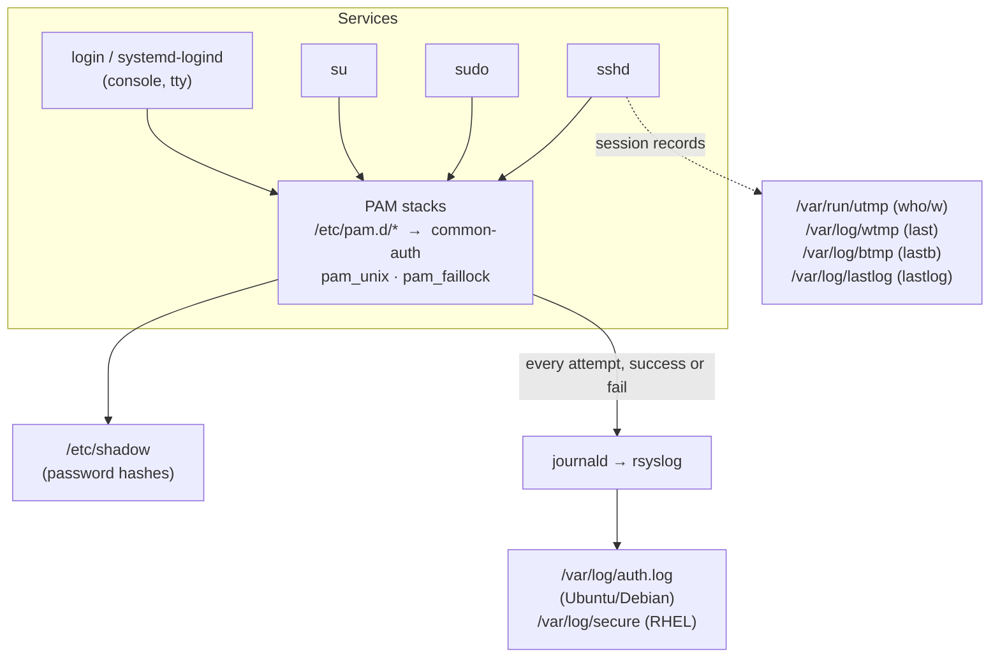

# Day 17: Authentication and Security Monitoring

!!! info "Lesson overview"
    | | |
    |---|---|
    | **Module** | 4 — Security, Logs & Monitoring |
    | **Difficulty** | :material-signal-cellular-2: Intermediate |
    | **Estimated time** | 3–4 hours (80 min reading, 90 min demonstrations, 60–90 min lab and quiz) |
    | **Platforms** | Ubuntu 24.04 LTS (OpenSSH 9.6p1, sudo 1.9.15, Linux-PAM, `login` package `last`/`lastb`/`lastlog`) · Windows 11 (Windows PowerShell 5.1 and PowerShell 7.4+) |
    | **Lab** | [Lab 17: Who Got In?](../../labs/lab-17.md) |

## Learning Objectives

By the end of this lesson you will be able to:

1. Explain how authentication works on Linux through **PAM** (the `/etc/pam.d` stacks, `pam_unix`, `pam_faillock`) and which services write to **`auth.log`**: `sshd`, `sudo`, `su`, `login` and `systemd-logind`.
2. Read and interpret **every common `sshd` message** in `/var/log/auth.log` — `Accepted password`/`publickey`, `Failed password`, `Invalid user`, `Connection closed … [preauth]`, `maximum authentication attempts exceeded`, and the `pam_unix(sshd:auth): authentication failure` lines — and know which are normal and which are suspicious.
3. Check a server's **effective SSH configuration** with `sshd -T` (PasswordAuthentication, PermitRootLogin, MaxAuthTries, LogLevel) and judge whether it is hardened.
4. Audit **interactive and privileged access** with `who`, `w`, `last`, `lastb`, `lastlog`, `id`, `sudo -l`, and read `sudo`/`su` log lines (`COMMAND=`, `incorrect password attempts`, `user NOT in sudoers`, `FAILED SU`).
5. Use **`journalctl`** authentication filters (`_COMM=sshd`, `-t sudo`, `-g`, `-p`) to query logins without text files, building on [Day 16](day-16.md).
6. Distinguish **brute force**, **password spraying**, **credential stuffing** and **success-after-failure**, and extract the attacker addresses, targeted accounts and timing with `grep`/`awk`.
7. Enable **account lockout** on Linux with `pam_faillock` **safely** (backup, test on a throwaway user, keep a root session, plan rollback) and inspect/reset it with `faillock`.
8. Describe the **Windows Security log** model: events **4624** (with logon types), **4625** (with Status/SubStatus codes), **4634/4647**, **4648**, **4672**, account-management events (**4720/4722/4724/4725/4726/4728/4732**), lockout **4740/4767** and audit-log-cleared **1102**; and read them with `Get-WinEvent -FilterHashtable`, `-FilterXPath` and `ToXml()`.
9. Check Windows audit and lockout policy read-only with `auditpol /get`, `net accounts`, `Get-LocalUser`, `quser` and `whoami /groups /priv`, and run the course's **`failed-login-report`** scripts on both platforms.

## Prerequisites

- [Day 16: System Logs](day-16.md): you can read `/var/log/auth.log`, use `journalctl` filters and output formats, count `Failed password` lines with `grep`/`zgrep`, and use `last`/`lastb`. Today goes deep on the **authentication** sources that Day 16 only teased.
- [Day 06: Users and Groups](../module-2/day-06.md): `/etc/passwd`, `/etc/shadow`, `/etc/group`, `usermod -aG sudo`, and the `*-LocalUser` cmdlets.
- [Day 08: Processes and Services](../module-2/day-08.md): `systemctl status ssh`, `journalctl -u ssh`.
- [Day 04](../module-1/day-04.md) and [Day 05](../module-1/day-05.md): `grep -E`, `awk`, <code>sort &#124; uniq -c &#124; sort -rn</code>, `Select-String`, `Group-Object`.
- An Ubuntu 24.04 VM or WSL2 with `sudo`, and `openssh-server` installed (`sudo apt install openssh-server`). A Windows 11 machine for the Windows demos; reading the **Security** log and running `auditpol` need an **elevated** window.

## Introduction and Concepts

### Why authentication monitoring is the core of defence

Almost every intrusion crosses an authentication boundary: a guessed SSH password, a stolen key, a re-used credential, a `sudo` abuse. Logs that record **who authenticated, from where, how, and whether it succeeded** are therefore the single most valuable security signal a system produces. The job of this lesson is to make those logs readable and to teach the patterns that separate a user who fat-fingered their password from an attacker working through a word list.

The questions you must be able to answer after an alert are always the same:

- **Who** tried to authenticate, as which account, from which address?
- **How** — password, public key, `sudo`, `su`, console?
- **Did it succeed?** If failures were followed by a success, that is the most urgent finding.
- **What did the account do** after it got in (sessions, `sudo` commands)?

### How Linux authentication fits together (PAM)

On Linux, programs do not check passwords themselves. They call **PAM** (Pluggable Authentication Modules). Each service has a stack in `/etc/pam.d/` — `sshd`, `sudo`, `su`, `login` — and most of them `@include common-auth`, the shared rule set. The default Ubuntu 24.04 `common-auth` is essentially:

```text
auth  [success=1 default=ignore]  pam_unix.so nullok
auth  requisite                   pam_deny.so
auth  required                    pam_permit.so
```

`pam_unix.so` checks the password against `/etc/shadow`. When it **fails**, PAM writes the line you will see everywhere:

```text
pam_unix(sshd:auth): authentication failure; logname= uid=0 euid=0 tty=ssh ruser= rhost=203.0.113.45 user=deploy
```

The `(sshd:auth)` part names the **service** and **phase**, and `rhost=` / `user=` name the source and target. Because every PAM-aware service logs through the same machinery, you can audit SSH, `sudo`, `su` and console logins with one mental model.



!!! note "Distribution differences"
    Debian and **Ubuntu** write authentication messages to **`/var/log/auth.log`**. **RHEL, Rocky, AlmaLinux and Fedora** write them to **`/var/log/secure`**. The `journalctl` commands are identical on both because the journal is distribution-neutral.

### SSH on Ubuntu 24.04: service and socket

Ubuntu 24.04 ships OpenSSH with **socket activation**: `ssh.socket` listens on port 22 and starts the (single) `ssh.service` on the first connection (`Accept=no`). Practically:

- `systemctl status ssh` and `journalctl -u ssh` still show the server's logs.
- To change the listening port on 24.04 you edit the **socket** (`systemctl edit ssh.socket`), not only `Port` in `sshd_config`. This catches many administrators out.
- Each connection appears in the journal with `_COMM=sshd` (and on some builds a child `sshd-session`), so `journalctl _COMM=sshd` is the reliable filter.

### Windows authentication: the Security log

Windows records authentication in the **Security** event log, written only by the Local Security Authority (LSA) — a program cannot forge an entry the way `logger` can forge a text line (Day 16). Every logon is a **4624** (success) or **4625** (failure); the **logon type** says *how*, and on a failure the **Status/SubStatus** says *why*. The Security log is readable only by administrators, which is itself a control: on a member server these events answer the same four questions as `auth.log` does on Linux.

## Linux Command Reference

| Command | Purpose | Package / availability | Needs root? |
|---|---|---|---|
| `who` | Who is logged in now (from `/run/utmp`) | coreutils | No |
| `w` | Who is logged in and what they are running (load, idle) | procps | No |
| `last` | Login/logout history from `/var/log/wtmp` | `login` (util-linux on some distros) | No (file is `adm`/root readable) |
| `lastb` | **Failed** login attempts from `/var/log/btmp` | `login` | **Yes** |
| `lastlog` | Most recent login per account (`/var/log/lastlog`) | `login` (replaced by `lastlog2`/`wtmpdb` on newer distros) | No |
| `id` | Show a user's UID, GID and group memberships | coreutils | No |
| `sudo -l` | List what the current user may run via `sudo` | sudo | No (may prompt for password) |
| `sudo -V` | sudo version and build options | sudo | No |
| `sshd -T` | Print the **effective** SSH server configuration | openssh-server | Yes (reads host keys) |
| `sshd -t` | Test `sshd_config` syntax | openssh-server | Yes |
| `faillock` | Show or reset `pam_faillock` counters | libpam-modules-bin | Yes (for other users) |
| `journalctl _COMM=sshd` | Journal entries written by `sshd` | systemd | Depends on group (`adm`/`systemd-journal`) |
| `getent passwd` / `getent group` | Resolve accounts and groups (files + directory) | libc | No |
| `pam-auth-update` | Enable/disable PAM profiles (incl. faillock) safely | libpam-runtime | Yes |

## PowerShell Command Reference

| Cmdlet / command | Aliases | Purpose | Works in 5.1 | Works in 7.x | Admin? |
|---|---|---|---|---|---|
| `Get-WinEvent` | — | Read event logs and `.evtx` files; the modern reader | Yes | **Windows only** | Security log: yes |
| `Get-WinEvent -FilterHashtable` | — | Fast server-side filter (LogName, Id, Level, time, Data) | Yes | Windows only | Depends on log |
| `Get-WinEvent -FilterXPath` | — | XPath filter, incl. **EventData** fields (TargetUserName…) | Yes | Windows only | Depends on log |
| `Get-EventLog` | — | Classic event reader (Security/System/Application) | Yes | **No (5.1 only)** | Security: yes |
| `Get-LocalUser` | — | Local accounts, `Enabled`, `LastLogon` | Yes | Windows only | No |
| `Get-LocalGroupMember` | — | Members of a local group (e.g. Administrators) | Yes | Windows only | No |
| `whoami /groups /priv /all` | — | Current token groups and privileges | Yes | Yes (`whoami.exe`) | No |
| `quser` / `query user` | — | Interactive sessions on this host | Yes | Yes | No (RDP info may need admin) |
| `auditpol /get` | — | Show the effective **audit policy** (read-only) | Yes | Yes | **Yes** |
| `net accounts` | — | Password and **lockout** policy | Yes | Yes | No (read) |
| `net user <name>` | — | Local account detail incl. last logon, lockout | Yes | Yes | No (read) |

\* `Get-WinEvent`, `Get-LocalUser` and the Security log do not exist on PowerShell 7 **for Linux** — there, parse `/var/log/auth.log` with `Select-String` (shown later).

## Detailed Command Explanations

### sshd authentication messages — a field guide

These are the lines you will actually meet in `/var/log/auth.log` (captured on Ubuntu 24.04.5, OpenSSH 9.6p1; host renamed `ubuntu-lab`):

| Message | Meaning |
|---|---|
| `Accepted password for alice from IP port P ssh2` | Successful **password** login |
| `Accepted publickey for bob from IP port P ssh2: ED25519 SHA256:…` | Successful **key** login; the fingerprint identifies the key |
| `Failed password for alice from IP port P ssh2` | Wrong password for an **existing** account |
| `Failed password for invalid user oracle from IP port P ssh2` | Wrong password for an account that **does not exist** |
| `Invalid user oracle from IP port P` | A login attempt for a non-existent account (precedes the `Failed` line) |
| `Connection closed by authenticating user alice IP port P [preauth]` | The client gave up before completing auth (common with automated tools) |
| `Disconnected from authenticating user … [preauth]` | Same idea; `[preauth]` means *before* the session opened |
| `error: maximum authentication attempts exceeded for bob … [preauth]` | The client exceeded `MaxAuthTries` (default 6) in one connection |
| `PAM N more authentication failures; … user=bob` | PAM's summary after a multi-try connection |
| `pam_unix(sshd:auth): authentication failure; … rhost=IP user=bob` | The PAM-level failure line (one per attempt) |

Two subtleties matter for counting:

- **`Invalid user`** lines distinguish *spraying across accounts* (many usernames) from *brute force on one account* (one username). `Failed password for invalid user X` also implies the account does not exist.
- rsyslog collapses identical consecutive lines into **`message repeated 5 times: [ Failed password for bob … ]`** (controlled by `$RepeatedMsgReduction on`). A naïve `grep -c 'Failed password'` under-counts when this happens; the journal (`journalctl _COMM=sshd -g 'Failed password'`) keeps every line. The course script accounts for this.

### `sshd -T` — the effective server configuration

`sudo sshd -T` prints the server's **actual** settings after all includes and defaults, which is far more reliable than reading `sshd_config` by eye. The security-relevant lines:

| Setting | Hardened value | Why |
|---|---|---|
| `passwordauthentication` | `no` (keys only) | Removes brute force of passwords entirely |
| `permitrootlogin` | `no` or `prohibit-password` | Stops direct root password login |
| `maxauthtries` | `3`–`4` | Fewer guesses per connection |
| `pubkeyauthentication` | `yes` | Keys instead of passwords |
| `kbdinteractiveauthentication` | `no` (unless MFA) | Closes an alternative password path |
| `logingracetime` | `20`–`60` | Limits how long an unauthenticated connection lingers |
| `loglevel` | `INFO` or `VERBOSE` | `VERBOSE` additionally logs the **key fingerprint** used |

!!! tip "`LogLevel VERBOSE` for investigations"
    `VERBOSE` adds the fingerprint of the key offered on every attempt, which lets you tell *which* key an attacker tried to use. It is the recommended level on servers you may have to investigate.

### `who`, `w`, `last`, `lastb`, `lastlog`

- `who` reads `/run/utmp` and lists **current** interactive sessions (user, tty, login time, source). `w` adds load average, idle time and the current command per session.
- `last` reads `/var/log/wtmp` — the **history** of logins, logouts and reboots (`last reboot`, `last -x` shutdowns/run-levels, `last -F` full timestamps). Day 16 introduced it; here it answers "when did this account last log in, and from where?".
- `lastb` reads `/var/log/btmp` — **failed** login attempts — and needs root. It overlaps with `auth.log` but is a quick triage: <code>sudo lastb &#124; head</code>.
- `lastlog` prints the **most recent** login per account from `/var/log/lastlog`. `lastlog -u NAME` for one user, `lastlog -t 7` for logins in the last 7 days, and `lastlog -b 90` for accounts dormant 90+ days (useful for finding stale accounts).

!!! warning "`lastlog` is being replaced"
    On Ubuntu 24.04 `lastlog` ships in the `login` package and works as described. Debian 13 and Fedora 40+ are **removing** the classic `/var/log/lastlog` tool in favour of `lastlog2` (a SQLite database) and `wtmpdb`. On those systems use `lastlog2` and `wtmpdb last`. Check with `command -v lastlog lastlog2`.

### `sudo` and `su` log lines

`sudo` logs to `auth.log` with the `sudo` identifier:

| Line | Meaning |
|---|---|
| `sudo:  alice : TTY=pts/0 ; PWD=/home/alice ; USER=root ; COMMAND=/usr/bin/systemctl restart api` | A **successful** privileged command — the audit trail of what was run as root |
| `sudo:  alice : 3 incorrect password attempts ; … COMMAND=/usr/bin/id` | `alice` typed the wrong password three times |
| `sudo:  mallory : user NOT in sudoers ; … COMMAND=/usr/bin/cat /etc/shadow` | A user **not permitted** to use sudo tried to — a strong alert |
| `pam_unix(sudo:auth): authentication failure; … user=alice` | The PAM failure behind an incorrect-password event |

`su` logs successes as `(to USER) BY on TTY` and failures as **`FAILED SU (to root) alice on pts/1`** plus a `pam_unix(su:auth): authentication failure` line. Repeated `FAILED SU (to root)` is a classic privilege-escalation attempt after a foothold.

`sudo -l` (run as the user) lists what they may run; `(ALL : ALL) ALL` means full sudo. During triage, `sudo -l -U suspectuser` (as an admin) shows another user's rights without logging in as them.

### `pam_faillock` — account lockout on Linux

Ubuntu does **not** lock accounts after failed passwords by default; an attacker can guess indefinitely (rate-limited only by SSH). `pam_faillock` adds lockout. It is configured in `/etc/security/faillock.conf` (`deny`, `unlock_time`, `fail_interval`, `even_deny_root`) and enabled by adding `pam_faillock.so` to the auth stack — ideally via `pam-auth-update` or a careful hand-edit of `/etc/pam.d/common-auth` and `common-account`.

`faillock` inspects and resets counters:

- `faillock --user alice` — show alice's recent failures and whether she is locked.
- `sudo faillock --user alice --reset` — clear her counter (unlock).

!!! danger "Lockout can lock **you** out"
    A misconfigured faillock stack, or `even_deny_root`, can lock every account including root, turning a security feature into a self-inflicted denial of service. **Always**: back up `/etc/pam.d/common-auth`, `/etc/pam.d/common-account` and `/etc/security/faillock.conf`; keep a **separate root shell open**; test on a throwaway user; and know the rollback (`cp` the backups back). The lab does exactly this.

### `Get-WinEvent` for authentication (Windows)

`Get-WinEvent -FilterHashtable` filters **on the server** (fast). For failed logons:

```powershell
Get-WinEvent -FilterHashtable @{ LogName='Security'; Id=4625 } -MaxEvents 50
```

The interesting data (target account, source address, SubStatus) is in **EventData**, not the message. Two ways to read it reliably:

1. **XML** per event: `([xml]$e.ToXml()).Event.EventData.Data` gives name/value pairs (`TargetUserName`, `IpAddress`, `LogonType`, `SubStatus`).
2. **XPath** filter to select by field:

    ```powershell
    Get-WinEvent -LogName Security -FilterXPath "*[System/EventID=4625] and *[EventData/Data[@Name='TargetUserName']='admin']"
    ```

Use `-FilterHashtable` with `StartTime`/`EndTime` to bound the window; never pipe a whole log into `Where-Object` (it reads every record).

### The course scripts: `failed-login-report.sh` and `Failed-Login-Report.ps1`

Both are **read-only** daily authentication summaries, the Day-17 counterpart of Day 16's `log-analyser`.

- **`scripts/linux/failed-login-report.sh`** `[-l FILE] [-s HOURS] [-t THRESHOLD] [-n TOP] [-f text|csv] [-o DIR] [-h]`. Source: the systemd journal (identifiers `sshd`, `sshd-session`, `sudo`, `su`, `login`) if it has entries, else `/var/log/auth.log`, else `/var/log/secure`; `-l FILE` reads a saved file (plain or `.gz`), including rotated copies. It reports failed SSH attempts, invalid-user lines, accepted logins by method, `sudo`/`su` failures, the **top source addresses** and **targeted accounts**, addresses **at or over the threshold** (default 10), and **success-after-failure**. Exit codes: `0` OK (also `n/a` when nothing is readable), `1` bad arguments, `2` output problem, **`3`** when an address reaches the threshold or a success-after-failure is found — so cron can alert.
- **`scripts/powershell/Failed-Login-Report.ps1`** `[-Hours 24] [-Threshold 10] [-Top 10] [-Format Text|Csv|Json] [-OutputPath DIR] [-LogFile PATH]`. On **Windows** it reads the Security log (4625/4624/4740; **needs elevation**, otherwise it reports `n/a` and exits 0) and groups failures by `IpAddress`, `TargetUserName`, `SubStatus` (decoded) and `LogonType`, with success-after-failure for network logons (type 3/10). On **PowerShell 7 on Linux** it parses `-LogFile` or `/var/log/auth.log`. Same exit codes. Runs in 5.1 and 7.

## Syntax and Parameters

### Linux

```text
who [-a] [-u] [-H]
w [-i] [USER]
last [-n N] [-F] [-x] [-w] [-i] [USER | reboot]
lastb [-n N] [-F]
lastlog [-u USER] [-t DAYS] [-b DAYS]
id [-u] [-g] [-G] [-n] [USER]
sudo -l [-U USER]
sshd -T               # print effective config (run as root)
sshd -t               # test config syntax
faillock [--user USER] [--reset]
journalctl _COMM=sshd [-g REGEX] [-p PRIO] [--since T] [-o short-iso]
journalctl -t sudo [-g 'COMMAND=']
```

| Option | Command | Meaning |
|---|---|---|
| `-F` | last / lastb | Full login/logout timestamps |
| `-x` | last | Include shutdown and run-level changes |
| `-w` | last / lastb | Full (wide) user and host names |
| `-t DAYS` | lastlog | Only logins more recent than DAYS |
| `-b DAYS` | lastlog | Only accounts with **no** login in DAYS (dormant) |
| `-U USER` | sudo -l | Show another user's sudo rights (needs privilege) |
| `--reset` | faillock | Clear a user's failure counter (unlock) |
| `-g REGEX` | journalctl | Match the message text (MESSAGE field only) |

### PowerShell

```text
Get-WinEvent -FilterHashtable @{ LogName='Security'; Id=4625; StartTime=(Get-Date).AddHours(-24) } [-MaxEvents N]
Get-WinEvent -LogName Security -FilterXPath "*[System/EventID=4625] and *[EventData/Data[@Name='TargetUserName']='USER']"
Get-WinEvent -Path C:\IR\Security.evtx -FilterXPath "*[System/EventID=4624]"
Get-LocalUser [NAME] | Select-Object Name, Enabled, LastLogon
whoami /groups ; whoami /priv ; whoami /all
auditpol /get /category:* ; auditpol /get /subcategory:"Logon"
net accounts ; net user <name>
quser ; query user
```

| Parameter / token | Meaning |
|---|---|
| `LogName='Security'` | The log to read (needs admin for Security) |
| `Id=4625` (or `4624,4625,4740`) | One or more event IDs (array) |
| `Level=1,2,3` | Critical/Error/Warning (not used for logon events, which are Information) |
| `StartTime`/`EndTime` | Time window (local time) |
| `Data='value'` | Match **any** EventData value (hashtable); use XPath to match a **named** field |
| `-MaxEvents N` | Return only the newest N (always bound your queries) |
| `/subcategory:"Logon"` | The audit subcategory to display with `auditpol /get` |

## Practical Demonstrations

The Linux outputs below were **captured** on Ubuntu 24.04.5 (OpenSSH 9.6p1, sudo 1.9.15p5, Linux-PAM) in a container, running `sshd` on `127.0.0.1` with throwaway `lab17-*` accounts and a hand-started `journald`+`rsyslog` pipeline; the host name is shown as `ubuntu-lab` and accounts/addresses are lab values. Windows/PowerShell outputs are **examples** (Windows PowerShell could not be run on the capture host). Your values will differ.

### Demo 1 — Who is here, and who has been here

=== "Bash"

    ```bash
    who
    w
    last -n 5 -w
    sudo lastb -n 5
    lastlog -u lab17-bob
    ```

    **Expected output (example):**

    ```text
    lab17-bob   pts/1   2026-11-15 16:45 (127.0.0.1)
    lab17-alice pts/2   2026-11-15 16:45 (127.0.0.1)
     16:45:40 up 7 min,  1 user,  load average: 0.06, 0.09, 0.04
    USER       TTY   FROM        LOGIN@   IDLE  WHAT
    lab17-bob  pts/1 127.0.0.1   16:45    0.00s sleep 60
    lab17-bob   pts/1  127.0.0.1  Sun Nov 15 16:45   still logged in
    lab17-alice pts/2  127.0.0.1  Sun Nov 15 16:45   still logged in
    btmp begins Sun Nov 15 16:43:07 2026
    Username  Port   From       Latest
    lab17-bob pts/1  127.0.0.1  Sun Nov 15 16:45:37 +0000 2026
    ```

=== "PowerShell"

    ```powershell
    quser
    Get-LocalUser | Select-Object Name, Enabled, LastLogon
    whoami /groups | Select-String "Administrators|Users"
    ```

    **Expected output (example):**

    ```text
     USERNAME   SESSIONNAME   ID  STATE   IDLE TIME  LOGON TIME
    >student    console        1  Active  none       15-11-2026 09:40

    Name     Enabled LastLogon
    ----     ------- ---------
    Administrator False
    student  True    15-11-2026 09:40:11
    svc_backup True  14-11-2026 02:00:03
    ```

### Demo 2 — Reading real sshd failures and successes

=== "Bash"

    ```bash
    # Every failed/accepted/invalid-user line, newest context, from the journal
    sudo journalctl _COMM=sshd -g 'Failed password|Accepted|Invalid user' -o short-iso --no-pager
    ```

    **Expected output (captured, container):**

    ```text
    2026-11-15T16:43:07+00:00 ubuntu-lab sshd[2152]: Failed password for lab17-alice from 127.0.0.1 port 44178 ssh2
    2026-11-15T16:43:10+00:00 ubuntu-lab sshd[2156]: Failed password for lab17-alice from 127.0.0.1 port 44186 ssh2
    2026-11-15T16:43:13+00:00 ubuntu-lab sshd[2264]: Failed password for lab17-alice from 127.0.0.1 port 44192 ssh2
    2026-11-15T16:43:13+00:00 ubuntu-lab sshd[2268]: Accepted password for lab17-alice from 127.0.0.1 port 44208 ssh2
    2026-11-15T16:43:13+00:00 ubuntu-lab sshd[2284]: Invalid user oracle from 127.0.0.1 port 44224
    2026-11-15T16:43:15+00:00 ubuntu-lab sshd[2284]: Failed password for invalid user oracle from 127.0.0.1 port 44224 ssh2
    ```

    Three failures for `lab17-alice` immediately followed by an `Accepted password` from the **same address** is the success-after-failure pattern — here it was a user mistyping, but the shape is identical to a guessed password.

=== "PowerShell"

    ```powershell
    # Failed logons in the last 24h, decoded
    Get-WinEvent -FilterHashtable @{ LogName='Security'; Id=4625; StartTime=(Get-Date).AddHours(-24) } |
        ForEach-Object {
            $x = ([xml]$_.ToXml()).Event.EventData.Data
            [pscustomobject]@{
                Time    = $_.TimeCreated
                Target  = ($x | Where-Object Name -eq 'TargetUserName').'#text'
                IP      = ($x | Where-Object Name -eq 'IpAddress').'#text'
                Type    = ($x | Where-Object Name -eq 'LogonType').'#text'
                SubStat = ($x | Where-Object Name -eq 'SubStatus').'#text'
            }
        } | Format-Table -AutoSize
    ```

    **Expected output (example):**

    ```text
    Time                 Target  IP            Type SubStat
    ----                 ------  --            ---- -------
    15-11-2026 03:01:11  deploy  203.0.113.45  3    0xC000006A
    15-11-2026 03:01:14  deploy  203.0.113.45  3    0xC000006A
    15-11-2026 03:02:40  admin   203.0.113.45  3    0xC0000064
    ```

    `0xC000006A` = correct user, **wrong password**; `0xC0000064` = **user name does not exist**. Logon **type 3** is a network logon (SMB, RDP gateway, WinRM).

### Demo 3 — The effective SSH configuration

=== "Bash"

    ```bash
    sudo sshd -T | grep -Ei '^(passwordauthentication|permitrootlogin|maxauthtries|pubkeyauthentication|kbdinteractiveauthentication|logingracetime|loglevel) '
    ```

    **Expected output (captured, container defaults):**

    ```text
    maxauthtries 6
    permitrootlogin without-password
    pubkeyauthentication yes
    passwordauthentication yes
    kbdinteractiveauthentication no
    logingracetime 120
    loglevel INFO
    ```

    This host is **not** hardened: `passwordauthentication yes` allows brute force, `maxauthtries 6` is generous, and `logingracetime 120` is long. A hardened server shows `passwordauthentication no`, `permitrootlogin no`, `maxauthtries 3`.

=== "PowerShell"

    ```powershell
    # Windows equivalent: audit policy that makes 4624/4625 appear at all
    auditpol /get /subcategory:"Logon","Logoff","Account Lockout"
    ```

    **Expected output (example, elevated):**

    ```text
    System audit policy
    Category/Subcategory                      Setting
    Logon/Logoff
      Logon                                   Success and Failure
      Logoff                                  Success
      Account Lockout                         Success
    ```

    If **Logon** shows `No Auditing`, there are **no** 4625 events to find — the first thing to check when a Security log looks empty.

### Demo 4 — Max auth tries and the preauth disconnect

=== "Bash"

    ```bash
    sudo journalctl _COMM=sshd -g 'maximum authentication|Disconnecting|message repeated' -o short-iso --no-pager
    ```

    **Expected output (captured, container):**

    ```text
    2026-11-15T16:43:46+00:00 ubuntu-lab sshd[2323]: message repeated 5 times: [ Failed password for lab17-bob from 127.0.0.1 port 33648 ssh2]
    2026-11-15T16:43:47+00:00 ubuntu-lab sshd[2323]: error: maximum authentication attempts exceeded for lab17-bob from 127.0.0.1 port 33648 ssh2 [preauth]
    2026-11-15T16:43:47+00:00 ubuntu-lab sshd[2323]: Disconnecting authenticating user lab17-bob 127.0.0.1 port 33648: Too many authentication failures [preauth]
    ```

    One connection made six password attempts (`MaxAuthTries 6`) against `lab17-bob`, then SSH cut it off. Note the `message repeated 5 times` line: the text log collapsed five identical failures into one, which is why counting from the **journal** is safer than `grep -c` on `auth.log`.

=== "PowerShell"

    ```powershell
    # On Windows, repeated network failures from one IP look like this
    Get-WinEvent -FilterHashtable @{ LogName='Security'; Id=4625 } -MaxEvents 1000 |
        Group-Object { ([xml]$_.ToXml()).Event.EventData.Data.Where({$_.Name -eq 'IpAddress'}).'#text' } |
        Sort-Object Count -Descending | Select-Object Count, Name -First 5
    ```

    **Expected output (example):**

    ```text
    Count Name
    ----- ----
      842 203.0.113.45
       19 198.51.100.77
    ```

### Demo 5 — sudo and su: who tried to become root

=== "Bash"

    ```bash
    sudo journalctl -t sudo -g 'COMMAND=|incorrect password|NOT in sudoers' -o short-iso --no-pager
    sudo journalctl _COMM=su -g 'FAILED SU' -o short-iso --no-pager
    ```

    **Expected output (captured, container):**

    ```text
    2026-11-15T16:44:05+00:00 ubuntu-lab sudo[2583]: lab17-alice : user NOT in sudoers ; PWD=/home/lab17-alice ; USER=root ; COMMAND=/usr/bin/id
    2026-11-15T16:44:11+00:00 ubuntu-lab sudo[2591]: lab17-admin : 3 incorrect password attempts ; PWD=/home/lab17-admin ; USER=root ; COMMAND=/usr/bin/id
    2026-11-15T16:44:11+00:00 ubuntu-lab sudo[2927]: lab17-admin : PWD=/home/lab17-admin ; USER=root ; COMMAND=/usr/bin/cat /etc/shadow
    ```

    Read top to bottom: a user **not allowed** sudo tried it (alert), an allowed user mistyped their password three times, then successfully ran a command reading `/etc/shadow` (which the audit trail now records).

=== "PowerShell"

    ```powershell
    # Windows: privileged (admin-equivalent) logons are event 4672
    Get-WinEvent -FilterHashtable @{ LogName='Security'; Id=4672; StartTime=(Get-Date).AddHours(-24) } -MaxEvents 20 |
        ForEach-Object {
            $x = ([xml]$_.ToXml()).Event.EventData.Data
            [pscustomobject]@{
                Time = $_.TimeCreated
                User = ($x | Where-Object Name -eq 'SubjectUserName').'#text'
            }
        }
    ```

    **Expected output (example):**

    ```text
    Time                User
    ----                ----
    15-11-2026 09:40:12 student
    14-11-2026 02:00:03 svc_backup
    ```

### Demo 6 — The course report script

=== "Bash"

    ```bash
    # Run against a saved/exported auth log (here: a copied incident file)
    bash scripts/linux/failed-login-report.sh -l /tmp/incident/auth.log -s 0 -t 10
    echo "exit code: $?"
    ```

    **Expected output (captured, run on the Lab 17 dataset):**

    ```text
    SSH failed attempts            : 28
    SSH invalid-user lines         : 0
    SSH accepted logins            : 2
    sudo user NOT in sudoers       : 1
    su failures                    : 2
    Distinct failing addresses     : 2
    Addresses at/over threshold    : 1 (threshold 10)
    Success after failure          : 1
    Status                         : ALERT

    --- Top 10 source addresses of failed attempts ---
      fails  accounts  address         first                last
         25         1  203.0.113.45    2026-11-13T03:00:00  2026-11-13T03:04:48
          3         3  198.51.100.77   2026-11-13T03:05:10  2026-11-13T03:05:14

    --- Success after failure (investigate!) ---
    2026-11-13T03:06:01  203.0.113.45  user=deploy  method=password  failures_from_address=25
    exit code: 3
    ```

=== "PowerShell"

    ```powershell
    # Windows (elevated): last 24h from the live Security log
    .\scripts\powershell\Failed-Login-Report.ps1 -Hours 24 -Threshold 10 -Top 10
    "exit code: $LASTEXITCODE"
    ```

    **Expected output (example):**

    ```text
    Failed logons (4625)          : 861
    Distinct source addresses     : 2
    Addresses at/over threshold   : 1 (threshold 10)
    Success after failure         : 1
    Status                        : ALERT

    --- By SubStatus ---
      842  0xC000006A  wrong password
       19  0xC0000064  user does not exist
    exit code: 3
    ```

## Linux vs PowerShell Comparison

| Task | Bash (Ubuntu) | PowerShell (Windows) | Notes |
|---|---|---|---|
| Who is logged in now | `who` · `w` | `quser` · `query user` | |
| Login history | `last -F` | `Get-WinEvent -FilterHashtable @{LogName='Security';Id=4624}` | wtmp vs Security log |
| Failed logins | `sudo lastb` · `auth.log` | `Get-WinEvent … Id=4625` | |
| Most recent login per account | `lastlog` | <code>Get-LocalUser &#124; Select Name,LastLogon</code> | `lastlog` → `lastlog2` on newer distros |
| Why a login failed | `Failed password` vs `invalid user` | SubStatus `0xC000006A` vs `0xC0000064` | |
| How a login happened | `Accepted password`/`publickey` | LogonType 2/3/10 + 4624 | |
| Privileged action trail | `journalctl -t sudo` (`COMMAND=`) | Event 4672 + process/audit events | |
| Failed privilege escalation | `FAILED SU` · `NOT in sudoers` | 4625 with elevated target / 4673 | |
| Current privileges | `id` · `sudo -l` | `whoami /groups /priv` | |
| Effective auth config | `sudo sshd -T` | `auditpol /get /category:*` | different layers (service vs audit) |
| Account lockout policy | `pam_faillock` + `faillock` | `net accounts` · 4740 | not default on Ubuntu |
| Reset a lockout | `sudo faillock --user U --reset` | `Unlock-ADAccount` (AD) · `net user U` | |
| Bound time window | `journalctl --since "…"` | `-FilterHashtable @{…;StartTime=…}` | always bound queries |
| Rank attacker IPs | <code>grep … &#124; awk &#124; sort &#124; uniq -c</code> | `Group-Object` on EventData IP | |
| Export for evidence | `cp -p auth.log` + `sha256sum` | `wevtutil epl Security f.evtx` + `Get-FileHash` | Day 16 |
| Daily report | `failed-login-report.sh` | `Failed-Login-Report.ps1` | exit 3 = alert |

## Real-World IT Scenarios

1. **The 3 a.m. alert.** A SIEM rule fires on "SSH failures > 100 in 5 minutes". You open `auth.log`, see 25 `Failed password for deploy` from one address, then an `Accepted password` from the same address — a compromised account. The next step is to find what `deploy` did (`journalctl -t sudo`, its session commands) and to rotate the credential.
2. **Password spray at the login portal.** Instead of many tries against one account, you see **one** failure each against *many* accounts from the same source within minutes — a spray designed to stay under lockout thresholds. On Windows this is many 4625 events with different `TargetUserName` and the same `IpAddress`.
3. **Insider privilege abuse.** `sudo: contractor : user NOT in sudoers ; COMMAND=/usr/bin/cat /etc/shadow` shows a user probing for privilege they do not have — a reportable event even though it failed.
4. **Stale accounts.** A quarterly review runs `lastlog -b 90` and finds service accounts that have not logged in for months; they are disabled, shrinking the attack surface.
5. **Lockout storm.** After a password policy change, dozens of 4740 lockouts appear because a saved credential on a phone keeps retrying. `net accounts` shows the lockout threshold; the fix is the stale credential, not the policy.

## Cybersecurity Application

- **Brute force vs spray vs stuffing.** *Brute force* = many passwords, one account (many `Failed password for deploy`). *Password spraying* = one or few passwords, many accounts (many `TargetUserName`, few per account, to dodge lockout). *Credential stuffing* = username+password pairs leaked elsewhere, so you see failures for **valid** accounts with no `invalid user` lines and few tries each. The report script's per-account and per-address breakdowns let you tell them apart.
- **Success-after-failure is the priority finding.** Any address with failures that then shows an `Accepted`/4624 must be treated as a possible compromise until proven to be a user who mistyped.
- **Off-hours and impossible travel.** A successful login at 03:00 from a new country, or two successes from distant countries minutes apart, are high-value signals. Correlate the `Accepted` time and source address with normal patterns.
- **Attackers clear their tracks.** `truncate -s 0 /var/log/auth.log`, deleting `btmp`, or Windows **1102** (audit log cleared) and **4740/4767** manipulation are indicators. Logs forwarded to a central server (Day 16) survive local deletion.
- **`LogLevel VERBOSE`** records key fingerprints, letting you attribute key-based logins and spot a stolen key.

## Network Analyst Application

- The **source address** of a failed or successful login ties the authentication event to the network: cross-reference attacker IPs with firewall logs (Day 18) and connection logs (Day 14) to see what else they touched.
- Logon **type 3** (network) and **type 10** (RemoteInteractive/RDP) on Windows tell you the access was over the network, not at the console — essential for scoping lateral movement.
- Jump hosts and bastions concentrate SSH auth logs; shipping them to a collector gives the network team one place to watch for credential attacks across the estate.
- Correlating `Accepted` times with VPN/RADIUS logs confirms whether a login came through the sanctioned path.

## System Administrator Application

- **Daily hygiene:** a scheduled `failed-login-report.sh`/`Failed-Login-Report.ps1` (exit 3 alerts) turns raw logs into an actionable summary without a SIEM.
- **Hardening checklist:** `sshd -T` to confirm keys-only and `PermitRootLogin no`; `net accounts`/`pam_faillock` for lockout; `auditpol`/journald to confirm auth events are actually recorded.
- **Account lifecycle:** `lastlog -b 90` and `Get-LocalUser` findings feed the joiner/mover/leaver process from Day 06.
- **Change evidence:** `journalctl -t sudo` is the authoritative record of what was run as root during a change window — pair it with the change ticket.

## Common Mistakes

| Mistake | What happens | Correct approach |
|---|---|---|
| `grep -c 'Failed password' auth.log` as the true count | Under-counts when rsyslog wrote `message repeated N times` | Count from the journal (`journalctl _COMM=sshd -g 'Failed password'`) or expand repeats |
| Treating every `Failed password` as an attack | Users mistype; noise drowns signal | Group by **address** and **account**; focus on thresholds and success-after-failure |
| Ignoring `invalid user` vs `Failed password` | Miss the spray-vs-brute-force distinction | `invalid user` = account does not exist (often spraying) |
| Enabling `pam_faillock` without a backup or open root shell | You lock everyone out, including yourself | Back up PAM files, keep a root shell, test on a throwaway user, know the rollback |
| Reading only `sshd_config` | Includes/defaults hide the real settings | `sudo sshd -T` prints the **effective** config |
| `Where-Object` over a whole Security log | Reads every record; very slow | `-FilterHashtable`/`-FilterXPath` filter on the server; always `-MaxEvents`/`StartTime` |
| Expecting 4625 events with auditing off | The log is empty and you conclude "no attacks" | Check `auditpol /get /subcategory:"Logon"` first |
| Assuming `lastlog` exists everywhere | Fails on Debian 13 / Fedora 40+ | Use `lastlog2`/`wtmpdb` there |
| Reading `/var/log/secure` on Ubuntu | File does not exist | Ubuntu uses `/var/log/auth.log`; RHEL uses `/var/log/secure` |

## Troubleshooting Guide

| Symptom | Likely cause | Fix |
|---|---|---|
| `auth.log` is empty or missing | rsyslog not installed/running, or a minimal/container image | Use `journalctl _COMM=sshd`; install `rsyslog` for text logs |
| `lastb: /var/log/btmp: No such file` | `btmp` not created (minimal image) | `sudo touch /var/log/btmp; sudo chmod 600 /var/log/btmp` |
| `who`/`w` show nothing though users are on | No `/run/utmp` (container without login records) | Expected in containers; use `last`/journal instead |
| `sshd -T` → `Permission denied` | Needs to read host keys | Run with `sudo` |
| Locked out after enabling faillock | Misconfigured stack or counters not reset | From the open root shell: restore the PAM backups, `faillock --user U --reset` |
| `Get-WinEvent … Security` → `No events / Access denied` | Not elevated, or Logon auditing off | Run elevated; enable via `auditpol`/Group Policy |
| 4625 events have blank `IpAddress` (`-`) | Logon type 2 (console) or 4/5 (service) has no network source | Expected; the source is local or a service |
| `journalctl -b -1` → no entries | No persistent journal | Day 16: create `/var/log/journal`; otherwise read `auth.log.1`/`.gz` |

## Hands-on Lab

Complete **[Lab 17: Who Got In?](../../labs/lab-17.md)**. A setup script builds a realistic, self-contained `auth.log` (plus rotated `.1` and `.gz`) for a fictional jump host after a SOC alert. You will classify the attack patterns, find the compromised account and what it did, run `failed-login-report.sh` on the files, check the local host's `sshd -T` hardening, safely practise `pam_faillock` on a throwaway user (with backups and a rollback), and repeat the investigation on Windows with `Get-WinEvent`.

Summary of tasks:

1. Separate the password **spray**, the single-account **brute force**, and the **credential-stuffing** attempt.
2. Find the **compromised account**, the attacker address, and the exact success-after-failure moment.
3. Trace what the account did (`sudo`/`su`) after it got in.
4. Run the report script and confirm its exit code and findings.
5. Check and (optionally) harden the local SSH config; practise and **roll back** `pam_faillock`.
6. On Windows, generate and read 4625 events and check `net accounts`.

## Practice Questions

1. Which log file holds authentication messages on Ubuntu, and which on RHEL/Rocky?
2. What is the difference between `Failed password for deploy` and `Failed password for invalid user deploy`?
3. Why can counting `Failed password` with `grep -c` under-count, and what counts correctly?
4. Write the `journalctl` command that shows only `sshd` lines containing `Accepted` or `Failed password`, in ISO time.
5. In one sentence each, define brute force, password spraying and credential stuffing by how they look in the logs.
6. What does a block of `Failed password for X` from one address **immediately followed by** `Accepted password for X` from the same address indicate, and why is it urgent?
7. Which command prints the **effective** SSH server configuration, and name three settings you would check for hardening.
8. What does the `sudo` line `user NOT in sudoers` mean, and why is it reportable even though the command did not run?
9. Name the Windows event IDs for a successful logon, a failed logon, and an audit-log-cleared event.
10. Decode the 4625 SubStatus codes `0xC000006A` and `0xC0000064`.
11. Why is enabling `pam_faillock` potentially dangerous, and list three precautions before doing it.
12. What does `lastlog -b 90` show, and why is it useful for security hygiene?
13. On PowerShell, why prefer `Get-WinEvent -FilterHashtable` over piping a log to `Where-Object`?
14. What does Windows logon **type 3** mean, and how does it differ from type 2 and type 10?

??? success "Practice answers"
    1. Ubuntu/Debian: `/var/log/auth.log`. RHEL family: `/var/log/secure`. The journal (`journalctl`) is the same on both.
    2. `invalid user` means the account **does not exist** on the system (a sign of spraying or a guessed username); plain `Failed password` means the account exists but the password was wrong.
    3. rsyslog collapses identical consecutive lines into `message repeated N times`, so `grep -c` counts the summary as one. The journal keeps every record: `journalctl _COMM=sshd -g 'Failed password' | wc -l`.
    4. `sudo journalctl _COMM=sshd -g 'Accepted|Failed password' -o short-iso --no-pager`.
    5. **Brute force:** many passwords against **one** account (many `Failed password for X`). **Spraying:** one/few passwords against **many** accounts (many different `TargetUserName`, few each). **Credential stuffing:** leaked username+password pairs — failures for **valid** accounts, few tries, no `invalid user` lines.
    6. Success-after-failure: a likely **compromised account** (the attacker guessed the password). Urgent because the attacker now has a valid session; investigate what the account did and rotate the credential.
    7. `sudo sshd -T`. Check `passwordauthentication` (want `no`), `permitrootlogin` (want `no`/`prohibit-password`), `maxauthtries` (want 3–4); also `kbdinteractiveauthentication`, `logingracetime`, `loglevel`.
    8. A user who is **not permitted** to use `sudo` attempted to. The command did not run, but the attempt shows someone probing for privilege they should not have — report it.
    9. 4624 = successful logon, 4625 = failed logon, 1102 = the audit (Security) log was cleared.
    10. `0xC000006A` = correct user name, **wrong password**. `0xC0000064` = **user name does not exist**.
    11. A bad faillock stack (or `even_deny_root`) can lock out every account, including root — a self-inflicted DoS. Precautions: back up `/etc/pam.d/common-auth`, `common-account` and `/etc/security/faillock.conf`; keep a separate root shell open; test on a throwaway account; know the rollback.
    12. Accounts with **no** login in the last 90 days (dormant). Useful for finding stale/forgotten accounts to disable, reducing attack surface.
    13. `-FilterHashtable` filters **on the server** and returns only matching records; `Where-Object` reads and deserialises **every** record first, which is far slower on a large Security log.
    14. **Type 3** = network logon (SMB, WinRM, RDP gateway). **Type 2** = interactive (at the console/keyboard). **Type 10** = RemoteInteractive (RDP). The type tells you the access path.

## Quiz

**Q1.** On Ubuntu 24.04, which filter reliably returns SSH authentication lines regardless of whether rsyslog is running?

- A. `grep sshd /var/log/secure`
- B. `journalctl _COMM=sshd`
- C. `dmesg | grep ssh`
- D. `cat /var/log/messages`

??? question "Answer and explanation"
    **B.** `/var/log/secure` is RHEL-only, `dmesg` is the kernel buffer, and `/var/log/messages` is not where Ubuntu writes auth. The journal always has the sshd entries via `_COMM=sshd`.

**Q2.** You see one `Failed password` each for `root`, `admin`, `oracle`, `postgres` and `git` from a single address within a minute. This is most likely:

- A. Brute force
- B. Password spraying
- C. Credential stuffing
- D. A user mistyping

??? question "Answer and explanation"
    **B.** Many **accounts**, few tries each, from one source is spraying — designed to stay under per-account lockout thresholds.

**Q3.** Which sequence is the most urgent finding?

- A. 50 `Invalid user` lines
- B. `maximum authentication attempts exceeded … [preauth]`
- C. Several `Failed password for deploy` then `Accepted password for deploy` from the same IP
- D. A single `FAILED SU`

??? question "Answer and explanation"
    **C.** Failures followed by a success from the same address is success-after-failure — a probable account compromise, the highest-priority pattern here.

**Q4.** What does `sudo sshd -T` print?

- A. The contents of `sshd_config` verbatim
- B. A syntax test only
- C. The **effective** configuration after includes and defaults
- D. The SSH host key fingerprints

??? question "Answer and explanation"
    **C.** `-T` prints the resolved, effective configuration (what the server will actually use); `-t` only tests syntax.

**Q5.** A Windows 4625 event has SubStatus `0xC0000064`. What happened?

- A. Correct user, wrong password
- B. The account is locked out
- C. The user name does not exist
- D. The account is disabled

??? question "Answer and explanation"
    **C.** `0xC0000064` = user name does not exist. Wrong password is `0xC000006A`/`0xC000006D`; locked out is `0xC0000234`; disabled is `0xC0000072`.

**Q6.** Why keep a second root shell open while enabling `pam_faillock`?

- A. To speed up editing
- B. So you can roll back the PAM files and reset counters if the change locks accounts out
- C. It is required by `pam-auth-update`
- D. To watch two logs at once

??? question "Answer and explanation"
    **B.** A faillock misconfiguration can lock out every account. An already-open root session lets you restore the backups and run `faillock --reset` without being locked out yourself.

**Q7.** Which approach is correct for finding the top source IPs of failed Windows logons?

- A. `Get-EventLog Security | Where-Object {...}` in PowerShell 7 on Linux
- B. `Get-WinEvent -FilterHashtable @{LogName='Security';Id=4625}` then group by the EventData IpAddress
- C. `dmesg | grep 4625`
- D. `Get-WinEvent -LogName Security | Out-File` then read by eye

??? question "Answer and explanation"
    **B.** Filter on the server for 4625, then `Group-Object` on the `IpAddress` EventData field. `Get-EventLog` is 5.1-only and does not exist on Linux; `dmesg` is irrelevant.

**Q8.** On Ubuntu 24.04 you ran `grep -c 'Failed password' auth.log` and got 11, but the journal shows 15. Why?

- A. The journal double-counts
- B. rsyslog wrote `message repeated N times`, collapsing identical lines in the text file
- C. `grep` is case-sensitive
- D. The clock changed

??? question "Answer and explanation"
    **B.** `$RepeatedMsgReduction on` makes rsyslog fold consecutive identical messages into one `message repeated N times` line, so the text count is lower. The journal keeps each event.

**Q9.** Which command lists accounts that have **not** logged in for 90+ days on Ubuntu 24.04?

- A. `last -90`
- B. `lastb -b 90`
- C. `lastlog -b 90`
- D. `who -90`

??? question "Answer and explanation"
    **C.** `lastlog -b DAYS` shows accounts whose last login is older than DAYS (dormant accounts). `-t DAYS` shows the opposite (recent logins).

**Q10.** What is logon **type 2** on Windows?

- A. A network logon (SMB/WinRM)
- B. An interactive logon at the console/keyboard
- C. A service logon
- D. A remote desktop (RDP) logon

??? question "Answer and explanation"
    **B.** Type 2 is interactive (local console). Type 3 is network, type 5 is service, type 10 is RemoteInteractive (RDP).

## Homework

1. **Build a one-line triage pipeline.** On a lab host (or the Lab 17 files), write a single Bash pipeline that prints the top 5 source addresses of failed SSH logins with their counts, using `grep`, `sed`/`awk`, `sort` and `uniq -c`. Save it as `top-attackers.sh`.
2. **Journal vs text count.** On a host with `rsyslog`, compare <code>grep -c 'Failed password' /var/log/auth.log</code> with `journalctl _COMM=sshd -g 'Failed password' | wc -l`. Explain any difference in two sentences.
3. **Harden and prove it.** On a throwaway VM, set `PasswordAuthentication no` and `MaxAuthTries 3` in a drop-in under `/etc/ssh/sshd_config.d/`, reload SSH, and show the change with `sudo sshd -T | grep -Ei 'passwordauthentication|maxauthtries'`. (Keep key access working first!)
4. **Windows mapping.** Write a table mapping each of these to its Linux equivalent: 4624, 4625, 4672, 4740, 1102.
5. **Reflection (120 words):** your manager asks "we had 10,000 failed SSH logins yesterday — are we compromised?" Explain what you would check to answer yes or no, referencing success-after-failure, per-account vs per-address patterns, and the accepted logins.

??? success "Homework answer key (items 1, 2, 4)"
    1. One correct form:

        ```bash
        grep -hE 'Failed password' /var/log/auth.log* 2>/dev/null \
          | sed -E 's/.*from ([0-9a-fA-F:.]+) port.*/\1/' \
          | sort | uniq -c | sort -rn | head -5
        ```

        (Use `zgrep` if you want to include `.gz` files, or `grep -h` on the expanded set.)
    2. The journal count is usually **equal or higher**: rsyslog's `message repeated N times` folds identical consecutive failures in the text file, so `grep -c` can be lower. If `$RepeatedMsgReduction` is off, or failures are interleaved, the counts match.
    4. 4624 → `Accepted …` / `last` (successful logon). 4625 → `Failed password` / `lastb` (failed logon). 4672 → `sudo`/privileged session (special privileges assigned). 4740 → `pam_faillock` lockout. 1102 → `truncate`/deletion of `auth.log`/`btmp` (audit log cleared).

## Professional Tips

- **Set `LogLevel VERBOSE`** on servers you may have to investigate — it records the key fingerprint on every attempt.
- **Always bound your queries** by time and count (`--since`, `-MaxEvents`, `StartTime`); an unbounded Security-log read can take minutes.
- **Count from the journal**, not `grep -c`, when repeats may be folded.
- **Forward auth logs** to a central collector (Day 16) so local deletion cannot hide an intrusion.
- **Lockout is a trade-off**: it stops online guessing but enables account-lockout denial of service. Many teams prefer rate-limiting (fail2ban, SSH `MaxStartups`) plus keys-only auth instead of hard lockouts on internet-facing hosts.
- **Keys-only beats any lockout**: `PasswordAuthentication no` removes password brute force entirely.

## Command Cheat Sheet

```bash
# ---- Linux: who, when, from where ----
who ; w ; last -F ; sudo lastb ; lastlog ; lastlog -b 90
id ; sudo -l ; sudo -l -U someuser

# ---- sshd log reading ----
sudo journalctl _COMM=sshd -g 'Accepted|Failed password|Invalid user' -o short-iso
sudo journalctl _COMM=sshd -g 'maximum authentication|[preauth]' -o short-iso
sudo zgrep -h 'Failed password' /var/log/auth.log*        # include rotated files

# ---- sudo / su ----
sudo journalctl -t sudo -g 'COMMAND=|incorrect password|NOT in sudoers'
sudo journalctl _COMM=su  -g 'FAILED SU'

# ---- effective config & lockout ----
sudo sshd -T | grep -Ei 'passwordauthentication|permitrootlogin|maxauthtries|loglevel'
faillock --user alice ; sudo faillock --user alice --reset

# ---- the course report ----
bash scripts/linux/failed-login-report.sh -s 24 -t 10          # exit 3 = alert
```

```powershell
# ---- Windows: Security log ----
Get-WinEvent -FilterHashtable @{ LogName='Security'; Id=4625; StartTime=(Get-Date).AddHours(-24) } -MaxEvents 50
Get-WinEvent -LogName Security -FilterXPath "*[System/EventID=4625] and *[EventData/Data[@Name='TargetUserName']='admin']"
# Decode EventData of one event
$e = Get-WinEvent -FilterHashtable @{LogName='Security';Id=4625} -MaxEvents 1
([xml]$e.ToXml()).Event.EventData.Data | Select-Object Name, '#text'

# ---- policy & accounts (read-only) ----
auditpol /get /subcategory:"Logon","Account Lockout"       # elevated
net accounts ; net user someuser
Get-LocalUser | Select-Object Name, Enabled, LastLogon
whoami /groups ; whoami /priv ; quser

# ---- the course report (elevated) ----
.\scripts\powershell\Failed-Login-Report.ps1 -Hours 24 -Threshold 10
```

## Completion Checklist

- [ ] I can name where authentication is logged on Ubuntu and on RHEL, and describe PAM's role.
- [ ] I can read and tell apart `Accepted`, `Failed password`, `invalid user`, `[preauth]` and `maximum authentication attempts` sshd lines.
- [ ] I can count failures reliably from the journal and know why `grep -c` can under-count.
- [ ] I can check a server's effective config with `sshd -T` and judge its hardening.
- [ ] I can read `sudo`/`su` log lines and explain `NOT in sudoers`, `incorrect password attempts` and `FAILED SU`.
- [ ] I can distinguish brute force, spraying, credential stuffing and success-after-failure in the logs.
- [ ] I can enable `pam_faillock` safely (backup, open root shell, throwaway user, rollback) and reset it with `faillock`.
- [ ] I can read Windows 4624/4625 events, decode logon types and SubStatus codes, and check audit/lockout policy.
- [ ] I ran `failed-login-report.sh`/`Failed-Login-Report.ps1` and understood the exit codes.
- [ ] I completed Lab 17 and checked it against the solution, and answered the practice questions and quiz.

## Further Reading

- Linux man pages: [sshd(8)](https://man7.org/linux/man-pages/man8/sshd.8.html), [sshd_config(5)](https://man7.org/linux/man-pages/man5/sshd_config.5.html), [pam(8)](https://man7.org/linux/man-pages/man8/pam.8.html), [pam_unix(8)](https://man7.org/linux/man-pages/man8/pam_unix.8.html), [pam_faillock(8)](https://man7.org/linux/man-pages/man8/pam_faillock.8.html), [faillock(8)](https://man7.org/linux/man-pages/man8/faillock.8.html), [sudo(8)](https://man7.org/linux/man-pages/man8/sudo.8.html), [sudoers(5)](https://man7.org/linux/man-pages/man5/sudoers.5.html), [last(1)](https://man7.org/linux/man-pages/man1/last.1.html), [lastlog(8)](https://man7.org/linux/man-pages/man8/lastlog.8.html), [who(1)](https://man7.org/linux/man-pages/man1/who.1.html), [w(1)](https://man7.org/linux/man-pages/man1/w.1.html)
- Ubuntu Server documentation — OpenSSH server: <https://documentation.ubuntu.com/server/how-to/security/openssh-server/>
- OpenSSH manual pages — <https://www.openssh.com/manual.html>
- PowerShell / Windows: [Get-WinEvent](https://learn.microsoft.com/en-us/powershell/module/microsoft.powershell.diagnostics/get-winevent), [Creating Get-WinEvent queries with FilterHashtable](https://learn.microsoft.com/en-us/powershell/scripting/samples/creating-get-winevent-queries-with-filterhashtable), [auditpol](https://learn.microsoft.com/en-us/windows-server/administration/windows-commands/auditpol), [net accounts](https://learn.microsoft.com/en-us/windows-server/administration/windows-commands/net-accounts)
- Windows security auditing events: [4624](https://learn.microsoft.com/en-us/windows/security/threat-protection/auditing/event-4624), [4625](https://learn.microsoft.com/en-us/windows/security/threat-protection/auditing/event-4625), [4672](https://learn.microsoft.com/en-us/windows/security/threat-protection/auditing/event-4672), [4740](https://learn.microsoft.com/en-us/windows/security/threat-protection/auditing/event-4740), [1102](https://learn.microsoft.com/en-us/windows/security/threat-protection/auditing/event-1102), and [logon types (4624 table)](https://learn.microsoft.com/en-us/windows/security/threat-protection/auditing/event-4624#logon-types-and-descriptions)

---

**Previous:** [Day 16: System Logs](day-16.md) · **Next:** [Day 18: Firewall Management](day-18.md)
