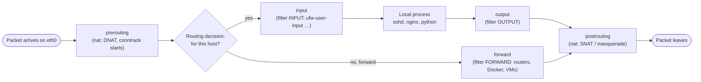
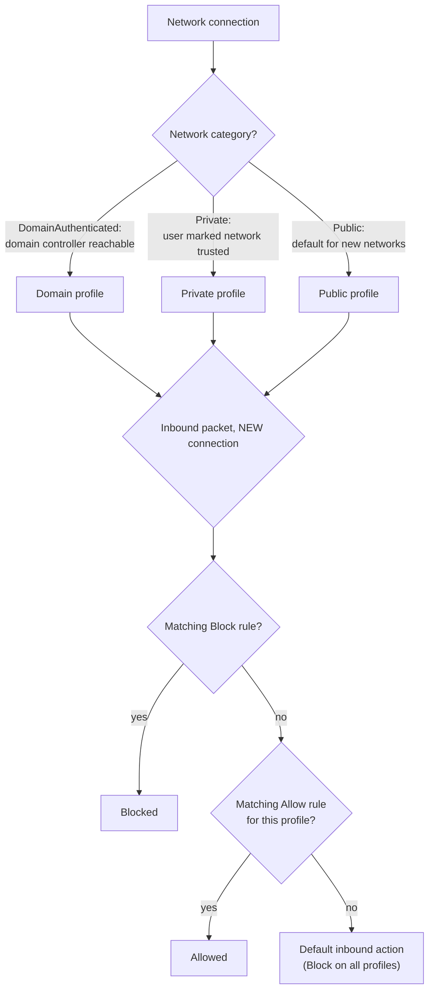

# Day 18: Firewall Management

!!! info "Lesson overview"
    | | |
    |---|---|
    | **Module** | 4 — Security, Logs & Monitoring |
    | **Difficulty** | :material-signal-cellular-2: Intermediate |
    | **Estimated time** | 3–4 hours (75 min reading, 90 min demonstrations, 60–90 min lab and quiz) |
    | **Platforms** | Ubuntu 24.04 LTS (ufw 0.36.2, nftables 1.0.9, iptables 1.8.10 `nf_tables`, conntrack-tools 1.4.8) · Windows 11 (Windows PowerShell 5.1 and PowerShell 7.4+, NetSecurity module) |
    | **Lab** | [Lab 18: Least-Privilege Firewall](../../labs/lab-18.md) |

## Learning Objectives

By the end of this lesson you will be able to:

1. Explain what a **host firewall** does, how it differs from a **network firewall**, and why both are needed (defence in depth).
2. Describe **stateful filtering**: connection tracking and the states `NEW`, `ESTABLISHED`, `RELATED` and `INVALID`, and why one "allow established" rule makes replies work.
3. Design a **default-deny, least-privilege** inbound policy: list what must be reachable, from where, on which protocol and port, and deny everything else.
4. Draw the Linux **netfilter** packet path (hooks `prerouting`, `input`, `forward`, `output`, `postrouting`), name the classic tables and chains, and tell whether `iptables` on your system is the **nf_tables** or **legacy** variant.
5. Read and change rules with **ufw** (Ubuntu), **nftables** (`nft`) and **iptables**, including rule order, numbered deletes, inserts, rate limiting, logging, syntax checks and handles; recognise **firewalld** on RHEL-family systems.
6. Make firewall changes **without locking yourself out**: back up first, allow management access first, keep a second session, and arm a **timed rollback** before you apply a risky change.
7. **Test** a policy from the outside with `nc`, `curl` and `nmap`, and interpret *open*, *closed* (refused) and *filtered* (timeout) — and explain **reject vs drop**.
8. Manage **Windows Defender Firewall** with PowerShell: profiles and network categories, `Get-NetFirewallProfile`, `Get-NetFirewallRule` and its port/address/application filters, `New-`/`Set-`/`Disable-`/`Remove-NetFirewallRule`, `netsh advfirewall export`/`import`, firewall logging (`pfirewall.log`) and Filtering Platform events.

## Prerequisites

- [Day 14: Ports, Sockets and Connections](../module-3/day-14.md): `ss -ltnp`, `Get-NetTCPConnection`, listening addresses, TCP states. Today you decide **who may reach** those listening ports.
- [Day 12: Connectivity Troubleshooting](../module-3/day-12.md): `nc -zv`, `curl`, `Test-NetConnection -Port`, and the difference between *refused* and *timed out*.
- [Day 16: System Logs](day-16.md) and Day 17 (authentication monitoring): the kernel log, `journalctl -k`, `Get-WinEvent`. Firewall logs are one more evidence source.
- An Ubuntu 24.04 **VM** (not a production server, not a cloud host you reach only over SSH) with `sudo`. Install the tools used today:

    ```bash
    sudo apt update && sudo apt install -y ufw nftables iptables conntrack netcat-openbsd curl nmap
    ```

- A Windows 11 VM or lab PC with Windows PowerShell 5.1 (PowerShell 7.4+ recommended). Reading firewall configuration works in a normal window; **changing** it, and reading `pfirewall.log`, needs an **elevated** window. All `*-NetFirewall*` cmdlets are **Windows-only** (they exist in 5.1 and in PowerShell 7 on Windows, not in PowerShell 7 on Linux or macOS).

!!! danger "Firewall changes can cut you off"
    A firewall rule can disconnect your own SSH or RDP session instantly. Practise only on lab machines that you can reach through a **console** (VM window, hypervisor console, out-of-band management). Never disable a firewall "to see if it helps" on a real system: diagnose with logs and counters instead, and change one precise rule.

## Introduction and Concepts

### What a firewall is for

A firewall decides, packet by packet, whether traffic may pass. A **network firewall** (a dedicated appliance, cloud security group or router ACL) protects a whole segment at its edge. A **host firewall** runs on each server or workstation and protects that one machine, including from other machines on the **same** network segment, where no network firewall sits in the path.

| Question | Network firewall | Host firewall |
|---|---|---|
| Where does it run? | Between networks (perimeter, data-centre segments, cloud VPC) | On the host itself (netfilter on Linux, Windows Filtering Platform on Windows) |
| What does it protect against? | Traffic crossing segments | Any traffic reaching the host, including from neighbours on the same VLAN |
| Who usually manages it? | Network / security team | System administrator, configuration management, Group Policy |
| Sees processes? | No | Windows rules can match a **program** or **service**; Linux rules match addresses, ports, interfaces, users (output) |
| Typical failure | A "temporary any-any" rule nobody removed | A service listening on `0.0.0.0` with no inbound restriction |

You need both. Day 14 showed that services often listen on **all** addresses; a host firewall makes sure that a database bound to `0.0.0.0:5432` is still only reachable from the application servers that need it. After an intrusion, a strict host firewall also limits **lateral movement**: a compromised web server cannot simply connect to every other machine's SSH or SMB port.

### Stateful filtering and connection tracking

Early packet filters looked at each packet on its own. That forced administrators to write rules for replies as well as requests ("allow TCP from port 443 to any high port" — which attackers abused). Modern firewalls are **stateful**: a connection-tracking table remembers every flow, and each packet is classified:

| State | Meaning | Typical rule |
|---|---|---|
| `NEW` | First packet of a flow not yet in the table (a TCP SYN, a first UDP datagram) | This is what your allow rules decide |
| `ESTABLISHED` | Belongs to a flow that has seen traffic in both directions | **Accept** — replies to allowed connections |
| `RELATED` | A new flow linked to an existing one (ICMP errors about a connection, FTP data channel with a helper) | **Accept** |
| `INVALID` | Does not fit any known flow (out-of-window TCP, malformed) | **Drop** |
| `UNTRACKED` | Exempted from tracking in the `raw` table | Rare; high-performance setups |

So a whole policy can be as short as: *accept ESTABLISHED and RELATED, drop INVALID, accept loopback, accept these few NEW connections, drop everything else*. Linux shows the table with `conntrack -L` (package `conntrack`); TCP entries also carry the TCP state (`ESTABLISHED`, `TIME_WAIT`, `CLOSE_WAIT` — the same states as Day 14). Windows Filtering Platform tracks state the same way internally; you never write "allow replies" rules on Windows.

### Default deny and least privilege

The professional design is **default deny inbound, explicit allow**:

1. **Inventory** what listens (`ss -ltnup`, `Get-NetTCPConnection -State Listen`).
2. For each service decide **who** needs it (everyone, a subnet, one host), on which **protocol/port**, on which **interface or profile**.
3. Write **allow** rules for exactly that, **most specific first** where order matters.
4. Set the **default** to deny (drop or reject) for inbound; usually allow outbound on servers and workstations, and restrict outbound only where you have a reason (for example, servers that must never send mail: deny outbound 25/tcp).
5. **Log** what is denied (rate-limited), so you can see scans and mistakes.
6. **Test** from each kind of client, document the result, and review rules regularly (remove "temporary" rules).

A policy written as a table is easy to review and to test. Lab 18 uses this one for an application server `app01` (10.18.0.10):

| Port | Service | Allowed from | Action for everyone else |
|---|---|---|---|
| 22/tcp | SSH | Admin subnet 10.18.0.16/28 | Drop (silently) |
| 443/tcp | HTTPS | Anyone | — |
| 9100/tcp | Metrics exporter | Monitoring host 10.18.0.50 only | Drop |
| 8080/tcp | Debug console (must not be used) | No one | **Reject** (fail fast, so developers notice) |
| Any other | — | No one | Drop and log |

### Drop or reject?

| | Drop (`DROP`, ufw `deny`, nft `drop`, Windows `Block`) | Reject (`REJECT`, ufw `reject`, nft `reject`) |
|---|---|---|
| What the firewall sends | Nothing | TCP RST (TCP) or ICMP port-unreachable (UDP) |
| What the client sees | **Timeout** after retries (`nc: … timed out`, `curl: (28)`) | Immediate **Connection refused** (`curl: (7)`) |
| `nmap` shows | `filtered` | `closed` |
| Good for | The Internet edge and untrusted sources: gives scanners nothing, costs no outgoing packets | Internal networks where fast failure helps users and monitoring |

Remember the Day 12 rule: **refused** means a host answered (no listener *or* a reject rule); **timeout** means something on the path, very often a firewall, silently dropped the packet.

### The Linux packet path: netfilter hooks

On Linux the filtering engine is **netfilter** inside the kernel. Tools such as `nft`, `iptables`, `ufw` and `firewalld` only **configure** it. Packets pass through five hooks:



| Hook (nftables) | Classic iptables chain(s) | Typical use |
|---|---|---|
| `prerouting` | `PREROUTING` in `raw`, `mangle`, `nat` | Destination NAT (port forwarding), marking |
| `input` | `INPUT` in `filter` (also `mangle`, `nat`) | **Protecting this host** — today's main topic |
| `forward` | `FORWARD` in `filter`, `mangle` | Traffic routed **through** the host (routers, containers, VMs) |
| `output` | `OUTPUT` in `raw`, `mangle`, `nat`, `filter` | Traffic generated by this host (egress control) |
| `postrouting` | `POSTROUTING` in `mangle`, `nat` | Source NAT / masquerading |

In iptables the **tables** are fixed (`filter`, `nat`, `mangle`, `raw`, `security`) and each has built-in **chains** with a **policy** (`ACCEPT` or `DROP`). Rules in a chain are evaluated **top to bottom; the first matching rule with a terminating target (`ACCEPT`, `DROP`, `REJECT`) wins**. Jumping to a user-defined chain (`-j ufw-user-input`) and returning is how ufw organises its rules.

In **nftables** you create your own tables (in a **family**: `ip` for IPv4, `ip6`, `inet` for both, `arp`, `bridge`, `netdev`) and your own **base chains** attached to a hook with a priority and a policy:

```text
table inet lab18 {
    chain input {
        type filter hook input priority filter; policy drop;
        ...rules...
    }
}
```

### Four tools, one engine

| Tool | Where you meet it | What it is |
|---|---|---|
| **nftables** (`nft`) | Debian 10+, Ubuntu 20.10+, RHEL 8+ | The modern native interface: one tool for IPv4/IPv6, sets and maps, atomic file loads |
| **iptables** | Everywhere, scripts and documentation from 20 years | On Ubuntu 24.04 `iptables` is **iptables-nft**: the old syntax, translated into nftables rules. `iptables -V` prints `iptables v1.8.10 (nf_tables)`. `iptables-legacy` still exists and writes to the old kernel tables — **do not mix them** |
| **ufw** (Uncomplicated Firewall) | Ubuntu (installed, **inactive** by default) | A front end that writes iptables rules from simple commands (`ufw allow 443/tcp`) and keeps them across reboots |
| **firewalld** (`firewall-cmd`) | RHEL, Rocky, Alma, Fedora, SUSE (enabled by default) | A daemon with **zones** and **services**, runtime vs permanent configuration, nftables back end |

!!! warning "One manager per host"
    Pick **one** tool to own the firewall on each machine. ufw and firewalld both rewrite rules on reload; a hand-made `nft` or `iptables` rule added next to them may vanish at the next reload, or sit in a separate table that is evaluated in a way you did not expect. Container engines (Docker, Podman, Kubernetes) and libvirt also insert their own rules — see *Common Mistakes*.

### ufw in detail (Ubuntu)

ufw stores its configuration in files and generates iptables rules from them:

| File | Contents |
|---|---|
| `/etc/default/ufw` | `IPV6=yes`, default policies (`DEFAULT_INPUT_POLICY="DROP"`, `DEFAULT_OUTPUT_POLICY="ACCEPT"`, `DEFAULT_FORWARD_POLICY="DROP"`) |
| `/etc/ufw/ufw.conf` | `ENABLED=yes/no` (start at boot) and `LOGLEVEL` |
| `/etc/ufw/before.rules`, `before6.rules` | Rules evaluated **before** yours: loopback, `ESTABLISHED,RELATED`, `INVALID` drop, needed ICMP, DHCP client, mDNS/UPnP |
| `/etc/ufw/user.rules`, `user6.rules` | **Your** rules, written by `ufw allow …` (do not edit by hand) |
| `/etc/ufw/after.rules`, `after6.rules` | Evaluated after yours (quietly drop noisy broadcast traffic before logging) |
| `/etc/ufw/applications.d/` | Application profiles, e.g. `openssh-server` installs `OpenSSH` = 22/tcp |
| `/var/log/ufw.log` | `[UFW BLOCK]` / `[UFW ALLOW]` / `[UFW AUDIT]` kernel log lines, written by rsyslog (`/etc/rsyslog.d/20-ufw.conf`); also visible in `journalctl -k` |

Rule syntax comes in a **simple** form (`ufw allow 443/tcp`, `ufw deny 23`) and a **full** form (`ufw allow from 10.18.0.16/28 to any port 22 proto tcp`). A port without `/tcp` or `/udp` means **both** protocols. When IPv6 is enabled, simple rules are added for IPv4 **and** IPv6 (status shows a second line ending in `(v6)`); rules with an IPv4 source address are added for IPv4 only.

**Rule order:** ufw appends new rules at the end of your list and evaluates them top to bottom, first match wins. Use `ufw insert N …` to put a rule at position *N*, and `ufw status numbered` to see the numbers.

**`ufw limit`** adds rate limiting: an address that opens **6 or more** new connections within **30 seconds** is rejected — a simple brake on SSH password guessing (Day 17). It does not replace key-only authentication or tools such as fail2ban.

### firewalld (RHEL family) in two minutes

You will meet firewalld on Red Hat-family servers. Its model is different from ufw:

- Every interface belongs to a **zone** (`public`, `internal`, `trusted`, `drop`…); each zone allows a list of **services** (`ssh`, `https`) and ports.
- Changes are **runtime** (lost on reload) unless you add `--permanent`, then `--reload`. That gives a built-in safety net: test at runtime, and only then make it permanent (`--runtime-to-permanent`). Runtime additions can even expire by themselves: `--timeout=5m`.

```bash
# RHEL / Rocky / Fedora (firewalld) — not Ubuntu
sudo firewall-cmd --state
sudo firewall-cmd --get-active-zones
sudo firewall-cmd --zone=public --list-all
sudo firewall-cmd --zone=public --add-service=https --timeout=5m     # runtime, expires
sudo firewall-cmd --zone=public --add-service=https --permanent && sudo firewall-cmd --reload
sudo firewall-cmd --zone=public --add-rich-rule='rule family="ipv4" source address="10.18.0.16/28" service name="ssh" accept' --permanent
```

### Windows Defender Firewall

Windows filters traffic with the **Windows Filtering Platform (WFP)**; *Windows Defender Firewall with Advanced Security* is its policy layer. Key differences from Linux:

- Three **profiles** — **Domain**, **Private**, **Public** — each with its own on/off state, default inbound/outbound action and logging. Each network connection has a **network category**, and the category decides which profile's rules apply.
- Rules have **no order**. The evaluation is: an explicit **Block** rule wins over an **Allow** rule; an Allow rule wins over the default action. (Exception: allow rules marked *override block* for authenticated IPsec traffic.)
- Rules can match a **program** (`C:\App\app.exe`) or **service**, as well as protocol, ports, local/remote addresses, interface type and profile.
- Rules come from several **policy stores**: the local **PersistentStore**, **Group Policy** (domain GPOs), and the effective merged result, the **ActiveStore**. A GPO rule cannot be changed locally.



By default all three profiles are **enabled**, inbound is **blocked** unless a rule allows it, and outbound is **allowed**. A laptop that moves from the office (Domain) to a café (Public) automatically switches to the stricter profile. A very common support problem — *"File sharing works on the office Wi-Fi but not at home"* — is simply a network that Windows classified as **Public**.

### Logs: seeing what the firewall did

- **ufw** logs blocked packets as kernel messages tagged `[UFW BLOCK]` (rate-limited; level `low` by default when you enable it). Levels: `off`, `low` (blocked packets not matching the policy, plus rules you marked `log`), `medium` (adds invalid packets, new allowed connections as `[UFW ALLOW]`, and `[UFW AUDIT]`), `high` and `full` (no rate limiting; very noisy).
- **nftables/iptables**: add a `log prefix "…"` statement (nft) or `-j LOG --log-prefix` (iptables) with a **limit** before the drop. Counters (`counter` in nft, `-v` in iptables) are often more useful than logs: a rule whose counter stays at 0 never matched.
- **Windows**: per-profile text log `%SystemRoot%\System32\LogFiles\Firewall\pfirewall.log` (off by default; enable `LogBlocked`), and Security-log events **5152** (packet dropped), **5157** (connection blocked) and **5156** (connection allowed) when the *Filtering Platform* audit subcategories are enabled. Rule changes are recorded in the operational log *Microsoft-Windows-Windows Firewall With Advanced Security/Firewall*.

A key log field to read is the **destination port** (`DPT=5432`, `dst-port`): a spread of ports from one source is a scan; repeated attempts on one port from many sources is usually a misconfigured client or a botnet.

## Linux Command Reference

| Command | Purpose | Package / availability | Needs root? |
|---|---|---|---|
| `ufw` | Uncomplicated Firewall front end: `status`, `allow`, `deny`, `reject`, `limit`, `insert`, `delete`, `default`, `logging`, `enable`, `disable`, `reload`, `reset`, `app`, `show` | ufw (Ubuntu default, inactive) | Yes (`status` too) |
| `nft` | nftables: `list ruleset`, `add`/`insert`/`delete` table/chain/rule/set/element, `-f FILE` atomic load, `-c` check, `-a` handles | nftables | Yes |
| `iptables`, `ip6tables` | Classic rule syntax (`-L`, `-S`, `-A`, `-I`, `-D`, `-P`, `-F`) — `nf_tables` variant on Ubuntu 24.04 | iptables | Yes |
| `iptables-save`, `iptables-restore` | Dump / load whole rule sets (`--test` to check) | iptables | Yes |
| `iptables-legacy`, `update-alternatives --display iptables` | Old kernel-table variant / which variant `iptables` points to | iptables | Yes / No |
| `conntrack` | List (`-L`), count (`-C`), watch (`-E`) and delete (`-D`) tracked connections | conntrack | Yes |
| `firewall-cmd` | firewalld client (RHEL family): zones, services, runtime/permanent | firewalld (**not Ubuntu default**) | Yes |
| `ss -ltnup` | What listens, and which process (Day 14) | iproute2 | `-p` for others' processes |
| `nc -zv -w 2 HOST PORT` | Test a TCP port: succeeded / refused / timed out | netcat-openbsd | No |
| `curl -m 3` | Test an HTTP(S) service end to end | curl | No |
| `nmap -sT -Pn -p PORTS HOST` | Port scan: open / closed / filtered (**authorised targets only**) | nmap | No (`-sS` needs root) |
| `systemd-run --on-active=5m CMD` | Run a command once after a delay (transient timer) — timed rollback | systemd | Yes |
| `at now + 5 minutes` | Alternative one-shot scheduler | at (install it) | Yes for root jobs |
| `journalctl -k -g 'UFW BLOCK'`, `/var/log/ufw.log` | Read firewall log lines | systemd / rsyslog | `adm` group or root |

## PowerShell Command Reference

| Cmdlet / command | Aliases | Purpose | Works in 5.1 | Works in 7.x | Admin? |
|---|---|---|---|---|---|
| `Get-NetConnectionProfile` | — | Network category (Public/Private/DomainAuthenticated) of each connection | Yes | Windows only | No |
| `Set-NetConnectionProfile` | — | Change a connection's category to Private/Public | Yes | Windows only | **Yes** |
| `Get-NetFirewallProfile` | — | Domain/Private/Public: Enabled, default actions, logging | Yes | Windows only | No (read) |
| `Set-NetFirewallProfile` | — | Change profile settings (logging, defaults) | Yes | Windows only | **Yes** |
| `Get-NetFirewallRule` | — | List rules; filter by name, group, enabled, direction, action, store | Yes | Windows only | No |
| `Get-NetFirewallPortFilter` / `-AddressFilter` / `-ApplicationFilter` / `-ServiceFilter` | — | Port/protocol, addresses, program, service of a rule | Yes | Windows only | No |
| `New-NetFirewallRule` | — | Create a rule | Yes | Windows only | **Yes** |
| `Set-NetFirewallRule` | — | Modify a rule (ports, addresses, profiles, action) | Yes | Windows only | **Yes** |
| `Enable-` / `Disable-NetFirewallRule` | — | Switch a rule on/off without deleting it | Yes | Windows only | **Yes** |
| `Remove-NetFirewallRule` | — | Delete rules (supports `-WhatIf`) | Yes | Windows only | **Yes** |
| `Copy-NetFirewallRule` | — | Duplicate a rule (`-NewName`) | Yes | Windows only | **Yes** |
| `Show-NetFirewallRule` | — | Print every rule with all its filters | Yes | Windows only | No |
| `Get-NetFirewallSetting` | — | Global settings (e.g. `-PolicyStore ActiveStore`) | Yes | Windows only | No |
| `Test-NetConnection -Port` | `tnc` | TCP test to a port from Windows (Day 12) | Yes | Windows only | No |
| `netsh advfirewall export` / `import` | — | Back up / restore the **whole** firewall policy (`.wfw`) | Native | Native | **Yes** |
| `netsh advfirewall show allprofiles` / `firewall show rule name=all` | — | Text view of profiles and rules | Native | Native | No |
| `auditpol /set /subcategory:"Filtering Platform Connection"` | — | Enable events 5156/5157 | Native | Native | **Yes** |
| `Get-WinEvent -FilterHashtable @{LogName='Security'; Id=5157}` | — | Read blocked-connection events (Day 16) | Yes | Windows only | **Yes** (Security log) |

All `*-NetFirewall*` and `*-NetConnectionProfile` cmdlets come from the **NetSecurity** and **NetConnection** modules, which are CIM-based and exist only on Windows (Windows 8 / Server 2012 and later). They work the same in Windows PowerShell 5.1 and PowerShell 7 on Windows.

## Detailed Command Explanations

### Inventory first: what listens, what is allowed?

Before you touch a firewall, collect two lists: **what is listening** and **what the firewall currently allows**. Compare them. Anything listening on a non-loopback address without a matching rule is either intentionally blocked or a forgotten service; anything allowed without a listener is a stale rule.

- Linux: `sudo ss -ltnup` (Day 14), `sudo ufw status verbose`, `sudo ufw show listening` (listening ports **with** the ufw rule that applies to each), `sudo nft list ruleset`, `sudo iptables -S`.
- Windows: `Get-NetTCPConnection -State Listen`, `Get-NetFirewallProfile`, and `Get-NetFirewallRule -Enabled True -Direction Inbound -Action Allow` joined with its port filter.

### `ufw` — everyday firewall on Ubuntu

```bash
sudo ufw status verbose                 # active? defaults, logging, rules
sudo ufw status numbered                # rules with numbers (for delete/insert)
sudo ufw default deny incoming          # set policies
sudo ufw default allow outgoing
sudo ufw allow from 10.18.0.16/28 to any port 22 proto tcp comment 'admin SSH'
sudo ufw allow 443/tcp
sudo ufw reject 8080/tcp                # refuse with TCP RST instead of dropping
sudo ufw limit OpenSSH                  # rate-limit an application profile
sudo ufw insert 1 deny from 203.0.113.45 comment 'IR-1742'
sudo ufw delete 3                       # shows the rule and asks for confirmation
sudo ufw --dry-run allow 9100/tcp       # print the iptables rules, change nothing
sudo ufw enable                         # starts now and at boot
sudo ufw logging low                    # off | low | medium | high | full
sudo ufw show added                     # your rules as commands (works while inactive)
sudo ufw reload                         # re-read the files
```

Points that trip people up:

- When you run it over SSH, `ufw enable` asks *"Command may disrupt existing ssh connections. Proceed with operation (y|n)?"* — that question is the moment to check you have an SSH allow rule (or console access). `--force` skips the question in scripts.
- While ufw is **inactive**, commands print `Rules updated` and change only the files; once it is **active** they print `Rule added` and take effect immediately.
- `ufw delete allow 443/tcp` (delete by rule text) and `ufw delete 2` (by number) both work. Numbers shift after every delete, so delete from the **highest** number down, and re-run `status numbered` each time.
- `ufw reset` disables the firewall and deletes all your rules, after copying every rules file to `*.rules.YYYYMMDD_HHMMSS`. It is a clean-slate tool for labs, not a troubleshooting step.

### `nft` — native nftables

```bash
sudo nft list ruleset                        # everything, all families
sudo nft list tables
sudo nft -a list chain inet lab18 input      # -a shows rule handles
sudo nft -c -f /etc/nftables.conf            # check syntax only (-c), change nothing
sudo nft -f /etc/nftables.conf               # load atomically: all or nothing
sudo nft add rule inet lab18 input tcp dport 443 accept
sudo nft insert rule inet lab18 input position 10 ip saddr 203.0.113.45 drop
sudo nft delete rule inet lab18 input handle 16
sudo nft add element inet lab18 admin_nets '{ 10.18.0.32/28 }'
sudo nft list ruleset > /root/fw-backup-$(date +%F).nft
```

Key ideas:

- A **file** with `flush ruleset` at the top followed by your tables is the professional way to manage nftables: review it in version control, `nft -c -f` it, then load it in one **atomic** transaction. If the file has an error, nothing changes.
- **Handles** (`# handle 10`, shown with `-a`) identify rules for `delete` and for `insert … position N` / `add … position N`.
- **Sets** (`set admin_nets { type ipv4_addr; flags interval; … }`) hold many addresses or ports in one rule; you add or remove elements without touching the rules.
- **Counters** (`counter`) show packets and bytes per rule — the quickest way to prove which rule matched.
- On Ubuntu the `nftables.service` loads `/etc/nftables.conf` at boot when it is **enabled** (`systemctl enable nftables`). Do not enable it next to ufw.
- A saved `nft list ruleset` dump does **not** contain `flush ruleset`; add that line at the top when you want to use the dump as a restore file, or the restore will add duplicate rules.

### `iptables` — classic syntax you must be able to read

```bash
sudo iptables -V                              # (nf_tables) or (legacy)
sudo iptables -L INPUT -n -v --line-numbers   # numeric, counters, rule numbers
sudo iptables -S                              # rules as commands (best for reading/diffing)
sudo iptables -A INPUT -p tcp -s 10.18.0.16/28 --dport 22 -j ACCEPT   # append
sudo iptables -I INPUT 3 -s 203.0.113.45 -j DROP                      # insert at 3
sudo iptables -D INPUT 3                      # delete rule 3 (or repeat the full spec)
sudo iptables -P INPUT DROP                   # chain policy — set LAST, after the allows
sudo iptables-save > /root/iptables-$(date +%F).rules
sudo iptables-restore --test < /root/iptables-2026-11-15.rules
```

`-n` avoids slow reverse DNS lookups, `-v` adds packet/byte counters and interfaces, `--line-numbers` gives the numbers for `-I`/`-D`. With iptables-nft, the rules also appear in `nft list ruleset` under `table ip filter` with the comment *"managed by iptables-nft, do not touch!"* — read them with either tool, but change them only with `iptables`. Rules added with plain `iptables` are **not persistent**: they vanish at reboot unless you use a manager (ufw, the `iptables-persistent` package, or nftables).

### `conntrack` — the state table

`sudo conntrack -L` lists flows with protocol, timeout, TCP state, original and reply tuples and flags (`[ASSURED]` = seen in both directions, protected from early eviction). `conntrack -L -p tcp --dport 22` filters, `conntrack -C` counts, `conntrack -E` streams events live. Dropped connection attempts do **not** appear: a flow is only confirmed in the table when its first packet is accepted. `conntrack -D -s ADDR` deletes entries — after you block an attacker, existing ESTABLISHED sessions keep working until they close or you delete them.

### Testing tools: `nc`, `curl`, `nmap`

- `nc -zv -w 2 10.18.0.10 22` — `succeeded` = open, `Connection refused` = closed or rejected, `timed out` = filtered (dropped) or host unreachable.
- `curl -sS -m 3 http://…` — tests the application, not only the port.
- `nmap -sT -Pn -p 22,443,5432 10.18.0.10` — a TCP **connect** scan (no root needed); `-sS` (SYN scan) needs root; `-Pn` skips host discovery, which is often blocked. Port states: `open`, `closed` (RST received), `filtered` (no answer or ICMP prohibited), `unfiltered`, `open|filtered` (typical for UDP). Scan **only** hosts you own or are explicitly authorised to test (`scanme.nmap.org` allows light scans).
- Always test from **each kind of client** the policy names (admin, monitoring, ordinary user), because a test from the server itself goes through `lo` and proves nothing about inbound rules.

### Lockout prevention and timed rollback

Every remote firewall change follows the same pattern:

1. **Console path ready** (hypervisor console, iDRAC/iLO, cloud serial console) — know how you will get in if SSH breaks.
2. **Back up** the current rules: `sudo tar -C /etc -czf /root/ufw-$(date +%F-%H%M).tgz ufw`, `sudo nft list ruleset > …`, `sudo iptables-save > …`; on Windows `netsh advfirewall export C:\FW\before.wfw`.
3. **Allow management first** (SSH from the admin subnet) **before** setting a deny default or enabling the firewall.
4. **Arm a rollback** that restores the backup automatically unless you cancel it:

    ```bash
    # restores the previous ufw configuration in 5 minutes unless cancelled
    sudo systemd-run --on-active=5m --unit=fw-rollback \
        /bin/sh -c 'tar -C /etc -xzf /root/ufw-backup.tgz && ufw reload'
    # nftables: restore a known-good file
    sudo systemd-run --on-active=5m --unit=fw-rollback /usr/sbin/nft -f /root/fw-known-good.nft
    ```

5. **Apply** the change, then open a **new** SSH session from the admin network (keep the old one open — existing sessions survive thanks to `ESTABLISHED`, so they prove nothing).
6. If the new session works, **cancel** the rollback: `sudo systemctl stop fw-rollback.timer`. If you were cut off, wait five minutes and log in again.

### `Get-NetFirewallProfile` and network categories (Windows)

```powershell
Get-NetConnectionProfile | Select-Object InterfaceAlias, Name, NetworkCategory
Get-NetFirewallProfile -PolicyStore ActiveStore |
    Select-Object Name, Enabled, DefaultInboundAction, DefaultOutboundAction, LogBlocked, LogFileName
```

Use `-PolicyStore ActiveStore` to see the **effective** values. Without it you read the local persistent store, where untouched settings show `NotConfigured` (meaning "use the built-in default": Enabled, inbound Block, outbound Allow). If a wired office network is shown as `Public`, fix the category (elevated) instead of loosening rules: `Set-NetConnectionProfile -InterfaceAlias Ethernet -NetworkCategory Private`. `DomainAuthenticated` cannot be set by hand; Windows chooses it when it can reach a domain controller.

### `Get-NetFirewallRule` and its filters

A Windows rule object holds the name, display name, group, enabled state, direction, action and profiles. The **conditions** live in separate filter objects, retrieved through the pipeline:

```powershell
# Enabled inbound allow rules with their ports
Get-NetFirewallRule -Enabled True -Direction Inbound -Action Allow |
    ForEach-Object {
        $pf = $_ | Get-NetFirewallPortFilter
        $af = $_ | Get-NetFirewallAddressFilter
        [pscustomobject]@{
            DisplayName = $_.DisplayName
            Profile     = $_.Profile
            Protocol    = $pf.Protocol
            LocalPort   = $pf.LocalPort -join ','
            Remote      = $af.RemoteAddress -join ','
        }
    } | Sort-Object LocalPort | Format-Table -AutoSize

# Which rules mention port 3389?
Get-NetFirewallPortFilter | Where-Object LocalPort -eq 3389 | Get-NetFirewallRule |
    Select-Object DisplayName, Enabled, Profile, Action
```

`-Enabled True` takes the value `True` or `False` of an **enumeration**, not a PowerShell Boolean: write `-Enabled True`, as the documentation does. `Name` is the unique ID (often a GUID or `RemoteDesktop-UserMode-In-TCP`); `DisplayName` is what the GUI shows and need not be unique. `-PolicyStoreSourceType GroupPolicy` (property on the rule) tells you a rule came from a GPO.

### `New-NetFirewallRule`, `Set-`, `Disable-`, `Remove-`

```powershell
New-NetFirewallRule -DisplayName 'Lab18 HTTPS in' -Group 'Lab18' `
    -Direction Inbound -Protocol TCP -LocalPort 443 -Action Allow -Profile Domain, Private
New-NetFirewallRule -DisplayName 'Lab18 metrics from monitoring' -Group 'Lab18' `
    -Direction Inbound -Protocol TCP -LocalPort 9100 -RemoteAddress 10.18.0.50 -Action Allow
Set-NetFirewallRule -DisplayName 'Lab18 metrics from monitoring' -RemoteAddress 10.18.0.50, 10.18.0.51
Disable-NetFirewallRule -DisplayName 'Lab18 HTTPS in'
Remove-NetFirewallRule -Group 'Lab18' -WhatIf
```

- `-Direction` defaults to `Inbound` and `-Action` to `Allow`, but write them anyway for readability.
- `-LocalPort` requires `-Protocol TCP` or `UDP`. Port lists and ranges: `-LocalPort 80, 443`, `-LocalPort 5000-5010`.
- `-RemoteAddress` accepts addresses, subnets (`10.18.0.16/28`, `10.18.0.16/255.255.255.240`), ranges and keywords (`LocalSubnet`, `Internet`, `Intranet`, `DefaultGateway`).
- `-Program 'C:\App\app.exe'` limits a rule to one executable — strong on workstations, where many programs open ports.
- Put lab or project rules in a **`-Group`**: you can then list, disable or remove them together (`-Group` is the internal group name; `-DisplayGroup` is what you filter by in `Get-NetFirewallRule`, and for groups you create they are the same).
- Every change cmdlet supports `-WhatIf` and `-Confirm`.

### `netsh advfirewall` — backup, restore and text views

```powershell
netsh advfirewall export "C:\FW\fw-before-chg1818.wfw"   # whole policy, all profiles
netsh advfirewall import "C:\FW\fw-before-chg1818.wfw"   # REPLACES the whole local policy
netsh advfirewall show allprofiles
netsh advfirewall firewall show rule name=all dir=in | Select-String -Pattern 'Rule Name|LocalPort' -Context 0,0
```

`export`/`import` is the Windows equivalent of `nft list ruleset > file` / `nft -f file`. Import affects the local policy store only; Group Policy rules still apply. Avoid `netsh advfirewall reset` (restores Windows defaults and deletes every custom rule).

### Firewall logging on Windows

```powershell
Set-NetFirewallProfile -Profile Domain, Private, Public -LogBlocked True -LogMaxSizeKilobytes 16384 `
    -LogFileName '%SystemRoot%\System32\LogFiles\Firewall\pfirewall.log'
Get-Content "$env:SystemRoot\System32\LogFiles\Firewall\pfirewall.log" -Tail 20    # elevated
auditpol /set /subcategory:"Filtering Platform Connection" /failure:enable          # 5157 events
Get-WinEvent -FilterHashtable @{ LogName = 'Security'; Id = 5157 } -MaxEvents 10
```

`pfirewall.log` is a W3C-style text file: a `#Fields:` header, then one line per event with `date time action protocol src-ip dst-ip src-port dst-port size tcpflags …` (newer Windows 11 builds add a `pid` column). Enabling `/success:enable` for *Filtering Platform Connection* creates an event 5156 for **every allowed connection** — far too noisy for most machines; enable failures only unless you have a SIEM that needs both.

## Syntax and Parameters

### Linux

```text
ufw [--dry-run] [--force] enable | disable | reload | reset | status [verbose|numbered]
ufw default allow|deny|reject [incoming|outgoing|routed]
ufw [insert N] allow|deny|reject|limit [in|out] [log|log-all] PORT[/PROTO] | APP [comment 'TEXT']
ufw [insert N] allow|deny|reject|limit [in|out [on IFACE]] [proto tcp|udp] [from ADDR [port P]] [to ADDR [port P]] [comment 'TEXT']
ufw delete N | delete RULE
ufw logging on|off|low|medium|high|full
ufw app list | app info NAME
ufw show added | listening | raw

nft [-c] [-a] [-n] -f FILE
nft list ruleset | tables | table FAMILY NAME | chain FAMILY TABLE CHAIN | set FAMILY TABLE SET
nft add|insert rule FAMILY TABLE CHAIN [position HANDLE] MATCHES... STATEMENT
nft delete rule FAMILY TABLE CHAIN handle N
nft add|delete element FAMILY TABLE SET '{ ELEMENT, ... }'
nft flush ruleset | flush chain FAMILY TABLE CHAIN

iptables [-t TABLE] -L [CHAIN] [-n] [-v] [--line-numbers] | -S [CHAIN]
iptables [-t TABLE] -A|-I CHAIN [N] [-p PROTO] [-s SRC] [-d DST] [-i IN] [--dport P] [-m conntrack --ctstate S] -j TARGET
iptables -D CHAIN N|RULESPEC ; iptables -P CHAIN ACCEPT|DROP ; iptables -F [CHAIN]
iptables-save [-t TABLE] > FILE ; iptables-restore [--test] [--noflush] < FILE

conntrack -L|-C|-E [-p PROTO] [-s SRC] [-d DST] [--dport P] [--state STATE]
nmap -sT|-sS [-Pn] [-p PORTS] TARGET
systemd-run --on-active=TIME [--unit=NAME] COMMAND...
```

| Option | Applies to | Meaning |
|---|---|---|
| `status verbose` / `numbered` | ufw | Defaults and logging / rule numbers |
| `allow` · `deny` · `reject` · `limit` | ufw | Accept · drop silently · refuse (RST / ICMP) · accept with 6-per-30 s rate limit |
| `insert N` | ufw | Put the rule at position N (first match wins) |
| `proto tcp` / `PORT/tcp` | ufw | Protocol; without it, **both** TCP and UDP |
| `comment 'TEXT'` | ufw | Stored and shown in `status`; document the ticket number |
| `--dry-run` | ufw | Print the resulting rules; change nothing |
| `--force` | ufw | No confirmation prompt (`enable`, `delete`, `reset`) |
| `-c` | nft | Check only, do not apply |
| `-a` | nft | Show rule handles |
| `flags interval` | nft set | Allow prefixes/ranges in a set |
| `policy drop;` | nft base chain | Default verdict when no rule matched |
| `-n` · `-v` · `--line-numbers` | iptables `-L` | Numeric · counters · rule numbers |
| `-S` | iptables | Print rules in command form |
| `-I CHAIN N` · `-A` · `-D` · `-P` | iptables | Insert at N · append · delete · set policy |
| `--test` | iptables-restore | Parse and check, do not commit |
| `--on-active=5m` | systemd-run | Delay before the one-shot command runs |

### PowerShell

```text
Get-NetConnectionProfile [-InterfaceAlias <String[]>]
Set-NetConnectionProfile -InterfaceAlias <String[]> -NetworkCategory <Public|Private>
Get-NetFirewallProfile [-Name <String[]>] [-PolicyStore <String>]
Set-NetFirewallProfile [-Profile <Domain|Private|Public[]>] [-Enabled <True|False>] [-DefaultInboundAction <Block|Allow>]
    [-LogBlocked <True|False>] [-LogAllowed <True|False>] [-LogFileName <String>] [-LogMaxSizeKilobytes <UInt64>]
Get-NetFirewallRule [-Name <String[]>] [-DisplayName <String[]>] [-DisplayGroup <String[]>] [-Group <String[]>]
    [-Enabled <True|False>] [-Direction <Inbound|Outbound>] [-Action <Allow|Block>] [-PolicyStore <String>]
Get-NetFirewallPortFilter | Get-NetFirewallAddressFilter | Get-NetFirewallApplicationFilter [-AssociatedNetFirewallRule <CimInstance>]
New-NetFirewallRule -DisplayName <String> [-Name <String>] [-Group <String>] [-Direction <Inbound|Outbound>]
    [-Action <Allow|Block>] [-Protocol <String>] [-LocalPort <String[]>] [-RemotePort <String[]>]
    [-LocalAddress <String[]>] [-RemoteAddress <String[]>] [-Program <String>] [-Service <String>]
    [-Profile <Any|Domain|Private|Public>] [-Enabled <True|False>] [-Description <String>] [-WhatIf]
Set-NetFirewallRule -Name|-DisplayName|-Group ... [same condition parameters] [-NewDisplayName <String>]
Enable-NetFirewallRule | Disable-NetFirewallRule | Remove-NetFirewallRule -Name|-DisplayName|-Group ... [-WhatIf] [-Confirm]
Copy-NetFirewallRule -DisplayName <String[]> -NewName <String>
Show-NetFirewallRule [-PolicyStore <String>]
Test-NetConnection [-ComputerName] <String> -Port <Int32>
netsh advfirewall export|import "<file.wfw>" ; netsh advfirewall show allprofiles
```

| Parameter | Meaning |
|---|---|
| `-PolicyStore ActiveStore` | Effective, merged policy (local + GPO); `PersistentStore` = local saved policy |
| `-Profile Domain, Private` | Rule applies only in these profiles (`Any` = all) |
| `-RemoteAddress 10.18.0.16/28` / `LocalSubnet` | Source restriction for inbound rules |
| `-Group 'Lab18'` | Group name for bulk enable/disable/remove |
| `-Program` / `-Service` | Restrict to one executable / Windows service |
| `-Enabled True/False` | String enumeration values |
| `-LogBlocked True` | Write dropped packets to the profile's log file |
| `-WhatIf` | Show what would change; change nothing |

## Practical Demonstrations

The Linux outputs below were **captured** on 2026-11-15 on Ubuntu 24.04.5 in a container, inside the network namespaces of [Lab 18](../../labs/lab-18.md): `app01` (server, 10.18.0.10), `admin` (10.18.0.20, in the admin subnet 10.18.0.16/28), `monitor` (10.18.0.50) and `guest` (10.18.0.100), joined by a bridge; ufw 0.36.2, nftables 1.0.9, iptables 1.8.10 (nf_tables), conntrack-tools 1.4.8, Nmap 7.94SVN. Every firewall command ran **inside** the server namespace (`sudo ip netns exec lab18-server …`), and client tests inside the client namespaces; the commands are shown without that prefix where it does not matter. To follow along, run the Lab 18 setup script and prefix the commands the same way. The capture kernel had no IPv6, so ufw created no `(v6)` rules; on a normal Ubuntu VM you will see an extra `(v6)` line for every rule without an IPv4 source. Windows outputs are **examples** (no Windows host was available to the release environment).

### Demo 1 — Inventory: which variant, what listens, what is allowed?

=== "Bash"

    ```bash
    iptables -V
    nft --version
    sudo ufw status verbose
    sudo ss -ltn
    ```

    **Expected output (captured, server namespace before any rules):**

    ```text
    iptables v1.8.10 (nf_tables)
    nftables v1.0.9 (Old Doc Yak #3)
    Status: inactive
    State  Recv-Q Send-Q Local Address:Port Peer Address:PortProcess
    LISTEN 0      16           0.0.0.0:443       0.0.0.0:*
    LISTEN 0      16           0.0.0.0:22        0.0.0.0:*
    LISTEN 0      16           0.0.0.0:9100      0.0.0.0:*
    LISTEN 0      16           0.0.0.0:8080      0.0.0.0:*
    LISTEN 0      16           0.0.0.0:5432      0.0.0.0:*
    ```

    Five services listen on **all** addresses and no firewall is active: every one of them is reachable by every host on the network. That is the exposure the policy table in *Introduction* fixes.

=== "PowerShell"

    ```powershell
    Get-NetConnectionProfile | Select-Object InterfaceAlias, Name, NetworkCategory
    Get-NetFirewallProfile -PolicyStore ActiveStore |
        Format-Table Name, Enabled, DefaultInboundAction, DefaultOutboundAction, LogBlocked
    Get-NetTCPConnection -State Listen | Where-Object LocalAddress -ne '127.0.0.1' |
        Sort-Object LocalPort | Select-Object LocalAddress, LocalPort, OwningProcess -First 6
    ```

    **Expected output (example):**

    ```text
    InterfaceAlias Name     NetworkCategory
    -------------- ----     ---------------
    Ethernet       Network2          Public

    Name    Enabled DefaultInboundAction DefaultOutboundAction LogBlocked
    ----    ------- -------------------- --------------------- ----------
    Domain     True                Block                 Allow      False
    Private    True                Block                 Allow      False
    Public     True                Block                 Allow      False

    LocalAddress LocalPort OwningProcess
    ------------ --------- -------------
    0.0.0.0            135          1180
    ::                 135          1180
    0.0.0.0            445             4
    0.0.0.0           5040          8344
    0.0.0.0           7680          5676
    0.0.0.0          49664           948
    ```

    The Ethernet connection is in the **Public** category, so the Public profile's rules apply. Ports 135 and 445 listen, but the firewall decides who can reach them.

### Demo 2 — Build a least-privilege ufw policy (management first)

=== "Bash"

    ```bash
    sudo ufw default deny incoming
    sudo ufw allow from 10.18.0.16/28 to any port 22 proto tcp     # management FIRST
    sudo ufw enable
    sudo ufw allow 443/tcp
    sudo ufw allow from 10.18.0.50 to any port 9100 proto tcp comment 'Prometheus node exporter'
    sudo ufw status numbered
    sudo ufw show added
    ```

    **Expected output (captured):**

    ```text
    Default incoming policy changed to 'deny'
    (be sure to update your rules accordingly)
    Rules updated
    Firewall is active and enabled on system startup
    Rule added
    Rule added
    Status: active

         To                         Action      From
         --                         ------      ----
    [ 1] 22/tcp                     ALLOW IN    10.18.0.16/28
    [ 2] 443/tcp                    ALLOW IN    Anywhere
    [ 3] 9100/tcp                   ALLOW IN    10.18.0.50                 # Prometheus node exporter

    Added user rules (see 'ufw status' for running firewall):
    ufw allow from 10.18.0.16/28 to any port 22 proto tcp
    ufw allow 443/tcp
    ufw allow from 10.18.0.50 to any port 9100 proto tcp comment 'Prometheus node exporter'
    ```

    Notice `Rules updated` (firewall still inactive: only files changed) versus `Rule added` (active: applied at once). The capture ran from a console, not over SSH, so `ufw enable` asked nothing. Over SSH it first asks *Command may disrupt existing ssh connections. Proceed with operation (y|n)?* — in a script, `ufw --force enable` skips the question. `ufw show added` prints your rules as re-runnable commands — handy for documentation and for rebuilding a server.

=== "PowerShell"

    ```powershell
    # Elevated. Back up first, then create the rules in one group.
    New-Item -ItemType Directory -Path C:\FW -Force | Out-Null
    netsh advfirewall export "C:\FW\fw-before-demo2.wfw"
    New-NetFirewallRule -DisplayName 'Lab18 SSH from admin subnet' -Group 'Lab18' -Direction Inbound `
        -Protocol TCP -LocalPort 22 -RemoteAddress 10.18.0.16/28 -Action Allow | Out-Null
    New-NetFirewallRule -DisplayName 'Lab18 HTTPS' -Group 'Lab18' -Direction Inbound `
        -Protocol TCP -LocalPort 443 -Action Allow | Out-Null
    New-NetFirewallRule -DisplayName 'Lab18 metrics' -Group 'Lab18' -Direction Inbound `
        -Protocol TCP -LocalPort 9100 -RemoteAddress 10.18.0.50 -Action Allow `
        -Description 'Prometheus windows_exporter, CHG-1818' | Out-Null
    Get-NetFirewallRule -Group 'Lab18' | Select-Object DisplayName, Enabled, Direction, Action, Profile
    ```

    **Expected output (example):**

    ```text
    Ok.

    DisplayName                 Enabled Direction Action Profile
    -----------                 ------- --------- ------ -------
    Lab18 SSH from admin subnet    True   Inbound  Allow     Any
    Lab18 HTTPS                    True   Inbound  Allow     Any
    Lab18 metrics                  True   Inbound  Allow     Any
    ```

    `Ok.` is `netsh`'s answer to the export. `Profile Any` means the rule applies in all three profiles; add `-Profile Domain, Private` to keep a rule out of the Public profile.

### Demo 3 — Test from the outside: open, refused, filtered

=== "Bash"

    ```bash
    # from admin (10.18.0.20) and from guest (10.18.0.100)
    nc -zv -w 2 10.18.0.10 22          # admin
    nc -zv -w 2 10.18.0.10 22          # guest
    curl -sS -m 3 http://10.18.0.10:443/          # guest (the lab web service speaks plain HTTP)
    curl -sS -m 3 http://10.18.0.10:9100/         # guest
    curl -sS -m 3 http://10.18.0.10:9100/         # monitor
    sudo ufw reject 8080/tcp                      # on the server
    time nc -zv -w 3 10.18.0.10 8080              # guest: rejected
    time nc -zv -w 3 10.18.0.10 5432              # guest: dropped by the default policy
    ```

    **Expected output (captured):**

    ```text
    Connection to 10.18.0.10 22 port [tcp/ssh] succeeded!
    nc: connect to 10.18.0.10 port 22 (tcp) timed out: Operation now in progress
    lab18 web: OK
    curl: (28) Connection timed out after 3002 milliseconds
    node_load1 0.42
    Rule added
    nc: connect to 10.18.0.10 port 8080 (tcp) failed: Connection refused

    real    0m0.003s
    nc: connect to 10.18.0.10 port 5432 (tcp) timed out: Operation now in progress

    real    0m3.006s
    ```

    (`user`/`sys` lines of `time` omitted.) Same server, same moment, different answers: the rules look at the **source address**. The rejected port fails in 3 milliseconds; the dropped port wastes the client's whole 3-second timeout. A scanner sees the same difference:

    ```bash
    nmap -sT -Pn -p 22,443,5432,8080,9100 10.18.0.10      # from guest, then from admin
    ```

    **Expected output (captured):**

    ```text
    PORT     STATE    SERVICE           (guest 10.18.0.100)
    22/tcp   filtered ssh
    443/tcp  open     https
    5432/tcp filtered postgresql
    8080/tcp closed   http-proxy
    9100/tcp filtered jetdirect

    PORT     STATE    SERVICE           (admin 10.18.0.20)
    22/tcp   open     ssh
    443/tcp  open     https
    5432/tcp filtered postgresql
    8080/tcp closed   http-proxy
    9100/tcp filtered jetdirect
    ```

    (The two scans are shown side by side; the client name in brackets was added.) `closed` for 8080 is the reject rule's TCP reset, not a missing service — the service is listening. Never conclude "nothing listens" from `closed` alone; check `ss -ltn` on the server.

=== "PowerShell"

    ```powershell
    Test-NetConnection -ComputerName 10.18.0.60 -Port 443 | Select-Object ComputerName, RemotePort, TcpTestSucceeded
    Test-NetConnection -ComputerName 10.18.0.60 -Port 5432 -WarningAction SilentlyContinue |
        Select-Object RemotePort, TcpTestSucceeded
    ```

    **Expected output (example, a Windows server `10.18.0.60` with the Lab18 rules, tested from another Windows client):**

    ```text
    ComputerName RemotePort TcpTestSucceeded
    ------------ ---------- ----------------
    10.18.0.60          443             True

    RemotePort TcpTestSucceeded
    ---------- ----------------
          5432            False
    ```

    `Test-NetConnection` only reports `True`/`False` (and a warning *TCP connect to … failed*); it does not distinguish refused from filtered. For that, use `nc` or `nmap` from a Linux or WSL client, or check the time it took.

### Demo 4 — Rule order: first match wins (ufw) vs block wins (Windows)

=== "Bash"

    ```bash
    sudo ufw deny from 10.18.0.100                # appended: comes AFTER "allow 443/tcp"
    sudo ufw status numbered
    nc -zv -w 2 10.18.0.10 443                    # guest: still allowed!
    sudo ufw delete deny from 10.18.0.100
    sudo ufw insert 1 deny from 10.18.0.100 comment 'IR-1742 blocked host'
    sudo ufw status numbered
    nc -zv -w 2 10.18.0.10 443                    # guest: now blocked
    echo n | sudo ufw delete 1                    # preview the delete, answer "n"
    ```

    **Expected output (captured):**

    ```text
    Rule added
    Status: active

         To                         Action      From
         --                         ------      ----
    [ 1] 22/tcp                     ALLOW IN    10.18.0.16/28
    [ 2] 443/tcp                    ALLOW IN    Anywhere
    [ 3] 9100/tcp                   ALLOW IN    10.18.0.50                 # Prometheus node exporter
    [ 4] 8080/tcp                   REJECT IN   Anywhere
    [ 5] Anywhere                   DENY IN     10.18.0.100

    Connection to 10.18.0.10 443 port [tcp/https] succeeded!
    Rule deleted
    Rule inserted
    Status: active

         To                         Action      From
         --                         ------      ----
    [ 1] Anywhere                   DENY IN     10.18.0.100                # IR-1742 blocked host
    [ 2] 22/tcp                     ALLOW IN    10.18.0.16/28
    [ 3] 443/tcp                    ALLOW IN    Anywhere
    [ 4] 9100/tcp                   ALLOW IN    10.18.0.50                 # Prometheus node exporter
    [ 5] 8080/tcp                   REJECT IN   Anywhere

    nc: connect to 10.18.0.10 port 443 (tcp) timed out: Operation now in progress
    Deleting:
     deny from 10.18.0.100 comment 'IR-1742 blocked host'
    Proceed with operation (y|n)? Aborted
    ```

    The appended deny was **shadowed** by the earlier `allow 443/tcp`. Blocking an attacker during an incident therefore always means `ufw insert 1 deny from …`. The delete prompt shows the exact rule before anything changes — read it before you answer `y`.

=== "PowerShell"

    ```powershell
    New-NetFirewallRule -DisplayName 'Lab18 block IR-1742' -Group 'Lab18' -Direction Inbound `
        -RemoteAddress 10.18.0.100 -Action Block | Out-Null
    Get-NetFirewallRule -Group 'Lab18' | Sort-Object Action | Select-Object DisplayName, Action
    ```

    **Expected output (example):**

    ```text
    DisplayName                 Action
    -----------                 ------
    Lab18 SSH from admin subnet  Allow
    Lab18 HTTPS                  Allow
    Lab18 metrics                Allow
    Lab18 block IR-1742          Block
    ```

    There is no position to choose: on Windows the Block rule wins over the HTTPS Allow rule for 10.18.0.100 automatically. The flip side: a broad Block rule (for example "block all inbound from 10.0.0.0/8") silently overrides **every** allow rule, including ones added later by other administrators.

### Demo 5 — Under the hood: iptables view of ufw, counters and connection tracking

=== "Bash"

    ```bash
    sudo iptables -L ufw-user-input -n -v --line-numbers
    sudo iptables -S ufw-user-input
    sudo iptables -S | grep -E 'ctstate' | head -4
    sudo nft list chain ip filter ufw-user-input
    sudo conntrack -L
    ```

    **Expected output (captured; nft output re-indented with spaces):**

    ```text
    Chain ufw-user-input (1 references)
    num   pkts bytes target     prot opt in     out     source               destination
    1        3   180 ACCEPT     6    --  *      *       10.18.0.16/28        0.0.0.0/0            tcp dpt:22
    2        7   420 ACCEPT     6    --  *      *       0.0.0.0/0            0.0.0.0/0            tcp dpt:443
    3        1    60 ACCEPT     6    --  *      *       10.18.0.50           0.0.0.0/0            tcp dpt:9100
    4        6   360 REJECT     6    --  *      *       0.0.0.0/0            0.0.0.0/0            tcp dpt:8080 reject-with tcp-reset
    -N ufw-user-input
    -A ufw-user-input -s 10.18.0.16/28 -p tcp -m tcp --dport 22 -j ACCEPT
    -A ufw-user-input -p tcp -m tcp --dport 443 -j ACCEPT
    -A ufw-user-input -s 10.18.0.50/32 -p tcp -m tcp --dport 9100 -j ACCEPT
    -A ufw-user-input -p tcp -m tcp --dport 8080 -j REJECT --reject-with tcp-reset
    -A ufw-before-forward -m conntrack --ctstate RELATED,ESTABLISHED -j ACCEPT
    -A ufw-before-input -m conntrack --ctstate RELATED,ESTABLISHED -j ACCEPT
    -A ufw-before-input -m conntrack --ctstate INVALID -j ufw-logging-deny
    -A ufw-before-input -m conntrack --ctstate INVALID -j DROP
    # Warning: table ip filter is managed by iptables-nft, do not touch!
    table ip filter {
        chain ufw-user-input {
            ip saddr 10.18.0.16/28 tcp dport 22 counter packets 3 bytes 180 accept
            tcp dport 443 counter packets 7 bytes 420 accept
            ip saddr 10.18.0.50 tcp dport 9100 counter packets 1 bytes 60 accept
            tcp dport 8080 counter packets 6 bytes 360 reject with tcp reset
        }
    }
    tcp      6 33 TIME_WAIT src=10.18.0.50 dst=10.18.0.10 sport=54602 dport=9100 src=10.18.0.10 dst=10.18.0.50 sport=9100 dport=54602 [ASSURED] mark=0 use=1
    tcp      6 59 CLOSE_WAIT src=10.18.0.20 dst=10.18.0.10 sport=54460 dport=22 src=10.18.0.10 dst=10.18.0.20 sport=22 dport=54460 [ASSURED] mark=0 use=1
    tcp      6 30 TIME_WAIT src=10.18.0.100 dst=10.18.0.10 sport=56614 dport=443 src=10.18.0.10 dst=10.18.0.100 sport=443 dport=56614 [ASSURED] mark=0 use=1
    conntrack v1.4.8 (conntrack-tools): 3 flow entries have been shown.
    ```

    Read it like this: your four ufw rules are four iptables rules in the chain `ufw-user-input`, and the same rules again in nftables form — one engine, three views. The `prot` column shows protocol **numbers** in iptables 1.8.10 (6 = TCP, 17 = UDP). The counters prove which rule matched. The `RELATED,ESTABLISHED` rule in `ufw-before-input` is why replies work. In the conntrack list each line shows the original direction, then the reply direction; the guest's dropped attempts to port 5432 are **missing**, because a flow is only entered when its first packet is accepted.

=== "PowerShell"

    ```powershell
    Get-NetFirewallRule -Group 'Lab18' | ForEach-Object {
        $pf = $_ | Get-NetFirewallPortFilter
        $af = $_ | Get-NetFirewallAddressFilter
        [pscustomobject]@{ Rule = $_.DisplayName; Action = $_.Action; Proto = $pf.Protocol
                           Port = ($pf.LocalPort -join ','); Remote = ($af.RemoteAddress -join ',') }
    } | Format-Table -AutoSize
    Get-NetFirewallPortFilter | Where-Object LocalPort -eq 3389 | Get-NetFirewallRule |
        Select-Object DisplayName, Enabled, Profile
    ```

    **Expected output (example):**

    ```text
    Rule                        Action Proto Port Remote
    ----                        ------ ----- ---- ------
    Lab18 SSH from admin subnet  Allow TCP   22   10.18.0.16/255.255.255.240
    Lab18 HTTPS                  Allow TCP   443  Any
    Lab18 metrics                Allow TCP   9100 10.18.0.50
    Lab18 block IR-1742          Block Any   Any  10.18.0.100

    DisplayName                      Enabled Profile
    -----------                      ------- -------
    Remote Desktop - User Mode (TCP-In)  False     Any
    ```

    Windows stores the subnet as address/mask. The second command answers "is RDP open?" by starting from the port filter and walking back to the rule — a pattern worth memorising for audits.

### Demo 6 — Rate limiting and logging blocked packets

=== "Bash"

    ```bash
    sudo ufw limit from 10.18.0.16/28 to any port 22 proto tcp
    for i in 1 2 3 4 5 6 7; do printf 'attempt %s: ' "$i"; nc -zv -w 2 10.18.0.10 22 2>&1; done   # admin
    sudo ufw logging medium
    nc -zv -w 2 10.18.0.10 5432        # guest
    sudo dmesg | grep 'UFW' | tail -2  # on a normal host: sudo tail /var/log/ufw.log
    ```

    **Expected output (captured; `MAC=` shortened):**

    ```text
    Rule updated
    attempt 1: Connection to 10.18.0.10 22 port [tcp/ssh] succeeded!
    attempt 2: Connection to 10.18.0.10 22 port [tcp/ssh] succeeded!
    attempt 3: Connection to 10.18.0.10 22 port [tcp/ssh] succeeded!
    attempt 4: Connection to 10.18.0.10 22 port [tcp/ssh] succeeded!
    attempt 5: Connection to 10.18.0.10 22 port [tcp/ssh] succeeded!
    attempt 6: nc: connect to 10.18.0.10 port 22 (tcp) failed: Connection refused
    attempt 7: nc: connect to 10.18.0.10 port 22 (tcp) failed: Connection refused
    Logging enabled
    nc: connect to 10.18.0.10 port 5432 (tcp) timed out: Operation now in progress
    [  444.658268] [UFW AUDIT] IN=eth0 OUT= MAC=9e:17:… SRC=10.18.0.100 DST=10.18.0.10 LEN=60 TOS=0x00 PREC=0x00 TTL=64 ID=15617 DF PROTO=TCP SPT=37936 DPT=5432 WINDOW=64240 RES=0x00 SYN URGP=0
    [  444.658311] [UFW BLOCK] IN=eth0 OUT= MAC=9e:17:… SRC=10.18.0.100 DST=10.18.0.10 LEN=60 TOS=0x00 PREC=0x00 TTL=64 ID=15617 DF PROTO=TCP SPT=37936 DPT=5432 WINDOW=64240 RES=0x00 SYN URGP=0
    ```

    `Rule updated` — ufw replaced the existing allow rule for the same tuple with a limit rule. The sixth new connection within 30 seconds was rejected; after 30 quiet seconds the address may connect again. Each log line names the input interface, source and destination addresses, protocol, source and destination ports and TCP flags (`SYN` = a new connection attempt). Kernel log lines from inside a network namespace are only written when `net.netfilter.nf_log_all_netns=1`; the lab sets it for this task and restores it. On an ordinary host the lines go to `journalctl -k` and, through rsyslog, to `/var/log/ufw.log`.

    Summarise the log per source and port (works on `/var/log/ufw.log` too):

    ```bash
    sudo grep 'UFW BLOCK' /var/log/ufw.log | sed -E 's/.*SRC=([0-9.]+).*DPT=([0-9]+).*/\1 \2/' | sort | uniq -c | sort -rn
    ```

=== "PowerShell"

    ```powershell
    # Elevated
    Set-NetFirewallProfile -Profile Domain, Private, Public -LogBlocked True -LogMaxSizeKilobytes 16384
    Get-NetFirewallProfile -Name Public | Select-Object Name, LogBlocked, LogFileName, LogMaxSizeKilobytes
    Get-Content "$env:SystemRoot\System32\LogFiles\Firewall\pfirewall.log" -TotalCount 6
    Get-Content "$env:SystemRoot\System32\LogFiles\Firewall\pfirewall.log" -Tail 500 |
        Where-Object { $_ -match ' DROP ' } |
        ForEach-Object { $f = $_ -split ' '; '{0} {1}/{2}' -f $f[4], $f[7], $f[3] } |
        Group-Object | Sort-Object Count -Descending | Select-Object Count, Name -First 5
    ```

    **Expected output (example):**

    ```text
    Name   LogBlocked LogFileName                                         LogMaxSizeKilobytes
    ----   ---------- -----------                                         -------------------
    Public       True %systemroot%\system32\LogFiles\Firewall\pfirewall.log               16384

    #Version: 1.5
    #Software: Microsoft Windows Firewall
    #Time Format: Local
    #Fields: date time action protocol src-ip dst-ip src-port dst-port size tcpflags tcpsyn tcpack tcpwin icmptype icmpcode info path pid

    2026-11-15 22:10:04 DROP TCP 10.18.0.100 10.18.0.60 51544 5432 52 S 3172839012 0 64240 - - - RECEIVE 4

    Count Name
    ----- ----
       14 10.18.0.100 5432/TCP
        6 10.18.0.100 3389/TCP
        2 10.18.0.77 445/TCP
    ```

    Field positions: 0 date, 1 time, 2 action, 3 protocol, 4 source IP, 5 destination IP, 6 source port, 7 destination port. The `#Time Format: Local` line is a reminder to convert to UTC before you correlate with other logs (Day 16). Windows has no direct equivalent of `ufw limit`; brute-force protection on Windows comes from account lockout policy (Day 17) and, for RDP, Network Level Authentication and restricting `-RemoteAddress`.

### Demo 7 — nftables natively: check, load, handles, sets

=== "Bash"

    ```bash
    sudo ufw disable                        # one manager at a time
    cat /srv/lab18/lab18.nft                # the policy file (shown in Lab 18)
    sudo nft -c -f /srv/lab18/lab18.nft && echo "syntax OK"
    sudo nft -c -f /tmp/bad.nft             # a copy with a typo: "acept"
    sudo nft -f /srv/lab18/lab18.nft
    sudo nft -a list chain inet lab18 input
    sudo nft add element inet lab18 admin_nets '{ 10.18.0.100 }'
    sudo nft list set inet lab18 admin_nets
    sudo nft delete element inet lab18 admin_nets '{ 10.18.0.100 }'
    sudo nft delete rule inet lab18 input handle 99
    ```

    **Expected output (captured; tabs re-indented):**

    ```text
    Firewall stopped and disabled on system startup
    syntax OK
    /tmp/bad.nft:21:37-43: Error: syntax error, unexpected comment
            tcp dport 443 counter acept comment "HTTPS for everyone"
                                        ^^^^^^^
    table inet lab18 {
        chain input { # handle 1
            type filter hook input priority filter; policy drop;
            ct state established,related accept # handle 5
            ct state invalid drop # handle 6
            iifname "lo" accept # handle 7
            ip protocol icmp icmp type { destination-unreachable, echo-request, time-exceeded } accept # handle 9
            tcp dport 22 ip saddr @admin_nets counter packets 1 bytes 60 accept comment "SSH from admin subnet" # handle 10
            tcp dport 443 counter packets 1 bytes 60 accept comment "HTTPS for everyone" # handle 11
            tcp dport 9100 ip saddr 10.18.0.50 counter packets 1 bytes 60 accept comment "metrics from monitoring host" # handle 12
            tcp dport 8080 counter packets 1 bytes 60 reject with tcp reset comment "debug console: refuse loudly" # handle 13
            limit rate 5/minute burst 10 packets log prefix "[NFT DROP] " level info # handle 14
            counter packets 2 bytes 120 comment "dropped by policy" # handle 15
        }
    }
    table inet lab18 {
        set admin_nets {
            type ipv4_addr
            flags interval
            elements = { 10.18.0.16/28, 10.18.0.100 }
        }
    }
    Error: Could not process rule: No such file or directory
    delete rule inet lab18 input handle 99
                                        ^^
    ```

    The checker points at the exact column of the typo, and nothing was loaded. In the live chain every rule has a handle; the last two rules log (rate-limited) and count whatever falls through to the `drop` policy. A set change took effect immediately for the SSH rule without editing it. Deleting a handle that does not exist fails safely.

=== "PowerShell"

    ```powershell
    Copy-NetFirewallRule -DisplayName 'Lab18 metrics' -NewName 'Lab18-metrics-backup-monitor'
    Set-NetFirewallRule -Name 'Lab18-metrics-backup-monitor' -NewDisplayName 'Lab18 metrics (backup monitor)' `
        -RemoteAddress 10.18.0.51
    Disable-NetFirewallRule -DisplayName 'Lab18 metrics (backup monitor)'
    Get-NetFirewallRule -Group 'Lab18' | Select-Object Name, DisplayName, Enabled
    ```

    **Expected output (example):**

    ```text
    Name                                   DisplayName                     Enabled
    ----                                   -----------                     -------
    {6f0c3c2e-5b0a-4d7e-9c1e-0a8d4f1b2c33} Lab18 SSH from admin subnet        True
    {1b2d9e44-7a61-4f0f-8b6e-3c5d2e9a7f10} Lab18 HTTPS                        True
    {a7e4b1c9-2d3f-4e5a-9b8c-7d6e5f4a3b21} Lab18 metrics                      True
    {c3d2e1f0-9a8b-4c7d-8e6f-5a4b3c2d1e0f} Lab18 block IR-1742                True
    Lab18-metrics-backup-monitor           Lab18 metrics (backup monitor)    False
    ```

    Rules created without `-Name` get a GUID as their name; giving your own `-Name` (as `Copy-NetFirewallRule -NewName` does) makes scripts much easier. Disabling keeps the rule for later, which is safer than deleting during a change window.

### Demo 8 — A safe change with automatic rollback

=== "Bash"

    ```bash
    # 1. known-good restore file (dump + "flush ruleset" on top)
    { echo "flush ruleset"; sudo nft list ruleset; } | sudo tee /root/rollback.nft >/dev/null
    sudo nft -c -f /root/rollback.nft && echo "rollback file OK"
    # 2. arm the rollback (on a VM with systemd):
    #    sudo systemd-run --on-active=5m --unit=fw-rollback /usr/sbin/nft -f /root/rollback.nft
    #    (captured here with a 10-second background job, because the container has no systemd)
    # 3. the risky change: a typo in the admin subnet
    sudo nft delete element inet lab18 admin_nets '{ 10.18.0.16/28 }'
    sudo nft add element inet lab18 admin_nets '{ 10.18.0.32/28 }'
    nc -zv -w 2 10.18.0.10 22          # admin: locked out
    sleep 10                           # ...the rollback fires
    nc -zv -w 2 10.18.0.10 22          # admin: back in
    sudo nft list set inet lab18 admin_nets | grep elements
    ```

    **Expected output (captured):**

    ```text
    rollback file OK
    nc: connect to 10.18.0.10 port 22 (tcp) timed out: Operation now in progress
    Connection to 10.18.0.10 22 port [tcp/ssh] succeeded!
            elements = { 10.18.0.16/28 }
    ```

    On a systemd host, `systemd-run` prints *Running timer as unit: fw-rollback.timer*; when your test from a new session succeeds, cancel it with `sudo systemctl stop fw-rollback.timer`. Without the timer, this typo would have meant a trip to the console.

=== "PowerShell"

    ```powershell
    # Elevated. Back up, schedule a restore in 5 minutes, make the change, test, cancel.
    netsh advfirewall export "C:\FW\fw-known-good.wfw"
    $action  = New-ScheduledTaskAction -Execute 'netsh.exe' -Argument 'advfirewall import "C:\FW\fw-known-good.wfw"'
    $trigger = New-ScheduledTaskTrigger -Once -At (Get-Date).AddMinutes(5)
    Register-ScheduledTask -TaskName 'FW-Rollback' -Action $action -Trigger $trigger -User 'SYSTEM' -RunLevel Highest | Out-Null
    Set-NetFirewallRule -DisplayName 'Lab18 SSH from admin subnet' -RemoteAddress 10.18.0.32/28   # the risky change
    # ...test from a NEW session; if it works:
    Unregister-ScheduledTask -TaskName 'FW-Rollback' -Confirm:$false
    ```

    **Expected output (example):**

    ```text
    Ok.
    ```

    Scheduled tasks are covered on Day 25; here the task simply runs `netsh advfirewall import` as SYSTEM. If your RDP or SSH session drops after the change, wait five minutes: the known-good policy comes back.

### Demo 9 — Back up and restore the whole policy

=== "Bash"

    ```bash
    sudo iptables-save > /root/l18/ipt.rules
    sudo iptables-restore --test < /root/l18/ipt.rules && echo "restore test OK"
    head -3 /root/l18/ipt.rules
    sudo ufw --force reset
    ```

    **Expected output (captured; ufw state at the time had a few rules):**

    ```text
    restore test OK
    # Generated by iptables-save v1.8.10 (nf_tables) on Sun Nov 15 16:50:02 2026
    *filter
    :INPUT DROP [0:0]
    Backing up 'user.rules' to '/etc/ufw/user.rules.20261115_164652'
    Backing up 'before.rules' to '/etc/ufw/before.rules.20261115_164652'
    Backing up 'after.rules' to '/etc/ufw/after.rules.20261115_164652'
    Backing up 'user6.rules' to '/etc/ufw/user6.rules.20261115_164652'
    Backing up 'before6.rules' to '/etc/ufw/before6.rules.20261115_164652'
    Backing up 'after6.rules' to '/etc/ufw/after6.rules.20261115_164652'
    ```

    For ufw the best backup is the directory itself: `sudo tar -C /etc -czf /root/ufw-$(date +%F).tgz ufw`, restored with `sudo tar -C /etc -xzf … && sudo ufw reload`.

=== "PowerShell"

    ```powershell
    netsh advfirewall export "C:\FW\fw-$(Get-Date -Format yyyyMMdd-HHmm).wfw"
    Get-ChildItem C:\FW\*.wfw | Select-Object Name, Length
    Remove-NetFirewallRule -Group 'Lab18' -WhatIf
    ```

    **Expected output (example):**

    ```text
    Ok.

    Name                        Length
    ----                        ------
    fw-before-demo2.wfw          63488
    fw-known-good.wfw            64000
    fw-20261115-2214.wfw         64000

    What if: Performing operation "Delete" on Target "Lab18 SSH from admin subnet".
    What if: Performing operation "Delete" on Target "Lab18 HTTPS".
    What if: Performing operation "Delete" on Target "Lab18 metrics".
    What if: Performing operation "Delete" on Target "Lab18 block IR-1742".
    What if: Performing operation "Delete" on Target "Lab18 metrics (backup monitor)".
    ```

    The exact `-WhatIf` wording differs slightly between Windows versions; the point is that you see every rule the command would delete before it does.

## Linux vs PowerShell Comparison

| Task | Bash (Ubuntu) | PowerShell (Windows) | Notes |
|---|---|---|---|
| Is the firewall on? | `sudo ufw status verbose` | `Get-NetFirewallProfile -PolicyStore ActiveStore` | Windows: per profile |
| Which rules apply here? | `sudo ufw status numbered` · `sudo nft list ruleset` | `Get-NetFirewallRule -Enabled True -Direction Inbound` | |
| Rule conditions | Part of the rule text | `Get-NetFirewallPortFilter`, `-AddressFilter`, `-ApplicationFilter` | Pipe the rule into the filter cmdlet |
| Default deny inbound | `sudo ufw default deny incoming` · nft `policy drop;` | `Set-NetFirewallProfile -DefaultInboundAction Block` (default) | |
| Allow a port from a subnet | `ufw allow from 10.18.0.16/28 to any port 22 proto tcp` | `New-NetFirewallRule -Protocol TCP -LocalPort 22 -RemoteAddress 10.18.0.16/28 -Action Allow` | |
| Allow per program | — (match ports/addresses; `skuid` only for output) | `New-NetFirewallRule -Program C:\App\app.exe` | Windows strength |
| Block one address | `ufw insert 1 deny from ADDR` | `New-NetFirewallRule -RemoteAddress ADDR -Action Block` | Order matters on Linux only |
| Rule order | First match wins | Block beats Allow beats default | |
| Refuse instead of drop | `ufw reject` · nft `reject` | No reject action (Block = silent drop) | |
| Rate limit | `ufw limit` · nft `limit rate` | No built-in equivalent | |
| Delete a rule | `ufw delete N` (prompts) · `nft delete rule … handle N` | `Remove-NetFirewallRule -DisplayName X -WhatIf` | |
| Temporarily switch off one rule | Delete and re-add (or comment out in an nft file) | `Disable-NetFirewallRule` | |
| Preview a change | `ufw --dry-run …` · `nft -c -f FILE` | `-WhatIf` | |
| Back up / restore | `tar /etc/ufw` · `nft list ruleset >` · `iptables-save` / `-restore` | `netsh advfirewall export` / `import` | |
| Timed rollback | `systemd-run --on-active=5m …` | Scheduled task running `netsh advfirewall import` | |
| Log blocked packets | `ufw logging low` → `/var/log/ufw.log` | `Set-NetFirewallProfile -LogBlocked True` → `pfirewall.log` | |
| Security-relevant events | `journalctl -k -g 'UFW BLOCK'` | Security 5152/5157 (audit policy) | |
| Network "trust level" | Interfaces/zones (firewalld) | Network category → profile | |
| Connection state table | `conntrack -L` | Not exposed (WFP internal); `Get-NetTCPConnection` for sockets | |
| Test a port remotely | `nc -zv -w 2 HOST PORT` · `nmap -sT` | `Test-NetConnection HOST -Port P` | `Test-NetConnection` cannot tell refused from filtered |

## Real-World IT Scenarios

1. **The database that was "internal".** A security scan finds PostgreSQL 5432 reachable from the guest Wi-Fi. `ss -ltn` shows it listening on `0.0.0.0` and `ufw status` shows `inactive`. The fix is two-layered: bind the database to the application interface, and add `ufw allow from 10.18.0.0/26 to any port 5432 proto tcp` with default deny. The change is tested from an app server (open) and from the guest network (filtered), and both results go into the ticket.
2. **The 2 a.m. lockout.** An engineer enables ufw on a cloud VM over SSH without an SSH rule. The session survives (ESTABLISHED), so they log out happy — and nobody can log in the next morning. The recovery requires the cloud provider's serial console. The team's runbook now says: allow SSH first, arm `systemd-run --on-active=5m` rollback, test from a new session.
3. **"Remote Desktop works in the office but not over VPN."** `Get-NetConnectionProfile` shows the VPN adapter as **Public**, and the RDP allow rule applies to **Domain** only. Instead of enabling RDP on Public for everyone, the admin scopes the rule: `-Profile Domain, Private` plus a `-RemoteAddress` of the VPN pool.
4. **Blocking an attacker during an incident.** Day 17's failed-login evidence shows a password-guessing source. The responder runs `sudo ufw insert 1 deny from 203.0.113.45 comment 'IR-1742'` (not `ufw deny`, which would land below the SSH allow), deletes its existing tracked sessions with `conntrack -D -s 203.0.113.45`, and records the time in the incident timeline. The network team then adds the block at the perimeter.
5. **Monitoring suddenly red.** After a "harmless" firewall change, every metrics scrape times out. `iptables -L ufw-user-input -n -v` shows the 9100 rule with a counter of 0 — its source is `10.18.0.5` instead of `10.18.0.50`. Counters located the typo in one minute, without disabling anything.

## Cybersecurity Application

- **Attack surface reduction:** every allowed inbound port is a door. The default-deny host firewall is one of the CIS Benchmark controls for both Ubuntu ("ensure ufw is enabled with default deny") and Windows ("Windows Firewall: Public: Firewall state = On, Inbound connections = Block").
- **Lateral movement:** ransomware and attackers move with SMB (445), RDP (3389), WinRM (5985/5986) and SSH (22). Restricting these to admin jump hosts with `-RemoteAddress` or `from <admin subnet>` breaks most automated spreading.
- **Indicators of compromise:** firewall changes are a favourite attacker step. On Windows watch for new rules (operational log *Windows Firewall With Advanced Security/Firewall*, rule-added events) and `netsh advfirewall set allprofiles state off`; on Linux watch `auth.log` and `journalctl -t sudo` for `ufw disable`, `iptables -F`, `nft flush ruleset`. Turning off the firewall is how malware opens its own listener.
- **Egress filtering:** malware calls home. Servers that only answer requests rarely need arbitrary outbound access; `ufw deny out 25/tcp` stops a compromised web server from sending spam, and stricter environments allow only the proxy, DNS servers and update mirrors.
- **Reading scans in logs:** many `[UFW BLOCK]` / `DROP` lines from one `SRC` to many different `DPT` values within seconds is a port scan; the same `DPT` from many sources is a worm or botnet sweep. Correlate with Day 17's authentication logs: a scan of port 22 followed by `Failed password` lines tells a story.
- **Authorised testing only:** run `nmap` against your own lab, your own servers with written approval, or `scanme.nmap.org`. Scanning other networks can breach law and contracts.

## Network Analyst Application

- **Timeout vs refused** is the first clue when an application "can't connect": a timeout points to a dropping firewall on the host or the path; *refused* means the packet reached a host that answered.
- Use the host firewall's **counters and logs** together with a capture (Day 15): a SYN visible in `tcpdump` on the server's interface but no SYN-ACK, plus a `[UFW BLOCK]` line with the same source port, proves the host firewall dropped it.
- Know what a firewall must **not** block: ICMP *destination unreachable / fragmentation needed* (path MTU discovery — Day 12 and 15), DHCP replies, DNS replies (handled by `ESTABLISHED`), and IPv6 neighbour discovery (ufw's `before6.rules` allows it). Blanket "block all ICMP" breaks networks in subtle ways.
- Containers and VMs use the **forward** path. Docker publishes ports with NAT rules in `PREROUTING` and the `DOCKER` chains, so `ufw deny 8080` does **not** protect a container published with `-p 8080:80`. Bind published ports to an address (`-p 127.0.0.1:8080:80`) or filter in the `DOCKER-USER` chain.
- On Windows, remember that profiles depend on network classification: network location awareness (NLA) misclassifying a network after a DNS or domain-controller outage changes the active profile and therefore which rules apply.

## System Administrator Application

- **Configuration as code:** keep `/etc/nftables.conf` or a `ufw` command list (`ufw show added`) in version control; on Windows, deploy rules with Group Policy or a script that creates them in a named `-Group`.
- **Change control:** every change ticket includes the before/after rule export, the test matrix (client × port → open/refused/filtered) and the rollback method.
- **Regular review:** list rules with comments/descriptions and owners; remove rules whose counters stay at 0 for months (after checking with the owner); look for `Anywhere` sources on management ports.
- **Build standards:** new Ubuntu servers get `ufw default deny incoming`, `ufw allow from <admin net> to any port 22 proto tcp`, `ufw enable`, logging `low`; Windows servers keep all three profiles on and inbound Block, with management rules scoped to admin subnets.
- **Do not fight the platform:** on RHEL use firewalld, on Ubuntu ufw (or nftables directly for complex hosts), on Windows the NetSecurity cmdlets or GPO. Mixing managers is the source of most "my rule disappeared" tickets.

## Common Mistakes

| Mistake | What happens | Correct approach |
|---|---|---|
| `ufw enable` over SSH with no SSH rule | Existing session survives, new logins fail — lockout | Allow SSH from the admin net first; arm a rollback; test from a new session |
| `ufw deny from ADDR` to block an attacker | Appended **after** existing allows; attacker still reaches allowed ports | `ufw insert 1 deny from ADDR` |
| `ufw allow 443/udp` (or `ufw allow 53` when only UDP is wanted) | Wrong protocol open, the real one still blocked / both protocols open | Always write `/tcp` or `/udp`; read `ufw status` |
| Allowing a port with no source (`ufw allow 9100`) | Metrics/admin interfaces open to everyone | `from <host or subnet>`; least privilege |
| Testing the firewall from the server itself | Traffic uses `lo`; the test always passes | Test from each client type |
| `iptables -P INPUT DROP` before the allow rules (or `iptables -F` with policy DROP) | Instant lockout | Add allows first, set policy last; know that `-F` keeps the policy |
| Mixing ufw, firewalld, hand-made nft/iptables and iptables-legacy | Rules vanish on reload or never match | One manager per host |
| Believing ufw protects Docker-published ports | Container reachable despite `ufw deny` | Bind to 127.0.0.1 or use `DOCKER-USER` |
| Deleting ufw rules by number from the top | Numbers shift; the wrong rule is deleted | Delete from the highest number down; re-run `status numbered` |
| Disabling the firewall "to test" | Exposure, and you learn nothing about which rule is wrong | Use counters, logs and one-rule changes |
| Windows: adding allow rules while a broad Block rule exists | Allow never works (Block wins) | Find Block rules: `Get-NetFirewallRule -Action Block -Enabled True` |
| Windows: rule for Domain profile only, network is Public | Rule silently ignored | Check `Get-NetConnectionProfile`; scope by address, not by opening Public |
| Windows: `netsh advfirewall import` as a "merge" | Whole local policy replaced | It is a full restore; export first |
| Forgetting IPv6 | Service reachable over IPv6 while IPv4 is filtered | ufw `IPV6=yes`; nft `inet` family; check `ss -ltn` for `[::]` |

## Troubleshooting Guide

| Symptom | Likely cause | Fix |
|---|---|---|
| `ERROR: You need to be root to run this script` | `ufw` without `sudo` | `sudo ufw …` |
| `ERROR: Could not find a profile matching 'OpenSSH'` | `openssh-server` not installed or wrong case | `ufw app list`; `ufw allow 22/tcp` |
| `Skipping adding existing rule` | Same rule already present | Fine; check `status numbered` |
| `ERROR: Invalid position '9'` on `ufw insert` | Position larger than the number of rules | `ufw status numbered`; append instead |
| Client times out but `ss` shows the service listening | Dropped by the firewall (or a path firewall) | Counters: `iptables -L ufw-user-input -n -v`; logs: `journalctl -k -g 'UFW BLOCK'` |
| Client gets "Connection refused" on an allowed port | Service not listening on that address, or a `reject`/`limit` rule | `ss -ltn`; `ufw status`; wait 30 s after `limit` |
| Rule present, counter stays 0 | Wrong source/port/proto, or an earlier rule matches first | Compare `iptables -S`; check order; `nft -a list chain` |
| `nft: Error: Could not process rule: No such file or directory` | Table/chain/handle does not exist (typo, wrong family) | `nft list tables`; `nft -a list chain …` |
| `Error: syntax error, unexpected …` | Typo in an nft file | Fix the line/column shown; always `nft -c -f` first |
| Rules gone after reboot | Plain `iptables`/`nft` commands are not persistent | Use ufw, `/etc/nftables.conf` + `systemctl enable nftables`, or iptables-persistent |
| `iptables -L` empty but traffic is filtered | Rules live in an nft table, or in iptables-legacy | `nft list ruleset`; `iptables-legacy -L`; `update-alternatives --display iptables` |
| No `[UFW BLOCK]` lines | Logging off, or no rsyslog rule, or namespace without `nf_log_all_netns` | `ufw logging low`; `journalctl -k`; check `/etc/rsyslog.d/20-ufw.conf` |
| Windows: `New-NetFirewallRule : Access is denied` | Not elevated | Run as administrator |
| Windows: `New-NetFirewallRule` rejects `-LocalPort` with an invalid-parameter error | `-LocalPort` without `-Protocol` (ports need TCP or UDP) | Add `-Protocol TCP` |
| Windows: rule exists but has no effect | Wrong profile, a Block rule, or a GPO setting `AllowLocalFirewallRules False` | `Get-NetConnectionProfile`; `Get-NetFirewallRule -Action Block`; `Get-NetFirewallProfile -PolicyStore ActiveStore` |
| Windows: `pfirewall.log` empty | `LogBlocked` not enabled for the active profile | `Set-NetFirewallProfile -Profile Public -LogBlocked True` |
| Windows: cannot read `pfirewall.log` | Needs administrator | Elevated window |

## Hands-on Lab

Complete **[Lab 18: Least-Privilege Firewall](../../labs/lab-18.md)**. You are the administrator of `app01`, a new application server that listens on five ports. A change ticket defines who may reach what. You build the policy with ufw without locking yourself out, prove it with a test matrix from three client networks, repair a colleague's broken change using rule numbers and counters, read blocked-packet logs, and re-implement the same policy as an atomic nftables file. On Windows you back up the policy, create scoped rules in a group, enable logging, read `pfirewall.log`, and roll back.

Summary of tasks:

1. Build the namespace lab and record the baseline exposure (everything open from everywhere).
2. Back up, arm a timed rollback, allow management first, enable default deny, verify from a new admin session and cancel the rollback.
3. Add the HTTPS, metrics and debug-console rules; prove the policy with the test matrix.
4. Repair change CHG-1818b: three faults (shadowed rule, wrong protocol, wrong admin subnet).
5. Enable logging and summarise `[UFW BLOCK]` lines by source and port.
6. Replace ufw with an nftables policy file: `nft -c -f`, rollback, load, identical matrix.
7. Windows: export, scoped rules in a group, `Test-NetConnection`, logging, `-WhatIf` removal and import.

## Practice Questions

1. What is the difference between a host firewall and a network firewall, and why does a server behind a perimeter firewall still need a host firewall?
2. Name the four main connection-tracking states and say which rule a stateful policy normally applies to each.
3. A client gets `Connection refused` on port 8080 and a timeout on port 5432. What does each answer tell you about the firewall rules?
4. On Ubuntu 24.04, how do you find out whether `iptables` is the nf_tables or the legacy variant, and why does it matter?
5. Write the ufw commands for: deny incoming by default, allow SSH only from 10.18.0.16/28, allow HTTPS from anywhere, and enable the firewall in the safe order.
6. You ran `sudo ufw deny from 203.0.113.45` but the address can still reach port 443. Why, and what is the correct command?
7. What does `ufw limit OpenSSH` do exactly, and what does a client see when the limit is hit?
8. Which nft command checks a ruleset file without applying it, and which option shows rule handles?
9. Why does a file created with `nft list ruleset > backup.nft` need an extra line before you use it as a restore file?
10. Describe a timed-rollback procedure for a remote firewall change on Linux and on Windows.
11. How do Windows Defender Firewall rules decide between an Allow rule and a Block rule that both match? How is that different from ufw?
12. Write a PowerShell command that lists every enabled inbound Allow rule with its protocol and local port.
13. A Windows laptop's file sharing works in the office but not at home. Which two cmdlets do you run first, and what are you looking for?
14. Why does `ufw deny 8080` not stop access to a Docker container published with `-p 8080:80`, and what are two fixes?
15. Which log line fields tell you that a sequence of blocked packets is a port scan?

??? success "Practice answers"
    1. A network firewall filters traffic **between** network segments at choke points; a host firewall filters traffic arriving at (or leaving) one machine. Hosts on the same segment, compromised neighbours and VPN users never cross the perimeter firewall, so only the host firewall can restrict them. It also limits lateral movement after a compromise.
    2. `NEW` (first packet — decided by your allow rules, default deny), `ESTABLISHED` (accept), `RELATED` (accept: ICMP errors, helper flows), `INVALID` (drop).
    3. *Refused* = a TCP RST came back: either no process listens on 8080 **or** a reject rule answered (check `ss -ltn` and the rules). *Timeout* = nothing came back: a firewall dropped the SYN (or the host/path is unreachable).
    4. `iptables -V` prints `(nf_tables)` or `(legacy)`; `update-alternatives --display iptables` shows the link. The two variants write to different kernel subsystems; rules added with one are invisible to the other's listing, which leads to confusing results.
    5. `sudo ufw default deny incoming` · `sudo ufw allow from 10.18.0.16/28 to any port 22 proto tcp` · `sudo ufw allow 443/tcp` · `sudo ufw enable` — the SSH rule must exist **before** `enable` (and ideally a rollback is armed).
    6. ufw appended the deny **after** the existing `allow 443/tcp`; first match wins. Use `sudo ufw insert 1 deny from 203.0.113.45` (and delete the useless appended rule).
    7. It allows the port but rejects a source address that opens 6 or more new connections within 30 seconds (iptables `recent` match). The client sees `Connection refused` until the address has been quiet for 30 seconds.
    8. `nft -c -f FILE` checks; `nft -a list …` shows handles.
    9. The dump has no `flush ruleset`; loading it on top of the existing rules adds duplicates (or fails on existing objects). Prepend `flush ruleset` (and check with `nft -c -f`).
    10. Linux: back up (`nft list ruleset`, `tar /etc/ufw`), `sudo systemd-run --on-active=5m --unit=fw-rollback <restore command>`, apply, test from a **new** SSH session, `sudo systemctl stop fw-rollback.timer`. Windows: `netsh advfirewall export file.wfw`, register a one-time scheduled task running `netsh advfirewall import file.wfw` as SYSTEM in 5 minutes, apply, test from a new session, `Unregister-ScheduledTask`.
    11. Windows has no rule order: a matching Block rule wins over a matching Allow rule (unless the allow rule overrides block for authenticated IPsec traffic). ufw/iptables/nft evaluate in order and the **first** matching rule decides.
    12. `Get-NetFirewallRule -Enabled True -Direction Inbound -Action Allow | ForEach-Object { $pf = $_ | Get-NetFirewallPortFilter; [pscustomobject]@{ Name = $_.DisplayName; Protocol = $pf.Protocol; LocalPort = $pf.LocalPort -join ',' } }`
    13. `Get-NetConnectionProfile` (is the home network `Public`?) and `Get-NetFirewallRule -DisplayGroup 'File and Printer Sharing' | Select-Object DisplayName, Enabled, Profile` (are the rules enabled only for Domain/Private?). Fix the category if the network is trusted, rather than enabling sharing on Public.
    14. Docker publishes ports with DNAT in `PREROUTING`; the traffic is then **forwarded** to the container and never passes the `INPUT` chain where ufw's user rules live. Fixes: publish on loopback only (`-p 127.0.0.1:8080:80`) or put filtering rules in the `DOCKER-USER` chain (or do not publish the port).
    15. The same `SRC` with many different `DPT` values in a short time, TCP flag `SYN` only (new connection attempts), often sequential or common service ports.

## Quiz

**Q1.** Which iptables/nftables hook does a packet addressed **to the local host** traverse to be filtered?

- A. `forward`
- B. `input`
- C. `output`
- D. `postrouting`

??? question "Answer and explanation"
    **B.** Packets for local processes pass `prerouting` then `input`. `forward` is for packets routed through the host, `output` for locally generated packets, `postrouting` for everything leaving.

**Q2.** A ufw policy has `[1] 443/tcp ALLOW IN Anywhere` and `[2] Anywhere DENY IN 198.51.100.9`. What happens to HTTPS from 198.51.100.9?

- A. Denied, because deny rules always win
- B. Allowed, because rule 1 matches first
- C. Denied, because the more specific rule wins
- D. It depends on the default policy

??? question "Answer and explanation"
    **B.** ufw (iptables) is first-match. The deny must be inserted above: `ufw insert 1 deny from 198.51.100.9`. "Block wins" is the **Windows** behaviour.

**Q3.** `nmap -sT` reports a port as `closed`. Which is correct?

- A. A firewall silently dropped the probe
- B. The host sent a TCP reset: no listener, or a reject rule
- C. The port is open but filtered
- D. The host is down

??? question "Answer and explanation"
    **B.** `closed` means a RST came back. A silent drop gives `filtered`. Because a reject rule also produces a RST, check `ss -ltn` on the server before concluding nothing listens.

**Q4.** Which command is the safest first step before changing the firewall of a remote Ubuntu server?

- A. `sudo ufw reset`
- B. `sudo ufw disable`
- C. Back up the current rules and arm a timed rollback
- D. `sudo iptables -F`

??? question "Answer and explanation"
    **C.** A backup plus an automatic restore (`systemd-run --on-active=5m …`) protects you from lockout. `reset`, `disable` and `-F` remove protection or rules and are not preparation steps.

**Q5.** What does `iptables -V` printing `iptables v1.8.10 (nf_tables)` tell you?

- A. You are using the legacy kernel tables
- B. The iptables commands are translated into nftables rules
- C. nftables is not installed
- D. IPv6 is disabled

??? question "Answer and explanation"
    **B.** It is the iptables-nft compatibility layer (Ubuntu 24.04 default). The rules are visible in `nft list ruleset` as `table ip filter`.

**Q6.** In Windows PowerShell, which command shows the **effective** firewall profile settings including Group Policy?

- A. `Get-NetFirewallProfile`
- B. `Get-NetFirewallProfile -PolicyStore ActiveStore`
- C. `netsh advfirewall reset`
- D. `Get-NetConnectionProfile`

??? question "Answer and explanation"
    **B.** Without `-PolicyStore ActiveStore`, you read the local persistent store, where unconfigured values show `NotConfigured`. `Get-NetConnectionProfile` shows the network category, not the firewall settings.

**Q7.** You create `New-NetFirewallRule -DisplayName X -Direction Inbound -LocalPort 9100 -Action Allow` and get an error. What is missing?

- A. `-Profile Any`
- B. `-Protocol TCP`
- C. `-RemoteAddress`
- D. `-Enabled True`

??? question "Answer and explanation"
    **B.** A local or remote port is only valid together with `-Protocol TCP` or `UDP`. The other parameters have defaults (although `-RemoteAddress` is what least privilege would add).

**Q8.** Which statement about `ufw limit` is true?

- A. It limits bandwidth to 6 Mbit/s
- B. It rejects an address that opens 6 or more connections within 30 seconds
- C. It blocks an address permanently after 6 failed passwords
- D. It only works for UDP

??? question "Answer and explanation"
    **B.** It counts **new connections**, not passwords; it does not read authentication logs (that is what tools such as fail2ban do) and the block lasts only while the rate stays high.

**Q9.** A rule in `ufw-user-input` has a packet counter of 0 after users report that the service is unreachable. What is the most likely explanation?

- A. The rule works, counters are only updated hourly
- B. The rule never matched: wrong source, port or protocol, or an earlier rule catches the traffic
- C. The kernel does not support counters
- D. The service is overloaded

??? question "Answer and explanation"
    **B.** Counters update for every matching packet. Zero hits during failing traffic means the packets look different from what the rule expects (Lab 18 uses this to find a typo).

**Q10.** Why should a responder run `conntrack -D -s 203.0.113.45` after inserting a block rule for that address?

- A. To unblock it again
- B. Because existing ESTABLISHED flows are still accepted by the `ESTABLISHED,RELATED` rule
- C. To save the rules
- D. To enable logging

??? question "Answer and explanation"
    **B.** The stateful accept rule comes before the user rules, so an attacker's already-open session keeps working. Deleting the tracked flows forces new packets through the rules, where the block applies.

## Homework

1. **Policy design (paper first):** for a small office file server (SMB 445 from the office LAN 192.168.10.0/24 only, SSH 22 from the IT laptop 192.168.10.5 only, monitoring 161/udp from 192.168.10.250, nothing else), write the policy table, then the ufw commands, an nftables file, and the PowerShell `New-NetFirewallRule` commands for a Windows equivalent.
2. **Test matrix script:** extend Lab 18's `matrix.sh` so it also tests one UDP port (`nc -zu`) and explain why UDP results are less reliable (`open|filtered`).
3. **Audit your own Windows PC:** list all enabled inbound Allow rules that apply to the **Public** profile, with program and port. Pick three and explain whether they are needed.
4. **Docker caveat (optional, lab VM with Docker):** publish an nginx container on port 8081, `ufw deny 8081`, test from another machine, then fix it by publishing on 127.0.0.1 and by a `DOCKER-USER` rule. Write down which test proves each fix.
5. **Reflection (150 words):** a manager asks you to "just turn off the firewall on the server to see if that fixes the application". Write your reply, including what you will do instead.

??? success "Homework answer key (items 1–4)"
    1. ufw: `sudo ufw default deny incoming` · `sudo ufw default allow outgoing` · `sudo ufw allow from 192.168.10.5 to any port 22 proto tcp` · `sudo ufw allow from 192.168.10.0/24 to any port 445 proto tcp` · `sudo ufw allow from 192.168.10.250 to any port 161 proto udp` · `sudo ufw enable`. nftables (essentials): `table inet office { chain input { type filter hook input priority filter; policy drop; ct state established,related accept; ct state invalid drop; iifname "lo" accept; ip saddr 192.168.10.5 tcp dport 22 accept; ip saddr 192.168.10.0/24 tcp dport 445 accept; ip saddr 192.168.10.250 udp dport 161 accept; } }`. Windows: `New-NetFirewallRule -DisplayName 'SMB from office' -Group 'FileServer' -Direction Inbound -Protocol TCP -LocalPort 445 -RemoteAddress 192.168.10.0/24 -Action Allow`, and the same pattern for 22/tcp from 192.168.10.5 and 161/udp from 192.168.10.250 — and check that no broader built-in *File and Printer Sharing* rule is enabled for other sources.
    2. Add `nc -z -u -w 2 "$SERVER" 161` and treat "succeeded" carefully: UDP has no handshake, so `nc -zu` reports success unless an ICMP port-unreachable comes back. A dropped packet and an open port that does not reply look the same — nmap calls this `open|filtered`. Test UDP services with a real client (`snmpget`, `dig`) instead.
    3. `Get-NetFirewallRule -Enabled True -Direction Inbound -Action Allow | Where-Object { $_.Profile -match 'Public|Any' } | ForEach-Object { $pf = $_ | Get-NetFirewallPortFilter; $ap = $_ | Get-NetFirewallApplicationFilter; [pscustomobject]@{ Rule = $_.DisplayName; Port = $pf.LocalPort -join ','; Program = $ap.Program } }`. Note that `Profile` is a flags value, so `Any` covers Public too.
    4. Before the fix the container answers from another machine although `ufw status` shows `8081 DENY`. Fix 1: `docker run -p 127.0.0.1:8081:80 nginx` — remote test times out or is refused, `curl http://127.0.0.1:8081` on the host works. Fix 2: `sudo iptables -I DOCKER-USER -p tcp -m conntrack --ctorigdstport 8081 -j DROP` (or with `-i eth0`) — remote test times out; the counter on the `DOCKER-USER` rule increases.

## Professional Tips

- **Write the policy as a table before you type a command.** Port, protocol, source, purpose, owner, ticket. The table becomes your test plan and your documentation.
- **Comment every rule** (`ufw … comment 'CHG-1818 metrics'`, nft `comment "…"`, Windows `-Description`). Six months later nobody remembers why 9100 is open.
- **Counters before logs, logs before changes.** `iptables -L -n -v`, `nft list ruleset` counters and `[UFW BLOCK]` lines answer most "is it the firewall?" questions without changing anything.
- **Keep a known-good file** (`/etc/nftables.conf` in git, `fw-known-good.wfw`) and practise restoring it in the lab, so you can do it calmly during an incident.
- **Use `reject` internally, `drop` externally.** Users and monitoring benefit from fast failures inside the company; scanners on the Internet get nothing.
- **Remember IPv6.** A perfect IPv4 policy is useless if the service also listens on `[::]` and IPv6 is unfiltered.
- **Prefer scoping to opening.** When something does not work on Windows, the fix is almost never "enable for Public" — it is a `-RemoteAddress`, the right profile, or a corrected network category.

## Command Cheat Sheet

```bash
# ---- Bash (Ubuntu 24.04) ----
sudo ss -ltnup                                          # what listens
sudo ufw status verbose ; sudo ufw status numbered      # state, defaults, numbered rules
sudo ufw show listening ; sudo ufw show added           # ports + matching rules ; rules as commands
sudo ufw default deny incoming ; sudo ufw default allow outgoing
sudo ufw allow from 10.18.0.16/28 to any port 22 proto tcp comment 'admin SSH'
sudo ufw allow 443/tcp ; sudo ufw reject 8080/tcp ; sudo ufw limit OpenSSH
sudo ufw insert 1 deny from 203.0.113.45 comment 'IR-1742'
sudo ufw delete 3 ; sudo ufw --dry-run allow 9100/tcp ; sudo ufw logging low
sudo tar -C /etc -czf /root/ufw-$(date +%F).tgz ufw    # backup
sudo systemd-run --on-active=5m --unit=fw-rollback /usr/sbin/nft -f /root/known-good.nft
sudo systemctl stop fw-rollback.timer                   # cancel rollback
sudo nft list ruleset ; sudo nft -a list chain inet lab18 input
sudo nft -c -f /etc/nftables.conf && sudo nft -f /etc/nftables.conf
sudo nft delete rule inet lab18 input handle 16
sudo iptables -V ; sudo iptables -L INPUT -n -v --line-numbers ; sudo iptables -S
sudo iptables-save > /root/ipt.rules ; sudo iptables-restore --test < /root/ipt.rules
sudo conntrack -L ; sudo conntrack -D -s 203.0.113.45
nc -zv -w 2 HOST 22 ; curl -sS -m 3 https://HOST/ ; nmap -sT -Pn -p 22,443 HOST   # own lab only
sudo journalctl -k -g 'UFW BLOCK' ; sudo tail /var/log/ufw.log
sudo firewall-cmd --list-all                            # RHEL family (firewalld)
```

```powershell
# ---- PowerShell (Windows only; changes need an elevated window) ----
Get-NetConnectionProfile | Select-Object InterfaceAlias, NetworkCategory
Get-NetFirewallProfile -PolicyStore ActiveStore | Format-Table Name, Enabled, DefaultInboundAction, LogBlocked
Get-NetFirewallRule -Enabled True -Direction Inbound -Action Allow | Select-Object DisplayName, Profile
Get-NetFirewallPortFilter | Where-Object LocalPort -eq 3389 | Get-NetFirewallRule
netsh advfirewall export "C:\FW\fw-before.wfw"          # backup (import = full restore)
New-NetFirewallRule -DisplayName 'App HTTPS' -Group 'App' -Direction Inbound -Protocol TCP -LocalPort 443 -Action Allow
New-NetFirewallRule -DisplayName 'App SSH admin' -Group 'App' -Direction Inbound -Protocol TCP -LocalPort 22 `
    -RemoteAddress 10.18.0.16/28 -Action Allow
Set-NetFirewallRule -DisplayName 'App SSH admin' -RemoteAddress 10.18.0.16/28, 10.18.1.0/24
Disable-NetFirewallRule -DisplayName 'App HTTPS' ; Remove-NetFirewallRule -Group 'App' -WhatIf
Set-NetFirewallProfile -Profile Domain, Private, Public -LogBlocked True
Get-Content "$env:SystemRoot\System32\LogFiles\Firewall\pfirewall.log" -Tail 20
Test-NetConnection -ComputerName SERVER -Port 443
```

## Completion Checklist

- [ ] I can explain host vs network firewalls, stateful filtering and the conntrack states.
- [ ] I can write a default-deny, least-privilege policy table and turn it into rules.
- [ ] I can draw the netfilter hooks and tell iptables-nft from iptables-legacy.
- [ ] I can manage ufw: defaults, allow/deny/reject/limit, insert, numbered delete, dry run, logging, reset backups.
- [ ] I can read and change nftables rules: check a file, load it atomically, use handles, sets and counters.
- [ ] I can read iptables rules with `-L -n -v --line-numbers` and `-S`, and save/restore them.
- [ ] I can make a remote change with a backup, management-first order, a timed rollback and a test from a new session.
- [ ] I can test a policy with `nc`, `curl` and `nmap` and explain open / refused / filtered and reject vs drop.
- [ ] I can inspect and change Windows Defender Firewall profiles and rules, including filters, groups and policy stores.
- [ ] I can back up and restore the Windows policy with `netsh advfirewall export`/`import` and read `pfirewall.log`.
- [ ] I completed Lab 18 and checked it against the solution.
- [ ] I answered the practice questions and the quiz, and completed the homework.

## Further Reading

- Linux man pages: [nft(8)](https://man7.org/linux/man-pages/man8/nft.8.html), [iptables(8)](https://man7.org/linux/man-pages/man8/iptables.8.html), [iptables-extensions(8)](https://man7.org/linux/man-pages/man8/iptables-extensions.8.html), [iptables-save(8)](https://man7.org/linux/man-pages/man8/iptables-save.8.html), [iptables-restore(8)](https://man7.org/linux/man-pages/man8/iptables-restore.8.html), [conntrack(8)](https://man7.org/linux/man-pages/man8/conntrack.8.html), [systemd-run(1)](https://man7.org/linux/man-pages/man1/systemd-run.1.html), [ufw(8)](https://manpages.ubuntu.com/manpages/noble/man8/ufw.8.html), [ufw-framework(8)](https://manpages.ubuntu.com/manpages/noble/man8/ufw-framework.8.html)
- Ubuntu Server documentation: Firewall (ufw) — <https://documentation.ubuntu.com/server/how-to/security/firewalls/>
- Nmap Reference Guide: [Port scanning basics (port states)](https://nmap.org/book/man-port-scanning-basics.html) · [Port scanning techniques (-sS, -sT)](https://nmap.org/book/man-port-scanning-techniques.html)
- PowerShell NetSecurity module: [Get-NetFirewallProfile](https://learn.microsoft.com/en-us/powershell/module/netsecurity/get-netfirewallprofile), [Set-NetFirewallProfile](https://learn.microsoft.com/en-us/powershell/module/netsecurity/set-netfirewallprofile), [Get-NetFirewallRule](https://learn.microsoft.com/en-us/powershell/module/netsecurity/get-netfirewallrule), [New-NetFirewallRule](https://learn.microsoft.com/en-us/powershell/module/netsecurity/new-netfirewallrule), [Set-NetFirewallRule](https://learn.microsoft.com/en-us/powershell/module/netsecurity/set-netfirewallrule), [Remove-NetFirewallRule](https://learn.microsoft.com/en-us/powershell/module/netsecurity/remove-netfirewallrule), [Get-NetFirewallPortFilter](https://learn.microsoft.com/en-us/powershell/module/netsecurity/get-netfirewallportfilter) · NetConnection: [Get-NetConnectionProfile](https://learn.microsoft.com/en-us/powershell/module/netconnection/get-netconnectionprofile), [Set-NetConnectionProfile](https://learn.microsoft.com/en-us/powershell/module/netconnection/set-netconnectionprofile)
- Windows: [Windows Firewall overview](https://learn.microsoft.com/en-us/windows/security/operating-system-security/network-security/windows-firewall/) · [Manage Windows Firewall with the command line](https://learn.microsoft.com/en-us/windows/security/operating-system-security/network-security/windows-firewall/configure-with-command-line) · [Configure Windows Firewall logging](https://learn.microsoft.com/en-us/windows/security/operating-system-security/network-security/windows-firewall/configure-logging) · [netsh advfirewall](https://learn.microsoft.com/en-us/windows-server/networking/technologies/netsh/netsh-contexts) · [Audit Filtering Platform Connection (5156/5157)](https://learn.microsoft.com/en-us/previous-versions/windows/it-pro/windows-10/security/threat-protection/auditing/audit-filtering-platform-connection)

---

**Previous:** [Day 17: Authentication and Security Monitoring](day-17.md) · **Next:** Day 19: System Security Auditing (see the [release schedule](../schedule.md))
