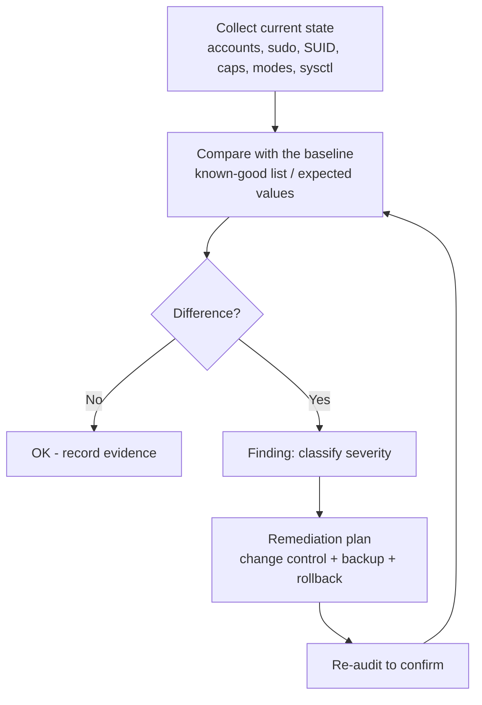

# Day 19: System Security Auditing

!!! info "Lesson overview"
    | | |
    |---|---|
    | **Module** | 4 — Security, Logs & Monitoring |
    | **Difficulty** | :material-signal-cellular-3: Advanced |
    | **Estimated time** | 3–4 hours (75 min reading, 90 min demonstrations, 60–90 min lab and quiz) |
    | **Platforms** | Ubuntu 24.04 LTS (coreutils 9.4, shadow-utils, libcap2-bin, sudo 1.9.15) · Windows 11 (Windows PowerShell 5.1 and PowerShell 7.4+, Defender and LocalAccounts modules) |
    | **Lab** | [Lab 19: Baseline and Hardening Audit](../../labs/lab-19.md) |

## Learning Objectives

By the end of this lesson you will be able to:

1. Audit **accounts** on both platforms: find UID 0 accounts, empty or non-expiring passwords, stale and never-logged-in users, and unexpected members of privileged groups.
2. Review **privilege**: read a sudoers policy safely, recognise dangerous `NOPASSWD` and wildcard rules, and explain why `sudo find` (and similar "shell-out" commands) is a full root escalation.
3. Enumerate **SUID/SGID** binaries and **file capabilities**, compare them with a known-good baseline, and verify package-owned files with `dpkg --verify`.
4. Find **world-writable** directories and files, **orphaned** (no-owner) files, and incorrect permissions on sensitive files such as `/etc/shadow`.
5. Read and interpret **kernel hardening** settings with `sysctl` (`fs.protected_*`, `kernel.kptr_restrict`, `kernel.dmesg_restrict`, `rp_filter`), and know which are defaults on Ubuntu 24.04.
6. Run the equivalent **Windows baseline audit**: execution policy, Microsoft Defender status, local administrators, your own privileges, file hashes and Authenticode signatures, BitLocker, Secure Boot, the SMB1 protocol and PowerShell script-block logging.
7. Produce a repeatable, **read-only** audit report and a prioritised remediation list — the core deliverable of a security baseline review.

## Prerequisites

- [Day 06: Users and Groups](../module-2/day-06.md): `/etc/passwd`, `/etc/shadow`, `/etc/group`, `useradd`, `usermod -aG`, `chage`; `Get-LocalUser`, `Get-LocalGroupMember`.
- [Day 07: File Permissions and Access Control](../module-2/day-07.md): numeric and symbolic modes, SUID/SGID/sticky bits, `umask`, `Get-Acl`/`icacls`.
- [Day 16: System Logs](day-16.md) and [Day 17: Authentication and Security Monitoring](day-17.md): the journal, `Get-WinEvent`, `auditpol`.
- An Ubuntu 24.04 **VM** with `sudo` (reading `/etc/shadow`, all directories and `sudo -l -U` for other users needs root). Install the audit helpers:

    ```bash
    sudo apt update && sudo apt install -y libcap2-bin sudo coreutils findutils
    ```

- A Windows 11 lab machine with an **elevated** PowerShell for the Defender, BitLocker and audit-policy parts (reading most settings works unelevated; the lesson marks what needs elevation). The `Get-MpComputerStatus`, `Get-BitLockerVolume` and `Confirm-SecureBootUEFI` cmdlets are **Windows-only** and do not exist in PowerShell 7 on Linux.

!!! warning "Audit, do not change — and only where you are authorised"
    Everything in this lesson is **read-only reconnaissance of your own or an authorised system**. You are building a picture, not fixing anything yet. Note each finding, decide the remediation, and apply changes later through change control with a backup and a rollback (the method from Days 7, 17 and 18). Running these commands against systems you do not own or administer is unauthorised and, in many places, a crime.

## Introduction and Concepts

A **security baseline audit** answers one question: *does this system match the secure configuration we expect, and if not, where does it differ?* It is the day-to-day work of a SOC analyst hardening a fleet, a sysadmin preparing for an ISO 27001 or Cyber Essentials assessment, and an incident responder deciding whether a host was tampered with. Everything you have learned so far — users (Day 6), permissions (Day 7), services (Day 8), logs (Days 16–17), firewalls (Day 18) — comes together here as a checklist you can run and re-run.

A good audit has three properties:

- **Read-only.** It changes nothing, so it is safe to run on production at any time.
- **Repeatable.** The same commands produce comparable output every time, so you can diff today against a saved **baseline** and see what drifted.
- **Prioritised.** It does not just list facts; it flags the handful that matter (a `NOPASSWD` sudo rule, an unknown SUID binary) above the noise.



### The two ends of the privilege problem

Most local findings fall into two families, and it is worth holding them in mind as you read:

1. **Who can become root?** Extra UID 0 accounts, unexpected members of `sudo`/`wheel`/Administrators, and sudo rules that are broader than they look. A `NOPASSWD` rule for a command that can run other commands (an editor, `find`, `awk`, `tar`, `less`) is a full root shell with no password — the community catalogues these at GTFOBins.
2. **What can escalate on disk?** SUID/SGID binaries and file capabilities run with elevated rights regardless of who starts them, so an unexpected one is a prime persistence and escalation mechanism. World-writable files that root later executes, and ownerless files from deleted accounts, are the same idea in slower motion.

### Defence in depth, not a single wall

No single setting makes a host secure. Secure Boot and BitLocker protect the boot chain and data at rest; Defender and auditing catch what gets in; least privilege (few admins, no loose sudo) limits what a foothold becomes; and the firewall from Day 18 limits what is reachable in the first place. An audit measures all of these layers because attackers only need one of them to be missing.

## Linux Command Reference

| Command | Purpose | Package / availability | Needs root? |
|---|---|---|---|
| `awk -F:` on `/etc/passwd` | Filter accounts by UID, shell, GID | coreutils/gawk | No (passwd is world-readable) |
| `awk -F:` on `/etc/shadow` | Find empty/locked passwords, ageing | gawk | **Yes** (shadow is root-only) |
| `chage -l USER` | Show password ageing and expiry for one user | passwd (shadow-utils) | For other users |
| `passwd -S [-a]` | One-line password status (`L`/`P`/`NP`) per account | passwd | Yes for `-a` / others |
| `getent group sudo adm` | Resolve group membership (files + any directory) | libc | No |
| `sudo -l [-U USER]` | List what a user may run via sudo | sudo | `-U` other users needs root |
| `visudo -c` / `-cf FILE` | Syntax-check the sudoers policy (read-only with `-c`) | sudo | Yes |
| `find / -xdev -perm -4000` | List SUID (`-2000` SGID) files on this filesystem | findutils | For unreadable dirs |
| `getcap -r /` | List files carrying Linux capabilities | libcap2-bin | For unreadable dirs |
| `dpkg -S FILE` / `dpkg -V` | Which package owns a file / verify installed files | dpkg | `-V` best as root |
| `find / -perm -0002` | World-writable files (`-type d ! -perm -1000` = no sticky) | findutils | For unreadable dirs |
| `find / -nouser -o -nogroup` | Orphaned files (owner/group UID has no name) | findutils | Yes |
| `stat -c '%a %U:%G %n'` | Numeric mode and owner of a file | coreutils | No |
| `sysctl KEY` / `sysctl -a` | Read a kernel tunable (hardening settings) | procps | No to read |
| `lastlog` / `last` | Last login per account / login history | util-linux | No (readable logs) |

## PowerShell Command Reference

| Cmdlet | Aliases | Purpose | 5.1 | 7.x | Admin? |
|---|---|---|---|---|---|
| `Get-ExecutionPolicy` | — | Effective script policy (optionally `-List` per scope) | Yes | Yes (Windows) | No |
| `Set-ExecutionPolicy` | — | Change the policy for a scope | Yes | Yes (Windows) | For `LocalMachine` |
| `Get-MpComputerStatus` | — | Microsoft Defender engine, signatures and protection state | Yes | **Windows only** | No |
| `Get-MpPreference` | — | Defender configuration (exclusions, settings) | Yes | **Windows only** | No |
| `Get-MpThreatDetection` | — | Threats Defender has detected | Yes | **Windows only** | No |
| `Get-LocalUser` / `Get-LocalGroupMember` | — | Local accounts / members of a local group | Yes | **Windows only** | No |
| `whoami /priv` `/groups` `/all` | — | Current token's privileges and group SIDs | Yes | Yes (`.exe`) | No |
| `Get-FileHash` | — | SHA-256 (etc.) hash of a file | Yes | Yes (all OS) | No |
| `Get-AuthenticodeSignature` | — | Digital-signature status of a file | Yes | **Windows only** | No |
| `Unblock-File` | — | Remove the Mark-of-the-Web (Zone.Identifier) | Yes | Yes | No |
| `Get-BitLockerVolume` | — | Drive encryption status | Yes | **Windows only** | For some fields |
| `Confirm-SecureBootUEFI` | — | Is Secure Boot enabled? | Yes | **Windows only** | **Yes** |
| `Get-SmbServerConfiguration` | — | SMB server settings incl. `EnableSMB1Protocol` | Yes | **Windows only** | Yes |
| `auditpol /get /category:*` | — | Effective audit policy | Yes | Yes (`.exe`) | **Yes** |

## Detailed Command Explanations

### Auditing accounts with `awk` on passwd and shadow

`/etc/passwd` is world-readable and holds the account name, UID, GID, GECOS comment, home and login shell. `/etc/shadow` is readable only by root (mode `640`, group `shadow`) and holds the password hash and ageing fields. Three `awk` one-liners cover most account findings:

- **UID 0 accounts** (should be only `root`): `awk -F: '$3==0 {print $1}' /etc/passwd`. Any second name here is a backdoor-level finding.
- **Interactive accounts**: `awk -F: '$3>=1000 && $3<65534 {print $1, $3, $7}' /etc/passwd` lists human users and their shells. A service account with a real shell (`/bin/bash`) is worth questioning.
- **Empty passwords**: `awk -F: '$2=="" {print $1}' /etc/shadow` — an empty second field means the account can log in with *no* password. There should be none.

The shadow password field also encodes state: a leading `!` or `*` means **locked** (cannot authenticate with a password). `!` followed by a hash is a locked account that still has a hash. `passwd -S USER` renders this as `L` (locked), `P` (usable password) or `NP` (no password), which is easier to scan than the raw file.

### `chage` and password ageing

`chage -l USER` prints the ageing policy for one account: last change date, expiry, inactivity window and warning period. In an audit you are looking for accounts whose password *never expires* (`Maximum number of days between password change : 99999`) **and** was last changed long ago — a classic stale-credential finding for former staff. The site-wide defaults live in `/etc/login.defs` (`PASS_MAX_DAYS`, `PASS_MIN_DAYS`, `PASS_WARN_AGE`, `UMASK`, `ENCRYPT_METHOD`).

### Reviewing sudo: `sudo -l`, the sudoers policy and the `find` trap

`sudo -l` shows what the current user may run; as root, `sudo -l -U alice` shows it for another user without logging in as them. Read the policy files with care — never hand-edit `/etc/sudoers`; use `visudo` (which validates on save) and `visudo -c` to syntax-check the whole policy including `/etc/sudoers.d/`.

The danger signs:

- **`NOPASSWD`** — the user runs the command as root with no password prompt. Acceptable for a narrowly scoped automation command, dangerous for anything that can spawn a shell.
- **A command that can run other commands.** `sudo find`, `sudo awk`, `sudo less`, `sudo vi`, `sudo tar --to-command`, `sudo tcpdump -z` and dozens more can execute arbitrary code. `sudo find . -exec /bin/sh \;` gives an **interactive root shell** even though the rule only "allowed find". GTFOBins (<https://gtfobins.github.io/>) catalogues these; treat any `NOPASSWD` rule for such a binary as equivalent to `NOPASSWD: ALL`.
- **Wildcards and writable scripts.** `sudo /opt/app/run.sh *` where `run.sh` is world-writable means anyone can edit what root executes.

### SUID/SGID and the baseline diff

A **SUID** binary runs with the file owner's identity (usually root) no matter who launches it; **SGID** does the same for the group. They are necessary for a handful of programs (`passwd`, `sudo`, `mount`), but every one is attack surface. The audit technique is:

```bash
find / -xdev -type f -perm -4000 -printf '%M %u %g %p\n' 2>/dev/null | sort
```

`-xdev` keeps the search on one filesystem (skip network mounts); `-perm -4000` matches the SUID bit (`-2000` for SGID). Save this list once as a **baseline**, then on later audits `comm -13 baseline.txt current.txt` shows only *new* SUID files. A new, unknown SUID-root binary outside `/usr` is a high-severity finding. Confirm provenance with `dpkg -S /path` (which package owns it) — "no path found" means no package does, which for a root-SUID file is a red flag. `dpkg -V` verifies that package-owned files still match their shipped checksums and modes.

### File capabilities with `getcap`

Modern Linux can grant a binary a *subset* of root's powers without full SUID, using **capabilities**. `ping` historically carried `cap_net_raw`; a packet tool might carry `cap_net_admin`. `getcap -r / 2>/dev/null` lists every file with capabilities. As with SUID, you are looking for *unexpected* entries — a capability on a binary in `/tmp`, `/srv` or a user's home is suspicious, because capabilities like `cap_setuid` or `cap_dac_override` are escalation paths.

### World-writable, orphaned files and sensitive modes

- **World-writable directories without the sticky bit** (`find / -xdev -type d -perm -0002 ! -perm -1000`): anyone can delete or replace files there. `/tmp`, `/var/tmp` and `/dev/shm` are world-writable *with* sticky (`drwxrwxrwt`), which is correct; anything else is a finding.
- **World-writable files** that a privileged process reads or executes are an escalation path (edit the script root runs nightly).
- **Orphaned files** (`find / -xdev -nouser -o -nogroup`): the owning UID/GID no longer has a name, usually because an account was deleted without its files. A new account that *reuses* that UID silently inherits them.
- **Sensitive file modes**: `/etc/shadow` and `/etc/gshadow` should be `640 root:shadow`, `/etc/passwd` and `/etc/group` `644 root:root`, `/etc/sudoers` `440 root:root`. A readable `/etc/shadow` is critical.

### Kernel hardening with `sysctl`

`sysctl KEY` reads a kernel tunable from `/proc/sys`. The security-relevant ones and their secure values on Ubuntu 24.04 (most are already set):

| Key | Secure value | What it does |
|---|---|---|
| `fs.protected_symlinks` / `fs.protected_hardlinks` | `1` | Blocks a classic symlink/hardlink race in world-writable dirs |
| `fs.protected_regular` / `fs.protected_fifos` | `1` / `1` | Same protection for regular files and FIFOs in sticky dirs |
| `fs.suid_dumpable` | `0` | SUID programs do not write core dumps (which could leak secrets) |
| `kernel.kptr_restrict` | `1` or `2` | Hides kernel pointers from `/proc` (defeats some exploits) |
| `kernel.dmesg_restrict` | `1` | Only privileged users read the kernel ring buffer |
| `kernel.yama.ptrace_scope` | `1`+ | Restricts which processes can `ptrace` (debug) others |
| `net.ipv4.conf.all.rp_filter` | `1` | Reverse-path filtering (anti-spoofing) |
| `net.ipv4.conf.all.accept_redirects` | `0` | Ignore ICMP redirects (route-hijack defence) |
| `net.ipv4.tcp_syncookies` | `1` | SYN-flood mitigation |

Read-only auditing uses `sysctl KEY`; changes go in `/etc/sysctl.d/*.conf` and apply with `sysctl --system`, under change control.

### Windows: execution policy is defence in depth, not a boundary

`Get-ExecutionPolicy -List` shows the effective policy per scope (`MachinePolicy`, `UserPolicy`, `Process`, `CurrentUser`, `LocalMachine`). The default on Windows clients is `Restricted`; servers default to `RemoteSigned`. **Microsoft is explicit that the execution policy is not a security boundary** — a user can paste a script's contents at the prompt or run `powershell -ExecutionPolicy Bypass`. It prevents *accidental* execution, not a determined attacker. Audit it, prefer `RemoteSigned` or `AllSigned`, but never rely on it alone. On non-Windows PowerShell the policy is fixed at `Unrestricted` and behaves like `Bypass`.

### Windows: Defender, identity, integrity and the boot chain

- **`Get-MpComputerStatus`** reports whether real-time protection, behaviour monitoring and the antivirus/antispyware engines are on, and the signature age. `AntivirusSignatureAge` in days flags out-of-date definitions. `Get-MpPreference` shows configured exclusions (an *attacker-added* exclusion path is a finding), and `Get-MpThreatDetection` lists detections.
- **`Get-LocalGroupMember Administrators`** lists who is a local admin — compare with the approved list. `whoami /priv` and `whoami /groups` show your own token's privileges (e.g. `SeDebugPrivilege`, `SeBackupPrivilege`) and group SIDs, including the integrity level.
- **`Get-FileHash -Algorithm SHA256`** produces a hash to compare against a known-good value or a threat-intel feed; **`Get-AuthenticodeSignature`** reports whether a binary is signed and by whom (`Valid`, `NotSigned`, `HashMismatch`). **`Unblock-File`** clears the Mark-of-the-Web that marks internet-downloaded files.
- **`Get-BitLockerVolume`** shows encryption status and protection state of each volume; **`Confirm-SecureBootUEFI`** returns `True` when Secure Boot is enabled (needs elevation and UEFI). **`Get-SmbServerConfiguration | Select EnableSMB1Protocol`** should report `False` — SMB1 is obsolete and was the vector for WannaCry.
- **Script-block logging** (event `4104` in `Microsoft-Windows-PowerShell/Operational`, or `PowerShellCore/Operational` for PowerShell 7) records the content of every script block executed — the single most useful PowerShell forensic log. Confirm it is enabled and that `auditpol /get /category:*` shows the expected audit subcategories (logon, privilege use, process creation).

## Syntax and Parameters

### Bash

```text
awk -F: 'CONDITION {print ...}' /etc/passwd | /etc/shadow
chage -l USER
passwd -S [-a] [USER...]
sudo -l [-U USER]
visudo -c | -cf FILE
find PATH -xdev -type f -perm -4000            # SUID (-2000 SGID)
find PATH -xdev -type d -perm -0002 ! -perm -1000   # world-writable, no sticky
find PATH -xdev \( -nouser -o -nogroup \)      # orphaned
getcap -r PATH
dpkg -S FILE ; dpkg -V [PACKAGE]
sysctl KEY ; sysctl -a
```

| Option | Command | Meaning |
|---|---|---|
| `-xdev` | find | Do not descend into other mounted filesystems |
| `-perm -MODE` | find | All of these permission bits are set (`-4000` SUID, `-2000` SGID, `-0002` world-write, `-1000` sticky) |
| `-printf` | find | Custom output; `%M` symbolic mode, `%u`/`%g` owner/group, `%p` path, `%TY-%Tm-%Td` mtime |
| `-S` / `-a` | passwd | Status report / for all accounts |
| `-l` / `-U` | sudo | List privileges / for another user (root only) |
| `-c` / `-cf` | visudo | Check the live policy / check a specific file |
| `-r` | getcap | Recurse into the directory tree |
| `-V` | dpkg | Verify installed files against the package database |

### PowerShell

```text
Get-ExecutionPolicy [-List] [-Scope <Scope>]
Set-ExecutionPolicy -ExecutionPolicy <Policy> -Scope <Scope> [-WhatIf]
Get-MpComputerStatus
Get-MpPreference ; Get-MpThreatDetection
Get-LocalUser ; Get-LocalGroupMember -Group Administrators
Get-FileHash -Path <String> [-Algorithm SHA256]
Get-AuthenticodeSignature -FilePath <String>
Unblock-File -Path <String> [-WhatIf]
Get-BitLockerVolume [-MountPoint <String>]
Confirm-SecureBootUEFI
Get-SmbServerConfiguration
```

| Parameter | Cmdlet | Meaning |
|---|---|---|
| `-List` | Get-ExecutionPolicy | Show the policy for every scope, not just the effective one |
| `-Scope` | Set/Get-ExecutionPolicy | `Process`, `CurrentUser`, `LocalMachine`, `MachinePolicy`, `UserPolicy` |
| `-ExecutionPolicy` | Set-ExecutionPolicy | `Restricted`, `AllSigned`, `RemoteSigned`, `Unrestricted`, `Bypass`, `Undefined` |
| `-Algorithm` | Get-FileHash | `SHA256` (default), `SHA1`, `SHA384`, `SHA512`, `MD5` |
| `-Group` | Get-LocalGroupMember | The local group whose members to list |
| `-WhatIf` | Set-ExecutionPolicy, Unblock-File | Preview the change without making it |

## Practical Demonstrations

The Linux outputs below were **captured on Ubuntu 24.04.5 LTS** in a container, running the exact commands against a set of deliberately planted findings (three lab accounts, a `NOPASSWD: find` sudo rule, an unknown SUID binary, a world-writable script, an orphaned file and a file capability), then removed. Account names, UIDs and the host name are from the lab. Windows outputs are **examples**, reviewed against the official documentation (see *Further Reading*); PowerShell is not installed on the release host.

### Demo 1 — Account audit

=== "Bash"

    ```bash
    # UID 0 (only root expected) and interactive accounts
    awk -F: '$3==0 {print $1}' /etc/passwd
    awk -F: '$3>=1000 && $3<65534 {print $1, $3, $7}' /etc/passwd
    # empty passwords (expect none) - needs root
    sudo awk -F: '$2=="" {print $1 " has an EMPTY password"}' /etc/shadow
    # ageing for a suspect account
    sudo chage -l lab19-old
    ```

    **Expected output (example):**

    ```text
    root
    ubuntu 1000 /bin/bash
    lab19-old 30033 /bin/bash
    lab19-intern 30034 /bin/bash
    Last password change                  : Jan 15, 2019
    Password expires                      : never
    Password inactive                     : never
    Account expires                       : never
    Minimum number of days between password change        : 0
    Maximum number of days between password change        : 99999
    Number of days of warning before password expires     : 7
    ```

    `lab19-old` was last changed in 2019 and never expires: a stale-credential finding for a former contractor.

=== "PowerShell"

    ```powershell
    Get-LocalUser | Select-Object Name, Enabled, PasswordExpires, LastLogon
    Get-LocalGroupMember -Group Administrators
    whoami /groups | Select-String 'Integrity|Administrators'
    ```

    **Expected output (example):**

    ```text
    Name           Enabled PasswordExpires       LastLogon
    ----           ------- ---------------       ---------
    Administrator  False
    student        True    01-02-2027 09:14:00   15-11-2026 08:40:11
    svc-backup     True                          14-11-2026 02:00:03

    ObjectClass Name                     PrincipalSource
    ----------- ----                     ---------------
    User        WIN11-LAB\student        Local
    User        WIN11-LAB\svc-backup     Local
    ```

    `svc-backup` is a service account in **Administrators** with a never-expiring password — question it. A blank `PasswordExpires` means the password never expires.

### Demo 2 — Privilege and sudo review

=== "Bash"

    ```bash
    getent group sudo admin
    sudo -l -U lab19-intern
    sudo -l -U lab19-deploy
    # read every active (non-comment) sudo rule
    sudo grep -rhE '^[^#].*NOPASSWD' /etc/sudoers /etc/sudoers.d/
    sudo visudo -c
    ```

    **Expected output (example):**

    ```text
    sudo:x:27:ubuntu,lab19-intern
    User lab19-intern may run the following commands on vm:
        (ALL : ALL) ALL
    User lab19-deploy may run the following commands on vm:
        (root) NOPASSWD: /usr/bin/find
    lab19-deploy ALL=(root) NOPASSWD: /usr/bin/find
    /etc/sudoers: parsed OK
    /etc/sudoers.d/lab19-deploy: parsed OK
    ```

    Two findings: `lab19-intern` is an unexpected full admin, and `lab19-deploy` has **passwordless `find`** — `sudo find . -exec /bin/sh \;` is a root shell.

=== "PowerShell"

    ```powershell
    Get-ExecutionPolicy -List
    whoami /priv | Select-String 'SeDebug|SeBackup|SeImpersonate|SeTakeOwnership'
    ```

    **Expected output (example):**

    ```text
            Scope ExecutionPolicy
            ----- ---------------
    MachinePolicy       Undefined
       UserPolicy       Undefined
          Process       Undefined
      CurrentUser       Undefined
     LocalMachine       RemoteSigned

    SeBackupPrivilege             Back up files and directories  Disabled
    SeDebugPrivilege              Debug programs                 Disabled
    ```

    `RemoteSigned` is a reasonable baseline. `SeDebugPrivilege` or `SeImpersonatePrivilege` held by a normal user would be a privilege-escalation finding.

### Demo 3 — SUID/SGID, capabilities and package provenance

=== "Bash"

    ```bash
    # current SUID list with owner and date
    find / -xdev -type f -perm -4000 -printf '%M %u %g %TY-%Tm-%Td %p\n' 2>/dev/null | sort -k5
    # diff against a saved baseline
    find / -xdev -type f -perm -4000 2>/dev/null | sort > /tmp/suid.now
    comm -13 ~/baseline/suid.txt /tmp/suid.now        # only NEW entries
    # who owns the suspicious binary?
    dpkg -S /srv/lab19/bin/sysinfo-helper
    # file capabilities
    getcap -r / 2>/dev/null
    ```

    **Expected output (example):**

    ```text
    -rwsr-xr-x root root 2024-05-30 /usr/bin/passwd
    -rwsr-xr-x root root 2026-10-06 /usr/bin/sudo
    -rwsr-xr-x root root 2026-11-16 /srv/lab19/bin/sysinfo-helper
    /srv/lab19/bin/sysinfo-helper
    dpkg-query: no path found matching pattern /srv/lab19/bin/sysinfo-helper
    /usr/lib/.../gst-ptp-helper cap_net_bind_service,cap_net_admin,cap_sys_nice=ep
    /srv/lab19/bin/net-probe cap_net_raw=ep
    ```

    `sysinfo-helper` is SUID-root, dated today, outside `/usr`, and **owned by no package** — a critical finding. `net-probe` carries `cap_net_raw` in `/srv`, also unexpected.

=== "PowerShell"

    ```powershell
    Get-MpComputerStatus |
        Select-Object RealTimeProtectionEnabled, AntivirusEnabled,
                      AntivirusSignatureAge, BehaviorMonitorEnabled, AMRunningMode
    Get-MpPreference | Select-Object -ExpandProperty ExclusionPath
    Get-AuthenticodeSignature C:\Tools\unknown.exe | Select-Object Status, SignerCertificate
    Get-FileHash C:\Tools\unknown.exe -Algorithm SHA256
    ```

    **Expected output (example):**

    ```text
    RealTimeProtectionEnabled : True
    AntivirusEnabled          : True
    AntivirusSignatureAge     : 0
    BehaviorMonitorEnabled    : True
    AMRunningMode             : Normal

    Status    : NotSigned
    Algorithm Hash                                                             Path
    --------- ----                                                             ----
    SHA256    9F86D081884C7D659A2FEAA0C55AD015A3BF4F1B2B0B822CD15D6C15B0F00A08 C:\Tools\unknown.exe
    ```

    A `NotSigned` binary in a tools folder, plus its hash, is what you submit for reputation lookup. An attacker-added `ExclusionPath` would appear in the second command.

### Demo 4 — Filesystem exposure

=== "Bash"

    ```bash
    # world-writable directories without the sticky bit
    find / -xdev -type d -perm -0002 ! -perm -1000 -printf '%M %u %p\n' 2>/dev/null
    # world-writable files under system paths
    sudo find /etc /srv /opt /usr -xdev -type f -perm -0002 -printf '%M %u %p\n' 2>/dev/null
    # orphaned files
    sudo find / -xdev \( -nouser -o -nogroup \) -printf '%u:%g %p\n' 2>/dev/null
    # correct sticky dirs look like this
    ls -ld /tmp /var/tmp /dev/shm
    ```

    **Expected output (example):**

    ```text
    drwxrwxrwx root /srv/lab19/shared
    -rwxrwxrwx root /srv/lab19/scripts/nightly-backup.sh
    4719:4719 /srv/lab19/data/export-2023.csv
    drwxrwxrwt 3 root root   60 Nov 16 16:38 /dev/shm
    drwxrwxrwt 8 root root 4096 Nov 16 16:43 /tmp
    drwxrwxrwt 2 root root 4096 Oct 24 14:12 /var/tmp
    ```

    The world-writable backup script (run by root nightly) is the worst finding here: any user can rewrite what root executes.

=== "PowerShell"

    ```powershell
    Get-BitLockerVolume | Select-Object MountPoint, VolumeStatus, ProtectionStatus, EncryptionPercentage
    Confirm-SecureBootUEFI
    Get-SmbServerConfiguration | Select-Object EnableSMB1Protocol, EnableSMB2Protocol
    ```

    **Expected output (example):**

    ```text
    MountPoint VolumeStatus      ProtectionStatus EncryptionPercentage
    ---------- ------------      ---------------- --------------------
    C:         FullyEncrypted    On                                100

    True

    EnableSMB1Protocol EnableSMB2Protocol
    ------------------ ------------------
                 False               True
    ```

    `ProtectionStatus On`, Secure Boot `True` and `EnableSMB1Protocol False` are all the secure values. An `EnableSMB1Protocol : True` would be a finding to remediate with `Set-SmbServerConfiguration -EnableSMB1Protocol $false`.

### Demo 5 — Kernel hardening and PowerShell logging

=== "Bash"

    ```bash
    sysctl kernel.kptr_restrict kernel.dmesg_restrict fs.protected_symlinks \
           fs.protected_regular fs.suid_dumpable \
           net.ipv4.conf.all.rp_filter net.ipv4.conf.all.accept_redirects \
           net.ipv4.tcp_syncookies
    grep -E '^(PASS_MAX_DAYS|UMASK|ENCRYPT_METHOD)' /etc/login.defs
    ```

    **Expected output (example):**

    ```text
    kernel.kptr_restrict = 1
    kernel.dmesg_restrict = 1
    fs.protected_symlinks = 1
    fs.protected_regular = 1
    fs.suid_dumpable = 0
    net.ipv4.conf.all.rp_filter = 1
    net.ipv4.conf.all.accept_redirects = 0
    net.ipv4.tcp_syncookies = 1
    PASS_MAX_DAYS   99999
    UMASK           022
    ENCRYPT_METHOD  SHA512
    ```

    `PASS_MAX_DAYS 99999` (passwords never expire by policy) is a finding for a managed fleet; the rest are secure defaults.

=== "PowerShell"

    ```powershell
    # Is script-block logging on? (event 4104 is written when it is)
    $k = 'HKLM:\Software\Policies\Microsoft\Windows\PowerShell\ScriptBlockLogging'
    (Get-ItemProperty $k -EA SilentlyContinue).EnableScriptBlockLogging
    Get-WinEvent -FilterHashtable @{LogName='Microsoft-Windows-PowerShell/Operational'; Id=4104} -MaxEvents 3 |
        Select-Object TimeCreated, Id
    auditpol /get /category:* | Select-String 'Logon|Process Creation|Privilege Use'
    ```

    **Expected output (example):**

    ```text
    1
      Logon                                    Success and Failure
      Process Creation                         Success
      Privilege Use                            No Auditing
    ```

    `1` confirms script-block logging is enabled. `Process Creation` auditing (event 4688) is on; `Privilege Use` is off and could be enabled for a high-security host.

## Linux vs PowerShell Comparison

| Audit question | Bash (Ubuntu) | PowerShell (Windows) | Notes |
|---|---|---|---|
| Who is UID 0 / admin? | `awk -F: '$3==0' /etc/passwd` · `getent group sudo` | `Get-LocalGroupMember Administrators` | Compare to approved list |
| Password status | `passwd -S -a` · `chage -l` | <code>Get-LocalUser &#124; Select PasswordExpires</code> | |
| My privileges | `id` · `sudo -l` | `whoami /priv /groups` | |
| Dangerous sudo / policy | `sudo -l -U u` · `visudo -c` | execution policy `Get-ExecutionPolicy -List` | Different models |
| Privileged binaries | `find / -perm -4000` · `getcap -r /` | — (no SUID); check services/tasks | |
| File integrity | `dpkg -V` · `sha256sum` | `Get-FileHash` · `Get-AuthenticodeSignature` | |
| Downloaded-file mark | `getfattr -n user...` (rare) | `Unblock-File` (Mark-of-the-Web) | |
| World-writable | `find / -perm -0002` | `icacls` / `Get-Acl` on key paths | Day 7 |
| Disk encryption | LUKS: `lsblk`, `cryptsetup status` | `Get-BitLockerVolume` | |
| Secure Boot | `mokutil --sb-state` | `Confirm-SecureBootUEFI` | |
| Antivirus state | `systemctl status clamav*` (if used) | `Get-MpComputerStatus` | Defender is built in |
| Legacy protocol off | n/a | `Get-SmbServerConfiguration` (SMB1) | |
| Kernel hardening | `sysctl -a` | registry / Security Baselines | |
| Command/script logging | `auditd` rules · shell history | event 4104 (script block), 4688 | |

## Real-World IT Scenarios

1. **Pre-assessment baseline.** Before a Cyber Essentials or ISO 27001 audit, a sysadmin runs the full read-only checklist on every server, exports it to CSV, and closes the gaps (stale accounts, loose sudo, SMB1) under change control.
2. **New-starter joins the security team.** Their first task is to diff last quarter's SUID baseline against today's on the jump hosts; two new SUID files turn out to be a legitimate package update, which they confirm with `dpkg -S` and record.
3. **Offboarding gone wrong.** A leaver's account was deleted but their files were not. The orphaned-file scan finds 4 GB owned by a now-free UID, which a new hire would have inherited on next `useradd`.
4. **Incident triage.** After a Defender alert, a responder runs `Get-MpThreatDetection`, hashes the dropped file with `Get-FileHash`, checks its signature, and looks for attacker-added Defender exclusions in `Get-MpPreference`.
5. **Fleet drift report.** A weekly scheduled task (Day 25) runs the audit script on 200 hosts and emails only the hosts with new findings, turning a day of manual checking into a five-minute review.

## Cybersecurity Application

- **Privilege-escalation hunting.** SUID binaries, file capabilities and `sudo -l` are the exact first checks an attacker runs after landing a shell (and what tools like LinPEAS automate). Auditing them first, as defender, closes the paths before they are used. GTFOBins turns a "harmless" `sudo` entry into a root shell; treat the catalogue as your checklist too.
- **Persistence detection.** New SUID files, added capabilities, a fresh UID 0 account, an attacker's SSH key in `authorized_keys` (Day 17) and a new Defender exclusion are classic persistence. The baseline diff is how you spot them.
- **Integrity and attribution.** `Get-FileHash`/`sha256sum` and `Get-AuthenticodeSignature` tie a suspicious file to threat intel and tell you whether it was signed by a trusted publisher or merely renamed to look legitimate.
- **Logging posture.** An audit that finds script-block logging (4104) and process-creation auditing (4688) *disabled* is itself a finding — an attacker who can turn off logging operates blind to the SOC.

## Network Analyst Application

- A host audit feeds the **network** picture: `Get-SmbServerConfiguration` (is SMB1 exposed?), the Day 18 firewall state, and the listening-port baseline (Day 14) together describe what this host offers the network.
- `net.ipv4.conf.all.rp_filter`, `accept_redirects` and `ip_forward` from the `sysctl` audit decide whether a host can be used for spoofing or as an unintended router — a network-security concern as much as a host one.
- When investigating lateral movement, the local-admin list and `whoami /groups` on each hop show whether a single compromised credential is a local admin everywhere (a flat, high-risk network) or scoped per host.

## System Administrator Application

- **Golden-image validation.** Run the audit against a freshly built image to prove it matches the hardening standard before it is cloned to the fleet.
- **Change evidence.** The before/after audit output is the evidence attached to a hardening change ticket.
- **Least privilege in practice.** Replace broad `sudo ALL` and `NOPASSWD: ALL` rules with narrowly scoped commands, remove dormant admins, and set password ageing in `login.defs` — all driven by audit findings.
- **Automation.** The read-only nature makes the whole checklist safe to run from a configuration-management tool (Ansible, Intune) and from the scheduled health check you build on Day 25.

## Common Mistakes

| Mistake | What happens | Correct approach |
|---|---|---|
| Editing `/etc/sudoers` with a text editor | A syntax error can lock out all sudo | Use `visudo` (validates) and `visudo -c` |
| Treating a `NOPASSWD: /usr/bin/find` rule as safe | `find -exec sh` is a root shell | Audit every `NOPASSWD` command against GTFOBins |
| Deleting an unknown SUID binary immediately | You lose evidence and may break a real tool | First `dpkg -S`, hash and record; remediate under change control |
| Relying on the PowerShell execution policy as security | `-ExecutionPolicy Bypass` defeats it trivially | It is defence in depth; use signing, logging and app control |
| Running `find /` without `-xdev` on a server with NFS | Scans slow network mounts for minutes | Add `-xdev`; scan mounts separately if needed |
| Forgetting `sudo` for `/etc/shadow` or `dpkg -V` | Silent empty/partial results | Run the shadow and full-tree scans as root |
| Changing `sysctl` live only | Reverts on reboot | Persist in `/etc/sysctl.d/` and `sysctl --system` |
| Auditing a system you do not own "to help" | Unauthorised access | Only audit systems you own or are authorised to assess |

## Troubleshooting Guide

| Symptom | Likely cause | Fix |
|---|---|---|
| `awk` on `/etc/shadow` prints nothing | Not root; shadow is `640 root:shadow` | Prefix with `sudo` |
| `find` floods with `Permission denied` | Normal for unreadable dirs as non-root | `2>/dev/null`, or run as root |
| `getcap: command not found` | `libcap2-bin` not installed | `sudo apt install libcap2-bin` |
| `sudo -l -U user` errors | Not run as root | Use `sudo`; or log in as the user and run `sudo -l` |
| `Get-MpComputerStatus` not found | PowerShell 7 on Linux, or Defender disabled/absent | Windows only; on Server the Defender feature may be off |
| `Confirm-SecureBootUEFI` throws "not supported" | Legacy BIOS (not UEFI) or not elevated | Run elevated on a UEFI system; BIOS has no Secure Boot |
| `Get-AuthenticodeSignature` says `UnknownError` | File locked or missing | Check the path; close the app holding it |
| `Set-ExecutionPolicy` fails with "overridden by Group Policy" | `MachinePolicy`/`UserPolicy` scope wins | The GPO is authoritative; change it there |
| `sysctl: cannot stat .../ptrace_scope` | Yama LSM not built in | The protection is absent; note it as a finding/limitation |

## Hands-on Lab

Complete **[Lab 19: Baseline and Hardening Audit](../../labs/lab-19.md)**. A setup script plants seven safe, reversible findings on a disposable VM (a stale account, an unexpected admin, a `NOPASSWD` sudo rule, an unknown SUID binary, a world-writable root script, an orphaned file and a file capability). You run the read-only audit, write up each finding with its severity and remediation, then run the matching PowerShell checks on Windows. A clean-up script removes everything.

Summary of tasks:

1. Baseline the accounts, sudo policy, SUID/capability lists and sensitive-file modes.
2. Identify and classify all seven planted findings with evidence.
3. Write the one-line remediation for each (what you *would* change, under change control).
4. Run the Windows baseline (execution policy, Defender, admins, BitLocker, Secure Boot, SMB1, logging).
5. Produce a prioritised findings report and confirm the clean-up restores the baseline.

## Practice Questions

1. Write the `awk` command that lists every account with UID 0 in `/etc/passwd`, and say what the correct result is.
2. Why must the empty-password check (`$2==""`) run against `/etc/shadow` with `sudo`, and what does an empty field mean?
3. A sudoers rule reads `deploy ALL=(root) NOPASSWD: /usr/bin/find`. Explain, in one sentence, why this is effectively full root.
4. Which `find` expression lists SUID files on the current filesystem only, and what does `-xdev` add?
5. You find a SUID-root binary in `/srv`. Give two commands that help you decide whether it is legitimate.
6. What does `getcap -r / 2>/dev/null` audit, and why is an entry in a user's home directory suspicious?
7. Distinguish a world-writable directory *with* the sticky bit (like `/tmp`) from one *without* it. Which is a finding?
8. What is an "orphaned" file, how do you find it, and why does it matter when you create a new account?
9. State the correct owner, group and numeric mode for `/etc/shadow` and for `/etc/sudoers`.
10. Microsoft says the PowerShell execution policy "isn't a security boundary." Give one way a user bypasses it and say what it is actually for.
11. Which single cmdlet shows whether Microsoft Defender real-time protection is on and how old the signatures are?
12. What does `Get-AuthenticodeSignature` tell you that `Get-FileHash` does not, and vice versa?
13. Name the Windows event ID that records the content of executed PowerShell script blocks, and why it matters.
14. Which command confirms Secure Boot is enabled, and what does it require to work?

??? success "Practice answers"
    1. `awk -F: '$3==0 {print $1}' /etc/passwd`. The only correct result is `root`; any other name is a backdoor-level finding.
    2. `/etc/shadow` is mode `640 root:shadow`, so only root can read the hash field; without `sudo` the command returns nothing. An empty second field means the account can authenticate with **no password**.
    3. `sudo find <dir> -exec /bin/sh \;` launches an interactive shell as root, so "allowing find" grants arbitrary root command execution with no password.
    4. `find / -xdev -type f -perm -4000`. `-xdev` stops `find` descending into other mounted filesystems (network shares, other disks), keeping the scan fast and on the intended volume.
    5. `dpkg -S /srv/path` (does any package own it? "no path found" is a red flag) and `sha256sum`/`Get-FileHash` plus checking its date and location; also `dpkg -V` for package-owned files.
    6. It lists every file carrying Linux **capabilities** (subsets of root power such as `cap_net_raw`, `cap_setuid`). An entry in a home directory or `/tmp`/`/srv` is suspicious because capabilities are an escalation path and legitimate ones live under `/usr`.
    7. `/tmp` is `drwxrwxrwt` — world-writable **with** the sticky bit, so users can only delete their own files; that is correct. A world-writable directory *without* sticky (`drwxrwxrwx`) lets anyone delete or replace others' files and **is** a finding.
    8. A file whose owning UID or GID no longer maps to a name (usually from a deleted account). Find it with `find / -xdev \( -nouser -o -nogroup \)`. It matters because a new account reusing that UID silently inherits the files.
    9. `/etc/shadow`: `root:shadow`, mode `640`. `/etc/sudoers`: `root:root`, mode `440`.
    10. A user can paste the script's contents at the prompt, or run `powershell -ExecutionPolicy Bypass -File script.ps1`. It exists to prevent *accidental* execution of untrusted scripts (defence in depth), not to stop a determined attacker.
    11. `Get-MpComputerStatus` (fields `RealTimeProtectionEnabled` and `AntivirusSignatureAge`).
    12. `Get-AuthenticodeSignature` reports whether the file is **digitally signed** and by whom (trust); `Get-FileHash` produces a content **fingerprint** to compare against known-good or malicious hashes (identity/integrity). You use both together.
    13. Event **4104** (in `Microsoft-Windows-PowerShell/Operational`, or `PowerShellCore/Operational` for PS7). It records the actual script-block content, the most useful artefact for reconstructing what an attacker's PowerShell did.
    14. `Confirm-SecureBootUEFI`; it must run **elevated** on a **UEFI** system (it errors on legacy BIOS).

## Quiz

**Q1.** Which of these sudo rules is the most dangerous?

- A. `alice ALL=(root) /usr/bin/systemctl restart nginx`
- B. `bob ALL=(root) NOPASSWD: /usr/bin/vi`
- C. `carol ALL=(root) /usr/bin/apt update`
- D. `dave ALL=(root) /usr/bin/id`

??? question "Answer and explanation"
    **B.** `vi` (like `find`, `less`, `awk`) can spawn a shell (`:!sh`), so `NOPASSWD: /usr/bin/vi` is passwordless root. The others are scoped to a single non-shelling action, and `id` only prints identity.

**Q2.** `find / -xdev -type f -perm -4000` is used to audit for what?

- A. World-writable files
- B. Files with the SUID bit set
- C. Files owned by no user
- D. Files with capabilities

??? question "Answer and explanation"
    **B.** `-perm -4000` matches the SUID bit. SGID is `-2000`, world-writable is `-perm -0002`, orphaned files use `-nouser`/`-nogroup`, and capabilities need `getcap`.

**Q3.** On Ubuntu 24.04, which `sysctl` value is the **secure** one?

- A. `fs.protected_symlinks = 0`
- B. `kernel.dmesg_restrict = 0`
- C. `fs.suid_dumpable = 0`
- D. `net.ipv4.tcp_syncookies = 0`

??? question "Answer and explanation"
    **C.** SUID programs should not write core dumps (`fs.suid_dumpable = 0`). The secure values for the others are `fs.protected_symlinks = 1`, `kernel.dmesg_restrict = 1` and `net.ipv4.tcp_syncookies = 1`.

**Q4.** What does `EnableSMB1Protocol : True` in `Get-SmbServerConfiguration` indicate?

- A. A secure, modern configuration
- B. An obsolete, vulnerable protocol is enabled and should be disabled
- C. SMB is turned off
- D. BitLocker is not enabled

??? question "Answer and explanation"
    **B.** SMB1 is deprecated and was the WannaCry/EternalBlue vector. Disable it with `Set-SmbServerConfiguration -EnableSMB1Protocol $false` unless a legacy device truly requires it.

**Q5.** A normal user's `whoami /priv` lists `SeDebugPrivilege` as enabled. Why is this a finding?

- A. It is required for all users
- B. It lets the account read and inject into other processes, including those of other users — a strong escalation primitive
- C. It disables Defender
- D. It only affects printing

??? question "Answer and explanation"
    **B.** `SeDebugPrivilege` normally belongs to administrators; on a standard user it allows reading/writing other processes' memory (e.g. dumping LSASS), a classic escalation and credential-theft path.

**Q6.** You run the SUID scan and `comm -13 baseline.txt current.txt` prints `/usr/bin/newtool`. What does that mean?

- A. `newtool` was removed since the baseline
- B. `newtool` is a **new** SUID file not present in the baseline
- C. The files are identical
- D. The baseline is corrupt

??? question "Answer and explanation"
    **B.** `comm -13` suppresses lines unique to file 1 and common lines, leaving only lines unique to file 2 (the current list) — i.e. newly appeared SUID files. Verify it with `dpkg -S`.

**Q7.** Which statement about the PowerShell execution policy is correct?

- A. It is a security boundary that stops all malicious scripts
- B. On non-Windows PowerShell it is fixed at `Unrestricted` and behaves like `Bypass`
- C. `Restricted` is the default on Windows Server
- D. `Process` scope changes persist after the session closes

??? question "Answer and explanation"
    **B.** On Linux/macOS it is fixed and effectively `Bypass`. It is *not* a security boundary; `RemoteSigned` is the **server** default (clients default to `Restricted`); and `Process` scope lives only in memory for the current session.

**Q8.** Which pair of commands best establishes whether a suspicious `C:\Temp\update.exe` is trustworthy?

- A. `Get-Process` and `Stop-Process`
- B. `Get-FileHash` (for reputation lookup) and `Get-AuthenticodeSignature` (signer/trust)
- C. `Get-ExecutionPolicy` and `Set-ExecutionPolicy`
- D. `Get-ChildItem` and `Remove-Item`

??? question "Answer and explanation"
    **B.** The hash identifies the exact file for threat-intel lookup; the Authenticode check reveals whether it is validly signed by a known publisher or unsigned/tampered. Together they inform the trust decision before you act.

## Homework

1. **Build your own baseline (Linux).** On a VM you own, save the SUID list, the capability list and the sensitive-file modes to a `baseline/` folder. Re-run the scans a day later and diff them; explain any change.
2. **GTFOBins study.** Pick three commands from your own `sudo -l` output (or the examples) and look each up on GTFOBins. Write down, for each, whether a `NOPASSWD` rule for it would be exploitable and why.
3. **Account hygiene report.** Produce a table of every interactive account on a VM with: shell, password status (`passwd -S`), last change (`chage -l`) and last login (`lastlog`). Flag anyone stale.
4. **Windows baseline (if you have Windows).** Capture `Get-ExecutionPolicy -List`, `Get-MpComputerStatus`, `Get-LocalGroupMember Administrators`, `Get-BitLockerVolume` and `Get-SmbServerConfiguration` and note any value that differs from the secure baseline in this lesson.
5. **Research:** read the CIS Benchmark summary for Ubuntu 24.04 or Windows 11 and list five checks it includes that this lesson did not cover.

??? success "Homework answer key (items 1–2)"
    1. Typical legitimate changes: a package update adds/updates a SUID binary under `/usr` — confirm with `dpkg -S` and the APT history (`/var/log/apt/history.log`, Day 10). Any new SUID file **outside** package control, or a new capability outside `/usr`, should be treated as a finding until proven otherwise.
    2. Exploitable examples: `find`, `vi`/`vim`, `less`, `more`, `awk`, `nmap` (interactive mode in old versions), `tar --to-command`, `tcpdump -z`, `env`, `python`/`perl` — all can execute arbitrary commands, so `NOPASSWD` for any of them is effectively `NOPASSWD: ALL`. Non-exploitable (as listed) examples are narrowly scoped, non-shelling commands like `systemctl restart <one unit>` or `id`.

## Professional Tips

- **Automate the collection, keep the judgement human.** A script gathers the facts and diffs the baseline; a person decides which differences are findings. Day 25 wires this into a scheduled job.
- **Baseline immediately after a clean build**, before the host ever touches the network, so your known-good is genuinely known-good.
- **Record evidence, not just conclusions.** Save the exact command and its output with a UTC timestamp (Day 1), so a finding is reproducible and defensible in a report.
- **Prefer capabilities over SUID** when you must grant a privilege — a capability is narrower than full root-SUID — and audit both.
- **On Windows, pair the audit with the built-in baselines** (Microsoft Security Compliance Toolkit) and app control (WDAC/AppLocker); the execution policy is the weakest of these.
- **Never remediate blind.** Every change from an audit goes through the Day 7/17/18 discipline: back up, change, verify, keep a rollback.

## Command Cheat Sheet

```bash
# ---- Linux baseline audit (read-only; sudo where noted) ----
awk -F: '$3==0{print $1}' /etc/passwd            # UID 0 accounts (expect: root)
sudo awk -F: '$2==""{print $1}' /etc/shadow      # empty passwords (expect: none)
passwd -S -a | awk '$2!="L"'                     # non-locked accounts
sudo chage -l USER                               # password ageing for one user
getent group sudo adm                            # privileged group members
sudo -l -U USER ; sudo visudo -c                 # sudo rights ; validate policy
find / -xdev -type f -perm -4000 2>/dev/null     # SUID (-2000 = SGID)
getcap -r / 2>/dev/null                          # file capabilities
dpkg -S FILE ; sudo dpkg -V                      # package owner ; verify files
find / -xdev -type d -perm -0002 ! -perm -1000 2>/dev/null   # ww dirs, no sticky
sudo find / -xdev \( -nouser -o -nogroup \) 2>/dev/null      # orphaned files
stat -c '%a %U:%G %n' /etc/shadow /etc/sudoers   # sensitive-file modes
sysctl fs.protected_symlinks kernel.dmesg_restrict fs.suid_dumpable
```

```powershell
# ---- Windows baseline audit ----
Get-ExecutionPolicy -List                        # script policy per scope
Get-MpComputerStatus                             # Defender engine & signatures
Get-MpPreference | Select ExclusionPath          # attacker-added exclusions?
Get-LocalGroupMember Administrators              # local admins vs approved list
whoami /priv ; whoami /groups                    # token privileges & SIDs
Get-FileHash file.exe -Algorithm SHA256          # integrity / reputation
Get-AuthenticodeSignature file.exe               # signer & trust
Unblock-File file.ps1 -WhatIf                    # Mark-of-the-Web (preview)
Get-BitLockerVolume                              # disk encryption
Confirm-SecureBootUEFI                           # Secure Boot (elevated, UEFI)
Get-SmbServerConfiguration | Select EnableSMB1Protocol   # expect False
```

## Completion Checklist

- [ ] I can find UID 0 accounts, empty/non-expiring passwords and stale users on Linux.
- [ ] I can read a sudoers policy safely and recognise a `NOPASSWD` shell-escape (e.g. `find`, `vi`).
- [ ] I can enumerate SUID/SGID files and capabilities and diff them against a baseline.
- [ ] I can find world-writable and orphaned files and check sensitive-file modes.
- [ ] I can read the key `sysctl` hardening values and say which are secure.
- [ ] I can run the Windows baseline: execution policy, Defender, admins, BitLocker, Secure Boot, SMB1, logging.
- [ ] I understand that the execution policy is defence in depth, not a security boundary.
- [ ] I completed Lab 19 and produced a prioritised findings report.
- [ ] I answered the practice questions and quiz, and did the homework.

## Further Reading

- Linux man pages: [find(1)](https://man7.org/linux/man-pages/man1/find.1.html), [chage(1)](https://man7.org/linux/man-pages/man1/chage.1.html), [sudoers(5)](https://man7.org/linux/man-pages/man5/sudoers.5.html), [capabilities(7)](https://man7.org/linux/man-pages/man7/capabilities.7.html), [getcap(8)](https://man7.org/linux/man-pages/man8/getcap.8.html), [sysctl(8)](https://man7.org/linux/man-pages/man8/sysctl.8.html), [login.defs(5)](https://man7.org/linux/man-pages/man5/login.defs.5.html)
- Ubuntu Server security documentation — <https://documentation.ubuntu.com/server/explanation/intro-to/security/>
- GTFOBins (privilege-escalation reference for defenders) — <https://gtfobins.github.io/>
- PowerShell: [about_Execution_Policies](https://learn.microsoft.com/en-us/powershell/module/microsoft.powershell.core/about/about_execution_policies), [Get-ExecutionPolicy](https://learn.microsoft.com/en-us/powershell/module/microsoft.powershell.security/get-executionpolicy), [about_Logging_Windows](https://learn.microsoft.com/en-us/powershell/module/microsoft.powershell.core/about/about_logging_windows)
- Microsoft Defender: [Get-MpComputerStatus](https://learn.microsoft.com/en-us/powershell/module/defender/get-mpcomputerstatus), [Get-MpPreference](https://learn.microsoft.com/en-us/powershell/module/defender/get-mppreference)
- Windows: [Get-AuthenticodeSignature](https://learn.microsoft.com/en-us/powershell/module/microsoft.powershell.security/get-authenticodesignature), [Get-BitLockerVolume](https://learn.microsoft.com/en-us/powershell/module/bitlocker/get-bitlockervolume), [Confirm-SecureBootUEFI](https://learn.microsoft.com/en-us/powershell/module/secureboot/confirm-securebootuefi), [Get-SmbServerConfiguration](https://learn.microsoft.com/en-us/powershell/module/smbshare/get-smbserverconfiguration)

---

**Previous:** [Day 18: Firewall Management](day-18.md) · **Next:** [Day 20: Network Security Investigation](day-20.md)
