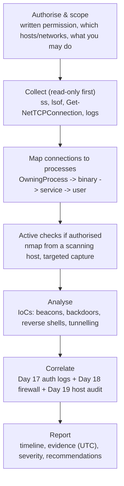

# Day 20: Network Security Investigation

!!! info "Lesson overview"
    | | |
    |---|---|
    | **Module** | 4 — Security, Logs & Monitoring |
    | **Difficulty** | :material-signal-cellular-3: Advanced |
    | **Estimated time** | 3–4 hours (75 min reading, 90 min demonstrations, 60–90 min lab and quiz) |
    | **Platforms** | Ubuntu 24.04 LTS (Nmap 7.94, iproute2 `ss`, lsof, tcpdump 4.99, tshark) · Windows 11 (Windows PowerShell 5.1 and PowerShell 7.4+, NetTCPIP, pktmon) |
    | **Lab** | [Lab 20: Suspicious Host Investigation](../../labs/lab-20.md) |

!!! danger "Authorisation first — every time"
    The techniques here (scanning, capturing, enumerating) are the same ones attackers use, and running them without permission is unauthorised access and, in most jurisdictions, a crime. **Only ever scan, capture on, or investigate systems and networks you own or have explicit written authorisation to test.** For practising scanning against a public host, Nmap provides exactly one sanctioned target: `scanme.nmap.org` ("you have permission to scan this host" — nmap.org). Everything else in this lesson uses localhost, your own lab VMs and isolated namespaces. Capturing other people's traffic without consent also raises serious privacy and legal issues (Day 15).

## Learning Objectives

By the end of this lesson you will be able to:

1. Follow a disciplined **investigation workflow**: authorise, scope, collect read-only evidence, analyse, correlate with logs, and report — without tipping off or disrupting the target.
2. Discover hosts and scan ports with **`nmap`**: host discovery (`-sn`), the difference between a connect scan (`-sT`) and a SYN scan (`-sS`), service/version (`-sV`) and OS (`-O`) detection, `--reason`, `--open`, port selection (`-p`, `--top-ports`) and saving results (`-oA`), and read *open / closed / filtered* correctly.
3. Investigate **live sockets** with `ss` and `lsof -i`, and map a suspicious connection to its **owning process**, binary and service.
4. Recognise **indicators of compromise** on the network: outbound beaconing to a C2 server, an unexpected listening port (backdoor), a reverse shell, and DNS tunnelling.
5. Capture and triage traffic with **`tcpdump`** (BPF filters, `-n -c -w -r -e`) and read it in **`tshark`**/Wireshark with display filters.
6. Do the equivalent on **Windows**: `Get-NetTCPConnection` with `OwningProcess`, `Test-NetConnection`, `netstat -anob`, a `pktmon` capture converted to pcapng, and firewall drop logs.
7. Correlate network findings with the host audit (Day 19), auth logs (Day 17) and firewall logs (Day 18) into a defensible incident timeline.

## Prerequisites

- [Day 12: Connectivity Troubleshooting](../module-3/day-12.md): `nc -zv`, `curl`, refused vs filtered vs timed out.
- [Day 14: Ports, Sockets and Connections](../module-3/day-14.md): `ss -tulnp`, the 5-tuple, TCP states, `OwningProcess`, listening vs established. **This is the foundation for today.**
- [Day 15: Network Interfaces and Diagnostics](../module-3/day-15.md): `tcpdump`, BPF capture filters, `tshark` display filters, capture ethics.
- [Day 18: Firewall Management](day-18.md) and [Day 19: System Security Auditing](day-19.md): firewall logs, the host baseline.
- An Ubuntu 24.04 **VM** with `sudo`. Install the investigation toolkit:

    ```bash
    sudo apt update && sudo apt install -y nmap iproute2 lsof tcpdump tshark netcat-openbsd curl
    ```

- A Windows 11 lab VM with an **elevated** PowerShell for `pktmon` and the firewall log.

## Introduction and Concepts

Days 11–15 taught you to investigate the network when something is *broken*. Today you investigate when something is *suspicious* — a server is reaching out to an address nobody recognises, an alert fired, or a host is behaving oddly. The tools overlap (`ss`, `tcpdump`, `nmap`), but the mindset is different: you are gathering **evidence**, you must not disturb it, and you must be able to defend every action afterwards.

### The investigation workflow



Start with the **least intrusive** evidence (live sockets and logs on the host itself), because it is both the safest and the most trustworthy — a running connection and its owning PID tell you far more than an external scan. Escalate to active scanning only when it is in scope and the quieter methods are exhausted.

### What a port scan actually does, and how to read it

A TCP **connect scan** (`nmap -sT`) completes the full three-way handshake (Day 14) — no special privilege, but every connection is logged by the target. A **SYN scan** (`-sS`, needs root) sends a SYN and judges the reply without completing the handshake: a SYN-ACK means *open*, a RST means *closed*, no reply means *filtered*. Nmap labels each port:

| State | Meaning | How Nmap decided (`--reason` shows it) |
|---|---|---|
| **open** | A service is listening and accepting | SYN-ACK received (`syn-ack`) |
| **closed** | Reachable host, nothing listening | RST received (`reset`) |
| **filtered** | A firewall is dropping the probe | No reply / ICMP unreachable (`no-response`) |
| **open\|filtered** | Can't tell open from filtered (common in UDP) | No reply to a probe that gets none when open |

This maps exactly onto the *refused vs timed out* distinction from Day 12: *closed* = refused (RST), *filtered* = timed out (drop). `-sV` then connects to each open port and reads the banner to identify the **service and version** (e.g. `OpenSSH 9.6p1`), and `-O` fingerprints the **operating system**.

### Indicators of compromise on the network

- **Beaconing (C2):** a process makes regular, small outbound connections to the same external address — often on 443 or 53 to blend in — at a fixed interval ("jitter" aside). Legitimate software updates are occasional; a beacon is metronomic.
- **Unexpected listener (backdoor):** a port in `LISTEN` that is not in your baseline (Day 14), especially one bound to `0.0.0.0` owned by an odd process or running from `/tmp`.
- **Reverse shell:** an *outbound* connection from a shell interpreter (`bash`, `python`, `nc`, `powershell`) to an attacker's listener — the target dials out so inbound firewall rules don't stop it.
- **DNS tunnelling / DGA:** a flood of unusual DNS queries (long random subdomains, high TXT volume) carrying data over port 53 (Day 13).

The giveaway is almost always **which process owns the socket**, so the single most valuable skill today is mapping a connection to its owning process and then to the binary, service and user behind it.

## Linux Command Reference

| Command | Purpose | Package | Needs root? |
|---|---|---|---|
| `nmap -sn NET` | Host discovery (ping sweep), no port scan | nmap | For some probe types |
| `nmap -sT` / `-sS` | TCP connect scan / SYN scan | nmap | `-sS` needs root |
| `nmap -sV` / `-O` | Service-version / OS detection | nmap | `-O` needs root |
| `nmap --reason --open` | Show *why* each state was decided / only open ports | nmap | No |
| `nmap -p` / `--top-ports N` | Specific ports / the N most common | nmap | No |
| `nmap -oA BASE` | Save normal, XML and grepable output at once | nmap | No |
| `ss -tulpn` | Listening TCP/UDP sockets with owning process | iproute2 | For other users' PIDs |
| `ss -tanp state established` | Established TCP connections with process | iproute2 | For other users' PIDs |
| `lsof -nP -i [:PORT]` | Open network files/sockets by process | lsof | For other users |
| `tcpdump -n -i IF` | Capture packets (numeric, on an interface) | tcpdump | Yes (or `cap_net_raw`) |
| `tcpdump -w F` / `-r F` | Write to / read from a pcap file | tcpdump | Write needs capture rights |
| `tshark -r F -Y FILTER` | Read a capture, apply a display filter | tshark | No (to read a file) |

## PowerShell Command Reference

| Cmdlet | Purpose | 5.1 | 7.x | Admin? |
|---|---|---|---|---|
| `Get-NetTCPConnection` | TCP connections/listeners with state and `OwningProcess` | Yes | **Windows only** | No (some fields need admin) |
| `Get-NetUDPEndpoint` | UDP listeners with owning process | Yes | **Windows only** | No |
| `Test-NetConnection -Port` | Test one TCP port (with routing/latency info) | Yes | **Windows only** | No |
| `Get-Process -Id` | Resolve an `OwningProcess` PID to a binary | Yes | Yes | No |
| `netstat -anob` | Connections with the owning executable | Yes | Yes (`.exe`) | **Yes** (`-b`) |
| `Resolve-DnsName` | Reverse-lookup a suspicious IP | Yes | Yes (Win) | No |
| `pktmon start/stop` | Built-in packet capture to ETL | Yes | Yes | **Yes** |
| `pktmon etl2pcap` | Convert the ETL capture to pcapng for Wireshark | Yes | Yes | **Yes** |
| `Get-NetFirewall*` + `pfirewall.log` | Firewall rules and dropped-packet log (Day 18) | Yes | **Windows only** | Yes |

## Detailed Command Explanations

### `nmap` — scanning, the right way

`nmap TARGET` scans the 1000 most common TCP ports with the default scan (SYN if root, connect otherwise). The flags you will use most in an authorised investigation:

- **`-sn`** — host discovery only ("which hosts are up on `10.0.0.0/24`?"), no port scan. Good for mapping a subnet first.
- **`-sT` vs `-sS`** — connect vs SYN scan. Use `-sT` when you are not root or want a scan that behaves like a normal client; `-sS` (root) is faster and stealthier but still fully logged by stateful firewalls.
- **`-sV`** — probe open ports to identify the service and version. Essential for spotting an outdated, vulnerable service.
- **`-O`** — OS fingerprinting (root).
- **`--reason`** — print the packet that decided each state (`syn-ack`, `reset`, `no-response`), so you can defend the result.
- **`--open`** — show only open ports, cutting noise in a report.
- **`-p 22,80,443` / `-p-` / `--top-ports 100`** — scan specific ports, all 65535, or the N most common.
- **`-oA basename`** — save results in all three formats (`.nmap`, `.xml`, `.gnmap`) for evidence and later parsing. `-oN file` is the normal human-readable form.
- **`-T4`** — timing template (faster); lower on fragile or production networks.

Reading output: each line is `PORT STATE SERVICE [VERSION]`. Treat an *open* port that is not in your inventory as the start of an investigation, not a conclusion.

### `ss` and `lsof -i` — the connections that exist right now

On the suspect host itself, the most trustworthy evidence is the live socket table (Day 14):

- `ss -tulpn` — every **listening** TCP/UDP socket with the owning process. Compare against the baseline; a new listener is a backdoor candidate.
- `ss -tanp state established` — every **established** TCP connection with its process. This is where you spot the beacon or reverse shell: an odd process connected to an external address.
- `ss -tanp 'dst 203.0.113.0/24'` — filter by destination to focus on a suspect network.
- `lsof -nP -i` — the same information organised by process/file descriptor; `lsof -nP -i :4444` shows exactly who holds port 4444.

Once you have a PID, resolve it: `ls -l /proc/PID/exe` (the real binary, even if deleted — a `(deleted)` target is a strong IoC), `cat /proc/PID/cmdline`, and `systemctl status PID` / the cgroup to find the owning service.

### `tcpdump` and `tshark` — capturing the evidence

When you need to see the actual packets (confirming a beacon's payload, a plaintext credential, a tunnelling pattern), capture with a **tight BPF filter** so you record only what is relevant and respect privacy (Day 15):

```bash
sudo tcpdump -n -i eth0 -c 200 -w /tmp/case.pcap 'host 203.0.113.10 and tcp'
```

`-n` skips DNS resolution (don't tip off the attacker and don't wait), `-c` limits the count, `-w` writes a pcap for analysis, and the filter restricts capture to the suspect host and TCP. Read it back offline with `tcpdump -n -r /tmp/case.pcap` or, better, `tshark -r /tmp/case.pcap -Y 'tcp.flags.syn==1 && tcp.flags.ack==0'` using Wireshark **display** filters (richer than BPF). `-e` prints link-layer (MAC) addresses, useful for same-segment attribution.

### Windows: `Get-NetTCPConnection`, `netstat -anob` and `pktmon`

`Get-NetTCPConnection` is the Day 14 cmdlet, now used for hunting. `Get-NetTCPConnection -State Established` lists active connections; each has an `OwningProcess` PID you resolve with `Get-Process -Id`. The investigative one-liner:

```powershell
Get-NetTCPConnection -State Established |
    Select-Object LocalAddress,LocalPort,RemoteAddress,RemotePort,OwningProcess,
        @{n='Process';e={(Get-Process -Id $_.OwningProcess -EA SilentlyContinue).Path}} |
    Sort-Object RemoteAddress
```

`netstat -anob` (elevated) shows connections with the owning **executable** name directly. For packet capture Windows has **`pktmon`**: `pktmon start --capture` (optionally with a packet filter), reproduce the activity, `pktmon stop`, then `pktmon etl2pcap PktMon.etl --out case.pcapng` to open it in Wireshark. Correlate with the Day 18 firewall drop log (`pfirewall.log`) and Security events 5156/5157.

## Syntax and Parameters

### Bash

```text
nmap [-sn|-sT|-sS|-sV|-O] [--reason] [--open] [-p PORTS | --top-ports N]
     [-T0..5] [-oA BASE | -oN FILE] [-Pn] TARGET...
ss [-t][-u][-l][-n][-p] [state STATE] [ 'EXPR' ]
lsof -nP -i [TCP|UDP][@HOST][:PORT]
tcpdump [-n] [-i IF] [-c N] [-e] [-w FILE | -r FILE] 'BPF-FILTER'
tshark -r FILE -Y 'DISPLAY-FILTER' [-T fields -e FIELD...]
```

| Option | Command | Meaning |
|---|---|---|
| `-sn` / `-Pn` | nmap | Host discovery only / skip discovery (treat host as up) |
| `-sT` / `-sS` | nmap | TCP connect / SYN scan (SYN needs root) |
| `-sV` / `-O` | nmap | Service-version / OS detection |
| `--reason` / `--open` | nmap | Explain each state / only show open ports |
| `--top-ports N` / `-p-` | nmap | N most common ports / all 65535 |
| `-oA` / `-oN` | nmap | Save all three formats / normal output to a file |
| `-l` / `-p` | ss | Listening sockets / show owning process |
| `state established` | ss | Filter by TCP state |
| `-n` | tcpdump, ss | Numeric (no name resolution) |
| `-c N` / `-w` / `-r` | tcpdump | Stop after N packets / write to / read from a file |
| `-Y` | tshark | Wireshark display filter |

### PowerShell

```text
Get-NetTCPConnection [-State <State[]>] [-LocalPort <UInt16[]>] [-RemoteAddress <String[]>]
                     [-OwningProcess <UInt32[]>]
Get-NetUDPEndpoint [-OwningProcess <UInt32[]>]
Test-NetConnection -ComputerName <String> -Port <Int32>
pktmon start --capture [--pkt-size 0] ; pktmon stop ; pktmon etl2pcap <etl> --out <pcapng>
```

| Parameter | Cmdlet | Meaning |
|---|---|---|
| `-State` | Get-NetTCPConnection | `Listen`, `Established`, `TimeWait`, `CloseWait`, … (Day 14) |
| `-OwningProcess` | Get-NetTCPConnection | Filter to one PID (then `Get-Process -Id`) |
| `-RemoteAddress` | Get-NetTCPConnection | Filter to connections to a suspect address |
| `-Port` | Test-NetConnection | The single TCP port to test |
| `--capture` | pktmon | Start capturing packets |
| `--pkt-size 0` | pktmon | Capture whole packets, not just headers |

## Practical Demonstrations

The Linux outputs below are **examples**, reviewed against the Nmap reference guide (nmap.org/book), the `tcpdump` and `ss` man pages, and the Day 14/15 captures — the release host cannot install `nmap`/`tcpdump`/`ss`, and scanning is only ever done against `scanme.nmap.org` or your own lab. The `lsof -i` form was confirmed on the release host. Windows outputs are examples reviewed against the official documentation (see *Further Reading*). **Never run these against anything you are not authorised to test.**

### Demo 1 — Host discovery and a careful port scan (authorised target only)

=== "Bash"

    ```bash
    # Host discovery on YOUR OWN lab subnet
    nmap -sn 10.20.0.0/24
    # The ONLY sanctioned public target for practice:
    nmap -sT --reason --open --top-ports 20 scanme.nmap.org
    # Service and (if root) OS detection, saved as evidence
    sudo nmap -sS -sV -O -oA ~/case/scanme scanme.nmap.org
    ```

    **Expected output (example):**

    ```text
    Nmap scan report for 10.20.0.20
    Host is up (0.00042s latency).

    PORT    STATE SERVICE REASON
    22/tcp  open  ssh     syn-ack ttl 64
    80/tcp  open  http    syn-ack ttl 64
    9929/tcp open nping-echo syn-ack ttl 54

    PORT   STATE SERVICE VERSION
    22/tcp open  ssh     OpenSSH 6.6.1p1 Ubuntu (protocol 2.0)
    80/tcp open  http    Apache httpd 2.4.7
    ```

    `--reason` shows `syn-ack` (open) vs `reset` (closed) vs `no-response` (filtered). `-sV` reveals the version — an old `OpenSSH 6.6.1` would be a patch finding.

=== "PowerShell"

    ```powershell
    # Windows has no built-in port scanner; test one port at a time
    Test-NetConnection -ComputerName 10.20.0.20 -Port 22 |
        Select-Object ComputerName, RemotePort, TcpTestSucceeded
    # Sweep a few ports on an authorised host
    22,80,443,3389,445 | ForEach-Object {
        [pscustomobject]@{ Port=$_
            Open=(Test-NetConnection 10.20.0.20 -Port $_ -WarningAction SilentlyContinue).TcpTestSucceeded } }
    ```

    **Expected output (example):**

    ```text
    ComputerName RemotePort TcpTestSucceeded
    ------------ ---------- ----------------
    10.20.0.20           22             True

    Port  Open
    ----  ----
      22  True
      80  True
     443 False
    3389 False
     445 False
    ```

### Demo 2 — Live sockets: find the suspicious connection and its owner

=== "Bash"

    ```bash
    # Listeners vs the baseline (Day 14): is there a new one?
    sudo ss -tulpn
    # Established connections with process
    sudo ss -tanp state established
    # Who holds a suspect port?
    sudo lsof -nP -i :4444
    # Resolve the PID to a binary (a "(deleted)" target is a red flag)
    ls -l /proc/1337/exe ; cat /proc/1337/cmdline | tr '\0' ' '; echo
    ```

    **Expected output (example):**

    ```text
    Netid State  Local Address:Port  Peer Address:Port Process
    tcp   LISTEN 0.0.0.0:4444        0.0.0.0:*         users:(("nc",pid=1337,fd=3))
    tcp   ESTAB  10.20.0.10:48912    203.0.113.10:443  users:(("python3",pid=1402,fd=5))
    COMMAND  PID USER FD TYPE NODE NAME
    nc      1337 www-data 3u IPv4 TCP 0.0.0.0:4444 (LISTEN)
    lrwxrwxrwx 1 root root 0 Nov 16 10:02 /proc/1337/exe -> /usr/bin/nc.traditional
    /bin/nc -lvnp 4444 -e /bin/bash
    ```

    A `www-data`-owned `nc ... -e /bin/bash` listening on 4444 is a **backdoor/reverse-shell** finding. The `python3` beacon to `203.0.113.10:443` every few seconds is C2.

=== "PowerShell"

    ```powershell
    Get-NetTCPConnection -State Listen |
        Where-Object LocalPort -notin 135,139,445,3389,5985 |
        Select-Object LocalAddress,LocalPort,OwningProcess,
            @{n='Proc';e={(Get-Process -Id $_.OwningProcess -EA SilentlyContinue).ProcessName}}
    Get-NetTCPConnection -State Established -RemoteAddress 203.0.113.10 |
        Select-Object RemoteAddress,RemotePort,OwningProcess
    Get-Process -Id 6273 | Select-Object Path, StartTime
    ```

    **Expected output (example):**

    ```text
    LocalAddress LocalPort OwningProcess Proc
    ------------ --------- ------------- ----
    0.0.0.0           4444          6273 powershell

    RemoteAddress RemotePort OwningProcess
    ------------- ---------- -------------
    203.0.113.10         443          6273

    Path                                   StartTime
    ----                                   ---------
    C:\Users\Public\svchost.exe            16-11-2026 10:02:11
    ```

    A `powershell`-owned listener on 4444 **and** an outbound 443 to the same PID, whose binary is a fake `svchost.exe` in `C:\Users\Public`, is a reverse shell plus C2.

### Demo 3 — Capture and triage the traffic

=== "Bash"

    ```bash
    # Capture only the suspect conversation (tight filter, limited count)
    sudo tcpdump -n -i eth0 -c 100 -w /tmp/case.pcap 'host 203.0.113.10'
    # Summarise it offline
    tcpdump -n -r /tmp/case.pcap | head
    # Wireshark display filters for richer triage
    tshark -r /tmp/case.pcap -Y 'tcp.flags.syn==1 && tcp.flags.ack==0' \
           -T fields -e frame.time -e ip.dst -e tcp.dstport
    ```

    **Expected output (example):**

    ```text
    10:02:14.001 IP 10.20.0.10.48912 > 203.0.113.10.443: Flags [S], seq 12..., length 0
    10:02:14.042 IP 203.0.113.10.443 > 10.20.0.10.48912: Flags [S.], seq 98..., length 0
    10:02:19.003 IP 10.20.0.10.48913 > 203.0.113.10.443: Flags [S], ...
    10:02:24.004 IP 10.20.0.10.48914 > 203.0.113.10.443: Flags [S], ...
    ```

    A SYN to the same destination **every 5 seconds** is the beaconing interval — a classic C2 signature.

=== "PowerShell"

    ```powershell
    # Elevated. Capture, reproduce the activity, stop, convert for Wireshark.
    pktmon start --capture --pkt-size 0
    Start-Sleep 20
    pktmon stop
    pktmon etl2pcap "$env:SystemRoot\System32\PktMon.etl" --out C:\case\case.pcapng
    # Correlate with the firewall drop log (Day 18)
    Get-Content "$env:SystemRoot\System32\LogFiles\Firewall\pfirewall.log" -Tail 50 |
        Where-Object { $_ -match '203.0.113.10' }
    ```

    **Expected output (example):**

    ```text
    PacketMonitor stopped. Logged: 412 packets.
    Processing... wrote 412 packets to C:\case\case.pcapng
    2026-11-16 10:02:14 ALLOW TCP 10.20.0.10 203.0.113.10 48912 443 ...
    ```

    Open `case.pcapng` in Wireshark to apply the same display filters as `tshark`.

### Demo 4 — Correlate into a timeline

=== "Bash"

    ```bash
    # What logged in before the backdoor appeared? (Day 17)
    sudo journalctl _COMM=sshd --since '2026-11-16 09:55' --until '2026-11-16 10:05'
    # Did the firewall see the beacon leave? (Day 18)
    sudo journalctl -k -g 'UFW' --since '2026-11-16 10:00' | head
    # Did the host audit change? (Day 19)
    find / -xdev -type f -perm -4000 2>/dev/null | sort | comm -13 ~/baseline/suid.txt -
    ```

    **Expected output (example):**

    ```text
    Nov 16 09:58:41 host sshd[1301]: Accepted password for www-data from 203.0.113.10 port 51022 ssh2
    Nov 16 10:02:03 host kernel: [UFW ALLOW] OUT=eth0 SRC=10.20.0.10 DST=203.0.113.10 DPT=443 ...
    /srv/app/.cache/helper
    ```

    The timeline writes itself: 09:58 suspicious SSH login → 10:02 new SUID file and outbound beacon.

=== "PowerShell"

    ```powershell
    # Logon events around the incident (Day 17)
    Get-WinEvent -FilterHashtable @{LogName='Security'; Id=4624,4625;
        StartTime='2026-11-16 09:55'; EndTime='2026-11-16 10:05'} |
        Select-Object TimeCreated, Id, @{n='User';e={$_.Properties[5].Value}}
    # Process that opened the C2 connection (Day 16/19: 4688 + script block 4104)
    Get-WinEvent -FilterHashtable @{LogName='Security'; Id=4688; StartTime='2026-11-16 10:00'} |
        Where-Object { $_.Message -match 'powershell' } | Select-Object TimeCreated
    ```

    **Expected output (example):**

    ```text
    TimeCreated          Id User
    -----------          -- ----
    16-11-2026 09:58:40 4624 svc-backup
    16-11-2026 10:02:10 4688
    ```

## Linux vs PowerShell Comparison

| Investigation step | Bash (Ubuntu) | PowerShell (Windows) | Notes |
|---|---|---|---|
| Discover live hosts | `nmap -sn NET` | `Test-Connection -Count 1` per host | |
| Port scan | `nmap -sS -sV TARGET` | `Test-NetConnection -Port` (per port) | Windows has no built-in scanner |
| Why open/closed/filtered | `nmap --reason` | `TcpTestSucceeded` true/false | filtered = timeout |
| Listening sockets | `ss -tulpn` | `Get-NetTCPConnection -State Listen` · `Get-NetUDPEndpoint` | Day 14 |
| Established connections | `ss -tanp state established` | `Get-NetTCPConnection -State Established` | |
| Socket → process | `lsof -i` · `/proc/PID/exe` | `OwningProcess` → `Get-Process -Id` | core skill |
| Socket → executable | `ls -l /proc/PID/exe` | `netstat -anob` | `(deleted)` = IoC |
| Capture packets | `tcpdump -w` | `pktmon start/stop` + `etl2pcap` | tight filter |
| Read a capture | `tshark -r -Y` / Wireshark | Wireshark (pcapng) | display filters |
| Reverse-lookup an IP | `dig -x` / `host` | `Resolve-DnsName` | Day 13 |
| Firewall drop log | `journalctl -k -g UFW` | `pfirewall.log`, 5157 | Day 18 |
| Correlate logins | `journalctl _COMM=sshd` | `Get-WinEvent` 4624/4625 | Day 17 |

## Real-World IT Scenarios

1. **SOC alert: outbound beacon.** A SIEM flags a host connecting to a known-bad IP every 60 seconds. The analyst runs `ss -tanp state established`, finds a `python3` process owned by `www-data`, maps it to a web-shell dropped via an unpatched app, and isolates the host.
2. **Unexpected listening port.** Monitoring shows a new `LISTEN` on 4444. `lsof -nP -i :4444` reveals `nc -e /bin/bash` — a reverse-shell backdoor. Correlating with Day 17 auth logs shows the SSH login that planted it.
3. **Authorised external assessment.** With written permission and a defined scope, a tester runs `nmap -sS -sV -oA` against the client's perimeter, finds an exposed, outdated service, and reports it with the `--reason` evidence and saved output.
4. **DNS tunnelling.** A capture shows thousands of TXT queries for long random subdomains of one domain. `tshark -Y 'dns.qry.type==16'` confirms data exfiltration over DNS (Day 13).
5. **Lateral movement check.** After one host is found compromised, the responder uses `Get-NetTCPConnection` across the fleet to find other hosts with established connections to the same C2 address.

## Cybersecurity Application

- This lesson **is** the hands-on core of SOC and incident-response work: find the connection, find the process, find the story. The firewall (Day 18), auth logs (Day 17) and host baseline (Day 19) are the corroborating evidence.
- **Offensive parity for defenders.** Knowing how `nmap -sS -sV` and reverse shells work lets you both detect them (what the SYN pattern and the `nc -e` process look like) and anticipate an attacker's next move.
- **Evidence discipline.** `-oA` for scans, `-w` for captures, UTC timestamps (Day 1) and read-only-first collection keep your findings defensible — crucial if the incident leads to HR action or prosecution.
- **Authorisation is the ethical and legal line.** The only public scan target in this course is `scanme.nmap.org`; everything else is your own lab. Capturing traffic also captures other people's data — minimise and protect it.

## Network Analyst Application

- The same `tcpdump`/`tshark`/`ss` skills from Days 14–15 now serve security: a "slow network" investigation and a "is this host beaconing?" investigation start with the same socket table and capture.
- **Baselining** is what turns noise into signal: without the Day 14 listening-port baseline and the Day 19 host baseline, you cannot say a listener or connection is *new*.
- Mapping connections to processes and services is exactly the asset-to-traffic correlation a network analyst does when documenting what each host legitimately talks to.

## System Administrator Application

- A sysadmin uses `nmap` (on their own network) to verify that only the intended ports are exposed after a firewall change (Day 18) — scanning from an *outside* host confirms the policy from the attacker's viewpoint.
- `Get-NetTCPConnection`/`ss` are the first response to "this server is slow / something's phoning home": identify the owning process before killing anything.
- Captures prove or disprove whether a problem is on the host or the network, and feed a precise bug report or vendor ticket.

## Common Mistakes

| Mistake | What happens | Correct approach |
|---|---|---|
| Scanning a host you don't own "to test" | Unauthorised access; possibly a crime | Only your own lab or `scanme.nmap.org`, with authorisation |
| Killing the suspicious process first | You destroy evidence and the attacker's live session | Collect read-only evidence (sockets, PID, binary, capture) first |
| Capturing with no filter | Huge files, privacy exposure, missed signal | Tight BPF filter, `-c` limit, minimise scope |
| Trusting the process *name* | Malware names itself `svchost`/`sshd` | Check the **path** (`/proc/PID/exe`, `Get-Process … Path`); beware `(deleted)` |
| Reading *filtered* as "safe" | A dropping firewall is not an absent service | `--reason`; correlate with the host's own `ss` |
| Running `-sS`/`-O` without root | Nmap silently falls back to `-sT` / skips OS detect | Run as root for SYN and OS detection |
| Forgetting `-n` in tcpdump/ss | Reverse-DNS lookups tip off the attacker and hang | Always `-n` in an investigation |
| No baseline | Can't tell "new" from "normal" | Keep Day 14 port and Day 19 host baselines |

## Troubleshooting Guide

| Symptom | Likely cause | Fix |
|---|---|---|
| `nmap` shows all ports `filtered` | A firewall is dropping probes (or host down) | Confirm the host is up (`-sn`), check scope; try from inside the segment |
| `nmap -sS` says "requires root" | SYN scan needs raw sockets | Use `sudo`, or `-sT` for an unprivileged connect scan |
| `ss` shows a socket but no process | Not root; process owned by another user | Run `sudo ss -tulpn` |
| `/proc/PID/exe -> ... (deleted)` | The binary was unlinked while running | Strong IoC; copy it from `/proc/PID/exe` as evidence before the process ends |
| `tcpdump: ... You don't have permission` | No capture rights | `sudo`, or grant `cap_net_raw` to the tool (Day 15) |
| `pktmon etl2pcap` missing | Older Windows build | Update, or use `netsh trace` and convert with the official tool |
| `Test-NetConnection` slow | Reverse DNS / routing delay | Expected; use `-WarningAction SilentlyContinue` in sweeps |
| Capture is empty | Wrong interface or over-tight filter | List interfaces (`ip -br link` / `pktmon list`); loosen the filter |

## Hands-on Lab

Complete **[Lab 20: Suspicious Host Investigation](../../labs/lab-20.md)**. On an isolated set of network namespaces (no real network touched), a setup script stands up a "victim" host that runs a listening backdoor and a periodic outbound beacon to a fake "C2" namespace. You investigate with `ss`, `lsof`, a scoped `tcpdump` capture and (against the lab only) `nmap`, map every suspicious socket to its owning process and binary, build a timeline, and write the incident report. A clean-up script tears it all down.

Summary of tasks:

1. Baseline the victim's listeners, then find the new one (the backdoor) and its owning process.
2. Find the periodic outbound connection (the beacon) and identify the interval and destination.
3. Capture the beacon traffic with a tight filter and confirm the pattern.
4. (Authorised lab only) scan the victim from the "admin" namespace and read open/closed/filtered with `--reason`.
5. Correlate with the host audit (Day 19) and write a prioritised incident report; run the clean-up.

## Practice Questions

1. What is the single most important precondition before running any command in this lesson, and what is the only sanctioned public scan target?
2. In `nmap` output, distinguish *open*, *closed* and *filtered*, and map each to the Day 12 terms *refused* and *timed out*.
3. What is the difference between `nmap -sT` and `-sS`, and which needs root?
4. Which `ss` command lists established TCP connections with their owning process, and why is the process the key piece of evidence?
5. You find a `LISTEN` on port 4444 owned by `nc ... -e /bin/bash`. What is this, and what should you do *before* killing it?
6. Why is a `/proc/PID/exe` symlink that points to a `(deleted)` file a strong indicator of compromise?
7. Write a `tcpdump` command that captures only traffic to `203.0.113.10`, stops after 100 packets, writes to a file, and does no name resolution.
8. What network pattern characterises C2 **beaconing**, and why do beacons often use port 443 or 53?
9. On Windows, how do you map an `OwningProcess` PID from `Get-NetTCPConnection` to the actual executable on disk?
10. Why should you always collect read-only evidence before taking any containment action?
11. What does `nmap --reason` add, and why does it matter in a report?
12. How would you confirm, from a capture, that outbound DNS is being used for tunnelling rather than normal lookups?

??? success "Practice answers"
    1. **Explicit authorisation** to scan/capture/investigate the target (you own it or have written permission). The only sanctioned public target for scan practice is `scanme.nmap.org`.
    2. *open* = a service accepted the connection (SYN-ACK) = the port answers; *closed* = host reachable but nothing listening (RST) = **refused**; *filtered* = a firewall dropped the probe (no reply) = **timed out**.
    3. `-sT` completes the full TCP handshake (works without root, fully logged); `-sS` sends a SYN and reads the reply without completing the handshake (faster, needs **root** for raw sockets).
    4. `ss -tanp state established`. The owning process ties the connection to a binary, service and user — a connection to a bad IP is only actionable once you know *which program* made it.
    5. A **reverse-shell/backdoor** listener. Before killing it, collect evidence read-only: `lsof`/`ss` for the PID, `ls -l /proc/PID/exe` and `cat /proc/PID/cmdline` for the binary and command line, and a scoped capture if it is active — so you preserve the attacker's artefacts and session.
    6. The binary was unlinked from disk while still running — normal software does not delete its own executable. It is a common malware anti-forensics technique; you can still recover the file from `/proc/PID/exe`.
    7. `sudo tcpdump -n -c 100 -w /tmp/case.pcap 'host 203.0.113.10'`
    8. Regular, small, outbound connections to the **same** external address at a fixed interval. 443 and 53 are used to blend in with normal HTTPS and DNS traffic and because those ports are usually allowed outbound.
    9. `Get-Process -Id <OwningProcess>` and read its `Path` (or `netstat -anob` for the executable directly). Check the path for fake-system-binary locations like `C:\Users\Public`.
    10. Containment (killing a process, blocking an IP, isolating a host) destroys or alters live evidence (the open socket, the running binary, memory). Read-only collection first preserves a defensible record and the attacker's live state for analysis.
    11. It prints the packet/behaviour that decided each port state (`syn-ack`, `reset`, `no-response`), so the result is explainable and defensible rather than an unexplained label.
    12. Look for a high volume of DNS queries (often TXT or long random subdomains of a single domain) carrying far more data than normal lookups — e.g. `tshark -r f -Y 'dns.qry.type==16'` or unusually long `dns.qry.name` values — rather than occasional A/AAAA lookups.

## Quiz

**Q1.** You have no written authorisation. Which target may you legally scan with `nmap` for practice?

- A. Any host that responds to ping
- B. Your employer's public website
- C. `scanme.nmap.org` (the host Nmap explicitly permits) and your own lab
- D. Any host in the `10.0.0.0/8` range

??? question "Answer and explanation"
    **C.** Nmap sanctions `scanme.nmap.org` for testing; otherwise only systems you own or are authorised to test. Scanning your employer's site without written permission, or arbitrary hosts, is unauthorised.

**Q2.** An `nmap` scan reports `8080/tcp filtered`. What does that mean?

- A. A service is listening and accepting connections
- B. The host is down
- C. A firewall is dropping the probes (no reply) — equivalent to "timed out"
- D. The port is closed with a RST

??? question "Answer and explanation"
    **C.** *filtered* means Nmap got no useful reply, typically because a firewall DROPs the probe. *closed* (RST) is "refused"; *open* is a SYN-ACK. `--reason` shows `no-response` for filtered.

**Q3.** Which command maps a suspicious connection to the program that made it?

- A. `ping -c 1`
- B. `ss -tanp state established` (then resolve the PID)
- C. `nmap -sn`
- D. `dig -x`

??? question "Answer and explanation"
    **B.** `ss -tanp` shows the owning process for each socket; you then resolve the PID to a binary via `/proc/PID/exe`. `nmap -sn` discovers hosts and `dig -x` reverse-resolves an IP.

**Q4.** A process named `svchost.exe` is running from `C:\Users\Public`. Why is the location significant?

- A. It is the normal location for `svchost.exe`
- B. Legitimate `svchost.exe` lives in `C:\Windows\System32`; a copy in a user-writable public folder is a strong IoC
- C. It means BitLocker is off
- D. It is a DNS server

??? question "Answer and explanation"
    **B.** Attackers name malware after trusted binaries. The real `svchost.exe` is in `System32`; the same name in `C:\Users\Public` is almost certainly malicious. Always verify the **path**, not the name.

**Q5.** What distinguishes C2 **beaconing** from normal traffic in a capture?

- A. It uses random high ports only
- B. Regular, small, outbound connections to the same address at a fixed interval
- C. It only ever uses ICMP
- D. It is always unencrypted

??? question "Answer and explanation"
    **B.** The metronomic interval and repeated destination are the signature. Beacons often use 443/53 to blend in and may be encrypted; the *timing* is the tell.

**Q6.** Which `tcpdump` invocation is best for investigating one suspect host without tipping it off or capturing unrelated data?

- A. `tcpdump -i any`
- B. `tcpdump -w all.pcap`
- C. `tcpdump -n -c 200 -w case.pcap 'host 203.0.113.10'`
- D. `tcpdump host google.com`

??? question "Answer and explanation"
    **C.** `-n` avoids reverse-DNS (no tip-off, no hang), `-c 200` bounds the capture, `-w` saves it, and the `host` filter restricts it to the suspect — minimal, targeted, defensible.

**Q7.** Before isolating a compromised host, what should you do first?

- A. Reboot it
- B. Delete the suspicious files
- C. Collect read-only evidence (sockets, owning PID, binary, a scoped capture)
- D. Change all passwords

??? question "Answer and explanation"
    **C.** Containment alters live evidence. Capture the socket table, the owning process and binary, and a targeted packet capture first, then contain. (Containment still matters — it just comes after evidence collection, per your IR plan.)

**Q8.** `Get-NetTCPConnection -State Established` shows a connection with `OwningProcess 6273`. What is the next command?

- A. `Stop-Process -Id 6273`
- B. `Get-Process -Id 6273 | Select-Object Path, StartTime`
- C. `Restart-Computer`
- D. `Get-ExecutionPolicy`

??? question "Answer and explanation"
    **B.** Resolve the PID to its executable path and start time to identify what made the connection. Stopping the process (A) destroys evidence and should follow collection, not precede it.

## Homework

1. **Authorised scan writeup.** Scan `scanme.nmap.org` with `nmap -sT --reason --open --top-ports 50 -oN scanme.txt`. In 150 words, explain each open port's state and how `--reason` justified it. (This host only.)
2. **Socket-to-process drill.** On your own VM, start a harmless listener (`nc -lvnp 9999` in one terminal), then in another find it with `ss -tulpn` and `lsof -nP -i :9999`, resolve the PID to its binary, and stop it. Record every command.
3. **Beacon simulation (your lab only).** Write a 5-line loop that `curl`s your own web server every 10 seconds, capture 60 seconds with a tight `tcpdump` filter, and show the fixed interval in the capture. Explain why this pattern would alarm a SOC.
4. **Windows connection hunt.** Produce the `Get-NetTCPConnection` one-liner that lists every established connection with its remote address and owning process path, sorted by remote address. Explain how you would spot a beacon in it.
5. **Research:** read the Nmap "Port Scanning Basics" chapter and list the six port states Nmap can report and what each means.

??? success "Homework answer key (items 2 and 5)"
    2. ```bash
       nc -lvnp 9999 &                 # terminal 1 (lab only)
       sudo ss -tulpn 'sport = :9999'  # LISTEN with users:(("nc",pid=...))
       sudo lsof -nP -i :9999          # same, by process/fd
       ls -l /proc/<pid>/exe           # -> /usr/bin/nc...
       kill <pid>                      # stop the listener you started
       ```
    5. Nmap's six states: **open** (service accepting), **closed** (reachable, nothing listening — RST), **filtered** (probe dropped/no reply), **unfiltered** (reachable but Nmap can't tell open from closed, seen in ACK scans), **open\|filtered** (can't distinguish open from filtered, common in UDP/FIN/NULL scans), and **closed\|filtered** (can't distinguish closed from filtered, idle scan).

## Professional Tips

- **Least intrusive first.** The host's own `ss`/`Get-NetTCPConnection` and logs beat an external scan for trust and safety; scan only when it adds something and is in scope.
- **Name is a lie, path is truth.** Always resolve a socket to the binary's real path; `(deleted)` and user-writable locations are instant red flags.
- **Capture small, capture legal.** Tight BPF filters and packet-count limits keep captures focused, lawful and reviewable.
- **Keep baselines.** The Day 14 port baseline and Day 19 host baseline are what let you say "this is new".
- **Write the timeline in UTC** and attach the raw evidence (`-oA` scans, `-w` pcaps, log excerpts). A good report is reproducible by someone else.
- **Have an IR plan.** Know, before the incident, the order: authorise → collect → analyse → contain → eradicate → recover → report.

## Command Cheat Sheet

```bash
# ---- Network investigation (AUTHORISED systems / scanme.nmap.org only) ----
nmap -sn 10.20.0.0/24                      # host discovery (your lab)
nmap -sT --reason --open --top-ports 50 scanme.nmap.org
sudo nmap -sS -sV -O -oA case/scan TARGET  # SYN + version + OS, saved
sudo ss -tulpn                             # listeners + owning process
sudo ss -tanp state established            # established + process
sudo lsof -nP -i :4444                     # who holds a port
ls -l /proc/PID/exe ; cat /proc/PID/cmdline  # binary + command line
sudo tcpdump -n -c 100 -w case.pcap 'host 203.0.113.10'
tshark -r case.pcap -Y 'tcp.flags.syn==1 && tcp.flags.ack==0'
sudo journalctl -k -g 'UFW' --since '-15 min'   # firewall drops (Day 18)
```

```powershell
# ---- Windows network investigation ----
Test-NetConnection HOST -Port 443                 # one-port test
Get-NetTCPConnection -State Listen                # listeners
Get-NetTCPConnection -State Established |          # connections + process path
  Select LocalPort,RemoteAddress,RemotePort,OwningProcess,
    @{n='Path';e={(Get-Process -Id $_.OwningProcess -EA SilentlyContinue).Path}}
Get-Process -Id <PID> | Select Path, StartTime
netstat -anob                                     # connections + executable (elevated)
pktmon start --capture ; pktmon stop              # capture (elevated)
pktmon etl2pcap "$env:SystemRoot\System32\PktMon.etl" --out case.pcapng
Get-Content "$env:SystemRoot\System32\LogFiles\Firewall\pfirewall.log" -Tail 50
```

## Completion Checklist

- [ ] I will only scan/capture/investigate systems I own or am authorised to test (and `scanme.nmap.org`).
- [ ] I can read `nmap` open/closed/filtered and use `--reason`, `-sV`, `-sT` vs `-sS`, `--open` and `-oA`.
- [ ] I can list listeners and established connections and map each to its owning process and binary.
- [ ] I can recognise a backdoor listener, a reverse shell, outbound beaconing and DNS tunnelling.
- [ ] I can capture with a tight `tcpdump` filter and triage it in `tshark`/Wireshark.
- [ ] I can do the Windows equivalents with `Get-NetTCPConnection`, `netstat -anob` and `pktmon`.
- [ ] I can correlate network findings with Day 17 auth logs, Day 18 firewall logs and the Day 19 host audit.
- [ ] I completed Lab 20 and wrote a prioritised incident report with evidence.
- [ ] I answered the practice questions and quiz, and did the homework.

## Further Reading

- Nmap Reference Guide (man page) and Port Scanning Basics — <https://nmap.org/book/man.html> · <https://nmap.org/book/man-port-scanning-basics.html>
- Nmap legal/authorisation note and `scanme.nmap.org` — <https://nmap.org/book/man-legal.html>
- Linux man pages: [ss(8)](https://man7.org/linux/man-pages/man8/ss.8.html), [lsof(8)](https://man7.org/linux/man-pages/man8/lsof.8.html), [tcpdump(1)](https://www.tcpdump.org/manpages/tcpdump.1.html), [pcap-filter(7)](https://www.tcpdump.org/manpages/pcap-filter.7.html)
- Wireshark display-filter reference — <https://www.wireshark.org/docs/dfref/>
- Wireshark User's Guide — <https://www.wireshark.org/docs/wsug_html_chunked/>
- PowerShell / Windows: [Get-NetTCPConnection](https://learn.microsoft.com/en-us/powershell/module/nettcpip/get-nettcpconnection), [Test-NetConnection](https://learn.microsoft.com/en-us/powershell/module/nettcpip/test-netconnection), [pktmon](https://learn.microsoft.com/en-us/windows-server/networking/technologies/pktmon/pktmon)

---

**Previous:** [Day 19: System Security Auditing](day-19.md) · **Next:** [Day 21: Variables and User Input](../module-5/day-21.md)
