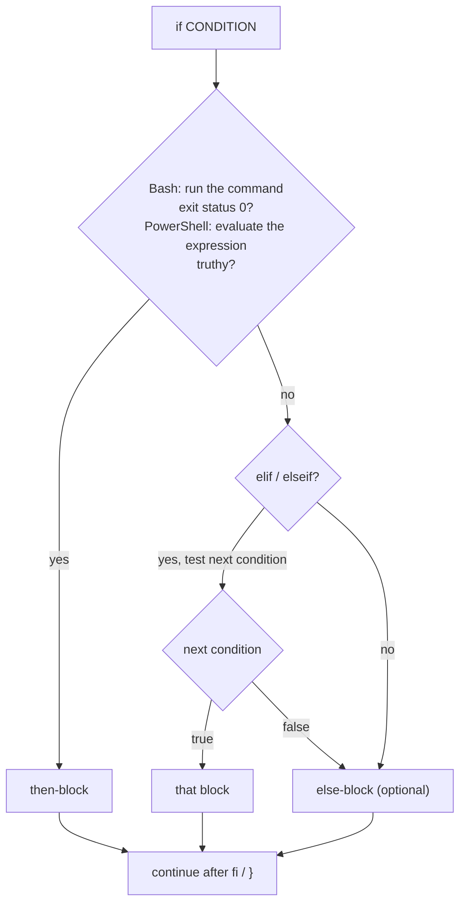
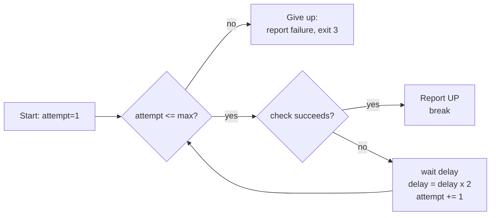

# Day 22: Conditions and Loops

!!! info "Lesson overview"
    | | |
    |---|---|
    | **Module** | 5 — Scripting & Automation |
    | **Difficulty** | :material-signal-cellular-2: Intermediate |
    | **Estimated time** | 3–4 hours (75 min reading, 90 min demonstrations, 60–90 min lab and quiz) |
    | **Platforms** | Ubuntu 24.04 LTS (Bash 5.2, coreutils 9.4) · Windows 11 (Windows PowerShell 5.1 and PowerShell 7.4+) |
    | **Lab** | [Lab 22: Triage Loop](../../labs/lab-22.md) |

## Learning Objectives

By the end of this lesson you will be able to:

1. Explain how Bash decides "true" and "false" (**exit status 0 = true**) and how PowerShell does (**truthy/falsy values**), and why the same `if` looks so different in each shell.
2. Write `if`/`elif`/`else` in Bash with `[ ]`, `[[ ]]` and `(( ))`, and `if`/`elseif`/`else` in PowerShell with comparison operators.
3. Use string, integer and **file tests** (`-z`, `-n`, `-eq`, `-lt`, `-f`, `-d`, `-r`, `-s`, `-nt`) and their PowerShell counterparts (`-eq`, `-lt`, `Test-Path`, `-like`, `-match`).
4. Match text with **glob patterns** and **regular expressions** (`[[ =~ ]]` and `BASH_REMATCH`; `-match` and `$Matches`).
5. Choose between `case` and `switch` (including `switch -Wildcard`, `-Regex` and `-File`).
6. Write every kind of loop — `for`, C-style `for`, `while`, `until`, `foreach`, `ForEach-Object`, `do`/`while`, `do`/`until` — and control them with `break`, `continue` and labels.
7. Read files and command output line by line **safely** (`while IFS= read -r`, process substitution, `switch -File`, `Get-Content`).
8. Build **retry loops with backoff and timeouts** that never run forever, and avoid the classic loop traps (`set -e` with `((i++))`, pipelines into `while`, `break` inside `ForEach-Object`).

## Prerequisites

- [Day 21](day-21.md) completed: variables, quoting, arrays, `read` and `param()`.
- [Day 05](../module-1/day-05.md): exit codes, `$?`, `$LASTEXITCODE`, `&&` and `||`.
- A practice folder (`~/lab22`, `$HOME\lab22`). Nothing in this lesson needs root or Administrator; the loop demos only read files and connect to `127.0.0.1`.

## Introduction and Concepts

### Decisions and repetition are what make a script useful

A list of commands is a **recipe**. Conditions and loops turn it into a **tool**: *if* the disk is above 90 % send an alert, *for each* server check the port, *while* the service is not up wait and retry, *until* ten attempts have failed. Almost every script in the course's Script Library is a loop around one or more conditions.

### What "true" means in each shell

This is the most important difference of the day:

| | Bash | PowerShell |
|---|---|---|
| `if` tests… | The **exit status of a command** | The **value of an expression** |
| True | Exit status `0` | `$true`, non-zero numbers, non-empty strings, non-empty collections, any object |
| False | Any non-zero exit status (1–255) | `$false`, `0`, `''`, `$null`, empty array `@()` |
| Typical test | `if grep -q root /etc/passwd; then` | `if (Select-String -Path f -Pattern root -Quiet) {` |
| Comparison | A **command**: `[ "$a" -lt 5 ]` or `[[ … ]]` or `(( … ))` | An **operator**: `$a -lt 5` |

In Bash, `[` is literally a command (also called `test`) whose exit status reports the result. `if`, `while`, `until`, `&&` and `||` all look only at exit statuses.



### Loops: three questions before you write one

1. **What am I iterating over?** A fixed list (servers), a range of numbers, the lines of a file, the output of a command, or "until something becomes true".
2. **How does it end?** Every loop needs a guaranteed exit: the end of a list, a counter, a timeout, or `break`. A loop that waits for a service must have a **maximum number of attempts**.
3. **What happens when one iteration fails?** Usually: record the failure, `continue` with the next item, and report a summary (and a non-zero exit code) at the end — not stop at the first bad server.



### Pattern matching: globs vs regular expressions

| | Glob (wildcard) | Regular expression |
|---|---|---|
| Bash | `[[ $f == *.log ]]`, `case` patterns | `[[ $f =~ ^app-[0-9]+\.log$ ]]` |
| PowerShell | `-like '*.log'`, `switch -Wildcard` | `-match '^app-\d+\.log$'`, `switch -Regex` |
| Matches | The **whole** string | **Anywhere** unless anchored with `^…$` |
| `*` means | Any characters | "Zero or more of the previous item" |

Day 04 introduced both; today you use them to make decisions.

## Linux Command Reference

| Command / syntax | Purpose | Availability | Needs root? |
|---|---|---|---|
| `if …; then …; elif …; then …; else …; fi` | Conditional execution on exit status | Bash keyword | No |
| `test EXPR`, `[ EXPR ]` | POSIX test command: strings, integers, files | Bash built-in (and `/usr/bin/test`) | No |
| `[[ EXPR ]]` | Bash conditional: no word splitting, `&&`/<code>&#124;&#124;</code> inside, `==` glob, `=~` regex | Bash keyword | No |
| `(( EXPR ))` | Arithmetic condition: status 0 when the result is non-zero | Bash keyword | No |
| `cmd1 && cmd2`, <code>cmd1 &#124;&#124; cmd2</code>, `! cmd` | Run on success / on failure / negate | Bash | No |
| `case WORD in PATTERN) …;; esac` | Multi-way branch on glob patterns (`;&` and `;;&` in Bash 4+) | Bash keyword | No |
| `for NAME in WORDS; do …; done` | Loop over a list | Bash keyword | No |
| `for (( init; cond; step )); do …; done` | C-style numeric loop | Bash keyword | No |
| `while CMD; do …; done` / `until CMD; do …; done` | Loop while the command succeeds / fails | Bash keywords | No |
| `break [N]`, `continue [N]` | Leave / skip to the next iteration of N nested loops | Bash built-ins | No |
| `select NAME in WORDS; do …; done` | Numbered interactive menu (prompt `PS3`) | Bash keyword | No |
| `{1..10}`, `{01..10}`, `{a..e}` | Brace expansion (generates words; no variables inside) | Bash | No |
| `seq [FIRST [STEP]] LAST` | Print a number sequence (`-w` equal width) | coreutils | No |
| `shopt -s nullglob` / `failglob` | Unmatched glob expands to nothing / is an error | Bash built-in | No |
| `mapfile -t ARR < file` (`readarray`) | Read lines into an array | Bash 4+ built-in | No |
| `timeout DURATION CMD` | Kill a command that runs too long (exit 124) | coreutils | No |
| `sleep N` | Pause between iterations | coreutils | No |

## PowerShell Command Reference

| Statement / operator / cmdlet | Aliases | Purpose | 5.1 | 7.x | Admin? |
|---|---|---|---|---|---|
| `if () {} elseif () {} else {}` | — | Conditional | Yes | Yes | No |
| `-eq -ne -gt -ge -lt -le` | — | Comparison (case-insensitive for strings) | Yes | Yes | No |
| `-ceq`, `-clike`, `-cmatch`… / `-ieq`… | — | Explicitly case-sensitive / insensitive | Yes | Yes | No |
| `-like -notlike` | — | Wildcard match | Yes | Yes | No |
| `-match -notmatch` | — | Regex match; fills `$Matches` | Yes | Yes | No |
| `-contains -notcontains -in -notin` | — | Collection membership | Yes | Yes | No |
| `-is -isnot` | — | Type test: `$x -is [int]` | Yes | Yes | No |
| `-and -or -xor -not` / `!` | — | Logical operators | Yes | Yes | No |
| <code>switch [-Wildcard&#124;-Regex&#124;-Exact] [-CaseSensitive] [-File path] (value) {}</code> | — | Multi-way branch; loops over arrays and files | Yes | Yes | No |
| `cond ? a : b` | — | Ternary operator | No | **7.0+** | No |
| `??`, `??=` | — | Null-coalescing | No | **7.0+** | No |
| `cmd1 && cmd2`, <code>cmd1 &#124;&#124; cmd2</code> | — | Pipeline chain operators | No | **7.0+** | No |
| `for (init; cond; step) {}` | — | Numeric loop | Yes | Yes | No |
| `foreach ($x in $list) {}` | — | Loop statement over a collection already in memory | Yes | Yes | No |
| `ForEach-Object` | `%`, `foreach` | Pipeline loop (`-Begin -Process -End`) | Yes | Yes | No |
| `ForEach-Object -Parallel` | — | Run iterations in parallel runspaces (`-ThrottleLimit`, default 5) | No | **7.0+** | No |
| `while () {}`, `do {} while ()`, `do {} until ()` | — | Condition loops | Yes | Yes | No |
| `break`, `continue`, `:label` | — | Loop control, labelled loops | Yes | Yes | No |
| `Where-Object` | `?`, `where` | Filter pipeline objects | Yes | Yes | No |
| `.Where({})`, `.ForEach({})` | — | Fast in-memory methods on collections | Yes (4.0+) | Yes | No |
| `Start-Sleep` | `sleep` | Pause (`-Seconds`, `-Milliseconds`) | Yes | Yes | No |
| `Test-Path` | — | File/folder tests (`-PathType Leaf/Container`, `-NewerThan`) | Yes | Yes | No |

## Detailed Command Explanations

### `if` in Bash: any command can be a condition

```bash
if grep -q '^root:' /etc/passwd; then
    echo "root account present"
elif [[ -r /etc/passwd ]]; then
    echo "no root entry"
else
    echo "cannot read /etc/passwd"
fi
```

The keywords are `if`, `then`, `elif`, `else`, `fi`. `then` must be on a new line or after `;`. Because the condition is a **command**, you can test anything that sets an exit status: `ping -c1 -W1 host`, `systemctl is-active --quiet nginx`, `id username`, `curl -fsS url`. Use `-q`/`--quiet` options and `>/dev/null 2>&1` to suppress output you do not need. `!` negates: `if ! id lab22-user >/dev/null 2>&1; then`.

The short forms `cmd && echo ok` and `cmd || echo failed` are fine for one action. Do **not** chain them as `a && b || c` and expect if/else: `c` also runs when `b` fails.

### `[ ]`, `[[ ]]` and `(( ))` — three ways to compare

| Form | What it is | Use for | Watch out for |
|---|---|---|---|
| `[ … ]` / `test` | POSIX command | Portable `sh` scripts | Must quote variables; `<` and `>` are **redirections**; use `-a`/`-o` sparingly (obsolescent) |
| `[[ … ]]` | Bash keyword | Most Bash conditions | Not available in `sh`/`dash`; `<` `>` compare **strings** |
| `(( … ))` | Arithmetic evaluation | Numbers | Status is 0 when the result is **non-zero**; `((x))` fails when `x` is 0 |

Why prefer `[[ ]]` in Bash scripts:

- No word splitting or globbing of variables inside, so `[[ $x = yes ]]` works even when `$x` is empty (with `[ ]` you get *unary operator expected*).
- `&&`, `||` and parentheses work inside: `[[ -f $f && -s $f ]]`.
- `==` and `!=` with an **unquoted** right-hand side match **glob patterns**: `[[ $file == *.log ]]`. Quote it to compare literally: `[[ $file == "*.log" ]]`.
- `=~` matches an **extended regular expression**; capture groups land in the array `BASH_REMATCH`. Keep the regex **unquoted** (or in a variable): quoted parts are matched literally.

### Test operators

**Strings**

| Test | True when |
|---|---|
| `-z "$s"` | String is empty |
| `-n "$s"` | String is not empty |
| `"$a" = "$b"` (also `==` in `[[ ]]`) | Equal |
| `"$a" != "$b"` | Not equal |
| `[[ $a < $b ]]` | `a` sorts before `b` (locale order) |

**Integers** (inside `[ ]`/`[[ ]]`)

| Test | Meaning | `(( ))` form |
|---|---|---|
| `-eq` / `-ne` | Equal / not equal | `==` / `!=` |
| `-lt` / `-le` | Less than / less or equal | `<` / `<=` |
| `-gt` / `-ge` | Greater than / greater or equal | `>` / `>=` |

**Files**

| Test | True when |
|---|---|
| `-e` | Exists (any type) |
| `-f` / `-d` / `-L` | Regular file / directory / symbolic link |
| `-r` / `-w` / `-x` | Readable / writable / executable **by you** |
| `-s` | Exists and is not empty |
| `f1 -nt f2` / `f1 -ot f2` | `f1` is newer / older than `f2` (modification time) |

`-r`, `-w` and `-x` check permissions for the **current user**, which is exactly what a script needs to know before trying to read a log or write a report.

### `case` — branching on patterns

```bash
case "$file" in
    *.gz)               reader="zcat" ;;
    *.log|*.log.[0-9])  reader="cat" ;;
    *.[cC][sS][vV])     reader="csv" ;;
    "")                 echo "no file given" >&2; exit 1 ;;
    *)                  reader="skip" ;;
esac
```

Patterns are **globs**, tested top to bottom; the first match wins, and `;;` ends the branch. `|` separates alternatives. `*)` is the default. Bash 4 adds `;&` (fall through into the next branch's commands) and `;;&` (test the next patterns too). `case` is ideal for command-line options, file types, yes/no answers (`[yY]|[yY][eE][sS])`) and log severities.

### `for` loops in Bash

- `for host in web-01 web-02 db-01; do …; done` — a literal list.
- `for host in "${servers[@]}"; do` — an array, each element intact.
- `for f in /var/log/*.log; do` — a glob. If nothing matches, the loop runs **once** with the literal pattern unless you set `shopt -s nullglob` (or test `[[ -e $f ]] || continue`).
- `for i in {1..10}` / `{01..10}` — brace expansion. It happens **before** variables are expanded, so `{1..$n}` does not work; use `for (( i = 1; i <= n; i++ ))` or `seq 1 "$n"`.
- `for (( i = 0; i < ${#arr[@]}; i++ ))` — C-style, when you need the index.

Never loop over `$(ls)` or `$(cat file)`: the output is word-split on spaces and globbed. Use a glob for files and `while read` for lines.

### `while`, `until` and reading lines

`while CMD; do …; done` repeats while the command succeeds; `until CMD` repeats while it **fails**. The idiomatic way to process a file line by line is:

```bash
while IFS= read -r line || [[ -n $line ]]; do
    printf '%s\n' "$line"
done < "$file"
```

- `IFS=` keeps leading and trailing spaces, and `-r` keeps backslashes (Day 21).
- `|| [[ -n $line ]]` processes a last line that has no trailing newline (common in files created on Windows or by `printf`).
- The redirection `< "$file"` is on the **loop**, so the whole loop reads one file.

To loop over **command output**, use process substitution so the loop runs in the current shell and its variables survive:

```bash
count=0
while IFS= read -r line; do (( count++ )); done < <(grep ERROR app.log)
echo "$count"      # correct; "grep ERROR app.log | while ..." would print 0
```

For file names that may contain newlines, use NUL separators: `find /data -name '*.log' -print0 | while IFS= read -r -d '' f; do …; done` (or `< <(find … -print0)`).

`mapfile -t lines < file` reads all lines into an array at once — convenient for small files.

### `break`, `continue` and nested loops

`continue` skips to the next iteration; `break` leaves the loop. Both take a number for nested loops: `break 2` leaves two levels. Use `continue` for "skip comments and blank lines" and `break` for "found it" or "service is up".

### Retry, backoff and timeouts

A loop that waits for something must be **bounded**:

```bash
attempt=1; max=5; delay=1
until curl -fs -o /dev/null --max-time 2 "http://127.0.0.1:8022/"; do
    (( attempt >= max )) && { echo "gave up after $max attempts" >&2; exit 3; }
    sleep "$delay"; (( attempt++ )); (( delay *= 2 ))
done
```

Each attempt has its own time limit (`--max-time`, `-W` for `ping`, `timeout 5 cmd`), the number of attempts is limited, and the delay doubles (exponential backoff) so you do not hammer a struggling service. `timeout 30 cmd` stops any command after 30 seconds and returns **124**.

!!! warning "`set -e` and arithmetic"
    `(( count++ ))` returns status **1** when `count` was 0 (the expression's old value is 0 = "false"). Under `set -o errexit` the script silently exits on the first iteration. Use `count=$(( count + 1 ))` or `(( ++count ))` (pre-increment returns the new value) in scripts that use `errexit`.

### `if` in PowerShell and comparison operators

```powershell
if ($pct -ge 95) {
    $level = 'CRITICAL'
} elseif ($pct -ge 80) {
    $level = 'WARNING'
} else {
    $level = 'OK'
}
```

PowerShell uses **operators**, never `<` or `>`: `>` is the **redirection** operator, so `if ($a > 5)` writes `$a` into a file named `5` and tests the (empty) result. String comparisons are **case-insensitive** by default; add `c` for case-sensitive (`-ceq`, `-clike`, `-cmatch`).

Operator behaviour to know:

- **The left operand decides the type.** `'10' -lt '9'` compares strings and is `$true`; `10 -lt '9'` converts `'9'` to a number and is `$false`. Cast input first: `[int]$text -lt 9`.
- **A collection on the left filters instead of testing.** `@(1, 2, 3, 2) -eq 2` returns `2, 2`, not `$true`. To test membership use `-contains` (`$list -contains 2`) or `-in` (`2 -in $list`).
- **Put `$null` on the left.** `$null -eq $x` is a reliable "is it null?" test; `$x -eq $null` filters if `$x` is an array. PSScriptAnalyzer warns about the reversed form.
- `-match` sets the automatic variable **`$Matches`** (only when the left side is a single value): `$Matches[0]` is the whole match, `$Matches[1]` the first group, `$Matches['name']` a named group `(?<name>…)`.
- `-like` uses wildcards and matches the **whole** string; `-match` uses regex and matches **anywhere** unless anchored.
- Combine with `-and`, `-or`, `-not` (or `!`). Like Bash, PowerShell short-circuits: in `$a -and $b`, `$b` is not evaluated when `$a` is false.

Commands can be conditions too, through their output: `if (Test-Path -Path $f -PathType Leaf)`, `if (Get-Service -Name Spooler -ErrorAction SilentlyContinue)`, `if (Select-String -Path log -Pattern ERROR -Quiet)`. For **native** programs, test `$LASTEXITCODE` after running them: `ping.exe -n 1 host > $null; if ($LASTEXITCODE -eq 0) { … }`.

PowerShell **7.0+** adds `$cond ? 'yes' : 'no'`, `$value ?? 'default'` and the chain operators `cmd1 && cmd2` / `cmd1 || cmd2` (which look at the success of the previous pipeline, like Bash).

### `switch` — PowerShell's power tool

```powershell
switch -Regex ($line) {
    '^ERROR'   { $errors++; break }
    '^WARN'    { $warnings++ }
    'timeout'  { $timeouts++ }
    default    { $other++ }
}
```

- Without `break`, **every** matching branch runs (here a `WARN … timeout` line counts twice). Add `break` to stop after the first match, `continue` to move to the next input item.
- `-Wildcard` uses `-like` patterns, `-Regex` uses `-match` (and fills `$Matches`), `-Exact` uses plain equality (the default behaves like `-eq` with some conveniences), `-CaseSensitive` changes all of them.
- A branch condition can be a **script block**: `{ $_ -gt 90 } { 'high' }`.
- If the input is an **array**, `switch` loops over every element; `$_` is the current one.
- `switch -File path` reads a file line by line — a fast, memory-friendly loop.

### `for`, `foreach` and `ForEach-Object`

| Form | Input | Memory | Use when |
|---|---|---|---|
| `for ($i = 0; $i -lt $n; $i++) {}` | A counter | — | You need the index or a numeric range |
| `foreach ($s in $servers) {}` | A collection already in a variable | Whole collection in memory | Fast loops over arrays, most script code |
| <code>Get-X &#124; ForEach-Object { $_ }</code> | Pipeline objects one at a time | Streams | Large or slow input (logs, files, remote results) |
| <code>1..10 &#124; ForEach-Object -Parallel { } -ThrottleLimit 5</code> | Pipeline, in parallel runspaces | Streams | Slow, independent work (network checks); **7.0+** |
| `$list.ForEach({ })`, `$list.Where({ })` | Collection | In memory | Concise, fast filters (4.0+) |

`ForEach-Object` has `-Begin` (once, before the first item), `-Process` (each item) and `-End` (once, after the last) blocks — ideal for "initialise counters, count, print a summary". Inside `-Parallel` blocks, read caller variables with `$using:name`.

!!! danger "`break` and `continue` inside `ForEach-Object`"
    `ForEach-Object` runs a **script block**, not a loop statement. `break` or `continue` inside it does not affect just the current item: it searches **outward** for an enclosing loop and, if there is none, **stops the whole script**. Use `return` to skip to the next item in `ForEach-Object`, and use a `foreach` statement when you need `break`.

### `while`, `do`/`while`, `do`/`until` and labels

`while ($cond) { }` tests before each iteration; `do { } while ($cond)` and `do { } until ($cond)` test **after**, so the body runs at least once — natural for "try, then decide whether to retry". `:outer foreach (...) { foreach (...) { break outer } }` leaves the labelled outer loop (the label has no space after the colon).

### Reading lines in PowerShell

- `foreach ($line in Get-Content -Path $f) { }` — simple; loads all lines first.
- `Get-Content -Path $f | ForEach-Object { }` — streams line by line; add `-ReadCount 1000` to process in batches for speed.
- `switch -File $f { … }` — fastest built-in way to classify lines.
- `[System.IO.File]::ReadLines($f)` — streaming .NET enumerator for very large files (use a full path).

Unlike Bash, PowerShell handles a final line without a newline, and spaces and backslashes are never altered.

## Syntax and Parameters

### Bash

```text
if LIST; then LIST; [elif LIST; then LIST;] ... [else LIST;] fi
[ EXPRESSION ]      [[ EXPRESSION ]]      (( ARITHMETIC ))
case WORD in [(] PATTERN [| PATTERN]... ) LIST ;; ... esac        # also ;& and ;;&
for NAME [in WORDS ...]; do LIST; done
for (( EXPR1; EXPR2; EXPR3 )); do LIST; done
while LIST; do LIST; done          until LIST; do LIST; done
select NAME [in WORDS ...]; do LIST; done
break [N]     continue [N]
seq [-w] [-s SEP] [FIRST [INCREMENT]] LAST
timeout [-k KILL_AFTER] [-s SIGNAL] DURATION COMMAND [ARG]...
mapfile [-t] [-n COUNT] [-d DELIM] ARRAY < FILE
```

| Item | Meaning |
|---|---|
| `[[ $s == pat ]]` | Glob match (pattern unquoted) |
| `[[ $s =~ regex ]]` | ERE match; groups in `BASH_REMATCH[1..n]`; exit 2 for an invalid regex |
| `;;` / `;&` / `;;&` | End branch / fall through / continue testing (Bash 4+) |
| `shopt -s nullglob` | Unmatched globs become empty (loops do not run) |
| `shopt -s nocasematch` | Case-insensitive `[[ == ]]`, `=~` and `case` |
| `timeout` exit 124 | The time limit was reached |
| `seq -w` | Pad numbers to equal width (`01 … 10`) |

### PowerShell

```text
if (<condition>) { } [elseif (<condition>) { }] [else { }]
switch [-Regex | -Wildcard | -Exact] [-CaseSensitive] (<value>) { <pattern> { <action> } ... default { } }
switch [-Regex | -Wildcard | -Exact] [-CaseSensitive] -File <path> { ... }
for (<init>; <condition>; <repeat>) { }
foreach ($<item> in $<collection>) { }
<collection> | ForEach-Object [-Begin <scriptblock>] [-Process] <scriptblock> [-End <scriptblock>]
<collection> | ForEach-Object -Parallel <scriptblock> [-ThrottleLimit <int>] [-TimeoutSeconds <int>]   # 7.0+
while (<condition>) { }     do { } while (<condition>)     do { } until (<condition>)
[:<label>] <loop> ...  break [<label>]   continue [<label>]
<condition> ? <if-true> : <if-false>                                                                    # 7.0+
```

| Item | Meaning |
|---|---|
| `-Regex` | Branch patterns are regular expressions; `$Matches` is set |
| `-Wildcard` | Branch patterns are `-like` wildcards |
| `-CaseSensitive` | Case-sensitive matching for all branches |
| `-File` | Read input lines from a file |
| `-ThrottleLimit` | Maximum parallel runspaces (default 5) |
| `-TimeoutSeconds` | Stop waiting for parallel work after N seconds (7.0+) |
| `$_` / `$PSItem` | Current item in `switch`, `ForEach-Object`, `Where-Object` |

## Practical Demonstrations

The **Bash** outputs below were captured by running the commands with Bash 5.2.21 on Ubuntu 24.04.5 in a container (error prefixes appear as at an interactive prompt). The **PowerShell** outputs are **examples** written from the documented behaviour of Windows PowerShell 5.1 and PowerShell 7.4; PowerShell was not available on the release host. Create a small test log first:

=== "Bash"

    ```bash
    mkdir -p ~/lab22-demo/logs && cd ~/lab22-demo
    printf 'INFO start\nERROR disk full\nWARN slow\nERROR timeout\nINFO done' > logs/app.log
    ```

=== "PowerShell"

    ```powershell
    New-Item -Path $HOME\lab22-demo\logs -ItemType Directory -Force | Out-Null
    Set-Location $HOME\lab22-demo
    Set-Content -Path .\logs\app.log -Value 'INFO start', 'ERROR disk full', 'WARN slow', 'ERROR timeout', 'INFO done'
    ```

(The Bash file deliberately has **no newline after the last line**.)

### Demo 1 — Commands as conditions

=== "Bash"

    ```bash
    if grep -q '^root:' /etc/passwd; then echo "root account present"; fi
    if ! id lab22-nobody >/dev/null 2>&1; then echo "lab22-nobody does not exist"; fi
    [ -d /etc ] && echo "/etc is a directory"
    [ -f /etc/does-not-exist ] || echo "file missing (exit $?)"
    test 5 -gt 3; echo "test 5 -gt 3 -> $?"
    [ "abc" = "abd" ]; echo "[ abc = abd ] -> $?"
    ```

    **Expected output (captured):**

    ```text
    root account present
    lab22-nobody does not exist
    /etc is a directory
    file missing (exit 1)
    test 5 -gt 3 -> 0
    [ abc = abd ] -> 1
    ```

=== "PowerShell"

    ```powershell
    if (Select-String -Path $env:windir\System32\drivers\etc\hosts -Pattern 'localhost' -Quiet) { 'hosts file mentions localhost' }
    if (-not (Get-LocalUser -Name lab22-nobody -ErrorAction SilentlyContinue)) { 'lab22-nobody does not exist' }
    if (Test-Path -Path C:\Windows -PathType Container) { 'C:\Windows is a folder' }
    if (-not (Test-Path -Path C:\does-not-exist.txt)) { 'file missing' }
    5 -gt 3
    'abc' -eq 'ABC'
    'abc' -ceq 'ABC'
    ```

    **Expected output (example, Windows):**

    ```text
    hosts file mentions localhost
    lab22-nobody does not exist
    C:\Windows is a folder
    file missing
    True
    True
    False
    ```

    `Get-LocalUser` is Windows-only (Day 06). String comparison is case-insensitive unless you use the `c` prefix.

### Demo 2 — String, number and pattern tests

=== "Bash"

    ```bash
    v=""; [ -z "$v" ] && echo "-z: empty"
    v="web"; [ -n "$v" ] && echo "-n: not empty"
    [[ 10 -lt 9 ]]; echo "[[ 10 -lt 9 ]] -> $?"
    [[ 10 < 9 ]];   echo "[[ 10 < 9 ]] (string) -> $?"
    (( 10 < 9 ));   echo "(( 10 < 9 )) -> $?"
    file="access-2026-11-17.log"
    [[ $file == access-*.log ]] && echo "glob match"
    [[ $file =~ ^access-([0-9]{4})-([0-9]{2})-([0-9]{2})\.log$ ]] &&
        echo "regex: year=${BASH_REMATCH[1]} month=${BASH_REMATCH[2]} day=${BASH_REMATCH[3]}"
    x=""
    [ $x = "yes" ];   echo "unquoted empty [ ] -> $?"
    [[ $x = "yes" ]]; echo "[[ ]] with empty -> $?"
    ```

    **Expected output (captured):**

    ```text
    -z: empty
    -n: not empty
    [[ 10 -lt 9 ]] -> 1
    [[ 10 < 9 ]] (string) -> 0
    (( 10 < 9 )) -> 1
    glob match
    regex: year=2026 month=11 day=17
    bash: [: =: unary operator expected
    unquoted empty [ ] -> 2
    [[ ]] with empty -> 1
    ```

    `[[ 10 < 9 ]]` is **true** because it compares text (`"1"` sorts before `"9"`). Exit status 2 from `[` means "syntax error", which `if` treats as false — a silent bug.

=== "PowerShell"

    ```powershell
    $v = ''; if (-not $v) { 'empty' }
    [string]::IsNullOrWhiteSpace('   ')
    '10' -lt '9'
    10 -lt '9'
    $file = 'access-2026-11-17.log'
    $file -like 'access-*.log'
    if ($file -match '^access-(?<year>\d{4})-(?<month>\d{2})-(?<day>\d{2})\.log$') {
        "regex: year=$($Matches.year) month=$($Matches.month) day=$($Matches.day)"
    }
    @(1, 2, 3, 2) -eq 2
    @(1, 2, 3) -contains 2
    2 -in @(1, 2, 3)
    $x = $null; $null -eq $x
    ```

    **Expected output (example):**

    ```text
    empty
    True
    True
    False
    True
    regex: year=2026 month=11 day=17
    2
    2
    True
    True
    True
    ```

    The `@(1,2,3,2) -eq 2` line returned the matching **elements**, not `True` — a frequent surprise in `if` statements.

### Demo 3 — Threshold decisions with `if`/`elif`

=== "Bash"

    ```bash
    for pct in 45 82 97; do
      if (( pct >= 95 )); then level=CRITICAL
      elif (( pct >= 80 )); then level=WARNING
      else level=OK
      fi
      printf '%3d%% -> %s\n' "$pct" "$level"
    done
    ```

    **Expected output (captured):**

    ```text
     45% -> OK
     82% -> WARNING
     97% -> CRITICAL
    ```

=== "PowerShell"

    ```powershell
    foreach ($pct in 45, 82, 97) {
        $level = if ($pct -ge 95) { 'CRITICAL' } elseif ($pct -ge 80) { 'WARNING' } else { 'OK' }
        '{0,3}% -> {1}' -f $pct, $level
    }
    ```

    **Expected output (example):**

    ```text
     45% -> OK
     82% -> WARNING
     97% -> CRITICAL
    ```

    In PowerShell an `if` statement can be assigned: its output becomes the value. In 7.0+ a two-way choice can use the ternary operator: `$state = $up ? 'UP' : 'DOWN'`.

### Demo 4 — `case` and `switch`

=== "Bash"

    ```bash
    for f in app.log app.log.1 app.log.2.gz report.CSV notes; do
      case "$f" in
        *.gz)              kind="compressed rotated log" ;;
        *.log|*.log.[0-9]) kind="plain log" ;;
        *.[cC][sS][vV])    kind="CSV data" ;;
        *)                 kind="unknown" ;;
      esac
      printf '%-14s %s\n' "$f" "$kind"
    done
    ```

    **Expected output (captured):**

    ```text
    app.log        plain log
    app.log.1      plain log
    app.log.2.gz   compressed rotated log
    report.CSV     CSV data
    notes          unknown
    ```

=== "PowerShell"

    ```powershell
    foreach ($f in 'app.log', 'app.log.1', 'app.log.2.gz', 'report.CSV', 'notes') {
        $kind = switch -Wildcard ($f) {
            '*.gz'        { 'compressed rotated log'; break }
            '*.log'       { 'plain log'; break }
            '*.log.[0-9]' { 'plain log'; break }
            '*.csv'       { 'CSV data'; break }
            default       { 'unknown' }
        }
        '{0,-14} {1}' -f $f, $kind
    }
    ```

    **Expected output (example):**

    ```text
    app.log        plain log
    app.log.1      plain log
    app.log.2.gz   compressed rotated log
    report.CSV     CSV data
    notes          unknown
    ```

    `*.csv` matched `report.CSV` because `switch` is case-insensitive by default; Bash needed `[cC][sS][vV]` (or `shopt -s nocasematch`).

### Demo 5 — `for` loops and the unmatched-glob trap

=== "Bash"

    ```bash
    for host in web-01 web-02 db-01; do echo "checking $host"; done
    for i in {1..3}; do printf 'server-%02d ' "$i"; done; echo
    for i in {01..03}; do printf 'node%s ' "$i"; done; echo
    for ((i = 10; i > 0; i -= 4)); do printf '%d ' "$i"; done; echo
    cd logs
    for f in *.txt; do echo "found: $f"; done
    shopt -s nullglob
    for f in *.txt; do echo "found: $f"; done
    echo "(nullglob: loop body did not run)"
    shopt -u nullglob; cd ..
    ```

    **Expected output (captured):**

    ```text
    checking web-01
    checking web-02
    checking db-01
    server-01 server-02 server-03
    node01 node02 node03
    10 6 2
    found: *.txt
    (nullglob: loop body did not run)
    ```

    Without `nullglob`, the loop ran once with the literal text `*.txt` — a script would then try to open a file called `*.txt`.

=== "PowerShell"

    ```powershell
    foreach ($h in 'web-01', 'web-02', 'db-01') { "checking $h" }
    (1..3 | ForEach-Object { 'server-{0:D2}' -f $_ }) -join ' '
    $out = for ($i = 10; $i -gt 0; $i -= 4) { $i }; $out -join ' '
    foreach ($f in Get-ChildItem -Path .\logs -Filter *.txt) { "found: $($f.Name)" }
    '(no .txt files: loop body did not run)'
    ```

    **Expected output (example):**

    ```text
    checking web-01
    checking web-02
    checking db-01
    server-01 server-02 server-03
    10 6 2
    (no .txt files: loop body did not run)
    ```

    `Get-ChildItem` returns nothing when no file matches, so `foreach` simply does not run. `{0:D2}` pads an integer to two digits.

### Demo 6 — Reading lines: the last-line and subshell traps

=== "Bash"

    ```bash
    n=0
    while IFS= read -r line; do n=$((n+1)); printf '%d: %s\n' "$n" "$line"; done < logs/app.log
    echo "lines read: $n (file has no trailing newline)"
    n=0
    while IFS= read -r line || [[ -n $line ]]; do n=$((n+1)); done < logs/app.log
    echo "with || [[ -n \$line ]]: $n"
    count=0
    grep ERROR logs/app.log | while read -r _; do count=$((count+1)); done
    echo "pipe into while: count=$count"
    count=0
    while read -r _; do count=$((count+1)); done < <(grep ERROR logs/app.log)
    echo "process substitution: count=$count"
    ```

    **Expected output (captured):**

    ```text
    1: INFO start
    2: ERROR disk full
    3: WARN slow
    4: ERROR timeout
    lines read: 4 (file has no trailing newline)
    with || [[ -n $line ]]: 5
    pipe into while: count=0
    process substitution: count=2
    ```

    Two silent bugs in one demo: the last line `INFO done` was skipped, and the piped loop's counter was lost in a subshell.

=== "PowerShell"

    ```powershell
    $n = 0
    foreach ($line in Get-Content -Path .\logs\app.log) { $n++; '{0}: {1}' -f $n, $line }
    "lines read: $n"
    $count = 0
    Get-Content -Path .\logs\app.log | ForEach-Object { if ($_ -match 'ERROR') { $count++ } }
    "pipeline count=$count"
    (Select-String -Path .\logs\app.log -Pattern 'ERROR').Count
    ```

    **Expected output (example):**

    ```text
    1: INFO start
    2: ERROR disk full
    3: WARN slow
    4: ERROR timeout
    5: INFO done
    lines read: 5
    pipeline count=2
    2
    ```

    The `ForEach-Object` script block runs in the **current** scope, so `$count` keeps its value — there is no subshell trap in PowerShell.

### Demo 7 — Counting with a map

=== "Bash"

    ```bash
    declare -A sev=()
    while read -r level _; do
      sev[$level]=$(( ${sev[$level]:-0} + 1 ))
    done < <(cat logs/app.log; echo)
    for k in "${!sev[@]}"; do printf '%-5s %d\n' "$k" "${sev[$k]}"; done | sort
    ```

    **Expected output (captured):**

    ```text
    ERROR 2
    INFO  2
    WARN  1
    ```

    `cat …; echo` adds the missing final newline so the last line is counted. Associative arrays have **no order**, hence `sort`.

=== "PowerShell"

    ```powershell
    $sev = @{}
    switch -Regex -File .\logs\app.log {
        '^(\w+)' { $sev[$Matches[1]] = 1 + [int]$sev[$Matches[1]] }
    }
    $sev.GetEnumerator() | Sort-Object Name | ForEach-Object { '{0,-5} {1}' -f $_.Name, $_.Value }
    # The same result with a pipeline:
    Get-Content .\logs\app.log | Group-Object { ($_ -split ' ')[0] } | Select-Object Name, Count
    ```

    **Expected output (example):**

    ```text
    ERROR 2
    INFO  2
    WARN  1

    Name  Count
    ----  -----
    INFO      2
    ERROR     2
    WARN      1
    ```

    `[int]$null` is `0`, so the first increment works without initialising each key. `Group-Object` (Day 24) often replaces a hand-written counting loop.

### Demo 8 — `break`, `continue`, `until` and nested loops

=== "Bash"

    ```bash
    for n in 1 2 3 4 5 6; do
      (( n % 2 == 0 )) && continue
      (( n > 4 )) && break
      echo "odd: $n"
    done
    tries=0
    until (( tries >= 3 )); do tries=$((tries+1)); echo "attempt $tries"; done
    for a in A B; do for b in 1 2 3; do [[ $b == 2 ]] && break 2; echo "$a$b"; done; done
    bash -c 'set -e; c=0; ((c++)); echo "never printed"'; echo "exit=$?"
    bash -c 'set -e; c=0; c=$((c+1)); echo "c=$c printed"'; echo "exit=$?"
    ```

    **Expected output (captured):**

    ```text
    odd: 1
    odd: 3
    attempt 1
    attempt 2
    attempt 3
    A1
    exit=1
    c=1 printed
    exit=0
    ```

    The `set -e` script died silently on `((c++))` because the old value 0 counts as "false".

=== "PowerShell"

    ```powershell
    foreach ($n in 1..6) {
        if ($n % 2 -eq 0) { continue }
        if ($n -gt 4) { break }
        "odd: $n"
    }
    $tries = 0
    do { $tries++; "attempt $tries" } until ($tries -ge 3)
    :outer foreach ($a in 'A', 'B') { foreach ($b in 1..3) { if ($b -eq 2) { break outer }; "$a$b" } }
    1..5 | ForEach-Object { if ($_ -eq 3) { return }; "item $_" }
    'after ForEach-Object'
    ```

    **Expected output (example):**

    ```text
    odd: 1
    odd: 3
    attempt 1
    attempt 2
    attempt 3
    A1
    item 1
    item 2
    item 4
    item 5
    after ForEach-Object
    ```

    `return` inside `ForEach-Object` skipped only item 3. With `break` there, nothing after item 2 would have printed — including `after ForEach-Object` when run in a script.

### Demo 9 — Wait for a service with retries and backoff

Start a throwaway local web server that comes up after 3 seconds, then wait for it.

=== "Bash"

    ```bash
    port=8022
    ( sleep 3; exec python3 -m http.server "$port" --bind 127.0.0.1 >/dev/null 2>&1 ) &
    srv=$!
    attempt=1; max=5; delay=1
    while (( attempt <= max )); do
      if curl -fs -o /dev/null --max-time 2 "http://127.0.0.1:$port/"; then
        echo "attempt $attempt: UP"; break
      fi
      echo "attempt $attempt: down, retrying in ${delay}s"
      sleep "$delay"; attempt=$((attempt+1)); delay=$((delay*2))
    done
    (( attempt > max )) && echo "gave up after $max attempts"
    kill "$srv" 2>/dev/null; pkill -f "http.server $port"
    timeout 2 bash -c 'while :; do sleep 0.5; done'; echo "timeout exit=$?"
    ```

    **Expected output (captured):**

    ```text
    attempt 1: down, retrying in 1s
    attempt 2: down, retrying in 2s
    attempt 3: down, retrying in 4s
    attempt 4: UP
    timeout exit=124
    ```

    `timeout` stopped a deliberately endless loop after 2 seconds and returned 124. (The capture used `curl -fsS`, which also printed one `curl: (7) Failed to connect` line per failed attempt; `-fs` hides them.)

=== "PowerShell"

    ```powershell
    $port = 8022
    $job = Start-Job -ScriptBlock {
        Start-Sleep -Seconds 3
        $l = [System.Net.Sockets.TcpListener]::new([ipaddress]::Loopback, $using:port)
        $l.Start(); Start-Sleep -Seconds 30; $l.Stop()
    }
    $attempt = 1; $max = 5; $delay = 1; $up = $false
    while ($attempt -le $max) {
        $client = [System.Net.Sockets.TcpClient]::new()
        try {
            $up = $client.ConnectAsync('127.0.0.1', $port).Wait(2000)
        } catch { $up = $false } finally { $client.Dispose() }
        if ($up) { "attempt ${attempt}: UP"; break }
        "attempt ${attempt}: down, retrying in ${delay}s"
        Start-Sleep -Seconds $delay; $attempt++; $delay *= 2
    }
    if (-not $up) { "gave up after $max attempts" }
    $job | Stop-Job -PassThru | Remove-Job
    ```

    **Expected output (example):**

    ```text
    attempt 1: down, retrying in 1s
    attempt 2: down, retrying in 2s
    attempt 3: down, retrying in 4s
    attempt 4: UP
    ```

    A refused connection makes `ConnectAsync().Wait()` throw, which the `catch` turns into "down". `"attempt ${attempt}:"` needs braces because `$attempt:` would be read as a scope-qualified variable name. `TcpClient` works in 5.1 and 7 on every OS; on Windows, `Test-NetConnection -Port` is an alternative (Day 12).

## Linux vs PowerShell Comparison

| Task | Bash | PowerShell | Notes |
|---|---|---|---|
| If / else if / else | `if …; then …; elif …; then …; else …; fi` | `if () {} elseif () {} else {}` | |
| Truth | Exit status 0 | Truthy value | |
| Negate | `! cmd`, `[[ ! … ]]` | `-not`, `!` | |
| And / or | `&&`, <code>&#124;&#124;</code> (also inside `[[ ]]`) | `-and`, `-or` | |
| Equal (string) | `[[ $a == "$b" ]]` | `$a -eq $b` | PS case-insensitive |
| Case-sensitive equal | `[[ ]]` is case-sensitive | `-ceq` | |
| Numeric compare | `(( a < b ))`, `[[ $a -lt $b ]]` | `$a -lt $b` | Never `<`/`>` in PS |
| Empty string | `[[ -z $s ]]` | `[string]::IsNullOrEmpty($s)`, `-not $s` | |
| Null | `[[ -z ${v+x} ]]` (unset) | `$null -eq $v` | `$null` on the left |
| Wildcard match | `[[ $f == *.log ]]` | `$f -like '*.log'` | |
| Regex match | `[[ $s =~ re ]]`, `BASH_REMATCH` | `$s -match 're'`, `$Matches` | |
| List contains | loop or `[[ " ${a[*]} " == *" x "* ]]` | `$list -contains 'x'`, `'x' -in $list` | |
| File exists | `[[ -e $p ]]`, `-f`, `-d` | `Test-Path $p -PathType Leaf/Container` | |
| File not empty | `[[ -s $p ]]` | `(Get-Item $p).Length -gt 0` | |
| Newer than | `[[ $a -nt $b ]]` | `(Get-Item $a).LastWriteTime -gt (Get-Item $b).LastWriteTime` | |
| Multi-way branch | `case … esac` | `switch` | `switch` runs all matches unless `break` |
| Ternary | <code>[[ c ]] &amp;&amp; x=a &#124;&#124; x=b</code> (careful) | `$c ? 'a' : 'b'` (7.0+) | |
| Loop over list | `for x in "${list[@]}"` | `foreach ($x in $list)` | |
| Numeric loop | `for (( i=0; i<n; i++ ))` | `for ($i=0; $i -lt $n; $i++)`, `1..$n` | Brace ranges cannot use variables |
| Loop over files | `for f in dir/*.log` + `nullglob` | `foreach ($f in Get-ChildItem dir -Filter *.log)` | |
| Lines of a file | <code>while IFS= read -r l &#124;&#124; [[ -n $l ]]; do … done &lt; f</code> | `switch -File f {}`, <code>Get-Content f &#124; ForEach-Object {}</code> | |
| Lines of a command | `while read -r l; do … done < <(cmd)` | <code>cmd &#124; ForEach-Object {}</code> | |
| While / until | `while cmd`, `until cmd` | `while ()`, `do {} until ()` | `do` runs at least once |
| Skip / stop | `continue`, `break`, `break 2` | `continue`, `break`, `break label` | `return` in `ForEach-Object` |
| Parallel loop | `xargs -P 4`, `&` + `wait` | `ForEach-Object -Parallel` (7.0+) | |
| Time limit | `timeout 30 cmd` | `Wait-Job -Timeout 30`, `-TimeoutSeconds` (7.0+ parallel) | |
| Pause | `sleep 2` | `Start-Sleep -Seconds 2` | |

## Real-World IT Scenarios

1. **The monitoring script that never alerted.** A disk check used `if [ $used > 90 ]`. The `>` was a redirection: it created a file called `90`, and the remaining test `[ $used ]` was true for any non-empty value, so every server alerted on every run and the team learned to ignore the alerts. Replacing it with `(( used > 90 ))` fixed it — and a ShellCheck run (SC2071) would have caught it. In PowerShell the same mistake (`if ($used > 90)`) silently creates a file named `90`.
2. **Patch-night server loop.** An engineer looped over 120 servers to restart a service and used `set -e`. The fifth server was unreachable; the script stopped there and the remaining 115 were never patched, while the change ticket said "completed". The professional pattern: record each failure, `continue`, and print a summary with an exit code that reflects any failure.
3. **Waiting for a database after reboot.** An application started before its database was ready and crashed. A bounded wait loop (`until pg_isready -q; do … done` with a maximum of 30 attempts and backoff, or `do { … } until (Test-NetConnection db01 -Port 5432 -InformationLevel Quiet)` with a counter) made the start-up reliable without hanging forever when the database really was down.
4. **Log rotation surprise.** A clean-up loop `for f in /var/app/logs/*.log; do gzip "$f"; done` ran on an empty directory and logged `gzip: /var/app/logs/*.log: No such file or directory` every night, which an analyst then treated as a real error. `shopt -s nullglob` (or `[[ -e $f ]] || continue`) removed the noise.
5. **Help-desk triage menu.** A first-line support team uses a `select` menu in Bash (`PS3="Choose: "; select action in "Check disk" "Check service" "Quit"; do case $action in …`) and a PowerShell `switch` over `Read-Host` answers to run safe, read-only checks without memorising commands.

## Cybersecurity Application

- **Brute-force detection.** Loop over authentication log lines, count failures per source address with an associative array or hashtable, and alert with `if (( count >= threshold ))` / `if ($count -ge $threshold)` — the core of the Day 17 `failed-login-report` scripts.
- **IoC sweeps.** Iterate over a list of known-bad hashes, domains or file names and test each host or file: `while read -r hash; do grep -qi "$hash" hashes.txt && echo "HIT $hash"; done < iocs.txt`; in PowerShell, `Get-FileHash` in a `foreach` with `-in $badHashes`. Read IoC lists with `IFS= read -r` so that unusual characters are not altered.
- **Regex validation before action.** Use `[[ $ip =~ ^[0-9.]+$ ]]` / `-match` checks before passing values to firewall commands in a loop, so an injected value such as `1.2.3.4; rm -rf ~` is rejected rather than executed.
- **Attackers use loops too.** Detection engineers recognise `for i in $(seq 1 254); do ping -c1 10.0.0.$i; done` (ping sweep) and `1..1024 | % { … TcpClient … }` (port scan) in shell histories, script-block logs (event 4104) and EDR command-line telemetry. A burst of sequential connection attempts from one host is a classic sign of a script loop.
- **Fail closed.** Security checks should default to the *alert* branch: if a file or log cannot be read (`[[ -r $f ]]` false, `Test-Path` false), report `UNKNOWN`/exit non-zero instead of falling through to "OK".
- **Rate-limit your own loops.** When querying APIs or scanning (only authorised targets — Day 20), add `sleep`/`Start-Sleep` and limits so your tool does not look like, or become, a denial-of-service.

## Network Analyst Application

- **Reachability matrix.** Nested loops over sources × destinations × ports produce a test matrix (as in Lab 18); `printf`/`-f` print it as an aligned table, and an `if` marks unexpected results.
- **Bounded probes.** Every network check inside a loop needs its own timeout: `ping -c 1 -W 1`, `nc -z -w 2`, `curl --max-time 3`, `TcpClient.ConnectAsync().Wait(2000)`, `Test-Connection -Count 1 -TimeoutSeconds 1` (7.0+). Without it, one dead host can stall the whole sweep for minutes.
- **Parallelism with care.** `ForEach-Object -Parallel -ThrottleLimit 10` (7.0+) or Bash background jobs (`&` and `wait`) speed up checks of many hosts; keep the limit low on production networks.
- **Classify results with `case`/`switch`.** Map `curl` exit codes (6 = could not resolve host, 7 = failed to connect, 28 = timeout) or `Test-NetConnection` properties to DNS / refused / filtered — the same diagnosis as Days 12–14, automated.
- **Watch loops.** `while true; do ss -s; sleep 5; done` or `while ($true) { Get-NetTCPConnection -State Established | Measure-Object; Start-Sleep 5 }` gives a quick live view during an incident; stop it with ++ctrl+c++, or use `timeout`.

## System Administrator Application

- **Fleet operations.** Loop over a host list read from a file (`while IFS= read -r host`), skip comments and blank lines with `continue`, run a read-only check on each, collect results, and exit non-zero if any host failed. Day 26 replaces the local check with SSH and PowerShell remoting.
- **Pre-flight checks.** Before changes: `if [[ $(id -u) -ne 0 ]]`, `if ! command -v rsync >/dev/null`, `if [[ ! -w $backup_dir ]]`; in PowerShell, `if (-not (Test-Path $BackupPath))` and an elevation check. Fail early with a clear message.
- **Clean-up with a preview.** Loops that delete or move files should support a preview mode: `if [[ $dry_run == yes ]]; then echo "would remove $f"; else rm -- "$f"; fi`, or `Remove-Item -WhatIf` in PowerShell.
- **Idempotent loops.** Test before acting (`id user || useradd …`, `if (-not (Get-LocalGroup X -ErrorAction SilentlyContinue)) { New-LocalGroup X }`) so a script can be run twice safely.
- **Never loop forever in a scheduled job.** Cron and Task Scheduler can start a second copy while the first is still waiting. Bound every wait loop and consider a lock (`flock` on Linux, Day 25).

## Common Mistakes

| Mistake | What happens | Correct approach |
|---|---|---|
| `if [ $a > 5 ]` (Bash) or `if ($a > 5)` (PowerShell) | Redirection: creates a file named `5`; test is wrong | `(( a > 5 ))` / `[ "$a" -gt 5 ]`; PowerShell `$a -gt 5` |
| `[ $x = yes ]` with empty `$x` | *unary operator expected*, status 2 (treated as false) | Quote: `[ "$x" = yes ]`, or use `[[ ]]` |
| `[[ 10 < 9 ]]` for numbers | String comparison: true | `(( 10 < 9 ))` or `-lt` |
| `if [[ $s =~ "^[0-9]+$" ]]` | Quoted regex is matched literally | Leave the regex unquoted or store it in a variable |
| Missing spaces: `[[$a == b]]` / `if [ "$a"="b" ]` | Command not found / always true | Spaces around `[[`, `]]` and operators |
| `for f in $(ls *.log)` | Breaks on spaces, globbing | `for f in *.log` with `nullglob` |
| `for i in {1..$n}` | Literal `{1..5}` once | `for (( i=1; i<=n; i++ ))` or `seq 1 "$n"` |
| <code>cmd &#124; while read …</code> then using variables | Changes lost in subshell | `while …; done < <(cmd)` |
| `while read line` without `IFS=` and `-r` | Spaces trimmed, backslashes lost | `while IFS= read -r line` |
| Last line not processed | File has no trailing newline | <code>&#124;&#124; [[ -n $line ]]</code> |
| `((count++))` under `set -e` | Script exits when count was 0 | `count=$((count + 1))` |
| <code>a &amp;&amp; b &#124;&#124; c</code> as if/else | `c` runs when `b` fails | Use a real `if` |
| `@(…) -eq $x` in an `if` | Returns matching items, not a Boolean | `-contains` / `-in` |
| `$x -eq $null` | Filters when `$x` is an array | `$null -eq $x` |
| `switch` without `break` | Several branches run for one value | Add `break` when only one should match |
| `break` inside `ForEach-Object` | Stops the whole script | `return` to skip; `foreach` statement to break |
| Wait loop without a limit | Job hangs forever; overlapping runs | Max attempts, per-attempt timeout, backoff |

## Troubleshooting Guide

| Symptom | Likely cause | Fix |
|---|---|---|
| `[: =: unary operator expected` | Unquoted empty variable in `[ ]` | Quote it or use `[[ ]]` |
| `[: too many arguments` | Unquoted variable containing spaces | Quote it |
| `[[: not found` / `Syntax error: "(" unexpected` | Script run by `sh` (dash), not Bash | Shebang `#!/usr/bin/env bash`; run `bash script` or `./script` |
| `syntax error near unexpected token 'fi'` / `'done'` | Missing `then`/`do`, or missing `;` before them on one line | `if cmd; then`, `for x in y; do` |
| `integer expression expected` | `-lt`/`-gt` with a non-number (often an empty string or a decimal) | Validate first; use `awk` for decimals |
| Loop runs once with `*.log` as the value | No file matched the glob | `shopt -s nullglob` or <code>[[ -e $f ]] &#124;&#124; continue</code> |
| Counter is 0 after a loop | Loop ran in a subshell (pipeline) | Process substitution `< <(cmd)` |
| Script stops silently inside a loop | `set -e` and a command/arithmetic returned non-zero | Handle the failure (`if`, <code>&#124;&#124; true</code>) or avoid `((x++))` from 0 |
| Infinite loop | Condition never changes / no limit | ++ctrl+c++; add a counter and `timeout`; check the variable is updated inside the loop |
| PowerShell file named `5` or `90` appears | `>` used as a comparison | Use `-gt` |
| `if` is true for an empty-looking result | Collection with one `$null` or a string `'False'` | Test explicitly: `$result.Count -gt 0`, `[bool]::Parse()` |
| `$Matches` holds an old value | Last `-match` failed or left side was an array | Use `$Matches` only inside the `if (... -match ...)` block |
| `ForEach-Object -Parallel` not found | Windows PowerShell 5.1 | PowerShell 7, or `Start-Job`/`foreach` in 5.1 |
| Variables empty inside `-Parallel` or `Start-Job` | Separate runspace | `$using:name` |

## Hands-on Lab

Complete **[Lab 22: Triage Loop](../../labs/lab-22.md)**. A setup script creates a folder of current and rotated application logs (including a compressed one, a file name with a space and a file without a final newline) and a host inventory with comments, blank lines and a bad port. You will write a triage script in both shells that:

1. Loops over every log file, picks the right reader with `case`/`switch`, and counts severities per file.
2. Classifies each file as OK / WARNING / CRITICAL with `if`/`elif` thresholds.
3. Reads the inventory line by line, skips comments, validates each entry and checks the TCP port on `127.0.0.1` with a bounded retry and backoff.
4. Prints an aligned summary and exits with **3** if anything is CRITICAL or DOWN — ready for the scheduler on Day 25.

## Practice Questions

1. What does Bash `if` actually test, and what values count as true?
2. Name three differences between `[ ]` and `[[ ]]`.
3. Why is `[[ 10 < 9 ]]` true, and how do you compare the numbers correctly?
4. Write a Bash test that is true when `$f` is a readable, non-empty regular file.
5. Write a `[[ ]]` test that extracts the hour from a time `HH:MM` stored in `$t` using `BASH_REMATCH`.
6. Rewrite `if [ "$ans" = y ] || [ "$ans" = Y ] || [ "$ans" = yes ]` as a `case` statement.
7. Why does `for f in *.csv` sometimes run once with the value `*.csv`, and how do you prevent it?
8. Why is a counter incremented inside `grep x file | while read -r l; do …; done` zero afterwards?
9. What does `|| [[ -n $line ]]` add to a `while read` loop?
10. In PowerShell, what do `@(3, 5, 3) -eq 3` and `@(3, 5, 3) -contains 3` return?
11. Why should you write `$null -eq $x` rather than `$x -eq $null`?
12. What happens in a PowerShell `switch` if several branches match and none uses `break`?
13. What is the difference between `foreach ($x in $list)` and `$list | ForEach-Object { }`, and what does `break` do in each?
14. Write a bounded retry loop (in either shell) that tries a check up to 5 times with a doubling delay.
15. Why can `((n++))` end a script that uses `set -o errexit`?

??? success "Practice answers"
    1. The **exit status** of the command(s) in the condition. Status `0` is true; any non-zero status (1–255) is false.
    2. Any three: `[[ ]]` does not word-split or glob variables (quoting optional); supports `&&`, `||` and `( )` inside; `==` does glob matching; `=~` does regex matching; `<`/`>` compare strings instead of redirecting; `[[ ]]` is Bash-only while `[ ]` is POSIX.
    3. Inside `[[ ]]`, `<` compares strings lexically and `"10"` sorts before `"9"`. Use `(( 10 < 9 ))` or `[[ 10 -lt 9 ]]`.
    4. `[[ -f $f && -r $f && -s $f ]]`
    5. `[[ $t =~ ^([01][0-9]|2[0-3]):([0-5][0-9])$ ]] && hour=${BASH_REMATCH[1]}`
    6. `case "$ans" in y|Y|yes) echo "confirmed" ;; *) echo "cancelled" ;; esac` (add `[yY][eE][sS]` for any case).
    7. When no file matches, Bash leaves the pattern unchanged. Set `shopt -s nullglob`, or start the body with `[[ -e $f ]] || continue`.
    8. Each part of a pipeline runs in a subshell; the loop's variables vanish when it ends. Use `while …; done < <(grep x file)`.
    9. It processes a final line that has no trailing newline: `read` returns non-zero at end of file but still fills `line`.
    10. `@(3,5,3) -eq 3` returns `3, 3` (the matching elements). `-contains` returns `True`.
    11. With an array on the left, `-eq` filters instead of comparing, so `$x -eq $null` can return an empty array (false) or `$null` elements. `$null -eq $x` always returns a single Boolean.
    12. **All** matching branches run, in order. Use `break` to stop after the first match.
    13. `foreach` is a statement over a collection already in memory and is usually faster; `ForEach-Object` streams pipeline input one object at a time. `break` leaves a `foreach` loop normally, but inside `ForEach-Object` it searches for an enclosing loop and can end the whole script — use `return` to skip an item.
    14. Bash: `a=1; d=1; until check; do (( a >= 5 )) && { echo failed; exit 3; }; sleep "$d"; a=$((a+1)); d=$((d*2)); done`. PowerShell: `$a = 1; $d = 1; while (-not (Test-Check)) { if ($a -ge 5) { throw 'failed' }; Start-Sleep $d; $a++; $d *= 2 }`.
    15. A post-increment returns the **old** value; when `n` was 0 the arithmetic result is 0, so `(( ))` returns status 1, and `errexit` stops the script.

## Quiz

**Q1.** What does `if [ "$count" > 10 ]; then echo big; fi` do in Bash?

- A. Prints `big` when count is greater than 10
- B. Compares numerically and works correctly
- C. Redirects output into a file named `10` and tests whether `"$count"` is non-empty
- D. Causes a syntax error

??? question "Answer and explanation"
    **C.** Inside `[ ]`, `>` is a redirection. The test becomes `[ "$count" ]` (true when non-empty) and a file `10` is created. Use `(( count > 10 ))` or `[ "$count" -gt 10 ]`.

**Q2.** Which Bash test extracts digits correctly?

- A. `[[ $id =~ "^[0-9]+$" ]]`
- B. `[[ $id =~ ^[0-9]+$ ]]`
- C. `[ $id =~ ^[0-9]+$ ]`
- D. `[[ $id == ^[0-9]+$ ]]`

??? question "Answer and explanation"
    **B.** `=~` works only in `[[ ]]`, and the regex must be unquoted (A matches the literal text). `==` (D) performs glob matching, not regex.

**Q3.** In PowerShell, `'10' -gt '9'` returns:

- A. `$true`, because 10 is greater than 9
- B. `$false`, because the comparison is between strings and `'1'` sorts before `'9'`
- C. An error
- D. `$null`

??? question "Answer and explanation"
    **B.** Both operands are strings, so PowerShell compares them as text. Cast to compare numbers: `[int]'10' -gt [int]'9'`.

**Q4.** A Bash loop `grep -c ERROR "$f" | while read -r n; do total=$((total+n)); done` leaves `total` unchanged afterwards because:

- A. `grep -c` prints nothing
- B. The `while` loop runs in a subshell
- C. `read` cannot read numbers
- D. `$(( ))` cannot add variables

??? question "Answer and explanation"
    **B.** Each pipeline segment runs in a subshell, so assignments do not reach the parent shell. Use `done < <(grep -c ERROR "$f")`.

**Q5.** What does this PowerShell code print?

```powershell
switch (5) { { $_ -gt 1 } { 'gt1' } { $_ -gt 3 } { 'gt3' } default { 'none' } }
```

- A. `gt1`
- B. `gt1` and `gt3`
- C. `gt3`
- D. `none`

??? question "Answer and explanation"
    **B.** `switch` evaluates every branch; both script-block conditions are true. `default` runs only when nothing matched. Add `break` to the first branch to print only `gt1`.

**Q6.** Inside `1..5 | ForEach-Object { if ($_ -eq 3) { <X> }; $_ }`, which `<X>` skips only item 3?

- A. `break`
- B. `continue`
- C. `return`
- D. `exit`

??? question "Answer and explanation"
    **C.** `return` ends the script block for the current item. `break` and `continue` look for an enclosing loop and can stop the whole script; `exit` ends the script.

**Q7.** Which wait loop is safest in a scheduled job?

- A. `while ! curl -fs URL; do sleep 5; done`
- B. `until curl -fs URL; do :; done`
- C. A loop with a maximum attempt count, a per-attempt timeout (`--max-time`) and increasing delay
- D. `while true; do curl URL && break; done`

??? question "Answer and explanation"
    **C.** A, B and D can run forever (B also busy-loops with no delay). A bounded loop with per-attempt timeouts and backoff always finishes and reports failure clearly.

**Q8.** Which statement about `ForEach-Object -Parallel` is correct?

- A. It is available in Windows PowerShell 5.1
- B. It runs each iteration in a separate runspace; caller variables need `$using:`
- C. It has no limit on concurrent iterations
- D. It guarantees output in input order

??? question "Answer and explanation"
    **B.** It is PowerShell 7.0+ only, uses `-ThrottleLimit` (default 5), and output order is not guaranteed. Variables from the caller must be referenced with `$using:`.

## Homework

1. **Port classifier.** Write a Bash script and a PowerShell script that read a list of `port` numbers (one per line, with comments allowed) and classify each as *well-known* (0–1023), *registered* (1024–49151) or *dynamic* (49152–65535), rejecting non-numbers and values above 65535 (Day 14 ranges).
2. **Log sweep with `case`/`switch`.** Loop over `/var/log/*.log` (Linux, readable files only — test with `-r`) and `C:\Windows\Logs\*` (Windows, `Get-ChildItem -Recurse -File -ErrorAction SilentlyContinue`) and print, per file, its size category (`small` < 1 MB, `medium` < 100 MB, `large`) using `if`/`elif` or `switch` with script-block conditions.
3. **Menu.** Build a `select` menu in Bash and a `do { } until` + `switch` menu in PowerShell with three **read-only** actions (show uptime, show disk usage, show listening ports) and a Quit option.
4. **Bug hunt.** Find and fix the four bugs in this script, then explain each:

    ```bash
    #!/usr/bin/env bash
    set -e
    errors=0
    for f in $(ls /var/log/*.log); do
      if [ $(grep -c error $f) > 0 ]; then ((errors++)); fi
    done
    echo "files with errors: $errors"
    ```

??? success "Homework answer key (items 1 and 4)"
    **Item 1 — Bash**

    ```bash
    #!/usr/bin/env bash
    set -o nounset
    while IFS= read -r p || [[ -n $p ]]; do
      [[ -z $p || $p == \#* ]] && continue
      if [[ ! $p =~ ^[0-9]+$ ]] || (( 10#$p > 65535 )); then echo "$p: invalid"; continue; fi
      p=$(( 10#$p ))
      if   (( p <= 1023 ));  then echo "$p: well-known"
      elif (( p <= 49151 )); then echo "$p: registered"
      else                        echo "$p: dynamic"
      fi
    done < "${1:?usage: $0 FILE}"
    ```

    **Item 1 — PowerShell**

    ```powershell
    param([Parameter(Mandatory)][string]$Path)
    switch -Regex -File $Path {
        '^\s*(#|$)' { continue }
        '^\d+$' {
            $p = [int]$_
            if ($p -gt 65535) { "${_}: invalid" }
            elseif ($p -le 1023)  { "${p}: well-known" }
            elseif ($p -le 49151) { "${p}: registered" }
            else                  { "${p}: dynamic" }
            continue
        }
        default { "${_}: invalid" }
    }
    ```

    (Very long digit strings would overflow `[int]`; `[long]` or a length check makes it robust.)

    **Item 4 — the four bugs**

    1. `for f in $(ls /var/log/*.log)` word-splits names and breaks on spaces → `for f in /var/log/*.log` (plus `shopt -s nullglob`).
    2. `[ … > 0 ]` is a redirection that creates a file named `0` → `(( $(grep -c error "$f") > 0 ))` or `grep -q error "$f"`.
    3. `$f` is unquoted, so names with spaces break → `"$f"` (and `--` before it). Counting with `grep -c` only to compare with 0 is also wasteful: `grep -qi error -- "$f"` as the `if` condition stops at the first match and ignores case.
    4. `((errors++))` returns status 1 when `errors` is 0, so `set -e` ends the script at the first file with errors → `errors=$((errors + 1))`.

    Fixed version:

    ```bash
    #!/usr/bin/env bash
    set -o errexit -o nounset -o pipefail
    shopt -s nullglob
    errors=0
    for f in /var/log/*.log; do
      [[ -r $f ]] || continue
      if grep -qi error -- "$f"; then errors=$((errors + 1)); fi
    done
    echo "files with errors: $errors"
    ```

## Professional Tips

- **Use `[[ ]]` and `(( ))` in Bash scripts, `[ ]` only for `sh`.** Run ShellCheck on every script; it catches `>` in tests, unquoted variables and loops over `ls`.
- **Prefer early `continue` over deep nesting.** `[[ -z $line || $line == \#* ]] && continue` at the top of a loop keeps the real logic unindented and readable.
- **Collect, then decide.** In fleet loops, store results (arrays, hashtables, `[pscustomobject]` lists) and decide the exit code after the loop. One failure should not hide the other 99 results.
- **Bound everything.** Maximum attempts, per-attempt timeouts and an overall `timeout` for wait loops; test the failure path by pointing the loop at a closed port.
- **Make `switch` intent explicit.** Add `break` to every branch unless you deliberately want multiple matches, and comment when you do.
- **Avoid `ForEach-Object` for control flow.** Use the `foreach` statement when you need `break`/`continue`; use `ForEach-Object` for streaming pipelines.
- **Log each iteration with context.** `printf '%s host=%s result=%s\n' "$(date -u +%FT%TZ)" "$host" "$state"` lines are easy to grep later and to ship to a SIEM.

## Command Cheat Sheet

```bash
# ---- Bash: conditions and loops ----
if cmd; then …; elif cmd2; then …; else …; fi
[[ -z $s ]]  [[ -n $s ]]  [[ $a == "$b" ]]  [[ $f == *.log ]]     # strings / glob
[[ $s =~ ^([0-9]+)$ ]] && echo "${BASH_REMATCH[1]}"                # regex
(( n >= 90 ))   [[ $a -lt $b ]]                                    # numbers
[[ -f $p ]] [[ -d $p ]] [[ -r $p ]] [[ -s $p ]] [[ $a -nt $b ]]   # files
case "$x" in a|b) …;; *.gz) …;; *) …;; esac
for h in "${hosts[@]}"; do …; done
for (( i = 1; i <= n; i++ )); do …; done
shopt -s nullglob; for f in dir/*.log; do …; done
while IFS= read -r l || [[ -n $l ]]; do …; done < file
while read -r l; do …; done < <(cmd)                               # keeps variables
until check; do sleep "$d"; d=$((d*2)); done                       # add a max!
continue; break; break 2
timeout 30 cmd; echo $?                                            # 124 = timed out
```

```powershell
# ---- PowerShell: conditions and loops ----
if ($a -ge 90) { } elseif ($a -ge 80) { } else { }
-eq -ne -gt -ge -lt -le   -ceq -clike -cmatch                       # compare
$f -like '*.log'; $s -match '^(\d+)$'; $Matches[1]                  # wildcard / regex
$list -contains 'x'; 'x' -in $list; $null -eq $v                    # membership / null
Test-Path $p -PathType Leaf                                         # file test
switch -Regex ($line) { '^ERROR' { …; break } default { } }
switch -File .\app.log { … }                                        # loop over lines
$state = $up ? 'UP' : 'DOWN'; $v ?? 'default'                       # 7.0+
for ($i = 0; $i -lt 10; $i++) { }
foreach ($h in $hosts) { if (…) { continue }; if (…) { break } }
Get-Content f | ForEach-Object { if (…) { return }; $_ }           # return = skip
$hosts | ForEach-Object -Parallel { … $using:port … } -ThrottleLimit 5   # 7.0+
do { } until ($ok -or $attempt -ge $max)
:outer foreach (…) { foreach (…) { break outer } }
```

## Completion Checklist

- [ ] I can explain exit-status truth in Bash and truthy values in PowerShell.
- [ ] I wrote `if`/`elif`/`else` with `[[ ]]`, `(( ))` and command conditions, and `if`/`elseif`/`else` with PowerShell operators.
- [ ] I used string, number and file tests and know why `<`/`>` are dangerous in both shells.
- [ ] I matched globs and regular expressions and used `BASH_REMATCH` and `$Matches`.
- [ ] I used `case` and `switch` (including `-Wildcard`, `-Regex`, `-File` and `break`).
- [ ] I wrote `for`, C-style `for`, `while`, `until`, `foreach`, `ForEach-Object` and `do`/`until` loops.
- [ ] I read files safely with `while IFS= read -r` and process substitution, and avoided the subshell and last-line traps.
- [ ] I built a bounded retry loop with backoff and used `timeout`.
- [ ] I completed Lab 22, the practice questions, the quiz and the homework.

## Further Reading

- GNU Bash Reference Manual — [Conditional Constructs (`if`, `case`, `[[ ]]`, `(( ))`)](https://www.gnu.org/software/bash/manual/html_node/Conditional-Constructs.html), [Looping Constructs](https://www.gnu.org/software/bash/manual/html_node/Looping-Constructs.html), [Bash Conditional Expressions](https://www.gnu.org/software/bash/manual/html_node/Bash-Conditional-Expressions.html), [Pattern Matching](https://www.gnu.org/software/bash/manual/html_node/Pattern-Matching.html), [The Shopt Builtin (`nullglob`, `nocasematch`)](https://www.gnu.org/software/bash/manual/html_node/The-Shopt-Builtin.html)
- Linux man pages: [bash(1)](https://man7.org/linux/man-pages/man1/bash.1.html), [test(1)](https://man7.org/linux/man-pages/man1/test.1.html), [seq(1)](https://man7.org/linux/man-pages/man1/seq.1.html), [timeout(1)](https://man7.org/linux/man-pages/man1/timeout.1.html), [sleep(1)](https://man7.org/linux/man-pages/man1/sleep.1.html), [regex(7)](https://man7.org/linux/man-pages/man7/regex.7.html)
- Ubuntu documentation hub — <https://documentation.ubuntu.com/>
- PowerShell: [about_If](https://learn.microsoft.com/en-us/powershell/module/microsoft.powershell.core/about/about_if), [about_Comparison_Operators](https://learn.microsoft.com/en-us/powershell/module/microsoft.powershell.core/about/about_comparison_operators), [about_Logical_Operators](https://learn.microsoft.com/en-us/powershell/module/microsoft.powershell.core/about/about_logical_operators), [about_Switch](https://learn.microsoft.com/en-us/powershell/module/microsoft.powershell.core/about/about_switch), [about_For](https://learn.microsoft.com/en-us/powershell/module/microsoft.powershell.core/about/about_for), [about_Foreach](https://learn.microsoft.com/en-us/powershell/module/microsoft.powershell.core/about/about_foreach), [about_While](https://learn.microsoft.com/en-us/powershell/module/microsoft.powershell.core/about/about_while), [about_Do](https://learn.microsoft.com/en-us/powershell/module/microsoft.powershell.core/about/about_do), [about_Break](https://learn.microsoft.com/en-us/powershell/module/microsoft.powershell.core/about/about_break), [about_Continue](https://learn.microsoft.com/en-us/powershell/module/microsoft.powershell.core/about/about_continue), [about_Operators (ternary, `??`, `&&`/`||`)](https://learn.microsoft.com/en-us/powershell/module/microsoft.powershell.core/about/about_operators)
- Cmdlets: [ForEach-Object](https://learn.microsoft.com/en-us/powershell/module/microsoft.powershell.core/foreach-object), [Where-Object](https://learn.microsoft.com/en-us/powershell/module/microsoft.powershell.core/where-object), [Start-Sleep](https://learn.microsoft.com/en-us/powershell/module/microsoft.powershell.utility/start-sleep), [Test-Path](https://learn.microsoft.com/en-us/powershell/module/microsoft.powershell.management/test-path)

---

**Previous:** [Day 21: Variables and User Input](day-21.md) · **Next:** Day 23: Functions and Reusable Scripts (see the [release schedule](../schedule.md))
