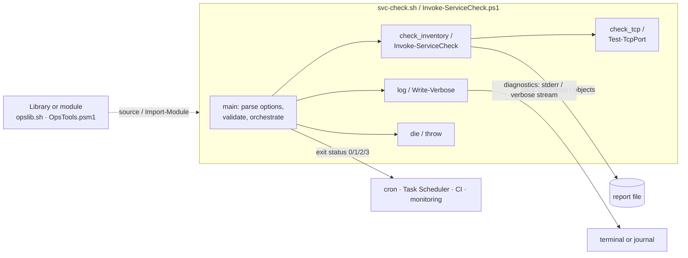

# Day 23: Functions and Reusable Scripts

!!! info "Lesson overview"
    | | |
    |---|---|
    | **Module** | 5 — Scripting & Automation |
    | **Difficulty** | :material-signal-cellular-2: Intermediate |
    | **Estimated time** | 3–4 hours (75 min reading, 90 min demonstrations, 60–90 min lab and quiz) |
    | **Platforms** | Ubuntu 24.04 LTS (Bash 5.2, coreutils 9.4, util-linux) · Windows 11 (Windows PowerShell 5.1 and PowerShell 7.4+) |
    | **Lab** | [Lab 23: Ops Toolkit](../../labs/lab-23.md) |

## Learning Objectives

By the end of this lesson you will be able to:

1. Explain **why** professional scripts are built from small functions, and what makes a function reusable (one job, inputs as parameters, data on standard output, a meaningful exit status).
2. Define and call **Bash functions**, pass arguments with `"$@"`, keep variables private with `local`, and explain Bash's **dynamic scoping**.
3. Separate the three channels of a Bash function: **data** on stdout, **diagnostics** on stderr and the **verdict** in the return status (0–255).
4. Parse options with **`getopts`** (including the silent-error mode, `OPTARG`, `OPTIND` and `shift`), and give every script a `usage` and a `die` helper and documented exit codes.
5. Clean up reliably with **`trap`** on `EXIT`, `ERR` and `INT`, combined with **`mktemp`**, and know the limits of `set -o errexit`.
6. Build a **sourced library** with a load guard and a `main` guard so that functions can be tested on their own.
7. Write PowerShell **advanced functions** with `[CmdletBinding()]`, validated `param()` blocks, pipeline input (`begin`/`process`/`end`), `[pscustomobject]` output, **comment-based help**, `-WhatIf`/`-Confirm` support and `-Verbose` messages.
8. Handle errors in PowerShell with **`try`/`catch`/`finally`**, `-ErrorAction Stop` and `throw`, and know the difference between terminating and non-terminating errors.
9. Package functions as a PowerShell **script module** (`.psm1` plus a `.psd1` manifest), import it and find it through `PSModulePath`.

## Prerequisites

- [Day 21](day-21.md) (variables, quoting, `param()` basics, `Set-StrictMode`) and [Day 22](day-22.md) (conditions, loops, exit-status truth) completed.
- [Day 05](../module-1/day-05.md) exit codes (`$?`, `$LASTEXITCODE`, `&&`/`||`) and [Day 03](../module-1/day-03.md) redirection (`>&2`, `2>/dev/null`).
- A text editor you are comfortable with (`nano`, `vim` or VS Code). Today you write files, not just one-liners.
- A normal (non-root, non-elevated) account. Nothing in this lesson needs administrator rights.

## Introduction and Concepts

### From one long script to small, testable pieces

Your Lab 21 and Lab 22 scripts already work, but each is one long block of code. That is fine for 30 lines and painful at 300. When the same "log a message", "check a port" or "validate a number" logic is copied into five scripts, a bug fix has to be made five times, and one copy is always forgotten.

A **function** is a named block of code that you define once and call many times. A **library** (Bash) or **module** (PowerShell) is a file of functions that many scripts share. Good functions have four properties:

| Property | What it means | Bash | PowerShell |
|---|---|---|---|
| **One job** | Does one thing and is named after it | `check_tcp`, `is_int_between` | `Test-TcpPort`, `Get-DiskReport` (Verb-Noun) |
| **Inputs are parameters** | No hidden dependence on global variables | `$1`, `$2`, `"$@"`, `local` | `param()` with types and validation |
| **Outputs are data** | Results can be captured, piped and tested | text lines on **stdout** | **objects** on the success stream |
| **Clear verdict** | Callers can tell success from failure | return status `0` = success | terminating error / `$?` / an `Open` property |



### Three output channels

The single most important design rule of the day: **keep data, diagnostics and the verdict apart.**

- **Data** is what the caller wants to capture: a percentage, a CSV row, an object. In Bash it goes to **standard output**; in PowerShell it is everything the function writes to the **success (output) stream**.
- **Diagnostics** are messages for a human: "checking web-01", "skipped malformed line 7". In Bash they go to **standard error** (`>&2`); in PowerShell to `Write-Verbose`, `Write-Warning`, `Write-Information` or `Write-Error`, which are separate streams (Day 03).
- **The verdict** says whether it worked. In Bash that is the **return status** (`return N`, or the status of the last command). In PowerShell it is usually an **error** (non-terminating or terminating) plus, for scripts, the **exit code** (`exit N`).

If a function prints "Checking..." on stdout, every caller that writes `x=$(func)` gets "Checking..." mixed into its data. If a script exits 0 after a failure, cron, Task Scheduler and CI all believe everything is fine. Both mistakes are extremely common in real environments.

### How the shells differ

| Topic | Bash | PowerShell |
|---|---|---|
| Definition | `name() { …; }` or `function name { …; }` | `function Verb-Noun { param(…) … }` |
| Arguments | Positional only: `$1`, `$2`, `"$@"`, `$#` | Named, typed, validated parameters; positional optional |
| Variable scope | **Global by default**; `local` makes a variable private; **dynamic** scoping | **Local by default**; a function sees its caller's variables read-only (copy-on-write) |
| Return value | Status 0–255 only; data is printed | Every uncaptured value is output; `return` just exits |
| Options | Parsed by hand or with `getopts` (short options) | Parameter binder does it for you (`-Name value`, switches, tab completion) |
| Help | Your own `usage()` function | Comment-based help → `Get-Help Verb-Noun -Full` |
| Errors | Exit status, `set -o errexit`, `trap ERR` | Error records, `try`/`catch`, `-ErrorAction`, `$ErrorActionPreference` |
| Sharing | `source lib.sh` | Dot-source `. .\lib.ps1` or (better) `Import-Module` |
| Dry run | You implement a `-n` option yourself | `SupportsShouldProcess` gives `-WhatIf`/`-Confirm` for free |

## Linux Command Reference

| Command / keyword | Purpose | Package / availability | Needs root? |
|---|---|---|---|
| `name() { …; }` · `function name { …; }` | Define a function | Bash keyword (POSIX `sh` has only `name()`) | No |
| `local` | Variable private to a function (and the functions it calls) | Bash built-in | No |
| `return [N]` | Leave a function with status N (0–255) | Bash built-in | No |
| `declare -f` / `declare -F` · `type` | Show function bodies / names; what a name is | Bash built-ins | No |
| `unset -f name` · `export -f name` | Delete a function / make it visible to child Bash processes | Bash built-ins | No |
| `FUNCNAME`, `BASH_SOURCE`, `BASH_LINENO`, `caller` | Call-stack information | Bash variables / built-in | No |
| `getopts` | Parse short command-line options | Bash built-in (POSIX) | No |
| `getopt` | Parse long options (`--timeout=5`) | util-linux (installed) — **not** the same as `getopts` | No |
| `source` / `.` | Run a file in the current shell (load a library) | Bash built-in | No |
| `trap` | Run code on exit, error or signal | Bash built-in | No |
| `mktemp` | Create a unique temporary file/directory safely | coreutils | No |
| `set -o errexit/nounset/pipefail/errtrace` | Fail-fast options | Bash built-in | No |
| `flock` | Allow only one running copy of a script (lock file) | util-linux | No |
| `shellcheck` | Static analysis for shell scripts | `sudo apt install shellcheck` | No (to install: yes) |

## PowerShell Command Reference

| Keyword / cmdlet | Aliases | Purpose | 5.1 | 7.x | Admin? |
|---|---|---|---|---|---|
| `function` · `param()` | — | Define a function and its parameters | Yes | Yes | No |
| `[CmdletBinding()]` | — | Make an **advanced function** (common parameters, `$PSCmdlet`) | Yes | Yes | No |
| `[Parameter()]`, `[ValidateSet()]`, `[ValidateRange()]`, `[ValidatePattern()]`, `[ValidateScript()]`, `[ValidateNotNullOrEmpty()]` | — | Parameter rules checked before your code runs | Yes | Yes | No |
| `begin` / `process` / `end` | — | Pipeline-aware function blocks | Yes | Yes | No |
| `[OutputType()]`, `[pscustomobject]@{}` | — | Declare and create structured output | Yes | Yes | No |
| `Write-Verbose`, `Write-Warning`, `Write-Error`, `Write-Information` | — | Diagnostics on separate streams | Yes | Yes | No |
| `try` / `catch` / `finally`, `throw`, `trap` | — | Error handling | Yes | Yes | No |
| `$PSCmdlet.ShouldProcess()` | — | Implement `-WhatIf` / `-Confirm` | Yes | Yes | No |
| `Get-Help` (comment-based help) | `help` | Help for your own functions | Yes | Yes | No |
| `Get-Command -CommandType Function`, `Get-Item Function:\Name` | `gcm` | Find and inspect functions | Yes | Yes | No |
| `Import-Module`, `Remove-Module`, `Get-Module` | `ipmo`, `rmo`, `gmo` | Load / unload / list modules | Yes | Yes | No |
| `Export-ModuleMember` | — | Choose what a `.psm1` exports | Yes | Yes | No |
| `New-ModuleManifest`, `Test-ModuleManifest` | — | Create / check a `.psd1` manifest | Yes | Yes | No |
| `Get-Verb` | — | List approved verbs | Yes | Yes | No |
| `$env:PSModulePath` | — | Folders searched for modules (auto-loading) | Yes | Yes (different folders) | No |

## Detailed Command Explanations

### Defining and calling a Bash function

A Bash function is defined with either form:

```bash
check_disk() {            # POSIX form - works in sh, dash and bash
    df -P -- "$1"
}

function check_disk {     # Bash/ksh form - not portable to /bin/sh
    df -P -- "$1"
}
```

Call it like any command: `check_disk /var`. The function must be **defined before it is called** (Bash reads the script from the top), which is why well-structured scripts define all functions first and call `main "$@"` on the last line.

Inside a function, `$1`, `$2`, `$#` and `"$@"` are the **function's** arguments; the script's own arguments are hidden while the function runs and come back afterwards. `$0` stays the script (or shell) name. `${FUNCNAME[0]}` is the current function's name, which is handy in log messages.

`type name` tells you whether a name is a function, `declare -f name` prints its body, `declare -F` lists all function names and `unset -f name` deletes one. Functions take priority over programs on `PATH`, so a function called `ls` or `test` silently replaces the real command — avoid such names.

### `local` and dynamic scope

Every variable you assign in a Bash function is **global** unless you declare it `local`. A helper that does `count=99` overwrites the caller's `count`. Always declare function variables `local`, including loop variables:

```bash
tidy() { local count=1 i; for i in 1 2 3; do :; done; }
```

Bash uses **dynamic scoping**: a `local` variable is visible to every function **called from** that function, not just inside its own body. This occasionally surprises people who know other languages. Demo 2 shows it. The practical rule: pass values as arguments; never rely on a helper "seeing" its caller's locals.

!!! warning "`local var=$(cmd)` hides the exit status"
    `local` is itself a command and it succeeds, so `local out=$(false)` leaves `$?` at 0. When you need the status, declare and assign separately: `local out; out=$(cmd) || return`. ShellCheck reports this as SC2155.

### Return status vs output

`return N` ends a function with status `N`. Only **0–255** exist: `return 300` gives 44 (300 mod 256). Without `return`, a function's status is the status of its **last command**. Use the status for yes/no answers (`if is_over "$pct" 90; then`) and **print** data:

```bash
disk_used_pct() { df -P -- "$1" | awk 'NR==2 { sub(/%/, "", $5); print $5 }'; }
pct=$(disk_used_pct /)          # capture the data
```

Diagnostics go to stderr so that `$( )` does not capture them: `printf '%s\n' "checking $1" >&2`.

Predicate functions (names that start with `is_`, `has_`, `can_`) should *only* return a status and print nothing, so they read naturally: `if has_cmd jq; then`.

### `getopts` — option parsing for scripts

`getopts OPTSTRING NAME` reads one option per call, so it is used in a `while` loop:

```bash
while getopts ':hH:t:v' opt; do
    case $opt in
        h)  usage; exit 0 ;;
        H)  host=$OPTARG ;;
        t)  timeout=$OPTARG ;;
        v)  verbose=1 ;;
        :)  die "option -$OPTARG needs a value" ;;
        \?) die "unknown option -$OPTARG" ;;
    esac
done
shift $((OPTIND - 1))           # what remains in "$@" are the operands
```

- Each letter in `OPTSTRING` is an option; a letter followed by `:` takes a value, which arrives in `OPTARG`. `-t 5` and `-t5` both work, and flags can be grouped: `-vH web-01`.
- A **leading `:`** switches on *silent* error reporting: `getopts` prints nothing itself and instead sets `opt` to `?` (unknown option, letter in `OPTARG`) or `:` (missing value, letter in `OPTARG`). This lets you print your own, consistent message. Without the leading colon, Bash prints `illegal option -- z` itself.
- `OPTIND` is the index of the next argument to process. After the loop, `shift $((OPTIND - 1))` removes the options. Parsing stops at the first non-option argument or at `--`.
- `getopts` keeps `OPTIND` between calls. If you parse options **inside a function** that is called more than once, declare `local OPTIND=1` (Demo 4).
- `getopts` handles **short options only**. For `--long-options`, util-linux provides the separate `getopt` program (no "s"); on Ubuntu it supports long options, but its usage is more complex and less portable. Short options with good help text are enough for most operations scripts.

### `usage`, `die` and exit codes

Every script that others will run needs three things:

1. A `usage` function that prints synopsis, options, defaults and **exit codes**, and runs for `-h`.
2. A `die` function that prints an error to stderr and exits non-zero.
3. A documented, consistent exit-code scheme. This course uses **0 = OK, 1 = usage or input error, 2 = environment or output problem, 3 = threshold breached / something is down** — the same scheme as every script in the [Script Library](../../projects/scripts.md).

Monitoring systems and schedulers act on exit codes, not on text. A script that exits 0 after writing "ERROR" to a file is, as far as automation is concerned, a success.

### `trap`, `mktemp` and cleanup

`trap 'commands' SIGNAL...` runs code when something happens:

| Trap | Fires when | Typical use |
|---|---|---|
| `EXIT` | The shell exits for **any** reason (normal end, `exit`, `errexit`, most signals) | Delete temp files, release locks |
| `ERR` | A command fails (same rules as `errexit`) | Log the failing line and command |
| `INT` | ++ctrl+c++ (SIGINT) | Tidy up and exit 130 |
| `TERM` | `kill PID`, `systemctl stop` | Graceful shutdown |
| `RETURN` | A function or sourced file returns | Rarely needed |

`SIGKILL` (`kill -9`) **cannot** be trapped, so a script killed that way never cleans up. `trap - EXIT` removes a trap; `trap -p` lists them.

`mktemp` creates a file (or with `-d` a directory) with a unique, unpredictable name and mode 0600/0700, which avoids races and symlink attacks on fixed names such as `/tmp/report.txt`. Combine the two:

```bash
workdir=$(mktemp -d "${TMPDIR:-/tmp}/report.XXXXXX")
trap 'rm -rf -- "$workdir"' EXIT
```

Write output to a temporary file and **move** it into place only when it is complete (`mv` within one filesystem is atomic). Readers then never see a half-written report.

The `ERR` trap is **not** inherited by functions, command substitutions or subshells unless you also `set -o errtrace` (`set -E`). Demo 5 shows the difference.

### `set -o errexit` and its traps

`set -o errexit` (`set -e`) exits the script when a command fails. It is useful, but it is **switched off** in many places: inside an `if`/`while` condition, on the left of `&&`/`||`, after `!`, and inside a function **called** from any of those places. The example under [Syntax and Parameters](#syntax-and-parameters) shows a function that keeps running after `false` because it was called from `if`. Treat `errexit` as a safety net, not as your error handling: check the commands that matter explicitly (`cmd || die "…"`). This course's library scripts use `set -o nounset -o pipefail` and explicit checks; lab helpers that must stop at the first problem also use `errexit`.

### Libraries: `source`, load guards and the main guard

`source file` (or `. file`) runs the file **in the current shell**, so its functions and variables become available. A library file:

- contains only function and constant definitions (no actions at load time),
- starts with a **load guard** so that sourcing it twice is harmless: `[[ -n ${_OPSLIB_LOADED:-} ]] && return 0; _OPSLIB_LOADED=1`,
- is found relative to the script, not to the current directory: `here=$(cd -- "$(dirname -- "${BASH_SOURCE[0]}")" && pwd)`,
- has a `# shellcheck shell=bash` directive so ShellCheck knows the dialect.

A script that ends with the **main guard**

```bash
if [[ ${BASH_SOURCE[0]} == "$0" ]]; then
    main "$@"
fi
```

runs `main` when executed but only *defines* functions when sourced. You can then `source script.sh` in a test and call each function on its own — the shell equivalent of unit testing (Lab 23, Task 5).

### Single-instance scripts with `flock`

Scheduled jobs (Day 25) sometimes overlap when one run is slow. util-linux `flock` prevents that:

```bash
exec 9>"${XDG_RUNTIME_DIR:-/tmp}/svc-check.lock"
flock -n 9 || die "another copy is already running"
```

The lock is released automatically when the script exits and file descriptor 9 closes.

### PowerShell functions and advanced functions

A basic PowerShell function:

```powershell
function Get-DiskUsedPercent {
    param([string]$Drive = 'C')
    $d = Get-PSDrive -Name $Drive -PSProvider FileSystem
    [math]::Round($d.Used / ($d.Used + $d.Free) * 100, 1)
}
```

Add `[CmdletBinding()]` (or any `[Parameter()]` attribute) and it becomes an **advanced function** that behaves like a compiled cmdlet:

- it gets the **common parameters**: `-Verbose`, `-Debug`, `-ErrorAction`, `-WarningAction`, `-InformationAction`, `-ErrorVariable`, `-WarningVariable`, `-InformationVariable`, `-OutVariable`, `-OutBuffer`, `-PipelineVariable` (and `-ProgressAction` in 7.4+);
- it **rejects unknown parameters** instead of silently collecting them in `$args`;
- it gets the automatic variable `$PSCmdlet` (for `ShouldProcess`, `ThrowTerminatingError` and parameter-set information).

Name functions **Verb-Noun** with an approved verb (`Get-Verb` lists them). `Import-Module` warns when a module exports unapproved verbs, and colleagues find `Get-`, `Test-`, `Set-`, `Remove-` functions by habit.

### Parameters: attributes and validation

```powershell
param(
    [Parameter(Mandatory, Position = 0, ValueFromPipelineByPropertyName)]
    [Alias('ComputerName')]
    [ValidateNotNullOrEmpty()]
    [string]$HostName,

    [Parameter(Mandatory, ValueFromPipelineByPropertyName)]
    [ValidateRange(1, 65535)]
    [int]$Port,

    [ValidateRange(100, 30000)]
    [int]$TimeoutMs = 2000,

    [switch]$Quiet
)
```

| Attribute / argument | Effect |
|---|---|
| `Mandatory` | Caller must supply it; at an interactive prompt PowerShell asks for it, in a non-interactive session (`-NonInteractive`) it fails |
| `Position = 0` | Can be given without the name |
| `ValueFromPipeline` | Binds the **whole** pipeline object |
| `ValueFromPipelineByPropertyName` | Binds the pipeline object's property with the same name (or alias) — perfect for `Import-Csv` input |
| `HelpMessage` | Text shown when a mandatory value is prompted for |
| `ParameterSetName` | Groups mutually exclusive parameters |
| `[ValidateSet('a','b')]` | Allowed values, with tab completion |
| `[ValidateRange(min,max)]` | Numeric range |
| `[ValidatePattern('regex')]` | Regex the string must match |
| `[ValidateScript({ … })]` | Any check; return `$true` or throw a helpful message |
| `[switch]` | On/off flag; test with `if ($Quiet)` |

Validation happens **before** your function body runs, so the body can assume clean input. Inside the function, `$PSBoundParameters` holds exactly what the caller passed, and `$PSBoundParameters.ContainsKey('TimeoutMs')` tells you whether a default is being used.

### Pipeline input: `begin`, `process`, `end`

A function that accepts pipeline input needs a `process` block, which runs **once per input object**:

```powershell
function Measure-Port {
    [CmdletBinding()]
    param([Parameter(ValueFromPipelineByPropertyName)][int]$Port)
    begin   { $count = 0 }                 # once, before the first object
    process { $count++; "port $Port" }     # once per object
    end     { "checked $count ports" }     # once, after the last object
}
```

Without explicit blocks, the whole body is an `end` block, so it runs **once** and the pipeline parameter only contains the **last** object — a classic bug.

### Output is everything you don't capture

In PowerShell, every value that is not assigned, redirected or discarded becomes output of the function. `return $x` is just "output `$x` and leave". This surprises Bash users in two ways:

1. Stray output pollutes the result. `$list.Add($item)` on an `ArrayList` outputs the new index; `New-Item` outputs the new item. Discard with `$null = …`, `[void](…)` or `| Out-Null`.
2. Multiple values become an **array**. If a function outputs a status message *and* an object, the caller gets both.

Return structured data, not formatted text: `[pscustomobject]@{ HostName = $h; Port = $p; Open = $true }`. Never end a function with `Format-Table` — formatting objects are only good for the screen. Let the caller format, sort, export to CSV or convert to JSON (Day 24).

### Comment-based help

A comment block with special keywords at the start of the function body (or directly above `function`) becomes real help:

```powershell
function Test-TcpPort {
    <#
    .SYNOPSIS
    Tests whether a TCP port accepts connections.
    .DESCRIPTION
    Opens a TCP connection with a timeout and reports Open = True/False. Read-only.
    .PARAMETER HostName
    Name or IP address to test.
    .EXAMPLE
    Test-TcpPort -HostName 127.0.0.1 -Port 22
    .EXAMPLE
    Import-Csv services.csv | Test-TcpPort
    #>
    [CmdletBinding()]
    param(...)
}
```

`Get-Help Test-TcpPort -Full`, `-Examples` and `-Parameter Port` then work exactly as for built-in cmdlets. This is the PowerShell equivalent of a Bash `usage()` function — and you get it almost for free.

### `-WhatIf` and `-Confirm` with `SupportsShouldProcess`

Any function that **changes** something (deletes files, stops services, edits configuration) should support a dry run:

```powershell
function Remove-StaleReport {
    [CmdletBinding(SupportsShouldProcess, ConfirmImpact = 'Medium')]
    param([Parameter(Mandatory)][string]$Path, [int]$OlderThanDays = 14)
    $cutoff = (Get-Date).AddDays(-$OlderThanDays)
    Get-ChildItem -Path $Path -Filter *.csv -File |
        Where-Object LastWriteTime -lt $cutoff |
        ForEach-Object {
            if ($PSCmdlet.ShouldProcess($_.FullName, 'Delete report')) {
                Remove-Item -LiteralPath $_.FullName
            }
        }
}
```

With `-WhatIf`, `ShouldProcess` prints `What if: Performing the operation "Delete report" on target "…".` and returns `$false`, so nothing is deleted. With `-Confirm` it asks. When `ConfirmImpact` is at or above `$ConfirmPreference` (default `High`), PowerShell asks automatically. Cmdlets called inside (`Remove-Item`) inherit `-WhatIf` through the preference variables.

### Errors: terminating, non-terminating, `try`/`catch`/`finally`

PowerShell has two kinds of errors:

- **Non-terminating** (most cmdlet errors, `Write-Error`): an error record is written to the error stream and `$Error`, and the command **continues** with the next item. `Get-Item a, missing, b` returns `a` and `b` plus one error.
- **Terminating** (`throw`, .NET exceptions, `-ErrorAction Stop`, parameter-binding failures): execution stops and jumps to the nearest `catch`.

`try`/`catch` only catches **terminating** errors. That is why `-ErrorAction Stop` (or `$ErrorActionPreference = 'Stop'` at the top of a script) is essential:

```powershell
try {
    $cfg = Get-Content -Path $Path -Raw -ErrorAction Stop | ConvertFrom-Json
}
catch [System.Management.Automation.ItemNotFoundException] {
    throw "Config file not found: $Path"
}
catch {
    throw "Cannot read config ${Path}: $($_.Exception.Message)"
}
finally {
    Write-Verbose 'config step finished'     # runs whether or not an error happened
}
```

Inside `catch`, `$_` is the `ErrorRecord`; `$_.Exception.Message` is the message, `$_.Exception.GetType().FullName` the type to catch specifically, `$_.InvocationInfo.PositionMessage` where it happened. `finally` is the equivalent of a Bash `EXIT` trap for one block: close files and connections there.

**Native programs** (`ping.exe`, `git`, `bash`) do not throw: check `$LASTEXITCODE`. In PowerShell 7.4+, setting `$PSNativeCommandUseErrorActionPreference = $true` makes a non-zero native exit code raise an error that obeys `$ErrorActionPreference`.

The older `trap { … }` statement also exists in PowerShell; `try`/`catch` is clearer and is what you should write.

### Script modules and manifests

A **script module** is a `.psm1` file of functions. Put it in a folder **with the same name**:

```text
OpsTools\
├── OpsTools.psd1     # manifest: version, author, what to export
└── OpsTools.psm1     # the functions
```

- `Export-ModuleMember -Function Test-TcpPort, Invoke-ServiceCheck` at the end of the `.psm1` exports only the public functions; helpers stay private. (Without it, all functions are exported.)
- `New-ModuleManifest -Path .\OpsTools\OpsTools.psd1 -RootModule OpsTools.psm1 -ModuleVersion 1.0.0 -FunctionsToExport Test-TcpPort, Invoke-ServiceCheck -Author 'Ops team'` creates the manifest. `FunctionsToExport` with explicit names (not `*`) lets PowerShell auto-load the module quickly.
- `Import-Module .\OpsTools -Force` loads it from a path (`-Force` reloads after edits); `Get-Command -Module OpsTools` lists what it exports; `Remove-Module OpsTools` unloads it.
- A module folder placed in one of the `$env:PSModulePath` directories is **auto-loaded** the first time you call one of its functions. Per-user folders: Windows PowerShell 5.1 `$HOME\Documents\WindowsPowerShell\Modules`; PowerShell 7 on Windows `$HOME\Documents\PowerShell\Modules`; PowerShell 7 on Linux `~/.local/share/powershell/Modules`.
- Script modules are scripts, so the **execution policy** (Day 19) applies to them on Windows.

Dot-sourcing (`. .\lib.ps1`) also loads functions, but into the caller's scope with no export control and no versioning. Use it for quick experiments; use modules for anything shared.

## Syntax and Parameters

### Bash

```text
name () compound-command [redirections]
function name [()] compound-command [redirections]
local [-r] [-a|-A] [-i] NAME[=VALUE]...
return [N]                      # N = 0..255 (taken modulo 256)
getopts OPTSTRING NAME [ARG...]
trap [-lp] [[ACTION] SIGNAL...] # ACTION '' ignores, - resets
mktemp [-d] [-p DIR] [TEMPLATE] # TEMPLATE ends in at least 3 X (use 6+)
source FILE [ARGS]  ·  . FILE [ARGS]
set -o errexit -o nounset -o pipefail -o errtrace
declare -f [NAME]  ·  declare -F  ·  unset -f NAME  ·  export -f NAME
flock [-n] [-w SECS] FD
```

| Item | Meaning |
|---|---|
| `$1`…`$9`, `${10}`, `$#`, `"$@"` | Function (or script) arguments |
| `${FUNCNAME[0]}` / `${FUNCNAME[1]}` | Current function / its caller |
| `${BASH_SOURCE[0]}` | File the current code was read from (works when sourced) |
| `OPTARG` / `OPTIND` | Value of the current option / index of the next argument |
| `getopts` `:` (leading) | Silent mode: `?` unknown option, `:` missing value, letter in `OPTARG` |
| `trap … EXIT` | Runs on every exit path except `SIGKILL` |
| `$BASH_COMMAND`, `$LINENO` | Command and line being run — useful in an `ERR` trap |
| `set -E` (`errtrace`) | `ERR` trap is inherited by functions and subshells |

A demonstration of the `errexit` exceptions and the `local` status trap (captured with Bash 5.2.21):

```bash
bash -c 'set -e; f() { false; echo "still running inside f"; }; if f; then echo "f returned 0"; fi; f; echo never'
echo "status $?"
bash -c 'g() { local out=$(false); echo "status after local: $?"; local o2; o2=$(false); echo "status after separate assignment: $?"; }; g'
```

**Expected output (captured):**

```text
still running inside f
f returned 0
status 1
status after local: 0
status after separate assignment: 1
```

Inside `if f`, `errexit` is ignored, so `false` does not stop `f` and `f` returns 0 (from `echo`). The second, unprotected call of `f` stops the script at `false`.

### PowerShell

```text
function [<scope:>]<Verb-Noun> {
    [CmdletBinding(SupportsShouldProcess, ConfirmImpact = 'Low|Medium|High', DefaultParameterSetName = '…')]
    [OutputType([type])]
    param(
        [Parameter(Mandatory, Position = n, ValueFromPipeline, ValueFromPipelineByPropertyName,
                   ParameterSetName = '…', HelpMessage = '…')]
        [Alias('…')] [Validate…()] [type]$Name = <default>
    )
    begin { } process { } end { }      # PowerShell 7.3+ also has clean { }
}
try { … } catch [ExceptionType] { … } catch { … } finally { … }
throw "message"  ·  Write-Error -Message "…" [-ErrorAction Stop]
Import-Module [-Name] <String[]> [-Force] [-Prefix <String>] [-PassThru]
Export-ModuleMember [-Function <String[]>] [-Variable <String[]>] [-Alias <String[]>]
New-ModuleManifest [-Path] <String> [-RootModule <String>] [-ModuleVersion <Version>] [-FunctionsToExport <String[]>]
```

| Parameter / item | Meaning |
|---|---|
| `SupportsShouldProcess` | Adds `-WhatIf` and `-Confirm`; call `$PSCmdlet.ShouldProcess(target, action)` |
| `ConfirmImpact` | How dangerous the action is; compared with `$ConfirmPreference` |
| `-ErrorAction Stop` | Turn this command's non-terminating errors into terminating ones |
| `$ErrorActionPreference = 'Stop'` | Same, for the whole scope |
| `$_` in `catch` | The `ErrorRecord`; `.Exception.Message`, `.FullyQualifiedErrorId` |
| `clean { }` | PowerShell **7.3+** only: always runs, even after Ctrl+C or an error (like a Bash `EXIT` trap) |
| `Import-Module -Force` | Reload a module after editing it |
| `Import-Module -Prefix X` | Rename imported nouns (`Test-XTcpPort`) to avoid clashes |

## Practical Demonstrations

The **Bash** outputs below were captured on 2026-11-18 by running the commands with Bash 5.2.21 on Ubuntu 24.04.5 in a container (temporary names and timestamps shown as captured or normalised where noted). The **PowerShell** outputs are **examples** written from the documented behaviour of Windows PowerShell 5.1 and PowerShell 7.4; PowerShell was not available on the release host. Work in a practice folder:

=== "Bash"

    ```bash
    mkdir -p ~/day23 && cd ~/day23
    ```

=== "PowerShell"

    ```powershell
    New-Item -Path $HOME\day23 -ItemType Directory -Force | Out-Null
    Set-Location $HOME\day23
    ```

### Demo 1 — Define, call and inspect a function

=== "Bash"

    ```bash
    cat > demo1.sh <<'EOF'
    #!/usr/bin/env bash
    greet() {
        printf 'Hello, %s (function %s, %d args)\n' "$1" "${FUNCNAME[0]}" "$#"
    }
    function show_args {
        local i=1
        for a in "$@"; do printf '  arg %d = [%s]\n' "$i" "$a"; i=$((i + 1)); done
    }
    greet student
    show_args web-01 "change window" 443
    type greet | head -1
    EOF
    bash demo1.sh
    ```

    **Expected output (captured):**

    ```text
    Hello, student (function greet, 1 args)
      arg 1 = [web-01]
      arg 2 = [change window]
      arg 3 = [443]
    greet is a function
    ```

    `"$@"` kept `change window` as **one** argument. `type greet` (without `head`) goes on to print the function body as Bash stores it; `declare -f greet` prints only the body.

=== "PowerShell"

    ```powershell
    function Show-Greeting {
        param([string]$Name = $env:USERNAME)
        "Hello, $Name (function $($MyInvocation.MyCommand.Name))"
    }
    function Show-Arguments {
        param([string[]]$Item)
        $i = 1
        foreach ($a in $Item) { '  arg {0} = [{1}]' -f $i, $a; $i++ }
    }
    Show-Greeting -Name student
    Show-Arguments -Item 'web-01', 'change window', '443'
    Get-Command Show-Greeting | Select-Object CommandType, Name
    (Get-Item Function:\Show-Greeting).Definition
    ```

    **Expected output (example):**

    ```text
    Hello, student (function Show-Greeting)
      arg 1 = [web-01]
      arg 2 = [change window]
      arg 3 = [443]

    CommandType Name
    ----------- ----
       Function Show-Greeting

        param([string]$Name = $env:USERNAME)
        "Hello, $Name (function $($MyInvocation.MyCommand.Name))"
    ```

    Functions live on the `Function:` drive. Arguments are **named**, so there is no `$1`; an array parameter carries a list.

### Demo 2 — Scope: `local`, leaks and dynamic scoping

=== "Bash"

    ```bash
    cat > demo2.sh <<'EOF'
    #!/usr/bin/env bash
    count=10
    leaky()  { count=99; tmp="left behind"; }
    tidy()   { local count=1; local tmp="stays inside"; echo "inside tidy: count=$count"; }
    tidy;  echo "after tidy:  count=$count tmp=${tmp:-<unset>}"
    leaky; echo "after leaky: count=$count tmp=${tmp:-<unset>}"
    EOF
    bash demo2.sh
    outer() { local level="set in outer"; inner; }
    inner() { echo "inner sees: ${level:-<nothing>}"; }
    outer; inner
    ```

    **Expected output (captured):**

    ```text
    inside tidy: count=1
    after tidy:  count=10 tmp=<unset>
    after leaky: count=99 tmp=left behind
    inner sees: set in outer
    inner sees: <nothing>
    ```

    `leaky` silently changed the caller's `count`. The last two lines show **dynamic scoping**: `inner` sees `outer`'s local only while it is called from `outer`.

=== "PowerShell"

    ```powershell
    $count = 10
    function Set-Leaky  { $count = 99; "inside: count=$count" }
    function Set-Global { $script:count = 99 }
    Set-Leaky;  "after Set-Leaky:  count=$count"
    Set-Global; "after Set-Global: count=$count"
    function Get-Outer { $level = 'set in outer'; Get-Inner }
    function Get-Inner { "inner sees: $(if ($level) { $level } else { '<nothing>' })" }
    Get-Outer; Get-Inner
    ```

    **Expected output (example):**

    ```text
    inside: count=99
    after Set-Leaky:  count=10
    after Set-Global: count=99
    inner sees: set in outer
    inner sees: <nothing>
    ```

    PowerShell is the **opposite** default: assignment inside a function creates a **local** copy, and you must write `$script:` or `$global:` to change an outer variable (Day 21). A child scope can still *read* its caller's variables — the same dynamic lookup as Bash. Under `Set-StrictMode -Version Latest`, `$level` in the last call would be an error instead of `$null`.

### Demo 3 — Data on stdout, verdict in the status

=== "Bash"

    ```bash
    cat > demo3.sh <<'EOF'
    #!/usr/bin/env bash
    # data goes to stdout, the verdict goes in the exit status, diagnostics to stderr
    disk_used_pct() {
        local mount=${1:?mount point required}
        df -P -- "$mount" 2>/dev/null | awk 'NR==2 { sub(/%/, "", $5); print $5 }'
    }
    is_over() {          # is_over VALUE LIMIT -> status 0 when VALUE >= LIMIT
        (( $1 >= $2 ))
    }
    pct=$(disk_used_pct /)
    echo "root filesystem: ${pct}% used"
    if is_over "$pct" 90; then echo "ALERT"; else echo "OK"; fi
    bad() { return 300; }
    bad; echo "return 300 gives status $?"
    nothing() { false; }
    nothing; echo "no return statement: status $? (last command)"
    EOF
    bash demo3.sh
    ```

    **Expected output (captured):**

    ```text
    root filesystem: 23% used
    OK
    return 300 gives status 44
    no return statement: status 1 (last command)
    ```

    And the mistake this design avoids — a "debug" line printed on stdout ends up inside the captured value:

    ```bash
    get() { echo "result"; echo "debug: noisy"; }
    v=$(get); printf '[%s]\n' "$v"
    ```

    **Expected output (captured):**

    ```text
    [result
    debug: noisy]
    ```

=== "PowerShell"

    ```powershell
    function Get-DiskUsedPercent {
        [CmdletBinding()]
        [OutputType([double])]
        param([ValidatePattern('^[A-Za-z]$')][string]$Drive = 'C')
        Write-Verbose "reading drive $Drive"
        $d = Get-PSDrive -Name $Drive -PSProvider FileSystem -ErrorAction Stop
        [math]::Round($d.Used / ($d.Used + $d.Free) * 100, 1)
    }
    $pct = Get-DiskUsedPercent -Verbose
    "C: is $pct% used"
    if ($pct -ge 90) { 'ALERT' } else { 'OK' }

    function Get-Noisy { 'checking...'; 42 }
    $v = Get-Noisy
    $v.GetType().Name; $v
    ```

    **Expected output (example):**

    ```text
    VERBOSE: reading drive C
    C: is 61.4% used
    OK
    Object[]
    checking...
    42
    ```

    `Write-Verbose` went to the verbose stream and was **not** captured into `$pct`. `Get-Noisy` shows the PowerShell version of the polluted-output bug: the caller got a two-element array instead of `42`.

### Demo 4 — A real command-line tool with `getopts`

=== "Bash"

    ```bash
    cat > portcheck.sh <<'EOF'
    #!/usr/bin/env bash
    # portcheck.sh - check TCP ports on one host (getopts demo)
    set -o nounset -o pipefail

    usage() {
        cat <<USAGE
    Usage: ${0##*/} [-h] [-t SECONDS] [-v] -H HOST PORT...
      -H HOST     host to check (required)
      -t SECONDS  connect timeout, 1-30 (default 2)
      -v          verbose
      -h          show this help
    Exit codes: 0 all open, 1 usage error, 3 at least one port closed
    USAGE
    }
    die() { printf '%s: %s\n' "${0##*/}" "$*" >&2; exit 1; }
    is_int_between() { [[ $1 =~ ^[0-9]+$ ]] && (( 10#$1 >= $2 && 10#$1 <= $3 )); }

    host="" timeout=2 verbose=0
    while getopts ':hH:t:v' opt; do
        case $opt in
            h) usage; exit 0 ;;
            H) host=$OPTARG ;;
            t) timeout=$OPTARG ;;
            v) verbose=1 ;;
            :) die "option -$OPTARG needs a value (try -h)" ;;
            \?) die "unknown option -$OPTARG (try -h)" ;;
        esac
    done
    shift $((OPTIND - 1))

    [[ -n $host ]]                   || die "-H HOST is required"
    is_int_between "$timeout" 1 30   || die "-t must be 1-30"
    (( $# > 0 ))                     || die "at least one PORT is required"

    closed=0
    for port in "$@"; do
        is_int_between "$port" 1 65535 || die "bad port: $port"
        (( verbose )) && printf 'checking %s:%s (timeout %ss)\n' "$host" "$port" "$timeout" >&2
        # shellcheck disable=SC2016  # $1/$2 belong to the inner bash
        if timeout "$timeout" bash -c 'exec 3<>"/dev/tcp/$1/$2"' _ "$host" "$port" 2>/dev/null; then
            printf '%-15s %5s open\n' "$host" "$port"
        else
            printf '%-15s %5s closed\n' "$host" "$port"
            closed=$((closed + 1))
        fi
    done
    (( closed == 0 )) || exit 3
    EOF
    chmod +x portcheck.sh
    python3 -m http.server 8023 --bind 127.0.0.1 >/dev/null 2>&1 &   # a local test listener
    sleep 1                                                            # give it a moment to bind
    ./portcheck.sh -H 127.0.0.1 -v 8023 8024; echo "status $?"
    ./portcheck.sh -H 127.0.0.1 -t; echo "status $?"
    ./portcheck.sh -x; echo "status $?"
    ./portcheck.sh -H 127.0.0.1 -t 99 22; echo "status $?"
    ./portcheck.sh -H 127.0.0.1 -t3 -- 8023; echo "status $?"
    kill %1
    ```

    **Expected output (captured):**

    ```text
    checking 127.0.0.1:8023 (timeout 2s)
    127.0.0.1        8023 open
    checking 127.0.0.1:8024 (timeout 2s)
    127.0.0.1        8024 closed
    status 3
    portcheck.sh: option -t needs a value (try -h)
    status 1
    portcheck.sh: unknown option -x (try -h)
    status 1
    portcheck.sh: -t must be 1-30
    status 1
    127.0.0.1        8023 open
    status 0
    ```

    `-t3` (value attached) and `--` (end of options) both work. Why `local OPTIND=1` matters when `getopts` runs inside a function called twice:

    ```bash
    parse() { while getopts "n:" opt; do echo "got -$opt $OPTARG"; done; }
    parse -n one; parse -n two; echo "(second call printed nothing)"
    parse() { local opt OPTIND=1; while getopts "n:" opt; do echo "got -$opt $OPTARG"; done; }
    parse -n one; parse -n two
    ```

    **Expected output (captured):**

    ```text
    got -n one
    (second call printed nothing)
    got -n one
    got -n two
    ```

=== "PowerShell"

    ```powershell
    function Test-TcpPort {
        <#
        .SYNOPSIS
        Tests whether TCP ports accept connections (read-only).
        .EXAMPLE
        Test-TcpPort -HostName 127.0.0.1 -Port 8023, 8024 -Verbose
        #>
        [CmdletBinding()]
        [OutputType([pscustomobject])]
        param(
            [Parameter(Mandatory, ValueFromPipelineByPropertyName)]
            [Alias('ComputerName')][ValidateNotNullOrEmpty()][string]$HostName,
            [Parameter(Mandatory, ValueFromPipelineByPropertyName)]
            [ValidateRange(1, 65535)][int[]]$Port,
            [ValidateRange(1, 30)][int]$TimeoutSec = 2
        )
        process {
            foreach ($p in $Port) {
                Write-Verbose "checking ${HostName}:$p (timeout ${TimeoutSec}s)"
                $client = New-Object System.Net.Sockets.TcpClient
                try   { $open = $client.ConnectAsync($HostName, $p).Wait($TimeoutSec * 1000) }
                catch { $open = $false }
                finally { $client.Close() }
                [pscustomobject]@{ HostName = $HostName; Port = $p; Open = $open }
            }
        }
    }
    Test-TcpPort -HostName 127.0.0.1 -Port 8023, 8024 -Verbose
    Test-TcpPort -HostName 127.0.0.1 -Port 99999
    Test-TcpPort -HostName 127.0.0.1 -Port 22 -Timeout 5 -Colour red
    ```

    **Expected output (example, PowerShell 7.4, listener on 8023):**

    ```text
    VERBOSE: checking 127.0.0.1:8023 (timeout 2s)
    VERBOSE: checking 127.0.0.1:8024 (timeout 2s)

    HostName  Port  Open
    --------  ----  ----
    127.0.0.1 8023  True
    127.0.0.1 8024 False

    Test-TcpPort: Cannot validate argument on parameter 'Port'. The 99999 argument is greater than the maximum allowed range of 65535. Supply an argument that is less than or equal to 65535 and then try the command again.
    Test-TcpPort: A parameter cannot be found that matches parameter name 'Colour'.
    ```

    The parameter binder did all the option parsing, validation and error messages that took 25 lines of `getopts` code. `-Timeout` worked as an unambiguous **prefix** of `-TimeoutSec`. `ConnectAsync`/`Wait` is the pattern executed in [Lab 12](../../labs/lab-12.md); a refused connection throws inside `Wait`, which the `catch` turns into `Open = False`.

### Demo 5 — Cleanup with `trap` and `mktemp`

=== "Bash"

    ```bash
    cat > cleanup-demo.sh <<'EOF'
    #!/usr/bin/env bash
    set -o errexit -o nounset -o pipefail
    workdir=$(mktemp -d "${TMPDIR:-/tmp}/report.XXXXXX")
    cleanup() {
        local status=$?
        rm -rf -- "${workdir:?}"
        printf 'cleanup: removed %s (exit status %d)\n' "$workdir" "$status" >&2
    }
    trap cleanup EXIT
    trap 'printf "error: line %d: %s (status %d)\n" "$LINENO" "$BASH_COMMAND" "$?" >&2' ERR

    printf 'working in %s\n' "$workdir"
    echo "partial data" > "$workdir/part1.txt"
    ls "$workdir"
    if [[ ${1:-} == fail ]]; then
        grep -q needle "$workdir/part1.txt"     # fails -> ERR trap, then errexit -> EXIT trap
    fi
    echo "finished normally"
    EOF
    bash cleanup-demo.sh;      echo "status $?"
    bash cleanup-demo.sh fail; echo "status $?"
    ls -d /tmp/report.* 2>/dev/null | wc -l
    ```

    **Expected output (captured; the random `XXXXXX` part differs on every run):**

    ```text
    working in /tmp/report.Xa81Qm
    part1.txt
    finished normally
    cleanup: removed /tmp/report.Xa81Qm (exit status 0)
    status 0
    working in /tmp/report.Xa81Qm
    part1.txt
    error: line 16: grep -q needle "$workdir/part1.txt" (status 1)
    cleanup: removed /tmp/report.Xa81Qm (exit status 1)
    status 1
    0
    ```

    Both runs removed the temporary directory, and the failing run reported the exact line and command. The `ERR` trap is not inherited by functions unless `set -E` is on:

    ```bash
    bash -c 'trap "echo ERR trap fired" ERR; f() { false; echo "f continues"; }; f'
    bash -c 'set -E; trap "echo ERR trap fired in \${FUNCNAME[0]:-main}" ERR; f() { false; echo "f continues"; }; f'
    bash -c 'trap "echo caught INT, tidying up; exit 130" INT; echo started; kill -INT $$; echo not reached'; echo "status $?"
    ```

    **Expected output (captured):**

    ```text
    f continues
    ERR trap fired in f
    f continues
    started
    caught INT, tidying up
    status 130
    ```

=== "PowerShell"

    ```powershell
    function Invoke-ReportBuild {
        [CmdletBinding()]
        param([switch]$Fail)
        $work = Join-Path ([System.IO.Path]::GetTempPath()) ("report.{0}" -f [guid]::NewGuid().ToString('N').Substring(0, 6))
        New-Item -Path $work -ItemType Directory | Out-Null
        try {
            "working in $work"
            Set-Content -Path (Join-Path $work 'part1.txt') -Value 'partial data'
            if ($Fail) { Get-Content -Path (Join-Path $work 'missing.txt') -ErrorAction Stop }
            'finished normally'
        }
        catch {
            Write-Warning "error: $($_.Exception.Message)"
            throw
        }
        finally {
            Remove-Item -LiteralPath $work -Recurse -Force
            Write-Verbose "cleanup: removed $work" -Verbose
        }
    }
    Invoke-ReportBuild
    try { Invoke-ReportBuild -Fail } catch { "caller saw: $($_.FullyQualifiedErrorId)" }
    ```

    **Expected output (example, Windows):**

    ```text
    working in C:\Users\student\AppData\Local\Temp\report.3f9a1c
    finished normally
    VERBOSE: cleanup: removed C:\Users\student\AppData\Local\Temp\report.3f9a1c
    working in C:\Users\student\AppData\Local\Temp\report.b07e44
    WARNING: error: Cannot find path 'C:\Users\student\AppData\Local\Temp\report.b07e44\missing.txt' because it does not exist.
    VERBOSE: cleanup: removed C:\Users\student\AppData\Local\Temp\report.b07e44
    caller saw: PathNotFound,Microsoft.PowerShell.Commands.GetContentCommand
    ```

    `finally` ran on both paths. A bare `throw` inside `catch` re-throws the original error so the caller can still handle it. PowerShell 7.3+ also offers a `clean {}` block on advanced functions, which runs even when the user presses ++ctrl+c++.

### Demo 6 — A shared library with load and main guards

=== "Bash"

    ```bash
    mkdir -p lib bin
    cat > lib/opslib.sh <<'EOF'
    # shellcheck shell=bash
    # opslib.sh - shared helpers. Source it; do not execute it.
    [[ -n ${_OPSLIB_LOADED:-} ]] && return 0
    _OPSLIB_LOADED=1

    log()  { printf '%s [%s] %s\n' "$(date -u +%Y-%m-%dT%H:%M:%SZ)" "${1^^}" "${*:2}" >&2; }
    die()  { log error "$*"; exit 1; }
    require_cmd() {
        local c missing=0
        for c in "$@"; do
            command -v -- "$c" >/dev/null 2>&1 || { log error "missing command: $c"; missing=1; }
        done
        return "$missing"
    }
    is_int_between() { [[ $1 =~ ^[0-9]+$ ]] && (( 10#$1 >= $2 && 10#$1 <= $3 )); }
    EOF
    cat > bin/disk-alert.sh <<'EOF'
    #!/usr/bin/env bash
    set -o nounset -o pipefail
    here=$(cd -- "$(dirname -- "${BASH_SOURCE[0]}")" && pwd)
    # shellcheck source=../lib/opslib.sh
    source "$here/../lib/opslib.sh"
    source "$here/../lib/opslib.sh"     # second load is a no-op thanks to the guard

    main() {
        local limit=${1:-90}
        is_int_between "$limit" 1 100 || die "limit must be 1-100, got '$limit'"
        require_cmd df awk || exit 2
        local pct
        pct=$(df -P / | awk 'NR==2 { sub(/%/, "", $5); print $5 }')
        if (( pct >= limit )); then log warn "/ is ${pct}% used (limit ${limit}%)"; return 3; fi
        log info "/ is ${pct}% used (limit ${limit}%)"
    }
    if [[ ${BASH_SOURCE[0]} == "$0" ]]; then
        main "$@"
    fi
    EOF
    chmod +x bin/disk-alert.sh
    cd / && ~/day23/bin/disk-alert.sh 80; echo "status $?"
    ~/day23/bin/disk-alert.sh 20; echo "status $?"
    ~/day23/bin/disk-alert.sh abc; echo "status $?"
    cd ~/day23 && bash -c 'source bin/disk-alert.sh; type -t main; declare -F'
    ```

    **Expected output (captured):**

    ```text
    2026-11-18T16:40:35Z [INFO] / is 23% used (limit 80%)
    status 0
    2026-11-18T16:40:35Z [WARN] / is 23% used (limit 20%)
    status 3
    2026-11-18T16:40:35Z [ERROR] limit must be 1-100, got 'abc'
    status 1
    function
    declare -f die
    declare -f is_int_between
    declare -f log
    declare -f main
    declare -f require_cmd
    ```

    The script found its library from `/` because the path is computed from `BASH_SOURCE`, not from the current directory. When **sourced**, it only defined functions and did not run `main`.

=== "PowerShell"

    ```powershell
    New-Item -Path .\OpsTools -ItemType Directory -Force | Out-Null
    @'
    function Write-OpsLog {
        param([ValidateSet('INFO', 'WARN', 'ERROR')][string]$Level = 'INFO', [string]$Message)
        $line = '{0} [{1}] {2}' -f (Get-Date).ToUniversalTime().ToString('yyyy-MM-ddTHH:mm:ssZ'), $Level, $Message
        Write-Information -MessageData $line -InformationAction Continue
    }
    function Get-DiskUsedPercent {
        [CmdletBinding()]
        param([string]$Drive = 'C')
        $d = Get-PSDrive -Name $Drive -PSProvider FileSystem -ErrorAction Stop
        [math]::Round($d.Used / ($d.Used + $d.Free) * 100, 1)
    }
    function Test-DiskThreshold {
        [CmdletBinding()]
        param([ValidateRange(1, 100)][int]$Limit = 90, [string]$Drive = 'C')
        $pct = Get-DiskUsedPercent -Drive $Drive
        $level = if ($pct -ge $Limit) { 'WARN' } else { 'INFO' }
        Write-OpsLog -Level $level -Message "${Drive}: is $pct% used (limit $Limit%)"
        [pscustomobject]@{ Drive = $Drive; UsedPercent = $pct; Limit = $Limit; Breached = $pct -ge $Limit }
    }
    Export-ModuleMember -Function Get-DiskUsedPercent, Test-DiskThreshold
    '@ | Set-Content -Path .\OpsTools\OpsTools.psm1 -Encoding UTF8
    New-ModuleManifest -Path .\OpsTools\OpsTools.psd1 -RootModule OpsTools.psm1 -ModuleVersion 1.0.0 `
        -FunctionsToExport Get-DiskUsedPercent, Test-DiskThreshold -Description 'Lab helpers'
    Import-Module .\OpsTools -Force
    Get-Command -Module OpsTools
    Test-DiskThreshold -Limit 20
    Get-Command Write-OpsLog -ErrorAction SilentlyContinue   # private: not exported
    ```

    **Expected output (example):**

    ```text
    CommandType     Name                      Version    Source
    -----------     ----                      -------    ------
    Function        Get-DiskUsedPercent       1.0.0      OpsTools
    Function        Test-DiskThreshold        1.0.0      OpsTools
    2026-11-18T16:40:35Z [WARN] C: is 61.4% used (limit 20%)

    Drive UsedPercent Limit Breached
    ----- ----------- ----- --------
    C            61.4    20     True
    ```

    `Write-OpsLog` is used inside the module but not exported, so the last command returns nothing. `Write-Information … -InformationAction Continue` shows the log line without polluting the output object.

### Demo 7 — Help and a safe dry run

=== "Bash"

    ```bash
    cd ~/day23 && ./portcheck.sh -h; echo "status $?"
    ```

    **Expected output (captured):**

    ```text
    Usage: portcheck.sh [-h] [-t SECONDS] [-v] -H HOST PORT...
      -H HOST     host to check (required)
      -t SECONDS  connect timeout, 1-30 (default 2)
      -v          verbose
      -h          show this help
    Exit codes: 0 all open, 1 usage error, 3 at least one port closed
    status 0
    ```

    Bash has no built-in dry-run mechanism: a script that deletes or changes things should offer `-n` (print what would be done) and default to it where practical, as the Day 25 clean-up job will.

=== "PowerShell"

    ```powershell
    function Remove-StaleReport {
        <#
        .SYNOPSIS
        Deletes report files older than a number of days.
        .PARAMETER OlderThanDays
        Age in days (1-365). Default 14.
        .EXAMPLE
        Remove-StaleReport -Path .\reports -OlderThanDays 30 -WhatIf
        #>
        [CmdletBinding(SupportsShouldProcess, ConfirmImpact = 'Medium')]
        param(
            [Parameter(Mandatory)][ValidateScript({ Test-Path -Path $_ -PathType Container })][string]$Path,
            [ValidateRange(1, 365)][int]$OlderThanDays = 14
        )
        $cutoff = (Get-Date).AddDays(-$OlderThanDays)
        Get-ChildItem -Path $Path -Filter *.csv -File | Where-Object LastWriteTime -lt $cutoff |
            ForEach-Object {
                if ($PSCmdlet.ShouldProcess($_.FullName, 'Delete report')) { Remove-Item -LiteralPath $_.FullName }
            }
    }
    New-Item -Path .\reports -ItemType Directory -Force | Out-Null
    $old = New-Item -Path .\reports\old.csv -ItemType File -Force
    $old.LastWriteTime = (Get-Date).AddDays(-40)
    Get-Help Remove-StaleReport -Parameter OlderThanDays
    Remove-StaleReport -Path .\reports -OlderThanDays 30 -WhatIf
    Test-Path .\reports\old.csv
    ```

    **Expected output (example):**

    ```text
    -OlderThanDays <Int32>
        Age in days (1-365). Default 14.

        Required?                    false
        Position?                    1
        Default value                14
        Accept pipeline input?       false
        Accept wildcard characters?  false

    What if: Performing the operation "Delete report" on target "C:\Users\student\day23\reports\old.csv".
    True
    ```

    The file still exists: `-WhatIf` only reported. Remove `-WhatIf` (or add `-Confirm`) to act.

## Linux vs PowerShell Comparison

| Task | Bash | PowerShell | Notes |
|---|---|---|---|
| Define | `f() { …; }` | `function Verb-Noun { param() … }` | Verb-Noun with approved verbs |
| Arguments | `$1`, `"$@"`, `$#` | Named parameters, `$PSBoundParameters` | ⚠ PS: no `$1` |
| Private variables | `local x` (must ask) | default (must ask for `$script:`) | ⚠ opposite defaults |
| Return data | print on stdout, capture with `$( )` | output objects, capture with `$x = …` | |
| Success / failure | `return 0..255` | errors (`Write-Error`, `throw`), `$?` | `return` in PS is just "leave" |
| Diagnostics | `>&2` | `Write-Verbose` / `Write-Warning` / `Write-Information` | |
| Option parsing | `getopts ':ht:' opt` | parameter binder, `[Parameter()]` | PS also completes names |
| Validation | your own `is_int_between`, `[[ =~ ]]` | `[ValidateRange()]`, `[ValidatePattern()]`, `[ValidateSet()]` | |
| Help | `usage()` for `-h` | comment-based help, `Get-Help -Full` | |
| Dry run | your own `-n` option | `SupportsShouldProcess` → `-WhatIf`/`-Confirm` | |
| Cleanup | `trap cleanup EXIT` | `try { } finally { }` · `clean { }` (7.3+) | |
| Fail fast | `set -o errexit` (with exceptions) | `$ErrorActionPreference = 'Stop'` | |
| Catch errors | `if ! cmd; then …; fi` · <code>cmd &#124;&#124; die "…"</code> | `try { } catch [Type] { }` | |
| Temp files | `mktemp`, `mktemp -d` | `[System.IO.Path]::GetTempFileName()`, `New-TemporaryFile` | |
| Share code | `source lib.sh` + load guard | `Import-Module .\Mod` (`.psm1` + `.psd1`) | |
| Testable script | `[[ ${BASH_SOURCE[0]} == "$0" ]] && main "$@"` | module functions; `if ($MyInvocation.InvocationName -ne '.') { … }` | Pester is the PS test framework |
| Pipeline input | `while read -r line; do …; done` | `process { }` + `ValueFromPipeline*` | |
| List functions | `declare -F` | `Get-ChildItem Function:` · `Get-Command -CommandType Function` | |

## Real-World IT Scenarios

1. **One fix, every script.** A team keeps a 200-line `opslib.sh` (logging, locking, `require_cmd`, Slack/e-mail notification) in a Git repository deployed to `/usr/local/lib/ops/`. When the notification API changed, one commit fixed forty scripts. The same team's Windows side ships an internal `OpsTools` PowerShell module to an internal repository and installs it with `Install-PSResource`.
2. **The cron job that "always succeeded".** A backup script printed `ERROR: rsync failed` and exited 0, so the scheduler and the monitoring system showed green for six weeks. The fix was a `die` function with `exit 2` and a `trap` that reports the failing line to the journal — and a rule that every script documents its exit codes.
3. **Overlapping runs.** A five-minute log-shipping job sometimes took seven minutes; two copies then processed the same file twice. `flock -n` at the top of the script made the second copy exit immediately with a clear message.
4. **Help-desk tooling.** Service-desk staff run `Reset-LabUserPassword -UserName j.doe -WhatIf` first. Because the function uses `SupportsShouldProcess`, `ValidatePattern` for user names and comment-based help, junior staff use it safely without reading the code.
5. **Change automation.** A pre-change script exposes `-H HOST` and `-n` (dry run) via `getopts`; the change ticket records the dry-run output before the real run, giving approvers evidence of exactly what will happen.

## Cybersecurity Application

- **Predictable temp files are a vulnerability.** A root script that writes `/tmp/report.txt` can be tricked into overwriting `/etc/shadow` if an attacker pre-creates `/tmp/report.txt` as a symlink. `mktemp` (unique name, mode 0600, `O_EXCL` creation) closes that hole. On Windows, use the per-user temp folder (`[System.IO.Path]::GetTempPath()`), not a shared folder.
- **Libraries are code that runs with your privileges.** `source lib.sh` and `Import-Module` execute the file. Keep shared libraries in root-owned, not world-writable locations (`/usr/local/lib/ops`, mode 0644, directories 0755) and the PowerShell module folder writable only by administrators; Day 19's world-writable-file audit catches violations. A writable library used by a root cron job is a classic privilege-escalation path.
- **Function shadowing.** A function named like a system command (`sudo`, `ls`, `cd`) runs instead of the real one. Attackers who can write to a victim's `~/.bashrc` define `sudo() { … }` to capture passwords. During investigations, `declare -F` and `type sudo` reveal it; in PowerShell, `Get-Command sudo -All` and `Get-ChildItem Function:` show shadowing functions and aliases.
- **`export -f` and inherited functions.** Exported Bash functions travel to child Bash processes in the environment (this mechanism was at the heart of the 2014 Shellshock vulnerability). Do not export functions in scripts that call other programs with elevated rights.
- **Responder toolkits are modules.** Incident responders package their triage functions (collect processes, connections, autoruns, hashes) as a signed module with `-WhatIf` support and structured output, so evidence is consistent and can be exported to CSV/JSON (Day 24) for the case file.
- **Error output is evidence too.** A `trap … ERR` that logs `$BASH_COMMAND` and `$LINENO` to the journal (`logger -t svc-check`) leaves an audit trail when a security script fails silently at 03:00.

## Network Analyst Application

- **A reusable port checker** (`check_tcp` / `Test-TcpPort`) replaces dozens of ad-hoc `nc -zv` one-liners. Because it returns a status (Bash) or an object with `Open = True/False` (PowerShell), it plugs straight into loops over device inventories (Day 22) and CSV reports (Day 24).
- **Timeouts as parameters.** WAN links and VPN tunnels need longer timeouts than a LAN. A validated `-t`/`-TimeoutSec` parameter with a sensible default and a range check stops a typo (`-t 300`) from hanging a script for five minutes per host.
- **Pipeline-friendly tools.** `Import-Csv switches.csv | Test-TcpPort` works because the function binds `HostName` and `Port` **by property name**. The Bash equivalent reads `name host port` lines with `while read`.
- **Consistent logging** with timestamps in UTC lets you correlate a script's "port 443 closed at 10:02:11Z" with firewall logs (Day 18) and packet captures (Day 15).

## System Administrator Application

- **Standard script skeleton.** Start every new script from a template: shebang, header comment, `set -o nounset -o pipefail`, `usage`, `die`, `getopts`, validation, `trap` cleanup, `main "$@"` with a main guard. For PowerShell: comment-based help, `[CmdletBinding()]`, validated `param()`, `Set-StrictMode -Version Latest`, `try`/`catch`, documented exit codes. The course scripts in `scripts/linux` and `scripts/powershell` follow exactly this pattern — read one now.
- **Idempotent, safe changes.** Functions that change state check first and change only when needed (`ensure_dir`, `Set-ServiceStartup` with `ShouldProcess`), so they can be re-run safely after a partial failure.
- **Profiles.** Personal helper functions belong in `~/.bashrc` (interactive only) or your PowerShell `$PROFILE`, never in system-wide files. Shared functions belong in a library or module under version control.
- **Static analysis in CI.** This course's pipeline runs ShellCheck and PSScriptAnalyzer on every script. Run them before you commit: `shellcheck -x script.sh` and `Invoke-ScriptAnalyzer -Path .\script.ps1`.

## Common Mistakes

| Mistake | What happens | Correct approach |
|---|---|---|
| Forgetting `local` | Helper overwrites the caller's variables (`i`, `count`, `file`) | Declare every function variable `local` |
| `local out=$(cmd)` then testing `$?` | Status is always 0 (status of `local`) | <code>local out; out=$(cmd) &#124;&#124; return</code> |
| Printing progress messages on stdout | Captured data contains "Checking…" | Diagnostics to stderr (`>&2`) / `Write-Verbose` |
| `return "$value"` to pass data | Only 0–255; `return 300` → 44; strings fail | Print data; use the status only for success/failure |
| Calling a function before defining it | `command not found` | Define functions first; call `main "$@"` at the end |
| `getopts` inside a function called twice | Second call parses nothing | `local OPTIND=1` |
| `getopts` optstring without leading `:` but with custom messages | Two error messages (Bash's and yours) | Use `':ht:'` and handle `?` and `:` |
| Relying on `set -e` inside functions called from `if` | Failures are ignored silently | Explicit checks: <code>cmd &#124;&#124; die "…"</code> |
| Fixed temp names (`/tmp/out.txt`) | Clashes between runs; symlink attacks | `mktemp` + `trap … EXIT` |
| Sourcing a library by relative path | Works only from one directory | Compute the path from `${BASH_SOURCE[0]}` |
| PowerShell function with pipeline parameter but no `process` block | Only the last pipeline object is processed | Add `process { }` |
| Ending a function with `Format-Table` | Caller gets formatting objects; CSV export is garbage | Output objects; format at the very end |
| `try { Get-Item missing } catch { }` | `catch` never runs (non-terminating error) | `-ErrorAction Stop` |
| `exit` inside a PowerShell function used interactively | Closes the whole console session | `return` / `throw` in functions; `exit N` only at script level |
| Unapproved verbs (`Check-Port`, `Do-Backup`) | `Import-Module` warning; hard to discover | `Test-Port`, `Invoke-Backup` (see `Get-Verb`) |
| Editing a module and not seeing the change | Old version still loaded | `Import-Module .\Mod -Force` (or a new session) |

## Troubleshooting Guide

| Symptom / error | Likely cause | Fix |
|---|---|---|
| `bash: myfunc: command not found` | Function defined later in the file, in another shell, or in a subshell | Define before use; `source` the library; `declare -F` to check |
| `local: can only be used in a function` | `local` at script level | Use a plain assignment at top level |
| `syntax error near unexpected token '}'` | Missing `;` or newline before `}` in a one-line function | `f() { cmd; }` — note the space after `{` and the `;` |
| Script prints `illegal option -- x` plus your own message | Optstring lacks the leading `:` | `getopts ':…'` |
| Option values seem to be ignored | Forgot `shift $((OPTIND - 1))` or used `$1` before the loop | Parse options first, then shift, then read operands |
| Temp directories pile up in `/tmp` | No `EXIT` trap, or script killed with `kill -9` | `trap cleanup EXIT`; stop jobs with `TERM`, not `KILL` |
| `ERR` trap never fires inside functions | `errtrace` not set | `set -o errtrace` (`set -E`) |
| `source: lib.sh: No such file or directory` | Relative path resolved from the current directory | `here=$(cd -- "$(dirname -- "${BASH_SOURCE[0]}")" && pwd)` |
| ShellCheck SC1091 "Not following" | ShellCheck cannot find the sourced file | Run `shellcheck -x` from the project root and add `# shellcheck source=path` |
| `The term 'Test-TcpPort' is not recognized` | Function defined in another session/script scope; module not imported | Dot-source the file or `Import-Module`; check `Get-Command Test-TcpPort` |
| `A parameter cannot be found that matches parameter name 'X'` | Typo, or function is not an advanced function and you used a common parameter | Check `Get-Help Name -Parameter *`; add `[CmdletBinding()]` |
| `Cannot validate argument on parameter 'Port'` | Value failed a `Validate*` attribute | Read the message: it states the rule |
| `catch` block never runs | Non-terminating error | `-ErrorAction Stop` or `$ErrorActionPreference = 'Stop'` |
| `WARNING: The names of some imported commands … include unapproved verbs` | Function names use non-standard verbs | Rename using `Get-Verb`; never hide the warning |
| `… cannot be loaded because running scripts is disabled on this system` | Execution policy on Windows (Day 19) | `Set-ExecutionPolicy -Scope CurrentUser RemoteSigned` after review, or run signed code; do not disable policy machine-wide |
| Module changes have no effect | Cached module | `Import-Module -Force`, or `Remove-Module` then import |

## Hands-on Lab

Complete **[Lab 23: Ops Toolkit](../../labs/lab-23.md)**. You will turn the Day 22 one-file checks into a small, reusable toolkit:

1. Write a Bash library `lib/opslib.sh` (`log`, `die`, `require_cmd`, `is_int_between`, `check_tcp`) with a load guard.
2. Build `bin/svc-check.sh` with `getopts` (`-f`, `-t`, `-o`, `-h`), input validation, a `trap`-cleaned temporary file moved atomically into place, and exit codes 0/1/2/3.
3. Test it against local listeners (healthy, one service down, malformed inventory lines, bad options, unwritable output directory) and prove that no temporary files are left behind.
4. Unit-test single functions by **sourcing** the script (main guard).
5. Build the PowerShell `OpsTools` module: `Test-TcpPort` (pipeline by property name), `Invoke-ServiceCheck` (CSV in, objects and CSV out, `try`/`catch`) and `Remove-StaleReport` (`-WhatIf`), with comment-based help and a manifest.

## Practice Questions

1. What are the three output "channels" of a well-designed Bash function, and where does each go?
2. Write a Bash function `is_root` that returns success only when the script runs as root, and use it in an `if`.
3. Why does `count=5` inside a Bash function change the caller's `count`, and how do you prevent it?
4. What status does `return 256` produce, and why?
5. Explain what `while getopts ':ab:' opt` does with `-a`, `-b value`, `-b` (no value) and `-z`.
6. Why do scripts run `shift $((OPTIND - 1))` after the `getopts` loop?
7. Write the two lines that create a temporary directory and guarantee its deletion when the script exits.
8. Give two situations in which `set -o errexit` does **not** stop a script after a failing command.
9. What problem does `[[ ${BASH_SOURCE[0]} == "$0" ]] && main "$@"` solve?
10. In PowerShell, what turns a function into an *advanced* function, and name three things you gain.
11. A PowerShell function declares `[Parameter(ValueFromPipeline)]$InputObject` but has no `begin`/`process`/`end` blocks. What happens when ten objects are piped into it?
12. Why does `try { Remove-Item C:\nope } catch { 'failed' }` print an error instead of `failed`, and how do you fix it?
13. What does `SupportsShouldProcess` add, and which method must your code call?
14. What is the purpose of `Export-ModuleMember`, and what happens without it?
15. Where must the `OpsTools` folder be placed for PowerShell 7 on Linux to auto-load the module?

??? success "Practice answers"
    1. **Data** on standard output (so callers capture it with `$( )`), **diagnostics** on standard error (`>&2`), and the **verdict** in the return status (0 = success).
    2. `is_root() { (( EUID == 0 )); }` then `if is_root; then echo "running as root"; fi`. The function's status is that of the arithmetic test.
    3. Bash variables are global by default; an assignment in a function modifies the existing global. Declare it `local count=5`.
    4. `0`. Statuses are 8-bit: 256 mod 256 = 0, which means **success** — a dangerous surprise. Keep return values in 0–255 and use them only for status.
    5. `-a` sets `opt=a`. `-b value` sets `opt=b`, `OPTARG=value`. `-b` with no value sets `opt=:` and `OPTARG=b` (silent mode because of the leading colon). `-z` sets `opt=?` and `OPTARG=z`. No message is printed by `getopts` itself.
    6. To remove the processed options so that `"$@"`, `$1` and `$#` refer to the remaining operands (for example the list of ports).
    7. `workdir=$(mktemp -d "${TMPDIR:-/tmp}/job.XXXXXX")` and `trap 'rm -rf -- "$workdir"' EXIT`.
    8. Any two of: in an `if`/`while`/`until` condition; on the left side of `&&` or `||`; after `!`; inside a function called from one of those contexts; in a command substitution inside `local x=$(…)` (the status is masked).
    9. It lets the same file work as an executable script (runs `main`) and as a library that can be **sourced** without side effects, so individual functions can be tested.
    10. `[CmdletBinding()]` (or any `[Parameter()]` attribute). Gains: common parameters (`-Verbose`, `-ErrorAction`, …), rejection of unknown parameters, `$PSCmdlet` (`ShouldProcess`, `ThrowTerminatingError`), optional `-WhatIf`/`-Confirm` support.
    11. The body is treated as the `end` block and runs **once**, after all input; `$InputObject` holds only the **last** object. Add a `process { }` block.
    12. `Remove-Item` raises a **non-terminating** error, which `try`/`catch` does not catch. Add `-ErrorAction Stop` (or set `$ErrorActionPreference = 'Stop'`).
    13. It adds the `-WhatIf` and `-Confirm` parameters. Your code must wrap each change in `if ($PSCmdlet.ShouldProcess($target, $action)) { … }`.
    14. It lists the functions (and variables/aliases) the module makes public; helpers stay private. Without it, **every** function in the `.psm1` is exported (variables and aliases are not).
    15. In a folder listed in `$env:PSModulePath`, typically `~/.local/share/powershell/Modules/OpsTools/` containing `OpsTools.psd1` and `OpsTools.psm1`.

## Quiz

**Q1.** A Bash function must report a disk percentage to its caller. Which design is correct?

- A. `return "$pct"`
- B. `echo "$pct"` and the caller uses `pct=$(func)`
- C. Set a global variable and `return 0` with no documentation
- D. `exit "$pct"`

??? question "Answer and explanation"
    **B.** Data belongs on stdout, captured with command substitution. A misuses the 0–255 status (101% or a decimal cannot be returned, and 0 would mean "success"). C works but creates hidden coupling. D ends the whole script.

**Q2.** What does this print? `f() { local v=inner; g; }; g() { echo "${v:-none}"; }; v=outer; f; g`

- A. `none` then `outer`
- B. `inner` then `outer`
- C. `outer` then `outer`
- D. `inner` then `inner`

??? question "Answer and explanation"
    **B.** Bash uses dynamic scoping: while `f` runs, `g` sees `f`'s local `v` (`inner`). After `f` returns, the global `v` (`outer`) is visible again.

**Q3.** Which `getopts` optstring accepts `-h`, `-v` and `-o DIR`, and lets the script print its own error messages?

- A. `'hvo'`
- B. `'hvo:'`
- C. `':hvo:'`
- D. `':h:v:o'`

??? question "Answer and explanation"
    **C.** The leading `:` selects silent error reporting; `o:` means `-o` takes a value. B works but Bash prints its own messages. D makes `-h` and `-v` require values and `-o` take none.

**Q4.** A script uses `trap 'rm -f "$tmp"' EXIT`. In which case is the temporary file **not** removed?

- A. The script reaches its last line
- B. The script calls `exit 3`
- C. The user presses Ctrl+C
- D. An administrator runs `kill -9` on the script

??? question "Answer and explanation"
    **D.** `SIGKILL` cannot be caught, so no trap runs. The `EXIT` trap runs on normal completion, on `exit`, and when Bash terminates because of SIGINT/SIGTERM.

**Q5.** In PowerShell, which change makes `catch` run when `Get-Content` cannot find the file?

- A. Wrap the call in parentheses
- B. Add `-ErrorAction Stop` to `Get-Content`
- C. Add `[CmdletBinding()]` to the function
- D. Use `-ErrorAction SilentlyContinue`

??? question "Answer and explanation"
    **B.** "File not found" from `Get-Content` is non-terminating. `-ErrorAction Stop` converts it into a terminating error that `try`/`catch` handles. D hides the error completely.

**Q6.** `Import-Csv hosts.csv | Test-TcpPort` should test every row (`HostName`,`Port` columns). Which parameter declaration and block make that work?

- A. `[Parameter(ValueFromPipelineByPropertyName)]` on `HostName` and `Port`, and a `process` block
- B. `[Parameter(Mandatory)]` only
- C. `[Parameter(ValueFromPipeline)]` on `HostName`, no blocks
- D. `$args[0]` and `$args[1]`

??? question "Answer and explanation"
    **A.** By-property-name binding maps each CSV column to the parameter of the same name, and `process` runs once per row. C binds the whole row object to `HostName` (a string) and would only process the last row.

**Q7.** What does `Remove-StaleReport -Path .\reports -WhatIf` do when the function uses `SupportsShouldProcess` and `$PSCmdlet.ShouldProcess()` correctly?

- A. Deletes the files and prints their names
- B. Prints "What if: Performing the operation …" for each file and deletes nothing
- C. Asks for confirmation for each file
- D. Fails because `-WhatIf` is not declared in `param()`

??? question "Answer and explanation"
    **B.** `ShouldProcess` returns `$false` under `-WhatIf` after printing the message. C describes `-Confirm`. `-WhatIf` is added automatically by `SupportsShouldProcess`, so D is wrong.

**Q8.** Which statement about the library pattern is **true**?

- A. A sourced Bash library should run its main logic when loaded
- B. A load guard such as `[[ -n ${_LIB_LOADED:-} ]] && return 0` makes repeated sourcing harmless
- C. PowerShell modules must be dot-sourced to be used
- D. Without `Export-ModuleMember`, a script module exports nothing

??? question "Answer and explanation"
    **B.** Libraries should only define things, and a guard prevents double definitions and repeated side effects. Modules are loaded with `Import-Module` (or auto-loaded); without `Export-ModuleMember` all functions are exported.

## Homework

1. **Refactor Lab 22.** Rewrite your Lab 22 `triage.sh` so that every logical step is a function (`read_log`, `classify`, `check_listeners`, `main`), add `getopts` options `-d DIR` and `-h`, a main guard, and keep the exit codes. Run ShellCheck until it is clean.
2. **Library audit.** List every function in your interactive Bash session (`declare -F`) and PowerShell session (`Get-ChildItem Function:`). Which ones come from your profile, which from the system, and does any shadow a real command (`type -a NAME`, `Get-Command NAME -All`)?
3. **`flock` experiment.** Add the two `flock` lines from the lesson to `svc-check.sh`, start it with a `sleep 30` inserted, and start a second copy. Record the second copy's message and exit code.
4. **PowerShell help.** Add full comment-based help (`.SYNOPSIS`, `.DESCRIPTION`, every `.PARAMETER`, two `.EXAMPLE`, `.OUTPUTS`, `.NOTES` with exit codes) to the Lab 23 `Invoke-ServiceCheck` function and verify it with `Get-Help Invoke-ServiceCheck -Full`.
5. **Error-path test table.** For `svc-check.sh`, write a table of at least six invocations (good and bad) with the expected exit code, then run them in a loop that prints `PASS`/`FAIL` for each.

??? success "Homework answer key (items 3 and 5)"
    Item 3 — the second copy exits at once:

    ```bash
    exec 9>"${XDG_RUNTIME_DIR:-/tmp}/svc-check.lock"
    flock -n 9 || die "another copy is already running"
    ```

    With the `die` from `opslib.sh`, the second copy prints `… [ERROR] another copy is already running` and exits **1**. Use a different code (for example 2) if your monitoring must distinguish "skipped" from "bad input".

    Item 5 — a self-checking test loop:

    ```bash
    cd ~/lab23
    while read -r expected args; do
        # shellcheck disable=SC2086  # word splitting of $args is intended here
        ./bin/svc-check.sh $args >/dev/null 2>&1; got=$?
        if (( got == expected )); then r=PASS; else r=FAIL; fi
        printf '%-4s expected %d got %d: svc-check.sh %s\n' "$r" "$expected" "$got" "$args"
    done <<'TESTS'
    0 -h
    1 -t 0
    1 -q
    1 -f does-not-exist.txt
    0 -f healthy.txt
    3 -f inventory.txt
    TESTS
    ```

    Expected: six `PASS` lines while the two lab listeners are running (the full inventory contains the deliberately closed port).

## Professional Tips

- **Write `main` first.** Sketch `main` as a list of function calls (`parse_args "$@"; validate; collect; report`) and then implement each function. The script becomes self-documenting.
- **Name functions for what they answer.** `is_…`/`has_…` return a status; `get_…` print data; `Test-…` returns `$true`/`$false` or an object with a Boolean property; `Get-…` returns objects.
- **Keep functions short.** If it does not fit on one screen, split it.
- **Log in UTC with a level** (`2026-11-18T16:40:35Z [WARN] …`) and send logs to stderr; under systemd or cron, stderr ends up in the journal or mail (Day 25).
- **Treat exit codes as an API.** Document them in `usage`/help, test them (Homework 5) and never change their meaning without updating the callers.
- **Version your module** (`ModuleVersion` in the `.psd1`) and keep libraries in Git; tag releases so servers can pin a known version.
- **Run the linters.** `shellcheck -x` and `Invoke-ScriptAnalyzer` find most of today's common mistakes automatically (SC2155, SC2034, PSUseApprovedVerbs, PSAvoidUsingWriteHost).
- **Test the failure paths**, not just the happy path: missing files, bad options, unwritable output, a closed port, Ctrl+C.

## Command Cheat Sheet

```bash
# ---- Bash ----
f() { local x=${1:?usage: f ARG}; printf '%s\n' "$x"; }   # define, require an argument
v=$(f hello)                                                # capture data
is_ok() { (( $1 == 0 )); }; if is_ok 0; then echo yes; fi   # predicate (status only)
log() { printf '%s %s\n' "$(date -u +%FT%TZ)" "$*" >&2; }   # diagnostics to stderr
die() { log "ERROR: $*"; exit 1; }
while getopts ':hf:t:' o; do case $o in h) usage; exit 0;; f) file=$OPTARG;; t) t=$OPTARG;;
  :) die "-$OPTARG needs a value";; \?) die "unknown -$OPTARG";; esac; done; shift $((OPTIND-1))
tmp=$(mktemp) && trap 'rm -f -- "$tmp"' EXIT               # safe temp file + cleanup
set -o errexit -o nounset -o pipefail -o errtrace           # fail-fast options
trap 'log "line $LINENO: $BASH_COMMAND failed"' ERR
here=$(cd -- "$(dirname -- "${BASH_SOURCE[0]}")" && pwd); source "$here/lib.sh"
[[ ${BASH_SOURCE[0]} == "$0" ]] && main "$@"               # main guard
declare -F ; declare -f f ; type f ; unset -f f             # inspect / remove functions
exec 9>/tmp/job.lock; flock -n 9 || die "already running"   # single instance
```

```powershell
# ---- PowerShell ----
function Test-Thing {
    [CmdletBinding(SupportsShouldProcess)]
    [OutputType([pscustomobject])]
    param([Parameter(Mandatory, ValueFromPipelineByPropertyName)][ValidateRange(1,65535)][int]$Port)
    begin { } process { if ($PSCmdlet.ShouldProcess("port $Port", 'Test')) { [pscustomobject]@{ Port = $Port } } } end { }
}
Write-Verbose 'msg'; Write-Warning 'msg'; Write-Error 'msg'      # diagnostics streams
try { Get-Item x -ErrorAction Stop } catch [System.Management.Automation.ItemNotFoundException] { } catch { $_.Exception.Message } finally { }
$ErrorActionPreference = 'Stop'; Set-StrictMode -Version Latest
$null = $list.Add($x)                                             # discard stray output
Get-Help Test-Thing -Full ; Get-ChildItem Function: ; Get-Verb
Export-ModuleMember -Function Test-Thing                          # end of the .psm1
New-ModuleManifest .\Mod\Mod.psd1 -RootModule Mod.psm1 -ModuleVersion 1.0.0 -FunctionsToExport Test-Thing
Import-Module .\Mod -Force ; Get-Command -Module Mod ; Remove-Module Mod
$env:PSModulePath -split [IO.Path]::PathSeparator                 # module search folders
```

## Completion Checklist

- [ ] I can explain the three output channels (data, diagnostics, verdict) in both shells.
- [ ] I define Bash functions with `local` variables and pass arguments with `"$@"`.
- [ ] I can explain dynamic scoping and the `local var=$(cmd)` status trap.
- [ ] I parse options with `getopts` (silent mode, `OPTARG`, `OPTIND`, `shift`) and write `usage`/`die`.
- [ ] I clean up with `mktemp` and `trap … EXIT`, and I know when `errexit` and `ERR` do not fire.
- [ ] I built a sourced library with a load guard and used the main guard to test functions.
- [ ] I write PowerShell advanced functions with validated parameters, pipeline input and object output.
- [ ] I added comment-based help and `-WhatIf` support to a function that changes things.
- [ ] I handle errors with `try`/`catch`/`finally` and `-ErrorAction Stop`.
- [ ] I created, imported and inspected a script module with a manifest.
- [ ] I completed Lab 23 and checked it against the solution.
- [ ] I answered the practice questions and the quiz, and did the homework.

## Further Reading

- GNU Bash manual: [Shell Functions](https://www.gnu.org/software/bash/manual/html_node/Shell-Functions.html), [Bourne Shell Builtins (`getopts`, `trap`, `return`, `.`)](https://www.gnu.org/software/bash/manual/html_node/Bourne-Shell-Builtins.html), [Bash Builtins (`local`, `declare`, `source`)](https://www.gnu.org/software/bash/manual/html_node/Bash-Builtins.html), [The Set Builtin](https://www.gnu.org/software/bash/manual/html_node/The-Set-Builtin.html), [Bash Variables (`FUNCNAME`, `BASH_SOURCE`)](https://www.gnu.org/software/bash/manual/html_node/Bash-Variables.html)
- Linux man pages: [bash(1)](https://man7.org/linux/man-pages/man1/bash.1.html), [getopts(1p)](https://man7.org/linux/man-pages/man1/getopts.1p.html), [mktemp(1)](https://man7.org/linux/man-pages/man1/mktemp.1.html), [flock(1)](https://man7.org/linux/man-pages/man1/flock.1.html), [getopt(1)](https://man7.org/linux/man-pages/man1/getopt.1.html), [signal(7)](https://man7.org/linux/man-pages/man7/signal.7.html)
- ShellCheck (Ubuntu package `shellcheck`) — [manpages.ubuntu.com: shellcheck(1)](https://manpages.ubuntu.com/manpages/noble/man1/shellcheck.1.html)
- PowerShell: [about_Functions](https://learn.microsoft.com/en-us/powershell/module/microsoft.powershell.core/about/about_functions), [about_Functions_Advanced](https://learn.microsoft.com/en-us/powershell/module/microsoft.powershell.core/about/about_functions_advanced), [about_Functions_Advanced_Parameters](https://learn.microsoft.com/en-us/powershell/module/microsoft.powershell.core/about/about_functions_advanced_parameters), [about_Functions_CmdletBindingAttribute](https://learn.microsoft.com/en-us/powershell/module/microsoft.powershell.core/about/about_functions_cmdletbindingattribute), [about_CommonParameters](https://learn.microsoft.com/en-us/powershell/module/microsoft.powershell.core/about/about_commonparameters), [about_Comment_Based_Help](https://learn.microsoft.com/en-us/powershell/module/microsoft.powershell.core/about/about_comment_based_help)
- PowerShell errors: [about_Try_Catch_Finally](https://learn.microsoft.com/en-us/powershell/module/microsoft.powershell.core/about/about_try_catch_finally), [about_Throw](https://learn.microsoft.com/en-us/powershell/module/microsoft.powershell.core/about/about_throw), [about_Preference_Variables](https://learn.microsoft.com/en-us/powershell/module/microsoft.powershell.core/about/about_preference_variables), [Everything you wanted to know about ShouldProcess](https://learn.microsoft.com/en-us/powershell/scripting/learn/deep-dives/everything-about-shouldprocess)
- PowerShell modules: [about_Modules](https://learn.microsoft.com/en-us/powershell/module/microsoft.powershell.core/about/about_modules), [How to write a PowerShell script module](https://learn.microsoft.com/en-us/powershell/scripting/developer/module/how-to-write-a-powershell-script-module), [New-ModuleManifest](https://learn.microsoft.com/en-us/powershell/module/microsoft.powershell.core/new-modulemanifest), [Import-Module](https://learn.microsoft.com/en-us/powershell/module/microsoft.powershell.core/import-module), [Approved Verbs](https://learn.microsoft.com/en-us/powershell/scripting/developer/cmdlet/approved-verbs-for-windows-powershell-commands)

---

**Previous:** [Day 22: Conditions and Loops](day-22.md) · **Next:** [Day 24: Text and Data Processing](day-24.md)
