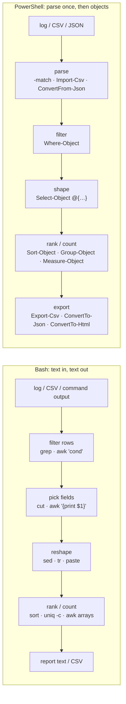

# Day 24: Text and Data Processing

!!! info "Lesson overview"
    | | |
    |---|---|
    | **Module** | 5 — Scripting & Automation |
    | **Difficulty** | :material-signal-cellular-2: Intermediate |
    | **Estimated time** | 3–4 hours (75 min reading, 90 min demonstrations, 60–90 min lab and quiz) |
    | **Platforms** | Ubuntu 24.04 LTS (Bash 5.2, GNU coreutils 9.4, GNU sed 4.9, mawk 1.3.4, jq 1.7) · Windows 11 (Windows PowerShell 5.1 and PowerShell 7.4+) |
    | **Lab** | [Lab 24: Access Log Report](../../labs/lab-24.md) |

## Learning Objectives

By the end of this lesson you will be able to:

1. Describe text data as **records** (lines) and **fields** (columns) separated by **delimiters**, and recognise the common formats an administrator meets: space-separated logs, colon-separated system files, CSV, TSV and JSON.
2. Extract and reshape fields with `cut`, `tr`, `paste` and `join`, and rank and count with `sort` and `uniq` — including numeric, human-size, version and multi-key sorts and the locale trap.
3. Edit text streams with **`sed`**: substitution with groups, line addresses, printing only matches, deleting lines, and safe in-place edits with a backup and a `diff` preview.
4. Write **`awk`** programs that filter, compute, count and sum per key, and print aligned reports with `printf` — and know what differs between Ubuntu's default `mawk` and GNU `gawk`.
5. Turn a web server access log into answers: top clients, status codes, error rate per hour, bytes per client, scanners and brute-force attempts.
6. Recognise when **text tools break** (quoted commas in CSV, CRLF line endings, spaces in fields) and switch to a real parser.
7. Query and build **JSON** with `jq`.
8. Do the same work in PowerShell with **objects**: `-split`, `-replace`, `-match` and `Select-String` for text; `Select-Object` calculated properties, `Sort-Object`, `Group-Object` and `Measure-Object` for analysis; `Import-Csv`/`Export-Csv` and `ConvertFrom-Json`/`ConvertTo-Json` for structured data — with the 5.1 vs 7 differences.

## Prerequisites

- [Day 03](../module-1/day-03.md) (reading files, redirection), [Day 04](../module-1/day-04.md) (`grep`, regular expressions, `Select-String`) and [Day 05](../module-1/day-05.md) (pipelines, text vs objects).
- [Days 21–23](day-21.md) (variables, loops, functions).
- `jq` installed on Ubuntu: `sudo apt install jq` (in the `universe` component; often already present).
- A normal user account. Everything today is read-only except files you create in your practice folder.

## Introduction and Concepts

### Records, fields and delimiters

Almost every file an administrator processes is a table in disguise:

| Source | Record | Field delimiter | Example |
|---|---|---|---|
| `/etc/passwd`, `/etc/group` | one line | `:` | `root:x:0:0:root:/root:/bin/bash` |
| Web access log (combined format) | one line | space, but quoted fields contain spaces | `203.0.113.10 - - [18/Nov/2026:09:01:12 +0000] "GET / HTTP/1.1" 200 5120 "-" "Mozilla/5.0"` |
| `ss`, `df -P`, `ps` output | one line | runs of spaces | `/dev/sda2  51290592 11834156 36818996  25% /` |
| CSV export | one line (usually) | `,` with `"…"` quoting | `web-03,ops,"rebuilt, needs patch"` |
| TSV | one line | tab | `web-02<TAB>prod;web` |
| JSON (API output, `journalctl -o json`, `ip -j`) | nested objects | none — it is a tree | `{"host": "web-02", "value": 93}` |

The Linux toolset assumes **lines of text with predictable delimiters**. That assumption is fast, universal and works on any system — until a field contains the delimiter. PowerShell assumes **objects with named properties**; text has to be parsed into objects first (once), after which sorting, grouping and exporting are reliable.



### The text-processing toolbox

| Tool | Think of it as | Best for |
|---|---|---|
| `cut` | "columns by position" | Single-character delimiters (`:` `,` tab), fixed columns |
| `tr` | "character translator" | Case changes, deleting `\r`, squeezing repeated spaces, swapping delimiters |
| `sort` | "order lines" | Numeric, size, version, multi-key ordering; de-duplication with `-u` |
| `uniq` | "collapse **adjacent** duplicates" | Counting (`-c`) after `sort` |
| `paste` / `join` | "glue files side by side" / "relational join on a key" | Combining two column lists; matching hosts to owners |
| `sed` | "stream editor" | Find-and-replace, deleting/printing line ranges, config edits |
| `awk` | "a small language for columns" | Conditions on fields, arithmetic, per-key counts/sums, formatted reports |
| `jq` | "awk for JSON" | Selecting, reshaping and building JSON |

Rules of thumb: use **`grep`** to find lines, **`cut`** when the delimiter is simple, **`awk`** as soon as you need a condition, a calculation or a varying number of spaces, **`sed`** to change text, and a **real parser** (`jq`, Python's `csv` module, PowerShell's `Import-Csv`) when the format has quoting or nesting.

### Sorting is locale-dependent

`sort` compares text according to the current **locale** (`LANG`, `LC_ALL`, `LC_COLLATE`). In `en_US.UTF-8` or `en_IN.UTF-8` (typical Ubuntu desktops), `sort` orders `a A b B` — case is mostly ignored and punctuation may be skipped. In the `C` locale it compares **bytes**: `A B a b`. Scripts that must give the same result everywhere (for `uniq`, `join`, `comm` or diffs of reports) set `LC_ALL=C sort`. Ubuntu server and container images often run with the `C`/`C.UTF-8` locale, so a script tested on your desktop can behave differently on a server.

### Ubuntu's `awk` is `mawk`

On Ubuntu 24.04 the `awk` command is **mawk** 1.3.4 (a fast POSIX awk). GNU awk (`gawk`) is a separate package (`sudo apt install gawk`). Everything in this lesson works in both. GNU-only features you may see online — `asort()`, `PROCINFO["sorted_in"]`, `FPAT`, `gensub()`, `--csv` (gawk 5.3+) — do **not** work in mawk. Check with `awk -W version` (mawk) or `awk --version` (gawk), and write portable awk unless the script declares `#!/usr/bin/gawk -f`.

### PowerShell: text when you must, objects when you can

PowerShell has strong text operators (`-split`, `-replace`, `-match`, `Select-String`), all using **.NET regular expressions** and **case-insensitive** by default. But its real strength is that data from cmdlets, CSV and JSON already arrive as objects. A correct PowerShell report pipeline parses text **once** into `[pscustomobject]`s and then never touches text again until the final `Export-Csv`, `ConvertTo-Json` or `Format-Table`.

Two traps to remember all day:

- **Everything from `Import-Csv` is a string.** `'100' -gt '90'` is `False` (text comparison). Cast: `[int]$_.disk_pct -ge 90`.
- **Format last.** `Format-Table` turns objects into formatting instructions; nothing useful can come after it in a pipeline.

## Linux Command Reference

| Command | Purpose | Package / availability | Needs root? |
|---|---|---|---|
| `cut` | Select fields (`-d -f`) or characters (`-c`) | coreutils | No |
| `sort` | Sort lines (`-n -r -k -t -u -h -V -s`) | coreutils | No |
| `uniq` | Collapse adjacent duplicates (`-c -d -u -i`) | coreutils | No |
| `tr` | Translate, delete (`-d`) or squeeze (`-s`) characters | coreutils | No |
| `paste` | Merge lines of files side by side; `-s` joins lines of one file | coreutils | No |
| `join` | Join two **sorted** files on a key field | coreutils | No |
| `wc`, `head`, `tail` | Count lines; first/last lines (`tail -n +2` skips a header) | coreutils | No |
| `sed` | Stream editor: `s///`, `-n`/`p`, `d`, addresses, `-E`, `-i[SUFFIX]` | GNU sed 4.9 | No (only to edit system files) |
| `awk` | Pattern-action language for fields | **mawk** on Ubuntu (`gawk` optional) | No |
| `jq` | JSON processor | `jq` package (universe) | No |
| `column -t` | Align columns | `bsdextrautils` (present on standard Ubuntu installs; absent from minimal images) | No |
| `zcat -f` | Read plain and gzip files alike | gzip | No |
| `diff` | Preview a change (<code>sed … file &#124; diff file -</code>) | diffutils | No |

## PowerShell Command Reference

| Cmdlet / operator | Aliases | Purpose | 5.1 | 7.x | Admin? |
|---|---|---|---|---|---|
| `-split`, `-join` | — | Split by regex / join with a separator | Yes | Yes | No |
| `-replace` | — | Regex replace (`$1`, `${name}`) | Yes | Yes | No |
| `-match`, `$Matches` | — | Regex test and capture groups | Yes | Yes | No |
| `Select-String` | `sls` | grep-like search; `.Matches.Groups` | Yes | Yes | No |
| `[regex]::Matches()` | — | All matches in a string | Yes | Yes | No |
| `Select-Object` (calculated properties) | `select` | Pick, rename and compute properties | Yes | Yes | No |
| `Where-Object` | `?`, `where` | Filter objects | Yes | Yes | No |
| `Sort-Object` | `sort`\* | Sort by one or more properties; `-Unique`; `-Top`/`-Bottom` **7.0+**; `-Stable` **7.0+** | Yes | Yes | No |
| `Group-Object` | `group` | Count / bucket by property; `-NoElement`, `-AsHashTable` | Yes | Yes | No |
| `Measure-Object` | `measure` | Count, Sum, Average, Minimum, Maximum; `-StandardDeviation` **7.0+** | Yes | Yes | No |
| `Import-Csv` / `Export-Csv` | `ipcsv` / `epcsv` | Read / write CSV files as objects | Yes | Yes (different defaults) | No |
| `ConvertFrom-Csv` / `ConvertTo-Csv` | — | CSV text ↔ objects in memory | Yes | Yes | No |
| `ConvertFrom-Json` / `ConvertTo-Json` | — | JSON ↔ objects; `-AsHashtable` **6.0+** | Yes | Yes | No |
| `ConvertTo-Html` | — | Objects → HTML table report | Yes | Yes | No |
| `Join-String` | — | Join pipeline objects into one string | No | **7.0+** | No |
| `Out-GridView` | `ogv` | Interactive table window | Yes | **Windows only** (7.x) | No |

\* `sort` is an alias for `Sort-Object` on Windows only; on Linux it runs the native `sort`.

## Detailed Command Explanations

### `cut` — fixed fields and columns

`cut -d DELIM -f LIST` prints the listed fields; `LIST` can be `1`, `1,7`, `2-4` or `3-` (from 3 to the end). The default delimiter is a **tab**. `cut -c 1-12` selects characters. `--complement` (GNU) prints everything except the listed fields.

`cut` treats **every** delimiter character as a boundary, so two spaces in a row create an empty field — which is why `cut -d' '` fails on `df` or `ps` output aligned with runs of spaces. Use `awk` (whose default field splitting treats any run of blanks as one separator) or squeeze first with `tr -s ' '`.

### `sort` — ordering lines

| Option | Meaning | Example |
|---|---|---|
| `-n` | Numeric | `10` after `9` |
| `-r` | Reverse | largest first |
| `-h` | Human sizes (`K`, `M`, `G`) | <code>du -sh * &#124; sort -h</code> |
| `-V` | Version numbers | `v1.2 v1.9 v1.10` |
| `-t SEP` | Field separator | `-t,` for CSV, `-t:` for passwd |
| `-k POS1[,POS2]` | Key fields | `-k5,5nr` = field 5 only, numeric, reverse |
| `-u` | Output only the first of equal lines (by key) | unique list |
| `-s` | Stable: keep input order of equal keys | multi-pass sorts |
| `-f` | Fold case | case-insensitive |
| `-o FILE` | Write output to FILE (may be the input file) | `sort -o list.txt list.txt` |

Always close a key: `-k2,2` means "field 2 only", while `-k2` means "from field 2 **to the end of the line**". When two lines have equal keys, GNU `sort` breaks the tie by comparing the **whole line** (and `-r` reverses that too); add explicit secondary keys (`-k1,1nr -k2,2`) when the order of ties matters.

### `uniq` — adjacent duplicates

`uniq` only compares **neighbouring** lines, so it nearly always follows `sort`. `-c` prefixes counts, `-d` prints only duplicated lines (once each), `-u` only lines that occur once, `-i` ignores case. The idiom <code>sort &#124; uniq -c &#124; sort -rn</code> ("count and rank") is one of the most used pipelines in operations.

### `tr`, `paste` and `join`

- `tr SET1 SET2` translates characters: `tr '[:upper:]' '[:lower:]'`, `tr ';' ','`. `tr -d '\r'` deletes carriage returns (Windows CRLF files), `tr -s ' '` squeezes repeated spaces. `tr` reads **stdin only**: `tr -d '\r' < file`.
- `paste -d, a.txt b.txt` joins line N of each file with a comma. `paste -sd, file` joins all lines of one file into one comma-separated line.
- `join -t, a.csv b.csv` joins lines whose first field matches, like a database join. **Both inputs must be sorted on the key** with the same collation (use `LC_ALL=C sort` for both, or the same locale for both). `-1 N`/`-2 N` choose other key fields; `-a 1` also prints unmatched lines from the first file.

### `sed` — the stream editor

`sed` reads input line by line, applies a script and prints the result. It never changes the input file unless you use `-i`.

| Command | Meaning |
|---|---|
| `s/old/new/` | Replace the first match on each line; `g` flag = all matches; `I` flag = ignore case (GNU) |
| `s#a/b#c/d#` | Any delimiter can follow `s` — handy for paths |
| `-E` | Extended regex: `( )`, `+`, `?`, `{n}`, <code>&#124;</code> without backslashes |
| `\1` … `\9`, `&` | Captured groups / the whole match in the replacement |
| `-n` + `p` | Print only selected lines: `sed -n '10,20p'`, `sed -n '/ERROR/p'` |
| `d` | Delete lines: `sed '/^#/d; /^$/d'` removes comments and blank lines |
| Addresses | `5`, `$` (last line), `/re/`, `10,20`, `/start/,/end/` |
| `$=` with `-n` | Print the number of lines |
| `-i` / `-i.bak` | Edit the file in place / and keep a backup with suffix `.bak` (GNU) |
| `-e` | Add another script expression |

The replacement `\130` means "group 1 followed by the text `30`" (sed only knows `\1`–`\9`), which is exactly what you want when changing `retention_days = 7` to `30`.

**Safe editing routine:** (1) run the `sed` command **without** `-i` and pipe it into `diff file -` to preview; (2) run it with `-i.bak`; (3) verify with `grep`/`diff file.bak file`; (4) keep or remove the backup deliberately. For system files (`/etc/...`) also copy the original elsewhere first (Day 02, Day 07) and validate the result with the service's own checker (`sshd -t`, `nginx -t`, `visudo -c`).

### `awk` — fields, conditions and arithmetic

An awk program is a list of `pattern { action }` pairs, run for every input line:

```text
awk [-F SEP] [-v var=value] 'BEGIN { … }  pattern { action }  END { … }' file…
```

| Element | Meaning |
|---|---|
| `$0`, `$1`…`$NF` | Whole line, fields; `$NF` = last field, `$(NF-1)` = second to last |
| `NR`, `FNR` | Line number overall / within the current file |
| `NF` | Number of fields on this line |
| `-F SEP` / `FS` | Input separator: `-F:`, `-F,`, `-F'"'`, regex `-F'[ :]+'`. Default: runs of blanks |
| `OFS` | Output separator for `print a, b` (default one space) |
| `BEGIN` / `END` | Run before the first line / after the last line |
| `pattern` | Any condition: `$9 >= 500`, `/regex/`, `$1 == "root"`, `NR > 1`, `!seen[$0]++` |
| `arr[key] += x` | Associative arrays: per-key counts and sums (`for (k in arr)` — order not defined) |
| `printf "%-15s %5d\n", a, b` | Formatted output |
| `split(s, arr, sep)`, `sub()`, `gsub()`, `substr()`, `length()`, `tolower()`, `toupper()` | String functions (all in mawk and gawk) |
| `-v name=value` | Pass a shell value safely into the program |

Pass shell variables with `-v` (`awk -v limit="$limit" '$5 >= limit'`) rather than splicing them into the program text: splicing breaks on quotes and is an injection risk when values come from files.

awk converts strings to numbers when you use them in arithmetic. A field with a trailing `\r` (CRLF file) still adds up correctly but fails string comparisons such as `$2 == "71"`, which is one more reason to strip `\r` first.

### Parsing the combined access log

With default splitting, the fields of a combined-format line are:

| Field | Content | Example |
|---|---|---|
| `$1` | Client IP | `198.51.100.7` |
| `$4` | `[day/Mon/year:HH:MM:SS` | `[18/Nov/2026:09:01:16` |
| `$6` | `"METHOD` (with the quote) | `"POST` |
| `$7` | Path | `/login` |
| `$9` | Status | `401` |
| `$10` | Bytes | `512` |
| `$12`… | User agent — **split into several fields** if it contains spaces | `"Mozilla/5.0` `(X11;` … |

Fields `$1`–`$10` are reliable because everything before the referrer contains no unexpected spaces. The user agent is not, so `$NF` is **not** "the user agent". Split on the double quote instead: with `-F'"'`, `$2` is the request line and `$6` the user agent.

### When text tools break: CSV and CRLF

- **Quoted fields.** `web-03,ops,"rebuilt, needs patch"` has three fields, but `cut -d, -f3` prints `"rebuilt` and `awk -F,` counts four. If the quoted column is the **last** one, fields before it are still safe. Otherwise use a CSV-aware tool: PowerShell `Import-Csv`, Python's `csv` module (`python3 -c 'import csv,sys; …'`), or `gawk --csv` (gawk 5.3+, not mawk).
- **Embedded newlines** in quoted CSV fields break every line-based tool.
- **CRLF line endings** from Windows add an invisible `\r` to the last field. Detect with `file data.csv` ("with CRLF line terminators") or `cat -A` (`^M$`), fix with `tr -d '\r'` or `sed 's/\r$//'`.
- **Headers.** Skip with `tail -n +2` or `awk 'NR > 1'`.

### `jq` — JSON on the command line

| Filter | Meaning |
|---|---|
| `.` | The whole input (pretty-printed) |
| `.key`, `.a.b`, `.[0]`, `.[]` | Field, nested field, array element, every element |
| <code>.[] &#124; select(.severity == "critical")</code> | Filter |
| `map(f)`, `length`, `add`, `keys` | Transform arrays, count, sum, list keys |
| `group_by(.k)`, `sort_by(.k)`, `unique_by(.k)` | Group / sort / de-duplicate arrays of objects |
| `{host, value}`, `{h: .host}` | Build objects |
| `"\(.host) \(.value)%"` | String interpolation |
| `@csv`, `@tsv` | Format an array as a CSV/TSV row (with `-r`) |
| `//` | Default when the left side is `null`/`false`: `.tags[0] // "none"` |
| `-r` | Raw strings (no JSON quotes) |
| `-c` | Compact one-line output |
| `-s` | Slurp: read all inputs (for example JSON Lines) into one array |
| `-n --arg k v --argjson n 5` | Build JSON from shell values safely |
| `-e` | Exit status 1 if the last output is `null`/`false` (use in `if`) |

`jq` exits non-zero on invalid JSON (status 5 for a parse error in jq 1.7), so a script can detect a broken API response instead of processing garbage.

### PowerShell text operators

```powershell
'web-01,web,10.0.1.11' -split ','                  # web-01 / web / 10.0.1.11
'a  b   c' -split '\s+'                             # regex split
($line -split ' ')[8]                               # 9th space-separated token (status in an access log)
'log_level = info' -replace '^(log_level\s*=\s*).*', '${1}debug'
'Web-01' -replace 'web', 'app'                      # app-01 (case-insensitive!)  -creplace for case-sensitive
if ($line -match '^(?<ip>\S+) .* (?<status>\d{3}) (?<bytes>\d+) ') { $Matches.ip; $Matches.status }
@('web-01', 'web-02') -join ';'
```

- Use **single quotes** around replacement strings so PowerShell does not expand `$1` as a variable. Use `${1}30` (not `$130`) when digits follow a group reference — .NET would look for group 130.
- `-match` on a single string fills `$Matches`; on an **array** it filters and does not reliably set `$Matches`.
- `Select-String -Pattern … -Path …` returns `MatchInfo` objects with `Line`, `LineNumber`, `Filename` and `Matches` (and `Matches[0].Groups['name'].Value` for named groups). Add `-AllMatches` to find every match on a line.

### Objects: `Select-Object`, `Sort-Object`, `Group-Object`, `Measure-Object`

- **Calculated properties** rename or compute: `Select-Object Name, @{Name = 'MiB'; Expression = { [math]::Round($_.Bytes / 1MB, 1) }}`. `Name`/`Expression` can be shortened to `N`/`E` (or `Label`/`L`).
- `Sort-Object -Property Count -Descending`; several keys with different directions: `Sort-Object @{Expression = 'Count'; Descending = $true}, @{Expression = 'Name'; Descending = $false}`. Sort strings as numbers with a script block: `Sort-Object { [int]$_.disk_pct }`. `Sort-Object -Unique` is case-insensitive; `-Top N`/`-Bottom N` and `-Stable` exist in PowerShell 7.0+ only.
- `Group-Object -Property ip` returns groups with `Count`, `Name` and `Group` (the original objects). `-NoElement` drops `Group` for speed; `-AsHashTable` returns a lookup table (`$byIp['192.0.2.77']`). Group on a script block for derived keys: `Group-Object { $_.Time.Hour }`.
- `Measure-Object -Property Bytes -Sum -Average -Maximum` (numeric) and `Measure-Object -Line -Word -Character` (text, like `wc`).

### CSV in PowerShell

- `Import-Csv path` reads a file whose first line is the header and returns one `PSCustomObject` per row; quoted fields with commas and even embedded newlines are handled. `-Delimiter ';'` for European exports; `-Header a,b,c` when the file has no header; `-Encoding` when the file is not UTF-8.
- `Export-Csv path -NoTypeInformation` writes objects. **Windows PowerShell 5.1** adds a `#TYPE …` first line unless you pass `-NoTypeInformation`, quotes every field, and defaults to **ASCII** encoding (non-ASCII characters become `?`; pass `-Encoding UTF8`, which writes a BOM). **PowerShell 7** omits the type line by default, writes UTF-8 without BOM, and adds `-UseQuotes Always|AsNeeded|Never` and `-QuoteFields`. `-Append` adds rows; `-Force` with `-Append` tolerates mismatched columns.
- `ConvertFrom-Csv` / `ConvertTo-Csv` do the same in memory (for text from APIs or `Get-Clipboard`).
- **All values are strings.** Cast where you compare or calculate.

### JSON in PowerShell

- `Get-Content file.json -Raw | ConvertFrom-Json` — `-Raw` reads the file as one string; without it, 5.1 receives one line at a time. Objects become `PSCustomObject`s; arrays become arrays.
- **5.1 trap:** Windows PowerShell 5.1 sends a top-level JSON **array** down the pipeline as **one** object. Wrap the conversion in parentheses — `(Get-Content a.json -Raw | ConvertFrom-Json) | Where-Object …` — to enumerate the elements. PowerShell 7 enumerates them (and has `-NoEnumerate` to opt out).
- `ConvertFrom-Json -AsHashtable` (6.0+) returns hashtables — needed for keys that differ only in case or are empty.
- `ConvertTo-Json -Depth N`: the default depth is **2**; deeper levels are flattened to strings such as `"System.Collections.Hashtable"` (silently in 5.1; recent PowerShell 7 versions print a warning). Always pass `-Depth` for nested data (maximum 100). `-Compress` writes one line.
- **Dates:** 5.1 writes `DateTime` values as `"\/Date(1763485200000)\/"`; PowerShell 7 writes ISO 8601 strings. Convert dates to ISO strings yourself (`.ToString('o')`) for portable output.

### HTML reports

`$rows | ConvertTo-Html -Title 'Disk report' -PreContent '<h1>Disk report</h1>' | Set-Content report.html` creates a simple HTML table that can be e-mailed or published. Add `-Property` to choose columns and `-Head '<style>…</style>'` for styling.

## Syntax and Parameters

### Bash

```text
cut -d DELIM -f LIST [FILE...]          cut -c LIST [FILE...]
sort [-n|-h|-V] [-r] [-u] [-s] [-f] [-t SEP] [-k POS1[,POS2][OPTS]]... [-o OUT] [FILE...]
uniq [-c] [-d|-u] [-i] [INPUT [OUTPUT]]
tr [-d] [-s] SET1 [SET2]                (stdin only)
paste [-d LIST] [-s] FILE...            join [-t SEP] [-1 F] [-2 F] [-a 1|2] FILE1 FILE2
sed [-n] [-E] [-i[SUFFIX]] [-e SCRIPT]... [FILE...]
awk [-F SEP] [-v VAR=VAL]... 'PROGRAM' [FILE...]
jq [-r] [-c] [-s] [-n] [-e] [--arg NAME VAL] [--argjson NAME JSON] [--slurpfile NAME FILE] FILTER [FILE...]
```

| Item | Meaning |
|---|---|
| `-k5,5nr` | Sort key = field 5 only, numeric, reverse |
| `LC_ALL=C sort` | Byte-order sort (portable, fast) |
| `sed -E 's/(a)(b)/\2\1/g'` | Extended regex, swap groups, all matches |
| `sed -n '/re/p'` | Print only matching lines (like `grep`) |
| `sed -i.bak '…' f` | In-place edit with backup `f.bak` |
| `awk 'NR > 1 && $5 >= 90'` | Pattern only: print matching lines |
| `awk '{ c[$1]++ } END { for (k in c) print c[k], k }'` | Count per key |
| <code>jq -r '.[] &#124; [.a, .b] &#124; @csv'</code> | Rows from an array of objects |

### PowerShell

```text
<string> -split <regex>[, <max>]          <string[]> -join <sep>
<string> -replace <regex>, <replacement>  (-creplace: case-sensitive)
Select-String [-Pattern] <regex[]> [-Path <string[]>] [-AllMatches] [-CaseSensitive] [-SimpleMatch] [-Context n]
Select-Object [-Property] <Object[]> [-ExpandProperty <string>] [-First n] [-Unique]
Sort-Object [[-Property] <Object[]>] [-Descending] [-Unique] [-CaseSensitive] [-Top n] [-Bottom n] [-Stable]   # -Top/-Bottom/-Stable 7.0+
Group-Object [[-Property] <Object[]>] [-NoElement] [-AsHashTable] [-AsString] [-CaseSensitive]
Measure-Object [[-Property] <string[]>] [-Sum] [-Average] [-Minimum] [-Maximum] [-Line] [-Word] [-Character]
Import-Csv [-Path] <string[]> [-Delimiter <char>] [-Header <string[]>] [-Encoding <enc>]
Export-Csv [-Path] <string> [-NoTypeInformation] [-Delimiter <char>] [-Encoding <enc>] [-Append] [-UseQuotes <mode>]   # -UseQuotes 7.0+
ConvertFrom-Json [-InputObject] <string> [-AsHashtable] [-Depth <int>] [-NoEnumerate]   # -AsHashtable 6.0+, -Depth/-NoEnumerate 7.x
ConvertTo-Json [-InputObject] <object> [-Depth <int>] [-Compress] [-AsArray]   # -AsArray 6.2+
ConvertTo-Html [-Property <Object[]>] [-Title <string>] [-PreContent <string[]>] [-PostContent <string[]>] [-Head <string[]>]
```

| Parameter | Meaning |
|---|---|
| `@{N='x'; E={ … }}` | Calculated property for `Select-Object`, `Sort-Object`, `Format-Table` |
| `-ExpandProperty` | Output the property's **value**, not an object with one property |
| `-NoElement` | `Group-Object` returns only `Count` and `Name` |
| `-NoTypeInformation` | No `#TYPE` line (needed in 5.1; default in 7) |
| `-Depth` | Nesting depth for JSON (default 2 for `ConvertTo-Json`) |
| `-Raw` (`Get-Content`) | Read the file as one string (required before `ConvertFrom-Json` in 5.1) |

## Practical Demonstrations

The **Bash** outputs below were captured on 2026-11-18 with Bash 5.2.21, GNU coreutils 9.4, GNU sed 4.9, mawk 1.3.4 and jq 1.7 on Ubuntu 24.04.5 in a container whose locale is `C` (lines marked *example* were not captured). The **PowerShell** outputs are **examples** derived from the same data and the documented cmdlet behaviour; PowerShell was not available on the release host. Create the practice data first:

=== "Bash"

    ```bash
    mkdir -p ~/day24 && cd ~/day24
    cat > web.log <<'EOF'
    203.0.113.10 - - [18/Nov/2026:09:01:12 +0000] "GET /index.html HTTP/1.1" 200 5120 "-" "Mozilla/5.0"
    198.51.100.7 - - [18/Nov/2026:09:01:15 +0000] "GET /login HTTP/1.1" 200 2048 "-" "Mozilla/5.0"
    198.51.100.7 - - [18/Nov/2026:09:01:16 +0000] "POST /login HTTP/1.1" 401 512 "-" "Mozilla/5.0"
    198.51.100.7 - - [18/Nov/2026:09:01:17 +0000] "POST /login HTTP/1.1" 401 512 "-" "Mozilla/5.0"
    198.51.100.7 - - [18/Nov/2026:09:01:18 +0000] "POST /login HTTP/1.1" 401 512 "-" "Mozilla/5.0"
    192.0.2.44 - - [18/Nov/2026:09:02:03 +0000] "GET /api/orders HTTP/1.1" 500 128 "-" "curl/8.5.0"
    203.0.113.10 - - [18/Nov/2026:09:02:09 +0000] "GET /images/logo.png HTTP/1.1" 200 20480 "-" "Mozilla/5.0"
    192.0.2.44 - - [18/Nov/2026:09:02:10 +0000] "GET /api/orders HTTP/1.1" 500 128 "-" "curl/8.5.0"
    203.0.113.25 - - [18/Nov/2026:10:15:41 +0000] "GET /wp-login.php HTTP/1.1" 404 256 "-" "python-requests/2.31"
    203.0.113.25 - - [18/Nov/2026:10:15:42 +0000] "GET /.env HTTP/1.1" 404 256 "-" "python-requests/2.31"
    198.51.100.7 - - [18/Nov/2026:10:20:00 +0000] "POST /login HTTP/1.1" 200 1024 "-" "Mozilla/5.0"
    192.0.2.44 - - [18/Nov/2026:10:31:27 +0000] "GET /api/orders HTTP/1.1" 200 4096 "-" "curl/8.5.0"
    EOF
    cat > servers.csv <<'EOF'
    name,role,ip,os,disk_pct,owner
    web-01,web,10.0.1.11,ubuntu-24.04,71,ops
    web-02,web,10.0.1.12,ubuntu-24.04,93,ops
    db-01,database,10.0.2.21,ubuntu-22.04,88,dba
    dc-01,domain,10.0.3.5,windows-2022,64,wintel
    file-01,file,10.0.3.9,windows-2019,97,wintel
    EOF
    cat > alerts.json <<'EOF'
    [
      {"id": 101, "host": "web-02", "severity": "critical", "check": "disk", "value": 93, "tags": ["prod", "web"]},
      {"id": 102, "host": "db-01", "severity": "warning", "check": "disk", "value": 88, "tags": ["prod"]},
      {"id": 103, "host": "file-01", "severity": "critical", "check": "disk", "value": 97, "tags": ["prod", "smb"]},
      {"id": 104, "host": "web-01", "severity": "info", "check": "cert", "value": 41, "tags": []}
    ]
    EOF
    ```

=== "PowerShell"

    ```powershell
    New-Item -Path $HOME\day24 -ItemType Directory -Force | Out-Null
    Set-Location $HOME\day24
    # Create web.log, servers.csv and alerts.json with exactly the content shown in the Bash tab,
    # for example by pasting each block into a here-string:
    @'
    name,role,ip,os,disk_pct,owner
    web-01,web,10.0.1.11,ubuntu-24.04,71,ops
    web-02,web,10.0.1.12,ubuntu-24.04,93,ops
    db-01,database,10.0.2.21,ubuntu-22.04,88,dba
    dc-01,domain,10.0.3.5,windows-2022,64,wintel
    file-01,file,10.0.3.9,windows-2019,97,wintel
    '@ | Set-Content -Path .\servers.csv -Encoding UTF8
    # ... the same for web.log and alerts.json
    ```

The addresses are from the documentation ranges (192.0.2.0/24, 198.51.100.0/24, 203.0.113.0/24), so they cannot collide with real hosts.

### Demo 1 — Fields with `cut`, `tr` and `paste`

=== "Bash"

    ```bash
    cut -d' ' -f1 web.log | head -3
    cut -d: -f1,7 /etc/passwd | head -3
    echo "Web-01 DB-01" | tr '[:upper:]' '[:lower:]'
    echo "a    b   c" | tr -s ' '
    printf 'web-01\nweb-02\n' > h.txt; printf '71\n93\n' > d.txt
    paste -d, h.txt d.txt
    cut -d, -f1 servers.csv | tail -n +2 | paste -sd,
    ```

    **Expected output (captured):**

    ```text
    203.0.113.10
    198.51.100.7
    198.51.100.7
    root:/bin/bash
    daemon:/usr/sbin/nologin
    bin:/usr/sbin/nologin
    web-01 db-01
    a b c
    web-01,71
    web-02,93
    web-01,web-02,db-01,dc-01,file-01
    ```

=== "PowerShell"

    ```powershell
    Get-Content .\web.log -TotalCount 3 | ForEach-Object { ($_ -split ' ')[0] }
    'Web-01 DB-01'.ToLower()
    'a    b   c' -replace ' +', ' '
    $hosts = 'web-01', 'web-02'; $disk = 71, 93
    0..($hosts.Count - 1) | ForEach-Object { '{0},{1}' -f $hosts[$_], $disk[$_] }
    (Import-Csv .\servers.csv).name -join ','
    ```

    **Expected output (example):**

    ```text
    203.0.113.10
    198.51.100.7
    198.51.100.7
    web-01 db-01
    a b c
    web-01,71
    web-02,93
    web-01,web-02,db-01,dc-01,file-01
    ```

    `(Import-Csv …).name` uses **member enumeration**: the `name` property of every row. In PowerShell 7 `Import-Csv .\servers.csv | Join-String -Property name -Separator ','` does the same.

### Demo 2 — Count and rank with `sort` and `uniq`

=== "Bash"

    ```bash
    cut -d' ' -f1 web.log | sort | uniq -c | sort -rn
    awk '{print $9}' web.log | sort | uniq -c | sort -k1,1nr -k2,2n
    printf 'a\nb\na\n' | uniq -c                         # not sorted: wrong counts
    cut -d' ' -f1 web.log | sort | uniq -d               # IPs seen more than once
    printf '10\n9\n100\n' | sort | tr '\n' ' '; echo
    printf '10\n9\n100\n' | sort -n | tr '\n' ' '; echo
    printf '1.5G\n800M\n12K\n' | sort -h | tr '\n' ' '; echo
    printf 'v1.10\nv1.9\nv1.2\n' | sort -V | tr '\n' ' '; echo
    tail -n +2 servers.csv | sort -t, -k5,5nr | head -3
    ```

    **Expected output (captured):**

    ```text
          5 198.51.100.7
          3 192.0.2.44
          2 203.0.113.25
          2 203.0.113.10
          5 200
          3 401
          2 404
          2 500
          1 a
          1 b
          1 a
    192.0.2.44
    198.51.100.7
    203.0.113.10
    203.0.113.25
    10 100 9
    9 10 100
    12K 800M 1.5G
    v1.2 v1.9 v1.10
    file-01,file,10.0.3.9,windows-2019,97,wintel
    web-02,web,10.0.1.12,ubuntu-24.04,93,ops
    db-01,database,10.0.2.21,ubuntu-22.04,88,dba
    ```

    Look at the first block: the two IPs with 2 hits appear as `.25` before `.10` because `sort -rn` reversed the whole-line tie-breaker. The second command uses explicit keys (`-k1,1nr -k2,2n`) so ties are ordered predictably. In a `en_US.UTF-8` locale, `printf 'b\nB\na\nA\n' | sort` gives `a A b B` (*example*); with `LC_ALL=C` it gives `A B a b` (captured, the container's locale).

=== "PowerShell"

    ```powershell
    $log = Get-Content .\web.log
    $log | ForEach-Object { ($_ -split ' ')[0] } | Group-Object -NoElement |
        Sort-Object @{Expression = 'Count'; Descending = $true}, @{Expression = 'Name'; Descending = $false}
    $log | ForEach-Object { ($_ -split ' ')[8] } | Group-Object -NoElement | Sort-Object Count -Descending
    '10', '9', '100' | Sort-Object
    '10', '9', '100' | Sort-Object { [int]$_ }
    [version[]]('1.10', '1.9', '1.2') | Sort-Object | ForEach-Object ToString
    Import-Csv .\servers.csv | Sort-Object { [int]$_.disk_pct } -Descending | Select-Object -First 3 name, disk_pct
    ```

    **Expected output (example):**

    ```text
    Count Name
    ----- ----
        5 198.51.100.7
        3 192.0.2.44
        2 203.0.113.10
        2 203.0.113.25

    Count Name
    ----- ----
        5 200
        3 401
        2 404
        2 500

    10
    100
    9
    9
    10
    100
    1.2
    1.9
    1.10

    name    disk_pct
    ----    --------
    file-01 97
    web-02  93
    db-01   88
    ```

    `Group-Object` does `sort | uniq -c` in one step and does not need sorted input. Sorting text that holds numbers is lexical in both shells (`10 100 9`) until you say "numeric": `sort -n` or `{ [int]$_ }`. The order of the two equal 404/500 groups is not guaranteed; add a second sort key when it matters.

### Demo 3 — `sed`: replace, print, delete and a safe in-place edit

=== "Bash"

    ```bash
    sed -E 's#^([0-9]+\.[0-9]+\.[0-9]+)\.[0-9]+#\1.x#' web.log | head -2    # mask the last octet
    sed -n '3,4p' web.log | cut -c1-60
    sed -n '/ 500 /p' web.log | cut -c1-60
    sed -n '$=' web.log                                                      # line count
    printf '# comment\nkey=1\n\nkey2=2\n' | sed -e '/^#/d' -e '/^$/d'
    cat > app.conf <<'EOF'
    # app.conf
    listen_port = 8080
    log_level = info
    max_clients = 100
    EOF
    sed -E 's/^(log_level[[:space:]]*=[[:space:]]*).*/\1debug/' app.conf | diff app.conf -; echo "diff status $?"
    sed -i.bak -E 's/^(log_level[[:space:]]*=[[:space:]]*).*/\1debug/' app.conf
    grep log_level app.conf app.conf.bak
    ```

    **Expected output (captured):**

    ```text
    203.0.113.x - - [18/Nov/2026:09:01:12 +0000] "GET /index.html HTTP/1.1" 200 5120 "-" "Mozilla/5.0"
    198.51.100.x - - [18/Nov/2026:09:01:15 +0000] "GET /login HTTP/1.1" 200 2048 "-" "Mozilla/5.0"
    198.51.100.7 - - [18/Nov/2026:09:01:16 +0000] "POST /login H
    198.51.100.7 - - [18/Nov/2026:09:01:17 +0000] "POST /login H
    192.0.2.44 - - [18/Nov/2026:09:02:03 +0000] "GET /api/orders
    192.0.2.44 - - [18/Nov/2026:09:02:10 +0000] "GET /api/orders
    12
    key=1
    key2=2
    3c3
    < log_level = info
    ---
    > log_level = debug
    diff status 1
    app.conf:log_level = debug
    app.conf.bak:log_level = info
    ```

    The preview (`diff` status 1 = "files differ") showed exactly one changed line **before** anything was written. Masking IP addresses with `sed` is a common step before sharing logs with a vendor.

=== "PowerShell"

    ```powershell
    Get-Content .\web.log -TotalCount 2 | ForEach-Object { $_ -replace '^(\d+\.\d+\.\d+)\.\d+', '$1.x' }
    (Get-Content .\web.log)[2..3] | ForEach-Object { $_.Substring(0, 60) }
    Select-String -Path .\web.log -Pattern ' 500 ' | ForEach-Object { $_.Line.Substring(0, 60) }
    (Get-Content .\web.log).Count
    '# comment', 'key=1', '', 'key2=2' | Where-Object { $_ -notmatch '^(#|$)' }
    Set-Content -Path .\app.conf -Value '# app.conf', 'listen_port = 8080', 'log_level = info', 'max_clients = 100'
    $new = (Get-Content .\app.conf) -replace '^(log_level\s*=\s*).*', '${1}debug'
    Compare-Object (Get-Content .\app.conf) $new                     # preview
    Copy-Item .\app.conf .\app.conf.bak
    $new | Set-Content -Path .\app.conf
    Select-String -Path .\app.conf, .\app.conf.bak -Pattern 'log_level' | ForEach-Object { '{0}:{1}' -f $_.Filename, $_.Line }
    ```

    **Expected output (example):**

    ```text
    203.0.113.x - - [18/Nov/2026:09:01:12 +0000] "GET /index.html HTTP/1.1" 200 5120 "-" "Mozilla/5.0"
    198.51.100.x - - [18/Nov/2026:09:01:15 +0000] "GET /login HTTP/1.1" 200 2048 "-" "Mozilla/5.0"
    198.51.100.7 - - [18/Nov/2026:09:01:16 +0000] "POST /login H
    198.51.100.7 - - [18/Nov/2026:09:01:17 +0000] "POST /login H
    192.0.2.44 - - [18/Nov/2026:09:02:03 +0000] "GET /api/orders
    192.0.2.44 - - [18/Nov/2026:09:02:10 +0000] "GET /api/orders
    12
    key=1
    key2=2

    InputObject       SideIndicator
    -----------       -------------
    log_level = debug =>
    log_level = info  <=

    app.conf:log_level = debug
    app.conf.bak:log_level = info
    ```

    The file is read completely into `$new` **before** `Set-Content` writes it. Writing in the same pipeline (`Get-Content f | … | Set-Content f`) fails because the file is still open for reading.

### Demo 4 — `awk`: filter, compute and report

=== "Bash"

    ```bash
    awk '{print $1, $9, $10}' web.log | head -3
    awk -F: '$3 >= 1000 && $7 !~ /nologin|false/ {print $1, $3, $7}' /etc/passwd
    awk -F: '$3 == 0 {print "UID 0:", $1}' /etc/passwd
    awk -F, -v limit=90 'NR > 1 && $5 >= limit {printf "%s %s%% (%s)\n", $1, $5, $6}' servers.csv
    awk -F, 'NR==1 {printf "%-8s %-9s %5s\n", "NAME", "ROLE", "DISK"; next}
             {printf "%-8s %-9s %4d%%\n", $1, $2, $5}' servers.csv
    awk -F, 'NR>1 {sum += $5; n++; if ($5 > max) {max = $5; who = $1}}
             END {printf "avg %.1f%% max %d%% (%s)\n", sum/n, max, who}' servers.csv
    printf 'b\na\nb\nc\na\n' | awk '!seen[$0]++' | tr '\n' ' '; echo
    ```

    **Expected output (captured; the `/etc/passwd` user is shown as `student`):**

    ```text
    203.0.113.10 200 5120
    198.51.100.7 200 2048
    198.51.100.7 401 512
    student 1000 /bin/bash
    UID 0: root
    web-02 93% (ops)
    file-01 97% (wintel)
    NAME     ROLE       DISK
    web-01   web         71%
    web-02   web         93%
    db-01    database    88%
    dc-01    domain      64%
    file-01  file        97%
    avg 82.6% max 97% (file-01)
    b a c
    ```

    `!seen[$0]++` prints a line only the first time it appears — de-duplication **without** sorting, keeping the original order. The second `/etc/passwd` command is a quick Day 19 audit: exactly one UID-0 account is expected.

=== "PowerShell"

    ```powershell
    Get-Content .\web.log -TotalCount 3 | ForEach-Object { $f = $_ -split ' '; '{0} {1} {2}' -f $f[0], $f[8], $f[9] }
    Import-Csv .\servers.csv | Where-Object { [int]$_.disk_pct -ge 90 } |
        ForEach-Object { '{0} {1}% ({2})' -f $_.name, $_.disk_pct, $_.owner }
    Import-Csv .\servers.csv | Format-Table name, role, @{N = 'DISK'; E = { '{0}%' -f $_.disk_pct }; Align = 'Right'}
    $s = Import-Csv .\servers.csv | Measure-Object -Property disk_pct -Average -Maximum
    $top = Import-Csv .\servers.csv | Sort-Object { [int]$_.disk_pct } -Descending | Select-Object -First 1
    'avg {0:N1}% max {1}% ({2})' -f $s.Average, $s.Maximum, $top.name
    'b', 'a', 'b', 'c', 'a' | Select-Object -Unique
    ```

    **Expected output (example):**

    ```text
    203.0.113.10 200 5120
    198.51.100.7 200 2048
    198.51.100.7 401 512
    web-02 93% (ops)
    file-01 97% (wintel)

    name    role     DISK
    ----    ----     ----
    web-01  web       71%
    web-02  web       93%
    db-01   database  88%
    dc-01   domain    64%
    file-01 file      97%

    avg 82.6% max 97% (file-01)
    b
    a
    c
    ```

    `Measure-Object` converts the string column to numbers itself. `Where-Object` needs the explicit `[int]`: without it, `'100' -ge 90` would compare **text** and be false. On Linux, `/etc/passwd` can be read the same way: `Get-Content /etc/passwd | ConvertFrom-Csv -Delimiter ':' -Header user, pw, uid, gid, gecos, home, shell | Where-Object { [int]$_.uid -eq 0 }`.

### Demo 5 — Answer real questions from an access log

=== "Bash"

    ```bash
    # bytes and hits per client
    awk '{bytes[$1] += $10; hits[$1]++}
         END {for (ip in bytes) printf "%-15s %3d hits %7d bytes\n", ip, hits[ip], bytes[ip]}' web.log | sort -k4,4nr
    # requests and error rate per hour
    awk '{split($4, t, ":"); hour = t[2]; total[hour]++; if ($9 >= 400) err[hour]++}
         END {for (h in total) printf "%s:00 %d requests %d errors %.1f%%\n", h, total[h], err[h], 100*err[h]/total[h]}' web.log | sort
    # request line and user agent: split on the double quote
    awk -F'"' '{print $2}' web.log | head -2
    awk -F'"' '{print $6}' web.log | sort | uniq -c | sort -k1,1nr -k2
    # most requested method + path
    grep -oE '"(GET|POST) [^ ]+' web.log | sort | uniq -c | sort -k1,1nr -k2 | head -4
    ```

    **Expected output (captured):**

    ```text
    203.0.113.10      2 hits   25600 bytes
    198.51.100.7      5 hits    4608 bytes
    192.0.2.44        3 hits    4352 bytes
    203.0.113.25      2 hits     512 bytes
    09:00 8 requests 5 errors 62.5%
    10:00 4 requests 2 errors 50.0%
    GET /index.html HTTP/1.1
    GET /login HTTP/1.1
          7 Mozilla/5.0
          3 curl/8.5.0
          2 python-requests/2.31
          4 "POST /login
          3 "GET /api/orders
          1 "GET /.env
          1 "GET /images/logo.png
    ```

    `for (k in arr)` returns keys in an **unspecified** order, so every awk report is piped to `sort`. Already the patterns of the lab are visible: four POSTs to `/login` from one address (three failures, then a success), probes for `/wp-login.php` and `/.env`, and repeated 500s on `/api/orders`.

=== "PowerShell"

    ```powershell
    $rx = '^(?<ip>\S+) \S+ \S+ \[(?<time>[^\]]+)\] "(?<method>\S+) (?<path>\S+) [^"]*" (?<status>\d{3}) (?<bytes>\d+|-) "[^"]*" "(?<ua>[^"]*)"$'
    $req = Get-Content .\web.log | ForEach-Object {
        if ($_ -match $rx) {
            [pscustomobject]@{
                IP     = $Matches.ip
                Time   = [datetime]::ParseExact(($Matches.time -split ' ')[0], 'dd/MMM/yyyy:HH:mm:ss', [cultureinfo]::InvariantCulture)
                Method = $Matches.method
                Path   = $Matches.path
                Status = [int]$Matches.status
                Bytes  = if ($Matches.bytes -eq '-') { 0 } else { [long]$Matches.bytes }
                Agent  = $Matches.ua
            }
        }
    }
    $req | Group-Object IP | ForEach-Object {
        [pscustomobject]@{ IP = $_.Name; Hits = $_.Count; Bytes = ($_.Group | Measure-Object Bytes -Sum).Sum }
    } | Sort-Object Bytes -Descending
    $req | Group-Object { $_.Time.ToString('HH:00') } | Sort-Object Name | ForEach-Object {
        $e = @($_.Group | Where-Object Status -ge 400).Count
        '{0} {1} requests {2} errors {3:N1}%' -f $_.Name, $_.Count, $e, (100 * $e / $_.Count)
    }
    $req | Group-Object Agent -NoElement | Sort-Object Count -Descending
    ```

    **Expected output (example):**

    ```text
    IP           Hits Bytes
    --           ---- -----
    203.0.113.10    2 25600
    198.51.100.7    5  4608
    192.0.2.44      3  4352
    203.0.113.25    2   512

    09:00 8 requests 5 errors 62.5%
    10:00 4 requests 2 errors 50.0%

    Count Name
    ----- ----
        7 Mozilla/5.0
        3 curl/8.5.0
        2 python-requests/2.31
    ```

    The regular expression is written once and turns each line into an object with typed properties (`[int]` status, `[datetime]` time). It matched all 767 lines of the Lab 24 data set in a test with a JavaScript engine (named groups, `\S`, `\d` behave the same there); every later step works on properties, not on text positions. All times in these logs are `+0000`, so the offset is dropped before parsing.

### Demo 6 — CSV traps: quoted commas and CRLF

=== "Bash"

    ```bash
    printf 'name,owner,notes\nweb-03,ops,"rebuilt, needs patch"\n' > tricky.csv
    cut -d, -f3 tricky.csv
    awk -F, '{print NF}' tricky.csv
    python3 -c 'import csv; [print(r["notes"]) for r in csv.DictReader(open("tricky.csv"))]'
    printf 'web-01,71\r\nweb-02,93\r\n' > win.csv
    cat -A win.csv
    awk -F, '{print $2 + 0, length($2)}' win.csv
    tr -d '\r' < win.csv | awk -F, '{print $2 + 0, length($2)}'
    ```

    **Expected output (captured):**

    ```text
    notes
    "rebuilt
    3
    4
    rebuilt, needs patch
    web-01,71^M$
    web-02,93^M$
    71 3
    93 3
    71 2
    93 2
    ```

    `cat -A` shows the carriage return as `^M` before the end-of-line marker `$`; `file win.csv` also reports CRLF terminators on a typical Ubuntu install. `length($2)` is 3 because of the hidden `\r`; arithmetic still works, but a comparison like `$2 == "71"` would be false until the `\r` is removed.

=== "PowerShell"

    ```powershell
    Set-Content -Path .\tricky.csv -Value 'name,owner,notes', 'web-03,ops,"rebuilt, needs patch"'
    (Import-Csv .\tricky.csv).notes
    ('web-03,ops,"rebuilt, needs patch"' -split ',').Count
    [System.IO.File]::WriteAllText("$PWD\win.csv", "web-01,71`r`nweb-02,93`r`n")
    Import-Csv .\win.csv -Header host, disk | ForEach-Object { '{0} {1}' -f $_.disk, $_.disk.Length }
    ```

    **Expected output (example):**

    ```text
    rebuilt, needs patch
    4
    71 2
    93 2
    ```

    `Import-Csv` understands quoting and both line-ending styles. A naive `-split ','` makes the same mistake as `cut`.

### Demo 7 — JSON with `jq` and `ConvertFrom-Json`

=== "Bash"

    ```bash
    jq length alerts.json
    jq -r '.[] | select(.severity == "critical") | "\(.host) \(.check) \(.value)%"' alerts.json
    jq -c '.[0]' alerts.json
    jq -r '.[] | [.id, .host, .severity, .value] | @csv' alerts.json
    jq -r '.[] | [.host, (.tags | join(";"))] | @tsv' alerts.json
    jq -c 'group_by(.severity) | map({severity: .[0].severity, count: length})' alerts.json
    jq '[.[] | .value] | add / length' alerts.json
    jq -r '.[] | select(.host == "web-01") | .tags[0] // "none"' alerts.json
    jq -n -c --arg h web-02 --argjson v 93 '{host: $h, value: $v}'
    echo '{"bad": json}' | jq . ; echo "jq status $?"
    ```

    **Expected output (captured; the tabs of the `@tsv` lines are shown as spaces):**

    ```text
    4
    web-02 disk 93%
    file-01 disk 97%
    {"id":101,"host":"web-02","severity":"critical","check":"disk","value":93,"tags":["prod","web"]}
    101,"web-02","critical",93
    102,"db-01","warning",88
    103,"file-01","critical",97
    104,"web-01","info",41
    web-02      prod;web
    db-01       prod
    file-01     prod;smb
    web-01
    [{"severity":"critical","count":2},{"severity":"info","count":1},{"severity":"warning","count":1}]
    79.75
    none
    {"host":"web-02","value":93}
    jq: parse error: Invalid numeric literal at line 1, column 13
    jq status 5
    ```

    `--arg` always creates a **string**, `--argjson` a JSON value (number, object…). Building JSON with `jq -n` instead of `echo "{\"host\": \"$h\"}"` guarantees correct quoting even when values contain quotes or backslashes.

=== "PowerShell"

    ```powershell
    $alerts = (Get-Content .\alerts.json -Raw | ConvertFrom-Json)   # parentheses: enumerate the array in 5.1
    $alerts.Count
    $alerts | Where-Object severity -eq 'critical' | ForEach-Object { '{0} {1} {2}%' -f $_.host, $_.check, $_.value }
    $alerts[0] | ConvertTo-Json -Compress
    $alerts | Select-Object id, host, severity, value | ConvertTo-Csv -NoTypeInformation
    $alerts | Group-Object severity -NoElement | Select-Object @{N = 'severity'; E = 'Name'}, Count | ConvertTo-Json -Compress
    ($alerts | Measure-Object value -Average).Average
    $w = $alerts | Where-Object host -eq 'web-01'; if ($w.tags.Count) { $w.tags[0] } else { 'none' }
    [pscustomobject]@{ host = 'web-02'; value = 93 } | ConvertTo-Json -Compress
    try { '{"bad": json}' | ConvertFrom-Json -ErrorAction Stop } catch { 'invalid JSON: ' + $_.Exception.Message.Split([Environment]::NewLine)[0] }
    ```

    **Expected output (example, PowerShell 7.4):**

    ```text
    4
    web-02 disk 93%
    file-01 disk 97%
    {"id":101,"host":"web-02","severity":"critical","check":"disk","value":93,"tags":["prod","web"]}
    "id","host","severity","value"
    "101","web-02","critical","93"
    "102","db-01","warning","88"
    "103","file-01","critical","97"
    "104","web-01","info","41"
    [{"severity":"critical","Count":2},{"severity":"warning","Count":1},{"severity":"info","Count":1}]
    79.75
    none
    {"host":"web-02","value":93}
    invalid JSON: Conversion from JSON failed with error: Unexpected character encountered while parsing value: j. Path 'bad', line 1, position 8.
    ```

    The exact parser message differs between 5.1 and 7 (different JSON libraries). `ConvertTo-Csv` quotes every field in 5.1 and in 7 by default; in 7 `-UseQuotes AsNeeded` gives `jq`-like output.

### Demo 8 — Joining data sets and writing reports

=== "Bash"

    ```bash
    tail -n +2 servers.csv | cut -d, -f1,6 | sort -t, -k1,1 > owners.csv
    jq -r '.[] | [.host, .severity] | @csv' alerts.json | tr -d '"' | sort -t, -k1,1 > sev.csv
    join -t, sev.csv owners.csv
    { echo "host,severity,owner"; join -t, sev.csv owners.csv; } > alert-owners.csv
    wc -l alert-owners.csv
    ```

    **Expected output (captured):**

    ```text
    db-01,warning,dba
    file-01,critical,wintel
    web-01,info,ops
    web-02,critical,ops
    5 alert-owners.csv
    ```

=== "PowerShell"

    ```powershell
    $owner = @{}
    Import-Csv .\servers.csv | ForEach-Object { $owner[$_.name] = $_.owner }        # lookup table
    $report = $alerts | Sort-Object host | Select-Object host, severity, @{N = 'owner'; E = { $owner[$_.host] }}
    $report
    $report | Export-Csv .\alert-owners.csv -NoTypeInformation -Encoding UTF8
    $report | ConvertTo-Json | Set-Content .\alert-owners.json -Encoding UTF8
    $report | ConvertTo-Html -Title 'Alert owners' -PreContent '<h1>Alert owners</h1>' | Set-Content .\alert-owners.html
    (Get-Content .\alert-owners.csv).Count
    ```

    **Expected output (example):**

    ```text
    host    severity owner
    ----    -------- -----
    db-01   warning  dba
    file-01 critical wintel
    web-01  info     ops
    web-02  critical ops

    5
    ```

    A **hashtable lookup** is PowerShell's equivalent of `join`: build it once from one data set, then add a calculated property to the other. It does not need sorted input. One object list produced three report formats.

## Linux vs PowerShell Comparison

| Task | Bash | PowerShell | Notes |
|---|---|---|---|
| Field N of a line | `cut -d' ' -f1` · `awk '{print $1}'` | `($line -split ' ')[0]` | ⚠ PS arrays start at 0 |
| Fields of a CSV | `cut -d, -f1,5` (no quoting!) | <code>Import-Csv f &#124; Select-Object name, disk_pct</code> | ⚠ quoted commas break `cut`/`awk` |
| Count per value | <code>sort &#124; uniq -c &#124; sort -rn</code> | <code>Group-Object -NoElement &#124; Sort-Object Count -Descending</code> | `Group-Object` needs no pre-sort |
| Numeric sort | `sort -n` · `sort -t, -k5,5nr` | `Sort-Object { [int]$_.disk_pct } -Descending` | ⚠ text sorts `10 100 9` in both |
| Unique values | `sort -u` · `awk '!seen[$0]++'` | `Sort-Object -Unique` · `Select-Object -Unique` | PS `-Unique` is case-insensitive |
| Sum / average | `awk '{s += $5} END {print s, s/NR}'` | `Measure-Object -Sum -Average` | |
| Replace text | `sed 's/a/b/g'` | `-replace 'a', 'b'` | ⚠ PS is case-insensitive; `-creplace` |
| Regex group in replacement | `\1` (`sed -E`) | `$1` / `${1}` in single quotes | |
| Print lines 10–20 | `sed -n '10,20p'` | `(Get-Content f)[9..19]` | |
| Delete comment/blank lines | `sed '/^#/d; /^$/d'` | <code>Where-Object { $_ -notmatch '^(#&#124;$)' }</code> | |
| In-place edit with backup | `sed -i.bak '…' f` | <code>Copy-Item f f.bak; (Get-Content f) -replace … &#124; Set-Content f</code> | read fully before writing |
| Preview an edit | <code>sed '…' f &#124; diff f -</code> | `Compare-Object (Get-Content f) $new` | |
| Upper/lower case | `tr '[:upper:]' '[:lower:]'` | `.ToLower()` · `.ToUpper()` | |
| Remove `\r` | `tr -d '\r'` | <code>-replace "&#96;r", ''</code> | `Import-Csv` handles CRLF |
| Join on a key | `join -t, a b` (sorted inputs) | hashtable lookup + calculated property | |
| Lines → one line | `paste -sd,` | `-join ','` · `Join-String` (7.0+) | |
| Formatted columns | `printf '%-10s %5d\n'` · `column -t` | `Format-Table` · `'{0,-10} {1,5}' -f` | format last |
| JSON field | `jq -r '.host'` | <code>(… &#124; ConvertFrom-Json).host</code> | |
| JSON filter | <code>jq '.[] &#124; select(.v &gt; 90)'</code> | `Where-Object v -gt 90` | |
| Build JSON | `jq -n --arg h "$h" '{host: $h}'` | <code>[pscustomobject]@{host = $h} &#124; ConvertTo-Json</code> | ⚠ `-Depth` default 2 |
| CSV out | `printf '%s,%s\n'` (quote yourself) | `Export-Csv -NoTypeInformation` | ⚠ 5.1 ASCII default |
| HTML report | (write HTML by hand) | `ConvertTo-Html` | |

## Real-World IT Scenarios

1. **"Who is hammering the website?"** At 09:05 the web team reports slowness. `awk '{print $1}' access.log | sort | uniq -c | sort -rn | head` shows one address with 40 000 requests in ten minutes; `awk -F'"' '{print $6}'` reveals an aggressive crawler user agent. The address is rate-limited at the reverse proxy and the evidence goes into the ticket.
2. **Monthly capacity report.** A PowerShell job collects disk usage from 300 servers into objects, exports `capacity-2026-11.csv` for finance and `capacity.html` (`ConvertTo-Html`) for the intranet, and e-mails the five fullest volumes — all from the same object list.
3. **Configuration drift fix.** Sixty Linux servers have `PermitRootLogin yes`. The change uses `sed -i.bak -E 's/^#?PermitRootLogin.*/PermitRootLogin no/' /etc/ssh/sshd_config`, validates with `sshd -t`, and reloads only when validation passes — with the `.bak` file as the rollback.
4. **Access review.** HR's CSV of leavers (exported from Excel with `;` delimiters and CRLF line endings) is compared with `getent passwd` and `Get-LocalUser` output. `Import-Csv -Delimiter ';'` reads it correctly; the Bash version first runs `tr -d '\r'` and switches to Python's `csv` module because some job titles contain commas.
5. **API inventory.** A cloud or monitoring API returns JSON. `curl -s … | jq -r '.items[] | [.name, .status] | @tsv'` turns it into a table for a shell loop; on Windows `Invoke-RestMethod` returns objects directly, no `ConvertFrom-Json` needed.

## Cybersecurity Application

- **Brute force and password spraying** in web logs: count `POST /login` with status 401 per source address, and flag sources that then get a 200 (**success after failure**, Day 17). Spread-out failures from many addresses against one account point to spraying.
- **Scanner detection:** many 404s from one address for paths such as `/wp-login.php`, `/.env`, `/.git/config`, `/phpmyadmin/` is automated reconnaissance. `awk '$9 == 404 {c[$1]++} END {for (ip in c) if (c[ip] >= 10) print c[ip], ip}'`.
- **Data exfiltration:** bytes per client (`awk '{b[$1] += $10}'`) and unusual large downloads (`/admin/export`, archives) outside business hours.
- **Thresholds need context.** A fixed "≥ 5 failures" rule also flags a legitimate user who mistyped five times over a day. Combine count, time window and outcome (success after failure) — Lab 24 shows both a real attack and such a false positive.
- **Normalise before you correlate.** Convert all times to UTC ISO 8601, strip `\r`, lower-case host names and use one field order, so web, firewall (Day 18) and authentication (Day 17) records line up in a timeline.
- **Protect evidence.** Text processing is read-only: work on copies, never `sed -i` an original log during an investigation, and hash the originals first (`sha256sum`, `Get-FileHash`, Day 19).
- **Mask before sharing.** Replace the last octet of client addresses or e-mail addresses with `sed -E`/`-replace` before sending logs to a vendor, and record that you did so.

## Network Analyst Application

- **Flow-style summaries from logs:** bytes per client and per hour reveal bandwidth hogs and backup windows; `sort -k2,2nr` on a summary file gives top talkers.
- **JSON from network tools:** `ip -j addr`, `ip -j route` (Day 11) and `ss` exports turn into tables with `jq -r '.[] | [.ifname, (.addr_info[0].local // "-")] | @tsv'`. On Windows, `Get-NetIPAddress | Select-Object InterfaceAlias, IPAddress | Export-Csv` produces the same inventory.
- **Packet-capture exports:** `tshark -T fields -e ip.src -e ip.dst -e tcp.dstport -r capture.pcap` (Day 15) produces tab-separated fields: <code>sort &#124; uniq -c &#124; sort -rn</code> ranks conversations; `-T json` output goes to `jq`.
- **Device configuration diffs:** strip timestamps and comment lines with `sed '/^!/d'` before `diff`-ing two router configs, so only real changes remain.
- **CSV for spreadsheets:** network teams often deliver results to managers in Excel. Use `Export-Csv -NoTypeInformation -Encoding UTF8` (5.1) so names with accents survive, and `-Delimiter ';'` for locales whose Excel expects semicolons.

## System Administrator Application

- **Inventory and reporting:** turn command output into CSV once (`df -P | awk 'NR > 1 {print $6 "," $5}'`, `Get-Volume | Select-Object DriveLetter, SizeRemaining | Export-Csv`), then sort, filter and chart it.
- **Config management by text:** `sed -i.bak` for one-line changes with validation; for anything bigger use a configuration-management tool or a template — and never edit a file you cannot validate.
- **Log housekeeping metrics:** `zcat -f /var/log/syslog* | awk '{print $5}' | sort | uniq -c | sort -rn | head` (programs that log most) helps size log retention (Day 16).
- **Account reviews:** `awk -F: '$3 >= 1000 {print $1}' /etc/passwd`, `Get-LocalUser | Select-Object Name, Enabled, LastLogon | Export-Csv` → compare with HR's list (Day 06).
- **Reports for humans, data for machines:** keep a CSV/JSON copy of every report you send, so next month's script can compare against it.

## Common Mistakes

| Mistake | What happens | Correct approach |
|---|---|---|
| `uniq -c` without `sort` | Same value counted several times | <code>sort &#124; uniq -c</code> (or `Group-Object`) |
| `sort -k2` meaning "field 2" | Sorts from field 2 **to end of line** | `-k2,2` |
| `sort` without `-n` on numbers | `10 100 9` | `sort -n` / `Sort-Object { [int]$_ }` |
| Different locales for `sort` and `join` | `join: file 1 is not in sorted order` / missed matches | `LC_ALL=C` for both |
| `cut -d' '` on aligned command output | Empty fields, wrong columns | `awk '{print $N}'` or `tr -s ' '` first |
| `cut`/`awk -F,` on quoted CSV | Fields shift after a quoted comma | `Import-Csv`, Python `csv`, `gawk --csv` |
| Ignoring CRLF | String comparisons fail; `\r` in output | `tr -d '\r'`; check with `file`/`cat -A` |
| `sed -i` without preview or backup | Unreviewed change, no rollback | <code>sed … &#124; diff f -</code> preview, then `sed -i.bak` |
| `sed 's/1.2.3.4/…/'` | `.` matches any character | Escape: `1\.2\.3\.4` |
| Splicing shell variables into awk/sed programs | Breaks on `/`, quotes; injection | `awk -v v="$v"`; choose another `s` delimiter |
| Using `$NF` as "user agent" | UA with spaces splits into many fields | `awk -F'"' '{print $6}'` |
| gawk-only functions in scripts run by `awk` on Ubuntu | `function asort never defined` (mawk) | Portable awk, or `#!/usr/bin/gawk -f` and install gawk |
| Comparing `Import-Csv` values without casting | `'100' -gt '90'` is False | `[int]$_.col` |
| `Format-Table` before `Export-Csv` | CSV full of `Microsoft.PowerShell.Commands.Internal.Format…` | Export objects; format only for the screen |
| `ConvertTo-Json` on nested data without `-Depth` | Inner objects become `"System.Collections.Hashtable"` | `-Depth 5` (or more) |
| <code>Get-Content file.json &#124; ConvertFrom-Json</code> in 5.1 | Error or one object per line | `Get-Content -Raw` |
| `Export-Csv` in 5.1 without options | `#TYPE` line, ASCII `?` characters | `-NoTypeInformation -Encoding UTF8` |
| `'$1'` vs `"$1"` in `-replace` | Double quotes expand `$1` as a (empty) variable | Single quotes: `'${1}x'` |

## Troubleshooting Guide

| Symptom | Likely cause | Fix |
|---|---|---|
| `sort: -k 2: invalid field specification` / odd order | Missing separator or key end | `sort -t, -k2,2` |
| `join: file 1 is not in sorted order` | Inputs not sorted on the join key, or in a different locale | `LC_ALL=C sort -t, -k1,1` both files, run `LC_ALL=C join` |
| `sed: -e expression #1, char N: unknown option to 's'` | The delimiter (`/`) appears in the pattern or replacement | Use another delimiter: `s#/old/path#/new/path#` |
| `sed: -e expression #1, char N: invalid reference \1 on 's' command's RHS` | Group used without `-E` (or `\( \)`) | Add `-E`, or escape the parentheses in basic regex |
| `awk: … syntax error` around `$` | Program in double quotes: the shell expanded `$1` | Single-quote the program; pass values with `-v` |
| `awk: … function asort never defined` | gawk-only function under mawk | Rewrite portably (pipe to `sort`) or use gawk explicitly |
| Numbers add up to 0 in awk | Wrong field separator (whole line is `$1`) | Check `-F`; print `NF` to see how many fields there are |
| `jq: error: Cannot index array with "host"` | Forgot `.[]` before `.host` | `jq '.[].host'` / `jq '.items[].host'` |
| `jq: parse error: Invalid numeric literal` | Input is not JSON (HTML error page, log text) | Check the source (`head`), the HTTP status, use `curl -f` |
| `Import-Csv` objects have one property containing commas | Wrong delimiter (file uses `;`) | `-Delimiter ';'` |
| Property names have odd characters (`name`) | UTF-8 BOM read with the wrong encoding (5.1) | `Import-Csv -Encoding UTF8` |
| `ConvertFrom-Json : Invalid JSON primitive` (5.1) | Piped line by line instead of the whole file | `Get-Content -Raw` |
| Exported CSV shows `System.Object[]` | A property holds an array | Join it first: `@{N='tags'; E={ $_.tags -join ';' }}` |
| `Set-Content : The process cannot access the file … because it is being used` | Reading and writing the same file in one pipeline | <code>(Get-Content f) &#124; … &#124; Set-Content f</code> — read fully first |
| `Where-Object` filter returns everything (5.1, JSON array) | Whole array passed as one object | <code>(… &#124; ConvertFrom-Json) &#124; Where-Object …</code> |

## Hands-on Lab

Complete **[Lab 24: Access Log Report](../../labs/lab-24.md)**. A setup script creates two days of web access logs (one rotated and compressed), a server inventory CSV with quoted fields and a nested JSON alert file. You will:

1. Count requests, unique clients and top talkers across the current and the compressed log.
2. Build a status-code distribution and the error rate.
3. Detect a vulnerability scanner (many 404s) and list the paths it probed.
4. Detect a brute-force attack that ended in a **successful** login, and explain a false positive.
5. Find the hour of a 5xx outage and the client that downloaded 3.5 GiB.
6. Read the inventory and alerts correctly despite quoted commas and nesting, and join alerts to owners.
7. Change a setting with `sed -i.bak` / `-replace` after a preview.
8. Produce `summary.csv` and `findings.json` in both Bash (`awk`, `sort`, `jq`) and PowerShell (objects, `Group-Object`, `Export-Csv`, `ConvertTo-Json`).

## Practice Questions

1. Why does `uniq -c` usually follow `sort`, and what single PowerShell cmdlet replaces both?
2. What is the difference between `sort -k3` and `sort -k3,3`?
3. Write a Bash command that prints the five largest values in field 5 of `servers.csv` (header skipped), largest first.
4. Why can `cut -d' ' -f5` give wrong results on `df` output, and what should you use instead?
5. Write a `sed` command that changes `max_clients = 100` to `max_clients = 250` in `app.conf`, showing a preview first and keeping a backup.
6. In a `sed -E` replacement, what does `\1` mean, and what does `\130` mean?
7. Write an `awk` command that prints the total and the average of field 10 of `web.log`.
8. In awk, how do you count occurrences per value of field 1, and why must the output be sorted?
9. Why is `$NF` not a reliable way to get the user agent from a combined access log, and what is?
10. Give two symptoms of CRLF line endings in a file processed on Linux, and the fix.
11. Write a `jq` command that prints `host,value` CSV rows for alerts whose `value` is at least 90.
12. In PowerShell, why does `Import-Csv .\servers.csv | Where-Object disk_pct -ge 90` miss a server with `disk_pct` 100, and how do you fix it?
13. What does `Group-Object -NoElement` change, and when is `-AsHashTable` useful?
14. Name three differences between `Export-Csv` in Windows PowerShell 5.1 and PowerShell 7.
15. Why should you pass `-Depth` to `ConvertTo-Json`, and what happens without it?

??? success "Practice answers"
    1. `uniq` only collapses **adjacent** duplicates; sorting first puts equal lines next to each other. `Group-Object` (with `-NoElement`) counts per value without sorting.
    2. `-k3` sorts on the text from field 3 **to the end of the line**; `-k3,3` uses field 3 only. With further fields, `-k3` can produce surprising ties and orders.
    3. `tail -n +2 servers.csv | sort -t, -k5,5nr | head -5` (or `awk -F, 'NR>1' servers.csv | sort -t, -k5,5nr | head -5`).
    4. `df` aligns columns with **runs** of spaces, and `cut` treats every single space as a delimiter, producing empty fields. Use `awk '{print $5}'` (default splitting on runs of blanks) or `df -P | tr -s ' ' | cut -d' ' -f5`.
    5. Preview: `sed -E 's/^(max_clients[[:space:]]*=[[:space:]]*)[0-9]+/\1250/' app.conf | diff app.conf -`; apply: `sed -i.bak -E 's/^(max_clients[[:space:]]*=[[:space:]]*)[0-9]+/\1250/' app.conf`; verify: `diff app.conf.bak app.conf`.
    6. `\1` inserts the text matched by the first group. `\130` is group 1 followed by the literal text `30` (sed has only `\1`–`\9`).
    7. `awk '{s += $10} END {printf "total %d average %.1f\n", s, s/NR}' web.log`
    8. `awk '{c[$1]++} END {for (k in c) print c[k], k}' file | sort -rn`. `for (k in c)` returns keys in an unspecified order, so the result must be sorted to be meaningful and repeatable.
    9. User agents contain spaces, so default splitting turns one UA into a varying number of fields and `$NF` is only its last word. Split on the double quote: `awk -F'"' '{print $6}'`.
    10. Any two of: `cat -A` shows `^M$` at line ends; `file` reports "with CRLF line terminators"; string comparisons on the last field fail; output contains stray `\r` (the cursor jumps back). Fix: `tr -d '\r' < in > out` or `sed -i 's/\r$//' file` (after a backup).
    11. `jq -r '.[] | select(.value >= 90) | [.host, .value] | @csv' alerts.json`
    12. CSV values are **strings**, and with a string on the left PowerShell compares as text: `'100' -ge '90'` is `False` because `'1'` sorts before `'9'`. Cast: `Where-Object { [int]$_.disk_pct -ge 90 }`.
    13. `-NoElement` omits the `Group` property (the original objects), so output is just `Count` and `Name` — faster and smaller. `-AsHashTable` returns a hashtable keyed by the group value, useful for fast lookups such as `$byIp['192.0.2.77'].Count`.
    14. Any three: 5.1 writes a `#TYPE` header unless `-NoTypeInformation` (7 does not by default); 5.1 defaults to ASCII encoding (7: UTF-8 without BOM); 5.1 always quotes every field (7 adds `-UseQuotes`/`-QuoteFields`); 7 adds `-IncludeTypeInformation`.
    15. The default depth is 2; anything nested deeper is converted to its type name string (for example `"System.Collections.Hashtable"`), silently in 5.1 (with a warning in recent 7.x). `-Depth N` (up to 100) serialises the full structure.

## Quiz

**Q1.** Which pipeline lists the ten client IPs with the most requests in a combined-format log?

- A. <code>cut -d' ' -f1 access.log &#124; uniq -c &#124; sort -rn &#124; head</code>
- B. <code>awk '{print $1}' access.log &#124; sort &#124; uniq -c &#124; sort -rn &#124; head</code>
- C. <code>sort access.log &#124; head -10</code>
- D. <code>awk '{print $NF}' access.log &#124; sort -u &#124; head</code>

??? question "Answer and explanation"
    **B.** Extract field 1, sort so that equal IPs are adjacent, count with `uniq -c`, then rank numerically. A counts unsorted runs, C sorts whole lines, and D takes the last word of the user agent.

**Q2.** You run `sed -i 's/info/debug/' app.conf`. What is the most important thing missing from a professional change?

- A. The `g` flag
- B. A preview and a backup (`sed … | diff app.conf -`, then `sed -i.bak …`)
- C. `-n`
- D. Nothing; `sed -i` is always safe

??? question "Answer and explanation"
    **B.** Without a preview you do not know what will change (the pattern also matches `information` or a comment), and without a backup there is no rollback. `-n` would print nothing and, combined with `-i`, would empty the file.

**Q3.** `awk -F, '$5 > 90' servers.csv` prints the header line too. Why, and what fixes it?

- A. awk cannot compare numbers; use `sort`
- B. The header's `$5` is the string `disk_pct`, and comparing it with a number falls back to a string comparison that is true; add `NR > 1 &&`
- C. `-F,` is wrong; use `-F';'`
- D. awk always prints the first line

??? question "Answer and explanation"
    **B.** When one side is not numeric, awk compares as strings, and `"disk_pct" > "90"` is true (`d` sorts after `9`). Skip the header with `NR > 1` (or `FNR > 1` for several files).

**Q4.** Which command correctly reads a CSV whose `notes` column contains quoted commas?

- A. `cut -d, -f7 servers.csv`
- B. `awk -F, '{print $7}' servers.csv`
- C. `Import-Csv .\servers.csv | Select-Object notes`
- D. `sed 's/,/\t/g' servers.csv`

??? question "Answer and explanation"
    **C.** `Import-Csv` implements CSV quoting rules. A and B split inside quoted fields, and D replaces the commas inside quotes as well.

**Q5.** In PowerShell 7, `$data | ConvertTo-Json` produces `"details": "System.Collections.Hashtable"` for a nested property. What is the fix?

- A. Use `-Compress`
- B. Add `-Depth 5` (or a sufficient depth)
- C. Use `Export-Csv` instead
- D. Convert to XML first

??? question "Answer and explanation"
    **B.** `ConvertTo-Json` serialises only 2 levels by default; deeper objects become their type name. `-Depth` raises the limit (maximum 100).

**Q6.** Which statement about `jq` is **true**?

- A. `--arg n 5` passes the number 5
- B. `-r` prints strings without JSON quotes
- C. `jq` ignores invalid JSON and continues with exit status 0
- D. `.host` works directly on an array of objects

??? question "Answer and explanation"
    **B.** `-r` outputs raw strings. `--arg` always passes a **string** (`--argjson` passes JSON values), invalid JSON produces an error and non-zero status, and an array needs `.[]` before `.host`.

**Q7.** Why does `sort | uniq -c | sort -rn` sometimes list equal counts in an order you did not expect?

- A. `uniq` randomises output
- B. GNU `sort` breaks ties by comparing the whole line, and `-r` reverses that tie-breaker too
- C. `-n` ignores the count
- D. It depends on the terminal width

??? question "Answer and explanation"
    **B.** Equal keys are ordered by a last-resort whole-line comparison, which `-r` also reverses. Add explicit keys for ties, for example `sort -k1,1nr -k2,2`.

**Q8.** A colleague's script uses `asort()` and fails on Ubuntu with "function asort never defined". Why?

- A. The file is not readable
- B. Ubuntu's `awk` is mawk, and `asort()` is a GNU awk extension
- C. `asort` needs root
- D. The script needs `-F,`

??? question "Answer and explanation"
    **B.** `/usr/bin/awk` on Ubuntu 24.04 is mawk. Install gawk and call it explicitly, or sort the output with `sort` instead.

## Homework

1. **Your own logs.** Run the Demo 5 commands against a real web server log in a lab VM (for example after installing `nginx` and requesting a few pages with `curl`), or against the Lab 24 data. Write down the top 3 clients, the status distribution and the busiest hour.
2. **System accounts report.** From `/etc/passwd`, produce a CSV `user,uid,shell` for all accounts, sorted by UID numerically, and a count of accounts per login shell. Do the same with `Get-LocalUser` on Windows (`Name,Enabled,LastLogon`).
3. **JSON from `ip`.** Using `ip -j addr` and `jq`, print one line per IPv4 address: `interface address/prefix`. Windows: `Get-NetIPAddress -AddressFamily IPv4 | Select-Object InterfaceAlias, IPAddress, PrefixLength | ConvertTo-Json`.
4. **Masking script.** Write a function `mask_ips` (Bash, `sed -E`) and `ConvertTo-MaskedLog` (PowerShell, `-replace`) that replaces the last octet of every IPv4 address in a stream with `x`. Test it on `web.log`.
5. **Explain a false positive.** In Lab 24, one normal client also has nine failed logins. Write three sentences explaining why it is not an attack and which extra condition in your detection rule excluded it.

??? success "Homework answer key (items 2–4)"
    Item 2:

    ```bash
    { echo "user,uid,shell"; awk -F: '{print $1 "," $3 "," $7}' /etc/passwd | sort -t, -k2,2n; } > accounts.csv
    awk -F: '{print $7}' /etc/passwd | sort | uniq -c | sort -k1,1nr -k2
    ```

    ```powershell
    Get-LocalUser | Select-Object Name, Enabled, LastLogon | Sort-Object Name | Export-Csv .\accounts.csv -NoTypeInformation -Encoding UTF8
    ```

    Item 3:

    ```bash
    ip -j addr | jq -r '.[] | .ifname as $i | .addr_info[] | select(.family == "inet") | "\($i) \(.local)/\(.prefixlen)"'
    ```

    Item 4:

    ```bash
    mask_ips() { sed -E 's/\b([0-9]{1,3}\.[0-9]{1,3}\.[0-9]{1,3})\.[0-9]{1,3}\b/\1.x/g'; }
    mask_ips < web.log | head -2
    ```

    ```powershell
    function ConvertTo-MaskedLog {
        [CmdletBinding()]
        param([Parameter(Mandatory, ValueFromPipeline)][AllowEmptyString()][string]$Line)
        process { $Line -replace '\b(\d{1,3}\.\d{1,3}\.\d{1,3})\.\d{1,3}\b', '$1.x' }
    }
    Get-Content .\web.log -TotalCount 2 | ConvertTo-MaskedLog
    ```

    `\b` (word boundary) is supported by GNU sed and .NET; it stops the pattern from matching inside longer numbers.

## Professional Tips

- **Build pipelines one stage at a time.** Run the first command with `| head`, add the next stage, look again. Debugging a seven-stage pipeline at once is miserable.
- **Keep raw data and derived data apart.** Never overwrite the input; write results to a new file or a `report/` folder.
- **Pin the environment in scripts:** `LC_ALL=C` for sorting and joining, `TZ=UTC` for dates, explicit `-F` for awk, `-NoTypeInformation -Encoding UTF8` for 5.1 CSV.
- **Prefer structured output when tools offer it:** `ip -j`, `journalctl -o json`, `lsblk -J`, `ss` + `awk` → CSV; `Get-*` cmdlets in PowerShell. Parsing human-formatted text is the last resort.
- **Name your regex groups** in PowerShell (`(?<ip>…)`) and comment your awk programs; in six months nobody remembers what `$9` was.
- **Validate inputs:** check the header (`head -1`, `$rows[0].PSObject.Properties.Name`) and the field count (`awk '{print NF}' | sort -u`) before trusting a file.
- **Hash evidence and record commands** when the analysis supports a security incident: someone may have to reproduce your numbers.

## Command Cheat Sheet

```bash
# ---- Bash: text and data ----
cut -d: -f1,7 /etc/passwd                  # fields by delimiter
awk '{print $1}' f | sort | uniq -c | sort -k1,1nr -k2   # count and rank
sort -t, -k5,5nr f.csv ; sort -h ; sort -V ; LC_ALL=C sort   # keyed / human / version / byte order
tr -d '\r' < win.csv > unix.csv ; tr -s ' '               # strip CR ; squeeze spaces
paste -sd, list.txt ; join -t, a.csv b.csv                # one line ; join sorted files on field 1
sed -n '10,20p' f ; sed '/^#/d; /^$/d' f                  # print range ; drop comments/blanks
sed -E 's/^(key\s*=\s*).*/\1new/' f | diff f -            # preview an edit (GNU sed: \s)
sed -i.bak -E 's/^(key[[:space:]]*=[[:space:]]*).*/\1new/' f   # edit with backup
awk -F, -v lim=90 'NR>1 && $5>=lim {print $1, $5}' f.csv  # filter with a shell value
awk '{s[$1]+=$10} END {for (k in s) print s[k], k}' f | sort -rn   # sum per key
awk -F'"' '{print $6}' access.log                        # user agent (quoted field)
awk '!seen[$0]++' f                                       # de-duplicate, keep order
jq -r '.[] | select(.v >= 90) | [.host, .v] | @csv' a.json # filter JSON to CSV
jq -n --arg h "$h" --argjson v 93 '{host: $h, value: $v}' # build JSON safely
zcat -f access.log.1.gz access.log | awk '…'              # plain + compressed logs
```

```powershell
# ---- PowerShell: text and data ----
($line -split '\s+')[0] ; $s -replace '^(key\s*=\s*).*', '${1}new' ; $a -join ','
if ($line -match '^(?<ip>\S+) ') { $Matches.ip }
Select-String -Path .\*.log -Pattern ' 500 ' | Select-Object Filename, LineNumber, Line
Import-Csv .\f.csv | Where-Object { [int]$_.disk_pct -ge 90 } | Sort-Object { [int]$_.disk_pct } -Descending
$objs | Group-Object IP -NoElement | Sort-Object Count -Descending | Select-Object -First 10
$objs | Measure-Object Bytes -Sum -Average -Maximum
$objs | Select-Object Name, @{N = 'MiB'; E = { [math]::Round($_.Bytes / 1MB, 1) }}
$objs | Export-Csv .\out.csv -NoTypeInformation -Encoding UTF8      # 5.1-safe
$data = Get-Content .\a.json -Raw | ConvertFrom-Json ; $data | ConvertTo-Json -Depth 5
$lookup = @{}; Import-Csv .\owners.csv | ForEach-Object { $lookup[$_.name] = $_.owner }
$objs | ConvertTo-Html -Title 'Report' | Set-Content .\report.html
(Get-Content .\f.conf) -replace 'old', 'new' | Set-Content .\f.conf   # read fully, then write
```

## Completion Checklist

- [ ] I can describe records, fields and delimiters for passwd, access logs, CSV and JSON.
- [ ] I use `cut`, `tr`, `paste` and `join` and know when `cut` is the wrong tool.
- [ ] I sort numerically, by key, by size and by version, and I know the locale and tie traps.
- [ ] I count and rank with <code>sort &#124; uniq -c &#124; sort -rn</code> and with `Group-Object`.
- [ ] I edit with `sed` safely: preview with `diff`, `-i.bak`, verify.
- [ ] I write awk programs with conditions, `-v`, `printf` and per-key arrays, portable to mawk.
- [ ] I can answer top-client, status, error-rate, bytes and attack questions from an access log.
- [ ] I recognise quoted-CSV and CRLF problems and use a real parser when needed.
- [ ] I query and build JSON with `jq` and with `ConvertFrom-Json`/`ConvertTo-Json -Depth`.
- [ ] I parse text into PowerShell objects once, then use `Sort-Object`, `Group-Object`, `Measure-Object` and calculated properties.
- [ ] I export CSV correctly in both 5.1 and 7.
- [ ] I completed Lab 24 and checked it against the solution, and did the practice questions, quiz and homework.

## Further Reading

- Linux man pages: [cut(1)](https://man7.org/linux/man-pages/man1/cut.1.html), [sort(1)](https://man7.org/linux/man-pages/man1/sort.1.html), [uniq(1)](https://man7.org/linux/man-pages/man1/uniq.1.html), [tr(1)](https://man7.org/linux/man-pages/man1/tr.1.html), [paste(1)](https://man7.org/linux/man-pages/man1/paste.1.html), [join(1)](https://man7.org/linux/man-pages/man1/join.1.html), [sed(1)](https://man7.org/linux/man-pages/man1/sed.1.html), [awk(1p)](https://man7.org/linux/man-pages/man1/awk.1p.html), [locale(7)](https://man7.org/linux/man-pages/man7/locale.7.html), [regex(7)](https://man7.org/linux/man-pages/man7/regex.7.html)
- Ubuntu: [mawk(1) on manpages.ubuntu.com (noble)](https://manpages.ubuntu.com/manpages/noble/man1/mawk.1.html), [jq(1) on manpages.ubuntu.com (noble)](https://manpages.ubuntu.com/manpages/noble/man1/jq.1.html)
- GNU manuals: [GNU sed](https://www.gnu.org/software/sed/manual/sed.html), [GNU Awk User's Guide](https://www.gnu.org/software/gawk/manual/gawk.html), [GNU coreutils: Operating on sorted files](https://www.gnu.org/software/coreutils/manual/html_node/Operating-on-sorted-files.html)
- jq manual — <https://jqlang.org/manual/>
- PowerShell: [about_Split](https://learn.microsoft.com/en-us/powershell/module/microsoft.powershell.core/about/about_split), [about_Join](https://learn.microsoft.com/en-us/powershell/module/microsoft.powershell.core/about/about_join), [about_Comparison_Operators (-replace, -match)](https://learn.microsoft.com/en-us/powershell/module/microsoft.powershell.core/about/about_comparison_operators), [about_Regular_Expressions](https://learn.microsoft.com/en-us/powershell/module/microsoft.powershell.core/about/about_regular_expressions), [about_Calculated_Properties](https://learn.microsoft.com/en-us/powershell/module/microsoft.powershell.core/about/about_calculated_properties)
- Cmdlets: [Sort-Object](https://learn.microsoft.com/en-us/powershell/module/microsoft.powershell.utility/sort-object), [Group-Object](https://learn.microsoft.com/en-us/powershell/module/microsoft.powershell.utility/group-object), [Measure-Object](https://learn.microsoft.com/en-us/powershell/module/microsoft.powershell.utility/measure-object), [Import-Csv](https://learn.microsoft.com/en-us/powershell/module/microsoft.powershell.utility/import-csv), [Export-Csv](https://learn.microsoft.com/en-us/powershell/module/microsoft.powershell.utility/export-csv), [ConvertFrom-Json](https://learn.microsoft.com/en-us/powershell/module/microsoft.powershell.utility/convertfrom-json), [ConvertTo-Json](https://learn.microsoft.com/en-us/powershell/module/microsoft.powershell.utility/convertto-json), [ConvertTo-Html](https://learn.microsoft.com/en-us/powershell/module/microsoft.powershell.utility/convertto-html), [Select-String](https://learn.microsoft.com/en-us/powershell/module/microsoft.powershell.utility/select-string)
- .NET: [Substitutions in regular expressions](https://learn.microsoft.com/en-us/dotnet/standard/base-types/substitutions-in-regular-expressions)

---

**Previous:** [Day 23: Functions and Reusable Scripts](day-23.md) · **Next:** Day 25: Task Scheduling and Automation (see the [release schedule](../schedule.md))
