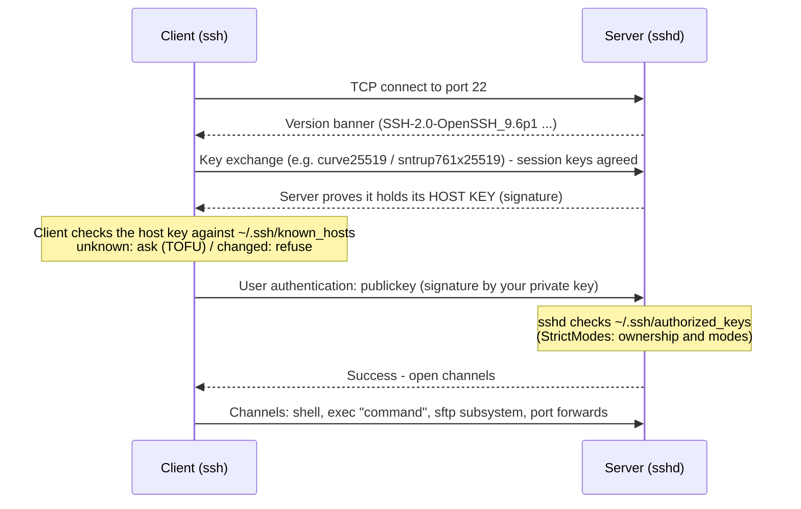
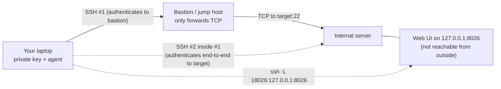
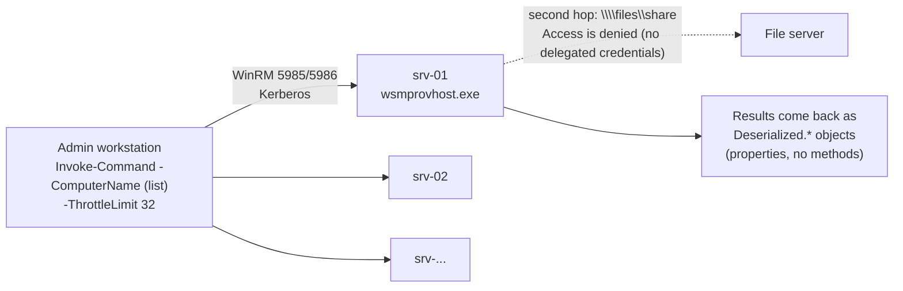

# Day 26: Remote Administration

!!! info "Lesson overview"
    | | |
    |---|---|
    | **Module** | 6 — Professional Operations & Projects |
    | **Difficulty** | :material-signal-cellular-3: Advanced |
    | **Estimated time** | 4–5 hours (90 min reading, 90 min demonstrations, 90–120 min lab and quiz) |
    | **Platforms** | Ubuntu 24.04 LTS (OpenSSH 9.6p1, rsync 3.2.7) · Windows 11 / Windows Server 2022 (Windows PowerShell 5.1 and PowerShell 7.4+, OpenSSH for Windows) |
    | **Lab** | [Lab 26: Secure Remote Access](../../labs/lab-26.md) |

Module 6 begins here. From now on the course assumes you work like a professional operator: on many machines, mostly remotely, with every change validated and every access traceable. Remote access is the foundation of all of that — and, because it is also the attacker's favourite way to move between machines, it is where good habits matter most.

## Learning Objectives

By the end of this lesson you will be able to:

1. Compare the main remote administration models — **SSH**, **WinRM/PowerShell Remoting** and **RDP**, in-band and out-of-band — and choose the right one for a task.
2. Explain the SSH protocol essentials: **host keys**, trust on first use, verifying a fingerprint **out of band** with `ssh-keyscan` and `ssh-keygen -lf`, hashed `known_hosts`, and the correct response to `REMOTE HOST IDENTIFICATION HAS CHANGED`.
3. Replace password logins with **keys**: generate an `ed25519` key with a passphrase, install it with `ssh-copy-id`, use `ssh-agent` safely, and avoid agent forwarding by using **ProxyJump**.
4. Diagnose **`authorized_keys` permission problems** (StrictModes) from the server log, and restrict keys with `from=`, `command=` and `restrict`.
5. Write a maintainable **`~/.ssh/config`** and run remote commands **non-interactively** — with correct local vs remote quoting, `BatchMode`, `ConnectTimeout`, exit codes and `ssh -n` in loops.
6. Transfer files with **`scp`**, **`sftp -b`** and **`rsync`** (dry run first, trailing-slash semantics) and build **`-L`, `-R` and `-D` tunnels** with their security implications.
7. **Harden `sshd`** on Ubuntu 24.04 with a drop-in file, understanding *first match wins*, validating with `sshd -t`/`sshd -T`, keeping a session open, reloading, and the `ssh.socket` port caveat.
8. Use **PowerShell Remoting**: WinRM ports and encryption, `Enable-PSRemoting`, `Test-WSMan`, `Enter-PSSession`, `Invoke-Command` fan-out with `-ThrottleLimit`, `$using:`, persistent sessions, `Copy-Item -ToSession`, deserialized objects, TrustedHosts caveats, the **second-hop problem** and its safe alternatives, and **JEA**.
9. Set up **PowerShell 7 remoting over SSH** between Linux and Windows, including the `Subsystem powershell` line and Windows OpenSSH Server with `administrators_authorized_keys`.
10. Hunt for **lateral movement** and abuse: which key logged in (fingerprints), unexpected `authorized_keys` entries, stolen keys, WinRM and PowerShell events, and tunnels used for exfiltration.

## Prerequisites

- [Day 06](../module-2/day-06.md) (users and groups) and [Day 07](../module-2/day-07.md) (permissions: `chmod 600`/`700` matter a lot today).
- [Days 11–15](../module-3/day-11.md) (networking, ports, DNS, `tcpdump`), which you will now run **remotely**.
- [Day 17](../module-4/day-17.md) (reading `sshd` log lines, `sshd -T`, Windows logon events) — today builds directly on it.
- [Days 21–25](../module-5/day-21.md) (scripts, loops, exit codes, scheduled jobs).
- Ubuntu 24.04 with `openssh-client` (always installed), `openssh-server` for the lab, and `rsync` (`sudo apt install openssh-server rsync`). A Windows 11 VM or Windows Server VM for the PowerShell part, ideally with PowerShell 7.4+ installed.
- **Safety:** practise only on machines you own — your VM, WSL2 or the lab's private `sshd` on `127.0.0.1:2222`. Never weaken a production server's SSH or WinRM configuration to "get something working".

## Introduction and Concepts

### Remote administration models

| Model | Protocol / port | Typical use | Strengths | Weaknesses |
|---|---|---|---|---|
| **SSH** | TCP 22 (`ssh`, `scp`, `sftp`, `rsync`, tunnels) | Linux, network devices, increasingly Windows | Strong crypto, keys, scriptable, file transfer and tunnels built in, universal | Key sprawl if unmanaged; tunnels can bypass firewalls |
| **WinRM / PowerShell Remoting** | TCP 5985 (HTTP) and 5986 (HTTPS), WS-Management | Windows servers and fleets | Kerberos single sign-on in a domain, **objects** returned, fan-out to hundreds of hosts, JEA | Windows-centric; workgroup setups are awkward (TrustedHosts, HTTPS certificates) |
| **PowerShell Remoting over SSH** | TCP 22 | Cross-platform PowerShell 7 | One transport for Linux and Windows, key-based | PowerShell 7 only, no Kerberos SSO, fewer enterprise controls than WinRM |
| **RDP** | TCP/UDP 3389 | Interactive GUI work on Windows | Full desktop | Not scriptable, heavy, a top ransomware entry point when exposed |
| **Out-of-band** | iDRAC/iLO/IPMI/BMC, serial console, hypervisor console, cloud serial console | Recovery when the OS or network is broken | Works when SSH does not (e.g. after a bad `sshd` change) | Powerful and often poorly secured — keep it on a separate management network |

**In-band** management travels over the same network and OS as the service (SSH, WinRM, RDP). **Out-of-band** management reaches the machine through a separate path (a BMC, a console server, the hypervisor). Before any risky remote change — firewall rules, `sshd` configuration, network interfaces — know your out-of-band path. That is the professional's real safety net.

### How an SSH connection works



Three facts follow from this picture:

- **The host key authenticates the server to you.** Encryption without host-key verification protects you from passive eavesdroppers only; an active attacker in the middle can present *their* key. That is why the first-connection question matters.
- **Your private key never leaves your machine.** The server sends a challenge; your client (or `ssh-agent`) signs it. The server stores only your **public** key.
- **Everything else is a channel**: an interactive shell, a remote command, the SFTP subsystem (used by `sftp` and, since OpenSSH 9.0, by `scp`), and TCP port forwards. One authenticated connection can carry many channels.

### Host keys and trust on first use

On the first connection to a host, `ssh` has nothing to compare and asks:

```text
The authenticity of host '[127.0.0.1]:2222 ([127.0.0.1]:2222)' can't be established.
ED25519 key fingerprint is SHA256:o/qhZftx7JopY2TFsRNbav8tMFad0jgMi94N4HFHUNQ.
Are you sure you want to continue connecting (yes/no/[fingerprint])?
```

Answering `yes` without checking is **trust on first use (TOFU)**: you trust whatever answered. The correct procedure is to obtain the fingerprint **out of band** — from the server's console (`ssh-keygen -lf /etc/ssh/ssh_host_ed25519_key.pub`), the cloud provider's console output, your configuration-management inventory, or a signed ticket — and compare. You can even **paste the expected fingerprint** at the prompt instead of `yes`; `ssh` accepts the key only if it matches.

After acceptance the key is stored in `~/.ssh/known_hosts`. Ubuntu's `/etc/ssh/ssh_config` sets `HashKnownHosts yes`, so entries look like `|1|O27F…=|Onjz…=` — the host name is hashed so that a stolen `known_hosts` file does not hand an attacker your list of servers. Use `ssh-keygen -F host` to find and `ssh-keygen -R host` to remove an entry; for non-standard ports the name is written `[host]:port`.

If the key **changes**, `ssh` refuses to connect with the famous `WARNING: REMOTE HOST IDENTIFICATION HAS CHANGED!`. There are two explanations: a legitimate change (reinstalled server, regenerated host keys, a different machine now has that IP) or an attack. The professional response:

1. **Stop.** Do not type passwords or run `ssh-keygen -R` yet.
2. Verify through another channel whether the host was rebuilt or its keys rotated (change ticket, console, colleague).
3. Only if the new fingerprint is confirmed, remove the old entry with `ssh-keygen -R '[host]:port'` and connect again, checking the new fingerprint.
4. If no one can explain the change, treat it as a **security incident**.

`StrictHostKeyChecking` controls the client's behaviour: `ask` (default — prompt for new keys, refuse changed keys), `accept-new` (add new keys automatically, still **refuse changed** ones — reasonable for automation inside a trusted network), `yes` (never add automatically; only pre-distributed keys) and `no` (accept new keys silently — changed keys are still refused for password authentication but the protection is much weaker; never use it in scripts as a "fix"). Large estates distribute host keys through configuration management or sign them with an **SSH certificate authority** (`@cert-authority` lines in `known_hosts`), which removes TOFU entirely.

### Authentication: keys, passphrases and the agent

| Method | Use | Notes |
|---|---|---|
| Password | Bootstrap only (to install a key) | Brute-forceable; disable on servers once keys work |
| **Public key** | The default for administrators and automation | Private key stays on the client; protect it with a passphrase |
| Keyboard-interactive | MFA prompts (TOTP via PAM) | `KbdInteractiveAuthentication`; disabled on Ubuntu by default |
| GSSAPI (Kerberos) | Domain-joined Linux | Single sign-on in AD/FreeIPA environments |
| Certificates | Large fleets | A CA signs user keys with an expiry — no `authorized_keys` sprawl |
| FIDO2 hardware keys (`ed25519-sk`) | High-value admins | Private key on a security key; touch required |

**Key types.** Use **`ed25519`**: short keys, fast, no parameter choices, and the default for `ssh-keygen` since OpenSSH 9.5. Use **RSA with at least 3072 bits** (`-t rsa -b 4096`) only for old systems that do not support ed25519 (some network appliances, very old servers). DSA keys are disabled in modern OpenSSH; ECDSA works but has no advantage over ed25519.

**Passphrases.** An unencrypted private key is a password written on a sticky note: anyone who copies the file (backup, stolen laptop, compromised home directory) becomes you on every server that trusts the key. A passphrase encrypts the key file; `-a 100` raises the number of key-derivation rounds so that guessing the passphrase is slower. Automation keys that cannot have a passphrase should be restricted with `authorized_keys` options instead (see below).

**`ssh-agent`** holds decrypted keys in memory so that you type the passphrase once per session; `ssh-add -t 1h` sets a lifetime, `ssh-add -l` lists loaded keys, `ssh-add -D` removes them. **Agent forwarding (`ssh -A`)** makes your agent available on the remote host — and therefore to **anyone with root on that host**, who can use your agent socket to log in wherever your keys work for as long as you stay connected. Do not forward your agent to machines you do not fully trust. To reach a server *behind* a bastion, use **`ProxyJump`** (`ssh -J bastion target`): the connection to the target is tunnelled through the bastion, but authentication to the target happens end-to-end from your own machine, so the bastion never sees your keys.



### `authorized_keys`: permissions and options

`sshd` reads the user's `~/.ssh/authorized_keys` (one public key per line). With **`StrictModes yes`** (the default) it **refuses** the file if the home directory, `~/.ssh` or the file itself is writable by anyone other than the user (or root) — because otherwise another user could add their own key. The required modes:

| Path | Mode | Why |
|---|---|---|
| `~` (home) | not group/world-writable (`755` or `750`, `700`) | Otherwise someone could replace `~/.ssh` |
| `~/.ssh` | `700` | Only the owner may add files |
| `~/.ssh/authorized_keys` | `600` (or `644`) | Only the owner may write |
| Private keys (client) | `600` | `ssh` refuses keys readable by others (`UNPROTECTED PRIVATE KEY FILE!`) |

The server logs `Authentication refused: bad ownership or modes for file /home/USER/.ssh/authorized_keys`, while the client only sees `Permission denied (publickey,…)` — you must read the **server** log to find the cause. (Debian and Ubuntu patch `sshd` to tolerate group-write when the group is the user's **private** group with no other members; a file writable by a shared group is still refused, as the lab demonstrates.)

Each key line can start with **options** that restrict what the key may do:

| Option | Effect |
|---|---|
| `from="192.0.2.10,198.51.100.0/24"` | Key accepted only from these source addresses |
| `command="/usr/local/bin/backup-receive"` | Forced command: whatever the client asks, this runs (the request is in `$SSH_ORIGINAL_COMMAND`) |
| `restrict` | Disables port, agent and X11 forwarding, PTY allocation and `~/.ssh/rc` — and any restriction added in future versions |
| `no-port-forwarding`, `no-agent-forwarding`, `no-pty` | Individual restrictions (older style) |
| `permitopen="127.0.0.1:5432"` | With forwarding allowed, only this destination |
| `expiry-time="20261231"` | Key stops working after this date |

A monitoring or backup key should look like `from="192.0.2.50",restrict,command="/usr/local/bin/report" ssh-ed25519 AAAA… monitor@nms`.

### PowerShell Remoting and WinRM

PowerShell Remoting traditionally runs over **WS-Management (WinRM)**:

- **Ports:** 5985 (HTTP) and 5986 (HTTPS). "HTTP" does **not** mean clear text: with Kerberos or NTLM (Negotiate) authentication, WinRM encrypts the message payload at the message level, and the service refuses unencrypted traffic by default (`AllowUnencrypted = false`). HTTPS adds TLS with a **server certificate**, which also authenticates the server when Kerberos cannot (workgroups, IP addresses).
- **Authentication:** in a domain, **Kerberos** gives mutual authentication (the client knows it reached the real server) and single sign-on. Kerberos needs **names**, not IP addresses; connecting by IP or to a workgroup machine falls back to NTLM, which does not authenticate the server — so the client refuses unless the target is HTTPS or listed in **TrustedHosts**.
- **TrustedHosts is not authentication.** Adding a computer to `WSMan:\localhost\Client\TrustedHosts` tells your client "I accept that I cannot verify this server's identity" — and it will send credentials to whatever answers at that name. Keep the list short, never use `*` outside an isolated lab, and prefer HTTPS listeners or SSH remoting.
- **Endpoints (session configurations):** `Microsoft.PowerShell` (Windows PowerShell 5.1) is the default. PowerShell 7's `Enable-PSRemoting` registers additional endpoints such as `PowerShell.7`; connect to them with `-ConfigurationName PowerShell.7`. By default only members of **Administrators** and **Remote Management Users** may connect.
- **`Enable-PSRemoting`** (elevated) starts the WinRM service and sets it to start automatically, creates an HTTP listener on all addresses, adds firewall exceptions, and registers and enables the session configurations. Remoting is **enabled by default on Windows Server** (2012 and later) and **disabled on Windows client** editions. On a client whose network profile is **Public**, `Enable-PSRemoting` refuses; `-SkipNetworkProfileCheck` lets it continue but the public-profile firewall rule then only allows the local subnet. Fix the profile instead (`Set-NetConnectionProfile -NetworkCategory Private`) where appropriate.



Key remoting behaviours:

- **1:1 interactive:** `Enter-PSSession -ComputerName srv-01` — the prompt becomes `[srv-01]: PS C:\>`. Leave with `Exit-PSSession` (or `exit`).
- **1:many fan-out:** `Invoke-Command -ComputerName (list) -ScriptBlock {…}` runs in parallel, at most **32** hosts at a time by default (`-ThrottleLimit`). Each result carries a `PSComputerName` property. Unreachable hosts produce errors, not output — collect them with `-ErrorVariable`.
- **Persistent sessions:** `New-PSSession` keeps a remote runspace alive; variables and imported modules survive between `Invoke-Command -Session` calls, and `Copy-Item -ToSession`/`-FromSession` (PowerShell 5.0+) copies files through it.
- **Passing values:** a script block runs on the remote machine, where your local variables do not exist. Use **`$using:name`** (PowerShell 3.0+) or `-ArgumentList` with a `param()` block.
- **Deserialized objects:** results are serialized to XML (CLIXML) and rebuilt locally as **property bags** with type names like `Deserialized.System.ServiceProcess.ServiceController`. Methods (`.Stop()`, `.Kill()`) are gone. Filter and act **remotely**, return only what you need.
- **The second hop:** inside a remote session your credentials are not delegated by default, so accessing a *third* machine (a file share, SQL server) fails with *Access is denied*. Safe options: run the command from your workstation against both machines; **resource-based Kerberos constrained delegation** (configured on the third machine, Windows Server 2012+); **JEA** endpoints that run as a virtual or group-managed service account; or pass an explicit credential into the script block. **CredSSP** solves it by sending your reusable credentials to the first server — if that server is compromised, so is your account. Avoid it.
- **JEA (Just Enough Administration)** is a constrained endpoint: a session configuration (`.pssc`, `SessionType RestrictedRemoteServer`) plus role capabilities (`.psrc`) listing exactly which cmdlets and parameters a group may run, usually as a temporary virtual account. It is the WinRM counterpart of `command=`/`restrict` in `authorized_keys`, and it is how help-desk staff can restart a service without being administrators.

### PowerShell 7 remoting over SSH

PowerShell 7 (not Windows PowerShell 5.1) can use **SSH as the transport**: `Enter-PSSession -HostName ubuntu-lab -UserName ops`, `New-PSSession -HostName … -KeyFilePath …`, `Invoke-Command -HostName …`. The client starts the OpenSSH client; the server's `sshd` starts PowerShell as an SSH **subsystem**, so the target needs PowerShell 7 and a line in `sshd_config`:

```text
# Linux (/etc/ssh/sshd_config or a drop-in)
Subsystem powershell /usr/bin/pwsh -sshs -nologo

# Windows ($env:ProgramData\ssh\sshd_config) - 8.3 short path because the path contains a space
Subsystem powershell c:/progra~1/powershell/7/pwsh.exe -sshs -nologo
```

The Microsoft documentation notes that the Windows path must avoid spaces (hence `progra~1`; check yours with `cmd /c dir /x C:\`). Older versions of the documentation also add `-NoProfile`. Restart `sshd` after the change. Authentication, host-key checking and keys are pure SSH — everything you learn today about SSH applies.

**Windows OpenSSH Server** is an optional feature on Windows 10 1809+/Server 2019+: `Add-WindowsCapability -Online -Name OpenSSH.Server~~~~0.0.1.0`, then `Start-Service sshd` and `Set-Service sshd -StartupType Automatic`. The installer adds the firewall rule `OpenSSH-Server-In-TCP`. Two Windows specifics: the configuration is `C:\ProgramData\ssh\sshd_config`, and for **members of the Administrators group** the default configuration reads keys from **`C:\ProgramData\ssh\administrators_authorized_keys`** (not the user's profile), which must be writable only by **Administrators and SYSTEM** — otherwise key login silently fails, just like StrictModes on Linux.

## Linux Command Reference

| Command | Purpose | Package / availability | Needs root? |
|---|---|---|---|
| `ssh` | Remote shell, remote commands, tunnels (`-L -R -D -J -N -f -t -n`) | openssh-client | No |
| `ssh -G host` | Print the effective client configuration for a host | openssh-client | No |
| `ssh-keygen` | Create keys (`-t ed25519 -a 100 -C -f`), fingerprints (`-lf`), `known_hosts` (`-F`, `-R`), passphrase change (`-p`) | openssh-client | No |
| `ssh-copy-id` | Append your public key to a remote `authorized_keys` | openssh-client | No |
| `ssh-agent`, `ssh-add` | Hold decrypted keys; `-l` list, `-t` lifetime, `-D` delete | openssh-client | No |
| `ssh-keyscan` | Fetch a server's public host key (does **not** verify it) | openssh-client | No |
| `scp` | Copy files (SFTP protocol by default since 9.0; `-O` legacy) | openssh-client | No |
| `sftp` | Interactive or batch (`-b`) file transfer | openssh-client | No |
| `rsync` | Incremental copy over SSH (`-a -v -z -n -i --delete`) | rsync (both ends) | No |
| `sshd -t` / `sshd -T` | Test config syntax / print the effective server config | openssh-server | Yes |
| `systemctl reload ssh` | Re-read `sshd` config (Ubuntu unit `ssh`; RHEL `sshd`) | systemd | Yes |
| `systemctl restart ssh.socket` | Apply `Port`/`ListenAddress` changes on Ubuntu 24.04 (after `daemon-reload`) | systemd | Yes |
| `script` | Record a terminal session to a file | util-linux (`bsdutils`) | No |
| `journalctl _COMM=sshd` | sshd log lines ([Day 17](../module-4/day-17.md)) | systemd | Group `adm` or root |

## PowerShell Command Reference

| Cmdlet / tool | Aliases | Purpose | 5.1 | 7.x | Admin? |
|---|---|---|---|---|---|
| `Enable-PSRemoting` | — | Configure WinRM listener, firewall, endpoints | Yes | Yes (registers PowerShell 7 endpoints) | **Yes** |
| `Disable-PSRemoting` | — | Deny remote access to the endpoints (does not undo everything) | Yes | Yes | **Yes** |
| `Test-WSMan` | — | Is WinRM answering on a host? | Yes | Yes (Windows) | No |
| `Enter-PSSession` / `Exit-PSSession` | `etsn` / `exsn` | Interactive 1:1 remote session | Yes | Yes (`-HostName` = SSH, 7 only) | Endpoint permissions |
| `Invoke-Command` | `icm` | Run a script block on one or many hosts (`-ThrottleLimit` 32) | Yes | Yes | Endpoint permissions |
| `New-PSSession`, `Get-PSSession`, `Remove-PSSession` | `nsn`, `gsn`, `rsn` | Persistent sessions | Yes | Yes | Endpoint permissions |
| `Copy-Item -ToSession` / `-FromSession` | `cp`, `copy` | Copy files through a session | Yes (5.0+) | Yes | No |
| `Get-PSSessionConfiguration` | — | List endpoints and their permissions | Yes | Yes (Windows) | **Yes** |
| `Register-PSSessionConfiguration`, `New-PSSessionConfigurationFile`, `New-PSRoleCapabilityFile` | — | Build JEA endpoints | Yes | Yes (Windows) | **Yes** |
| `WSMan:` drive (`Get-Item`, `Set-Item`) | — | WinRM configuration, TrustedHosts | Yes | Yes (Windows) | Set: **Yes** |
| `winrm quickconfig`, `winrm enumerate winrm/config/listener` | — | Native WinRM tool | Windows | Windows | **Yes** |
| `Get-WindowsCapability` / `Add-WindowsCapability` | — | Install OpenSSH Server/Client feature | Windows | Windows (Windows PowerShell module) | **Yes** |
| `Start-Service sshd`, `Set-Service` | `sasv` | Run Windows OpenSSH Server | Yes | Yes | **Yes** |
| `ssh.exe`, `scp.exe`, `sftp.exe`, `ssh-keygen.exe`, `ssh-agent` service | — | OpenSSH client on Windows (same options as Linux) | Windows 10 1809+ | Yes | No |
| `Start-Transcript` | — | Record a PowerShell session | Yes | Yes | No |

All WinRM cmdlets are **Windows-only** as servers. PowerShell 7 on Linux/macOS can be a **client** for WinRM only in limited cases; use SSH transport there.

## Detailed Command Explanations

### `ssh` — remote shells and remote commands

`ssh [options] [user@]host [command]`. Without a command you get an interactive login shell; with a command, `ssh` runs it through the remote user's shell, returns its output and exits with the **remote command's exit status** — or **255** if `ssh` itself failed (connection refused, authentication, host key). That makes `ssh` scriptable: `if ssh host 'systemctl is-active --quiet nginx'; then …`.

**Quoting decides where expansion happens.** `ssh` joins its arguments with spaces and hands the string to the **remote** shell. Your **local** shell has already processed the command line:

- `ssh host "echo $HOME"` — double quotes: the **local** shell expands `$HOME` to *your* home before `ssh` runs.
- `ssh host 'echo $HOME'` — single quotes: the text arrives unchanged and the **remote** shell expands it.
- `ssh host ls ~` — an unquoted `~` is expanded locally to `/home/student`, which then does not exist (or is not readable) remotely.
- To pass a local value safely into a remote command, quote it for the remote shell: `ssh host "grep -c -- $(printf '%q' "$pattern") /var/log/syslog"`; for anything non-trivial, send a script on stdin: `ssh host 'bash -s' < check.sh`.

Other important options: `-p PORT`, `-i KEYFILE`, `-l USER`, `-o Option=value` (any `ssh_config` keyword), `-t` force a pseudo-terminal (needed for `sudo` password prompts, `top`, `vim`), `-T` disable it, `-n` stdin from `/dev/null`, `-v`/`-vvv` debug, `-J` jump hosts, `-L`/`-R`/`-D` forwards, `-N` no command, `-f` background after authentication, `-q` quiet.

### `~/.ssh/config` — the client configuration

`ssh` reads command-line options, then `~/.ssh/config`, then `/etc/ssh/ssh_config` (and its `ssh_config.d/*.conf`). For each keyword **the first obtained value wins**, so put **specific `Host` blocks first and wildcard defaults last**.

```text
Host bastion
    HostName bastion.example.net
    User ops

Host web-* db-*
    ProxyJump bastion
    User ops

Host *
    IdentityFile ~/.ssh/id_ed25519
    IdentitiesOnly yes
    ServerAliveInterval 30
```

| Keyword | Meaning |
|---|---|
| `Host` | Patterns (aliases) this block applies to; `*` and `?` wildcards, `!` negation |
| `HostName` | Real name or address to connect to |
| `User`, `Port` | Login name and port |
| `IdentityFile` | Key(s) to offer |
| `IdentitiesOnly yes` | Offer **only** the configured keys, not every key in the agent — avoids `Too many authentication failures` with `MaxAuthTries` |
| `ProxyJump` | Jump host(s), comma-separated for chains (`-J` on the command line) |
| `ConnectTimeout` | Seconds to wait for the TCP connection |
| `BatchMode yes` | Never prompt (passwords, passphrases, host keys): fail instead — for scripts |
| `StrictHostKeyChecking` | `ask` / `accept-new` / `yes` / `no` (see Concepts) |
| `ServerAliveInterval` | Keepalive messages; detects dead connections |
| `ForwardAgent` | Agent forwarding — leave `no` |
| `Include` | Read other files (put it near the top; relative paths are under `~/.ssh`) |

`ssh -G alias` prints the configuration that would be used — the client equivalent of `sshd -T`.

### `ssh-keygen` — keys, fingerprints and known_hosts

| Task | Command |
|---|---|
| New key with passphrase | `ssh-keygen -t ed25519 -a 100 -C "you@host purpose 2026-11" -f ~/.ssh/id_ed25519_work` |
| RSA for legacy systems | `ssh-keygen -t rsa -b 4096 -a 100 -C … -f …` |
| Fingerprint of a key or of **every key in a file** | `ssh-keygen -lf ~/.ssh/id_ed25519.pub` · `ssh-keygen -lf ~/.ssh/authorized_keys` · `ssh-keygen -lf known_hosts_scan.txt` |
| Change/add a passphrase | `ssh-keygen -p -f ~/.ssh/id_ed25519` |
| Find / remove a known host | `ssh-keygen -F '[host]:2222'` · `ssh-keygen -R '[host]:2222'` (keeps `known_hosts.old`) |
| Public key from a private key | `ssh-keygen -y -f ~/.ssh/id_ed25519` |

`-C` is only a comment, but a good one (`who@where purpose date`) makes `authorized_keys` audits possible. Fingerprints are printed as `SHA256:` + base64; older tools may show MD5 (`ssh-keygen -E md5 -lf …`).

### `ssh-copy-id` — installing a key

`ssh-copy-id -i ~/.ssh/key.pub [-p PORT] user@host` logs in (normally with the password), creates `~/.ssh` with safe permissions if needed and **appends** the key to `authorized_keys`. It first tries the key itself and skips keys that already work. It does **not** fix wrong permissions on existing files. The manual equivalent is `cat key.pub | ssh user@host 'umask 077; mkdir -p ~/.ssh && cat >> ~/.ssh/authorized_keys'`. On a Windows target `ssh-copy-id` does not work as-is (no POSIX shell); copy the key into the right file and set ACLs (see Windows OpenSSH below).

### `ssh-keyscan` — collecting host keys

`ssh-keyscan -p 2222 -t ed25519 host` prints the host's public key in `known_hosts` format. It **does not verify anything** — it asks the network, so an attacker in the path can answer. Use it to *collect* keys, then compare the fingerprint (`ssh-keygen -lf file`) with the out-of-band value before appending to `known_hosts`.

### `scp`, `sftp` and `rsync`

- **`scp`** `[-P port] [-r] [-p] src… dest` copies files; note **capital `-P`** for the port (lower-case `-p` preserves times). Since **OpenSSH 9.0**, `scp` uses the **SFTP protocol** by default, which removes the old remote-shell glob and quoting problems; `-O` forces the legacy SCP protocol for old servers without an SFTP subsystem.
- **`sftp`** opens an FTP-like session over SSH: `put`, `get`, `ls`, `cd`, `mkdir`, `rm`, `chmod`. **`sftp -b batchfile host`** runs commands non-interactively and **aborts with exit status 1 on the first failing command** (prefix a command with `-` to ignore its failure). Requires non-interactive authentication.
- **`rsync -a`** (archive = recursive, keep permissions, times, symlinks, owner/group when root) copies only differences, over SSH by default for `host:path` destinations; `rsync` must be installed on **both** ends. `-z` compresses, `-v` lists files, `-i` itemizes *why* each file is transferred (`<f..t......` = sent, time differs), `-n`/`--dry-run` shows what would happen. **Trailing slash:** `rsync -a deploy/ host:deploy/` copies the **contents** of `deploy`; `rsync -a deploy host:deploy/` creates `deploy/deploy`. **`--delete`** removes files on the destination that are missing at the source — always run it with `--dry-run` first and read the `*deleting` lines. Use `-e 'ssh -p 2222'` for options, or simply an alias from `~/.ssh/config`.

### Port forwarding (tunnels)

| Option | Direction | Example | Use |
|---|---|---|---|
| `-L [bind:]lport:host:hport` | **Local**: a port on *your* machine forwards to `host:hport` as seen **from the server** | `ssh -L 18026:127.0.0.1:8026 srv` | Reach a web UI or database that listens only on the server's loopback |
| `-R [bind:]rport:host:hport` | **Remote**: a port on the *server* forwards back to `host:hport` as seen from **your** side | `ssh -R 9000:127.0.0.1:3000 srv` | Expose a local service to the server (demos, reverse support) — and a classic **backdoor** pattern |
| `-D [bind:]port` | **Dynamic** SOCKS proxy | `ssh -D 1080 bastion` | Browse an internal network through the server |
| `-N` / `-f` | No remote command / go to background after auth | `ssh -f -N -L …` | Tunnel-only sessions |
| `-o ExitOnForwardFailure=yes` | Fail if the forward cannot be set up | | Scripts |

By default forwards bind to `127.0.0.1` only (`GatewayPorts no`); binding to `0.0.0.0` exposes the tunnel to your whole network. On the server, **`AllowTcpForwarding`** (`yes` | `no` | `local` | `remote` | `all`), `PermitOpen`, `PermitListen` and `DisableForwarding` control what tunnels are allowed. Tunnels are powerful *because* they bypass network controls — which is exactly why security teams watch for them.

### `sshd` configuration and hardening

On Ubuntu 24.04 the server configuration is `/etc/ssh/sshd_config`, whose first active line is `Include /etc/ssh/sshd_config.d/*.conf`. Because **the first obtained value wins** for most keywords (sshd_config(5)), and the drop-ins are included **at the top**, a setting in a drop-in **overrides** the same setting later in the main file, and among the drop-ins the file that sorts **first** wins: `10-hardening.conf` beats `50-cloud-init.conf` (cloud images often ship a `50-cloud-init.conf` with `PasswordAuthentication yes`). Put your hardening in a low-numbered drop-in and verify the **effective** result with `sshd -T`. `Match` blocks (for example `Match Group sftp-only`) must come at the end of a file.

A sensible baseline:

```text
# /etc/ssh/sshd_config.d/10-hardening.conf
PasswordAuthentication no
KbdInteractiveAuthentication no
PermitRootLogin no              # or prohibit-password if root needs key access (the default)
MaxAuthTries 3
LoginGraceTime 30
AllowGroups ssh-users           # only members may log in at all
AllowAgentForwarding no
AllowTcpForwarding no           # or "local" on bastions that must allow ProxyJump / -L
X11Forwarding no
LogLevel VERBOSE                # logs key fingerprints of attempts as well
```

**Change procedure** (a bad `sshd` change can lock everyone out):

1. Keep an **existing root/sudo session open** (and know the out-of-band console).
2. Back up: `sudo cp -a /etc/ssh/sshd_config.d /root/sshd_config.d.bak-$(date +%F)`.
3. Edit the drop-in; confirm a key login works for the accounts in `AllowGroups` **before** disabling passwords.
4. `sudo sshd -t` — no output and exit status 0 means valid. It reports the file and line of errors.
5. `sudo sshd -T | grep -Ei '^(passwordauthentication|permitrootlogin|maxauthtries|allowgroups) '` — effective values.
6. `sudo systemctl reload ssh` — existing sessions survive a reload (and a restart).
7. From a **second terminal**, test a new key login and confirm a password login is now refused. Only then close the safety session.

**Ubuntu 24.04 socket activation.** `ssh.socket` listens on port 22 and starts `ssh.service` when a connection arrives. A generator (`sshd-socket-generator`) reads `Port`, `ListenAddress` and `AddressFamily` from `sshd_config` and writes the socket's listening addresses; the shipped `sshd_config` says: after changing them run `systemctl daemon-reload` and `systemctl restart ssh.socket`. [Day 17](../module-4/day-17.md) introduced this; the practical rule is *Port changes need the socket, other changes need `reload`*. If `ssh.service` is inactive (no connection since boot), `systemctl reload ssh` reports that the unit is not active — the next connection starts a fresh `sshd`, which reads the new configuration anyway. **RHEL/Rocky/Alma** use `sshd.service` without socket activation, ship `/etc/ssh/sshd_config.d/50-redhat.conf`, and require an SELinux port label for a new port (`semanage port -a -t ssh_port_t -p tcp 2222`).

### Logging what you did

Remote administration must leave a trail:

- `sshd` logs every login with method, source and — for keys — the **fingerprint** (`Accepted publickey for ops from 192.0.2.10 port 51514 ssh2: ED25519 SHA256:…`). Map a fingerprint to a key with `ssh-keygen -lf ~ops/.ssh/authorized_keys`, which is why good key comments matter.
- `sudo` logs every privileged command ([Day 17](../module-4/day-17.md)).
- `script -q -a ~/sessions/$(date +%F)-web-01.log -c 'ssh web-01'` records a whole terminal session for a change record (it records everything, including secrets you type — store it carefully). PowerShell's equivalent is `Start-Transcript`.
- For servers where you must prove what *anyone* ran, use **auditd** (`execve` rules, `ausearch -k`) or `pam_tty_audit`, shipped to a central log store — a user can edit their own history, not the audit trail.

## Syntax and Parameters

### Bash

```text
ssh [-p PORT] [-i KEY] [-J JUMP] [-L [B:]P:H:HP] [-R [B:]P:H:HP] [-D [B:]P] [-N] [-f] [-n] [-t|-T]
    [-o Option=value]... [-v] [user@]host [command]
ssh -G host                              # effective client config
ssh-keygen -t ed25519 [-a ROUNDS] [-C COMMENT] [-f FILE] [-N PASSPHRASE]
ssh-keygen -lf FILE        ssh-keygen -F HOST        ssh-keygen -R HOST        ssh-keygen -p -f KEY
ssh-copy-id [-i KEY.pub] [-p PORT] user@host
ssh-keyscan [-p PORT] [-t TYPE] host
eval "$(ssh-agent -s)"      ssh-add [-t LIFE] [KEY]      ssh-add -l      ssh-add -D      ssh-agent -k
scp [-P PORT] [-r] [-p] [-O] SRC... DEST        (remote paths: host:path)
sftp [-P PORT] [-b BATCHFILE] host
rsync [-a] [-v] [-z] [-i] [-n|--dry-run] [--delete] [-e 'ssh OPTS'] SRC... [host:]DEST
sshd -t [-f CONFIG]         sshd -T [-f CONFIG] [-C user=U,host=H,addr=A]
```

| Item | Meaning |
|---|---|
| `-o BatchMode=yes` | Never prompt; fail with exit 255 instead |
| `-o ConnectTimeout=5` | Give up connecting after 5 s |
| `-o StrictHostKeyChecking=accept-new` | Add unknown host keys, refuse changed ones |
| `-o IdentitiesOnly=yes` | Offer only the keys you name |
| `-o ExitOnForwardFailure=yes` | Fail when a forward cannot be set up |
| `ssh host 'cmd'` vs `"cmd"` | Remote vs local expansion |
| exit status `255` | `ssh` itself failed; otherwise the remote command's status |
| `rsync src/ dst/` | Copy **contents** of `src` |
| `sshd -T -C user=…,host=…,addr=…` | Effective config including `Match` blocks for that connection |

### PowerShell

```text
Enable-PSRemoting [-Force] [-SkipNetworkProfileCheck]
Test-WSMan [[-ComputerName] <string>] [-UseSSL] [-Authentication <mech>]
Enter-PSSession [-ComputerName] <string> [-Credential <pscredential>] [-ConfigurationName <string>] [-UseSSL]
Enter-PSSession -HostName <string> [-UserName <string>] [-KeyFilePath <string>] [-Port <int>] [-SSHTransport]   # 7.x
Invoke-Command [-ComputerName] <string[]> [-ScriptBlock] <scriptblock> [-ArgumentList <object[]>]
               [-ThrottleLimit <int>] [-AsJob] [-HideComputerName] [-ErrorVariable <string>] [-Credential …]
Invoke-Command -Session <PSSession[]> [-ScriptBlock] <scriptblock> | -FilePath <string>
Invoke-Command -HostName <string[]> [-UserName …] [-KeyFilePath …] -ScriptBlock …                             # 7.x
New-PSSession [-ComputerName] <string[]> | -HostName <string[]>     Get-PSSession     Remove-PSSession
Copy-Item -Path <string> -Destination <string> -ToSession <PSSession> | -FromSession <PSSession>
Get-Item WSMan:\localhost\Client\TrustedHosts       Set-Item WSMan:\localhost\Client\TrustedHosts -Value <list> [-Concatenate]
Get-WindowsCapability -Online -Name OpenSSH*        Add-WindowsCapability -Online -Name OpenSSH.Server~~~~0.0.1.0
```

| Parameter | Meaning |
|---|---|
| `-ThrottleLimit` | Maximum concurrent connections (default 32) |
| `$using:var` | Use a local variable's value inside a remote script block (3.0+) |
| `-ArgumentList` + `param()` | Pass values positionally |
| `-FilePath` | Send a local `.ps1` to run remotely (it need not exist on the target) |
| `-AsJob` | Return a job immediately; `Receive-Job` later |
| `-ConfigurationName` | Endpoint: `Microsoft.PowerShell` (default), `PowerShell.7`, a JEA endpoint |
| `-HostName` / `-UserName` / `-KeyFilePath` | SSH transport (PowerShell 7) |
| `-SSHTransport` | Use SSH with `-ComputerName`-style parameter set (7.x) |
| `-SkipNetworkProfileCheck` | Allow `Enable-PSRemoting` on a client with a Public network (local subnet only) |

## Practical Demonstrations

The **Bash** outputs below were **captured** on 2026-11-19 on Ubuntu 24.04.5 (OpenSSH 9.6p1 Ubuntu-3ubuntu13.20, rsync 3.2.7) in a container: the "server" is a separate `sshd` started by hand on `127.0.0.1:2222` with its own configuration, host key and log file (`/usr/sbin/sshd -f /srv/lab26/sshd_config -E /srv/lab26/logs/sshd.log`) — exactly what the Lab 26 setup script builds — with the throwaway accounts `student` (client) and `lab26-ops` (target). The host name is shown as `ubuntu-lab`. All keys and fingerprints are throwaway lab values and will differ on your machine. Passphrase and password prompts were answered by an `SSH_ASKPASS` helper during capture, so they do not appear in the output. The **PowerShell** outputs are **examples** based on the documented behaviour; Windows and PowerShell were not available on the capture host.

### Demo 1 — Verify a host key out of band, then connect

=== "Bash"

    ```bash
    # The fingerprint the server team gave you (out of band - here a file the setup script wrote):
    cat /srv/lab26/hostkey-fingerprint.txt
    # What the network says:
    ssh-keyscan -p 2222 -t ed25519 127.0.0.1 2>/dev/null > /tmp/scan.txt
    ssh-keygen -lf /tmp/scan.txt
    # First interactive connection: compare before answering
    ssh -p 2222 lab26-ops@127.0.0.1
    # In scripts: add unknown keys, but still refuse changed keys
    ssh -o StrictHostKeyChecking=accept-new -o BatchMode=yes -p 2222 lab26-ops@127.0.0.1 true
    head -c 60 ~/.ssh/known_hosts; echo
    ```

    **Expected output (captured):**

    ```text
    256 SHA256:o/qhZftx7JopY2TFsRNbav8tMFad0jgMi94N4HFHUNQ lab26-hostkey (ED25519)
    256 SHA256:o/qhZftx7JopY2TFsRNbav8tMFad0jgMi94N4HFHUNQ [127.0.0.1]:2222 (ED25519)
    The authenticity of host '[127.0.0.1]:2222 ([127.0.0.1]:2222)' can't be established.
    ED25519 key fingerprint is SHA256:o/qhZftx7JopY2TFsRNbav8tMFad0jgMi94N4HFHUNQ.
    This key is not known by any other names.
    Are you sure you want to continue connecting (yes/no/[fingerprint])? no
    Host key verification failed.
    Warning: Permanently added '[127.0.0.1]:2222' (ED25519) to the list of known hosts.
    lab26-ops@127.0.0.1: Permission denied (publickey,password).
    |1|O27F0k4dzSh1YSubJ5gJ3VB/9YY=|OnjzCvCCpTM3Nbnf2cxknKaZuME=
    ```

    The two fingerprints match, so the key is genuine. At the prompt you may answer `yes` or paste the expected `SHA256:…` string. The `accept-new` run added the key and then failed authentication (no key installed yet, and `BatchMode` forbids the password prompt) — host verification and user authentication are separate steps. `|1|…` shows the hashed `known_hosts` format.

    When a stored key no longer matches (simulated here with a known_hosts file holding a different key):

    ```text
    @@@@@@@@@@@@@@@@@@@@@@@@@@@@@@@@@@@@@@@@@@@@@@@@@@@@@@@@@@@
    @    WARNING: REMOTE HOST IDENTIFICATION HAS CHANGED!     @
    @@@@@@@@@@@@@@@@@@@@@@@@@@@@@@@@@@@@@@@@@@@@@@@@@@@@@@@@@@@
    IT IS POSSIBLE THAT SOMEONE IS DOING SOMETHING NASTY!
    Someone could be eavesdropping on you right now (man-in-the-middle attack)!
    It is also possible that a host key has just been changed.
    The fingerprint for the ED25519 key sent by the remote host is
    SHA256:o/qhZftx7JopY2TFsRNbav8tMFad0jgMi94N4HFHUNQ.
    Please contact your system administrator.
    Add correct host key in /home/student/.ssh/known_hosts to get rid of this message.
    Offending ED25519 key in /home/student/.ssh/known_hosts:1
      remove with:
      ssh-keygen -f '/home/student/.ssh/known_hosts' -R '[127.0.0.1]:2222'
    Host key for [127.0.0.1]:2222 has changed and you have requested strict checking.
    Host key verification failed.
    ```

    Only after confirming the new fingerprint out of band: `ssh-keygen -R '[127.0.0.1]:2222'` (it keeps `known_hosts.old`).

=== "PowerShell"

    ```powershell
    # WinRM: is the service answering? (Kerberos authenticates the server in a domain)
    Test-WSMan -ComputerName localhost
    # Windows OpenSSH client uses exactly the same host-key logic as Linux:
    ssh-keyscan.exe -t ed25519 ubuntu-lab | Out-File -Encoding ascii $env:TEMP\scan.txt
    ssh-keygen.exe -lf $env:TEMP\scan.txt
    Get-Content $HOME\.ssh\known_hosts -TotalCount 1
    ```

    **Expected output (example):**

    ```text
    wsmid           : http://schemas.dmtf.org/wbem/wsman/identity/1/wsmanidentity.xsd
    ProtocolVersion : http://schemas.dmtf.org/wbem/wsman/1/wsman.xsd
    ProductVendor   : Microsoft Corporation
    ProductVersion  : OS: 0.0.0 SP: 0.0 Stack: 3.0

    256 SHA256:o/qhZftx7JopY2TFsRNbav8tMFad0jgMi94N4HFHUNQ ubuntu-lab (ED25519)
    ubuntu-lab ssh-ed25519 AAAAC3NzaC1lZDI1NTE5AAAAIBA6uXN3fNA5VblkZJ+HFlF69qfDp8ApDcsPDICWBcVw
    ```

    `Test-WSMan` without `-Authentication` is anonymous — it proves WinRM listens, not that you may log in. Windows' OpenSSH client does not hash `known_hosts` by default (`HashKnownHosts` is a Debian/Ubuntu default).

### Demo 2 — Generate a key with a passphrase and load it into the agent

=== "Bash"

    ```bash
    ssh-keygen -t ed25519 -a 100 -C "student@ubuntu-lab lab26 2026-11" -f ~/.ssh/lab26_ed25519
    ls -l ~/.ssh
    ssh -o BatchMode=yes lab26-srv true; echo "exit=$?"     # passphrase needed, no agent yet
    eval "$(ssh-agent -s)"
    ssh-add -t 1h ~/.ssh/lab26_ed25519
    ssh-add -l
    ```

    **Expected output (captured):**

    ```text
    Generating public/private ed25519 key pair.
    Your identification has been saved in /home/student/.ssh/lab26_ed25519
    Your public key has been saved in /home/student/.ssh/lab26_ed25519.pub
    The key fingerprint is:
    SHA256:hIabfdxph1zHRtX1u4mTJRTDkkB0yOs9APoq0352Ewo student@ubuntu-lab lab26 2026-11
    The key's randomart image is:
    +--[ED25519 256]--+
    |        ++o.oo..=|
    |     . o o.o +o o|
    |    . + o . o.+ .|
    |     * o = +.o  .|
    |    o o S O .. o |
    |     E o + +  = o|
    |    . o . . .+ o |
    |   o o + o    .  |
    |    +.o . .      |
    +----[SHA256]-----+
    total 12
    -rw-r--r-- 1 student student 142 Nov 19 16:48 known_hosts
    -rw------- 1 student student 484 Nov 19 16:48 lab26_ed25519
    -rw-r--r-- 1 student student 114 Nov 19 16:48 lab26_ed25519.pub
    lab26-ops@127.0.0.1: Permission denied (publickey,password).
    exit=255
    Identity added: /home/student/.ssh/lab26_ed25519 (student@ubuntu-lab lab26 2026-11)
    Lifetime set to 3600 seconds
    256 SHA256:hIabfdxph1zHRtX1u4mTJRTDkkB0yOs9APoq0352Ewo student@ubuntu-lab lab26 2026-11 (ED25519)
    ```

    `ssh-keygen` created the private key with mode `600` automatically. With `BatchMode=yes`, `ssh` cannot ask for the passphrase, so the key is unusable until it is in the agent — the same reason cron jobs fail with passphrase-protected keys (use a dedicated, restricted automation key or an agent you manage).

=== "PowerShell"

    ```powershell
    # Windows OpenSSH client (Windows 10 1809+): the agent is a Windows service, disabled by default
    Get-Service ssh-agent | Set-Service -StartupType Manual      # elevated, once
    Start-Service ssh-agent
    ssh-keygen.exe -t ed25519 -a 100 -C "student@win11 lab26 2026-11" -f $HOME\.ssh\lab26_ed25519
    ssh-add.exe $HOME\.ssh\lab26_ed25519
    ssh-add.exe -l
    ```

    **Expected output (example):**

    ```text
    Identity added: C:\Users\student\.ssh\lab26_ed25519 (student@win11 lab26 2026-11)
    256 SHA256:Xq3J0ZpN6tq5m0Q2y4m3HnW2X2yq0b6eP0x7a8cKk1E student@win11 lab26 2026-11 (ED25519)
    ```

    Unlike Linux, the Windows `ssh-agent` service stores added keys **persistently** (protected for your user) until you run `ssh-add -D`, so lifetimes (`-t`) matter even more.

### Demo 3 — Install the key and fix a permission problem

=== "Bash"

    ```bash
    ssh-copy-id -i ~/.ssh/lab26_ed25519.pub -p 2222 lab26-ops@127.0.0.1     # asks for the password once
    ssh -o PasswordAuthentication=no -i ~/.ssh/lab26_ed25519 -p 2222 lab26-ops@127.0.0.1 id
    sudo tail -4 /srv/lab26/logs/sshd.log                                   # the SERVER says why
    # Inspect and fix over a password session (or as root on the console):
    ssh -o PubkeyAuthentication=no -p 2222 lab26-ops@127.0.0.1 \
        'ls -l ~/.ssh/authorized_keys; ssh-keygen -lf ~/.ssh/authorized_keys'
    ssh -o PubkeyAuthentication=no -p 2222 lab26-ops@127.0.0.1 \
        'cp -p ~/.ssh/authorized_keys ~/.ssh/authorized_keys.bak-lab26 &&
         sed -i "/contractor@old-laptop/d" ~/.ssh/authorized_keys &&
         chmod 600 ~/.ssh/authorized_keys && chmod 700 ~/.ssh && ls -l ~/.ssh'
    ssh -o PasswordAuthentication=no -i ~/.ssh/lab26_ed25519 -p 2222 lab26-ops@127.0.0.1 'id; hostname'
    ```

    **Expected output (captured):**

    ```text
    /usr/bin/ssh-copy-id: INFO: Source of key(s) to be installed: "/home/student/.ssh/lab26_ed25519.pub"
    /usr/bin/ssh-copy-id: INFO: attempting to log in with the new key(s), to filter out any that are already installed
    /usr/bin/ssh-copy-id: INFO: 1 key(s) remain to be installed -- if you are prompted now it is to install the new keys

    Number of key(s) added: 1

    Now try logging into the machine, with:   "ssh -p 2222 'lab26-ops@127.0.0.1'"
    and check to make sure that only the key(s) you wanted were added.

    lab26-ops@127.0.0.1: Permission denied (publickey,password).
    Connection from 127.0.0.1 port 41260 on 127.0.0.1 port 2222 rdomain ""
    Authentication refused: bad ownership or modes for file /home/lab26-ops/.ssh/authorized_keys
    Failed publickey for lab26-ops from 127.0.0.1 port 41260 ssh2: ED25519 SHA256:hIabfdxph1zHRtX1u4mTJRTDkkB0yOs9APoq0352Ewo
    Connection closed by authenticating user lab26-ops 127.0.0.1 port 41260 [preauth]
    -rw-rw-r-- 1 lab26-ops lab26-ssh 217 Nov 19 16:48 /home/lab26-ops/.ssh/authorized_keys
    256 SHA256:hPIt3wpFPsarNe8OVRtGTOlGTBsktUSUCuzKQyhTqv4 contractor@old-laptop (ED25519)
    256 SHA256:hIabfdxph1zHRtX1u4mTJRTDkkB0yOs9APoq0352Ewo student@ubuntu-lab lab26 2026-11 (ED25519)
    total 8
    -rw------- 1 lab26-ops lab26-ssh 114 Nov 19 16:49 authorized_keys
    -rw-rw-r-- 1 lab26-ops lab26-ssh 217 Nov 19 16:48 authorized_keys.bak-lab26
    uid=30034(lab26-ops) gid=30035(lab26-ops) groups=30035(lab26-ops),30034(lab26-ssh)
    ubuntu-lab
    ```

    Three lessons in one demo. (1) The client only says `Permission denied`; the **server log** names the real cause — `authorized_keys` is writable by the shared group `lab26-ssh`. (2) `ssh-keygen -lf` on `authorized_keys` revealed a **second key nobody expected** (`contractor@old-laptop`) — it was removed. (3) `cp -p` preserved the bad mode on the backup; use `install -m 600 src dst` (the lab solution does) or `chmod 600` the backup too.

=== "PowerShell"

    ```powershell
    # Windows OpenSSH Server (elevated): install, start, and authorise a key for an ADMINISTRATOR account
    Get-WindowsCapability -Online -Name OpenSSH* | Select-Object Name, State
    Add-WindowsCapability -Online -Name OpenSSH.Server~~~~0.0.1.0
    Start-Service sshd; Set-Service -Name sshd -StartupType Automatic
    Get-NetFirewallRule -Name OpenSSH-Server-In-TCP | Select-Object Name, Enabled
    $f = "$env:ProgramData\ssh\administrators_authorized_keys"
    Get-Content \\fileserver\keys\student-lab26.pub | Add-Content -Path $f -Encoding ascii
    icacls.exe $f /inheritance:r /grant "Administrators:F" /grant "SYSTEM:F"
    ```

    **Expected output (example):**

    ```text
    Name                           State
    ----                           -----
    OpenSSH.Client~~~~0.0.1.0      Installed
    OpenSSH.Server~~~~0.0.1.0      NotPresent

    Path          :
    Online        : True
    RestartNeeded : False

    Name                  Enabled
    ----                  -------
    OpenSSH-Server-In-TCP    True

    processed file: C:\ProgramData\ssh\administrators_authorized_keys
    Successfully processed 1 files; Failed processing 0 files
    ```

    For non-administrator accounts the key goes in `C:\Users\NAME\.ssh\authorized_keys`. If an administrator's key "does not work", check that it is in `administrators_authorized_keys`, that the ACL lists only Administrators and SYSTEM, and read the `OpenSSH/Operational` event log. (Use the built-in group names of your Windows language, or the SIDs `*S-1-5-32-544` and `*S-1-5-18`.)

### Demo 4 — `~/.ssh/config`, `ssh -G` and ProxyJump

=== "Bash"

    ```bash
    mkdir -p ~/.ssh/config.d && chmod 700 ~/.ssh/config.d
    cat > ~/.ssh/config.d/lab26.conf <<'EOF'
    Host lab26-srv
        HostName 127.0.0.1
        Port 2222
        User lab26-ops

    Host lab26-srv-b
        HostName 127.0.0.1
        Port 2222
        User lab26-ops
        ProxyJump lab26-srv

    Host lab26-down
        HostName 127.0.0.1
        Port 2299
        User lab26-ops

    Host lab26-*
        IdentityFile ~/.ssh/lab26_ed25519
        IdentitiesOnly yes
        ConnectTimeout 5
        ServerAliveInterval 30
    EOF
    printf 'Include config.d/lab26.conf\n' > ~/.ssh/config     # new file; otherwise add the line at the TOP
    chmod 600 ~/.ssh/config ~/.ssh/config.d/lab26.conf
    ssh -G lab26-srv-b | grep -E '^(hostname|port|user|identityfile|identitiesonly|proxyjump|connecttimeout|stricthostkeychecking|batchmode) '
    ssh lab26-srv-b 'echo via jump: $(hostname)'
    ```

    **Expected output (captured):**

    ```text
    user lab26-ops
    hostname 127.0.0.1
    port 2222
    batchmode no
    identitiesonly yes
    stricthostkeychecking ask
    identityfile ~/.ssh/lab26_ed25519
    connecttimeout 5
    proxyjump lab26-srv
    via jump: ubuntu-lab
    ```

    `lab26-srv-b` reaches the "internal" server by first connecting to `lab26-srv` and tunnelling through it; in the lab both are the same `sshd`, so you can see the mechanism without a second VM. In production `lab26-srv` would be the bastion and `lab26-srv-b` a server with no public address. Note that the wildcard block comes **last** so that specific blocks win.

=== "PowerShell"

    ```powershell
    # The Windows OpenSSH client reads $HOME\.ssh\config with the same syntax:
    @'
    Host ubuntu-lab
        HostName 192.0.2.26
        User lab26-ops
        IdentityFile ~/.ssh/lab26_ed25519
        IdentitiesOnly yes
    '@ | Set-Content -Path $HOME\.ssh\config -Encoding ascii
    ssh.exe -G ubuntu-lab | Select-String '^(hostname|user|identityfile) '
    ```

    **Expected output (example):**

    ```text
    user lab26-ops
    hostname 192.0.2.26
    identityfile ~/.ssh/lab26_ed25519
    ```

    PowerShell 7 SSH remoting starts this same `ssh` client, so Host aliases and `ProxyJump` in your config generally apply to `Enter-PSSession -HostName ubuntu-lab` too. WinRM has no per-host client file; its settings live in the `WSMan:` drive and Group Policy.

### Demo 5 — Remote commands: quoting, exit codes and TTYs

=== "Bash"

    ```bash
    ssh lab26-srv "echo $HOME $USER"     # double quotes: expanded LOCALLY
    ssh lab26-srv 'echo $HOME $USER'     # single quotes: expanded REMOTELY
    ssh lab26-srv ls ~ ; echo "exit=$?"  # ~ expanded locally to /home/student
    ssh lab26-srv "exit 7"; echo "exit=$?"
    ssh lab26-srv tty                    # no TTY for a remote command
    ssh -t lab26-srv tty                 # -t forces one (needed for sudo prompts, top, vim)
    ```

    **Expected output (captured):**

    ```text
    /home/student student
    /home/lab26-ops lab26-ops
    ls: cannot open directory '/home/student': Permission denied
    exit=2
    exit=7
    not a tty
    /dev/pts/1
    Connection to 127.0.0.1 closed.
    ```

    The remote command's exit status (`2` from `ls`, `7` from `exit 7`) becomes `ssh`'s exit status — so scripts can test remote results. `255` is reserved for `ssh`'s own failures. Running `ssh -t` from a script whose stdin is not a terminal prints `Pseudo-terminal will not be allocated because stdin is not a terminal.` (use `-tt` to force, rarely a good idea).

=== "PowerShell"

    ```powershell
    $svc = 'WinRM'
    Invoke-Command -ComputerName localhost -ScriptBlock { Get-Service -Name $svc }        # $svc is $null remotely!
    Invoke-Command -ComputerName localhost -ScriptBlock { Get-Service -Name $using:svc } |
        Select-Object PSComputerName, Name, Status
    Invoke-Command -ComputerName localhost -ScriptBlock { param($n) Get-Service -Name $n } -ArgumentList 'WinRM' |
        Select-Object PSComputerName, Name, Status
    Invoke-Command -ComputerName localhost -ScriptBlock { cmd.exe /c exit 7; $LASTEXITCODE }
    ```

    **Expected output (example):**

    ```text
    Status   Name               DisplayName                           PSComputerName
    ------   ----               -----------                           --------------
    Running  AarSvc_4f1c2       Agent Activation Runtime_4f1c2        localhost
    ...      (every service: -Name $null matched all)

    PSComputerName Name  Status
    -------------- ----  ------
    localhost      WinRM Running
    localhost      WinRM Running
    7
    ```

    The first call is the PowerShell version of the quoting trap: the script block runs remotely, where `$svc` does not exist, so `Get-Service -Name $null` returns **all** services. `$using:` or `-ArgumentList` passes the value. Native exit codes do not propagate automatically — return `$LASTEXITCODE` (or `exit` it in a `-FilePath` script) yourself.

### Demo 6 — Fleet loops: `BatchMode`, `ConnectTimeout`, exit codes and `ssh -n`

=== "Bash"

    ```bash
    cat ~/lab26/hosts.txt            # lab26-srv, lab26-srv-b, lab26-down (nothing listens on 2299)
    # WRONG: ssh reads the rest of hosts.txt from stdin
    while read -r h; do printf '%-12s ' "$h"; ssh -o BatchMode=yes "$h" 'hostname'; done < ~/lab26/hosts.txt
    # RIGHT: -n, BatchMode, ConnectTimeout, capture and report the exit code
    while read -r h; do
        out=$(ssh -n -o BatchMode=yes -o ConnectTimeout=5 "$h" \
              'printf "%s up %s\n" "$(hostname)" "$(cut -d" " -f1 /proc/uptime)"' 2>&1)
        rc=$?
        printf '%-12s rc=%-3s %s\n' "$h" "$rc" "$out"
    done < ~/lab26/hosts.txt
    ```

    **Expected output (captured):**

    ```text
    lab26-srv    ubuntu-lab
    lab26-srv    rc=0   ubuntu-lab up 656.26
    lab26-srv-b  rc=0   ubuntu-lab up 656.66
    lab26-down   rc=255 ssh: connect to host 127.0.0.1 port 2299: Connection refused
    ```

    The first loop processed **one** host and silently stopped: `ssh` forwarded the remaining lines of `hosts.txt` to the remote command as its stdin. `-n` (or `< /dev/null`) fixes it. The second loop shows the professional pattern: no prompts (`BatchMode`), bounded waiting (`ConnectTimeout`), and `rc=255` marking the unreachable host. A non-routable address (for example `192.0.2.10` from the documentation range) would instead produce `Connection timed out` after 5 seconds. The lab turns this into a script that writes CSV and exits `3` if any host failed.

=== "PowerShell"

    ```powershell
    $hosts = 'localhost', '127.0.0.1', $env:COMPUTERNAME, 'lab26-down'
    $results = Invoke-Command -ComputerName $hosts -ThrottleLimit 2 -ErrorAction SilentlyContinue `
        -ErrorVariable failed -ScriptBlock {
            [pscustomobject]@{ Uptime = (Get-Date) - (Get-CimInstance Win32_OperatingSystem).LastBootUpTime }
        }
    $results | Select-Object PSComputerName, @{N = 'UptimeH'; E = { [int]$_.Uptime.TotalHours }}
    $failed | ForEach-Object { '{0} failed: {1}' -f $_.TargetObject, $_.FullyQualifiedErrorId }
    ```

    **Expected output (example):**

    ```text
    PSComputerName UptimeH
    -------------- -------
    localhost           26
    127.0.0.1           26
    WIN11-LAB           26
    lab26-down failed: NetworkPathNotFound,PSSessionStateBroken
    ```

    `Invoke-Command` does the parallelism, throttling and per-host tagging for you; unreachable hosts become error records in `$failed`. Connecting to `127.0.0.1` uses NTLM (IP address) — on a workgroup machine it works for loopback, but to a remote IP it would need HTTPS or TrustedHosts. (Values in `ErrorRecord` messages vary by Windows version.)

### Demo 7 — File transfer with `scp`, `sftp -b` and `rsync`

=== "Bash"

    ```bash
    cd ~/lab26
    scp files/report.txt lab26-srv:/tmp/                  # upload (SFTP protocol under the hood)
    scp lab26-srv:motd.txt files/ && cat files/motd.txt   # download
    scp -v files/report.txt lab26-srv:/tmp/r2.txt 2>&1 | grep -E 'Sending (command|subsystem)'
    scp -O -v files/report.txt lab26-srv:/tmp/r2.txt 2>&1 | grep -E 'Sending (command|subsystem)'
    printf 'cd /tmp\nput files/report.txt report-sftp.txt\nls -l report*\nget report-sftp.txt files/back.txt\n' > sftp-batch.txt
    sftp -b sftp-batch.txt lab26-srv; echo "exit=$?"
    printf 'cd /nonexistent\nput files/report.txt\n' > sftp-bad.txt
    sftp -b sftp-bad.txt lab26-srv; echo "exit=$?"
    rsync -avz --dry-run deploy lab26-srv:deploy/          # no trailing slash: would create deploy/deploy
    rsync -avz --dry-run deploy/ lab26-srv:deploy/         # trailing slash: the contents
    rsync -avz deploy/ lab26-srv:deploy/
    ```

    **Expected output (captured):**

    ```text
    LAB26 server 2026-11-19
    debug1: Sending subsystem: sftp
    debug1: Sending command: scp -v -t /tmp/r2.txt
    sftp> cd /tmp
    sftp> put files/report.txt report-sftp.txt
    sftp> ls -l report*
    -rw-r--r--    ? lab26-ops lab26-ops       20 Nov 19 16:49 report-sftp.txt
    -rw-r--r--    ? lab26-ops lab26-ops       20 Nov 19 16:49 report.txt
    sftp> get report-sftp.txt files/back.txt
    exit=0
    sftp> cd /nonexistent
    stat remote: No such file or directory
    exit=1
    sending incremental file list
    deploy/
    deploy/app.conf
    deploy/logging.conf

    sent 137 bytes  received 26 bytes  326.00 bytes/sec
    total size is 35  speedup is 0.21 (DRY RUN)
    sending incremental file list
    ./
    app.conf
    logging.conf

    sent 120 bytes  received 25 bytes  290.00 bytes/sec
    total size is 35  speedup is 0.24 (DRY RUN)
    sending incremental file list
    ./
    app.conf
    logging.conf

    sent 237 bytes  received 57 bytes  588.00 bytes/sec
    total size is 35  speedup is 0.12
    ```

    The `-v` lines prove the default `scp` uses the **SFTP subsystem** and `-O` the legacy remote `scp -t` command. `sftp -b` stopped at the first failing command with exit status 1 — good for scripts. The two dry runs show the trailing-slash rule before anything was written.

    Then a change and a stray file on the target, previewed with `--delete`:

    ```bash
    printf 'max_clients = 250\n' > deploy/app.conf
    ssh lab26-srv 'touch deploy/stray.conf'
    rsync -avi --delete --dry-run deploy/ lab26-srv:deploy/
    ```

    **Expected output (captured):**

    ```text
    sending incremental file list
    *deleting   stray.conf
    .d..t...... ./
    <f..t...... app.conf

    sent 121 bytes  received 43 bytes  328.00 bytes/sec
    total size is 35  speedup is 0.21 (DRY RUN)
    ```

    `*deleting` is the line to read before running `--delete` for real. `<f..t......` means the file is sent (`<`) because its time differs (`t`); the size is unchanged because `100` and `250` have the same length — rsync compares size and modification time by default (`-c` compares checksums).

=== "PowerShell"

    ```powershell
    $s = New-PSSession -ComputerName localhost
    New-Item -ItemType Directory -Path C:\Temp\lab26 -Force | Out-Null
    Copy-Item -Path .\files\report.txt -Destination C:\Temp\lab26\ -ToSession $s
    Copy-Item -Path C:\Windows\System32\drivers\etc\hosts -Destination .\files\hosts-from-remote.txt -FromSession $s
    Invoke-Command -Session $s { Get-ChildItem C:\Temp\lab26 | Select-Object Name, Length }
    Remove-PSSession $s
    # SSH tools work unchanged on Windows:
    scp.exe .\files\report.txt ubuntu-lab:/tmp/
    ```

    **Expected output (example):**

    ```text
    Name       Length PSComputerName RunspaceId
    ----       ------ -------------- ----------
    report.txt     20 localhost      5e0c7a1b-...
    ```

    `Copy-Item -ToSession` needs the destination folder to exist (or use `-Recurse` for folders) and runs over the existing remoting connection — no SMB share is needed, which is useful when only WinRM is allowed through a firewall. Windows has no built-in rsync; `robocopy /MIR` (with `/L` to list only) is the closest equivalent for SMB paths.

### Demo 8 — A local port forward to an internal-only web page

=== "Bash"

    ```bash
    # The status page listens ONLY on the server's loopback (127.0.0.1:8026)
    ssh -f -N -o ExitOnForwardFailure=yes -L 127.0.0.1:18026:127.0.0.1:8026 lab26-srv; echo "exit=$?"
    curl -s http://127.0.0.1:18026/
    pgrep -af 'ssh -f -N'
    ssh -f -N -o ExitOnForwardFailure=yes -L 127.0.0.1:18026:127.0.0.1:8026 lab26-srv; echo "exit=$?"
    pkill -f -- '-L 127.0.0.1:18026:127.0.0.1:8026'      # close the tunnel when done
    ```

    **Expected output (captured):**

    ```text
    exit=0
    <html><body><h1>LAB26 internal status</h1><p>queue=ok replicas=3</p></body></html>
    4761 ssh -f -N -o ExitOnForwardFailure=yes -L 127.0.0.1:18026:127.0.0.1:8026 lab26-srv
    bind [127.0.0.1]:18026: Address already in use
    channel_setup_fwd_listener_tcpip: cannot listen to port: 18026
    Could not request local forwarding.
    exit=255
    ```

    The browser (or `curl`) talks to *your* port 18026; `sshd` on the server connects to *its* `127.0.0.1:8026`. In the lab both ends are the same machine, which is why you could also reach 8026 directly — on a real server only the tunnel works. A second tunnel on the same local port fails cleanly thanks to `ExitOnForwardFailure`. Background tunnels outlive your terminal; always close them.

=== "PowerShell"

    ```powershell
    # Windows OpenSSH client - identical syntax; open the page in a browser
    Start-Process ssh.exe -ArgumentList '-N','-o','ExitOnForwardFailure=yes','-L','127.0.0.1:18026:127.0.0.1:8026','ubuntu-lab'
    Invoke-WebRequest -Uri http://127.0.0.1:18026/ -UseBasicParsing | Select-Object StatusCode, Content
    Get-NetTCPConnection -LocalPort 18026 -State Listen | Select-Object LocalAddress, LocalPort, OwningProcess
    ```

    **Expected output (example):**

    ```text
    StatusCode Content
    ---------- -------
           200 <html><body><h1>LAB26 internal status</h1><p>queue=ok replicas=3</p></body></html>

    LocalAddress LocalPort OwningProcess
    ------------ --------- -------------
    127.0.0.1        18026          9124
    ```

    PowerShell Remoting has no port-forwarding feature. `netsh interface portproxy` can relay ports on Windows but **does not encrypt** anything — prefer an SSH tunnel.

### Demo 9 — Harden the lab `sshd`: validate, check effective values, reload, verify

=== "Bash"

    ```bash
    L=/srv/lab26                         # on a real server: /etc/ssh and /etc/ssh/sshd_config.d
    # Mistakes that sshd -t catches:
    printf 'PasswordAuthentcation no\n' | sudo tee $L/sshd_config.d/10-lab26-hardening.conf >/dev/null
    sudo sshd -t -f $L/sshd_config; echo "exit=$?"
    printf 'MaxAuthTries three\n' | sudo tee $L/sshd_config.d/10-lab26-hardening.conf >/dev/null
    sudo sshd -t -f $L/sshd_config; echo "exit=$?"
    printf 'AllowTcpForwarding sometimes\n' | sudo tee $L/sshd_config.d/10-lab26-hardening.conf >/dev/null
    sudo sshd -t -f $L/sshd_config; echo "exit=$?"
    ```

    **Expected output (captured):**

    ```text
    /srv/lab26/sshd_config.d/10-lab26-hardening.conf: line 1: Bad configuration option: PasswordAuthentcation
    /srv/lab26/sshd_config.d/10-lab26-hardening.conf: terminating, 1 bad configuration options
    exit=255
    /srv/lab26/sshd_config.d/10-lab26-hardening.conf line 1: MaxAuthTries integer value invalid.
    exit=255
    /srv/lab26/sshd_config.d/10-lab26-hardening.conf line 1: unsupported option "sometimes".
    exit=255
    ```

    Now the real drop-in, plus a simulated cloud-image file that tries to turn passwords back on:

    ```bash
    sudo tee $L/sshd_config.d/10-lab26-hardening.conf >/dev/null <<'EOF'
    # Lab 26 hardening - keys only, fewer tries, only the lab26-ssh group, no agent/X11/remote forwarding
    PasswordAuthentication no
    KbdInteractiveAuthentication no
    PermitRootLogin no
    MaxAuthTries 3
    LoginGraceTime 30
    AllowGroups lab26-ssh
    AllowAgentForwarding no
    AllowTcpForwarding local
    X11Forwarding no
    EOF
    printf 'PasswordAuthentication yes\n' | sudo tee $L/sshd_config.d/50-cloud-init.conf >/dev/null
    sudo sshd -t -f $L/sshd_config; echo "sshd -t exit=$?"
    sudo sshd -T -f $L/sshd_config | grep -E '^(passwordauthentication|permitrootlogin|maxauthtries|kbdinteractiveauthentication|allowtcpforwarding|allowagentforwarding|allowgroups|allowusers|logingracetime) '
    sudo mv $L/sshd_config.d/10-lab26-hardening.conf $L/sshd_config.d/60-lab26-hardening.conf
    sudo sshd -T -f $L/sshd_config | grep '^passwordauthentication '     # 50-cloud-init now wins!
    ```

    **Expected output (captured):**

    ```text
    sshd -t exit=0
    logingracetime 30
    maxauthtries 3
    permitrootlogin no
    passwordauthentication no
    kbdinteractiveauthentication no
    allowtcpforwarding local
    allowagentforwarding no
    allowusers lab26-ops
    allowgroups lab26-ssh
    passwordauthentication yes
    ```

    **First match wins:** while the hardening file was `10-…` it beat `50-cloud-init.conf`; renamed to `60-…`, the cloud file's `PasswordAuthentication yes` won and the server silently accepted passwords again. Only `sshd -T` reveals this. (Rename it back and delete the simulated file.) Then reload with a safety session open and verify from a new connection:

    ```bash
    ssh -n lab26-srv 'sleep 20; echo "safety session still alive"' &      # stands in for your open root session
    sudo sshd -t -f $L/sshd_config && sudo kill -HUP "$(cat $L/sshd.pid)"  # real server: sudo systemctl reload ssh
    ssh -o PubkeyAuthentication=no -o PreferredAuthentications=password lab26-srv true; echo "exit=$?"
    ssh lab26-srv 'echo key login still works'; echo "exit=$?"
    ssh -o ExitOnForwardFailure=yes -R 127.0.0.1:19026:127.0.0.1:22 lab26-srv true; echo "exit=$?"
    ssh -A lab26-srv 'echo "agent socket: ${SSH_AUTH_SOCK:-none}"'
    wait
    ```

    **Expected output (captured):**

    ```text
    lab26-ops@127.0.0.1: Permission denied (publickey).
    exit=255
    key login still works
    exit=0
    Error: remote port forwarding failed for listen port 19026
    exit=255
    agent socket: none
    safety session still alive
    ```

    The server now offers only `publickey` (the `password` method has disappeared from the list), remote forwards are refused (`AllowTcpForwarding local`), agent forwarding is ignored even when the client asks with `-A`, and the session that was open during the reload survived. The server log shows `Received SIGHUP; restarting.` followed by `Server listening on 127.0.0.1 port 2222.`

=== "PowerShell"

    ```powershell
    # WinRM hardening checks (elevated)
    Get-Item WSMan:\localhost\Service\AllowUnencrypted, WSMan:\localhost\Service\Auth\Basic,
             WSMan:\localhost\Service\Auth\CredSSP | Select-Object Name, Value
    winrm enumerate winrm/config/listener
    Get-PSSessionConfiguration | Select-Object Name, Permission
    # Windows OpenSSH Server: same keywords, then test and restart
    Add-Content $env:ProgramData\ssh\sshd_config "`nPasswordAuthentication no"
    & "$env:windir\System32\OpenSSH\sshd.exe" -t; if ($LASTEXITCODE -eq 0) { Restart-Service sshd }
    ```

    **Expected output (example):**

    ```text
    Name             Value
    ----             -----
    AllowUnencrypted false
    Basic            false
    CredSSP          false

    Listener
        Address = *
        Transport = HTTP
        Port = 5985
        Hostname
        Enabled = true
        URLPrefix = wsman
        CertificateThumbprint
        ListeningOn = 127.0.0.1, 192.0.2.30, ::1

    Name                 Permission
    ----                 ----------
    microsoft.powershell NT AUTHORITY\INTERACTIVE AccessAllowed, BUILTIN\Administrators AccessAllowed, BUILTIN\Remote Management Users AccessAllowed
    PowerShell.7         NT AUTHORITY\INTERACTIVE AccessAllowed, BUILTIN\Administrators AccessAllowed, BUILTIN\Remote Management Users AccessAllowed
    ```

    On Windows' `sshd_config` the shipped file ends with a `Match Group administrators` block; settings appended **after** a `Match` line apply only inside that block. Insert global settings **above** the `Match` block instead of appending. Restarting `sshd` on Windows keeps existing sessions.

### Demo 10 — Which key logged in? Restricted keys

=== "Bash"

    ```bash
    sudo grep -E 'Accepted (publickey|password)' /srv/lab26/logs/sshd.log | tail -2
    sudo grep 'Accepted publickey' /srv/lab26/logs/sshd.log | grep -oE 'SHA256:[A-Za-z0-9+/]{43}' | sort | uniq -c
    sudo ssh-keygen -lf /home/lab26-ops/.ssh/authorized_keys
    ```

    **Expected output (captured):**

    ```text
    Accepted publickey for lab26-ops from 127.0.0.1 port 33204 ssh2: ED25519 SHA256:hIabfdxph1zHRtX1u4mTJRTDkkB0yOs9APoq0352Ewo
    Accepted publickey for lab26-ops from 127.0.0.1 port 33216 ssh2: ED25519 SHA256:hIabfdxph1zHRtX1u4mTJRTDkkB0yOs9APoq0352Ewo
         30 SHA256:hIabfdxph1zHRtX1u4mTJRTDkkB0yOs9APoq0352Ewo
    256 SHA256:hIabfdxph1zHRtX1u4mTJRTDkkB0yOs9APoq0352Ewo student@ubuntu-lab lab26 2026-11 (ED25519)
    ```

    The fingerprint in the log matches the `student@ubuntu-lab lab26` line — that is how you answer "which person's key was used" when several people share an account. (The `-E` log file has no timestamps; on a real server the journal adds them: `journalctl _COMM=sshd -g 'Accepted publickey'`.)

    A **restricted** key for a monitoring system — it may only print the load average, only from 127.0.0.1, with no forwarding or TTY:

    ```bash
    ssh-keygen -q -t ed25519 -N '' -C lab26-monitor -f ~/.ssh/lab26_monitor
    ssh lab26-srv "printf '%s\n' 'from=\"127.0.0.1\",restrict,command=\"cat /proc/loadavg\" $(cat ~/.ssh/lab26_monitor.pub)' >> ~/.ssh/authorized_keys"
    # Offer ONLY the monitor key (no agent, no config IdentityFile) and ask for something harmless:
    ssh -o IdentityAgent=none -o IdentitiesOnly=yes -o BatchMode=yes -i ~/.ssh/lab26_monitor -p 2222 lab26-ops@127.0.0.1 'cat /etc/passwd'; echo "exit=$?"
    ssh -o IdentityAgent=none -o IdentitiesOnly=yes -o BatchMode=yes -i ~/.ssh/lab26_monitor -N -L 18027:127.0.0.1:8026 -p 2222 lab26-ops@127.0.0.1 &  sleep 2
    curl -s -m 3 http://127.0.0.1:18027/; echo "curl exit=$?"; kill %1
    ```

    **Expected output (captured):**

    ```text
    0.16 0.11 0.03 1/124 9186
    exit=0
    channel 1: open failed: administratively prohibited: open failed
    curl exit=56
    ```

    The client asked for `cat /etc/passwd`; the server ran `cat /proc/loadavg` instead (the request is available to a wrapper script as `$SSH_ORIGINAL_COMMAND`). `restrict` blocked the tunnel. A key like this can safely live without a passphrase on a monitoring server.

    !!! warning "Test forced commands with harmless requests"
        If the client offers a **different** key first (for example your admin key from `ssh-agent`, or an `IdentityFile` from `~/.ssh/config`), the server accepts that key and runs the requested command **for real**. That is why the test above disables the agent (`IdentityAgent=none`), uses `IdentitiesOnly=yes` with an explicit address instead of the `lab26-*` alias, and asks for a read-only command. Never test a restriction with a destructive command.

=== "PowerShell"

    ```powershell
    # Who connected over WinRM, and what did they run? (elevated)
    Get-WinEvent -FilterHashtable @{ LogName = 'Microsoft-Windows-WinRM/Operational'; Id = 91 } -MaxEvents 3 |
        Select-Object TimeCreated, Id, @{N = 'Message'; E = { $_.Message.Split("`n")[0] }}
    Get-WinEvent -FilterHashtable @{ LogName = 'Security'; Id = 4624 } -MaxEvents 200 |
        Where-Object { $_.Properties[8].Value -eq 3 } | Select-Object -First 3 TimeCreated,
            @{N = 'User'; E = { $_.Properties[5].Value }}, @{N = 'Source'; E = { $_.Properties[18].Value }}
    Get-WinEvent -FilterHashtable @{ LogName = 'Microsoft-Windows-PowerShell/Operational'; Id = 4104 } -MaxEvents 2 |
        Select-Object TimeCreated, @{N = 'Script'; E = { $_.Properties[2].Value }}
    ```

    **Expected output (example):**

    ```text
    TimeCreated          Id Message
    -----------          -- -------
    19/11/2026 10:02:14  91 Creating WSMan shell on server with ResourceUri: http://schemas.microsoft.com/powershell/Microsoft.PowerShell

    TimeCreated          User    Source
    -----------          ----    ------
    19/11/2026 10:02:14  student 192.0.2.40

    TimeCreated          Script
    -----------          ------
    19/11/2026 10:02:15  Get-Service -Name WinRM
    ```

    Event 91 marks a remote shell being created on the target; 4624 with logon type **3** (network) gives the account and source address; 4104 (Script Block Logging, which must be enabled by policy for full coverage) records **what** ran. The JEA equivalent of a restricted key is a constrained endpoint: `Register-PSSessionConfiguration -Name Lab26Helpdesk -Path .\Lab26Helpdesk.pssc`, where the `.pssc` sets `SessionType = 'RestrictedRemoteServer'`, `RunAsVirtualAccount = $true` and `RoleDefinitions` mapping a group to a role capability that lists only `Restart-Service -Name Spooler`.

### Demo 11 — PowerShell Remoting end to end (WinRM and SSH)

=== "PowerShell"

    ```powershell
    # 1. Enable (lab VM only, elevated). On a client with a Public network add -SkipNetworkProfileCheck.
    Enable-PSRemoting -Force
    Test-WSMan -ComputerName $env:COMPUTERNAME
    # 2. Interactive 1:1
    Enter-PSSession -ComputerName localhost
    #   [localhost]: PS C:\Users\student\Documents> hostname ; Exit-PSSession
    # 3. Persistent session: state survives between calls
    $s = New-PSSession -ComputerName localhost
    Invoke-Command -Session $s { $start = Get-Date }
    Invoke-Command -Session $s { "session alive since $start" }
    Get-PSSession | Select-Object Id, ComputerName, State, ConfigurationName
    # 4. Deserialized objects: properties yes, methods no
    $remote = Invoke-Command -Session $s { Get-Service -Name Spooler }
    $remote.PSObject.TypeNames[0]
    $remote.Stop()
    Invoke-Command -Session $s { Get-Service -Name Spooler | Select-Object Name, Status }   # act/filter REMOTELY
    Remove-PSSession $s
    # 5. PowerShell 7 over SSH to the Linux lab host (needs Subsystem powershell on the Linux sshd)
    Enter-PSSession -HostName ubuntu-lab -UserName lab26-ops -KeyFilePath $HOME\.ssh\lab26_ed25519
    Invoke-Command -HostName ubuntu-lab -UserName lab26-ops -ScriptBlock { $PSVersionTable.OS; uname -r }
    ```

    **Expected output (example):**

    ```text
    wsmid           : http://schemas.dmtf.org/wbem/wsman/identity/1/wsmanidentity.xsd
    ProtocolVersion : http://schemas.dmtf.org/wbem/wsman/1/wsman.xsd
    ProductVendor   : Microsoft Corporation
    ProductVersion  : OS: 0.0.0 SP: 0.0 Stack: 3.0

    [localhost]: PS C:\Users\student\Documents>
    session alive since 11/19/2026 10:05:31

    Id ComputerName State  ConfigurationName
    -- ------------ -----  -----------------
     2 localhost    Opened Microsoft.PowerShell

    Deserialized.System.ServiceProcess.ServiceController
    InvalidOperation: Method invocation failed because [Deserialized.System.ServiceProcess.ServiceController] does not contain a method named 'Stop'.

    Name    Status PSComputerName RunspaceId
    ----    ------ -------------- ----------
    Spooler Running localhost     3f6b...

    [ubuntu-lab]: PS /home/lab26-ops>
    Ubuntu 24.04.1 LTS
    6.8.0-48-generic
    ```

    Note the `Deserialized.` type name and the missing `Stop()` method: to act on remote objects, call the cmdlet **inside** the script block (`Invoke-Command { Stop-Service Spooler }`). Over SSH the prompt shows the Linux path (`PS /home/lab26-ops>`), and `$PSVersionTable.OS` proves you are on the Linux host. Run `Enable-PSRemoting` from PowerShell 7 to also register the `PowerShell.7` endpoint (`-ConfigurationName PowerShell.7`).

## Linux vs PowerShell Comparison

| Task | Bash / OpenSSH | PowerShell | Notes |
|---|---|---|---|
| Interactive remote shell | `ssh user@host` | `Enter-PSSession -ComputerName host` · `-HostName host` (7.x, SSH) | `Exit-PSSession` / `exit` |
| One command on one host | `ssh host 'cmd'` | `Invoke-Command -ComputerName host { cmd }` | PS returns objects |
| Fan-out to many hosts | `while read -r h; do ssh -n … "$h" …; done` (sequential) · `xargs -P` / `parallel` | `Invoke-Command -ComputerName $list -ThrottleLimit 32` (parallel) | ⚠ Bash: remember `-n` |
| Never prompt in scripts | `-o BatchMode=yes` | Kerberos/SSO; `-Credential` from a vault | |
| Connection timeout | `-o ConnectTimeout=5` | `New-PSSessionOption -OpenTimeout 5000` · `-ConnectingTimeout` (7.2+, SSH) | |
| Pass a local value | quote for the remote shell (`printf %q`) or `bash -s` + stdin | `$using:var` · `-ArgumentList` | ⚠ `"…$var…"` expands locally in Bash |
| Run a local script remotely | `ssh host 'bash -s' < script.sh` | `Invoke-Command -FilePath .\script.ps1` | |
| Persistent connection | `ControlMaster auto` + `ControlPath` (multiplexing) | `New-PSSession` + `-Session` | |
| Copy a file | `scp f host:/path` · `sftp -b` | `Copy-Item f -Destination C:\path -ToSession $s` | |
| Sync a directory | `rsync -avz --dry-run src/ host:dst/` | `robocopy src dst /MIR /L` (SMB) | ⚠ `--delete` / `/MIR` delete |
| Local port forward | `ssh -L 18026:127.0.0.1:8026 host` | `ssh.exe -L …` (no PS remoting equivalent) | |
| SOCKS proxy | `ssh -D 1080 host` | `ssh.exe -D 1080 host` | |
| Jump host | `ssh -J bastion target` · `ProxyJump` | SSH transport with `~/.ssh/config`; WinRM: none (RDP Gateway for RDP) | |
| Server trust | `known_hosts` fingerprints | Kerberos mutual auth · HTTPS certificate · TrustedHosts (no auth!) | |
| Client credentials | key + passphrase + `ssh-agent` | Kerberos ticket · `Get-Credential` · SSH key (7.x) | |
| Restrict what a login may do | `authorized_keys` `command=`, `restrict`, `from=` | JEA endpoint (`RestrictedRemoteServer`, role capabilities) | |
| Enable the server | `apt install openssh-server` | `Enable-PSRemoting` · `Add-WindowsCapability OpenSSH.Server…` | |
| Validate server config | `sshd -t` · `sshd -T` | `winrm get winrm/config` · `sshd.exe -t` (Windows OpenSSH) | |
| Who logged in, with which key | `journalctl _COMM=sshd -g 'Accepted publickey'` + `ssh-keygen -lf authorized_keys` | Security 4624 type 3 · WinRM/Operational 91 · PowerShell 4104 | |
| Record the session | `script -q -a log -c 'ssh host'` | `Start-Transcript` | |

## Real-World IT Scenarios

1. **New hire onboarding.** A new administrator gets an `ed25519` key with a passphrase, the public key is added to the `ssh-users` group's servers by configuration management (not by hand), and their `~/.ssh/config` uses `ProxyJump bastion` for all `*.internal` hosts. No passwords are ever exchanged; the bastion's log shows the key fingerprint for every login.
2. **The rebuilt server.** After a VM is rebuilt from a template, the whole team gets `REMOTE HOST IDENTIFICATION HAS CHANGED`. The on-call engineer checks the change ticket, reads the new fingerprint from the hypervisor console with `ssh-keygen -lf /etc/ssh/ssh_host_ed25519_key.pub`, and publishes it in the team channel before anyone runs `ssh-keygen -R`. The next rebuild uses SSH host certificates so the warning disappears for good.
3. **Patch Tuesday fan-out.** A Windows team checks 400 servers for a pending reboot with `Invoke-Command -ComputerName (Get-Content servers.txt) -ThrottleLimit 64 { Test-Path 'HKLM:\SOFTWARE\Microsoft\Windows\CurrentVersion\WindowsUpdate\Auto Update\RebootRequired' }`, groups the results by `PSComputerName`, and reboots in waves. The 12 hosts in `-ErrorVariable` are investigated separately (WinRM stopped, firewall, DNS).
4. **Locked out by a typo.** An engineer edits `sshd_config` on a remote server and restarts SSH without `sshd -t`; the service fails to start and nobody can log in. Recovery needs the out-of-band console. The post-mortem introduces the change procedure from this lesson: drop-in file, `sshd -t`, `sshd -T`, reload, test from a second terminal, then close the safety session.
5. **Config push.** A web team keeps `/etc/nginx/sites-available` in Git. The release script runs `rsync -avzi --dry-run --delete build/ web-01:/etc/nginx/sites-available/`, a human reads the itemized list, then the real `rsync`, then `ssh web-01 'sudo nginx -t && sudo systemctl reload nginx'` — on each host only if the previous one succeeded.

## Cybersecurity Application

- **Lateral movement.** Once attackers have one foothold, they use the same tools you do: **SSH** (MITRE ATT&CK **T1021.004**) with stolen keys or reused passwords, and **WinRM** (**T1021.006**) with harvested credentials (`Invoke-Command`, `Enter-PSSession`, `winrs`). Remote-admin traffic between workstations, or from a web server to a database server outside maintenance windows, deserves attention.
- **Stolen keys (T1552.004, Private Keys).** Attackers search for `id_*`, `*.pem` and `~/.ssh/config` (which conveniently lists where the keys work), and for unprotected keys in backups and CI variables. Defences: passphrases, `ssh-agent` lifetimes, hardware keys for admins, short-lived SSH certificates, and `from=` restrictions on automation keys.
- **Persistence through `authorized_keys` (T1098.004).** A line added to `~/.ssh/authorized_keys` (or `/root/.ssh/authorized_keys`) survives password resets. Audit regularly: `for f in /home/*/.ssh/authorized_keys /root/.ssh/authorized_keys; do sudo ssh-keygen -lf "$f"; done` and compare fingerprints and comments with your inventory; watch file changes with auditd (`-w /root/.ssh/authorized_keys -p wa -k sshkeys`) or file-integrity monitoring ([Day 19](../module-4/day-19.md)). On Windows, check `administrators_authorized_keys` and each profile's `.ssh\authorized_keys`.
- **Hunting SSH logins.** `journalctl _COMM=sshd -g 'Accepted publickey'` gives user, source and **fingerprint**; map it with `ssh-keygen -lf` to a person. Red flags: a key fingerprint you cannot map, a service account logging in interactively, `Accepted password` on a server that should be keys-only (the hardening was overridden — check `sshd -T`), and logins from addresses outside the admin network.
- **Hunting WinRM/PowerShell.** On the target: `Microsoft-Windows-WinRM/Operational` (event 91, shell created), Security **4624 logon type 3** with the source address, `wsmprovhost.exe` processes (the remote PowerShell host), and `Microsoft-Windows-PowerShell/Operational` **4104** Script Block Logging for the code that ran. On the source: WinRM/Operational event 6 (session created) and Security 4648 (explicit credentials) when `-Credential` was used.
- **Tunnels as exfiltration and C2 (T1572, Protocol Tunneling).** `ssh -R` from an internal host to an external server creates an inbound path through the firewall; `-D` turns any SSH server into a proxy. Detect long-lived SSH sessions with steady traffic, SSH to unusual destinations or ports (443 is a favourite), and `sshd` processes with `-R` listeners (`ss -ltnp`). Prevent with `AllowTcpForwarding no` (or `local` on bastions), `restrict` on keys, and egress filtering ([Day 18](../module-4/day-18.md)).
- **Agent hijacking.** With `ForwardAgent yes`, root on the intermediate server can use `SSH_AUTH_SOCK` to authenticate *as you* elsewhere. Use `ProxyJump`, set `AllowAgentForwarding no` on servers, and `ssh-add -c` (confirm each use) if you must forward.
- **WinRM misconfigurations to flag:** `TrustedHosts = *`, `AllowUnencrypted = true`, `Basic` authentication over HTTP, CredSSP enabled, and endpoints granting access to broad groups (`Get-PSSessionConfiguration`).

## Network Analyst Application

- **Reaching devices through a bastion.** Network devices often live on a management VLAN reachable only from a jump host: `ssh -J ops@bastion admin@192.0.2.1`. Put it in `~/.ssh/config` per device group. Old switches may need legacy algorithms; enable them **only for that host block** (for example `HostKeyAlgorithms +ssh-rsa` and `PubkeyAcceptedAlgorithms +ssh-rsa`) and plan to replace the device.
- **Web UIs through a tunnel.** A firewall, controller or monitoring UI on `192.0.2.20:443` reachable only from the bastion: `ssh -N -L 127.0.0.1:8443:192.0.2.20:443 bastion`, then browse `https://127.0.0.1:8443/` (the certificate name will not match `127.0.0.1`; verify its fingerprint instead of clicking through blindly). For many internal sites, `ssh -D 1080 bastion` and a browser profile using the SOCKS proxy.
- **Running diagnostics remotely.** The Day 12–15 tools work over SSH and Invoke-Command: `ssh srv 'ss -tnp state established'`, `ssh srv 'dig +short app.internal'`, `ssh srv 'mtr -rwc 20 192.0.2.53'`; `Invoke-Command -ComputerName srv { Test-NetConnection 192.0.2.53 -Port 53; Resolve-DnsName app.internal }`. Running the test **from the affected server** answers "can *this* machine reach it?", which is the question that matters.
- **Remote packet capture.** `ssh srv 'sudo tcpdump -i eth0 -U -w - "not port 22"' > capture.pcap` streams a capture to your machine (or pipe it into `wireshark -k -i -`). Cautions: exclude your own SSH session (`not port 22`) or the capture captures itself; `sudo` cannot prompt without a TTY, so use a `sudoers` rule for `tcpdump` or `sudo -n`; limit with `-c`/`-G` and a filter; and treat the file as sensitive data. On Windows use `pktmon` or `netsh trace` inside `Invoke-Command` and copy the file back with `Copy-Item -FromSession`.
- **Know your management ports.** 22 (SSH), 5985/5986 (WinRM), 3389 (RDP), 623/UDP (IPMI) should be reachable only from admin networks; flows to them from user VLANs are worth investigating.

## System Administrator Application

- **Fleet commands.** Keep a host list per role, run read-only checks with `BatchMode`/`ConnectTimeout`/`-n` and report exit codes (the Lab 26 fleet script), or `Invoke-Command -ComputerName` with `-ErrorVariable`. Anything bigger than ad-hoc checks belongs in a configuration-management tool (Ansible uses exactly this SSH foundation; Windows equivalents use WinRM or SSH).
- **Config push.** `rsync -avzi --dry-run` → review → `rsync -avz` → validate remotely (`nginx -t`, `sshd -t`) → reload, one host at a time or in small waves; keep the previous version for rollback.
- **Key rotation.** Generate a new key (`ssh-keygen -t ed25519 -a 100 -C "you@host 2027-05"`), add it alongside the old one everywhere, test with `-o IdentitiesOnly=yes -i newkey`, then **remove the old public key** from every `authorized_keys` (find it by fingerprint with `ssh-keygen -lf`). Rotate immediately when a laptop is lost or a person leaves; certificates with expiry make this automatic.
- **Hardening baseline.** A drop-in with keys-only, `PermitRootLogin no`, `MaxAuthTries 3`, `AllowGroups`, no forwarding except on bastions, `LogLevel VERBOSE`; verify with `sshd -T` in your monitoring. On Windows: remoting only from management subnets (firewall scope), HTTPS listeners in workgroups, no CredSSP, JEA for delegated tasks.
- **Scheduled remote jobs** ([Day 25](../module-5/day-25.md)): a dedicated automation key with `from=` and `command=` restrictions, `BatchMode=yes`, a known_hosts file deployed with the job, and the job's exit code monitored.

## Common Mistakes

| Mistake | What happens | Correct approach |
|---|---|---|
| Typing `yes` to every host-key prompt | You trust whoever answered (MITM possible) | Compare the fingerprint out of band; paste it at the prompt |
| `ssh-keygen -R` as the reflex fix for `HOST IDENTIFICATION HAS CHANGED` | Possible attack ignored | Verify the change first; incident if unexplained |
| `StrictHostKeyChecking=no` in scripts | Silent acceptance of new (possibly fake) hosts | `accept-new` inside trusted networks, or pre-distributed known_hosts |
| Keys without passphrases on laptops | A copied file = your identity everywhere | Passphrase + agent with lifetime; restricted keys for automation |
| `ssh -A` to convenience-jump | Root on the jump host can use your keys | `ProxyJump` / `-J` |
| Wrong modes on `~/.ssh` or `authorized_keys` | `Permission denied (publickey)`; cause only in the server log | `chmod 700 ~/.ssh; chmod 600 ~/.ssh/authorized_keys`; read the server log |
| `ssh host "… $var …"` without thinking | Expanded locally; wrong values or injection | Single quotes for remote expansion; `printf %q` or `bash -s` |
| `ssh` inside `while read` without `-n` | Loop stops after the first host | `ssh -n` or `< /dev/null` |
| No `BatchMode`/`ConnectTimeout` in scripts | Script hangs on a prompt or a dead host | `-o BatchMode=yes -o ConnectTimeout=5` |
| `scp -p 2222` | `-p` preserves times; port ignored, then "No such file" | `scp -P 2222` (capital P) or a config alias |
| `rsync --delete` without `--dry-run`, or wrong trailing slash | Files deleted / nested `dir/dir` | Dry run, read `*deleting`, mind `src/` vs `src` |
| `-R`/`-D` tunnels left running or bound to `0.0.0.0` | Backdoor-like exposure | Bind to 127.0.0.1, close tunnels, restrict forwarding |
| Editing `sshd_config` and restarting without `sshd -t` | Server does not start; lockout | Drop-in + `sshd -t` + `sshd -T` + reload + second-terminal test |
| Hardening in a drop-in numbered after `50-cloud-init.conf` | Passwords still enabled | Low number (`10-…`), verify with `sshd -T` |
| Changing `Port` on Ubuntu 24.04 and only reloading | Still listening on 22 | `systemctl daemon-reload && systemctl restart ssh.socket` |
| `Set-Item WSMan:\…\TrustedHosts *` | Credentials sent to any impostor | Specific names, HTTPS, or SSH remoting |
| Calling methods on `Invoke-Command` results | `Method invocation failed … Deserialized…` | Act inside the script block |
| Using `$localVar` in a remote script block | `$null` remotely — e.g. `Get-Service -Name $null` returns everything | `$using:localVar` / `-ArgumentList` |
| Enabling CredSSP to fix the second hop | Reusable credentials cached on the server | Resource-based constrained delegation, JEA, or explicit credentials |
| Appending global settings after a `Match` block (Windows `sshd_config`) | Settings apply only to the matched group | Insert above the `Match` block |

## Troubleshooting Guide

| Symptom | Likely cause | Fix |
|---|---|---|
| `Permission denied (publickey)` | Key not installed, wrong user, wrong key offered, bad modes, `AllowUsers/AllowGroups` | `ssh -v` (which keys are offered?), server log (`Authentication refused`, `not allowed because`), `ls -ld ~ ~/.ssh` |
| `Too many authentication failures` | Agent offers many keys before the right one (`MaxAuthTries`) | `IdentitiesOnly yes` + `IdentityFile` |
| `Host key verification failed.` | Unknown host in `BatchMode`, or changed key | Verify fingerprint; add with `ssh-keyscan` after comparing, or investigate the change |
| `Connection refused` | Nothing listening on that port / wrong port | `ss -ltn` on the server, check `Port`, `ssh.socket` on 24.04 |
| `Connection timed out` | Firewall drops, wrong address, host down | `Test-NetConnection host -Port 22`, `nc -vz`, firewall rules (Day 18) |
| `WARNING: UNPROTECTED PRIVATE KEY FILE!` | Private key readable by others | `chmod 600 key` (Windows: remove inherited ACLs on the key file) |
| `sshd -t` prints `Bad configuration option` | Typo or option for a different version | Fix spelling; check sshd_config(5) for your version |
| Settings ignored although in `sshd_config` | An earlier drop-in or a `Match` block sets them first | `sshd -T` (with `-C user=…,host=…,addr=…` for Match) |
| `systemctl reload ssh` → unit not active (24.04) | Socket-activated, no connection yet | Fine: the next connection reads the new config; check `systemctl status ssh.socket` |
| `Pseudo-terminal will not be allocated…` | `-t` without a local TTY | Remove `-t` in scripts, or `-tt` if a TTY is really needed |
| `sudo: a terminal is required to read the password` | Remote `sudo` without TTY | `ssh -t`, or a scoped `NOPASSWD` sudoers rule for automation |
| `channel N: open failed: administratively prohibited` | Forwarding disabled (`AllowTcpForwarding`, `restrict`) | Expected on hardened servers; use the approved path |
| `WinRM cannot complete the operation… verify that the computer exists… firewall` | WinRM not enabled, firewall, wrong name | `Test-WSMan host`, `Enable-PSRemoting` on the target, firewall scope |
| `…TrustedHosts… Kerberos… authentication scheme` error | Workgroup or IP address: no Kerberos | Use HTTPS (`-UseSSL`) or SSH; TrustedHosts only for isolated labs |
| `Enable-PSRemoting` fails: network connection type is Public | Client OS with a Public profile | `Set-NetConnectionProfile -NetworkCategory Private` or `-SkipNetworkProfileCheck` |
| `Access is denied` to a share **inside** a remote session | Second hop | Run from your workstation, RBCD, JEA, or explicit credential |
| `Enter-PSSession -HostName` → `subsystem request failed` | No `Subsystem powershell` line or wrong pwsh path | Add the Subsystem line, restart `sshd`, check the path (`which pwsh`) |
| Windows admin key login fails, user key works | Key in profile instead of `administrators_authorized_keys`, or ACL wrong | Move key, run the `icacls` command from Demo 3 |

## Hands-on Lab

Complete **[Lab 26: Secure Remote Access](../../labs/lab-26.md)**. You join the operations team; a setup script builds a private lab "server" — a separate `sshd` on `127.0.0.1:2222` with its own configuration and log, an account `lab26-ops` that still uses a password, a planted permission problem, a stale key from a former contractor and an internal-only status page. You will:

1. Verify the server's host key fingerprint out of band before the first connection.
2. Generate an `ed25519` key with a passphrase and load it into `ssh-agent`.
3. Install the key, diagnose why it is refused from the server log, fix the permissions and remove the stale key.
4. Write `~/.ssh/config` entries, including a `ProxyJump` host.
5. Run a fleet command loop with `BatchMode`, `ConnectTimeout` and exit codes (one host is unreachable).
6. Transfer files with `scp`, `sftp -b` and `rsync` (dry run first).
7. Open a local port forward to the internal web page.
8. Harden the lab `sshd` with a drop-in, `sshd -t` before reload, a safety session open, and prove password logins are refused.
9. Find which key logged in from the auth log fingerprints.
10. On Windows: `Enable-PSRemoting`, `Test-WSMan`, `Enter-PSSession`, `Invoke-Command` fan-out with `$using:` and `-ThrottleLimit`, a persistent session with `Copy-Item -ToSession`, a deserialized-object demo, PowerShell 7 SSH remoting to the Linux host, and a complete clean-up.

## Practice Questions

1. What does the SSH host key prove, and why does encryption alone not protect you from a man-in-the-middle?
2. You see `REMOTE HOST IDENTIFICATION HAS CHANGED` for a server you use daily. List the steps you take, in order.
3. Why does `ssh-keyscan` not verify a host, and how do you use it safely?
4. Write the command to create an `ed25519` key with 100 KDF rounds, a comment and the file name `~/.ssh/id_ed25519_ops`.
5. Why is agent forwarding risky, and what should you use instead to reach a server behind a bastion?
6. A user's key login fails with `Permission denied (publickey)`; the server log says `Authentication refused: bad ownership or modes for file /home/ana/.ssh/authorized_keys`. What do you check and fix?
7. Write an `authorized_keys` line that lets a backup server at 192.0.2.50 run only `/usr/local/bin/backup-receive`, with no forwarding or TTY.
8. What do `ssh web-01 "df -h $HOME"` and `ssh web-01 'df -h $HOME'` each show, and why?
9. Why does a `while read -r host; do ssh "$host" uptime; done < hosts.txt` loop stop after the first host, and how do you fix it?
10. What exit status does `ssh` return when the connection fails, and when the remote command fails?
11. What is the difference between `rsync -a conf host:/etc/app/` and `rsync -a conf/ host:/etc/app/`, and how do you preview `--delete`?
12. Explain `-L`, `-R` and `-D` in one sentence each, and name one server setting that restricts them.
13. On Ubuntu 24.04, a drop-in `/etc/ssh/sshd_config.d/60-hardening.conf` sets `PasswordAuthentication no`, but `sshd -T` shows `yes`. Give a likely cause and the fix.
14. On Ubuntu 24.04 you change `Port 22` to `Port 2222` and run `systemctl reload ssh`, but the server still listens on 22. Why, and what is the correct procedure?
15. Why is HTTP on port 5985 not "clear text" for PowerShell Remoting in a domain, and why is TrustedHosts not an authentication mechanism?
16. What is printed by `$s='WinRM'; Invoke-Command -ComputerName srv { Get-Service $s }` and how do you fix it?
17. Why does `(Invoke-Command -ComputerName srv { Get-Process notepad }).Kill()` fail, and what is the correct approach?
18. Describe the second-hop problem and two safe alternatives to CredSSP.
19. What line must the Linux `sshd_config` contain for PowerShell 7 SSH remoting, and why does the Windows version use `progra~1`?
20. Name four log sources (two Linux, two Windows) you would check to find out who logged in remotely and with which credential.

??? success "Practice answers"
    1. The host key proves the server's **identity**: only the real server holds the private host key that signs the key exchange. Encryption without identity verification means you might have an encrypted session **with the attacker**, who decrypts and re-encrypts to the real server. Checking the fingerprint against `known_hosts` (or an out-of-band value) prevents that.
    2. Stop and do not authenticate; check whether the host was rebuilt or its keys rotated (change ticket, colleagues, console); obtain the new fingerprint out of band (`ssh-keygen -lf /etc/ssh/ssh_host_ed25519_key.pub` on the console); if it matches what the client now sees, `ssh-keygen -R host` and reconnect verifying the fingerprint; if nobody can explain the change, treat it as a security incident.
    3. It simply asks the network for the key, so whoever answers (including an attacker in the path) is believed. Use it to **collect** the key, then compare `ssh-keygen -lf` of the result with a fingerprint obtained out of band before adding it to `known_hosts`.
    4. `ssh-keygen -t ed25519 -a 100 -C "you@laptop ops 2026-11" -f ~/.ssh/id_ed25519_ops`
    5. Anyone with root (or your account) on the intermediate host can use the forwarded agent socket to authenticate as you to any server your keys open, for as long as you are connected. Use `ProxyJump` (`ssh -J bastion target`), which tunnels TCP through the bastion while authentication to the target happens from your own machine.
    6. Check ownership and modes of `/home/ana`, `/home/ana/.ssh` and `authorized_keys` (`ls -ld`): the file must be owned by `ana` and not group/world-writable (unless the group is ana's private group on Debian/Ubuntu). Fix with `chown ana: …`, `chmod 700 ~ana/.ssh`, `chmod 600 ~ana/.ssh/authorized_keys`, and make sure the home directory is not group/world-writable.
    7. `from="192.0.2.50",restrict,command="/usr/local/bin/backup-receive" ssh-ed25519 AAAA… backup@bk-01`
    8. With double quotes your **local** shell replaces `$HOME` with your local home path before `ssh` runs, so the server reports on that path (which may not exist there). With single quotes the text arrives unchanged and the **remote** shell expands `$HOME` to the remote user's home.
    9. `ssh` reads its stdin and forwards it to the remote command, consuming the rest of `hosts.txt`; `read` then sees end-of-file. Use `ssh -n` (stdin from `/dev/null`) or `ssh … < /dev/null`.
    10. `255` when `ssh` itself fails (connection, authentication, host key); otherwise the remote command's exit status (for example `2` from a failing `ls`).
    11. Without the trailing slash the directory `conf` itself is copied, creating `/etc/app/conf/…`; with `conf/` the **contents** go into `/etc/app/`. Preview with `rsync -avi --delete --dry-run conf/ host:/etc/app/` and read the `*deleting` lines.
    12. `-L` opens a port on your machine that forwards to a host:port as seen from the server; `-R` opens a port on the server that forwards back to a host:port on your side; `-D` creates a SOCKS proxy on your machine that sends any connection through the server. `AllowTcpForwarding` (also `PermitOpen`, `PermitListen`, `DisableForwarding`, `restrict` in `authorized_keys`).
    13. A drop-in that sorts **earlier** (for example `50-cloud-init.conf`) sets `PasswordAuthentication yes`, and the first obtained value wins. Rename your file to sort first (`10-hardening.conf`) or fix the other file, then `sshd -t`, `sshd -T` and reload.
    14. Ubuntu 24.04 uses socket activation: `ssh.socket` owns the listening port, generated from `sshd_config` by `sshd-socket-generator`. Run `sudo systemctl daemon-reload` and `sudo systemctl restart ssh.socket` (after `sshd -t`, with a session open, and with the firewall allowing the new port).
    15. With Kerberos or NTLM, WinRM encrypts the SOAP message payload at the message level, and the service rejects unencrypted traffic by default. TrustedHosts only tells the client to skip **server** authentication for those names and send credentials anyway — it verifies nothing; HTTPS (certificate) or Kerberos authenticate the server.
    16. `$s` does not exist in the remote runspace, so `Get-Service $null` runs and returns **all services** on `srv`. Use `$using:s` or `-ArgumentList $s` with `param($s)`.
    17. Results are **deserialized** property bags (`Deserialized.System.Diagnostics.Process`) without methods. Act remotely: `Invoke-Command -ComputerName srv { Stop-Process -Name notepad }` (or `Get-Process notepad | Stop-Process` inside the script block).
    18. In a remote session your credentials are not delegated, so accessing a third resource (share, SQL) fails with Access denied. Alternatives: run both steps from your workstation; resource-based Kerberos constrained delegation on the third server; a JEA endpoint running as a virtual/gMSA account with the needed rights; passing an explicit credential to the inner command (`$using:cred`). CredSSP caches reusable credentials on the first server — dangerous if it is compromised.
    19. `Subsystem powershell /usr/bin/pwsh -sshs -nologo` (then restart `sshd`). On Windows the `sshd_config` Subsystem path must not contain spaces, so the 8.3 short name `c:/progra~1/powershell/7/pwsh.exe` replaces `C:\Program Files\…`.
    20. Linux: the journal / `auth.log` `sshd` lines (`Accepted publickey … SHA256:…`), `authorized_keys` fingerprints (`ssh-keygen -lf`), `last`/`wtmp`, auditd. Windows: Security 4624 (logon type 3, source address) and 4648, `Microsoft-Windows-WinRM/Operational` (91), `Microsoft-Windows-PowerShell/Operational` 4104, `OpenSSH/Operational` for Windows sshd.

## Quiz

**Q1.** You connect to a new server and see `ED25519 key fingerprint is SHA256:o/qh…`. What is the correct action?

- A. Type `yes`; the connection is encrypted anyway
- B. Compare the fingerprint with one obtained out of band (console, inventory, ticket), then accept
- C. Use `-o StrictHostKeyChecking=no` to avoid the question
- D. Run `ssh-keygen -R` first

??? question "Answer and explanation"
    **B.** Only an out-of-band comparison proves you reached the real server. A is trust on first use, C disables the check, and D removes entries — there is nothing to remove for a new host.

**Q2.** Which `ssh` exit status indicates that `ssh` itself failed rather than the remote command?

- A. 1
- B. 127
- C. 255
- D. 130

??? question "Answer and explanation"
    **C.** `ssh` returns 255 for its own errors (connection, authentication, host key). Any other value is the remote command's exit status — `127` would be "command not found" on the remote side.

**Q3.** A loop over 50 hosts with `ssh "$h" uptime` inside `while read -r h; do … done < hosts.txt` prints only the first host. What fixes it?

- A. `ssh -t`
- B. `ssh -n` (stdin from /dev/null)
- C. `IFS=,`
- D. `ssh -v`

??? question "Answer and explanation"
    **B.** `ssh` consumes the loop's stdin (the rest of the host list). `-n` stops that. `-t` would make it worse; `IFS` and `-v` are unrelated.

**Q4.** Which statement about `authorized_keys` is **true**?

- A. sshd accepts the file even if it is world-writable, as long as the key is valid
- B. `restrict` disables port, agent and X11 forwarding, PTY allocation and `~/.ssh/rc`
- C. `command=` only works for root
- D. `from=` restricts the destination of port forwards

??? question "Answer and explanation"
    **B.** That is the documented meaning of `restrict`. With `StrictModes yes` sshd refuses writable files (A), `command=` works for any account (C), and `from=` restricts the **source** address of the client (D; `permitopen=` restricts forwarding destinations).

**Q5.** On Ubuntu 24.04, `/etc/ssh/sshd_config` says `PasswordAuthentication no` near the end, but `sshd -T` shows `passwordauthentication yes`. Why?

- A. `sshd -T` shows defaults only
- B. A drop-in included at the top of the file sets `yes`, and the first obtained value wins
- C. The last value in the file always wins
- D. PAM overrides sshd settings

??? question "Answer and explanation"
    **B.** `Include /etc/ssh/sshd_config.d/*.conf` is the first line, so a drop-in (often `50-cloud-init.conf`) is read first and its value is used. `sshd -T` prints the effective configuration, not defaults.

**Q6.** Which is the safest way to reach `db-01` that is only reachable from the bastion?

- A. `ssh -A bastion`, then `ssh db-01` from the bastion
- B. Copy your private key to the bastion
- C. `ssh -J bastion db-01`
- D. `ssh -D 1080 db-01`

??? question "Answer and explanation"
    **C.** ProxyJump tunnels through the bastion while authentication to `db-01` happens end-to-end from your machine. A exposes your agent to the bastion, B puts your key on a shared server, and D cannot connect to `db-01` directly in the first place.

**Q7.** Which `rsync` command previews deleting files on the destination that no longer exist in `site/`?

- A. `rsync -av --delete site host:/var/www/`
- B. `rsync -avi --delete --dry-run site/ host:/var/www/`
- C. `rsync -av --dry-run site host:/var/www/`
- D. `scp -r --delete site/ host:/var/www/`

??? question "Answer and explanation"
    **B.** `--dry-run` with `--delete` lists `*deleting` lines without changing anything, and `site/` syncs the contents. A really deletes (and nests `site/`), C has no `--delete` and the wrong slash, and `scp` has no `--delete`.

**Q8.** `Invoke-Command -ComputerName srv { Get-Service Spooler }` returns an object whose `.Stop()` call fails. Why?

- A. WinRM blocks the Spooler service
- B. Remote results are deserialized property bags without methods
- C. You need `-AsJob`
- D. `Stop()` exists only in PowerShell 7

??? question "Answer and explanation"
    **B.** Objects come back as `Deserialized.System.ServiceProcess.ServiceController`. Run `Stop-Service Spooler` inside the script block instead.

**Q9.** What is the default `-ThrottleLimit` of `Invoke-Command`?

- A. 4
- B. 16
- C. 32
- D. Unlimited

??? question "Answer and explanation"
    **C.** At most 32 concurrent connections by default; raise or lower it with `-ThrottleLimit`.

**Q10.** Inside an `Enter-PSSession` to `app-01`, `Get-ChildItem \\files\share` fails with *Access is denied* although you have rights. What is the recommended fix?

- A. Enable CredSSP on all servers
- B. Add `files` to TrustedHosts
- C. Resource-based Kerberos constrained delegation (or a JEA endpoint / explicit credentials) instead of CredSSP
- D. Use `-UseSSL`

??? question "Answer and explanation"
    **C.** This is the second-hop problem: your credentials are not delegated from `app-01`. RBCD (or JEA with a suitable run-as account, or an explicit credential) solves it without caching reusable credentials on `app-01` as CredSSP does. TrustedHosts and SSL do not delegate credentials.

## Homework

1. **Your own key hygiene.** List every private key in `~/.ssh` (and on Windows `$HOME\.ssh`), show its fingerprint and whether it has a passphrase (`ssh-keygen -y -P '' -f key` succeeds only for unencrypted keys). Add a passphrase to any key that lacks one (`ssh-keygen -p -f key`).
2. **authorized_keys audit script.** Write `ak-audit.sh` that prints, for every account with a home under `/home` plus `/root`, the path, mode, owner and each key's fingerprint and comment from `authorized_keys`, and flags files that are group/world-writable. Run it on a lab VM with `sudo`.
3. **Config for your estate.** Write a `~/.ssh/config` for an imaginary estate: a bastion `bastion.example.net`, internal hosts `web-01…web-03` and `db-01` reached through it, a network switch at `192.0.2.1` that needs `HostKeyAlgorithms +ssh-rsa`, and global defaults. Verify each with `ssh -G`.
4. **PowerShell fan-out report.** Write `Get-FleetUptime.ps1` that takes `-ComputerName` (array) and `-ThrottleLimit`, returns objects `ComputerName, UptimeHours, LastBoot, Status` (including `Status = 'Unreachable'` rows for failures) and exports them to CSV.
5. **Explain it to a colleague** (150 words): why "keys only" is safer than strong passwords, and why it is not the end of SSH security (key theft, `authorized_keys` persistence, tunnels).

??? success "Homework answer key (items 1, 2 and 4)"
    Item 1:

    ```bash
    for k in ~/.ssh/*; do
        [ -f "$k" ] && [ -f "$k.pub" ] || continue
        if ssh-keygen -y -P '' -f "$k" >/dev/null 2>&1; then p='NO PASSPHRASE'; else p='passphrase'; fi
        printf '%s  %s  %s\n' "$(ssh-keygen -lf "$k.pub" | cut -d' ' -f2)" "$p" "$k"
    done
    ```

    Item 2:

    ```bash
    #!/usr/bin/env bash
    # ak-audit.sh - audit authorized_keys files (run with sudo)
    set -o nounset -o pipefail
    for f in /root/.ssh/authorized_keys /home/*/.ssh/authorized_keys; do
        [[ -f $f ]] || continue
        read -r mode owner < <(stat -c '%a %U' "$f")
        flag=ok; (( 8#$mode & 8#022 )) && flag=WRITABLE-BY-OTHERS
        printf '== %s mode=%s owner=%s %s\n' "$f" "$mode" "$owner" "$flag"
        ssh-keygen -lf "$f" | sed 's/^/   /'
    done
    ```

    Item 4:

    ```powershell
    [CmdletBinding()]
    param([Parameter(Mandatory)][string[]]$ComputerName, [int]$ThrottleLimit = 32, [string]$Path = '.\fleet-uptime.csv')
    $ok = Invoke-Command -ComputerName $ComputerName -ThrottleLimit $ThrottleLimit -ErrorAction SilentlyContinue -ErrorVariable bad -ScriptBlock {
        $boot = (Get-CimInstance Win32_OperatingSystem).LastBootUpTime
        [pscustomobject]@{ LastBoot = $boot; UptimeHours = [math]::Round(((Get-Date) - $boot).TotalHours, 1) }
    } | ForEach-Object {
        [pscustomobject]@{ ComputerName = $_.PSComputerName; UptimeHours = $_.UptimeHours; LastBoot = $_.LastBoot; Status = 'OK' }
    }
    $failed = $bad | ForEach-Object { [pscustomobject]@{ ComputerName = $_.TargetObject; UptimeHours = $null; LastBoot = $null; Status = 'Unreachable' } }
    @($ok) + @($failed) | Sort-Object ComputerName | Export-Csv -Path $Path -NoTypeInformation -Encoding UTF8
    ```

    `TargetObject` of a remoting connection error holds the computer name in Windows PowerShell 5.1 and 7; check it in your environment.

## Professional Tips

- **Know your way back in.** Before any remote change to SSH, WinRM, firewall or networking: an open session, a tested out-of-band console, and a rollback (backup file + command). A `sleep 300; cp backup …; systemctl reload ssh` safety job (Day 25 `at`) is an old but effective trick for risky firewall changes.
- **One key per person per device, comments that say who/where/when.** It makes audits, rotation and incident response possible. Never share a key between people.
- **Use `IdentitiesOnly yes`** and per-host `IdentityFile` — it avoids `Too many authentication failures` and stops your client offering every key to every server.
- **Multiplex frequent connections** with `ControlMaster auto`, `ControlPath ~/.ssh/cm-%C` and `ControlPersist 10m`: subsequent `ssh`/`scp`/`rsync` calls reuse the connection and start instantly.
- **Prefer configuration management and certificates at scale.** Hand-maintained `authorized_keys` on 300 servers is how stale keys survive for years.
- **In PowerShell, filter remotely and return small objects** (`Select-Object` inside the script block). Less data, fewer deserialization surprises, faster fan-out.
- **Use Kerberos names, not IPs,** for WinRM in a domain; and for workgroups or cross-platform, go straight to HTTPS or SSH rather than widening TrustedHosts.
- **Record what you did:** `script` or `Start-Transcript` for change windows, and paste the commands and outputs into the change record.

## Command Cheat Sheet

```bash
# ---- SSH: trust, keys, config ----
ssh-keyscan -p 2222 -t ed25519 host > scan.txt && ssh-keygen -lf scan.txt   # compare with out-of-band value
ssh-keygen -F '[host]:2222' ; ssh-keygen -R '[host]:2222'                    # find / remove known host
ssh-keygen -t ed25519 -a 100 -C "me@laptop ops 2026-11" -f ~/.ssh/id_ed25519_ops
ssh-keygen -p -f ~/.ssh/id_ed25519_ops ; ssh-keygen -lf ~/.ssh/authorized_keys
ssh-copy-id -i ~/.ssh/id_ed25519_ops.pub user@host
eval "$(ssh-agent -s)"; ssh-add -t 1h ~/.ssh/id_ed25519_ops; ssh-add -l
ssh -G alias | grep -E '^(hostname|user|port|proxyjump) '                   # effective client config
chmod 700 ~/.ssh; chmod 600 ~/.ssh/authorized_keys ~/.ssh/config ~/.ssh/id_*
# ---- remote commands ----
ssh host 'echo $HOME'                        # remote expansion   ("…" = local expansion)
ssh -n -o BatchMode=yes -o ConnectTimeout=5 "$h" 'cmd'; rc=$?   # in loops; 255 = ssh failed
ssh host 'bash -s' < script.sh ; ssh -t host sudo systemctl status nginx
# ---- transfer ----
scp -P 2222 f host:/tmp/ ; scp -r host:dir . ; scp -O …       # -O legacy protocol
sftp -b batch.txt host                                          # aborts on first error (exit 1)
rsync -avzi --dry-run src/ host:dst/ && rsync -avz src/ host:dst/
rsync -avi --delete --dry-run src/ host:dst/                     # read *deleting first
# ---- tunnels / jump ----
ssh -J bastion target ; ssh -f -N -o ExitOnForwardFailure=yes -L 127.0.0.1:8443:192.0.2.20:443 bastion
ssh -N -D 127.0.0.1:1080 bastion ; ssh -N -R 127.0.0.1:9000:127.0.0.1:3000 host
# ---- sshd ----
sudo sshd -t && sudo sshd -T | grep -Ei '^(passwordauthentication|permitrootlogin|maxauthtries|allowgroups|allowtcpforwarding) '
sudo systemctl reload ssh ; sudo systemctl daemon-reload && sudo systemctl restart ssh.socket   # Port changes (24.04)
sudo journalctl _COMM=sshd -g 'Accepted publickey' -o short-iso
```

```powershell
# ---- PowerShell Remoting (WinRM) ----
Enable-PSRemoting -Force                          # elevated; client + Public network: -SkipNetworkProfileCheck
Test-WSMan -ComputerName srv01
Enter-PSSession -ComputerName srv01 ; Exit-PSSession
Invoke-Command -ComputerName (Get-Content .\servers.txt) -ThrottleLimit 32 -ErrorVariable bad { Get-Service WinRM }
Invoke-Command -ComputerName srv01 { Get-Service -Name $using:svc }
Invoke-Command -ComputerName srv01 -FilePath .\check.ps1 -ArgumentList 90
$s = New-PSSession srv01; Copy-Item .\f.txt C:\Temp\ -ToSession $s; Copy-Item C:\Temp\log.txt . -FromSession $s; Remove-PSSession $s
Get-Item WSMan:\localhost\Client\TrustedHosts     # keep short; prefer HTTPS / SSH
Get-PSSessionConfiguration | Select-Object Name, Permission
# ---- PowerShell 7 over SSH / Windows OpenSSH ----
Enter-PSSession -HostName ubuntu-lab -UserName ops -KeyFilePath $HOME\.ssh\id_ed25519
Invoke-Command -HostName web-01, web-02 -UserName ops -ScriptBlock { uptime }
Add-WindowsCapability -Online -Name OpenSSH.Server~~~~0.0.1.0; Start-Service sshd; Set-Service sshd -StartupType Automatic
icacls.exe "$env:ProgramData\ssh\administrators_authorized_keys" /inheritance:r /grant "Administrators:F" /grant "SYSTEM:F"
# ---- hunting ----
Get-WinEvent -FilterHashtable @{LogName='Microsoft-Windows-WinRM/Operational'; Id=91} -MaxEvents 10
Get-WinEvent -FilterHashtable @{LogName='Microsoft-Windows-PowerShell/Operational'; Id=4104} -MaxEvents 10
```

## Completion Checklist

- [ ] I can compare SSH, WinRM, PowerShell-over-SSH and RDP, and I know my out-of-band path.
- [ ] I verify host key fingerprints out of band and respond correctly to a changed host key.
- [ ] I generate `ed25519` keys with passphrases, use `ssh-agent` with lifetimes, and use ProxyJump instead of agent forwarding.
- [ ] I can diagnose `authorized_keys` permission problems from the server log and restrict keys with `from=`, `command=` and `restrict`.
- [ ] I maintain `~/.ssh/config` with specific blocks first and check it with `ssh -G`.
- [ ] I run remote commands non-interactively with correct quoting, `BatchMode`, `ConnectTimeout`, exit codes and `-n`.
- [ ] I transfer files with `scp`, `sftp -b` and `rsync` (dry run first, trailing slash understood).
- [ ] I can open `-L`, `-R` and `-D` tunnels and explain their risks and server controls.
- [ ] I harden `sshd` with a drop-in, validate with `sshd -t`/`sshd -T`, reload safely, and know the 24.04 `ssh.socket` rule.
- [ ] I use `Enable-PSRemoting`, `Enter-PSSession`, `Invoke-Command` (fan-out, `$using:`, `-ThrottleLimit`), PSSessions and `Copy-Item -ToSession`.
- [ ] I understand deserialized objects, TrustedHosts, the second-hop problem and JEA.
- [ ] I can set up PowerShell 7 SSH remoting and Windows OpenSSH Server with correct `administrators_authorized_keys` ACLs.
- [ ] I can hunt remote logins and lateral movement on Linux and Windows.
- [ ] I completed Lab 26 and checked it against the solution, and did the practice questions, quiz and homework.

## Further Reading

- OpenSSH man pages: [ssh(1)](https://man7.org/linux/man-pages/man1/ssh.1.html), [ssh_config(5)](https://man7.org/linux/man-pages/man5/ssh_config.5.html), [sshd(8) (AUTHORIZED_KEYS FILE FORMAT)](https://man7.org/linux/man-pages/man8/sshd.8.html), [sshd_config(5)](https://man7.org/linux/man-pages/man5/sshd_config.5.html), [ssh-keygen(1)](https://man7.org/linux/man-pages/man1/ssh-keygen.1.html), [ssh-agent(1)](https://man7.org/linux/man-pages/man1/ssh-agent.1.html), [ssh-copy-id(1)](https://man7.org/linux/man-pages/man1/ssh-copy-id.1.html), [scp(1)](https://man7.org/linux/man-pages/man1/scp.1.html), [sftp(1)](https://man7.org/linux/man-pages/man1/sftp.1.html), [script(1)](https://man7.org/linux/man-pages/man1/script.1.html)
- Ubuntu (noble): [sshd_config(5)](https://manpages.ubuntu.com/manpages/noble/man5/sshd_config.5.html), [rsync(1)](https://manpages.ubuntu.com/manpages/noble/man1/rsync.1.html), [Ubuntu Server: OpenSSH server](https://documentation.ubuntu.com/server/how-to/security/openssh-server/)
- OpenSSH release notes (scp SFTP default in 9.0, ed25519 default in 9.5): <https://www.openssh.com/releasenotes.html>
- PowerShell remoting: [about_Remote](https://learn.microsoft.com/en-us/powershell/module/microsoft.powershell.core/about/about_remote), [about_PSSessions](https://learn.microsoft.com/en-us/powershell/module/microsoft.powershell.core/about/about_pssessions), [about_Remote_Variables](https://learn.microsoft.com/en-us/powershell/module/microsoft.powershell.core/about/about_remote_variables), [about_Remote_Output](https://learn.microsoft.com/en-us/powershell/module/microsoft.powershell.core/about/about_remote_output), [about_Remote_Troubleshooting](https://learn.microsoft.com/en-us/powershell/module/microsoft.powershell.core/about/about_remote_troubleshooting)
- Cmdlets: [Enable-PSRemoting](https://learn.microsoft.com/en-us/powershell/module/microsoft.powershell.core/enable-psremoting), [Disable-PSRemoting](https://learn.microsoft.com/en-us/powershell/module/microsoft.powershell.core/disable-psremoting), [Invoke-Command](https://learn.microsoft.com/en-us/powershell/module/microsoft.powershell.core/invoke-command), [Enter-PSSession](https://learn.microsoft.com/en-us/powershell/module/microsoft.powershell.core/enter-pssession), [New-PSSession](https://learn.microsoft.com/en-us/powershell/module/microsoft.powershell.core/new-pssession), [Copy-Item](https://learn.microsoft.com/en-us/powershell/module/microsoft.powershell.management/copy-item), [Test-WSMan](https://learn.microsoft.com/en-us/powershell/module/microsoft.wsman.management/test-wsman)
- Security and SSH on Windows: [WinRM security](https://learn.microsoft.com/en-us/powershell/scripting/security/remoting/winrm-security), [Making the second hop in PowerShell Remoting](https://learn.microsoft.com/en-us/powershell/scripting/security/remoting/ps-remoting-second-hop), [JEA overview](https://learn.microsoft.com/en-us/powershell/scripting/security/remoting/jea/overview), [PowerShell remoting over SSH](https://learn.microsoft.com/en-us/powershell/scripting/security/remoting/ssh-remoting-in-powershell), [Get started with OpenSSH for Windows](https://learn.microsoft.com/en-us/windows-server/administration/openssh/openssh_install_firstuse), [OpenSSH key management (administrators_authorized_keys)](https://learn.microsoft.com/en-us/windows-server/administration/openssh/openssh_keymanagement)
- MITRE ATT&CK: [T1021.004 SSH](https://attack.mitre.org/techniques/T1021/004/), [T1021.006 Windows Remote Management](https://attack.mitre.org/techniques/T1021/006/), [T1098.004 SSH Authorized Keys](https://attack.mitre.org/techniques/T1098/004/), [T1572 Protocol Tunneling](https://attack.mitre.org/techniques/T1572/)

---

**Previous:** [Day 25: Task Scheduling and Automation](../module-5/day-25.md) · **Next:** Day 27: Network Investigation (see the [release schedule](../schedule.md))
