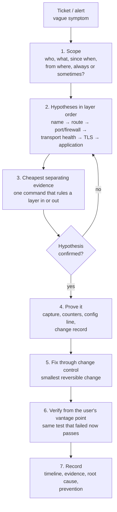
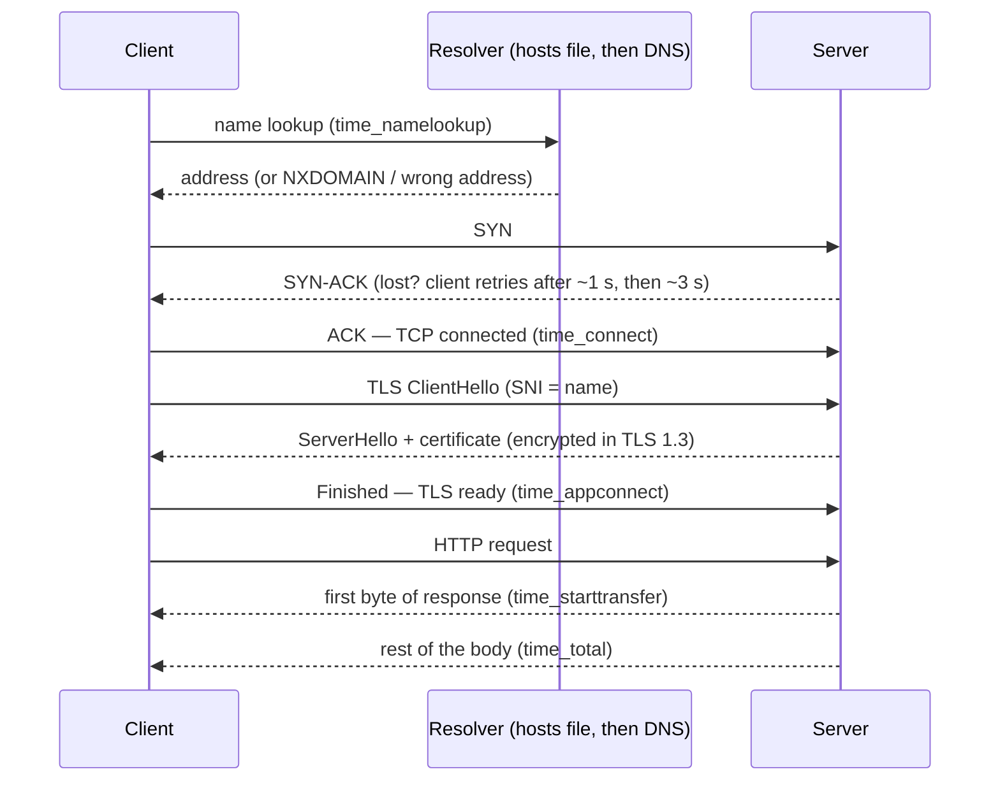
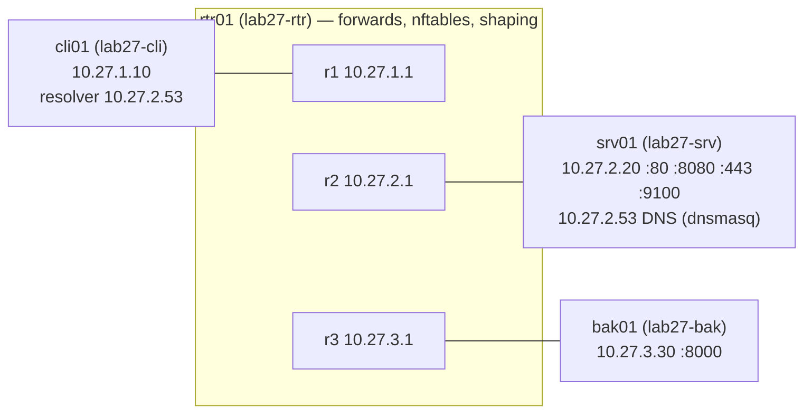

# Day 27: Network Investigation

!!! info "Lesson overview"
    | | |
    |---|---|
    | **Module** | 6 — Professional Operations & Projects |
    | **Difficulty** | :material-signal-cellular-3: Advanced |
    | **Estimated time** | 4–5 hours (75 min reading, 90 min demonstrations, 90–120 min lab and quiz) |
    | **Platforms** | Ubuntu 24.04 LTS (tcpdump 4.99, TShark 4.2, Nmap 7.94, curl 8.5, OpenSSL 3.0, BIND `dig` 9.18) · Windows 11 / Windows Server 2022 (Windows PowerShell 5.1 and PowerShell 7.4+, `pktmon`, `curl.exe`) |
    | **Lab** | [Lab 27: Five Tickets, One Network](../../labs/lab-27.md) |

Module 3 taught you the tools one layer at a time: addresses (Day 11), reachability (Day 12), DNS (Day 13), sockets (Day 14) and interfaces and captures (Day 15). Day 20 used them to hunt an attacker. Today you use all of them together, the way a network analyst does on a real shift: a ticket arrives with a vague symptom ("the intranet is slow", "the API is down"), and you must turn it into a **proven root cause** with evidence another engineer can check. The lesson is built around five case studies that all run on one small, isolated lab network, so every output on this page comes from real commands and you can reproduce each case yourself.

## Learning Objectives

By the end of this lesson you will be able to:

1. Apply a **hypothesis-driven investigation method**: scope the problem, list hypotheses in layer order, collect the cheapest evidence that separates them, test, fix, verify and record.
2. Read **failure signatures** precisely: *connection refused* (RST), *timed out* (silence), *no route to host* (ICMP unreachable), and connect times of **about 1 s or 3 s** (a lost SYN or SYN-ACK and the TCP retransmission timer).
3. Split a slow request into **phases** — name lookup, TCP connect, TLS handshake, time to first byte, transfer — with `curl -w` on Linux and `curl.exe -w` on Windows.
4. Prove **which name-resolution source** answered: `getent` (the system resolver, hosts file first) versus `dig` (DNS only) on Linux, and `Resolve-DnsName -NoHostsFile` versus `[System.Net.Dns]` on Windows.
5. Find a **missing return path** with `ip route get`, `traceroute`, and a **two-point capture** that shows where packets stop.
6. Distinguish **filtered from closed** ports with `nmap --reason`, `nc`, `traceroute -T` and firewall counters, and recognise a firewall change as the cause.
7. Diagnose **TLS failures** — untrusted issuer and name mismatch — with `curl`, `openssl s_client`, `openssl x509` and `nmap --script ssl-cert`, and explain what TLS 1.3 hides from a packet capture.
8. Measure **TCP loss and queueing** with `ss -ti`, `nstat` and `tshark` (`tcp.analysis.*` display filters, `-z conv,tcp`, `-z io,stat`, `-z expert`), and read *Previous segment not captured* as evidence of loss upstream of the capture point.
9. Handle captures as **evidence**: minimal capture filters, snap length, UTC timestamps, `capinfos`, `editcap` and SHA-256 hashes, and write findings that hold up in a post-incident review.

## Prerequisites

- Days [11](../module-3/day-11.md)–[15](../module-3/day-15.md) (IP configuration, connectivity, DNS, sockets, interfaces and capture) and [Day 20](../module-4/day-20.md) (authorised scanning and capture). This lesson assumes you can read `ip`, `ss`, `dig`, `tcpdump` and `nmap` output.
- [Day 18](../module-4/day-18.md) (firewalls): nftables tables, chains and counters.
- A disposable **Ubuntu 24.04 VM** (or WSL2 with root) where you may create network namespaces. The demonstrations use the Lab 27 network; the setup script is in [Lab 27](../../labs/lab-27.md#setup-script-linux). Install the tools with `sudo apt install iproute2 nftables ethtool dnsmasq-base tcpdump tshark nmap dnsutils traceroute curl openssl`.
- For the Windows parts: Windows 11 or Windows Server with Windows PowerShell 5.1 and/or PowerShell 7, and an **elevated** session for `pktmon`.

!!! warning "Authorisation and privacy"
    Capturing packets and scanning ports are **only** acceptable on systems you own or are explicitly authorised to test (Day 20). Captures can contain passwords, cookies and personal data: capture the minimum (tight filters, short snap length), store captures as sensitive evidence, and delete them when the case closes. Everything on this page runs inside isolated namespaces that have no connection to any real network.

## Introduction and Concepts

### From symptom to root cause: the investigation method

Troubleshooting asks "how do I make it work again?". **Investigation** asks "what exactly is wrong, how do I know, and what else does it affect?". On a busy team the two blend, but the investigation habits are what stop you from "fixing" the wrong thing — restarting a healthy server, flushing a cache that was never the problem, or opening a firewall that was blocking an attacker.



Three rules make this work:

- **Scope before you touch anything.** "Slow for everyone since 09:00" and "fails for one user on Wi-Fi" are different investigations. Ask: which name or address, which port, from which client network, every time or intermittently, and what changed (deployments, firewall changes, certificate renewals, DNS migrations)?
- **Separate layers with one command each.** If `getent hosts api.corp.lab` returns the wrong address, nothing at the TCP layer matters yet. If a TCP connect succeeds, the route and the firewall are fine for that port. Each answer prunes the tree.
- **Prove, do not assume.** A hypothesis becomes a root cause only when you can point at evidence — a capture, a counter that increments when you test, a configuration line, a change record — and when removing the cause makes the original test pass.

### The life of a request — and where it can fail

Almost every ticket in this lesson is about one client making one TCP (and often TLS) request. Knowing the phases of that request, and what each failure looks like, is the core skill.



The `curl -w` variables in brackets are cumulative times from the start of the request. Reading them as **differences** tells you which phase is slow: `connect − namelookup` is the TCP handshake, `appconnect − connect` is TLS, `starttransfer − appconnect` (or `− connect` without TLS) is the server thinking, and `total − starttransfer` is the transfer.

### Failure signatures you must recognise instantly

| What you see | What happened on the wire | Usual causes |
|---|---|---|
| `Connection refused` immediately (curl exit 7, `nc` "failed: Connection refused", nmap `closed` / `conn-refused`) | The host answered the SYN with a **RST** | Nothing listening on that port; service bound to another address; firewall rule with `reject with tcp reset` |
| `Connection timed out` (curl exit 28, nmap `filtered` / `no-response`) | **Silence**: the SYN or the reply was dropped | Firewall `drop`; missing **return** route; wrong address that nobody owns on a remote subnet; security group/ACL |
| `No route to host` after about 3 s (curl exit 7, ICMP *Host unreachable* from a router) | A router (or your own host) tried **ARP/ND** for the next hop or the target and got no answer | Address not in use any more (stale DNS/hosts entry), host down on its own subnet, wrong prefix length |
| `Network is unreachable` immediately | Your own host has **no route** at all | Missing default route, VPN down, wrong interface |
| Connect takes **≈ 1 s** (or ≈ 3 s, 7 s…) but then works | The first SYN or SYN-ACK was **lost**; the client retransmitted after the initial retransmission timeout (1 s on Linux, doubling each try; Windows uses its own `InitialRtoMs` setting, shown by `Get-NetTCPSetting` and commonly 3 s) | Packet loss on the path, overloaded firewall, SYN backlog overflow on the server |
| Connect fast, **first byte slow** | Network fine; the **application** is slow | Slow database, thread pool exhaustion, slow upstream API |
| Connect fast, first byte fast, **transfer slow**, retransmissions in a capture | **Loss or congestion** during the transfer | Faulty link, duplex mismatch, shaping/policing, Wi-Fi interference, bufferbloat |
| TLS error (curl exit 60, `SSL certificate problem`, `hostname mismatch`) | TCP fine; the **certificate** was rejected | Wrong name on the certificate, untrusted or missing intermediate CA, expired certificate, interception proxy |

!!! tip "The 1-second and 3-second rule"
    Linux starts the SYN retransmission timer at 1 second and doubles it (1, 2, 4, 8… s; `net.ipv4.tcp_syn_retries` defaults to 6, so a connect to a black hole gives up after roughly 2 minutes unless the application has its own timeout). A connect time of **1.0x s** means one lost SYN or SYN-ACK; **3.0x s** means two. When a "slow page" ticket shows connect times clustered at exactly those values, you are looking at packet loss, not a slow server. Windows clients start from their `InitialRtoMs` value instead (check it with `Get-NetTCPSetting`; it is commonly 3000 ms), so on Windows the same loss shows up as connect times of about 3 s and 9 s.

### TCP behaviour an analyst reads from a capture

- **Sequence and acknowledgement numbers** let the receiver detect a gap. When a segment is missing, the receiver keeps acknowledging the last in-order byte — **duplicate ACKs** — and, with **SACK** (selective acknowledgement, on by default), tells the sender exactly which later blocks it already has (`SLE=`/`SRE=` in tshark's summary).
- **Fast retransmission** happens after three duplicate ACKs: the sender resends the missing segment without waiting for the timer. A **timeout retransmission** (RTO) happens when no ACK arrives at all; it is slower and makes the sender cut its congestion window sharply.
- **Round-trip time (RTT)** has two parts: the propagation delay of the path and the **queueing delay** in buffers. On a congested link the queue grows and RTT rises far above the minimum (`minrtt` in `ss -ti`) — the classic *bufferbloat* signature.
- **Window problems** look different from loss: *zero window* and *window full* mean the **receiver** cannot keep up (a slow application reading the socket), not that the network is dropping packets.
- **RST** ends a connection abruptly. A RST in reply to a SYN is "nobody home"; a RST in the middle of a session is an application abort, an idle-timeout on a firewall or load balancer, or an intrusion prevention system.

### Capture points: where you capture decides what you can prove

A capture shows only what passed **that** interface. If the client capture shows a gap but the server capture shows the packet leaving, the packet was lost **between** the two capture points. Wireshark and TShark flag the gap on the receiving side as **[TCP Previous segment not captured]** — the name is literal: the analyser saw a later segment without the earlier one. Away from the start of a capture, that is strong evidence of loss upstream of where you captured. Capturing at **two points at the same time** (client and server, or both sides of a firewall) is the single most powerful technique in this lesson.

!!! note "Timestamps across capture points"
    Two captures are only comparable if the clocks agree. Check NTP on both machines (`timedatectl`, `w32tm /query /status`), record the offset if there is one, and write times in UTC in your notes.

### Routing: the return path is half the path

Day 12 introduced the return path. In investigations it is the most common "impossible" problem: the server's capture shows the request arriving, the server sends a reply, and the reply never reaches the client — because the server (or a router on the way back) has no route to the client's network, sends the reply out of a different interface (**asymmetric routing**, often dropped by a stateful firewall or by Linux **reverse-path filtering**, `net.ipv4.conf.*.rp_filter`), or sends it towards a gateway that does not forward it. `ip route get <client-address>` **on the server** answers the question in one line.

### Name resolution: which source answered?

Applications on Linux resolve names through the C library's **NSS** (Name Service Switch). The `hosts:` line in `/etc/nsswitch.conf` — `files dns` on a plain Ubuntu system, often with `resolve` or `mdns4_minimal` on a desktop — says the **hosts file is consulted first**. `getent hosts name` and `getent ahosts name` use exactly that path; `dig` and `host` talk **only to DNS** and never read `/etc/hosts`. So "dig says the right address but the application connects to the wrong one" almost always means a hosts-file entry, a different resolver configuration, or an application-level cache.

Windows has the same split: the DNS Client service consults the `hosts` file (`C:\Windows\System32\drivers\etc\hosts`) and its cache before DNS. `Resolve-DnsName name` can return hosts-file entries unless you add **`-NoHostsFile`**, and `[System.Net.Dns]::GetHostAddresses('name')` resolves the way most .NET applications do.

### TLS: what a capture can and cannot show

A TLS handshake failure is not a network failure — TCP connected fine — but it reaches the network team because "the site doesn't work". In **TLS 1.3** the server certificate is **encrypted**, so a capture shows the ClientHello (including the **SNI** — the name the client asked for), the ServerHello, and then only *Application Data* records; the certificate and any alert are not readable. Use the endpoints instead: `curl -v`, `openssl s_client` and `nmap --script ssl-cert` show the certificate the server actually presents. Note also that the ClientHello is labelled `TLSv1` by TShark: that is the legacy record-layer version every TLS 1.3 client sends for compatibility, not the negotiated version.

### Nmap in an investigation

Day 20 used Nmap to find unexpected services. In an investigation it answers a narrower question: **"from this vantage point, what does the network do to my packets on these ports?"** `--reason` turns each state into evidence (`syn-ack`, `conn-refused`, `no-response`, `host-unreach`), `-Pn` stops a dropped ping from hiding the host, and NSE scripts such as `ssl-cert` read application details. Scan only the hosts and ports in the ticket, from the affected client network, with authorisation.

### The case-study network

Every demonstration uses the **Lab 27** network: four network namespaces on one Ubuntu VM, joined by virtual Ethernet pairs, with **no uplink to any real network**. The setup script injects five faults — one per ticket. You can build it now with the script from [Lab 27](../../labs/lab-27.md#setup-script-linux) and follow along, or read the captured output first and do the lab afterwards.



| Ticket | Symptom reported | Hidden fault |
|---|---|---|
| T1 | "The intranet `www.corp.lab` is slow; downloads crawl and pages sometimes hang for a second" | Congested, lossy link on rtr01 for web replies |
| T2 | "`api.corp.lab:8080` is down for me, but the API team says it is up" | A stale `/etc/hosts` entry on the client |
| T3 | "The backup server `bak01` is unreachable, but it is up" | bak01 has no default route — no return path |
| T4 | "`https://secure.corp.lab` gives a certificate error since the migration" | The certificate only names the old host name |
| T5 | "Monitoring can't scrape `metrics.corp.lab:9100` since last night" | A "temporary" firewall rule on rtr01 drops the port |

## Linux Command Reference

| Command | Purpose in an investigation | Package (Ubuntu 24.04) | Needs root? |
|---|---|---|---|
| `curl -w '<format>'` | Time each phase of a request (DNS, connect, TLS, first byte, total), show the address used | curl | No |
| `curl --resolve name:port:addr` | Test a specific server for a name without changing DNS or hosts | curl | No |
| `getent hosts` / `getent ahostsv4` | Resolve a name exactly as applications do (NSS: hosts file, then DNS) | libc-bin (always installed) | No |
| `dig` / `dig +short` | Ask DNS only (never reads `/etc/hosts`) | dnsutils (bind9-dnsutils) | No |
| `ip route get <addr>` | Which route, interface and source address the kernel would use | iproute2 | No |
| `traceroute -n` / `traceroute -T -p <port>` | Hop-by-hop path; `-T` sends TCP SYNs to a port, which shows where a firewall stops them | traceroute | `-T` needs root |
| `nc -zv -w <s> host port` | Quick TCP connect test: refused vs timed out | netcat-openbsd | No |
| `nmap -Pn -n --reason -p <ports>` | Port state with the reason (syn-ack, conn-refused, no-response) | nmap | No for `-sT`; root for `-sS` |
| `nmap --script ssl-cert -p 443` | Read the certificate a TLS service presents | nmap | No |
| `openssl s_client -connect h:p -servername n` | Perform a TLS handshake and show chain, verification result and protocol | openssl | No |
| `openssl x509 -noout -subject -issuer -dates -ext subjectAltName` | Print the fields of a certificate | openssl | No |
| `ss -tin` | Per-connection TCP internals: rtt, retransmissions, lost, cwnd, delivery rate | iproute2 | No (root to see other users' processes) |
| `nstat -az <counters>` | Kernel SNMP counters such as `TcpRetransSegs`, `TcpExtTCPSynRetrans`, `IpOutNoRoutes` | iproute2 | No |
| `tcpdump -ni <if> -s <len> -w <file> '<filter>'` | Capture the minimum evidence to a file | tcpdump | Yes |
| `tshark -r <file> -Y '<filter>'` | Analyse a capture with Wireshark display filters | tshark | No for reading files |
| `tshark -q -z conv,tcp` / `-z io,stat,…` / `-z expert` | Conversation table, per-interval counts, expert summary | tshark | No |
| `capinfos` / `editcap` / `mergecap` | Describe, slice and merge capture files | wireshark-common (installed with tshark) | No |
| `nft list ruleset` / `nft list table …` | Firewall rules **with counters** — did my test packet hit the drop rule? | nftables | Yes |
| `tc -s qdisc show dev <if>` / `tc -s class show dev <if>` | Queueing, shaping and drop statistics on an interface | iproute2 | No to read |
| `sha256sum` | Hash evidence files so their integrity can be shown later | coreutils | No |

## PowerShell Command Reference

| Cmdlet / tool | Purpose in an investigation | Windows PowerShell 5.1 | PowerShell 7.x | Admin? |
|---|---|---|---|---|
| `Test-NetConnection -ComputerName h -Port p -InformationLevel Detailed` | Name resolution, chosen source address and next hop, TCP test result | Yes | Yes (**Windows only**) | No |
| `Test-NetConnection -TraceRoute` | Hop list (ICMP) | Yes | Windows only | No |
| `Test-Connection -TargetName h -TcpPort p` | TCP port test returning `True`/`False` | — | **7.0+**, all OS | No |
| `Resolve-DnsName name [-NoHostsFile] [-DnsOnly] [-Server s] [-Type A]` | Query DNS; separate hosts-file answers from DNS answers | Yes | Windows only | No |
| `[System.Net.Dns]::GetHostAddresses('name')` | Resolve the way most .NET applications do (hosts file included) | Yes | Yes, all OS | No |
| `Get-DnsClientCache` / `Clear-DnsClientCache` | Inspect / clear the DNS client cache | Yes | Windows only | Clear needs admin |
| `Find-NetRoute -RemoteIPAddress a` | The route and source address Windows would use (like `ip route get`) | Yes | Windows only | No |
| `Get-NetTCPConnection -RemotePort p` | TCP connections and their state (`SynSent` = waiting for SYN-ACK) | Yes | Windows only | No |
| `Get-NetTCPSetting` | TCP templates, including `InitialRtoMs` and `MaxSynRetransmissions` | Yes | Windows only | No |
| `Get-Counter '\TCPv4\Segments Retransmitted/sec'` | Retransmission rate (English counter names; localised on other UI languages) | Yes | Windows only | No |
| `Get-NetFirewallRule` + `Get-NetFirewallPortFilter` | Which local rule could block a port (Day 18) | Yes | Windows only | No |
| `curl.exe -w '<format>'` | The real curl (shipped with Windows 10 1803+): phase timings as on Linux | Yes (call `curl.exe`; in 5.1 `curl` is an alias of `Invoke-WebRequest`) | Yes | No |
| `Invoke-WebRequest -UseBasicParsing` | Application-level HTTP test; shows TLS trust errors | Yes (`-UseBasicParsing` avoids the IE engine) | Yes | No |
| `pktmon filter add` / `pktmon start --capture` / `pktmon stop` | Built-in packet capture (Windows 10 2004+ syntax) | Yes | Yes | **Yes** |
| `pktmon etl2pcap <etl> --out <pcapng>` | Convert a pktmon trace for Wireshark/TShark | Yes | Yes | No |
| `Get-FileHash -Algorithm SHA256` | Hash evidence files | Yes | Yes | No |

All Windows-only cmdlets above come from Windows modules (NetTCPIP, DnsClient, NetSecurity) and work in PowerShell 7 **on Windows** through the same modules; they do not exist in PowerShell 7 on Linux or macOS.

## Detailed Command Explanations

### `curl -w` — split one request into phases

`curl -w` (write-out) prints variables after the transfer. Put the format in a file and reuse it with `-w @file`:

```text
dns=%{time_namelookup} connect=%{time_connect} tls=%{time_appconnect} ttfb=%{time_starttransfer} total=%{time_total} code=%{http_code} size=%{size_download} speed=%{speed_download}\n
```

All `time_*` values are seconds **since the start** of the request, so subtract neighbours to get each phase. `%{remote_ip}` shows the address curl actually connected to (invaluable for hosts-file and load-balancer cases), `%{local_port}` the client port (to find the connection in a capture), `%{ssl_verify_result}` the certificate verification code (0 = OK), and `%{num_connects}` whether a new connection was made. Useful companions: `-s -o /dev/null` (no body, no progress meter), `-m <s>` (overall timeout — always set one in scripts), `-v` (shows each address tried and the TLS details), `--resolve name:port:addr` (pin a name to an address for this request only — the cleanest way to test "is the *new* server OK?" without touching DNS), and `--cacert <file>` (trust a private CA for this request instead of disabling verification with `-k`).

Exit codes matter in scripts and tickets: **6** could not resolve host, **7** failed to connect (refused or unreachable), **28** timeout, **35** TLS handshake failure, **60** certificate verification failed.

### `getent` versus `dig` — two different questions

`getent hosts name` asks "what will **applications** on this machine get?" — it follows `/etc/nsswitch.conf`, so `/etc/hosts` usually wins. `getent ahostsv4 name` prints every IPv4 address in the order applications would try them. `dig name` asks "what does the **DNS server** say?" — it reads `/etc/resolv.conf` for the server but never the hosts file. `dig +short` prints only the answers, `dig @server name` asks a specific server, and the `status:` field (`NOERROR`, `NXDOMAIN`, `SERVFAIL`) and TTL are Day 13 skills. When the two disagree, the investigation is over in one step: look at the source `getent` used.

### `ip route get` and `traceroute` — the path, both ways

`ip route get 10.27.3.30` prints the route, outgoing interface and **source address** the kernel would use to reach that address. Running it **on the remote host back towards the client** is the fastest test for a missing return route: `RTNETLINK answers: Network is unreachable` is the answer you are looking for in such a case. `traceroute -n` (UDP probes by default) shows hops; `traceroute -n -T -p 9100` sends **TCP SYN** probes to the port in the ticket, so the last hop that answers is the last device that let a connection attempt through — very good at pointing at the firewall that drops a port. `-T` needs root; `-q 1 -w 1 -m 4` keep it quick in a lab.

### `ss -tin` and `nstat` — what the TCP stack itself saw

`ss -tin` (TCP, internal info, numeric) prints a second line per connection with the kernel's view of its health. The fields that matter most:

| Field | Meaning |
|---|---|
| `rtt:<avg>/<mdev>` | Smoothed round-trip time and its variation, in ms |
| `minrtt:` | The lowest RTT seen — the path without queueing; compare with `rtt` |
| `rto:` | Current retransmission timeout, ms |
| `cwnd:` / `ssthresh:` | Congestion window and slow-start threshold, in segments |
| `retrans:<now>/<total>` | Segments currently waiting for retransmission / total retransmitted on this connection |
| `lost:` / `sacked:` | Segments the stack considers lost / selectively acknowledged |
| `bytes_retrans:` | Bytes sent again — divide by `bytes_sent` for a loss estimate |
| `delivery_rate` | Recent measured goodput |
| `rwnd_limited:` | Time the sender was blocked by the **receiver's** window (an application or receive-buffer problem, not loss) |

Run it on the **sender** of the bulk data (usually the server) while the transfer runs; add a filter such as `'sport = :80'`. The first word on the info line is the congestion-control algorithm (`cubic` is the Ubuntu default; the captures on this page come from a host configured with `bbr`).

`nstat` reads the kernel's SNMP counters. `nstat -az TcpRetransSegs TcpExtTCPSynRetrans IpOutNoRoutes` prints absolute values (`-a`) including zeros (`-z`) for the counters you name. Without `-a`, `nstat` prints the **change since its last run**, using a history file in `/tmp` per user — convenient interactively, but confusing if you switch between namespaces or users, so use `-a` for evidence.

### `tcpdump` — capture the minimum, at the right point

Day 15 covered filters. For investigations:

- **Filter tightly** to the conversation in the ticket: `host 10.27.2.20 and tcp port 80`, or only handshake packets with `'tcp port 80 and tcp[tcpflags] & tcp-syn != 0'`.
- **Limit the snap length** with `-s 128` when you only need headers: it keeps files small and keeps payloads (and personal data) out of your evidence. TShark then marks frames *Packet size limited during capture*, which is expected.
- **Write to a file** with `-w` and analyse later; reading live text output is fine for a quick look but is not evidence.
- **Capture at two points at once** — client and server, or both interfaces of a router (`-i any` shows the interface name and direction on every line).
- For long-running problems use a **ring buffer**: `-C 100 -W 10` (ten files of about 100 MB) or `-G 3600` with a strftime file name, so the capture never fills the disk.

### `tshark` — Wireshark's analysis engine in a terminal

TShark reads capture files and applies the same dissectors, display filters and statistics as the Wireshark GUI. The **display filters** that answer investigation questions:

| Display filter | Finds |
|---|---|
| `tcp.analysis.retransmission` | All retransmissions (includes fast and spurious ones) |
| `tcp.analysis.fast_retransmission` | Retransmissions triggered by duplicate ACKs |
| `tcp.analysis.duplicate_ack` | Duplicate ACKs (the receiver reporting a gap) |
| `tcp.analysis.lost_segment` | *Previous segment not captured* — a gap seen at this capture point |
| `tcp.analysis.flags && !tcp.analysis.window_update` | Every TCP problem TShark flagged, minus noise |
| `tcp.analysis.zero_window` / `tcp.analysis.window_full` | Receiver-side bottlenecks |
| `tcp.flags.syn == 1 && tcp.flags.ack == 0` | Connection attempts (SYNs) |
| `tcp.flags.reset == 1` | Resets |
| `icmp.type == 3` | ICMP destination unreachable (with `icmp.code` for host/port/fragmentation needed) |
| `dns.flags.rcode != 0` | DNS errors (NXDOMAIN = 3, SERVFAIL = 2) |
| `tls.handshake.type == 1` | TLS ClientHellos; add `-T fields -e tls.handshake.extensions_server_name` for the SNI |

Statistics (`-q` suppresses the per-packet list):

- `-z conv,tcp` — one row per TCP conversation: frames and bytes in each direction and duration.
- `-z 'io,stat,1,COUNT(tcp.analysis.retransmission)tcp.analysis.retransmission'` — counts per 1-second interval, a text version of Wireshark's I/O graph.
- `-z expert` (or `-z expert,warn`) — the Expert Information summary grouped by severity.
- `-z follow,tcp,ascii,<stream>` — reassemble one conversation's payload (only if you captured payload).

`-T fields -e <field> … -E header=y` turns packets into columns for scripts (`frame.time_relative`, `tcp.seq`, `tcp.len`, `tcp.analysis.initial_rtt`, `ip.dst`). Reading files needs no privileges; on Ubuntu, live capture as a normal user requires the `wireshark` group (offered when you install the package) — otherwise capture with `tcpdump` as root and analyse the file as yourself.

In the **Wireshark GUI** the same analysis lives under *Analyze → Expert Information*, *Statistics → Conversations*, *Statistics → I/O Graphs*, *Statistics → TCP Stream Graphs → Stevens / tcptrace* (sequence numbers over time: flat steps are stalls, re-sent segments stand out) and *Follow → TCP Stream*.

### `capinfos`, `editcap`, `mergecap` and hashes — handling evidence

`capinfos file.pcap` prints packet count, first and last packet time, duration, snap length and (in this version) SHA-256 and SHA-1 of the file — the facts you quote in a report. `editcap -r in.pcap out.pcap 9-12` keeps only frames 9–12 (to share just the relevant packets), `editcap -A '<start>' -B '<end>'` slices by time, and `mergecap -w both.pcapng a.pcap b.pcap` merges files by timestamp (do not merge two captures of the **same** packets from different points, or every packet appears twice). Record `sha256sum` of every file you hand over.

### `openssl s_client` and `openssl x509` — what the server really presents

`openssl s_client -connect host:443 -servername name` performs a TLS handshake: `-servername` sets the SNI (without it many servers send a default certificate), `-CAfile` adds a trusted CA, `-verify_hostname name` checks the name the way a browser does, and `-showcerts` prints the whole chain. Pipe the output to `openssl x509 -noout -subject -issuer -dates -ext subjectAltName` to print the fields that cause most outages: the **Subject Alternative Names** (browsers and curl ignore the CN when a SAN is present), the **issuer**, and the **validity dates**. `echo |` in front of `s_client` closes the session immediately instead of waiting for input.

### `nmap` — states with reasons, from the client's side

`nmap -sT -Pn -n --reason -p 80,443,8080,9100,9200 10.27.2.20` performs full TCP connects (no root needed) to exactly the ports in the ticket, without a ping (`-Pn`) or reverse DNS (`-n`). The `REASON` column is the evidence: `syn-ack` (open), `conn-refused` (closed: a RST came back), `no-response` (filtered: silence), `host-unreach` (an ICMP error came back). `--script ssl-cert` adds the certificate subject, SANs, issuer and validity. Nmap's `SERVICE` column is only a guess from the port number (`jetdirect` for 9100) unless you add `-sV`.

### Firewall and queue counters on the path

When you control the devices on the path, their **counters** turn a hypothesis into proof: run the failing test and watch the counter of the suspected rule increase (`nft list table inet <name>`; on Windows the firewall log from Day 18; on network appliances their own hit counters). The same applies to queues: `tc -s class show dev r1` shows bytes, packets, drops and *overlimits* (packets that had to wait because the class was over its rate) — the Linux view of a congested egress port.

### Windows: `Test-NetConnection`, `Resolve-DnsName`, `Find-NetRoute`, `Get-NetTCPConnection`

`Test-NetConnection -ComputerName api.corp.lab -Port 8080 -InformationLevel Detailed` resolves the name (showing `NameResolutionResults`), picks the source address and next hop (`SourceAddress`, `NetRoute (NextHop)`), and reports `TcpTestSucceeded`. It does not distinguish refused from filtered well (both are `False`, with a warning), so pair it with a capture or with `Get-NetTCPConnection -RemotePort 8080`, where a connection stuck in **`SynSent`** means no SYN-ACK arrived. `Resolve-DnsName api.corp.lab -NoHostsFile` asks DNS only; without the switch the answer may come from the hosts file — compare the two outputs and then read the hosts file itself. `Find-NetRoute -RemoteIPAddress 10.27.3.30` is the Windows `ip route get`. In PowerShell 7, `Test-Connection -TargetName host -TcpPort port` returns a simple Boolean and works on every OS.

### Windows: `pktmon` and converting captures

`pktmon` (Windows 10 version 2004 and later, and Windows Server 2022) captures packets without installing anything, from an **elevated** prompt: `pktmon filter add -p 443` limits it to a port, `pktmon start --capture --pkt-size 128` starts capturing (only the first 128 bytes of each packet are kept by default; `--pkt-size 0` keeps whole packets), `pktmon stop` writes `PktMon.etl`, and `pktmon etl2pcap PktMon.etl --out case.pcapng` converts it for Wireshark or TShark. Remove filters afterwards with `pktmon filter remove`. On older systems `netsh trace start capture=yes tracefile=C:\Temp\case.etl` / `netsh trace stop` capture to ETL, which needs a separate converter.

### Windows: inspecting a TLS certificate from PowerShell

There is no built-in `s_client`, but a few lines of .NET read the certificate a server presents. The validation callback below **accepts any certificate only so that it can be inspected**; nothing is sent over the connection, and this pattern must never be used to "fix" a real client:

```powershell
$name = 'secure.corp.lab'
$tcp  = New-Object System.Net.Sockets.TcpClient($name, 443)
$errs = $null
$cb   = [System.Net.Security.RemoteCertificateValidationCallback]{
    param($s, $cert, $chain, $policyErrors) $script:errs = $policyErrors; $true }
$ssl  = New-Object System.Net.Security.SslStream($tcp.GetStream(), $false, $cb)
try {
    $ssl.AuthenticateAsClient($name)
    $c = New-Object System.Security.Cryptography.X509Certificates.X509Certificate2($ssl.RemoteCertificate)
    $c | Select-Object Subject, Issuer, NotBefore, NotAfter, Thumbprint, DnsNameList
    "Policy errors: $errs"
} finally { $ssl.Dispose(); $tcp.Dispose() }
```

`$errs` contains `RemoteCertificateNameMismatch` and/or `RemoteCertificateChainErrors` — the same two failures `curl` reports as "no alternative certificate subject name matches" and "unable to get local issuer certificate". `DnsNameList` is a property PowerShell adds to certificate objects; it lists the SAN DNS names. The code uses only syntax that works in Windows PowerShell 5.1 and PowerShell 7.

## Syntax and Parameters

### Bash

```text
curl [-s] [-o FILE] [-m SECS] [-w FORMAT|@FILE] [-v] [--resolve HOST:PORT:ADDR] [--cacert FILE] URL
getent hosts|ahosts|ahostsv4 NAME
dig [@SERVER] NAME [TYPE] [+short] [+noall +answer] [+stats]
ip route get ADDRESS [from ADDRESS]
traceroute [-n] [-T -p PORT] [-q N] [-w SECS] [-m MAXHOPS] HOST
nc -zv [-w SECS] HOST PORT
nmap [-sT|-sS] [-Pn] [-n] [--reason] [-p PORTS] [--script ssl-cert] [-sV] TARGET
openssl s_client -connect HOST:PORT [-servername NAME] [-CAfile FILE] [-verify_hostname NAME] [-showcerts]
openssl x509 [-in FILE] -noout [-subject] [-issuer] [-dates] [-ext subjectAltName]
ss -tin [FILTER]                       # e.g. 'sport = :80', 'dst 10.27.1.10'
nstat [-a] [-z] [COUNTER...]
tcpdump -n -i IFACE [-s SNAPLEN] [-c COUNT] [-w FILE] [-C MB -W FILES] ['FILTER']
tshark -r FILE [-n] [-Y DISPLAYFILTER] [-T fields -e FIELD... -E header=y] [-q -z STAT]
capinfos FILE ;  editcap -r IN OUT RANGE ;  mergecap -w OUT IN...
nft list table FAMILY NAME ;  tc -s class show dev IFACE
```

| Option | Command | Meaning |
|---|---|---|
| `-w @file` | curl | Read the write-out format from a file |
| `--resolve h:p:a` | curl | Use address `a` for host `h` port `p` for this request only |
| `-m` | curl | Maximum time for the whole operation (exit 28 when exceeded) |
| `--cacert` | curl | Trust this CA file (instead of `-k`, which disables verification) |
| `+short` / `+noall +answer` | dig | Answers only / only the answer section |
| `-T -p` | traceroute | TCP SYN probes to a destination port (root) |
| `--reason` | nmap | Show why each port has its state |
| `-Pn` / `-n` | nmap | Skip host discovery / skip reverse DNS |
| `-servername` | s_client | Send this SNI |
| `-verify_hostname` | s_client | Check the certificate against this name |
| `-i` | ss | Show TCP internal information |
| `-a` / `-z` | nstat | Absolute values / include zero counters |
| `-s` | tcpdump | Snap length: bytes kept per packet |
| `-C` / `-W` | tcpdump | Rotate files at N MB / keep at most N files |
| `-Y` | tshark | Display filter (Wireshark syntax), applied when reading |
| `-f` | tshark | Capture filter (BPF syntax), live capture only |
| `-q -z` | tshark | Quiet, print a statistic |

### PowerShell

```text
Test-NetConnection [-ComputerName] <String> [-Port <Int32>] [-InformationLevel Quiet|Detailed] [-TraceRoute] [-Hops <Int32>]
Test-Connection -TargetName <String[]> -TcpPort <Int32> [-TimeoutSeconds <Int32>]        # PowerShell 7.0+
Resolve-DnsName [-Name] <String> [-Type <RecordType>] [-Server <String[]>] [-NoHostsFile] [-DnsOnly] [-CacheOnly]
Find-NetRoute -RemoteIPAddress <String>
Get-NetTCPConnection [-RemoteAddress <String[]>] [-RemotePort <UInt16[]>] [-State <State[]>]
Get-NetTCPSetting [[-SettingName] <String[]>]
Get-Counter [-Counter] <String[]> [-SampleInterval <Int32>] [-MaxSamples <Int64>]
Get-FileHash [-Path] <String[]> [-Algorithm SHA256]
pktmon filter add [-p <port>] [-i <ip>] ;  pktmon start --capture [--pkt-size <bytes>] ;  pktmon stop
pktmon etl2pcap <file.etl> [--out <file.pcapng>]
curl.exe -s -o NUL -w "<format>" <URL>
```

| Parameter | Cmdlet | Meaning |
|---|---|---|
| `-InformationLevel Detailed` | Test-NetConnection | Adds name resolution results, source address and next hop |
| `-Port` | Test-NetConnection | TCP port to test (otherwise only ICMP) |
| `-TcpPort` | Test-Connection (7+) | TCP test; returns `True`/`False` |
| `-NoHostsFile` | Resolve-DnsName | Ignore the hosts file; ask DNS |
| `-DnsOnly` | Resolve-DnsName | Use only the DNS protocol (no LLMNR or NetBIOS) |
| `-Server` | Resolve-DnsName | Ask a specific DNS server |
| `-State SynSent` | Get-NetTCPConnection | Connections still waiting for a SYN-ACK |
| `--pkt-size` | pktmon start | Bytes captured per packet (`0` = whole packet) |

## Practical Demonstrations

**How the Bash output on this page was produced.** Every Bash block was run on 2026-11-20 as root on Ubuntu 24.04.5 inside the Lab 27 namespaces (built with the setup script from [Lab 27](../../labs/lab-27.md#setup-script-linux)) with tcpdump 4.99.4, TShark 4.2.2, Nmap 7.94SVN, curl 8.5.0, OpenSSL 3.0.13, dig 9.18.39 and dnsmasq 2.91. Commands are shown as run inside a namespace (prefix them with `sudo ip netns exec lab27-cli` on your VM). Timestamps, ports, sequence numbers and random loss differ on every run. The host used the `bbr` congestion control (Ubuntu's default is `cubic`), and the kernel had no `netem` module, so the lab's "slow link" is a 4 Mbit/s shaper plus random drops; the queueing delay you see is real. **PowerShell blocks are examples** of the same investigation on Windows against an equivalent fault; they were not executed for this release.

### Demo 1 — First look: one line per service

Before diving into any single ticket, take thirty seconds to test everything the tickets mention, from the affected client. A small loop gives you a table to paste into the ticket and often shows that several "separate" problems share a cause — or, as here, that they do not.

=== "Bash"

    ```bash
    # triage.sh - run inside lab27-cli
    printf '%-26s %-12s %-10s %s\n' TARGET ADDRESS TCP RESULT
    while read -r name port scheme; do
        addr=$(getent ahostsv4 "$name" | awk 'NR==1 {print $1}')
        if timeout 3 bash -c "exec 3<>/dev/tcp/$addr/$port" 2>/dev/null; then tcp=open
        else rc=$?; [ "$rc" -eq 124 ] && tcp=timeout || tcp=refused/unreach; fi
        result=$(curl -s -o /dev/null -m 6 -w '%{http_code} connect=%{time_connect}s total=%{time_total}s' \
                 "$scheme://$name:$port/" 2>&1); rc=$?
        printf '%-26s %-12s %-10s %s (curl exit %s)\n' "$name:$port" "${addr:-NXDOMAIN}" "$tcp" "$result" "$rc"
    done <<'LIST'
    www.corp.lab 80 http
    api.corp.lab 8080 http
    secure.corp.lab 443 https
    metrics.corp.lab 9100 http
    bak01.corp.lab 8000 http
    LIST
    ```

    **Expected output (captured in the lab):**

    ```text
    TARGET                     ADDRESS      TCP        RESULT
    www.corp.lab:80            10.27.2.20   open       200 connect=0.000543s total=0.003496s (curl exit 0)
    api.corp.lab:8080          10.27.2.21   timeout    000 connect=0.000000s total=0.044648s (curl exit 7)
    secure.corp.lab:443        10.27.2.20   open       000 connect=0.000561s total=0.021801s (curl exit 60)
    metrics.corp.lab:9100      10.27.2.20   timeout    000 connect=0.000000s total=6.002277s (curl exit 28)
    bak01.corp.lab:8000        10.27.3.30   timeout    000 connect=0.000000s total=6.002395s (curl exit 28)
    ```

    Read it like an analyst: **www** works in this sample (its problem is intermittent — Demo 2); **api** resolves to `10.27.2.21`, a different address from the other srv01 services, and fails fast with exit 7 (Demo 3); **secure** connects but fails certificate verification, exit 60 (Demo 5); **metrics** and **bak01** both time out — silence — but one is on srv01, which otherwise works, and one is on another subnet (Demos 4 and 6). Note that `/dev/tcp` is a Bash feature, not a file, and that the 3-second `timeout` labels both kinds of silence the same way.

=== "PowerShell"

    ```powershell
    $targets = @(
        @{ Name = 'www.corp.lab';     Port = 80 },   @{ Name = 'api.corp.lab';    Port = 8080 },
        @{ Name = 'secure.corp.lab';  Port = 443 },  @{ Name = 'metrics.corp.lab'; Port = 9100 },
        @{ Name = 'bak01.corp.lab';   Port = 8000 }
    )
    foreach ($t in $targets) {
        $addr = try { ([System.Net.Dns]::GetHostAddresses($t.Name) |
                       Where-Object AddressFamily -eq 'InterNetwork')[0].IPAddressToString } catch { 'NXDOMAIN' }
        $tnc  = Test-NetConnection -ComputerName $t.Name -Port $t.Port -WarningAction SilentlyContinue
        [pscustomobject]@{
            Target  = '{0}:{1}' -f $t.Name, $t.Port
            Address = $addr
            TcpOK   = $tnc.TcpTestSucceeded
            NextHop = $tnc.NetRoute.NextHop
        }
    }
    ```

    **Expected output (example):**

    ```text
    Target                Address    TcpOK NextHop
    ------                -------    ----- -------
    www.corp.lab:80       10.27.2.20  True 10.27.1.1
    api.corp.lab:8080     10.27.2.21 False 10.27.1.1
    secure.corp.lab:443   10.27.2.20  True 10.27.1.1
    metrics.corp.lab:9100 10.27.2.20 False 10.27.1.1
    bak01.corp.lab:8000   10.27.3.30 False 10.27.1.1
    ```

    `Test-NetConnection` is slow when a port is filtered (it waits for its own timeout) and reports only `True`/`False`, so treat this as the first pass and use the techniques below to classify each failure. In PowerShell 7 you can replace it with `Test-Connection -TargetName $t.Name -TcpPort $t.Port`, which also works on Linux.

### Demo 2 — Case T1: "the intranet is slow"

The user's words are "slow" and "sometimes hangs for a second". Split the request into phases, compare with a second service on the **same server**, then look at TCP itself.

=== "Bash"

    ```bash
    cat > curl-format.txt <<'EOF2'
    dns=%{time_namelookup} connect=%{time_connect} tls=%{time_appconnect} ttfb=%{time_starttransfer} total=%{time_total} code=%{http_code} size=%{size_download} speed=%{speed_download}\n
    EOF2
    for i in 1 2 3 4 5; do curl -s -m 10 -o /dev/null -w @curl-format.txt http://www.corp.lab/; done
    curl -s -o /dev/null -w @curl-format.txt http://www.corp.lab/report.bin        # 2 MB on port 80
    curl -s -o /dev/null -w @curl-format.txt http://www.corp.lab:8080/report.bin   # same file, port 8080
    ```

    **Expected output (captured in the lab; small page first, then the two downloads):**

    ```text
    dns=0.000409 connect=1.004998 tls=0.000000 ttfb=1.006015 total=1.006065 code=200 size=49 speed=48
    dns=0.000489 connect=1.014797 tls=0.000000 ttfb=1.015803 total=1.015918 code=200 size=49 speed=48
    dns=0.000558 connect=0.000623 tls=0.000000 ttfb=0.001452 total=0.001489 code=200 size=49 speed=32907
    dns=0.000570 connect=0.000637 tls=0.000000 ttfb=0.001423 total=0.001451 code=200 size=49 speed=33769
    dns=0.000546 connect=1.027679 tls=0.000000 ttfb=1.028845 total=1.028916 code=200 size=49 speed=47
    dns=0.000743 connect=0.000845 tls=0.000000 ttfb=0.001644 total=4.102218 code=200 size=2000000 speed=487541
    dns=0.000637 connect=0.000819 tls=0.000000 ttfb=0.001919 total=0.018896 code=200 size=2000000 speed=105842506
    ```

    Three of five page loads spent **exactly ~1 s in the TCP connect** and almost nothing anywhere else: lost SYNs or SYN-ACKs, retried after the 1-second initial timeout. DNS is fast, and once connected the server answers in about a millisecond, so the application is healthy. The 2 MB download on port 80 runs at about 0.49 MB/s (≈ 4 Mbit/s) while the **same file from the same server on port 8080** takes 19 ms. Whatever is wrong is on the path and specific to the web traffic, not the server's disk or CPU.

    Now look at TCP on the **sender** (srv01) during a port-80 download, and at the kernel counters:

    ```bash
    # inside lab27-srv, while the client downloads report.bin
    ss -tin 'sport = :80'
    nstat -az TcpRetransSegs TcpExtTCPSynRetrans TcpOutSegs
    ```

    **Expected output (captured in the lab):**

    ```text
    State Recv-Q Send-Q Local Address:Port Peer Address:Port Process
    ESTAB 0      840456    10.27.2.20:80     10.27.1.10:59528
             bbr wscale:10,10 rto:636 rtt:406.135/26.525 ato:40 mss:1448 pmtu:1500 rcvmss:536 advmss:1448 cwnd:172 ssthresh:138 bytes_sent:1027054 bytes_retrans:65992 bytes_acked:409374 bytes_received:85 segs_out:712 segs_in:393 data_segs_out:711 data_segs_in:1 bbr:(bw:1158399584bps,mrtt:0.02,pacing_gain:1,cwnd_gain:2) send 4905876bps lastrcv:1484 pacing_rate 1146815584bps delivery_rate 3814712bps delivered:494 busy:1484ms rwnd_limited:92ms(6.2%) unacked:381 retrans:6/48 lost:6 sacked:209 rcv_space:14480 rcv_ssthresh:64088 notsent:288768 minrtt:0.02 snd_wnd:1082368
    #kernel
    TcpRetransSegs                  232                0.0
    TcpExtTCPSynRetrans             2                  0.0
    TcpOutSegs                      2846               0.0
    ```

    `minrtt:0.02` ms is the empty path; `rtt:406` ms is the path **with a full queue** — four hundred milliseconds of bufferbloat on a link that should add nothing. `retrans:6/48`, `lost:6` and `bytes_retrans:65992` (about 6 % of `bytes_sent`) show real loss, and `delivery_rate 3814712bps` matches the 4 Mbit/s the user is getting. On the router, the queue statistics confirm the bottleneck: `tc -s class show dev r1` reported `Sent 4193269 bytes 2866 pkt (dropped 0, overlimits 1250 requeues 0)` for the web class.

    Finally, capture the download at the **client** and let TShark do the counting:

    ```bash
    tcpdump -ni c0 -s 128 -w www.pcap 'tcp port 80' &     # inside lab27-cli
    curl -s -o /dev/null http://www.corp.lab/report.bin ; kill %1
    capinfos www.pcap | grep -E 'Number of packets|Capture duration'
    tshark -n -r www.pcap -q -z 'io,stat,1,COUNT(tcp.analysis.retransmission)tcp.analysis.retransmission,COUNT(tcp.analysis.duplicate_ack)tcp.analysis.duplicate_ack'
    tshark -n -r www.pcap -q -z expert,warn
    tshark -n -r www.pcap -Y 'tcp.analysis.flags && !tcp.analysis.window_update' | head -3
    ```

    **Expected output (captured in the lab, trimmed):**

    ```text
    Number of packets:   2537
    Capture duration:    4.471549 seconds
    ========================================================================
    | IO Statistics                                                        |
    | Duration: 4.471549 secs                                              |
    | Interval: 1 secs                                                     |
    | Col 1: COUNT(tcp.analysis.retransmission)tcp.analysis.retransmission |
    |     2: COUNT(tcp.analysis.duplicate_ack)tcp.analysis.duplicate_ack   |
    |----------------------------------------------------------------------|
    |          |1      |2      |                                           |
    | Interval | COUNT | COUNT |                                           |
    |--------------------------|                                           |
    |  0 <> 1  |    37 |    48 |                                           |
    |  1 <> 2  |     8 |     9 |                                           |
    |  2 <> 3  |    18 |     0 |                                           |
    |  3 <> 4  |    33 |     0 |                                           |
    |  4 <> Dur|    10 |     0 |                                           |
    ========================================================================

    Warns (23)
    =============
       Frequency      Group           Protocol  Summary
              22   Sequence                TCP  Previous segment(s) not captured (common at capture start)
               1   Sequence                TCP  TCP window specified by the receiver is now completely full

       18   0.014015   10.27.2.20 → 10.27.1.10   HTTP 1514 [TCP Previous segment not captured] Continuation[Packet size limited during capture]
       21   0.017072   10.27.1.10 → 10.27.2.20   TCP 78 [TCP Dup ACK 17#1] 39532 → 80 [ACK] Seq=86 Ack=7447 Win=80896 Len=0 TSval=1949297855 TSecr=4139591151 SLE=14687 SRE=17583
       23   0.017073   10.27.1.10 → 10.27.2.20   TCP 78 [TCP Dup ACK 17#2] 39532 → 80 [ACK] Seq=86 Ack=7447 Win=80896 Len=0 TSval=1949297855 TSecr=4139591151 SLE=14687 SRE=19031
    ```

    The pattern repeats through the whole transfer: a segment never arrives at the client (*Previous segment not captured* — 22 times, and this capture started before the connection, so these are not start-of-capture artefacts), the client sends duplicate ACKs with SACK blocks saying "I have 14687–17583, still missing 7447", and the server retransmits (106 retransmissions in total). Because the gap is seen **at the client**, the loss happened somewhere **before** the client: on the server, the router, or the links. Demo 2b pins it down.

    **Demo 2b — two capture points prove where the packet died.** Capture SYN and SYN-ACK packets at the client and at the server at the same time, repeat small requests until one takes ~1 s, then compare that connection in both files:

    ```bash
    ip netns exec lab27-cli tcpdump -ni c0 -w a-cli.pcap 'tcp port 80 and tcp[tcpflags] & tcp-syn != 0' &
    ip netns exec lab27-srv tcpdump -ni s0 -w a-srv.pcap 'tcp port 80 and tcp[tcpflags] & tcp-syn != 0' &
    # ... repeat curl until connect is about 1 s; it reported local port 57528 ...
    tshark -n -r a-cli.pcap -Y 'tcp.port==57528'
    tshark -n -r a-srv.pcap -Y 'tcp.port==57528'
    ```

    **Expected output (captured in the lab):**

    ```text
    --- client side (c0)
        9   0.038252   10.27.1.10 → 10.27.2.20   TCP 74 57528 → 80 [SYN] Seq=0 Win=64240 Len=0 MSS=1460 SACK_PERM TSval=2259412750 TSecr=0 WS=1024
       10   1.046100   10.27.1.10 → 10.27.2.20   TCP 74 [TCP Retransmission] 57528 → 80 [SYN] Seq=0 Win=64240 Len=0 MSS=1460 SACK_PERM TSval=2259413758 TSecr=0 WS=1024
       11   1.046122   10.27.2.20 → 10.27.1.10   TCP 74 80 → 57528 [SYN, ACK] Seq=0 Ack=1 Win=65160 Len=0 MSS=1460 SACK_PERM TSval=3465210720 TSecr=2259412750 WS=1024
    --- server side (s0)
        9   0.038251   10.27.1.10 → 10.27.2.20   TCP 74 57528 → 80 [SYN] Seq=0 Win=64240 Len=0 MSS=1460 SACK_PERM TSval=2259412750 TSecr=0 WS=1024
       10   0.038257   10.27.2.20 → 10.27.1.10   TCP 74 80 → 57528 [SYN, ACK] Seq=0 Ack=1 Win=65160 Len=0 MSS=1460 SACK_PERM TSval=3465209712 TSecr=2259412750 WS=1024
       11   1.046075   10.27.2.20 → 10.27.1.10   TCP 74 [TCP Retransmission] 80 → 57528 [SYN, ACK] Seq=0 Ack=1 Win=65160 Len=0 MSS=1460 SACK_PERM TSval=3465210720 TSecr=2259412750 WS=1024
    ```

    The server answered the first SYN **6 microseconds** after it arrived (server frame 10). That SYN-ACK never reached the client. One second later both sides retransmit and the second SYN-ACK gets through. The only thing between `s0` and `c0` is rtr01, so the router (or its links) is where to look next — and on rtr01 the nftables counters and the shaper statistics show the simulated faulty link. In a real network the same evidence would send you to the switch-port error counters (Day 15), the firewall's CPU and drop counters, or the WAN circuit.

=== "PowerShell"

    ```powershell
    # Phase timings with the real curl (Windows 10 1803+ ships curl.exe)
    $fmt = 'dns=%{time_namelookup} connect=%{time_connect} ttfb=%{time_starttransfer} total=%{time_total} code=%{http_code}\n'
    1..5 | ForEach-Object { curl.exe -s -o NUL -m 10 -w $fmt http://www.corp.lab/ }

    # Connections that are still waiting for a SYN-ACK, and the TCP template in use
    Get-NetTCPConnection -RemotePort 80 -State SynSent -ErrorAction SilentlyContinue
    Get-NetTCPSetting -SettingName Internet | Select-Object SettingName, InitialRtoMs, MaxSynRetransmissions, CongestionProvider

    # Retransmission rate while a download runs (English counter names)
    Get-Counter '\TCPv4\Segments Retransmitted/sec', '\TCPv4\Segments Sent/sec' -SampleInterval 1 -MaxSamples 5
    ```

    **Expected output (example):**

    ```text
    dns=0.002104 connect=3.016480 ttfb=3.019311 total=3.019402 code=200
    dns=0.001877 connect=0.001342 ttfb=0.003816 total=0.003910 code=200
    ...
    SettingName InitialRtoMs MaxSynRetransmissions CongestionProvider
    ----------- ------------ --------------------- ------------------
    Internet            3000                     4 CUBIC

    Timestamp                 CounterSamples
    ---------                 --------------
    20/11/2026 22:31:07       \\win11-lab\tcpv4\segments retransmitted/sec : 41.98
                              \\win11-lab\tcpv4\segments sent/sec :          612.37
    ```

    On Windows the lost-SYN signature is a connect time of about **3 s** (the `InitialRtoMs` value on this example system), not 1 s. A retransmission rate of 40 per second against about 600 segments sent per second is roughly 7 % — far above the fraction of a percent a healthy LAN shows. `MaxSynRetransmissions` and `CongestionProvider` values differ between Windows versions and templates, so read your own rather than memorising these.

### Demo 3 — Case T2: "the API is down for me, the API team says it is up"

"Works for them, not for me" points at something **local to the client**: its resolver, its routes, its proxy, its firewall. Start with name resolution and compare the two sources.

=== "Bash"

    ```bash
    curl -sv -m 6 http://api.corp.lab:8080/ 2>&1 | head -6
    dig api.corp.lab +noall +answer
    getent hosts api.corp.lab
    grep ^hosts /etc/nsswitch.conf
    cat /etc/hosts
    curl -sS -m 4 --resolve api.corp.lab:8080:10.27.2.20 -o /dev/null -w '%{http_code} %{remote_ip}\n' http://api.corp.lab:8080/
    ```

    **Expected output (captured in the lab):**

    ```text
    * Host api.corp.lab:8080 was resolved.
    * IPv6: (none)
    * IPv4: 10.27.2.21
    *   Trying 10.27.2.21:8080...
    * connect to 10.27.2.21 port 8080 from 10.27.1.10 port 35226 failed: No route to host
    * Failed to connect to api.corp.lab port 8080 after 3069 ms: Couldn't connect to server
    api.corp.lab.               300     IN      A       10.27.2.20
    10.27.2.21      api.corp.lab api
    hosts:          files dns
    127.0.0.1 localhost
    10.27.1.10 cli01.corp.lab cli01
    10.27.2.21 api.corp.lab api   # old API server (migrated 2026-10)
    200 10.27.2.20
    ```

    DNS says `10.27.2.20` with a 300-second TTL; the system resolver says `10.27.2.21`. `nsswitch.conf` reads `files` before `dns`, and the hosts file has a forgotten line from the migration. `--resolve` proves the real API on `10.27.2.20` answers `200`. The DNS server's own query log tells the same story from the other side: during the failing tests it received queries for www, secure, metrics and bak01 — but **no query for api.corp.lab** until `dig` was run, because the client never asked DNS.

    The failure itself is worth reading too. A capture on the client shows three SYNs to `10.27.2.21` and then four ICMP errors from the router:

    ```text
        1   0.000000   10.27.1.10 → 10.27.2.21   TCP 74 35234 → 8080 [SYN] Seq=0 Win=64240 Len=0 MSS=1460 SACK_PERM TSval=2550462941 TSecr=0 WS=1024
        2   1.018894   10.27.1.10 → 10.27.2.21   TCP 74 [TCP Retransmission] 35234 → 8080 [SYN] Seq=0 Win=64240 Len=0 MSS=1460 SACK_PERM TSval=2550463960 TSecr=0 WS=1024
        3   2.042895   10.27.1.10 → 10.27.2.21   TCP 74 [TCP Retransmission] 35234 → 8080 [SYN] Seq=0 Win=64240 Len=0 MSS=1460 SACK_PERM TSval=2550464984 TSecr=0 WS=1024
        4   2.554957    10.27.1.1 → 10.27.1.10   ICMP 102 Destination unreachable (Host unreachable)
    ```

    The router tried ARP for `10.27.2.21` on its srv01 segment, nobody answered (`ip neigh` on the router shows `10.27.2.21 dev r2 INCOMPLETE`), and after about 3 s it reported *Host unreachable* — which curl turns into "No route to host". That message does **not** mean a routing table problem on the client; it means "the address you asked for does not exist on its subnet". Later attempts fail in milliseconds because the router remembers the failed neighbour for a while — which is why the triage table in Demo 1 showed exit 7 after only 0.04 s.

=== "PowerShell"

    ```powershell
    Resolve-DnsName api.corp.lab -Type A                  # may include a hosts-file answer
    Resolve-DnsName api.corp.lab -Type A -NoHostsFile     # DNS only
    [System.Net.Dns]::GetHostAddresses('api.corp.lab').IPAddressToString   # what .NET apps get
    Select-String -Path "$env:SystemRoot\System32\drivers\etc\hosts" -Pattern 'api' -SimpleMatch
    Get-DnsClientCache -Entry api.corp.lab -ErrorAction SilentlyContinue
    curl.exe -s -o NUL -m 4 --resolve api.corp.lab:8080:10.27.2.20 -w "%{http_code} %{remote_ip}\n" http://api.corp.lab:8080/
    ```

    **Expected output (example):**

    ```text
    Name                                           Type   TTL   Section    IPAddress
    ----                                           ----   ---   -------    ---------
    api.corp.lab                                   A      86400 Answer     10.27.2.21

    api.corp.lab                                   A      300   Answer     10.27.2.20

    10.27.2.21

    hosts:23:10.27.2.21 api.corp.lab api   # old API server (migrated 2026-10)

    Entry                     RecordName                Record Status    Section TimeToLive Data
    -----                     ----------                ------ ------    ------- ---------- ----
    api.corp.lab              api.corp.lab              A      Success   Answer       86400 10.27.2.21

    200 10.27.2.20
    ```

    Hosts-file entries appear in the DNS client cache with a long TTL, so on Windows the stale answer shows up in `Get-DnsClientCache` too, and `Clear-DnsClientCache` does **not** remove it — only editing the hosts file does. Editing it needs an elevated editor; back the file up first (`Copy-Item ... hosts.bak-<date>`), and check whether a management tool or a "helpful" script keeps re-adding the entry.

### Demo 4 — Case T3: "bak01 is unreachable, but it is up"

The backup team can see bak01 is running. The client cannot ping it or reach its web interface. Is the problem the forward path, the host, or the way back?

=== "Bash"

    ```bash
    ping -c 2 -W 1 10.27.3.30                     # from cli01
    traceroute -n -w 1 -q 1 -m 4 10.27.3.30
    # capture on bak01 while the client pings again
    ip netns exec lab27-bak tcpdump -ni b0 -c 6 icmp
    # on bak01: how would it reply?
    ip netns exec lab27-bak ip route
    ip netns exec lab27-bak ip route get 10.27.1.10
    ip netns exec lab27-bak nstat -az IpOutNoRoutes
    ip netns exec lab27-rtr ping -c 2 -W 1 10.27.3.30   # from the router's own subnet
    ```

    **Expected output (captured in the lab):**

    ```text
    2 packets transmitted, 0 received, 100% packet loss, time 1018ms
    traceroute to 10.27.3.30 (10.27.3.30), 4 hops max, 60 byte packets
     1  10.27.1.1  0.058 ms
     2  *
     3  *
     4  *
    listening on b0, link-type EN10MB (Ethernet), snapshot length 262144 bytes
    16:43:17.965185 IP 10.27.1.10 > 10.27.3.30: ICMP echo request, id 2012, seq 1, length 64
    16:43:18.969976 IP 10.27.1.10 > 10.27.3.30: ICMP echo request, id 2012, seq 2, length 64
    16:43:19.993159 IP 10.27.1.10 > 10.27.3.30: ICMP echo request, id 2012, seq 3, length 64
    10.27.3.0/24 dev b0 proto kernel scope link src 10.27.3.30
    RTNETLINK answers: Network is unreachable
    #kernel
    IpOutNoRoutes                   11                 0.0
    2 packets transmitted, 2 received, 0% packet loss, time 1019ms
    rtt min/avg/max/mdev = 0.040/0.042/0.044/0.002 ms
    ```

    The traceroute stops after the router, which *looks* like "the router does not forward to bak01". The capture on bak01 disproves that in one line: every echo request **arrives**, and **no echo reply is sent**. bak01's routing table has only its own subnet, `ip route get 10.27.1.10` fails, and the kernel counter `IpOutNoRoutes` (packets the host wanted to send but had no route for) has been climbing. The router can ping bak01 because the router is **on** bak01's subnet. Root cause: bak01 has no default route — the return path is missing. Adding `default via 10.27.3.1` (through change control, and in the persistent configuration — netplan on Ubuntu) fixes it; in the lab, the same `ping` then succeeds and `curl http://10.27.3.30:8000/` returns `200`.

=== "PowerShell"

    ```powershell
    Test-NetConnection 10.27.3.30 -TraceRoute -Hops 4    # from the client
    # on the Windows server that "cannot be reached" (if you can get a console on it):
    Find-NetRoute -RemoteIPAddress 10.27.1.10
    Get-NetRoute -AddressFamily IPv4 -DestinationPrefix '0.0.0.0/0' -ErrorAction SilentlyContinue
    Get-NetIPConfiguration | Select-Object InterfaceAlias, IPv4Address, IPv4DefaultGateway
    ```

    **Expected output (example):**

    ```text
    ComputerName           : 10.27.3.30
    RemoteAddress          : 10.27.3.30
    InterfaceAlias         : Ethernet
    SourceAddress          : 10.27.1.10
    PingSucceeded          : False
    TraceRoute             : 10.27.1.1
                             0.0.0.0
                             0.0.0.0
                             0.0.0.0

    InterfaceAlias IPv4Address  IPv4DefaultGateway
    -------------- -----------  ------------------
    Ethernet       {10.27.3.30}
    ```

    `0.0.0.0` hops are `Test-NetConnection`'s way of printing "no reply". On the server, `Find-NetRoute` returns an error instead of a route object, and the empty `IPv4DefaultGateway` on the server is the Windows equivalent of bak01's routing table. Remember Windows Firewall blocks inbound ICMP echo by default on many profiles (Day 18), so on Windows a failed ping alone proves even less than on Linux — a capture with `pktmon` on the server is the equivalent of the `tcpdump` above.

### Demo 5 — Case T4: "certificate error since the migration"

TCP connects (Demo 1 showed `open`), so this is a TLS problem. Collect the client's error, then look at the certificate the server actually presents.

=== "Bash"

    ```bash
    curl -sS -m 5 -o /dev/null https://secure.corp.lab/ ; echo "exit=$?"
    curl -sS -m 5 -o /dev/null --cacert ca.crt https://secure.corp.lab/ ; echo "exit=$?"   # trust the lab CA
    echo | openssl s_client -connect 10.27.2.20:443 -servername secure.corp.lab 2>/dev/null |
        openssl x509 -noout -subject -issuer -dates -ext subjectAltName
    nmap -Pn -n -p 443 --script ssl-cert 10.27.2.20
    ```

    **Expected output (captured in the lab, curl's advice text trimmed):**

    ```text
    curl: (60) SSL certificate problem: unable to get local issuer certificate
    exit=60
    curl: (60) SSL: no alternative certificate subject name matches target host name 'secure.corp.lab'
    exit=60
    subject=CN = legacy.corp.lab
    issuer=CN = Lab27 Root CA
    notBefore=Nov 20 16:42:59 2026 GMT
    notAfter=Dec 20 16:42:59 2026 GMT
    X509v3 Subject Alternative Name:
        DNS:legacy.corp.lab
    PORT    STATE SERVICE
    443/tcp open  https
    | ssl-cert: Subject: commonName=legacy.corp.lab
    | Subject Alternative Name: DNS:legacy.corp.lab
    | Issuer: commonName=Lab27 Root CA
    | Public Key type: rsa
    | Public Key bits: 2048
    | Signature Algorithm: sha256WithRSAEncryption
    | Not valid before: 2026-11-20T16:42:59
    | Not valid after:  2026-12-20T16:42:59
    | MD5:   c1c0:bfd3:1c2e:ed22:04ac:02fa:26a1:7709
    |_SHA-1: cd3a:1b1c:3439:af4b:2200:6220:5dab:74d0:ec4f:879d
    ```

    There are **two** problems, and the order matters. Without the lab CA, curl stops at the first: the issuer is not trusted (on a real network: a private CA that is not deployed to this client, or a server that does not send its intermediate certificate). With the CA trusted, the second appears: the certificate is valid and in date but names only `legacy.corp.lab`. The migration moved the service to a new name and kept the old certificate. The fix is a new certificate whose SANs include `secure.corp.lab` (and the old name, if clients still use it) — **not** `curl -k`, `-SkipCertificateCheck` or a browser exception, which would also accept an attacker's certificate.

    `openssl s_client` with `-verify_hostname` gives the verdict in OpenSSL's words:

    ```bash
    echo | openssl s_client -connect secure.corp.lab:443 -servername secure.corp.lab \
        -CAfile ca.crt -verify_hostname secure.corp.lab 2>&1 | grep -E 'subject=|issuer=|Verification'
    ```

    **Expected output (captured in the lab):**

    ```text
    subject=CN = legacy.corp.lab
    issuer=CN = Lab27 Root CA
    Verification error: hostname mismatch
    ```

    What does a **capture** of the failing request show? Only the parts TLS 1.3 leaves in clear text:

    ```bash
    tshark -n -r tls.pcap -Y tls
    tshark -n -r tls.pcap -Y 'tls.handshake.type == 1' -T fields -e ip.dst -e tls.handshake.extensions_server_name
    ```

    **Expected output (captured in the lab):**

    ```text
        4   0.001574   10.27.1.10 → 10.27.2.20   TLSv1 583 Client Hello (SNI=secure.corp.lab)
        6   0.002534   10.27.2.20 → 10.27.1.10   TLSv1.3 1424 Server Hello, Change Cipher Spec, Application Data, Application Data, Application Data, Application Data
        8   0.003154   10.27.1.10 → 10.27.2.20   TLSv1.3 146 Change Cipher Spec, Application Data
        9   0.003227   10.27.1.10 → 10.27.2.20   TLSv1.3 90 Application Data
       11   0.003511   10.27.2.20 → 10.27.1.10   TLSv1.3 321 Application Data
    10.27.2.20  secure.corp.lab
    ```

    You can prove **which name the client asked for** (the SNI) and that the server chose TLS 1.3, but the certificate sits inside the encrypted "Application Data" records after the ServerHello. For certificate problems, the endpoints are the evidence; the capture only tells you the handshake happened.

=== "PowerShell"

    ```powershell
    # Windows PowerShell 5.1
    try { Invoke-WebRequest https://secure.corp.lab/ -UseBasicParsing | Out-Null }
    catch { $_.Exception.Message }
    # PowerShell 7
    try { Invoke-WebRequest https://secure.corp.lab/ | Out-Null } catch { $_.Exception.Message }
    # Read the certificate the server presents (see "Inspecting a TLS certificate" above)
    ```

    **Expected output (example):**

    ```text
    The underlying connection was closed: Could not establish trust relationship for the SSL/TLS secure channel.
    The SSL connection could not be established, see inner exception.

    Subject     : CN=legacy.corp.lab
    Issuer      : CN=Lab27 Root CA
    NotBefore   : 20/11/2026 22:12:59
    NotAfter    : 20/12/2026 22:12:59
    Thumbprint  : CD3A1B1C3439AF4B220062205DAB74D0EC4F879D
    DnsNameList : {legacy.corp.lab}
    Policy errors: RemoteCertificateNameMismatch, RemoteCertificateChainErrors
    ```

    The two editions word the error differently and neither names the cause, which is why reading the certificate is the real diagnostic step. If the issuing CA is an internal one, check that it is in the client's trusted roots: `Get-ChildItem Cert:\LocalMachine\Root | Where-Object Subject -like '*Lab27*'`. PowerShell 7's `-SkipCertificateCheck` exists for lab testing only; using it to make a production script "work" removes the protection TLS is there to provide.

### Demo 6 — Case T5: "monitoring can't scrape metrics:9100 since last night"

The words "since last night" mean **look for a change**. First classify the failure precisely from the monitoring server's network, then find which device is responsible.

=== "Bash"

    ```bash
    nmap -sT -Pn -n --reason -p 80,443,8080,9100,9200 10.27.2.20
    nc -zv -w 3 10.27.2.20 9100 ; nc -zv -w 3 10.27.2.20 9200
    traceroute -n -T -p 9100 -q 1 -w 1 -m 4 10.27.2.20
    traceroute -n -T -p 80   -q 1 -w 1 -m 4 10.27.2.20
    ```

    **Expected output (captured in the lab):**

    ```text
    Nmap scan report for 10.27.2.20
    Host is up, received user-set (0.00047s latency).

    PORT     STATE    SERVICE    REASON
    80/tcp   open     http       syn-ack
    443/tcp  open     https      syn-ack
    8080/tcp open     http-proxy syn-ack
    9100/tcp filtered jetdirect  no-response
    9200/tcp closed   wap-wsp    conn-refused

    nc: connect to 10.27.2.20 port 9100 (tcp) timed out: Operation now in progress
    nc: connect to 10.27.2.20 port 9200 (tcp) failed: Connection refused
    traceroute to 10.27.2.20 (10.27.2.20), 4 hops max, 60 byte packets
     1  10.27.1.1  0.094 ms
     2  *
     3  *
     4  *
    traceroute to 10.27.2.20 (10.27.2.20), 4 hops max, 60 byte packets
     1  10.27.1.1  0.028 ms
     2  10.27.2.20  0.019 ms
    ```

    Port 9200 is **closed** — srv01 itself answered with a RST, so the host is reachable and simply has nothing on that port. Port 9100 is **filtered** — no answer at all — while 80, 443 and 8080 on the same host are open. A TCP traceroute to port 80 reaches srv01 at hop 2; to port 9100 it dies after hop 1. Something at or after the router drops connection attempts to that one port. On srv01, the service is healthy:

    ```bash
    ip netns exec lab27-srv ss -ltnp 'sport = :9100'
    ip netns exec lab27-srv curl -s -o /dev/null -w '%{http_code}\n' http://10.27.2.20:9100/
    ```

    **Expected output (captured in the lab):**

    ```text
    State  Recv-Q Send-Q Local Address:Port Peer Address:PortProcess
    LISTEN 0      5         10.27.2.20:9100      0.0.0.0:*    users:(("python3",pid=1963,fd=3))
    200
    ```

    Capture on the router's both interfaces and read its firewall:

    ```bash
    ip netns exec lab27-rtr tcpdump -ni any -c 20 'tcp port 9100'      # while the client retries
    ip netns exec lab27-rtr nft list table inet lab27
    ```

    **Expected output (captured in the lab):**

    ```text
    16:44:44.100996 r1    In  IP 10.27.1.10.47968 > 10.27.2.20.9100: Flags [S], seq 1292428834, win 64240, options [mss 1460,sackOK,TS val 3828946289 ecr 0,nop,wscale 10], length 0
    16:44:45.113014 r1    In  IP 10.27.1.10.47968 > 10.27.2.20.9100: Flags [S], seq 1292428834, win 64240, options [mss 1460,sackOK,TS val 3828947302 ecr 0,nop,wscale 10], length 0
    16:44:46.137027 r1    In  IP 10.27.1.10.47968 > 10.27.2.20.9100: Flags [S], seq 1292428834, win 64240, options [mss 1460,sackOK,TS val 3828948326 ecr 0,nop,wscale 10], length 0
    table inet lab27 {
        chain forward {
            type filter hook forward priority filter; policy accept;
            ip daddr 10.27.2.20 tcp dport 9100 counter packets 12 bytes 720 drop comment "CHG-4471 temp block"
        }
    }
    ```

    The SYNs come **in** on `r1` and never go **out** on `r2`; the drop rule's counter matches the number of SYNs sent by the tests (nmap, nc, curl and traceroute), and its comment names a change ticket. That is a complete chain of evidence: symptom (timeout), classification (filtered, not closed), location (the router, from the TCP traceroute and the two-interface capture), cause (a rule with a counter that increments on every test) and context (change CHG-4471, a "temporary" block that was never removed). The fix goes through the owner of CHG-4471, not a quick `nft delete` by whoever reads the ticket first.

=== "PowerShell"

    ```powershell
    Test-NetConnection -ComputerName metrics.corp.lab -Port 9100 -InformationLevel Detailed
    Test-NetConnection -ComputerName metrics.corp.lab -Port 9200 -WarningAction SilentlyContinue |
        Select-Object ComputerName, RemotePort, TcpTestSucceeded
    # PowerShell 7 (any OS): quick Boolean tests for several ports
    80, 9100, 9200 | ForEach-Object { '{0,5} {1}' -f $_, (Test-Connection -TargetName metrics.corp.lab -TcpPort $_) }
    # On a Windows server: is a LOCAL firewall rule involved? (Day 18)
    Get-NetFirewallPortFilter -Protocol TCP | Where-Object LocalPort -eq 9100 | Get-NetFirewallRule |
        Select-Object DisplayName, Enabled, Direction, Action
    ```

    **Expected output (example):**

    ```text
    WARNING: TCP connect to (10.27.2.20 : 9100) failed

    ComputerName            : metrics.corp.lab
    RemoteAddress           : 10.27.2.20
    RemotePort              : 9100
    NameResolutionResults   : 10.27.2.20
    InterfaceAlias          : Ethernet
    SourceAddress           : 10.27.1.10
    NetRoute (NextHop)      : 10.27.1.1
    PingSucceeded           : True
    TcpTestSucceeded        : False

    ComputerName     RemotePort TcpTestSucceeded
    ------------     ---------- ----------------
    metrics.corp.lab       9200            False

       80 True
     9100 False
     9200 False
    ```

    Both 9100 and 9200 report `False`: `Test-NetConnection` and `Test-Connection -TcpPort` do **not** tell refused from filtered. On Windows, `Measure-Command` around the test (a refused port fails in milliseconds, a filtered one waits for the timeout), `Get-NetTCPConnection -State SynSent` during the attempt, or a `pktmon` capture supplies the missing evidence. If the Windows server's own firewall is not involved (no matching rule above), the drop is on the path.

### Demo 7 — Packaging the evidence

An investigation ends with evidence other people can verify. Keep only the relevant packets, describe the files, hash them, and write down the capture points and clock status.

=== "Bash"

    ```bash
    capinfos a-cli.pcap | grep -E 'Number of packets|Capture duration|First packet|Last packet|SHA256'
    editcap -r a-cli.pcap syn-only.pcap 9-12       # keep frames 9-12 only
    sha256sum a-cli.pcap a-srv.pcap
    date -u +%Y-%m-%dT%H:%M:%SZ ; timedatectl show -p NTPSynchronized
    ```

    **Expected output (captured in the lab; the `timedatectl` line is an example — the container has no systemd; the extra `Number of packets =` line is a second match of the `grep` pattern in `capinfos` output):**

    ```text
    Number of packets:   12
    Capture duration:    1.046265 second
    First packet time:   2026-11-20 16:49:49.283007
    Last packet time:    2026-11-20 16:49:50.329272
    SHA256:              dfb40cec41ce0f8c4acd706763e3a998d74192e42287be1537c4b10064a8016e
                         Number of packets = 12
    dfb40cec41ce0f8c4acd706763e3a998d74192e42287be1537c4b10064a8016e  a-cli.pcap
    22e083b8bf13090e0ad213244bcb4e1a826c0cf07cbf332001372d1e6f1016cf  a-srv.pcap
    2026-11-20T16:55:50Z
    NTPSynchronized=yes
    ```

    A finding then reads like this — short, factual, reproducible:

    ```text
    T1 www.corp.lab slow — ROOT CAUSE: packet loss and a 4 Mbit/s bottleneck on rtr01 for srv01:80 replies.
    Evidence: curl connect times of 1.00-1.03 s in 3/5 requests (lost SYN/SYN-ACK); ss -ti on srv01:
    rtt 406 ms vs minrtt 0.02 ms, bytes_retrans ~6 %; two-point capture 16:49:49Z: SYN-ACK leaves
    s0 at +0.038257 s, absent on c0, retransmitted at +1.046 s (a-srv.pcap / a-cli.pcap, SHA-256 above).
    Port 8080 on the same host unaffected (2 MB in 19 ms). Clocks: both captures on one host (same clock).
    ```

=== "PowerShell"

    ```powershell
    # Elevated: capture only port 80, whole packets, then convert for Wireshark/TShark
    pktmon filter remove
    pktmon filter add -p 80
    pktmon start --capture --pkt-size 0 --file-name C:\Evidence\t1.etl
    #   ... reproduce the problem ...
    pktmon stop
    pktmon etl2pcap C:\Evidence\t1.etl --out C:\Evidence\t1.pcapng
    pktmon filter remove
    Get-FileHash C:\Evidence\t1.etl, C:\Evidence\t1.pcapng -Algorithm SHA256 | Format-Table Hash, Path -AutoSize
    w32tm /query /status | Select-String 'Source|Last Successful Sync Time'
    ```

    **Expected output (example):**

    ```text
    Filter list:
        # Name  EtherType Protocol IP Address Port
        - ----  --------- -------- ---------- ----
        1 <empty>        -        -          -   80
    Logger Parameters: ...
    Processing...
    Packets total: 2611
    ...
    Hash                                                             Path
    ----                                                             ----
    6B0D0C1E5B6F3C0E2A8E8D9B0F1A4C2E7D5B3A1F0E9D8C7B6A5F4E3D2C1B0A9F C:\Evidence\t1.etl
    1A2B3C4D5E6F708192A3B4C5D6E7F8091A2B3C4D5E6F708192A3B4C5D6E7F809 C:\Evidence\t1.pcapng
    Last Successful Sync Time: 20/11/2026 22:10:41
    Source: time.windows.com,0x8
    ```

    The converted `.pcapng` opens in Wireshark or `tshark -r` exactly like the Linux captures, so every TShark command in this lesson works on Windows evidence too. `pktmon` output formats vary between Windows builds; the hashes above are illustrative only.

## Linux vs PowerShell Comparison

| Investigation step | Linux (Bash) | Windows (PowerShell) | Notes |
|---|---|---|---|
| Phase timings of a request | `curl -s -o /dev/null -w @fmt URL` | `curl.exe -s -o NUL -w "<fmt>" URL` | In 5.1, `curl` alone is `Invoke-WebRequest`; type `curl.exe` |
| Pin a name to an address for one test | `curl --resolve h:p:a` | `curl.exe --resolve h:p:a` | No hosts-file edit needed |
| What applications resolve | `getent ahostsv4 name` | `[System.Net.Dns]::GetHostAddresses('name')` | Both include the hosts file |
| What DNS says | `dig name +short` | `Resolve-DnsName name -NoHostsFile` | |
| Hosts file | `/etc/hosts` (order in `/etc/nsswitch.conf`) | `$env:SystemRoot\System32\drivers\etc\hosts` | Windows caches hosts entries in the DNS client cache |
| Route to an address | `ip route get a` | `Find-NetRoute -RemoteIPAddress a` | Run it on **both** ends |
| Hop list | `traceroute -n` / `traceroute -T -p port` | `Test-NetConnection -TraceRoute` / `tracert -d` | Windows has no built-in TCP traceroute |
| TCP port test | `nc -zv -w 3 h p` | `Test-NetConnection h -Port p`; `Test-Connection h -TcpPort p` (7+) | Only `nc`/nmap/curl distinguish refused from timed out at a glance |
| Port states with reasons | `nmap -sT -Pn -n --reason -p …` | Nmap for Windows (same syntax) | Authorised targets only |
| TCP internals of a live connection | `ss -tin` | `Get-NetTCPConnection` (state only); `Get-Counter '\TCPv4\…'` | Windows exposes per-connection stats through ETW, not a simple cmdlet |
| Retransmission counters | `nstat -az TcpRetransSegs` | `Get-Counter '\TCPv4\Segments Retransmitted/sec'` | |
| Capture | `tcpdump -ni if -s 128 -w f.pcap 'filter'` | `pktmon filter add …; pktmon start --capture …; pktmon stop` | pktmon needs elevation; convert with `pktmon etl2pcap` |
| Analyse a capture | `tshark -r f -Y '…'`, `-z conv,tcp`, `-z expert` | Same `tshark.exe` from Wireshark for Windows | Display filters are identical |
| Certificate a server presents | <code>openssl s_client … &#124; openssl x509 -noout …</code> | .NET `SslStream` snippet; `Invoke-WebRequest` error | Both editions word TLS errors differently |
| Firewall evidence | `nft list ruleset` (counters) | `Get-NetFirewallRule`, `pfirewall.log` (Day 18) | |
| Hash evidence | `sha256sum f` | `Get-FileHash f -Algorithm SHA256` | |

## Real-World IT Scenarios

1. **"Teams calls drop every afternoon."** The network team is blamed. Phase timings and captures from two users show RTT climbing from 8 ms to 600 ms between 14:00 and 16:00 and retransmissions at the same time, all through the branch's 50 Mbit/s circuit. `tc`-style queue counters on the branch router (`show interface` on an appliance) show output drops. Root cause: an off-site backup job scheduled at 14:00 saturating the uplink. Fix: move the job and apply QoS — found in an hour with evidence instead of a week of finger-pointing.
2. **"The new API server is broken."** Developers test with `curl --resolve` and the new server works; users still hit the old one. `getent` on a user's laptop shows a hosts-file entry pushed by an old configuration-management policy. The DNS change was fine; the policy was removed and the entry cleaned up fleet-wide with a script.
3. **"Half the users can't reach the HR portal after the VPN change."** Two-point captures show SYNs arriving at the portal and SYN-ACKs leaving it — towards the old VPN pool's gateway. The portal's server had a static route for the old pool only. `ip route get <vpn-client-address>` on the server showed it in one line.
4. **"Payment provider says our TLS is broken."** `openssl s_client -showcerts` shows the server sends only its leaf certificate, without the intermediate. Browsers that cached the intermediate worked; the provider's strict client did not. Fix: configure the full chain; verify with `openssl s_client` and the provider's test endpoint.
5. **"Prometheus lost targets overnight."** `nmap --reason` from the monitoring subnet: `filtered` on 9100 for one VLAN. The firewall change log shows a "temporary" deny added during an incident and never removed. The fix went through the change's owner, and a review rule now requires an expiry date on temporary rules.
6. **"The database is slow" — and it is not the network.** Phase timings from the app server: connect 0.4 ms, first byte 2.8 s. Retransmissions: zero. The network is cleared with evidence in ten minutes, and the investigation moves to the database's query plan (Day 28 covers the system side).

## Cybersecurity Application

- **The same evidence, different conclusion.** A drop counter that increments, a host-file entry nobody remembers, an unexpected certificate — each is a misconfiguration *or* an attack. A hosts-file entry redirecting a banking, login or security-update domain is a long-standing malware trick (for phishing, or to block antivirus updates); always ask "who added this, and when?" (`stat /etc/hosts`, file-integrity monitoring, Windows `Get-Item ... hosts | Select-Object LastWriteTime` and the change record).
- **Certificate anomalies as indicators.** A certificate issued by an unexpected CA, a self-signed certificate on a service that normally has a public one, or a sudden change of fingerprint can indicate TLS interception (T1557, *Adversary-in-the-Middle*). `nmap --script ssl-cert` across your estate, compared with a baseline, catches this; so does certificate transparency monitoring for public names.
- **Never "fix" TLS by turning verification off.** `curl -k`, `-SkipCertificateCheck`, `ServerCertificateValidationCallback = { $true }` in production scripts are findings in every security audit: they make the script accept an attacker's certificate.
- **Filtered vs closed during incident response.** During containment you *want* ports to be filtered from untrusted networks. Verify isolation from the attacker's vantage point (or the closest authorised equivalent) with `nmap --reason`, and record the result in the incident timeline.
- **Captures are sensitive evidence.** Use the smallest filter and snap length that answer the question, hash files at collection time, store them access-controlled, and record who collected them, where and when (chain of custody). TLS 1.3 protects payloads in transit; your capture files must protect anything you did collect.
- **Beaconing and loss look similar in statistics.** Regular small connections, or repeated connection attempts every N seconds, appear in `-z conv,tcp` and I/O statistics. Day 20's beacon hunt and today's loss analysis use the same tools; the difference is the destination and the regularity.

## Network Analyst Application

- Build a personal **failure-signature table** (refused, timed out, host unreachable, 1 s/3 s connect, slow first byte, slow transfer, TLS error) and classify every ticket against it before you open a capture.
- **Capture where it proves something**: at both ends, or on both sides of the suspected device. A single capture at the client can show *that* packets are missing, not *where* they went missing.
- Use **TShark statistics** (`-z conv,tcp`, `-z io,stat`, `-z expert`) to summarise a large capture in seconds, and Wireshark's Stevens/tcptrace graphs to explain the result to others.
- **Correlate the transport with the queue**: rising RTT with loss means congestion or a policer; loss without RTT growth points at a faulty link or a duplex/CRC problem (Day 15 counters); window-full or zero-window points at the receiver.
- Pin the investigation to **one flow**: client port (`%{local_port}` in curl), five-tuple filters, stream index (`tcp.stream eq N`).
- Treat Nmap as a **measurement instrument**, not a scanner: exact ports from the ticket, from the affected network, with `--reason`, and the output saved (`-oN`) with the ticket.

## System Administrator Application

- Most "network problems" that reach a sysadmin are **host configuration**: hosts files, missing routes, local firewalls, wrong bind addresses, expired or mismatched certificates. Check `getent`, `ip route get`, `ss -ltn`, the local firewall and the certificate on your own host first.
- Add **phase timing** to your monitoring: a health check that records `time_connect` and `time_starttransfer` separately tells you immediately whether to page the network team or the application team.
- **Certificates are configuration with an expiry date.** Inventory them (`openssl x509 -noout -dates -ext subjectAltName`, `nmap --script ssl-cert`), and check SANs during every migration or rename — the T4 case is one of the most common outage causes after a migration.
- Keep the **persistent** configuration in step with what you test: a route added with `ip route add` disappears at reboot; on Ubuntu the fix belongs in netplan, on Windows in the adapter configuration or DHCP option.
- Document **temporary** firewall rules with an owner and an expiry, and review them. Day 25's scheduling skills can produce a weekly "temporary rules still present" report.

## Common Mistakes

| Mistake | What happens | Correct approach |
|---|---|---|
| Trusting `dig` to show what applications use | The hosts file or another NSS source silently wins | Compare `getent ahostsv4` with `dig`; on Windows `[System.Net.Dns]` with `Resolve-DnsName -NoHostsFile` |
| Reading "No route to host" as a routing table problem on the client | You check the wrong machine | It usually means ARP/ND for the target failed on its subnet: the address is unused or the host is down |
| Concluding "the router doesn't forward" from a traceroute that stops | You blame the forward path when the return path is missing | Capture on the destination; run `ip route get <client>` there |
| Capturing at one point only | You see that packets are missing, not where | Capture at both ends at the same time |
| Treating every *Previous segment not captured* as loss | Misreading the first packets of a capture that started mid-flow | Start the capture before the connection; check whether the gap is at the start |
| Using `curl -k` / `-SkipCertificateCheck` to "test" | The test passes and hides the real certificate problem — and the flag stays in a script | Use `--cacert` for a private CA; read the certificate with `openssl x509` |
| Expecting to see the certificate in a TLS 1.3 capture | It is encrypted after the ServerHello | Inspect the certificate at the endpoint (`s_client`, nmap `ssl-cert`) |
| Full-packet, unfiltered captures "just in case" | Huge files, personal data in evidence, slow analysis | Tight BPF filter, `-s 128` for header-only questions, ring buffers for long captures |
| Fixing before scoping | A restart or rollback destroys the evidence (queues drain, caches clear) | Capture and record first, then change one thing at a time |
| Removing a firewall rule found during an investigation | You may undo a security control or another team's change | Find the owner/change record; fix through change control |
| Using `Test-NetConnection` alone to classify a port | Refused and filtered both show `False` | Add timing, `Get-NetTCPConnection -State SynSent`, or a capture |

## Troubleshooting Guide

| Symptom | Likely cause | Fix |
|---|---|---|
| `tcpdump: <if>: No such device exists` inside a namespace | Interface name differs in that namespace | `ip -br link` inside the namespace; capture on `any` |
| `tshark: Running as user "root" and group "root". This could be dangerous.` | TShark warns when run as root | Capture with `tcpdump` as root; analyse files as a normal user |
| TShark shows no `tcp.analysis.*` flags in an obviously bad capture | Capture taken with a tiny snap length that cut TCP options, or packets out of order across interfaces | Use at least `-s 128`; capture on one interface per file |
| Huge "packets" (tens of KB) in a capture | Offloads (TSO/GSO/GRO) merge segments before the capture point | Expected on the sending host; capture on the receiving side or disable offloads in a lab (`ethtool -K`) |
| `curl: (60)` even for a valid public site | Missing CA bundle or an interception proxy | `curl -v` shows the issuer; check `ca-certificates`, proxy variables (<code>env &#124; grep -i proxy</code>) |
| `curl` uses a proxy you did not expect | `http_proxy`/`https_proxy` variables set | `curl --noproxy '*'` for a direct test, or `env -u https_proxy …` |
| `nmap` shows every port `filtered` | Host firewall drops everything, or the host is down and `-Pn` hides that | Test a known-open port; check ARP/neighbour entries; try from the same subnet |
| `traceroute -T` prints `* * *` from hop 1 | Not run as root, or local firewall drops outgoing probes | Run with `sudo`; check the local firewall |
| `Resolve-DnsName` and `ping` resolve differently on Windows | Hosts file, NRPT or suffix search list | `Resolve-DnsName -NoHostsFile`, `Get-DnsClientNrptPolicy`, `Get-DnsClientGlobalSetting` |
| `pktmon etl2pcap` output is empty | Filters did not match, or capture started without `--capture` | `pktmon filter list`; restart with `pktmon start --capture` |
| Two captures disagree by seconds | Clocks not synchronised | Check NTP on both; note the offset in the report |

## Hands-on Lab

Complete **[Lab 27: Five Tickets, One Network](../../labs/lab-27.md)**. The setup script builds the isolated four-namespace network used in this lesson, with five faults injected. You work the five tickets like an on-call analyst:

1. Run a first-look triage from the client and classify every failure by its signature.
2. **T1** — prove packet loss and congestion on the web path with phase timings, `ss -ti`, a two-point capture and TShark statistics, and locate the device responsible.
3. **T2** — find why the client reaches the wrong API server although DNS is correct.
4. **T3** — prove the missing return route with a capture on bak01 and `ip route get`.
5. **T4** — identify both TLS problems and state the correct fix.
6. **T5** — classify the metrics port as filtered, locate the dropping device and the change it belongs to.
7. Fix T2, T3 and T5 in the lab (with backups), re-run the triage, package the evidence with hashes, write five one-paragraph findings, and clean up.

A Windows part repeats the client-side classification with `Test-NetConnection`, `Resolve-DnsName`, `curl.exe` and `pktmon` against a local test server.

## Practice Questions

1. List the seven steps of the investigation method in order, and explain why "scope" comes before "hypotheses".
2. A user reports that a page "sometimes takes a second to start loading". `curl -w` shows `connect=1.012` on some requests and `connect=0.0006` on others. What does that tell you, and what would you capture to prove it?
3. Explain the difference between curl exit codes 7 and 28, and give one cause of each.
4. Why can `dig api.corp.lab` return the right address while `curl http://api.corp.lab` connects to the wrong one? Which command shows what the application will use?
5. A traceroute to a server stops after the first hop, but a capture on the server shows the probes arriving. Name two possible causes and the command you would run on the server.
6. What does *[TCP Previous segment not captured]* mean in a capture taken at the client, and when is it *not* evidence of loss?
7. Interpret these `ss -ti` values for a server sending a large file: `rtt:406/26 minrtt:0.02 retrans:6/48 bytes_retrans:65992 bytes_sent:1027054`.
8. Nmap reports `9100/tcp filtered no-response` and `9200/tcp closed conn-refused` on the same host. What does each mean, and which device answered for 9200?
9. Why can you not see the server certificate in a TLS 1.3 capture? What can you see, and how do you inspect the certificate instead?
10. Write the TShark command that counts retransmissions per second in `case.pcap`.
11. On Windows, which two commands show the difference between a hosts-file answer and a DNS answer for `api.corp.lab`?
12. Why do `Test-NetConnection` results alone not tell refused from filtered, and what can you add to tell them apart?
13. Give three rules for handling packet captures as evidence.
14. You find an nftables drop rule with a comment `CHG-4471 temp block` whose counter increases with each of your tests. What do you do next, and what do you not do?

??? success "Practice answers"
    1. Scope → hypotheses in layer order → cheapest separating evidence → test/confirm → prove → fix through change control → verify from the user's vantage point → record. Scope comes first because the hypotheses depend on it: "everyone since 09:00" and "one user on Wi-Fi" have completely different likely causes, and a wrong scope sends you to the wrong layer.
    2. A connect time of ≈ 1 s is the Linux initial SYN retransmission timeout: the first SYN or SYN-ACK was lost and the retry succeeded. It is packet loss on the path, not a slow server. Prove it with a SYN/SYN-ACK capture at the client **and** the server at the same time, and compare one slow connection in both files.
    3. Exit 7 = failed to connect: a RST (refused) or an ICMP error such as host unreachable came back — for example nothing listening, or an unused address on the destination subnet. Exit 28 = timeout: silence — for example a firewall drop or a missing return route.
    4. `dig` asks DNS only; applications use NSS, which on Ubuntu reads `/etc/hosts` first (`hosts: files dns`). A stale hosts entry wins. `getent hosts api.corp.lab` (or `getent ahostsv4`) shows what applications get.
    5. The server has no route back to the client (missing default route or wrong gateway), or replies leave by another path and are dropped (asymmetric routing with a stateful firewall or `rp_filter`). Also possible: a host firewall drops the replies or the probes. Run `ip route get <client-address>` on the server (and capture there).
    6. The analyser saw a segment whose sequence number is beyond what it has seen, so an earlier segment never passed the capture point — it was lost **before** the client (server, path, or a capture drop). It is not evidence of loss at the very start of a capture that began in the middle of a connection, or when the capture itself dropped packets (`packets dropped by kernel` in tcpdump's summary).
    7. The path without queueing is 0.02 ms, but the smoothed RTT is 406 ms: a large queue (bufferbloat/congestion) on the path. 6 segments are currently being retransmitted, 48 in total; about 6.4 % of the bytes sent were sent again — significant loss. Together: a congested, lossy bottleneck.
    8. `filtered no-response`: the SYN got no answer — something dropped it (or the reply). `closed conn-refused`: the target host replied with a RST — it is reachable and nothing listens on 9200. The host (srv01) answered for 9200.
    9. In TLS 1.3 everything after the ServerHello, including the Certificate message, is encrypted. You can see the ClientHello with the SNI, the ServerHello and the negotiated version, then Application Data records. Inspect the certificate at the endpoint with `openssl s_client -connect host:443 -servername name | openssl x509 -noout -subject -issuer -dates -ext subjectAltName` or `nmap --script ssl-cert`.
    10. `tshark -n -r case.pcap -q -z 'io,stat,1,COUNT(tcp.analysis.retransmission)tcp.analysis.retransmission'`
    11. `Resolve-DnsName api.corp.lab` (may include the hosts-file answer) and `Resolve-DnsName api.corp.lab -NoHostsFile` (DNS only); `[System.Net.Dns]::GetHostAddresses('api.corp.lab')` shows what .NET applications get.
    12. `TcpTestSucceeded` is `False` for both a RST and silence. Add timing (`Measure-Command`: refused fails in milliseconds, filtered waits for the timeout), `Get-NetTCPConnection -State SynSent` during the attempt, a `pktmon` capture, or a tool that reports the difference (`curl.exe` exit 7 vs 28, nmap `--reason`).
    13. Any three of: capture the minimum (tight filter, small snap length); write to files and hash them at collection time (`sha256sum`/`Get-FileHash`); record capture point, time (UTC) and clock status; store access-controlled and delete when the case closes; record who collected the evidence (chain of custody).
    14. Record the evidence (rule, counter before/after your test, capture), find change CHG-4471 and its owner, and request removal or modification through change control; verify afterwards. Do **not** delete the rule yourself on the spot — it may be part of an active incident response or another team's work.

## Quiz

**Q1.** A connect to a web server takes 3.03 s on Linux, then the page loads instantly. The most likely explanation is:

- A. The server's application is slow to accept connections
- B. Two SYN or SYN-ACK packets were lost and the client retried at 1 s and 3 s
- C. DNS is slow
- D. The TLS handshake took 3 s

??? question "Answer and explanation"
    **B.** Linux's SYN retransmission timer starts at 1 s and doubles (1 s, then 2 s more), so ≈ 3 s means two lost handshake packets. DNS time is reported separately (`time_namelookup`), and TLS comes after the connect.

**Q2.** `dig app.corp.lab +short` prints `10.0.5.20`; `getent hosts app.corp.lab` prints `10.0.9.20`. Applications connect to 10.0.9.20. Where should you look first?

- A. The DNS server's zone file
- B. `/etc/hosts` and the `hosts:` line of `/etc/nsswitch.conf` on the client
- C. The router's ARP table
- D. The server's firewall

??? question "Answer and explanation"
    **B.** `dig` talks only to DNS, which is correct. `getent` follows NSS, where `files` (the hosts file) normally comes first — so a local entry is overriding DNS.

**Q3.** A capture on a server shows ICMP echo requests from a client arriving, and no echo replies leaving. `ip route get <client>` on the server prints `Network is unreachable`. What is the root cause?

- A. A firewall on the router drops ICMP
- B. The client has no default route
- C. The server has no route back to the client's network
- D. The server's network interface is down

??? question "Answer and explanation"
    **C.** The requests arrive, so the forward path and the interface work. The server cannot build a reply route — the return path is missing (typically no default gateway).

**Q4.** Nmap shows `9100/tcp filtered no-response` while ports 80 and 443 on the same host are `open syn-ack`, and `traceroute -T -p 9100` dies after hop 1 while `-p 80` reaches the host. Which conclusion is best supported?

- A. The service on 9100 has crashed
- B. A device at or after hop 1 drops connection attempts to port 9100
- C. The host is down
- D. Port 9100 is closed on the host

??? question "Answer and explanation"
    **B.** A crashed service or a closed port would produce a RST (`closed conn-refused`), and the host is clearly up. Silence only for 9100, with the TCP traceroute stopping after the first hop, points at a filtering device on the path.

**Q5.** Which TShark display filter lists the TCP problems TShark detected, without window-update noise?

- A. `tcp.flags.reset == 1`
- B. `tcp.analysis.flags && !tcp.analysis.window_update`
- C. `tcp.port == 80`
- D. `frame.len > 1000`

??? question "Answer and explanation"
    **B.** `tcp.analysis.flags` matches any frame TShark annotated (retransmissions, duplicate ACKs, lost segments, zero windows…); excluding window updates removes the most common harmless annotation.

**Q6.** curl reports `SSL: no alternative certificate subject name matches target host name 'secure.corp.lab'`. What is the correct fix?

- A. Add `-k` to the curl command in the monitoring script
- B. Issue a certificate whose Subject Alternative Names include `secure.corp.lab`
- C. Change the certificate's CN only
- D. Disable TLS 1.3 on the server

??? question "Answer and explanation"
    **B.** The certificate does not name the host clients use. `-k` disables verification (a security finding), clients check SANs rather than the CN when SANs are present, and the TLS version is irrelevant.

**Q7.** On Windows, `Test-NetConnection srv -Port 9200` returns `TcpTestSucceeded : False`. What do you know?

- A. The port is filtered
- B. The port is closed
- C. The TCP connection did not succeed — it could be closed or filtered
- D. DNS failed

??? question "Answer and explanation"
    **C.** `Test-NetConnection` does not distinguish refused from timed out; name resolution succeeded if `RemoteAddress` is filled in. Use timing, `Get-NetTCPConnection -State SynSent`, a capture, or nmap `--reason` to classify it.

**Q8.** Which statement about a TLS 1.3 capture is true?

- A. The server certificate can be read in the ServerHello
- B. The SNI in the ClientHello shows which host name the client requested
- C. The negotiated version is always shown as TLSv1 because that is the protocol in use
- D. Alerts are always visible in clear text

??? question "Answer and explanation"
    **B.** The SNI is in the clear ClientHello (unless Encrypted Client Hello is in use, which is still rare on internal networks). The certificate and alerts are encrypted; `TLSv1` on the ClientHello is only the legacy record-layer version.

**Q9.** In `ss -ti`, `rtt:406` with `minrtt:0.02` most strongly indicates:

- A. A long-distance path
- B. A large queue on the path (congestion / bufferbloat)
- C. A receiver window problem
- D. DNS latency

??? question "Answer and explanation"
    **B.** `minrtt` is the best case — the path itself. A smoothed RTT 20,000 times higher means packets are waiting in a buffer. A receiver window problem shows up as `rwnd_limited` and zero-window/window-full events instead.

## Homework

1. **Signature cards.** For each row of the *failure signatures* table, write the exact evidence you would attach to a ticket (command and the line of output that proves it). Do it for Linux and for Windows.
2. **Your own phase timer.** Write `phase-time.sh URL [COUNT]` that runs curl COUNT times (default 5) with `-m 10` and prints one CSV line per request with `dns,connect,tls,ttfb,total,code,remote_ip`, then a summary line with the number of requests whose TCP connect took more than 0.9 s. Validate the URL argument and use exit code 3 when any slow connect was seen (the course's 0/1/2/3 convention). Run it against the Lab 27 web server.
3. **Hosts-file audit.** Write a one-liner (Bash) and a short pipeline (PowerShell) that list every non-comment, non-localhost entry in the hosts file, and for each name compare the hosts answer with DNS (`dig +short` / `Resolve-DnsName -NoHostsFile`), printing `MATCH`, `DIFFERENT` or `NOT-IN-DNS`.
4. **Certificate inventory.** For three HTTPS services you own or are allowed to test (the Lab 27 server, your home router's admin page, a lab web server), record subject, SANs, issuer and days until expiry using `openssl` or the PowerShell snippet. Flag anything expiring within 30 days.
5. **Write-up.** Pick one lab ticket and write a one-page post-incident note: summary, impact, timeline (UTC), root cause, evidence (with hashes), fix, and one prevention action.

??? success "Homework answer key (items 2 and 3)"
    **Item 2 — one possible `phase-time.sh`:**

    ```bash
    #!/usr/bin/env bash
    # phase-time.sh - per-phase timings for a URL; exit 3 if any TCP connect took > 0.9 s
    set -o nounset -o pipefail
    url=${1:-}; count=${2:-5}
    [[ $url =~ ^https?:// ]] || { echo "usage: $0 URL [COUNT]" >&2; exit 1; }
    if ! [[ $count =~ ^[0-9]+$ ]] || (( count < 1 )); then echo "COUNT must be a positive integer" >&2; exit 1; fi
    echo "dns,connect,tls,ttfb,total,code,remote_ip"
    slow=0
    for ((i = 1; i <= count; i++)); do
        line=$(curl -s -o /dev/null -m 10 -w '%{time_namelookup},%{time_connect},%{time_appconnect},%{time_starttransfer},%{time_total},%{http_code},%{remote_ip}' "$url")
        echo "$line"
        connect=$(cut -d, -f2 <<<"$line")
        awk -v c="$connect" 'BEGIN { exit !(c > 0.9) }' && slow=$((slow + 1))
    done
    echo "# slow connects (>0.9 s): $slow of $count"
    (( slow > 0 )) && exit 3
    exit 0
    ```

    `awk` does the decimal comparison because Bash arithmetic is integer-only (Day 21).

    **Item 3 — hosts-file audit:**

    ```bash
    grep -Ev '^\s*(#|$)' /etc/hosts | awk '$1 !~ /^(127\.|::1)/ {for (i = 2; i <= NF && $i !~ /^#/; i++) print $1, $i}' |
    while read -r addr name; do
        dns=$(dig +short "$name" A | tail -n1)
        if [ -z "$dns" ]; then s=NOT-IN-DNS; elif [ "$dns" = "$addr" ]; then s=MATCH; else s=DIFFERENT; fi
        printf '%-28s hosts=%-15s dns=%-15s %s\n' "$name" "$addr" "${dns:--}" "$s"
    done
    ```

    ```powershell
    Get-Content "$env:SystemRoot\System32\drivers\etc\hosts" |
        Where-Object { $_ -match '^\s*[0-9a-fA-F:.]+\s+\S' -and $_ -notmatch '^\s*(127\.|::1)' } |
        ForEach-Object {
            $parts = ($_ -replace '#.*$', '').Trim() -split '\s+'
            foreach ($n in $parts[1..($parts.Count - 1)]) {
                $dns = (Resolve-DnsName $n -Type A -NoHostsFile -ErrorAction SilentlyContinue |
                        Where-Object Type -eq 'A' | Select-Object -Last 1).IPAddress
                $state = if (-not $dns) { 'NOT-IN-DNS' } elseif ($dns -eq $parts[0]) { 'MATCH' } else { 'DIFFERENT' }
                [pscustomobject]@{ Name = $n; Hosts = $parts[0]; Dns = $dns; State = $state }
            }
        }
    ```

    In the Lab 27 client namespace the Bash version printed (captured):

    ```text
    cli01.corp.lab               hosts=10.27.1.10      dns=10.27.1.10      MATCH
    cli01                        hosts=10.27.1.10      dns=-               NOT-IN-DNS
    api.corp.lab                 hosts=10.27.2.21      dns=10.27.2.20      DIFFERENT
    api                          hosts=10.27.2.21      dns=-               NOT-IN-DNS
    ```

    The short names show as `NOT-IN-DNS` because `dig` does not apply the `search corp.lab` line from `resolv.conf` unless you add `+search` — another difference between `dig` and the system resolver. Add `+search` to the `dig` call if you want short names expanded.

## Professional Tips

- **Write the symptom in numbers before you start.** "Connect 1.0 s in 3 of 5 requests, 4 Mbit/s downloads" is investigable; "slow" is not.
- **Change one thing, then re-run the same test.** Keep the failing command in your notes and run it unchanged after every change — it is your regression test.
- **Keep a capture running before you reproduce.** Starting `tcpdump` after the problem happened gives you *Previous segment not captured* at the start and no handshake.
- **Compare with a twin.** Another port on the same server, another client on the same subnet, the same request by IP instead of name: each comparison removes a layer in one step.
- **Name things in your evidence.** `t1-cli-c0-20261120T1649Z.pcap` tells a reviewer the ticket, host, interface and time without opening the file.
- **Prefer evidence from devices you control** (counters, configs, logs) over inference. A counter that increments when you test is better than a theory.
- **Say what you ruled out.** Findings that list the layers you cleared ("DNS correct, route correct, port open, no retransmissions") save the next engineer hours.
- **Hand over cleanly.** If the fix belongs to another team, give them the exact evidence and the test that will show it is fixed.

## Command Cheat Sheet

```bash
# ---- Phases, names, paths (Linux) ----
curl -s -o /dev/null -m 10 -w @curl-format.txt URL          # dns/connect/tls/ttfb/total
curl -sv -m 5 URL 2>&1 | head                                # which address, what failed
curl --resolve host:443:10.0.0.5 https://host/               # test one server, no DNS change
getent ahostsv4 name ; dig +short name ; dig @server name    # app view vs DNS view
grep ^hosts /etc/nsswitch.conf ; cat /etc/hosts
ip route get 10.27.1.10                                      # run on BOTH ends
traceroute -n host ; sudo traceroute -n -T -p 9100 host      # ICMP/UDP path ; TCP SYN path
nc -zv -w 3 host port                                        # refused vs timed out
nmap -sT -Pn -n --reason -p 80,443,9100 host                 # states with reasons
nmap -Pn -n -p 443 --script ssl-cert host                    # certificate summary

# ---- TLS ----
echo | openssl s_client -connect host:443 -servername name 2>/dev/null |
    openssl x509 -noout -subject -issuer -dates -ext subjectAltName
echo | openssl s_client -connect host:443 -servername name -CAfile ca.crt -verify_hostname name 2>&1 | grep Verification

# ---- TCP health and captures ----
ss -tin 'sport = :80'                                        # rtt, minrtt, retrans, lost, cwnd
nstat -az TcpRetransSegs TcpExtTCPSynRetrans IpOutNoRoutes
sudo tcpdump -ni eth0 -s 128 -w case.pcap 'host 10.0.0.5 and tcp port 443'
sudo tcpdump -ni eth0 'tcp port 80 and tcp[tcpflags] & tcp-syn != 0'   # handshakes only
tshark -n -r case.pcap -Y 'tcp.analysis.flags && !tcp.analysis.window_update'
tshark -n -r case.pcap -q -z conv,tcp
tshark -n -r case.pcap -q -z 'io,stat,1,COUNT(tcp.analysis.retransmission)tcp.analysis.retransmission'
tshark -n -r case.pcap -q -z expert,warn
tshark -n -r case.pcap -Y 'tls.handshake.type == 1' -T fields -e ip.dst -e tls.handshake.extensions_server_name
capinfos case.pcap ; editcap -r case.pcap small.pcap 100-200 ; sha256sum case.pcap
sudo nft list ruleset | grep -B2 -A2 counter ; tc -s class show dev eth0
```

```powershell
# ---- Windows (5.1 and 7 on Windows unless marked) ----
curl.exe -s -o NUL -m 10 -w "dns=%{time_namelookup} connect=%{time_connect} ttfb=%{time_starttransfer} total=%{time_total}\n" URL
Test-NetConnection host -Port 443 -InformationLevel Detailed      # resolution, source, next hop, TCP
Test-Connection -TargetName host -TcpPort 443                     # 7.0+, any OS: True/False
Resolve-DnsName name -NoHostsFile ; [System.Net.Dns]::GetHostAddresses('name')
Get-Content "$env:SystemRoot\System32\drivers\etc\hosts" ; Get-DnsClientCache -Entry name
Find-NetRoute -RemoteIPAddress 10.27.3.30
Get-NetTCPConnection -RemotePort 443 -State SynSent
Get-NetTCPSetting | Select-Object SettingName, InitialRtoMs, MaxSynRetransmissions
Get-Counter '\TCPv4\Segments Retransmitted/sec' -SampleInterval 1 -MaxSamples 5
pktmon filter add -p 443 ; pktmon start --capture --pkt-size 0 ; pktmon stop    # elevated
pktmon etl2pcap PktMon.etl --out case.pcapng ; pktmon filter remove
Get-FileHash case.pcapng -Algorithm SHA256
```

## Completion Checklist

- [ ] I can apply the seven-step investigation method and write a symptom in numbers.
- [ ] I recognise refused, timed out, host unreachable, network unreachable and 1 s/3 s connect signatures instantly.
- [ ] I can split a request into phases with `curl -w` / `curl.exe -w` and say which team owns the slow phase.
- [ ] I can prove which name source answered with `getent` vs `dig`, and `[System.Net.Dns]` vs `Resolve-DnsName -NoHostsFile`.
- [ ] I can find a missing return route with a capture at the destination and `ip route get` / `Find-NetRoute`.
- [ ] I can classify filtered vs closed ports with `nmap --reason`, `nc`, `traceroute -T` and firewall counters.
- [ ] I can diagnose untrusted-issuer and name-mismatch TLS failures without disabling verification, and I know what TLS 1.3 hides.
- [ ] I can read loss and queueing from `ss -ti`, `nstat` and TShark statistics, and locate loss with a two-point capture.
- [ ] I handle captures as evidence: tight filters, snap length, UTC, `capinfos`, hashes.
- [ ] I completed Lab 27 and checked it against the solution, and did the practice questions, quiz and homework.

## Further Reading

- Linux man pages: [ip-route(8)](https://man7.org/linux/man-pages/man8/ip-route.8.html), [ss(8)](https://man7.org/linux/man-pages/man8/ss.8.html), [nstat(8)](https://man7.org/linux/man-pages/man8/nstat.8.html), [tc(8)](https://man7.org/linux/man-pages/man8/tc.8.html), [tcp(7)](https://man7.org/linux/man-pages/man7/tcp.7.html) (`tcp_syn_retries`, RTO), [getent(1)](https://man7.org/linux/man-pages/man1/getent.1.html), [nsswitch.conf(5)](https://man7.org/linux/man-pages/man5/nsswitch.conf.5.html), [hosts(5)](https://man7.org/linux/man-pages/man5/hosts.5.html), [ip-netns(8)](https://man7.org/linux/man-pages/man8/ip-netns.8.html), [pcap-filter(7)](https://man7.org/linux/man-pages/man7/pcap-filter.7.html), [tcpdump(1)](https://man7.org/linux/man-pages/man1/tcpdump.1.html), [nft(8)](https://man7.org/linux/man-pages/man8/nft.8.html)
- Ubuntu (noble): [curl(1)](https://manpages.ubuntu.com/manpages/noble/man1/curl.1.html), [dig(1)](https://manpages.ubuntu.com/manpages/noble/man1/dig.1.html), [traceroute(1)](https://manpages.ubuntu.com/manpages/noble/man1/traceroute.db.1.html), [openssl-s_client(1ssl)](https://manpages.ubuntu.com/manpages/noble/man1/openssl-s_client.1ssl.html), [openssl-x509(1ssl)](https://manpages.ubuntu.com/manpages/noble/man1/openssl-x509.1ssl.html), [Ubuntu Server networking](https://documentation.ubuntu.com/server/explanation/networking/)
- Wireshark: [TShark manual](https://www.wireshark.org/docs/man-pages/tshark.html), [capinfos](https://www.wireshark.org/docs/man-pages/capinfos.html), [editcap](https://www.wireshark.org/docs/man-pages/editcap.html), [mergecap](https://www.wireshark.org/docs/man-pages/mergecap.html), [Wireshark User's Guide — TCP analysis](https://www.wireshark.org/docs/wsug_html_chunked/ChAdvTCPAnalysis.html), [Expert Information](https://www.wireshark.org/docs/wsug_html_chunked/ChAdvExpert.html), [Display filter reference: tcp](https://www.wireshark.org/docs/dfref/t/tcp.html), [tls](https://www.wireshark.org/docs/dfref/t/tls.html)
- Nmap: [Port scanning basics (port states)](https://nmap.org/book/man-port-scanning-basics.html), [Output and `--reason`](https://nmap.org/book/man-output.html), [ssl-cert NSE script](https://nmap.org/nsedoc/scripts/ssl-cert.html)
- Microsoft: [Test-NetConnection](https://learn.microsoft.com/en-us/powershell/module/nettcpip/test-netconnection), [Test-Connection](https://learn.microsoft.com/en-us/powershell/module/microsoft.powershell.management/test-connection), [Resolve-DnsName](https://learn.microsoft.com/en-us/powershell/module/dnsclient/resolve-dnsname), [Find-NetRoute](https://learn.microsoft.com/en-us/powershell/module/nettcpip/find-netroute), [Get-NetTCPConnection](https://learn.microsoft.com/en-us/powershell/module/nettcpip/get-nettcpconnection), [Get-NetTCPSetting](https://learn.microsoft.com/en-us/powershell/module/nettcpip/get-nettcpsetting), [Get-Counter](https://learn.microsoft.com/en-us/powershell/module/microsoft.powershell.diagnostics/get-counter), [Packet Monitor (pktmon)](https://learn.microsoft.com/en-us/windows-server/networking/technologies/pktmon/pktmon), [pktmon etl2pcap](https://learn.microsoft.com/en-us/windows-server/administration/windows-commands/pktmon-etl2pcap), [SslStream class](https://learn.microsoft.com/en-us/dotnet/api/system.net.security.sslstream)
- MITRE ATT&CK: [T1557 Adversary-in-the-Middle](https://attack.mitre.org/techniques/T1557/)

---

**Previous:** [Day 26: Remote Administration](day-26.md) · **Next:** [Day 28: Advanced System Troubleshooting](day-28.md)
