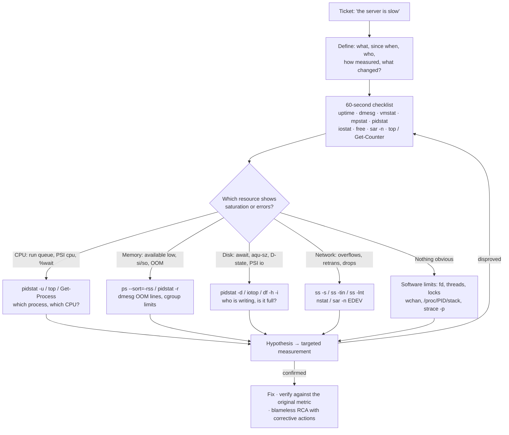

# Day 28: Advanced System Troubleshooting

!!! info "Lesson overview"
    | | |
    |---|---|
    | **Module** | 6 — Professional Operations & Projects |
    | **Difficulty** | :material-signal-cellular-3: Advanced |
    | **Estimated time** | 4–5 hours (90 min reading, 90 min demonstrations, 90–120 min lab and quiz) |
    | **Platforms** | Ubuntu 24.04 LTS (procps 4.0.4, sysstat 12.6.1, strace 6.8) · Windows 11 / Windows Server 2022 (Windows PowerShell 5.1 and PowerShell 7.4+) |
    | **Lab** | [Lab 28: The Slow Server](../../labs/lab-28.md) |

"The server is slow" is the most common, least precise ticket in IT. Yesterday's network investigation (Day 27) asked *is the path healthy?* Today asks the other half: *is the machine itself healthy, and if not, which resource is the bottleneck, which process is causing it, and why did it happen?* You already know most of the individual tools — `ps`, `top`, `df`, `journalctl`, `Get-Process`, `Get-WinEvent`. Today turns them into a **method**, so you reach the root cause in minutes instead of guessing for hours, and then write it up so it does not happen again.

## Learning Objectives

By the end of this lesson you will be able to:

1. Apply a **repeatable method** to performance problems: define the problem precisely, check the **USE** metrics (utilisation, saturation, errors) of every resource, use **RED** (rate, errors, duration) for services, and work by **hypothesis and evidence** rather than by restarting things.
2. Run the Linux **60-second checklist** — `uptime`, `dmesg -T | tail`, `vmstat 1`, `mpstat -P ALL 1`, `pidstat 1`, `iostat -xz 1`, `free -m`, `sar -n DEV 1`, `sar -n TCP,ETCP 1`, `top` — and read every important column.
3. Explain what the Linux **load average** really counts (runnable **and** uninterruptible `D`-state tasks), why "load 4" means different things on 1 and 64 CPUs, and how **iowait**, **steal** and per-CPU saturation hide in averages.
4. Read **Pressure Stall Information** (`/proc/pressure/cpu`, `memory`, `io`) and explain the difference between `some` and `full`.
5. Diagnose **memory** problems: `available` versus `free`, page cache, swap activity (`si`/`so`), the **OOM killer** in `dmesg`/the journal, `oom_score` and `oom_score_adj`, and contain a process with `systemd-run --scope -p MemoryMax=`.
6. Diagnose **disk** problems: latency (`r_await`, `w_await`), queue (`aqu-sz`), why `%util` misleads on SSD/NVMe, per-process I/O with `pidstat -d` and `iotop`, full file systems versus **inode exhaustion**.
7. Find **file-descriptor leaks** (`/proc/PID/fd`, `/proc/PID/limits`, `ulimit -n`, `lsof -p`) and **stuck processes** (`ps -o stat,wchan`, `/proc/PID/stack`, `strace -p`, `strace -c`).
8. Spot **host-side network bottlenecks**: socket summaries (`ss -s`), per-connection TCP state (`ss -tin`), **accept-queue overflows** (`ss -lnt` Recv-Q, `nstat TcpExtListenOverflows`), interface errors (`sar -n EDEV`).
9. Do the same on **Windows** with `Get-Counter` (and why counter names are localised), `Get-Process`, `Win32_PerfFormattedData_PerfProc_Process`, `typeperf`, `logman`/`relog`, Resource Monitor, Performance Monitor and WPR, and read the events that matter (2004, 41, 6008, 1000, 1001, 153).
10. Write a **blameless root-cause analysis**: timeline, impact, the 5 whys, contributing factors and corrective actions with owners.

## Prerequisites

- Days 08 (processes and services), 09 (disk and storage), 14 (ports and sockets), 16 (system logs) and 25 (scheduling) — today assumes you can already use `ps`, `top`, `kill`, `systemctl`, `journalctl`, `df`, `du`, `lsof`, `ss`, `Get-Process`, `Get-Service` and `Get-WinEvent`.
- An Ubuntu 24.04 VM (2+ vCPU, 2+ GB RAM) where you have `sudo`, with these packages: `sudo apt install sysstat stress-ng strace lsof iotop-c` (`sysstat`, `strace` and `lsof` are in `main`; `stress-ng` and `iotop-c` in `universe`). `stress-ng` is only for generating load in the lab.
- A Windows 11 or Windows Server VM for the PowerShell parts. `Get-Counter` and the CIM performance classes work in Windows PowerShell 5.1 and in PowerShell 7 **on Windows only**.
- Read [Lab Environment & Safety](../../getting-started/lab-environment.md). Load generators and `kill` are only for **your own lab machines**. Never generate load on, or kill processes on, a shared or production server without a change ticket.

## Introduction and Concepts

### Why a method beats intuition

Under pressure, people follow the *streetlight* anti-method: they look where it is easy to look (the tool they know, the graph that is already open), or the *random change* anti-method: restart the service, add RAM, reboot, and see if the complaint goes away. Both sometimes "work", destroy the evidence, and leave the real cause to return next week.

A professional investigation has four stages:

1. **Define the problem precisely.** *What* is slow (a web page, a backup, an SSH login, the whole machine)? *Since when*? *For whom* (everyone, one site, one user)? *How do you measure it* (response time, job duration)? *What changed* (deploys, patches, data growth, a new scheduled task)? Five minutes here saves hours later.
2. **Check every resource systematically** — CPU, memory, disk, network, and the software limits (file descriptors, threads, connection pools) — for utilisation, saturation and errors. This is the **USE method**.
3. **Form a hypothesis, then prove or disprove it** with a specific measurement. "I think the disk is slow" becomes "if the disk is the bottleneck, `w_await` will be high and the application's threads will be in `D` state".
4. **Fix, verify against the original measurement, and write it up** so the cause, not just the symptom, is removed.

### The USE method

The USE method (described by Brendan Gregg) gives you a checklist that cannot forget a resource. For **every resource**, ask three questions:

| | Question | CPU example | Memory example | Disk example | Network example |
|---|---|---|---|---|---|
| **U**tilisation | How busy is it? | `%usr+%sys` per CPU | used vs `available` | `%util`, throughput | rx/tx kB/s vs link speed |
| **S**aturation | Is work queuing because it is full? | run queue (`vmstat r` > CPUs), PSI cpu, `pidstat %wait` | swapping (`si`/`so`), PSI memory, OOM kills | `aqu-sz`, `await`, PSI io, tasks in `D` | accept-queue overflows, retransmits, socket buffers full |
| **E**rrors | Is anything failing? | machine-check events in `dmesg` | allocation failures, OOM | I/O errors in `dmesg`, SMART | `rxerr`/`rxdrop`, interface errors |

Saturation is the one beginners miss. A CPU at 100 % with nothing waiting is merely busy; a CPU at 70 % average with 12 threads queued on one core is the bottleneck.

**Software resources** count too: file descriptors (`ulimit -n`), process and thread limits (`pids.max`), connection pools, locks, and the listen backlog of a socket. Many "the server is slow" incidents are a software limit reached, while every hardware graph looks fine.

### The RED method for services

For a service (web, API, database) the user-facing signals are **R**ate (requests per second), **E**rrors (failed requests per second) and **D**uration (latency, ideally percentiles such as p95/p99). RED tells you *that* and *when* users suffer; USE on the host tells you *why*. Day 24's access-log analysis is exactly how you get RED numbers from a log when no monitoring exists.



### Load average, run queue and the D state

`uptime` prints three **load averages**: exponentially damped averages over 1, 5 and 15 minutes. On Linux the load counts tasks that are **runnable** (running or waiting for a CPU) **plus** tasks in **uninterruptible sleep** (`D` state — usually waiting for disk or NFS I/O). This differs from most other Unix systems, which count only runnable tasks. Consequences:

- Load must be compared with the **number of CPUs** (`nproc`). A load of 4 is idle-ish on a 32-CPU server and heavily saturated on 1 CPU.
- A high load with idle CPUs usually means **I/O**: many tasks in `D` state. Check `vmstat`'s `b` column and `ps -eo stat | grep D`.
- The **trend** matters: `1.52, 0.58, 0.22` (1-min much higher than 15-min) means the problem has just started; the reverse means it is clearing.

`vmstat`'s `r` column is the instantaneous count of runnable tasks; `b` is the count in `D` state. `r` persistently greater than the CPU count means CPU saturation.

### CPU time categories: iowait and steal

`mpstat`, `top` and `vmstat` split CPU time into `us`/`%usr` (user code), `sy`/`%sys` (kernel), `ni` (niced user code), `wa`/`%iowait`, `hi`/`si` (`%irq`, `%soft`: hardware and software interrupts), `st`/`%steal` and `id`/`%idle`.

- **iowait** is *idle time during which at least one I/O was outstanding*. It is a hint, not a measurement of disk speed: a CPU-bound workload starting on the same core makes iowait drop even though the disk is no faster. Use it to decide "look at the disk next", then measure the disk with `iostat`.
- **steal** is time this virtual CPU wanted to run but the hypervisor ran something else. Persistent steal above a few percent on a cloud VM means a noisy neighbour or an undersized instance type; nothing inside the guest can fix it.
- **Per-CPU views matter.** A single-threaded process pinned at 100 % on one of 16 CPUs shows as about 6 % average — invisible in a dashboard, obvious in `mpstat -P ALL`.

### Pressure Stall Information (PSI)

Since Linux 4.20 the kernel reports how much **time tasks spent stalled** waiting for each resource, in `/proc/pressure/cpu`, `/proc/pressure/memory` and `/proc/pressure/io` (and per cgroup in cgroup v2 as `cpu.pressure`, `memory.pressure`, `io.pressure`). Each file has two lines:

```text
some avg10=19.52 avg60=14.55 avg300=5.19 total=19184515
full avg10=16.84 avg60=12.55 avg300=4.51 total=16814254
```

- **some** — the percentage of wall-clock time in which **at least one** task was stalled on this resource (over the last 10, 60 and 300 seconds). `total` is the cumulative stall time in microseconds.
- **full** — the percentage of time in which **all non-idle tasks** were stalled at once: no useful work happened at all. For memory and I/O, `full` is the clearest single "the machine is thrashing" number there is. (At the system level the CPU `full` line is reported for format compatibility; it is meaningful per cgroup.)

PSI is the most direct answer to *"is this resource actually slowing work down?"* — it measures saturation, not utilisation. `systemd-oomd` on Ubuntu uses memory PSI to kill runaway cgroups before the kernel OOM killer is needed.

### Memory: free, available, cache and the OOM killer

Linux deliberately uses "free" RAM as **page cache** (file contents it has read or written), so `free` is usually small on a healthy server. The number that matters is **`available`**: the kernel's estimate of how much memory can be given to new work without swapping (free + reclaimable cache and slab). A memory problem looks like:

1. `available` shrinking towards zero and staying there;
2. **swap activity** — `vmstat`'s `si`/`so` (KiB/s swapped in/out) non-zero *continuously* (a one-off burst is normal), PSI memory rising, major page faults (`pidstat -r` `majflt/s`);
3. finally the **OOM killer**: when the kernel cannot reclaim enough memory it chooses a victim by its `oom_score` (mostly proportional to its memory use, adjusted by `oom_score_adj` from −1000 "never kill" to +1000 "kill first") and kills it with `SIGKILL`. The process exits with status **137** (128 + 9) and the kernel logs `Out of memory: Killed process ...` (or `Memory cgroup out of memory: Killed process ...` when a **cgroup limit** was hit).

On systemd systems you constrain a process or a service with a **cgroup memory limit**: `MemoryMax=` in a unit file, or `systemd-run --scope -p MemoryMax=500M command` for an ad-hoc command, so a leak kills the leaking process instead of the whole machine.

### Disk: latency, queue and the %util trap

`iostat -x` reports, per device, request rates (`r/s`, `w/s`), throughput (`rkB/s`, `wkB/s`), **average latency including queueing** (`r_await`, `w_await`, in milliseconds), the average **queue length** (`aqu-sz`) and **`%util`** (the percentage of time the device had at least one request in flight).

`%util` was designed for disks that serve one request at a time. SSDs, NVMe drives, RAID arrays and cloud volumes serve many requests in parallel, so a device can show 100 % `%util` and still have plenty of capacity. **Judge disks by latency (`await`) and queue (`aqu-sz`)**, compared with what that device normally does — a few hundred microseconds for NVMe, a few milliseconds for SATA SSD, 5–15 ms for a spinning disk, and whatever the cloud provider's volume type promises.

A "disk problem" can also be **capacity**: blocks (`df -h`) or **inodes** (`df -i`). A file system with no free inodes refuses to create files with *No space left on device* while `df -h` shows plenty of space — a classic with millions of tiny session or cache files.

### Process states and why a process is "stuck"

`ps` and `top` show each task's state: `R` running/runnable, `S` interruptible sleep (waiting for an event — normal for idle daemons), `D` uninterruptible sleep (waiting on I/O; cannot be killed until the I/O completes), `T` stopped, `Z` zombie (exited, parent has not reaped it), `I` idle kernel thread. A process that "does nothing" is usually in `S` or `D`, and the kernel will tell you **where** it is waiting:

- `ps -o wchan` / `/proc/PID/wchan` — the kernel function the task is sleeping in (e.g. `wait_for_partner` = opening a FIFO with no writer, `submit_bio_wait` = waiting for a disk I/O, `do_epoll_wait` = an idle event loop);
- `/proc/PID/stack` (root only) — the full kernel stack;
- `strace -p PID` — the system call it is blocked in, with its arguments (the file name, the socket).

### Root-cause analysis and blameless write-ups

The **root cause** is the deepest cause that, if removed, prevents recurrence — usually a process or design gap, not a person. The **5 whys** technique keeps asking *why* until you reach something you can fix structurally:

> The web site was slow → the database server's disk latency was 200 ms → a log-shipping job was doing synchronous 4 KiB writes → it had been reconfigured to `fsync` every line → the vendor's upgrade guide recommended it and nobody load-tested the change → **there is no performance test step in the change process for agents running on database hosts.**

A **blameless** RCA describes what happened and why the system allowed it, not who to blame, because people who fear blame hide information. A good RCA contains: summary, impact (who, how long, how measured), detection (how and when we found out — and how we could have found out sooner), a **UTC timeline**, root cause and contributing factors, what went well, and **corrective actions** with owners and dates.

## Linux Command Reference

| Command | Purpose | Package / availability | Needs root? |
|---|---|---|---|
| `uptime`, `/proc/loadavg` | Load averages, running/total tasks | procps (always installed) | No |
| `dmesg -T` | Kernel ring buffer with readable timestamps (OOM kills, I/O errors, hung tasks) | util-linux | Ubuntu: yes (`kernel.dmesg_restrict=1`) |
| `journalctl -k`, `journalctl -p warning -S -1h` | Kernel and system messages from the journal | systemd | Group `adm`/`systemd-journal` or root |
| `vmstat -w 1` | Run queue, D-state count, memory, swap, I/O, CPU split per second | procps | No |
| `mpstat -P ALL 1` | Per-CPU utilisation including iowait, irq, soft, steal | **sysstat** | No |
| `pidstat 1`, `-d`, `-r`, `-w`, `-t` | Per-process CPU, disk, memory/faults, context switches, threads | **sysstat** | No (others' I/O needs root) |
| `iostat -xz 1` | Per-device latency, queue, throughput, utilisation | **sysstat** | No |
| `sar -n DEV/EDEV/TCP,ETCP 1`, `sar -f` | Network, interface errors, TCP rates; history from `/var/log/sysstat` | **sysstat** (history needs collection enabled) | No |
| `free -m`, `/proc/meminfo` | Memory: used, free, buff/cache, **available**, swap | procps | No |
| `top`, `htop` | Interactive process view (`htop` package for htop) | procps / htop | No |
| `cat /proc/pressure/{cpu,memory,io}` | Pressure Stall Information | kernel ≥ 4.20 (Ubuntu 24.04: yes) | No |
| `ps -eo pid,stat,wchan:20,etime,args` | Process state and kernel wait channel | procps | No |
| `cat /proc/PID/stack` | Kernel stack of a task | kernel | **Yes** |
| `strace -p PID`, `strace -c`, `-f`, `-T`, `-tt` | Trace or summarise system calls | **strace** | Others' processes: yes (Yama `ptrace_scope=1`) |
| `ls /proc/PID/fd`, `/proc/PID/limits`, `ulimit -n` | Open file descriptors and limits | kernel / Bash built-in | Others' processes: yes |
| `lsof -p PID` | Open files of a process | lsof | Others' processes: yes |
| `iotop-c -o` / `iotop -o` | Per-process disk I/O, interactive | **iotop-c** or iotop | Yes |
| `ss -s`, `ss -tin`, `ss -lnt` | Socket summary, TCP internals, listen queues | iproute2 | No (`-p` for others' processes: yes) |
| `nstat -az` | Kernel SNMP/TCP counters (retransmits, listen overflows) | iproute2 | No |
| `choom -p PID` | Show/adjust a process's OOM score adjustment | util-linux | To lower it: yes |
| `systemd-run --scope -p MemoryMax=` | Run a command in a transient cgroup with limits | systemd (cgroup v2) | Yes (or `--user` with delegation) |
| `stress-ng` | Synthetic load for **labs only** | stress-ng (universe) | No |

## PowerShell Command Reference

| Cmdlet / tool | Aliases | Purpose | 5.1 | 7.x | Admin? |
|---|---|---|---|---|---|
| `Get-Counter` | — | Sample performance counters (local or remote) | Yes | **Windows only** (7.0+) | No (some counter sets need admin or *Performance Monitor Users*) |
| `Get-Counter -ListSet` | — | List counter sets and their (localised) paths | Yes | Windows only | No |
| `Import-Counter`, `Export-Counter` | — | Read/write `.blg`/`.csv` counter logs | Yes | **Not available** (use `relog` + `Import-Csv`) | No |
| `Get-Process` | `gps`, `ps`\* | Processes with CPU seconds, working set, handles, threads | Yes | Yes (all OS; `-IncludeUserName` needs admin) | No |
| `Get-CimInstance Win32_PerfFormattedData_PerfProc_Process` | `gcim` | Per-process % CPU, I/O bytes/s, private working set | Yes | Windows only | No |
| `Get-CimInstance Win32_OperatingSystem` | — | Free physical memory, commit limit, last boot | Yes | Windows only | No |
| `Get-WinEvent -FilterHashtable` | — | Events 2004, 41, 6008, 1000, 1001, 1002, 153 | Yes | Windows only | Security log: yes |
| `typeperf.exe` | — | Counter sampling from any shell, CSV output | Yes | Yes (Windows) | No |
| `logman.exe`, `relog.exe` | — | Create/run Data Collector Sets; convert `.blg` to CSV | Yes | Yes (Windows) | logman create/start: yes |
| `resmon.exe`, `perfmon.exe` | — | Resource Monitor, Performance Monitor GUIs | Yes | Yes (Windows) | No |
| `wpr.exe` / WPA | — | Windows Performance Recorder (ETW traces) and Analyzer | Yes | Yes (Windows) | **Yes** |
| `Get-Volume`, `Get-PhysicalDisk` | — | Free space and disk health status | Yes | Windows only | No |

\* `ps` is an alias only on Windows.

## Detailed Command Explanations

### `uptime` and `/proc/loadavg` — first glance

`uptime` answers two questions in one line: how long since the last boot (an unexpected reboot is a finding) and the 1/5/15-minute load. `/proc/loadavg` adds two fields: `2/133` means 2 tasks runnable now out of 133 total, and the last field is the most recently assigned PID — a rapidly increasing number between two reads means processes are being created very fast (a fork storm, or a cron job spawning per-second).

### `dmesg -T` and `journalctl -k` — has the kernel already told you?

Before measuring anything, read what the kernel has logged: OOM kills, `blk_update_request: I/O error`, `task ... blocked for more than 120 seconds` (hung-task detector), NIC link flaps, `nf_conntrack: table full, dropping packet`, CPU thermal throttling, segfaults. `dmesg -T` converts the timestamps to wall-clock time (approximate: it does not account for suspend). On Ubuntu `dmesg` needs `sudo` because `kernel.dmesg_restrict=1`; `journalctl -k -b` (kernel messages since boot) and `journalctl -k -S "-1h"` work for members of `adm`/`systemd-journal` and survive reboots if the journal is persistent.

### `vmstat` — the whole machine, once per second

`vmstat -w 1` (wide output, one line per second; the **first line is the average since boot — ignore it**). Columns: `r` runnable, `b` uninterruptible (D), `swpd` swap used, `free`, `buff`, `cache`, `si`/`so` swap in/out per second, `bi`/`bo` blocks read/written per second, `in` interrupts, `cs` context switches, then CPU `us sy id wa st` and, in procps 4.x, `gu` (time running KVM guests). Read it left to right: is work queuing (`r`, `b`)? is memory swapping (`si`, `so`)? is the disk busy (`bo`, `wa`)? is the CPU the limit (`us+sy` near 100, `id` near 0)?

### `mpstat -P ALL` — per CPU

Shows each CPU's split of `%usr %nice %sys %iowait %irq %soft %steal %guest %gnice %idle`. Look for **imbalance**: one CPU at 100 % (single-threaded bottleneck, or all network interrupts landing on CPU 0 — high `%soft`), steal on every CPU (hypervisor), iowait concentrated where the I/O-issuing thread runs.

### `pidstat` — per process, over an interval

Unlike `top`, `pidstat` prints rolling per-interval figures that you can paste into a ticket. Modes: default/`-u` CPU (`%usr %system %guest %wait %CPU CPU`), **`%wait`** is time the task was runnable but waiting for a CPU — direct per-process CPU saturation; `-d` disk (`kB_rd/s kB_wr/s kB_ccwr/s iodelay`); `-r` memory (`minflt/s majflt/s VSZ RSS %MEM`); `-w` context switches (`cswch/s` voluntary — blocking; `nvcswch/s` involuntary — preempted, a CPU-contention sign); `-t` per thread; `-p PID` or `-C name` to filter; `-l` to show the full command line.

### `iostat -xz` — per device

`-x` extended statistics, `-z` hide idle devices, `1` interval. Again, the first report is since boot. Key columns: `r/s w/s`, `rkB/s wkB/s`, `rareq-sz wareq-sz` (average request size: 4 KiB writes at thousands per second is a synchronous small-write pattern), `r_await w_await` (ms, including queue time), `f/s f_await` (flush requests — `fsync` from applications), `aqu-sz`, `%util`. Add `-p sda` for partitions, `-m` for MB.

### `free -m` and `/proc/meminfo`

`free -m` shows `total used free shared buff/cache available` and swap. `available` is what matters. `/proc/meminfo` adds `Dirty` and `Writeback` (data waiting to be written: large values mean writes are being buffered faster than the disk drains them), `Slab`/`SReclaimable`, `Committed_AS` (memory promised to processes), `HugePages_*`.

### `sar` — the past, not just the present

Every command above shows *now*. By the time you log in, the incident may be over. `sar` (sysstat) records history every 10 minutes when collection is enabled, which it is **not** on a fresh Ubuntu install (`/etc/default/sysstat` ships with `ENABLED="false"`). On Ubuntu 24.04 (sysstat 12.6) there are two collection paths: the systemd timer `sysstat-collect.timer` (pulled in by `sudo systemctl enable --now sysstat`), which runs `/usr/lib/sysstat/sa1` directly, and the Debian cron script `/usr/lib/sysstat/debian-sa1`, which only collects when `ENABLED="true"`. Run `sudo dpkg-reconfigure sysstat` (answer *Yes*, which sets `ENABLED="true"`) **and** `sudo systemctl enable --now sysstat`, then confirm with `systemctl list-timers 'sysstat*'`. Data goes to `/var/log/sysstat/saDD`, kept for `HISTORY=7` days by default (`/etc/sysstat/sysstat`). Then `sar -u -f /var/log/sysstat/sa20 -s 02:00:00 -e 03:00:00` shows CPU between 02:00 and 03:00 on the 20th; `-r` memory, `-B` paging, `-d` disks, `-q` run queue and load, `-n DEV`/`EDEV`/`TCP`/`ETCP` network. Live: `sar -n DEV 1` per-interface packets and kB/s, `sar -n EDEV 1` errors and drops, `sar -n TCP,ETCP 1` active/passive opens, retransmits (`retrans/s`), resets.

### `top` — interactive confirmation

`top` combines the summary (load, tasks by state, CPU split, memory) with a sorted process list. Useful keys: ++shift+p++ sort by CPU, ++shift+m++ by memory, ++1++ per-CPU lines, ++c++ full command line, ++h++ threads, ++f++ choose fields (add `WCHAN`, `nTH`, `SWAP`). Batch mode for tickets: `top -b -n 1 -o %CPU | head -20`.

### PSI files

`cat /proc/pressure/io` takes no options. To watch it: `watch -n 2 cat /proc/pressure/{cpu,memory,io}`. For a systemd service on cgroup v2: `cat /sys/fs/cgroup/system.slice/nginx.service/memory.pressure`.

### The OOM killer: `dmesg`, `oom_score`, `choom`, `MemoryMax=`

After an OOM kill, `dmesg -T | grep -iE 'killed process|out of memory'` or `journalctl -k -g 'Killed process'` shows the victim, its memory and whether the trigger was the whole machine (`Out of memory:`) or a cgroup limit (`Memory cgroup out of memory:` with `oom_memcg=` naming the cgroup). `cat /proc/PID/oom_score` shows the current badness score; `/proc/PID/oom_score_adj` (or `choom -p PID`) the adjustment. Services set it with `OOMScoreAdjust=` in their unit. To protect the machine from a leaky job, run it with a limit: `sudo systemd-run --scope -p MemoryMax=500M -p MemorySwapMax=0 ./job.sh` — the job is OOM-killed at 500 MiB instead of starving everything else.

### `pidstat -d` and `iotop` — who is doing the I/O?

`pidstat -d 1` lists processes with non-zero disk read/write rates and `iodelay` (clock ticks spent waiting for block I/O, needs `kernel.task_delayacct`). `sudo iotop-c -o` (package `iotop-c` on Ubuntu 24.04, command `iotop-c`; the older Python implementation is the `iotop` package) shows only processes currently doing I/O, with `IO>` percentage — the delay-accounting columns need `sudo sysctl kernel.task_delayacct=1` on recent kernels.

### File descriptors: `/proc/PID/fd`, limits and `lsof -p`

Every open file, socket, pipe and device is a file descriptor. Each process has a soft and hard limit (`ulimit -n` in a shell; `LimitNOFILE=` for systemd services; `grep 'open files' /proc/PID/limits` for a running process). When the limit is reached, `open()`, `socket()` and `accept()` fail with **`EMFILE` — "Too many open files"** — and a server stops accepting connections while its CPU and memory look perfect. Diagnose with `ls /proc/PID/fd | wc -l` (compare with the limit, and repeat a minute later — growing means a leak), and `lsof -p PID` to see *what* is open (the same file opened 200 times, thousands of sockets in `CLOSE_WAIT` — the application never calls `close()`). System-wide: `cat /proc/sys/fs/file-nr` (allocated, unused, maximum).

### `strace` — what is the process asking the kernel?

`strace -p PID` attaches to a running process and prints each system call as it happens; a process blocked inside one call shows that single unfinished line, e.g. `openat(AT_FDCWD, "/srv/app/backup.fifo", O_RDONLY` — it is waiting to open a FIFO. `-f` follows children and threads, `-tt` timestamps, `-T` time spent in each call, `-e trace=file,network` filters, `-o file` writes to a file. **`strace -c -p PID`** (stop with ++ctrl+c++) prints a summary table: which calls, how many, how long — "20,000 `write` calls in 5 seconds" is a small-writes pattern. `strace` slows the traced process considerably, so trace briefly and never leave it attached in production. On Ubuntu, Yama `kernel.yama.ptrace_scope=1` lets normal users trace only their own child processes; use `sudo` — do not lower the Yama setting.

### `ss` and `nstat` for host-side network bottlenecks

Day 14 used `ss` to find listeners; today it diagnoses bottlenecks. `ss -s` summarises socket counts by state (thousands of `timewait` or `orphaned` can indicate connection churn). `ss -tin` adds per-connection TCP internals: `rtt`, `cwnd`, `retrans:current/total`, `bytes_retrans`, `send`/`delivery_rate`, `unacked`, `notsent`. For a **listening** socket, `ss -lnt` shows the **accept queue**: `Recv-Q` = connections completed by the kernel but not yet `accept()`ed by the application, `Send-Q` = the configured backlog. When `Recv-Q` reaches `Send-Q+1`, new connections are dropped and `nstat`'s `TcpExtListenOverflows` and `TcpExtListenDrops` increase — clients see slow connects (SYN retransmissions after 1 s, 3 s...) while the network is perfect. The cause is an application that does not accept fast enough (all workers busy, blocked, or stuck).

`nstat` prints kernel counters as **increments since its last run** (it keeps history per user); `nstat -az NAME...` prints **absolute** values including zeros. Useful counters: `TcpRetransSegs`, `TcpExtTCPTimeouts`, `TcpExtListenOverflows`, `TcpExtListenDrops`, `TcpExtTCPBacklogDrop`, `UdpRcvbufErrors`.

### `Get-Counter` — Windows performance counters

`Get-Counter` samples performance counters: `Get-Counter -Counter '\Processor(_Total)\% Processor Time' -SampleInterval 1 -MaxSamples 5`. With no `-MaxSamples` it takes one sample; `-Continuous` samples until ++ctrl+c++. Each result is a `PerformanceCounterSampleSet` whose `CounterSamples` property holds `Path`, `InstanceName` and `CookedValue`. Wildcards work in instance names (`\PhysicalDisk(*)\Avg. Disk sec/Read`). `-ComputerName` reads a remote computer's counters over the **Remote Registry/performance counter** service, not WinRM; inside `Invoke-Command` it is simpler and more firewall-friendly (Day 26).

!!! warning "Counter names are localised"
    Counter paths are translated into the Windows display language (on a German system, for example, the *Processor* set is called *Prozessor*), and an English path fails with *The specified object was not found on the computer*. Discover the real names with `Get-Counter -ListSet Processor | Select-Object -ExpandProperty Counter`, and in scripts for multilingual fleets prefer the CIM classes (`Win32_PerfFormattedData_*`), whose property names are not localised.

Useful counters and rough guidance (always compare with that machine's own baseline):

| Counter | What it tells you | Rough concern level |
|---|---|---|
| `\Processor(_Total)\% Processor Time` | CPU utilisation | Sustained > 85–90 % |
| `\System\Processor Queue Length` | Threads ready but waiting for a CPU (saturation) | Sustained > 2 × number of cores |
| `\Memory\Available MBytes` | Memory that can be given to processes immediately | < 10 % of RAM, or falling steadily |
| `\Memory\Pages/sec` | Pages read/written to resolve hard faults (includes memory-mapped files, so not pure "swapping") | Sustained high **together with** low Available MBytes |
| `\Memory\% Committed Bytes In Use` | Commit charge versus commit limit (RAM + page file) | > 90 % → event 2004 risk |
| `\PhysicalDisk(*)\Avg. Disk sec/Read`, `sec/Write` | Latency **in seconds** (0.010 = 10 ms) | SSD > ~0.005 s, HDD > ~0.020 s sustained |
| `\PhysicalDisk(*)\Current Disk Queue Length` | Outstanding requests now | Persistently high with high latency |
| `\Network Interface(*)\Bytes Total/sec` | Throughput per NIC | Compare with `\Network Interface(*)\Current Bandwidth` (bits/s) |
| `\Process(*)\% Processor Time` | Per-process CPU (per core: can exceed 100) | — |

### `Get-Process` and the CIM per-process performance class

`Get-Process` returns objects with `CPU` (total processor **seconds** since the process started — not a percentage), `WorkingSet64` (bytes in RAM), `PagedMemorySize64`/`PM` (private committed bytes, the leak indicator), `Handles`/`HandleCount`, `Threads`, `StartTime`. For current percentage CPU per process use `Get-Counter '\Process(*)\% Processor Time'` or `Get-CimInstance Win32_PerfFormattedData_PerfProc_Process` (properties `Name`, `IDProcess`, `PercentProcessorTime`, `WorkingSetPrivate`, `IODataBytesPersec`, `HandleCount`, `ThreadCount`). `PercentProcessorTime` is per logical CPU, so on an 8-CPU machine a process can show up to 800; divide by `[Environment]::ProcessorCount`. A steadily growing `HandleCount` is the Windows equivalent of a file-descriptor leak.

### `typeperf`, `logman` and `relog` — sampling and recording

`typeperf "\Processor(_Total)\% Processor Time" "\Memory\Available MBytes" -si 1 -sc 10` prints CSV from any shell. To record a baseline or catch an intermittent problem overnight, create a **Data Collector Set** (elevated): `logman create counter PerfBaseline -c "\Processor(*)\*" "\Memory\*" "\PhysicalDisk(*)\*" -si 00:00:15 -o C:\PerfLogs\PerfBaseline -f bincirc -max 512`, then `logman start PerfBaseline` / `logman stop PerfBaseline`. Convert the `.blg` file (logman adds a version number such as `_000001` to the name) with `relog <file>.blg -f csv -o perf.csv` and load it with `Import-Csv` (PowerShell 7) or read the `.blg` directly with `Import-Counter` (Windows PowerShell 5.1 only).

### Resource Monitor, Performance Monitor and WPR

`resmon.exe` is the fastest GUI triage on Windows: per-process CPU, disk (with **file names and response time**), network (with remote addresses) and memory (hard faults/sec), plus *Analyze Wait Chain* on a hung process — the Windows answer to `wchan`/`strace -p`. `perfmon.exe` graphs any counter and runs Data Collector Sets. For deep problems (which function burns CPU, which driver delays I/O), **Windows Performance Recorder** records an ETW trace (elevated): `wpr -start GeneralProfile -start CPU`, reproduce, `wpr -stop C:\Temp\slow.etl`, then open it in **Windows Performance Analyzer** (WPA, from the Windows ADK or Microsoft Store). Linux's closest equivalent is `perf record` (package `linux-tools-$(uname -r)` on Ubuntu).

### Windows events that explain "slow" and "it rebooted"

| Log / provider | ID | Meaning |
|---|---|---|
| System / `Microsoft-Windows-Resource-Exhaustion-Detector` | 2004 | Low virtual memory: lists the processes using the most commit — the Windows "who caused the memory pressure" record |
| System / `Microsoft-Windows-Kernel-Power` | 41 | The system rebooted without cleanly shutting down (power loss, hard hang, bugcheck) |
| System / `EventLog` | 6008 | The previous system shutdown was unexpected (with the time) |
| System / `BugCheck` | 1001 | The computer rebooted from a bugcheck (blue screen) and wrote a dump |
| Application / `Application Error` | 1000 | An application crashed (faulting module and exception code) |
| Application / `Windows Error Reporting` | 1001 | Fault bucket report for a crash or hang |
| Application / `Application Hang` | 1002 | An application stopped responding and was closed |
| System / `disk`, `stornvme`, `storahci` | 7, 153, 129 | Bad block; I/O retried; storage reset — hardware or driver trouble behind slow disks |

## Syntax and Parameters

### Bash

```text
uptime [-p] [-s]
dmesg [-T] [-l LEVEL[,LEVEL]] [--since TIME] [--until TIME]   # --since/--until: util-linux 2.39.3 on 24.04
vmstat [-w] [-S M] [-a] [DELAY [COUNT]]
mpstat [-P {CPU[,...] | ALL}] [INTERVAL [COUNT]]
pidstat [-u] [-d] [-r] [-w] [-t] [-l] [-p PID[,...] | -C REGEX] [INTERVAL [COUNT]]
iostat [-x] [-z] [-m] [-p DEV] [DEVICE...] [INTERVAL [COUNT]]
sar [-u] [-q] [-r] [-B] [-d] [-n {DEV|EDEV|TCP|ETCP|SOCK}[,...]] [-f FILE] [-s HH:MM:SS] [-e HH:MM:SS] [INTERVAL [COUNT]]
free [-m | -h] [-w] [-s SECONDS]
top [-b] [-n N] [-o FIELD] [-p PID] [-H] [-w COLS]
ps -eo pid,ppid,stat,wchan:20,etime,pcpu,rss,args [--sort=-pcpu | --sort=-rss]
strace [-f] [-tt] [-T] [-c] [-e trace=SET] [-o FILE] { -p PID | COMMAND [ARG...] }
lsof -p PID
ss [-s] [-t] [-i] [-n] [-l] [FILTER]
nstat [-a] [-z] [-n] [COUNTER...]
systemd-run [--scope] [-p PROPERTY=VALUE]... COMMAND [ARG...]
```

| Option | Command | Meaning |
|---|---|---|
| `-w` | vmstat | Wide output (columns do not run together) |
| `-S M` | vmstat | Show memory in MiB instead of KiB |
| `-P ALL` | mpstat | One line per CPU plus `all` |
| `-u` / `-d` / `-r` / `-w` / `-t` | pidstat | CPU / disk I/O / memory and page faults / context switches / per thread |
| `-C REGEX`, `-p PID` | pidstat | Only commands matching the regex / only these PIDs |
| `-x`, `-z` | iostat | Extended statistics / omit devices with no activity |
| `-n DEV`, `EDEV`, `TCP`, `ETCP` | sar | Interface traffic, interface errors, TCP rates, TCP errors (`retrans/s`) |
| `-f FILE`, `-s`, `-e` | sar | Read history file, start and end time |
| `-b -n 1 -o %CPU` | top | Batch mode, one iteration, sort by CPU |
| `wchan:20` | ps | Wait channel column, 20 characters wide |
| `-c` | strace | Count calls, time and errors; print summary at exit/detach |
| `-T`, `-tt` | strace | Time spent in each call; wall-clock timestamps with microseconds |
| `-p PID` | strace, lsof | Attach to / list open files of a running process |
| `-i` | ss | Internal TCP information (rtt, cwnd, retrans) |
| `-a`, `-z` | nstat | Absolute counter values (ignore history) / include zero counters |
| `--scope`, `-p MemoryMax=` | systemd-run | Run in the foreground in a transient scope / set a cgroup property |

### PowerShell

```text
Get-Counter [[-Counter] <String[]>] [-SampleInterval <Int32>] [-MaxSamples <Int64>] [-Continuous]
            [-ComputerName <String[]>]
Get-Counter -ListSet <String[]> [-ComputerName <String[]>]
Get-Process [[-Name] <String[]>] [-Id <Int32[]>] [-IncludeUserName]
Get-CimInstance -ClassName Win32_PerfFormattedData_PerfProc_Process [-Filter <String>] [-Property <String[]>]
Get-WinEvent -FilterHashtable @{ LogName=<String>; Id=<Int32[]>; ProviderName=<String>; StartTime=<DateTime> } [-MaxEvents <Int64>]
typeperf <counter> [<counter> ...] [-si <interval>] [-sc <samples>] [-f CSV] [-o <file>]
logman create counter <name> -c <counter> [...] -si <hh:mm:ss> -o <path> [-f bin|bincirc|csv] [-max <MB>]
relog <file.blg> -f csv -o <file.csv> [-b <begin>] [-e <end>]
wpr -start <profile> [-start <profile>] | wpr -stop <file.etl> | wpr -cancel
```

| Parameter | Cmdlet / tool | Meaning |
|---|---|---|
| `-Counter` | Get-Counter | One or more counter paths `\Set(Instance)\Counter`; wildcards allowed |
| `-SampleInterval` | Get-Counter | Seconds between samples (default 1) |
| `-MaxSamples` | Get-Counter | Number of samples (default 1); cannot be combined with `-Continuous` |
| `-Continuous` | Get-Counter | Sample until stopped with ++ctrl+c++ |
| `-ListSet` | Get-Counter | Return counter-set objects (`CounterSetName`, `Counter`, `Paths`, `PathsWithInstances`) |
| `-IncludeUserName` | Get-Process | Add the owner (requires elevation) |
| `-Filter` | Get-CimInstance | WQL filter, e.g. `"Name='sqlservr'"` |
| `-si`, `-sc` | typeperf | Sample interval, sample count |
| `-f bincirc -max` | logman | Circular binary log with a size limit in MB |
| `-start GeneralProfile -start CPU` | wpr | Built-in recording profiles (combine several) |

## Practical Demonstrations

**Capture environment.** The Bash outputs below were **captured** on 2026-11-20 as root in an Ubuntu 24.04.5 container (4 vCPU, 16 GB RAM, **no swap**, kernel 6.18, one virtio disk `vda`, host name shown as `vm`) with procps 4.0.4, sysstat 12.6.1, strace 6.8, stress-ng 0.17.06 and iproute2 6.1, while the Lab 28 fault script was running. Rows belonging to the container's own management processes were removed and long tables shortened (`...`); nothing else was edited. Because the container has no systemd as PID 1, the `systemd-run`/`journalctl` lines are labelled examples. **All PowerShell output is an example**: it shows the documented format, not a capture.

### Demo 1 — The 60-second checklist on a "slow" server

The Lab 28 faults are running. Work through the checklist in order, writing one line of notes per command.

=== "Bash"

    ```bash
    uptime
    sudo dmesg -T | tail -5
    vmstat -w 1 5
    ```

    **Expected output (captured):**

    ```text
     16:43:43 up 5 min,  0 user,  load average: 1.52, 0.58, 0.22
    [Fri Nov 20 16:38:16 2026] EXT4-fs (vda): mounted filesystem e7a56aa4-... r/w without journal. Quota mode: none.
    ...
    --procs-- -----------------------memory---------------------- ---swap-- -----io---- -system-- ----------cpu----------
       r    b         swpd         free         buff        cache   si   so    bi    bo   in   cs  us  sy  id  wa  st  gu
       2    0            0     12863940        31608      1124948    0    0  1207 11123 7980   27   8   4  84   4   0   0
       1    1            0     12867780        31608      1125016    0    0   100 34536 30567 42632  27   9  47  17   1   0
       1    1            0     12867860        31608      1125112    0    0     0 39124 33867 48227  25  10  47  17   1   0
       1    1            0     12867860        31608      1125112    0    0     0 36172 30466 44624  26  10  48  16   1   0
       1    1            0     12867860        31608      1125112    0    0     0 36192 34687 44656  20  12  50  17   1   0
    ```

    Notes a professional would write:

    - **uptime**: up 5 minutes (was it rebooted? — here yes, it is a fresh lab machine); 1-minute load 1.52 rising fast versus 0.22 → *started in the last minute or two*; 4 CPUs, so the load alone is not alarming.
    - **dmesg**: no OOM kills, no I/O errors, no hung tasks. Good: we can rule out hardware errors for now.
    - **vmstat** (ignore the first line): `r`=1 runnable, `b`=1 constantly in D state; no swap activity; `bo` ≈ 36,000 blocks/s written; `wa` 16–17 % and `us` ≈ 25 % (= one CPU of four fully busy in user mode). **Two hypotheses: a CPU-bound process, and a heavy writer.**

=== "PowerShell"

    ```powershell
    $os = Get-CimInstance Win32_OperatingSystem
    'Up since {0} ({1:N1} h)' -f $os.LastBootUpTime, ((Get-Date) - $os.LastBootUpTime).TotalHours
    Get-WinEvent -FilterHashtable @{LogName='System'; Level=1,2,3; StartTime=(Get-Date).AddHours(-2)} -MaxEvents 5 |
        Format-Table TimeCreated, Id, ProviderName, LevelDisplayName -AutoSize
    $counters = '\Processor(_Total)\% Processor Time', '\System\Processor Queue Length',
                '\Memory\Available MBytes', '\Memory\Pages/sec',
                '\PhysicalDisk(_Total)\Avg. Disk sec/Write', '\PhysicalDisk(_Total)\Current Disk Queue Length'
    Get-Counter -Counter $counters -SampleInterval 1 -MaxSamples 3 |
        ForEach-Object { $_.CounterSamples | Select-Object @{n='Time';e={$_.Timestamp.ToString('HH:mm:ss')}},
                                                         @{n='Counter';e={$_.Path -replace '^\\\\[^\\]+'}},
                                                         @{n='Value';e={[math]::Round($_.CookedValue,3)}} }
    ```

    **Expected output (example):**

    ```text
    Up since 20/11/2026 15:02:11 (1.7 h)

    TimeCreated          Id ProviderName                 LevelDisplayName
    -----------          -- ------------                 ----------------
    20/11/2026 16:31:40 2004 Microsoft-Windows-Resource-Exhaustion-Detector Warning

    Time     Counter                                         Value
    ----     -------                                         -----
    16:43:44 \processor(_total)\% processor time             38.112
    16:43:44 \system\processor queue length                       0
    16:43:44 \memory\available mbytes                          1234
    16:43:44 \memory\pages/sec                               12.004
    16:43:44 \physicaldisk(_total)\avg. disk sec/write        0.041
    16:43:44 \physicaldisk(_total)\current disk queue length      3
    ...
    ```

    The `-replace` strips the leading `\\COMPUTERNAME` from each path. Here a 41 ms average write latency with a queue of 3 and a recent event 2004 would give two hypotheses: a heavy writer and memory pressure.

### Demo 2 — Per CPU and per process: who is using the CPU?

=== "Bash"

    ```bash
    mpstat -P ALL 1 1
    pidstat 1 1
    top -b -n 1 -o %CPU | head -12
    ```

    **Expected output (captured, shortened):**

    ```text
    16:43:47     CPU    %usr   %nice    %sys %iowait    %irq   %soft  %steal  %guest  %gnice   %idle
    16:43:48     all   17.09    0.00    5.36   17.35    0.00    8.67    1.02    0.00    0.00   50.51
    16:43:48       0    0.00    0.00    1.98    5.94    0.00    2.97    0.00    0.00    0.00   89.11
    16:43:48       1    0.00    0.00   13.33   53.33    0.00    0.00    1.11    0.00    0.00   32.22
    16:43:48       2    0.00    0.00    7.00   14.00    0.00    0.00    0.00    0.00    0.00   79.00
    16:43:48       3   66.34    0.00    0.00    0.00    0.00   30.69    2.97    0.00    0.00    0.00

    16:43:48      UID       PID    %usr %system  %guest   %wait    %CPU   CPU  Command
    16:43:49        0        56    0.00    3.00    0.00    0.00    3.00     1  kworker/1:1H-kblockd
    16:43:49        0        69    0.00    5.00    0.00    0.00    5.00     0  kworker/0:1H-kblockd
    16:43:49        0      1806   74.00   24.00    0.00    0.00   98.00     3  python3
    16:43:49        0      2084    0.00   19.00    0.00    2.00   19.00     1  dd

    top - 16:43:59 up 5 min,  0 user,  load average: 1.62, 0.65, 0.25
    Tasks: 105 total,   3 running, 102 sleeping,   0 stopped,   0 zombie
    %Cpu(s): 21.4 us,  7.1 sy,  0.0 ni, 50.0 id, 16.7 wa,  0.0 hi,  4.8 si,  0.0 st
    MiB Mem :  16087.6 total,  12561.1 free,   2653.0 used,   1130.2 buff/cache
    MiB Swap:      0.0 total,      0.0 free,      0.0 used.  13434.7 avail Mem

      PID USER      PR  NI    VIRT    RES    SHR S  %CPU  %MEM     TIME+ COMMAND
     1806 root      20   0   13948   7668   4884 R 100.0   0.0   1:16.41 python3
      182 root       0 -20       0      0      0 I  10.0   0.0   0:01.67 kworker/2:1H-kblockd
     2117 root      20   0    2756   1792   1676 R  10.0   0.0   0:00.01 dd
    ```

    - The **average** says 50 % idle; the **per-CPU** view says CPU 3 has **0 % idle** (66 % user + 31 % softirq) while CPU 1 spends 53 % in iowait. Averages hide the bottleneck.
    - `pidstat` names the CPU consumer: PID 1806, `python3`, 98 % of one CPU. `%wait` 0 → it is not starved, it simply uses a whole core. The `dd` (PID changes every few seconds — a loop starting new `dd` processes) and the `kblockd` kernel workers are the I/O side.
    - The command column says only `python3`. **That is not enough to act on.** Get the full command line before anything else: `ps -o pid,etime,args -p 1806` (or ++c++ in `top`). In the lab it is `/srv/lab28/bin/thumbnailer` — a name that sounds harmless.

=== "PowerShell"

    ```powershell
    $cpus = [Environment]::ProcessorCount
    Get-CimInstance Win32_PerfFormattedData_PerfProc_Process -Filter "Name<>'_Total' AND Name<>'Idle'" |
        Sort-Object PercentProcessorTime -Descending | Select-Object -First 5 Name, IDProcess,
            @{n='CPU%';e={[math]::Round($_.PercentProcessorTime / $cpus, 1)}},
            @{n='WS_MB';e={[math]::Round($_.WorkingSetPrivate / 1MB)}}, HandleCount
    Get-Process -Id 6120 | Select-Object Id, ProcessName, StartTime, Path,
        @{n='CmdLine';e={(Get-CimInstance Win32_Process -Filter "ProcessId=$($_.Id)").CommandLine}}
    ```

    **Expected output (example):**

    ```text
    Name        IDProcess  CPU% WS_MB HandleCount
    ----        ---------  ---- ----- -----------
    powershell       6120  24.9    68         612
    MsMpEng          3312   3.1   245        1203
    svchost#12       1880   0.8    22         431
    ...

      Id ProcessName StartTime           Path                                                      CmdLine
      -- ----------- ---------           ----                                                      -------
    6120 powershell  20/11/2026 16:41:02 C:\Windows\System32\WindowsPowerShell\v1.0\powershell.exe powershell.exe -NoProfile -File C:\Lab28\thumbnailer.ps1
    ```

    `PercentProcessorTime` is per logical CPU; dividing by the CPU count gives a 0–100 % figure comparable with Task Manager. On a 4-CPU machine, 24.9 % is one full core — the same single-threaded pattern as the Linux demo.

### Demo 3 — Saturation versus utilisation: a queue on one CPU

This demo pins three CPU workers to CPU 0 for 12 seconds (`taskset -c 0 stress-ng --cpu 3 --timeout 12s`) to show what CPU **saturation** looks like when the average is low.

=== "Bash"

    ```bash
    taskset -c 0 stress-ng --cpu 3 --timeout 12s --quiet &
    sleep 3
    vmstat -w 1 3
    mpstat -P 0,1 1 1
    pidstat -u 1 1 -C stress-ng
    cat /proc/pressure/cpu
    ```

    **Expected output (captured):**

    ```text
       r    b         swpd         free         buff        cache   si   so    bi    bo   in   cs  us  sy  id  wa  st  gu
       5    0            0     14639340        31696      1333896    0    0   661 22052 19002   67  15   7  68   9   0   0
       3    0            0     14656140        31696      1333908    0    0     0     8  723  832  28   1  71   0   0   0
       3    0            0     14669940        31696      1333908    0    0     0     0  368  370  25   0  75   0   0   0

    16:48:26     CPU    %usr   %nice    %sys %iowait    %irq   %soft  %steal  %guest  %gnice   %idle
    16:48:27       0   97.00    0.00    0.00    0.00    0.00    0.00    3.00    0.00    0.00    0.00
    16:48:27       1    0.00    0.00    0.00    0.00    0.00    0.00    0.00    0.00    0.00  100.00

    16:48:27      UID       PID    %usr %system  %guest   %wait    %CPU   CPU  Command
    16:48:28        0      3275   33.00    0.00    0.00   66.00   33.00     0  stress-ng-cpu
    16:48:28        0      3276   33.00    0.00    0.00   67.00   33.00     0  stress-ng-cpu
    16:48:28        0      3277   33.00    0.00    0.00   67.00   33.00     0  stress-ng-cpu

    some avg10=33.91 avg60=7.00 avg300=1.56 total=9676909
    full avg10=0.00 avg60=0.00 avg300=0.00 total=0
    ```

    The machine is **75 % idle** overall, yet `r`=3 runnable tasks share one CPU, each worker gets 33 % and **waits 66–67 %** of the time (`%wait`), and CPU PSI `some` jumps to 34 %. This is how a service limited to one core (CPU affinity, a cgroup `cpu.max` quota, a single-threaded event loop) is slow while the dashboard is green. The same idea on Windows is `\System\Processor Queue Length` together with per-process `% Processor Time`.

=== "PowerShell"

    ```powershell
    # Windows has no direct %wait per process; combine queue length with per-core utilisation
    Get-Counter '\Processor(*)\% Processor Time', '\System\Processor Queue Length' -MaxSamples 1 |
        Select-Object -ExpandProperty CounterSamples |
        Select-Object InstanceName, @{n='Value';e={[math]::Round($_.CookedValue,1)}}, Path
    ```

    **Expected output (example):**

    ```text
    InstanceName Value Path
    ------------ ----- ----
    0             99.6 \\win11-lab\processor(0)\% processor time
    1              2.1 \\win11-lab\processor(1)\% processor time
    2              1.4 \\win11-lab\processor(2)\% processor time
    3              0.8 \\win11-lab\processor(3)\% processor time
    _total        26.0 \\win11-lab\processor(_total)\% processor time
                   5.0 \\win11-lab\system\processor queue length
    ```

### Demo 4 — Disk: latency, queue, and who is writing

=== "Bash"

    ```bash
    iostat -xz 1 2
    pidstat -d 1 1
    cat /proc/pressure/io
    ps -eo pid,stat,wchan:20,comm | awk '$2 ~ /^D/'
    ```

    **Expected output (captured; first `iostat` report and idle read-only devices removed):**

    ```text
    avg-cpu:  %user   %nice %system %iowait  %steal   %idle
              20.71    0.00   10.61   17.42    0.76   50.51

    Device            r/s     rkB/s   rrqm/s  %rrqm r_await rareq-sz     w/s     wkB/s   wrqm/s  %wrqm w_await wareq-sz     d/s     dkB/s   drqm/s  %drqm d_await dareq-sz     f/s f_await  aqu-sz  %util
    vda              0.00      0.00     0.00   0.00    0.00     0.00 14679.00  29856.00     0.00   0.00    0.06     2.03    0.00      0.00     0.00   0.00    0.00     0.00 7215.00    0.07    1.34  80.00

    16:43:59      UID       PID   kB_rd/s   kB_wr/s kB_ccwr/s iodelay  Command
    16:44:00        0      2117      0.00  29497.03      0.00       0  dd

    some avg10=19.52 avg60=14.55 avg300=5.19 total=19184515
    full avg10=16.84 avg60=12.55 avg300=4.51 total=16814254

     3145 D    submit_bio_wait      dd
    ```

    Reading it:

    - **14,679 writes/s of about 2 KiB** (`wareq-sz` 2.03) and **7,215 flushes/s** (`f/s`): an application forcing every small write to stable storage (`O_DSYNC`/`fsync`). Throughput is only 29 MB/s — the disk is not "full of data", it is full of **tiny synchronous operations**.
    - `w_await` is 0.06 ms — this virtual disk is fast, so each write is quick, but there are so many that `%util` is 80 % and `aqu-sz` 1.34. On a real SATA disk the same pattern would show tens of milliseconds of `w_await` and the whole machine would feel frozen.
    - **PSI io `full` 16.8 %**: for one sixth of the time, *every* non-idle task was waiting for I/O. That is the measured cost to everything else on the host.
    - The writer is `dd` in `D` state, blocked in `submit_bio_wait`. Since `dd` is short-lived, find its **parent** to get the real culprit: `ps -o ppid= -p 3145` then `ps -o pid,args -p <ppid>` (Lab 28 Task 3). In a later sample `pidstat -d` may even list the parent shell with a burst of exactly 65,536 kB/s: when a parent reaps a finished child, the kernel adds the child's I/O to the parent's counters.

=== "PowerShell"

    ```powershell
    Get-Counter '\PhysicalDisk(*)\Avg. Disk sec/Write', '\PhysicalDisk(*)\Disk Writes/sec',
                '\PhysicalDisk(*)\Current Disk Queue Length' -MaxSamples 1 |
        Select-Object -ExpandProperty CounterSamples | Where-Object InstanceName -ne '_total' |
        Select-Object InstanceName, @{n='Counter';e={($_.Path -split '\\')[-1]}}, @{n='Value';e={[math]::Round($_.CookedValue,4)}}
    Get-CimInstance Win32_PerfFormattedData_PerfProc_Process -Filter "Name<>'_Total'" |
        Sort-Object IOWriteBytesPersec -Descending | Select-Object -First 3 Name, IDProcess,
            @{n='WriteKB/s';e={[math]::Round($_.IOWriteBytesPersec/1KB)}}, IOWriteOperationsPersec
    ```

    **Expected output (example):**

    ```text
    InstanceName Counter                    Value
    ------------ -------                    -----
    0 C:         avg. disk sec/write       0.0381
    0 C:         disk writes/sec         512.9011
    0 C:         current disk queue length      4

    Name       IDProcess WriteKB/s IOWriteOperationsPersec
    ----       --------- --------- -----------------------
    powershell      7344      2052                     513
    MsMpEng         3312        40                      12
    System             4        18                       6
    ```

    `IOWriteBytesPersec` counts all I/O (file, network, device) issued by the process, not only disk; Resource Monitor's *Disk* tab shows the exact **files** and their response times.

### Demo 5 — Memory: available, RSS and an OOM kill in a cgroup

=== "Bash"

    ```bash
    free -m
    grep -E '^(MemTotal|MemFree|MemAvailable|Cached|SwapTotal|Dirty|Writeback):' /proc/meminfo
    ps -eo pid,rss,args --sort=-rss | head -4
    ```

    **Expected output (captured, shortened):**

    ```text
                   total        used        free      shared  buff/cache   available
    Mem:           16087        2649       12565          12        1129       13438
    Swap:              0           0           0
    MemTotal:       16473744 kB
    MemFree:        12850140 kB
    MemAvailable:   13750460 kB
    Cached:          1062736 kB
    SwapTotal:             0 kB
    Dirty:               192 kB
    Writeback:             0 kB
        PID     RSS COMMAND
       2329 2105132 python3 /srv/lab28/bin/cache-warmer 2048
    ...
    ```

    On this 16 GB container the 2 GiB "cache warmer" is not yet a problem (13.4 GB available, no swap configured). On a 4 GB VM the same process would push `available` low, and on a machine with swap you would see `si`/`so` and memory PSI rise. Without swap, the next step is the OOM killer. To show it safely, run a deliberately leaking command inside a **200 MiB memory cgroup**:

    ```bash
    # Ubuntu 24.04 (cgroup v2, systemd):
    sudo systemd-run --scope -p MemoryMax=200M -p MemorySwapMax=0 \
        python3 -c 'b=[]
    while True: b.append(bytearray(50*1024*1024))'
    echo "exit status: $?"
    sudo dmesg -T | grep -iE 'invoked oom-killer|Killed process'
    ```

    **Expected output (kernel lines and exit status captured — the container has no systemd, so the same 200 MiB limit was applied with a cgroup v1 memory controller named `lab28oom`; with `systemd-run` the kernel lines have the same form):**

    ```text
    Killed
    exit status: 137
    [Fri Nov 20 16:47:53 2026] python3 invoked oom-killer: gfp_mask=0xcc0(GFP_KERNEL), order=0, oom_score_adj=0
    [Fri Nov 20 16:47:53 2026] oom-kill:constraint=CONSTRAINT_MEMCG,nodemask=(null),cpuset=/,mems_allowed=0,oom_memcg=/lab28oom,task_memcg=/lab28oom,task=python3,pid=3120,uid=0
    [Fri Nov 20 16:47:53 2026] Memory cgroup out of memory: Killed process 3120 (python3) total-vm:218760kB, anon-rss:204288kB, file-rss:4752kB, shmem-rss:0kB, UID:0 pgtables:476kB oom_score_adj:0
    ```

    `CONSTRAINT_MEMCG` and `Memory cgroup out of memory` say the **cgroup limit** was hit, not the machine; `anon-rss:204288kB` is the 200 MiB. Exit status **137** = killed by signal 9. With `systemd-run` on Ubuntu the cgroup is named like `run-r3f1c....scope`, and `journalctl -k -g 'Killed process'` shows the same lines.

=== "PowerShell"

    ```powershell
    $os = Get-CimInstance Win32_OperatingSystem
    [pscustomobject]@{
        TotalGB     = [math]::Round($os.TotalVisibleMemorySize / 1MB, 1)
        FreeGB      = [math]::Round($os.FreePhysicalMemory / 1MB, 1)
        CommitUsed  = '{0:P0}' -f (1 - $os.FreeVirtualMemory / $os.TotalVirtualMemorySize)
    }
    Get-Process | Sort-Object PagedMemorySize64 -Descending | Select-Object -First 3 Id, ProcessName,
        @{n='PrivateMB';e={[math]::Round($_.PagedMemorySize64/1MB)}}, @{n='WS_MB';e={[math]::Round($_.WorkingSet64/1MB)}}
    Get-WinEvent -FilterHashtable @{LogName='System'; ProviderName='Microsoft-Windows-Resource-Exhaustion-Detector'; Id=2004} -MaxEvents 1 |
        Select-Object TimeCreated, Message | Format-List
    ```

    **Expected output (example):**

    ```text
    TotalGB FreeGB CommitUsed
    ------- ------ ----------
       15.7    1.1 93 %

      Id ProcessName PrivateMB WS_MB
      -- ----------- --------- -----
    7712 powershell       6144  6150
    3312 MsMpEng           312   245
    ...

    TimeCreated : 20/11/2026 16:31:40
    Message     : Windows successfully diagnosed a low virtual memory condition. The following programs consumed the
                  most virtual memory: powershell.exe (7712) consumed 6442450944 bytes, MsMpEng.exe (3312) consumed ...
    ```

    `TotalVisibleMemorySize`, `FreePhysicalMemory` and `FreeVirtualMemory` are in **KiB**. Commit (RAM + page file) running out is what triggers event 2004 and eventually allocation failures.

### Demo 6 — File-descriptor leak: "Too many open files"

=== "Bash"

    ```bash
    for p in $(pgrep -f /srv/lab28/bin/); do
        printf '%7s %5s  %s\n' "$p" "$(sudo ls /proc/$p/fd | wc -l)" "$(tr '\0' ' ' < /proc/$p/cmdline)"
    done
    P=2340
    grep 'open files' /proc/$P/limits
    sudo lsof -p $P | awk '{print $NF}' | sort | uniq -c | sort -rn | head -3
    tail -2 /srv/lab28/logs/session-cache.log
    ```

    **Expected output (captured, `timeout` wrapper rows removed):**

    ```text
       2325     3  python3 /srv/lab28/bin/thumbnailer
       2329     3  python3 /srv/lab28/bin/cache-warmer 2048
       2333     4  /bin/sh /srv/lab28/bin/log-shipper
       2340   256  python3 /srv/lab28/bin/session-cache
       2344     4  /bin/sh /srv/lab28/bin/backup-agent
    Max open files            256                  256                  files
          6 /srv/lab28/sessions/s2.tmp
          6 /srv/lab28/sessions/s1.tmp
          5 /srv/lab28/sessions/s9.tmp
    2026-11-20T16:45:28 ERROR accept session: [Errno 24] Too many open files: '/srv/lab28/sessions/s4.tmp'
    2026-11-20T16:45:33 ERROR accept session: [Errno 24] Too many open files: '/srv/lab28/sessions/s5.tmp'
    ```

    PID 2340 has exactly as many descriptors open as its limit (256), the **same files are open several times** (it opens and never closes), and its log shows `Errno 24` = `EMFILE`. Its CPU and memory are tiny — no hardware graph would show this. Raising the limit (`LimitNOFILE=` in the unit) only buys time; the fix is in the code (close the file, use a pool). Re-run the count a minute apart: a number that only grows is a leak; a number that plateaus well under the limit is normal.

=== "PowerShell"

    ```powershell
    $before = @{}
    Get-Process | ForEach-Object { $before[$_.Id] = $_.HandleCount }
    Start-Sleep -Seconds 60
    Get-Process | Where-Object { $before.ContainsKey($_.Id) } | ForEach-Object {
        [pscustomobject]@{ Id = $_.Id; Name = $_.ProcessName; Before = $before[$_.Id]
                           After = $_.HandleCount; Growth = $_.HandleCount - $before[$_.Id] }
    } | Sort-Object Growth -Descending | Select-Object -First 3
    ```

    **Expected output (example):**

    ```text
      Id Name       Before After Growth
      -- ----       ------ ----- ------
    8120 powershell   1410  1710    300
     944 svchost       512   519      7
    3312 MsMpEng      1203  1205      2
    ```

    A process gaining hundreds of handles a minute, without coming back down, is leaking. Sysinternals **Handle** (`handle.exe -p 8120 -s`) or Process Explorer shows which handle types (File, Key, Event, Thread) are growing.

### Demo 7 — A stuck process: where is it waiting?

=== "Bash"

    ```bash
    B=$(pgrep -f bin/backup-agent | tail -1)
    ps -o pid,stat,etime,wchan:20,args -p "$B"
    sudo cat /proc/$B/stack
    sudo timeout 3 strace -p "$B"
    sudo ls -l /proc/$B/fd
    ```

    **Expected output (captured):**

    ```text
      PID STAT     ELAPSED WCHAN                COMMAND
     1823 S          01:27 wait_for_partner     /bin/sh /srv/lab28/bin/backup-agent
    [<0>] wait_for_partner+0x5c/0x100
    [<0>] fifo_open+0x2d9/0x330
    [<0>] do_dentry_open+0x1a6/0x430
    [<0>] vfs_open+0x2c/0x100
    [<0>] path_openat+0x7fe/0x12d0
    [<0>] do_filp_open+0xc3/0x180
    [<0>] do_sys_openat2+0x6e/0xd0
    [<0>] __x64_sys_openat+0x5d/0xa0
    [<0>] do_syscall_64+0x71/0x280
    [<0>] entry_SYSCALL_64_after_hwframe+0x76/0x7e
    strace: Process 1823 attached
    openat(AT_FDCWD, "/srv/lab28/spool/backup.fifo", O_RDONLYstrace: Process 1823 detached
     <detached ...>
    lr-x------ 1 root root 64 Nov 20 16:43 0 -> /dev/null
    l-wx------ 1 root root 64 Nov 20 16:43 1 -> /dev/null
    lr-x------ 1 root root 64 Nov 20 16:43 10 -> /srv/lab28/bin/backup-agent
    l-wx------ 1 root root 64 Nov 20 16:43 2 -> /dev/null
    ```

    Three tools, one answer: the "backup agent" has been sleeping for 87 seconds inside `openat()` on `/srv/lab28/spool/backup.fifo`, a FIFO, waiting for a **writer** that never comes (`wait_for_partner` in `fifo_open`). It uses no CPU, so `top` never shows it — but the nightly backup never runs. Real-world equivalents: a process blocked on an NFS server that went away (`D` state, `nfs_...` in the stack), on a database lock, on `flock` (Day 25), or reading from a socket whose peer died without a FIN. `strace` was stopped by `timeout` after 3 seconds (exit 124); the traced process continues unharmed.

=== "PowerShell"

    ```powershell
    $p = Get-Process -Id 5508
    $p | Select-Object Id, ProcessName, StartTime, Responding, @{n='CPUsec';e={[math]::Round($_.CPU,1)}}
    $p.Threads | Group-Object ThreadState, WaitReason -NoElement | Sort-Object Count -Descending
    ```

    **Expected output (example):**

    ```text
      Id ProcessName StartTime           Responding CPUsec
      -- ----------- ---------           ---------- ------
    5508 backupagent 20/11/2026 16:41:10       True    0.1

    Count Name
    ----- ----
        6 Wait, UserRequest
        1 Wait, Executive
    ```

    `Responding` refers only to a GUI message loop and is `True` for console processes. Thread `WaitReason` (`UserRequest`, `Executive`, `PageIn`...) gives a first hint; for the real answer use Resource Monitor → CPU → right-click the process → **Analyze Wait Chain**, which shows the handle or the other process it is waiting for.

### Demo 8 — Inode exhaustion: "No space left on device" with 0 % used

=== "Bash"

    ```bash
    # a tiny 50 MiB tmpfs with only 500 inodes, to show the effect safely
    sudo mkdir -p /mnt/inodes && sudo mount -t tmpfs -o size=50m,nr_inodes=500 lab28inodes /mnt/inodes
    cd /mnt/inodes && for i in $(seq 1 600); do : > "f$i" || break; done
    df -h /mnt/inodes
    df -i /mnt/inodes
    cd / && sudo umount /mnt/inodes && sudo rmdir /mnt/inodes
    ```

    **Expected output (captured):**

    ```text
    bash: f500: No space left on device
    Filesystem      Size  Used Avail Use% Mounted on
    lab28inodes      50M     0   50M   0% /mnt/inodes
    Filesystem     Inodes IUsed IFree IUse% Mounted on
    lab28inodes       500   500     0  100% /mnt/inodes
    ```

    (Captured in a non-interactive shell, where the error prefix is `/bin/bash: line 18:`; an interactive Bash prints `bash:`.) `df -h` says 0 % used; `df -i` says 100 % of inodes used. Always run **both**. To find which directory holds the millions of files: `sudo du --inodes -x -d 2 / | sort -n | tail` (GNU coreutils 8.22+).

=== "PowerShell"

    ```powershell
    Get-Volume | Where-Object DriveLetter | Select-Object DriveLetter, FileSystem,
        @{n='SizeGB';e={[math]::Round($_.Size/1GB,1)}}, @{n='FreeGB';e={[math]::Round($_.SizeRemaining/1GB,1)}},
        HealthStatus
    (Get-ChildItem C:\Lab28\sessions -File -Force | Measure-Object).Count
    ```

    **Expected output (example):**

    ```text
    DriveLetter FileSystem SizeGB FreeGB HealthStatus
    ----------- ---------- ------ ------ ------------
              C NTFS        126.4   41.2 Healthy

    184213
    ```

    NTFS has no fixed inode table like ext4 (the MFT grows), so Windows rarely hits "inode" exhaustion, but hundreds of thousands of small files in one folder still make every directory listing, antivirus scan and backup slow.

### Demo 9 — Host-side network bottleneck: the accept queue overflows

A server whose application stops calling `accept()` (all workers busy or stuck) looks like a **network** problem to clients: connections hang or time out. The host shows the truth. This demo runs in a throwaway network namespace: a Python listener with a backlog of 4 that never accepts, and 20 clients.

=== "Bash"

    ```bash
    sudo ip netns add lab28demo && sudo ip -n lab28demo link set lo up
    sudo ip netns exec lab28demo timeout 30 python3 -c '
    import socket, time
    s = socket.socket(); s.bind(("127.0.0.1", 8088)); s.listen(4); time.sleep(30)' &
    sleep 1
    sudo ip netns exec lab28demo bash -c '
    for i in $(seq 1 20); do (timeout 3 bash -c "exec 3<>/dev/tcp/127.0.0.1/8088; sleep 2") 2>/dev/null & done
    sleep 1
    ss -lnt "sport = :8088"
    nstat -az TcpExtListenOverflows TcpExtListenDrops
    wait'
    sudo ip netns del lab28demo
    ```

    **Expected output (captured):**

    ```text
    State  Recv-Q Send-Q Local Address:Port Peer Address:PortProcess
    LISTEN 5      4          127.0.0.1:8088      0.0.0.0:*
    #kernel
    TcpExtListenOverflows           15                 0.0
    TcpExtListenDrops               15                 0.0
    ```

    For a `LISTEN` socket, `Send-Q` 4 is the backlog and `Recv-Q` 5 is the number of fully established connections waiting for the application (backlog + 1 is the kernel's maximum). The other 15 handshakes were **dropped** (`ListenOverflows` 15): those clients retransmit their SYN after 1 s, 3 s, 7 s... and report "slow" or "timeout". On a real server, a steadily rising `TcpExtListenOverflows` points at the application's worker pool, not the network. Compare per-connection health on busy sockets with `ss -tin` (look at `retrans:`, `rtt:` and `unacked:`), and interface-level drops with `sar -n EDEV 1`.

=== "PowerShell"

    ```powershell
    Get-NetTCPConnection -State SynReceived, Established -LocalPort 443 -ErrorAction SilentlyContinue |
        Group-Object State -NoElement
    Get-Counter '\TCPv4\Segments Retransmitted/sec', '\TCPv4\Connection Failures', '\TCPv4\Connections Reset' -MaxSamples 1 |
        Select-Object -ExpandProperty CounterSamples | Select-Object Path, @{n='Value';e={[math]::Round($_.CookedValue,1)}}
    netstat -s -p tcp | Select-String 'Segments Retransmitted', 'Failed Connection Attempts', 'Reset Connections'
    ```

    **Expected output (example):**

    ```text
    Count Name
    ----- ----
      212 Established
       48 SynReceived

    Path                                         Value
    ----                                         -----
    \\win11-lab\tcpv4\segments retransmitted/sec   0.0
    \\win11-lab\tcpv4\connection failures         1543
    \\win11-lab\tcpv4\connections reset            877

      Segments Retransmitted              = 19021
      Failed Connection Attempts          = 1543
      Reset Connections                   = 877
    ```

    Many `SynReceived` connections on a listening port mean the server is not completing or accepting connections fast enough (or a SYN flood). `Connection Failures` and `Connections Reset` are cumulative counters: sample them twice and compare.

### Demo 10 — Recording history so the next incident has evidence

=== "Bash"

    ```bash
    grep -v '^#' /etc/default/sysstat | grep .
    sudo cp -a /etc/default/sysstat /etc/default/sysstat.bak       # back up before changing config
    sudo dpkg-reconfigure sysstat                                   # answer Yes: sets ENABLED="true"
    diff /etc/default/sysstat.bak /etc/default/sysstat
    sudo systemctl enable --now sysstat                             # also enables sysstat-collect.timer
    systemctl list-timers 'sysstat*' --no-pager
    # the next day:
    sar -q -f /var/log/sysstat/sa20 -s 02:00:00 -e 03:00:00
    ```

    **Expected output (first line captured in the container; the rest is an example from a VM with systemd):**

    ```text
    ENABLED="false"
    9c9
    < ENABLED="false"
    ---
    > ENABLED="true"
    NEXT                        LEFT     LAST PASSED UNIT                   ACTIVATES
    Fri 2026-11-20 17:00:00 UTC 8min     -    -      sysstat-collect.timer  sysstat-collect.service
    Sat 2026-11-21 00:07:00 UTC 7h left  -    -      sysstat-summary.timer  sysstat-summary.service
    02:00:01      runq-sz  plist-sz   ldavg-1   ldavg-5  ldavg-15   blocked
    02:10:01            1       241      0.41      0.38      0.33         0
    02:20:01           14       266      9.87      6.12      3.01         6
    02:30:01            2       244      1.12      3.40      2.92         0
    Average:            6       250      3.80      3.30      2.09         2
    ```

    The 02:20 sample (run queue 14, 6 blocked tasks) is exactly the evidence you need for an incident that ended before anyone logged in. Default collection is every 10 minutes (`OnCalendar=*:00/10` in `sysstat-collect.timer`) and Ubuntu keeps 7 days (`HISTORY=7` in `/etc/sysstat/sysstat`); raise it if you want a month of baseline.

=== "PowerShell"

    ```powershell
    # elevated: a circular 512 MB baseline collector, sampling every 15 s
    logman create counter Lab28Baseline -c "\Processor(_Total)\% Processor Time" "\System\Processor Queue Length" `
        "\Memory\Available MBytes" "\PhysicalDisk(*)\Avg. Disk sec/Write" -si 00:00:15 `
        -o C:\PerfLogs\Lab28Baseline -f bincirc -max 512
    logman start Lab28Baseline
    # later:
    logman stop Lab28Baseline
    relog (Get-ChildItem C:\PerfLogs\Lab28Baseline*.blg | Select-Object -Last 1).FullName -f csv -o C:\PerfLogs\lab28.csv
    Import-Csv C:\PerfLogs\lab28.csv | Select-Object -First 2
    ```

    **Expected output (example):**

    ```text
    The command completed successfully.
    The command completed successfully.
    ...
    ...
    The command completed successfully.
    ```

    Remove the collector when finished: `logman delete Lab28Baseline`. A baseline recorded on a **good** day is what turns "it feels slow" into "write latency is 8 times normal".

## Linux vs PowerShell Comparison

| Task | Bash (Ubuntu) | PowerShell / Windows | Notes |
|---|---|---|---|
| Uptime and load | `uptime`, `cat /proc/loadavg` | `(Get-CimInstance Win32_OperatingSystem).LastBootUpTime`, `\System\Processor Queue Length` | Windows has no load average; queue length is the closest |
| Kernel/system errors | `sudo dmesg -T`, `journalctl -k -p warning` | `Get-WinEvent -FilterHashtable @{LogName='System';Level=1,2,3}` | |
| Whole-system per second | `vmstat -w 1` | `Get-Counter -Counter ... -SampleInterval 1 -Continuous` | |
| Per-CPU utilisation | `mpstat -P ALL 1` | `Get-Counter '\Processor(*)\% Processor Time'` | |
| Top processes by CPU | `pidstat 1`, `top -o %CPU` | `Get-CimInstance Win32_PerfFormattedData_PerfProc_Process` sorted by `PercentProcessorTime` | `Get-Process` `CPU` is total seconds, not % |
| CPU saturation per process | `pidstat -u` `%wait`, PSI cpu | `\System\Processor Queue Length` | No per-process wait in Windows counters |
| Memory available | `free -m` `available` | `\Memory\Available MBytes`, `FreePhysicalMemory` | |
| Top processes by memory | `ps -eo pid,rss,args --sort=-rss` | `Get-Process` sorted by `PagedMemorySize64` / `WorkingSet64` | |
| Memory exhaustion record | `dmesg`/`journalctl -k` OOM lines | Event 2004 Resource-Exhaustion-Detector | |
| Limit a process's memory | `systemd-run --scope -p MemoryMax=` | Job objects (no built-in cmdlet); WSRM is retired | |
| Disk latency and queue | `iostat -xz 1` (`await`, `aqu-sz`) | `\PhysicalDisk(*)\Avg. Disk sec/Read`, `Current Disk Queue Length` | Windows latency is in seconds |
| Who does disk I/O | `pidstat -d 1`, `sudo iotop-c -o` | Resource Monitor Disk tab, `IOWriteBytesPersec` | |
| Inodes / file count | `df -i`, `du --inodes` | <code>(Get-ChildItem -File -Recurse &#124; Measure-Object).Count</code> | |
| Open files / handles | `ls /proc/PID/fd`, `lsof -p PID` | `Get-Process` `HandleCount`, Sysinternals Handle | |
| Where is a process waiting | `ps -o wchan`, `/proc/PID/stack`, `strace -p` | Resource Monitor *Analyze Wait Chain*, thread `WaitReason` | |
| Syscall/ETW profile | `strace -c`, `perf record` | `wpr -start CPU` + WPA | |
| Socket and TCP health | `ss -s`, `ss -tin`, `nstat` | `Get-NetTCPConnection`, `\TCPv4\*` counters, `netstat -s` | |
| History | `sar -f /var/log/sysstat/saDD` | `logman` Data Collector Sets, `relog` | Both must be enabled **before** the incident |

## Real-World IT Scenarios

1. **The 02:00 slowdown nobody can reproduce.** Users of an overnight batch system complain every morning. By 08:00 everything is fine. Enabling `sar` (or a `logman` collector on Windows) shows `runq-sz` 14 and `blocked` 6 every night at 02:20 — exactly when the antivirus full scan and the database backup overlap. Corrective action: move one of them; add an alert on disk latency.
2. **"The application is slow after the upgrade."** `iostat` shows 15,000 writes/s of 2 KiB with 7,000 flushes/s; `pidstat -d` points at the logging agent. Its new version calls `fsync` after every line. Rolling back the agent's configuration returns latency to normal; the RCA adds "performance test agents on database hosts" to the change checklist.
3. **Web server stops accepting connections at the busiest hour.** CPU 30 %, memory fine. The application log has `Too many open files`; `/proc/PID/limits` shows 1024 and `ls /proc/PID/fd | wc -l` shows 1024. The service unit had no `LimitNOFILE=`. The short-term fix is a higher limit; the real fix is a leaked HTTP client connection in the code, found with `lsof -p` (thousands of sockets in `CLOSE_WAIT`).
4. **The nightly backup "ran" but produced nothing.** The process is still there, 0 % CPU, state `D`, wchan `rpc_wait_bit_killable`, stack in `nfs_...`: the NFS server it writes to was rebooted. Kill does not work until the NFS mount recovers or is force-unmounted. Corrective action: `timeout` wrapper (Day 25) and monitoring of mount health.
5. **A cloud VM gets slow every afternoon.** `mpstat` shows 20–30 % `%steal` on all CPUs while the guest itself is lightly loaded. The instance type is a burstable/shared class whose CPU credits run out. Nothing inside the VM can fix it; the fix is a different instance type — evidence from `mpstat` is what convinces the budget owner.
6. **Windows file server freezes; event 2004 every day.** The 2004 events list one backup agent consuming 9 GB of commit. Commit (not RAM) was exhausted because the page file had been reduced to 1 GB "to save disk". Corrective actions: system-managed page file, vendor ticket for the leak, a `% Committed Bytes In Use` alert at 85 %.

## Cybersecurity Application

- **Performance anomalies are a detection signal.** Cryptominers (MITRE ATT&CK **T1496 Resource Hijacking**) show up as sustained 100 % CPU in a process with an innocent name — exactly Demo 2's `thumbnailer`. Always resolve the **full command line, binary path, owner, parent and start time** (`ps -o pid,ppid,user,lstart,args -p PID`, `ls -l /proc/PID/exe`), and check whether the binary belongs to a package (`dpkg -S`, Day 19) before deciding it is legitimate.
- **Ransomware looks like a disk problem first**: a sudden storm of reads and writes from one process across many directories, with new file extensions. `pidstat -d` / Resource Monitor's Disk tab give the process and the files. Isolate the host (network), do not reboot (memory evidence), escalate to incident response.
- **Preserve evidence before you "fix"**. Killing a suspicious process destroys its memory, open files and network connections. In a suspected compromise, record `ps`, `lsof -p`, `ss -tnp`, `/proc/PID/cmdline`, `/proc/PID/environ` and hashes first, then follow the incident-response plan. A deleted binary still running shows as `/proc/PID/exe -> /tmp/x (deleted)` and can be copied from `/proc/PID/exe`.
- **Denial of service is a resource-saturation problem.** A SYN flood or slow-loris attack shows as `SynReceived`/accept-queue overflows (Demo 9) and connection counts, not CPU. The USE method applied to the listening socket finds it quickly.
- **Never weaken controls to troubleshoot.** Do not lower `kernel.yama.ptrace_scope`, disable SELinux/AppArmor, or exclude whole directories from antivirus to "make it faster" without a risk decision: use `sudo` for tracing and targeted, documented antivirus exclusions recommended by the vendor.

## Network Analyst Application

- **Separate host from network.** Before blaming the network for "slow connections", check the server's accept queue (`ss -lnt`), `TcpExtListenOverflows`, CPU saturation of the network-interrupt CPU (`mpstat` `%soft` on one core), and NIC drops (`sar -n EDEV`, `ip -s link`). Day 27's captures show the symptom on the wire; today's tools show whether the host caused it.
- **Per-connection TCP health** (`ss -tin`): high `rtt` with low `retrans` is distance or queuing; growing `retrans`/`bytes_retrans` is loss; large `notsent`/`unacked` with a small `snd_wnd` means the **receiver** is not reading fast enough (zero-window, Day 27). These distinguish a network fault from a slow application on the other end.
- **Interrupt and softirq load**: high `%soft` on a single CPU at high packet rates indicates receive processing is not spread across cores (check RSS/RPS queues with `ethtool -l` and `/proc/interrupts`).
- **Throughput sanity**: `sar -n DEV` `%ifutil` near 100 % on a 1 Gbit/s link is a genuine bandwidth bottleneck; on Windows compare `Bytes Total/sec × 8` with `Current Bandwidth`.

## System Administrator Application

- **Baselines.** Enable `sysstat` and a Windows Data Collector Set on every server *now*, before the next incident. Record normal values for CPU, run queue, disk latency, available memory and connection counts.
- **Limits by design.** Put `MemoryMax=`, `CPUQuota=`, `TasksMax=` and `LimitNOFILE=` in service units (Day 08) so a faulty service cannot take down the host, and set `OOMScoreAdjust=` to protect critical daemons (e.g. `sshd` so you can still log in).
- **Alert on saturation, not just utilisation**: PSI memory/io `full`, disk `await`, run queue, file descriptors in use versus limit, `ListenOverflows` rate.
- **Runbooks.** Turn the 60-second checklist into a script that captures everything to a timestamped file (you will build this on Day 29), so the first responder collects evidence before restarting anything.
- **Write the RCA within days**, while memories are fresh, and track the corrective actions like any other work item. An RCA without owners and dates is a story, not a fix.

## Common Mistakes

| Mistake | What happens | Correct approach |
|---|---|---|
| Restarting the service first | The symptom disappears with the evidence; it returns next week | Capture the checklist output (and `lsof`, `ss`, stacks) first, then restart if needed |
| Reading the first line of `vmstat`/`iostat` as "now" | It is the average since boot | Use the second and later samples |
| Comparing load average with nothing | "Load 8 is bad" — on 32 CPUs it is not | Compare with `nproc`, and look at `r`, `b` and PSI |
| Trusting the CPU average | A single-threaded bottleneck at 100 % on one core shows as 6 % on 16 CPUs | `mpstat -P ALL`, `pidstat`, per-core counters |
| Treating high iowait as "the disk is slow" | Iowait is idle time with I/O outstanding; it moves with unrelated CPU load | Measure `await`, `aqu-sz`, PSI io |
| Judging SSD/NVMe by `%util` | 100 % util with low latency is not saturation on parallel devices | Use `await` and `aqu-sz` against the device's normal values |
| Treating low `free` memory as a problem | Linux uses free RAM for cache on purpose | Watch `available`, `si`/`so`, PSI memory |
| Checking only `df -h` | Inode exhaustion gives "No space left" with free blocks | Always `df -h` **and** `df -i` |
| Killing a `D`-state process repeatedly | It cannot die until the I/O returns | Find what it waits on (wchan, stack) and fix that (storage, NFS) |
| Leaving `strace` attached | The traced process runs many times slower | Trace for seconds, with `timeout`, or use `-c` |
| Using `Get-Process` `CPU` as a percentage | It is cumulative seconds | Use `% Processor Time` counters or CIM `PercentProcessorTime / cores` |
| English counter paths on localised Windows | *The specified object was not found* | `Get-Counter -ListSet`, or CIM performance classes |
| Blaming a person in the RCA | People hide information next time | Blameless write-up focused on the system's gaps |

## Troubleshooting Guide

| Symptom | Likely cause | Fix |
|---|---|---|
| `mpstat: command not found`, `iostat: command not found` | sysstat not installed | `sudo apt install sysstat` |
| `Cannot open /var/log/sysstat/saDD: No such file or directory` | History collection was never enabled | `sudo dpkg-reconfigure sysstat`, `sudo systemctl enable --now sysstat`; wait for samples |
| `dmesg: read kernel buffer failed: Operation not permitted` | `kernel.dmesg_restrict=1` on Ubuntu | `sudo dmesg -T` or `journalctl -k` as a member of `adm` |
| `strace: attach: ptrace(PTRACE_SEIZE, N): Operation not permitted` | Yama `ptrace_scope=1`, or the process belongs to another user | `sudo strace -p N`; do not change the Yama setting |
| `cat: /proc/N/stack: Permission denied` | Kernel stacks are root-only | `sudo cat /proc/N/stack` |
| `iotop` shows zeros or warns about `CONFIG_TASK_DELAY_ACCT` | Delay accounting disabled at runtime | `sudo sysctl kernel.task_delayacct=1` (temporary), or use `pidstat -d` |
| `/proc/pressure/...: No such file or directory` | Kernel older than 4.20 or PSI disabled (`psi=0`) | Use `vmstat`/`iostat`; Ubuntu 24.04 kernels have PSI enabled |
| `systemd-run: Failed to start transient scope unit: Access denied` | Not root, and no user delegation | `sudo systemd-run --scope ...` or `systemd-run --user --scope` with cgroup delegation |
| `Get-Counter : The specified object was not found on the computer.` | Localised counter names, or a typo | `Get-Counter -ListSet *processor*` and copy the real path |
| `Get-Counter` not recognised in PowerShell 7 on Linux | Windows-only cmdlet | Use the Linux tools, or run it on Windows |
| `Import-Counter` not recognised in PowerShell 7 | Only in Windows PowerShell 5.1 | `relog file.blg -f csv -o file.csv` then `Import-Csv` |
| `logman: Access is denied` | Creating Data Collector Sets needs elevation | Run from an elevated session (or as a member of *Performance Log Users*) |

## Hands-on Lab

Complete **[Lab 28: The Slow Server](../../labs/lab-28.md)**. A setup script starts five bounded, self-expiring faults on your Ubuntu VM (they stop by themselves after 30 minutes): a CPU hog with a harmless-sounding name, a memory hog, a synchronous small-write disk hog, a file-descriptor leak and a stuck "backup agent". Without reading the fault scripts, you:

1. Define the problem and run the 60-second checklist, recording one finding per command.
2. Identify the CPU consumer and its full command line, and prove saturation versus utilisation.
3. Find the disk writer through its short-lived `dd` children, and quantify the I/O pattern.
4. Find the biggest memory consumer and explain what would happen on a smaller VM.
5. Find the file-descriptor leak and the stuck process, and explain exactly what each is waiting for.
6. Stop the culprits safely (preview first), verify recovery against your original measurements, and write a blameless RCA.
7. On Windows, run a bounded PowerShell fault script and triage it with `Get-Counter` and CIM.

## Practice Questions

1. What does the Linux load average count that most other Unix systems do not, and why does that matter when the CPUs are idle?
2. `uptime` shows `load average: 7.90, 3.10, 1.20` on a 4-CPU server. What two things does this tell you?
3. In `vmstat 1`, which line must you ignore, and what do the `r` and `b` columns mean?
4. A server's average CPU is 12 % on 8 CPUs, yet one application is slow. Which command could show the bottleneck, and what would you expect to see?
5. Explain the difference between PSI `some` and `full`, and why memory `full` is particularly alarming.
6. `free -m` shows `free 180` and `available 9200` on a 16 GB server. Is memory a problem? Why?
7. Why is `%util` near 100 % not proof of a saturated NVMe disk, and which `iostat` columns should you use?
8. A process has been killed and its parent logs exit status 137. What probably happened, and where do you confirm it?
9. How do you tell whether a process is leaking file descriptors, and which error does the application get when it reaches the limit?
10. A process is in state `D` and ignores `kill -9`. Why, and what should you investigate?
11. `ss -lnt` shows `Recv-Q 129 Send-Q 128` on port 443. What does it mean and which counter confirms it?
12. Why can `Get-Counter '\Processor(_Total)\% Processor Time'` fail on a French Windows server, and what are two ways around it?
13. In `Get-Process`, what is the `CPU` property, and how do you get a current percentage per process instead?
14. Name four Windows event IDs that help explain an unexpected reboot or a memory problem, with their meaning.
15. Write the 5 whys for: "Users could not log in to the intranet for 40 minutes because the authentication server's disk was full."

??? success "Practice answers"
    1. Tasks in **uninterruptible sleep** (`D` state, usually waiting for disk or NFS I/O) as well as runnable tasks. A high load with idle CPUs therefore usually points at I/O (or a hung storage/NFS server), not CPU.
    2. Load is about twice the CPU count in the last minute (saturation — or many D-state tasks), and the 1-minute value is far above the 15-minute value, so the problem **started recently** and is getting worse.
    3. Ignore the **first line** (averages since boot). `r` = runnable tasks (running or waiting for a CPU); `b` = tasks in uninterruptible sleep (blocked, usually on I/O).
    4. `mpstat -P ALL 1` (and `pidstat 1`): one CPU at ~100 % (`%idle` 0) while the others are idle — a single-threaded process, an affinity/quota limit, or interrupts concentrated on one core. `pidstat -u` `%wait` would show whether its threads are queuing.
    5. `some` = percentage of time at least one task was stalled on the resource; `full` = percentage of time **all** non-idle tasks were stalled simultaneously, i.e. no productive work at all. Memory `full` means the system is thrashing (reclaim/swap) — users experience it as a frozen machine.
    6. No. `free` is low because RAM is used as page cache; `available` (9.2 GB) is what can be given to applications without swapping. Check `si`/`so` and PSI memory to be sure.
    7. `%util` is the fraction of time with at least one request in flight; NVMe/SSD/RAID devices serve many requests in parallel, so they can be at 100 % with spare capacity. Use `r_await`/`w_await` (latency) and `aqu-sz` (queue), compared with the device's normal values.
    8. 137 = 128 + 9: it was killed by `SIGKILL`, very likely by the OOM killer (or a cgroup memory limit). Confirm with `sudo dmesg -T | grep -i 'killed process'` or `journalctl -k -g 'Killed process'` — `Memory cgroup out of memory` indicates a cgroup limit.
    9. Count `ls /proc/PID/fd | wc -l` at intervals and compare with `grep 'open files' /proc/PID/limits`; a count that only grows is a leak. `lsof -p PID` shows what is open. At the limit, calls fail with `EMFILE` — "Too many open files" (Errno 24).
    10. A `D`-state task is in uninterruptible sleep inside the kernel, waiting for I/O to complete; signals are not delivered until it returns. Investigate what it waits on: `ps -o wchan`, `sudo cat /proc/PID/stack`, `dmesg` for storage/NFS errors or hung-task warnings, `iostat` for the device.
    11. The accept queue of the listener is full: 129 connections are established but not yet accepted by the application (backlog 128). New handshakes are dropped. `nstat -az TcpExtListenOverflows TcpExtListenDrops` increasing confirms it. The application's workers are too few, busy or stuck.
    12. Counter paths are localised: on a French system the *Processor* set and its counters have French names, so the English path is "not found". Use `Get-Counter -ListSet` to discover the local names, or query the CIM class `Win32_PerfFormattedData_PerfOS_Processor` (property `PercentProcessorTime`), whose names are not localised.
    13. `CPU` is the total processor time in **seconds** consumed since the process started. For a current percentage use `Get-Counter '\Process(*)\% Processor Time'` or `Win32_PerfFormattedData_PerfProc_Process.PercentProcessorTime`, divided by the logical CPU count.
    14. Kernel-Power **41** (rebooted without clean shutdown), EventLog **6008** (previous shutdown unexpected), BugCheck **1001** (rebooted from a bugcheck), Resource-Exhaustion-Detector **2004** (low virtual memory, with top consumers); also Application Error 1000 (application crash).
    15. Example: Users could not log in → the authentication service could not write its session database → the disk was 100 % full → a debug log had grown to 40 GB → debug logging was enabled during a troubleshooting session three weeks ago and never disabled, and the log was not covered by logrotate → **root cause: no process to revert temporary diagnostic changes, and no disk-usage alerting on the server.** Corrective actions: logrotate for the file, disk alerts at 80/90 %, a change-ticket step "revert diagnostic settings", owner and date for each.

## Quiz

**Q1.** `vmstat 1` shows `r` = 1, `b` = 9, `us` 3, `sy` 2, `id` 40, `wa` 55 on a 4-CPU server. What is the most likely bottleneck?

- A. CPU
- B. Memory
- C. Storage I/O (or a hung network file system)
- D. The network interface

??? question "Answer and explanation"
    **C.** Nine tasks in uninterruptible sleep, high iowait and almost no CPU work: tasks are waiting for I/O. Confirm with `iostat -xz 1` (latency, queue), `ps` wchan and `dmesg` (storage or NFS errors). CPU is mostly idle; memory would show swap (`si`/`so`).

**Q2.** Which measurement best shows that tasks are actually **delayed** by memory shortage, rather than memory simply being used?

- A. `free` column of `free -m`
- B. `/proc/pressure/memory` (`some`/`full`)
- C. Total RSS of all processes
- D. `buff/cache` in `free -m`

??? question "Answer and explanation"
    **B.** PSI measures stall time — saturation. Low `free` is normal (cache), RSS totals measure use not delay, and `buff/cache` is reclaimable memory. Swap activity (`si`/`so`) and major faults are good supporting evidence.

**Q3.** An NVMe device shows `%util` 100, `r_await` 0.12 ms and `aqu-sz` 0.9. What do you conclude?

- A. The disk is saturated and must be replaced
- B. The disk is busy but responding fast; `%util` is misleading for parallel devices
- C. The disk has errors
- D. The file system is out of inodes

??? question "Answer and explanation"
    **B.** Latency of 0.12 ms and a queue below 1 are excellent for NVMe. `%util` only means "at least one request was in flight all the time". Saturation would show rising `await` and `aqu-sz`.

**Q4.** A web server's log says `accept: Too many open files`. CPU and memory are normal. What do you check first?

- A. `df -i`
- B. `grep 'open files' /proc/PID/limits` and `ls /proc/PID/fd | wc -l` (and `lsof -p PID`)
- C. `mpstat -P ALL`
- D. `dmesg` for OOM kills

??? question "Answer and explanation"
    **B.** `EMFILE` is the per-process descriptor limit. Compare the open count with the limit, see what is open with `lsof -p`, and watch whether the count keeps growing (a leak). `df -i` concerns file-system inodes (`ENOSPC`), not descriptors.

**Q5.** In PowerShell on a 4-CPU Windows server, `Win32_PerfFormattedData_PerfProc_Process` reports `PercentProcessorTime` = 200 for a process. What does that mean?

- A. A measurement error
- B. The process uses two full logical CPUs, i.e. 50 % of the machine
- C. The process uses 200 % of one core, which is impossible
- D. The process has been running for 200 seconds

??? question "Answer and explanation"
    **B.** The value is per logical processor (100 = one full CPU). Divide by `[Environment]::ProcessorCount` (4) to get 50 % of total capacity, the figure Task Manager shows.

**Q6.** `ss -lnt` shows `LISTEN 129 128 0.0.0.0:443` and `TcpExtListenOverflows` rises every second. Where is the problem?

- A. Packet loss on the WAN
- B. The server application is not accepting connections fast enough
- C. The client's DNS
- D. The firewall is rejecting connections

??? question "Answer and explanation"
    **B.** The kernel completed the handshakes and queued them, but the application is not calling `accept()` quickly enough; new handshakes are dropped. Investigate the application's workers (busy, blocked, stuck threads, CPU or locks).

**Q7.** Which statement about the OOM killer is correct?

- A. It sends `SIGTERM`, so applications can clean up
- B. It picks the victim mainly by memory use, adjusted by `oom_score_adj`, and logs "Killed process" in the kernel log
- C. It only runs when swap is enabled
- D. It always kills the newest process

??? question "Answer and explanation"
    **B.** The kernel computes `oom_score` largely from the process's memory footprint, adjusted by `oom_score_adj` (−1000 to +1000), and kills with `SIGKILL` (exit 137). It runs with or without swap; with a cgroup limit the log says `Memory cgroup out of memory`.

**Q8.** Which is the best **root cause** statement for an RCA?

- A. "The engineer forgot to disable debug logging."
- B. "The disk filled up."
- C. "Temporary diagnostic changes had no revert step in the change process, and the server had no disk-usage alerting."
- D. "The server was old."

??? question "Answer and explanation"
    **C.** It names the systemic gaps that allowed the incident and can be fixed with corrective actions. A blames a person (not blameless), B is a symptom, D is not actionable.

## Homework

1. **Baseline your machines.** On your Ubuntu VM enable `sysstat`; on Windows create a `logman` collector with the six counters from Demo 1 at 15-second intervals. After 24 hours, produce a table of the normal (median) and peak values for CPU, run queue/processor queue, available memory and disk latency.
2. **Checklist script.** Write `triage.sh` that runs the 60-second checklist with sensible intervals (2 or 3 samples each) and writes everything to `triage-$(hostname)-$(date -u +%Y%m%dT%H%M%SZ).txt`, plus `ps -eo pid,ppid,stat,wchan:20,pcpu,rss,etime,args --sort=-pcpu | head -20` and the PSI files. It must work without root (skipping `dmesg` with a note) and exit 0. (Day 29 turns this into a full report tool.)
3. **PowerShell equivalent.** Write `Triage.ps1` collecting the Demo 1 counters (3 samples), the top 5 processes by CPU (CIM, normalised by CPU count) and by private memory, handle counts, and System log errors/warnings from the last 2 hours, into one text file. It must run in Windows PowerShell 5.1 and PowerShell 7.
4. **Read an RCA.** Read one public post-incident report from a large cloud provider or SaaS company. Identify its timeline, root cause, contributing factors and corrective actions, and note one thing you would add.
5. **Write the RCA** for Lab 28 (if you have not already) using the template in the lab, and ask a colleague to review it for blame-free language.

??? success "Homework answer key (items 2 and 3, one possible solution)"
    ```bash
    #!/usr/bin/env bash
    # triage.sh - capture the 60-second checklist to a timestamped file (read-only).
    set -o nounset -o pipefail
    out="triage-$(hostname)-$(date -u +%Y%m%dT%H%M%SZ).txt"
    run() { printf '\n===== %s =====\n' "$*"; "$@" 2>&1; }
    {
        run uptime
        if dmesg >/dev/null 2>&1; then printf '\n===== dmesg (err,warn) =====\n'; dmesg -T --level=err,warn | tail -20
        else printf '\n===== dmesg =====\n(not permitted as %s; re-run with sudo for kernel messages)\n' "$(id -un)"; fi
        run vmstat -w 1 3
        for c in "mpstat -P ALL 1 2" "pidstat 1 2" "iostat -xz 1 2" "sar -n DEV 1 2" "sar -n TCP,ETCP 1 2"; do
            command -v "${c%% *}" >/dev/null && run $c || printf '\n===== %s =====\nn/a (install sysstat)\n' "$c"
        done
        run free -m
        run df -h -x tmpfs -x devtmpfs
        run df -i -x tmpfs -x devtmpfs
        for r in cpu memory io; do [ -r /proc/pressure/$r ] && run cat /proc/pressure/$r; done
        run ss -s
        printf '\n===== top processes =====\n'
        ps -eo pid,ppid,stat,wchan:20,pcpu,rss,etime,args --sort=-pcpu | head -20
    } > "$out"
    echo "Wrote $out"
    ```

    (`$c` is intentionally unquoted so that the command and its arguments split into words; ShellCheck's SC2086 warning is expected on that line.)

    ```powershell
    [CmdletBinding()] param([string]$OutputPath = '.')
    Set-StrictMode -Version Latest
    $file = Join-Path $OutputPath ('triage-{0}-{1}.txt' -f $env:COMPUTERNAME, (Get-Date).ToUniversalTime().ToString('yyyyMMddTHHmmssZ'))
    $cpus = [Environment]::ProcessorCount
    $counters = '\Processor(_Total)\% Processor Time', '\System\Processor Queue Length', '\Memory\Available MBytes',
                '\Memory\Pages/sec', '\PhysicalDisk(_Total)\Avg. Disk sec/Write', '\PhysicalDisk(_Total)\Current Disk Queue Length'
    & {
        '===== counters ====='
        try { (Get-Counter -Counter $counters -SampleInterval 1 -MaxSamples 3 -ErrorAction Stop).CounterSamples |
                Format-Table Timestamp, Path, CookedValue -AutoSize | Out-String -Width 200 }
        catch { "Get-Counter failed: $($_.Exception.Message) (localised counter names? see Get-Counter -ListSet)" }
        '===== top CPU ====='
        Get-CimInstance Win32_PerfFormattedData_PerfProc_Process -Filter "Name<>'_Total' AND Name<>'Idle'" |
            Sort-Object PercentProcessorTime -Descending | Select-Object -First 5 Name, IDProcess,
            @{n='CPU%';e={[math]::Round($_.PercentProcessorTime / $cpus, 1)}}, HandleCount | Format-Table -AutoSize | Out-String
        '===== top private memory ====='
        Get-Process | Sort-Object PagedMemorySize64 -Descending | Select-Object -First 5 Id, ProcessName,
            @{n='PrivateMB';e={[math]::Round($_.PagedMemorySize64/1MB)}}, HandleCount | Format-Table -AutoSize | Out-String
        '===== System errors/warnings, last 2 h ====='
        Get-WinEvent -FilterHashtable @{LogName='System'; Level=1,2,3; StartTime=(Get-Date).AddHours(-2)} -MaxEvents 30 -ErrorAction SilentlyContinue |
            Format-Table TimeCreated, Id, ProviderName -AutoSize | Out-String -Width 200
    } | Out-File -FilePath $file -Encoding utf8
    Write-Output "Wrote $file"
    ```

## Professional Tips

- **Write down the problem statement and the first measurement before touching anything.** "Checkout page p95 = 4.2 s since 14:05 UTC, normally 0.6 s" is the yardstick for "fixed".
- **Change one thing at a time** and re-measure. Two simultaneous changes make the RCA guesswork.
- **Keep the terminal output.** Run `script -a incident-$(date -u +%F).log` (Day 26) or `Start-Transcript` at the start; paste the relevant excerpts into the ticket and the RCA.
- **Use UTC timestamps everywhere** in the timeline; correlate with Day 16's log techniques and Day 27's captures.
- **Know the normal.** Spend ten minutes on a healthy server running today's commands. You cannot recognise abnormal values without knowing normal ones.
- **Prefer limits to heroics.** cgroup limits, `timeout`, `flock`, connection-pool limits and log rotation prevent most of the incidents in this lesson from becoming outages.
- **Escalate with evidence.** "PSI io full 17 %, w_await 40 ms, 15,000 writes/s of 2 KiB from PID 2333 (log-shipper)" gets a vendor or storage team moving; "the server is slow" does not.

## Command Cheat Sheet

```bash
# ---- 60-second checklist (Ubuntu; sysstat for mpstat/pidstat/iostat/sar) ----
uptime ; nproc                       # load vs CPU count; trend 1/5/15 min
sudo dmesg -T | tail -20             # OOM, I/O errors, hung tasks, link flaps
vmstat -w 1 5                        # r (run queue) b (D state) si/so wa st  (ignore line 1)
mpstat -P ALL 1 3                    # per-CPU: one core at 100%? steal? softirq?
pidstat 1 3 ; pidstat -d 1 3 ; pidstat -r 1 3   # per process CPU (%wait) / disk / memory
iostat -xz 1 3                       # r_await w_await aqu-sz f/s (ignore %util on SSD/NVMe)
free -m                              # watch "available", not "free"
cat /proc/pressure/{cpu,memory,io}   # PSI: some/full stall percentages
sar -n DEV,EDEV 1 3 ; sar -n TCP,ETCP 1 3       # throughput, NIC errors, retrans/s
top -b -n 1 -o %CPU | head -20       # confirm
# ---- drill down ----
ps -eo pid,ppid,stat,wchan:20,etime,pcpu,rss,args --sort=-pcpu | head
ps -o pid,ppid,user,lstart,args -p PID ; ls -l /proc/PID/exe
ls /proc/PID/fd | wc -l ; grep 'open files' /proc/PID/limits ; sudo lsof -p PID
sudo cat /proc/PID/stack ; sudo timeout 5 strace -p PID ; sudo timeout -s INT 10 strace -c -f -p PID
df -h ; df -i ; sudo du --inodes -x -d 2 / | sort -n | tail
dmesg -T | grep -iE 'killed process|out of memory' ; cat /proc/PID/oom_score
sudo systemd-run --scope -p MemoryMax=500M -p MemorySwapMax=0 ./job.sh
ss -s ; ss -tin ; ss -lnt ; nstat -az TcpRetransSegs TcpExtListenOverflows TcpExtListenDrops
sar -q -f /var/log/sysstat/sa20 -s 02:00:00 -e 03:00:00     # history (enable sysstat first)
```

```powershell
# ---- Windows triage (5.1 and 7 on Windows) ----
(Get-CimInstance Win32_OperatingSystem).LastBootUpTime
Get-WinEvent -FilterHashtable @{LogName='System'; Level=1,2,3; StartTime=(Get-Date).AddHours(-2)}
Get-Counter '\Processor(*)\% Processor Time','\System\Processor Queue Length','\Memory\Available MBytes' -SampleInterval 1 -MaxSamples 5
Get-Counter '\PhysicalDisk(*)\Avg. Disk sec/Read','\PhysicalDisk(*)\Avg. Disk sec/Write','\PhysicalDisk(*)\Current Disk Queue Length'
Get-Counter -ListSet *processor* | Select-Object CounterSetName, Counter     # localised names
$c=[Environment]::ProcessorCount; Get-CimInstance Win32_PerfFormattedData_PerfProc_Process |
    Sort-Object PercentProcessorTime -Desc | Select -First 5 Name,IDProcess,@{n='CPU%';e={$_.PercentProcessorTime/$c}}
Get-Process | Sort-Object PagedMemorySize64 -Descending | Select-Object -First 5 Id,ProcessName,PagedMemorySize64,HandleCount
Get-WinEvent -FilterHashtable @{LogName='System'; Id=41,6008,1001,2004} -MaxEvents 10
typeperf "\Processor(_Total)\% Processor Time" -si 1 -sc 10
logman create counter Base -c "\Processor(_Total)\% Processor Time" -si 00:00:15 -o C:\PerfLogs\Base -f bincirc -max 512
relog (Get-ChildItem C:\PerfLogs\Base*.blg)[-1].FullName -f csv -o base.csv ; Import-Csv base.csv
resmon.exe ; perfmon.exe ; wpr -start GeneralProfile -start CPU ; wpr -stop C:\Temp\slow.etl
```

## Completion Checklist

- [ ] I can define a performance problem precisely (what, since when, who, how measured, what changed).
- [ ] I can apply the USE method to CPU, memory, disk, network and software limits, and RED to a service.
- [ ] I can run and interpret the 60-second checklist, ignoring since-boot first samples.
- [ ] I can explain Linux load average (including `D` state), run queue, iowait, steal and per-CPU imbalance.
- [ ] I can read PSI `some`/`full` for CPU, memory and I/O.
- [ ] I can diagnose memory pressure and OOM kills, and contain a process with `MemoryMax=`.
- [ ] I can judge disk health by latency and queue, and I check both `df -h` and `df -i`.
- [ ] I can find file-descriptor leaks and stuck processes with `/proc`, `lsof`, wchan, stacks and `strace`.
- [ ] I can recognise accept-queue overflows and other host-side network bottlenecks.
- [ ] I can triage Windows with `Get-Counter`, CIM performance classes, Resource Monitor, `logman`/`relog` and the key event IDs.
- [ ] I can write a blameless RCA with a UTC timeline, 5 whys and owned corrective actions.
- [ ] I completed Lab 28 and checked it against the solution, and did the practice questions, quiz and homework.

## Further Reading

- Linux man pages: [uptime(1)](https://man7.org/linux/man-pages/man1/uptime.1.html), [vmstat(8)](https://man7.org/linux/man-pages/man8/vmstat.8.html), [free(1)](https://man7.org/linux/man-pages/man1/free.1.html), [top(1)](https://man7.org/linux/man-pages/man1/top.1.html), [ps(1)](https://man7.org/linux/man-pages/man1/ps.1.html), [dmesg(1)](https://man7.org/linux/man-pages/man1/dmesg.1.html), [proc(5)](https://man7.org/linux/man-pages/man5/proc.5.html) (`/proc/PID/fd`, `limits`, `stack`, `wchan`, `oom_score_adj`, `loadavg`, `meminfo`), [strace(1)](https://man7.org/linux/man-pages/man1/strace.1.html), [lsof(8)](https://man7.org/linux/man-pages/man8/lsof.8.html), [ss(8)](https://man7.org/linux/man-pages/man8/ss.8.html), [getrlimit(2)](https://man7.org/linux/man-pages/man2/getrlimit.2.html) (`EMFILE`), [choom(1)](https://man7.org/linux/man-pages/man1/choom.1.html)
- sysstat on Ubuntu (noble): [mpstat(1)](https://manpages.ubuntu.com/manpages/noble/man1/mpstat.1.html), [pidstat(1)](https://manpages.ubuntu.com/manpages/noble/man1/pidstat.1.html), [iostat(1)](https://manpages.ubuntu.com/manpages/noble/man1/iostat.1.html), [sar(1)](https://manpages.ubuntu.com/manpages/noble/man1/sar.1.html), [nstat(8)](https://manpages.ubuntu.com/manpages/noble/man8/nstat.8.html), [iotop-c(8)](https://manpages.ubuntu.com/manpages/noble/man8/iotop-c.8.html), [stress-ng(1)](https://manpages.ubuntu.com/manpages/noble/man1/stress-ng.1.html)
- Kernel documentation: [PSI — Pressure Stall Information](https://docs.kernel.org/accounting/psi.html), [cgroup v2 (memory.max, memory.pressure)](https://docs.kernel.org/admin-guide/cgroup-v2.html), [iostats](https://docs.kernel.org/admin-guide/iostats.html)
- systemd: [systemd-run(1)](https://man7.org/linux/man-pages/man1/systemd-run.1.html), [systemd.resource-control(5)](https://man7.org/linux/man-pages/man5/systemd.resource-control.5.html) (`MemoryMax=`, `CPUQuota=`, `TasksMax=`), [systemd.exec(5)](https://man7.org/linux/man-pages/man5/systemd.exec.5.html) (`LimitNOFILE=`, `OOMScoreAdjust=`)
- Ubuntu Server documentation: <https://documentation.ubuntu.com/server/>
- PowerShell: [Get-Counter](https://learn.microsoft.com/en-us/powershell/module/microsoft.powershell.diagnostics/get-counter), [Get-Process](https://learn.microsoft.com/en-us/powershell/module/microsoft.powershell.management/get-process), [Get-CimInstance](https://learn.microsoft.com/en-us/powershell/module/cimcmdlets/get-ciminstance), [Get-WinEvent](https://learn.microsoft.com/en-us/powershell/module/microsoft.powershell.diagnostics/get-winevent), [Import-Counter (5.1)](https://learn.microsoft.com/en-us/powershell/module/microsoft.powershell.diagnostics/import-counter?view=powershell-5.1)
- Windows tools: [typeperf](https://learn.microsoft.com/en-us/windows-server/administration/windows-commands/typeperf), [logman](https://learn.microsoft.com/en-us/windows-server/administration/windows-commands/logman), [relog](https://learn.microsoft.com/en-us/windows-server/administration/windows-commands/relog), [Windows Performance Recorder](https://learn.microsoft.com/en-us/windows-hardware/test/wpt/windows-performance-recorder), [Windows Performance Analyzer](https://learn.microsoft.com/en-us/windows-hardware/test/wpt/windows-performance-analyzer), [Performance tuning guidelines for Windows Server](https://learn.microsoft.com/en-us/windows-server/administration/performance-tuning/)
- MITRE ATT&CK: [T1496 Resource Hijacking](https://attack.mitre.org/techniques/T1496/), [T1499 Endpoint Denial of Service](https://attack.mitre.org/techniques/T1499/)

---

**Previous:** [Day 27: Network Investigation](day-27.md) · **Next:** Day 29: Integrated Diagnostic Automation (see the [release schedule](../schedule.md))
