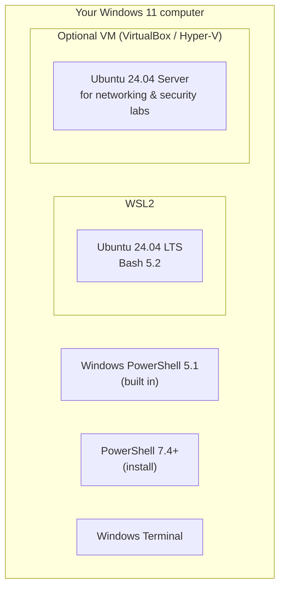

# Getting Started

This section prepares a safe practice environment for the next 30 days. Budget 1–2 hours.

## Prerequisites

- Basic computer skills: installing software, using a web browser, editing a text file.
- A computer that can run **Windows 11** with **WSL2** or a virtual machine. 8 GB RAM minimum, 16 GB recommended. 40 GB free disk.
- An internet connection for installing packages.
- Administrator rights on **your own** machine, needed only for installation.

No prior command-line experience is required.

## Recommended lab layout



| Option | Best for | Guide |
|---|---|---|
| **Windows 11 + WSL2 Ubuntu** (recommended) | Most learners. Both shells on one machine. | [WSL2 Installation](wsl2.md) |
| **Ubuntu 24.04 desktop or VM** | Full Linux experience including systemd, firewall and networking labs | [Ubuntu Setup](ubuntu-setup.md) |
| **Windows 11 only** | PowerShell-focused learners (use WSL2 for the Linux parts) | [Windows Setup](windows-setup.md) |

!!! note "WSL2 limitations"
    WSL2 is excellent for Days 1–7 and 21–24. Some later labs (firewall, systemd services, packet capture, network interfaces) work best in a **full Ubuntu VM**, and each lesson says when this applies.

## Required software

| Software | Required? | Purpose | Install guide |
|---|---|---|---|
| Windows Terminal | Recommended | Tabs for every shell | Built in to Windows 11 |
| Windows PowerShell 5.1 | Built in | Windows-only cmdlets, legacy compatibility | — |
| PowerShell 7.4+ | Required | Modern, cross-platform PowerShell | [PowerShell 7](powershell-install.md) |
| WSL2 + Ubuntu 24.04 | Required (or a VM) | Linux and Bash | [WSL2](wsl2.md) |
| Visual Studio Code | Recommended | Editing scripts, with the PowerShell and ShellCheck extensions | [Windows Setup](windows-setup.md) |
| Git | Recommended | Clone this course, track your own scripts | [Windows Setup](windows-setup.md) |
| Wireshark, Nmap | From Day 15/20 | Packet analysis, network discovery (lab only) | Installed in those lessons |

## Get the course files

```powershell
# Windows (PowerShell) — requires Git
Set-Location ~
git clone https://github.com/<github-user>/linux-powershell-professional-mastery.git
```

```bash
# Ubuntu / WSL
cd ~
git clone https://github.com/<github-user>/linux-powershell-professional-mastery.git
```

Replace `<github-user>` with the account shown in the repository link at the top right of this site.

## Before your first lab

Read **[Lab Environment & Safety](lab-environment.md)**. It sets out the rules every lab follows: authorised systems only, backups before configuration changes, and no disabling of security controls as a workaround.

Then start **[Day 01](../course/module-1/day-01.md)**.
