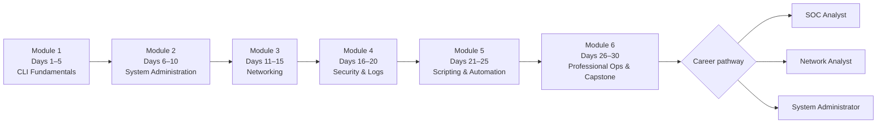

# Linux & PowerShell Professional Mastery

## 30 Days: From Beginner to Advanced IT Professional

**Master the Command Line. Understand Your Systems. Secure Your Network. Automate Your Work.**

[Start Day 01 :material-arrow-right:](course/module-1/day-01.md){ .md-button .md-button--primary }
[Set up your lab](getting-started/index.md){ .md-button }
[Download the handbook](downloads/index.md){ .md-button }

## What you will achieve

-   :material-console:{ .lg .middle } **Command-line fluency**

    ---

    Navigate, search and manage files and text confidently in **Bash** and **PowerShell**, and know exactly how each maps to the other.

-   :material-server:{ .lg .middle } **System administration**

    ---

    Manage users, permissions, processes, services, storage and software on Ubuntu 24.04 and Windows 11.

-   :material-lan:{ .lg .middle } **Network troubleshooting**

    ---

    Diagnose IP, routing, DNS, ports and connectivity problems, and capture packets with `tcpdump`, `pktmon` and Wireshark.

-   :material-shield-search:{ .lg .middle } **Security investigation**

    ---

    Analyse logs and authentication events, audit firewalls and permissions, and investigate suspicious connections the way a SOC analyst does.

-   :material-robot:{ .lg .middle } **Automation**

    ---

    Write reusable Bash and PowerShell scripts, schedule them, and produce CSV/JSON health reports.

-   :material-briefcase-check:{ .lg .middle } **Career-ready projects**

    ---

    Finish with a capstone and a toolkit for your chosen pathway: **SOC Analyst**, **Network Analyst** or **System Administrator**.

## Who this course is for

| Audience | What you get |
|---|---|
| **Beginners** | A gentle, structured start. Every command is explained, not just listed. |
| **IT support & system administrators** | Daily admin tasks on both platforms with real troubleshooting workflows. |
| **Cybersecurity professionals & SOC analysts** | Log analysis, authentication monitoring, firewall auditing and investigation methodology. |
| **Network analysts & engineers** | IP, DNS, ports, routing, packet capture and diagnostic automation. |
| **Developers, DevOps & working professionals** | Shell fluency, text processing, scripting and remote administration. |

## Learning roadmap

| Module | Days | Focus |
|---|---|---|
| [1 — Command-Line Fundamentals](course/module-1/index.md) | 1–5 | Shells, files, reading and searching text, help, pipelines |
| [2 — System Administration](course/module-2/index.md) | 6–10 | Users, permissions, processes, services, storage, packages |
| [3 — Networking & Troubleshooting](course/module-3/index.md) | 11–15 | IP, connectivity, DNS, ports, interfaces, packet capture |
| [4 — Security, Logs & Monitoring](course/module-4/index.md) | 16–20 | Logs, authentication, firewalls, auditing, network security |
| [5 — Scripting & Automation](course/module-5/index.md) | 21–25 | Variables, logic, functions, data processing, scheduling |
| [6 — Professional Operations & Projects](course/module-6/index.md) | 26–30 | Remote admin, investigations, troubleshooting, capstone |

## How every lesson works

Each day follows the same structure, so you always know where to find things: objectives → concepts → Linux and PowerShell command references → detailed explanations → demonstrations with expected output → comparison table → IT, security, network and sysadmin applications → common mistakes → troubleshooting → hands-on lab → 10+ practice questions → quiz with explanations → homework → tips → cheat sheet → checklist → official documentation.

## Course facts

| | |
|---|---|
| **Duration** | 30 days, about 3–4 hours per day |
| **Platforms** | Ubuntu 24.04 LTS · Windows 11 · Windows PowerShell 5.1 · PowerShell 7.4+ |
| **Cost** | Free and open source (MIT License) |
| **Publishing** | New lessons are released every night at **22:00 IST**, two days at a time. See the [release schedule](course/schedule.md). |
| **Safety** | All labs run on localhost, WSL2, virtual machines or explicitly authorised lab systems. |

[Begin with Getting Started :material-arrow-right:](getting-started/index.md){ .md-button .md-button--primary }
