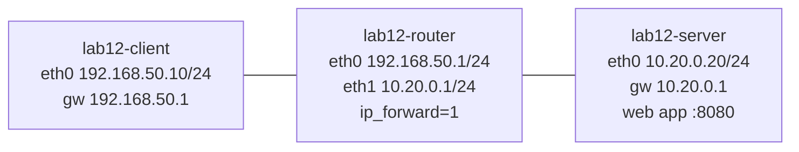

# Lab 12: Can't Reach the Server

| Field | Value |
|---|---|
| **Lab ID** | LAB-12 |
| **Related lesson** | [Day 12: Connectivity Troubleshooting](../course/module-3/day-12.md) |
| **Difficulty** | Intermediate |
| **Time** | 90–120 minutes |
| **Risk level** | Low. The Linux network runs inside three **isolated network namespaces**; faults (including firewall rules) are applied only inside them and disappear when the namespaces are deleted. Your real interfaces, routes and firewall are not touched. Windows tasks use a listener on `127.0.0.1` and read-only tests to your own gateway; no firewall settings are changed. Use a VM or WSL2. |

## Objective

Users on the **client** network report: *"The web app on 10.20.0.20:8080 doesn't work."* Over the day the cause changes five times. For each round you must:

1. Test the layers in order (link → IP → gateway → path → port → application).
2. Name the **first failing layer** and the **root cause**, with evidence.
3. Fix it, re-test from the top, and write a one-line ticket note.

You will also measure the path MTU and per-hop packet loss, and on Windows practise telling an **open**, **refused** and **filtered** port apart.

**Lab network:**



## Required Environment

- **Linux:** Ubuntu 24.04 VM or WSL2 with `sudo`, and these packages (installed by default unless noted): `iproute2`, `iputils-ping`, `iputils-tracepath`, `traceroute` and `mtr-tiny` (install: `sudo apt install traceroute mtr-tiny iputils-tracepath`), `netcat-openbsd`, `curl`, `python3`, `iptables`.
- Containers usually cannot create namespaces; use a VM or WSL2.
- **Windows:** Windows 11 with Windows PowerShell 5.1; PowerShell 7.4+ for the `Test-Connection -TcpPort` part. A normal (non-elevated) window is enough.

## Initial Conditions

- No namespaces called `lab12-*` exist (`ip netns list`). If they do, run the clean-up first.
- Create the working folder: `mkdir -p ~/lab12` (Linux) and `New-Item -ItemType Directory -Path $HOME\lab12 -Force` (Windows).
- Read both scripts below before running them. They only create namespaces and veth links, set addresses and routes **inside** them, start a test web server as the `nobody` user inside `lab12-server` (and stop it with a `pkill -f` pattern that matches only that server), and add or remove `iptables` rules **inside** `lab12-router` or `lab12-server`.

### Lab setup (Linux)

Save as `~/lab12/setup.sh` and run `sudo bash ~/lab12/setup.sh`:

```bash
#!/usr/bin/env bash
# Lab 12 setup: client - router - server in isolated network namespaces, plus a test web app.
set -o errexit -o nounset -o pipefail
for ns in lab12-client lab12-router lab12-server; do
    ip netns add "$ns"
    ip -n "$ns" link set lo up
done
ip link add c-eth0 type veth peer name r-eth0
ip link add s-eth0 type veth peer name r-eth1
ip link set c-eth0 netns lab12-client; ip link set r-eth0 netns lab12-router
ip link set s-eth0 netns lab12-server; ip link set r-eth1 netns lab12-router
ip -n lab12-client link set c-eth0 name eth0
ip -n lab12-router link set r-eth0 name eth0
ip -n lab12-router link set r-eth1 name eth1
ip -n lab12-server link set s-eth0 name eth0
ip -n lab12-client addr add 192.168.50.10/24 dev eth0
ip -n lab12-router addr add 192.168.50.1/24 dev eth0
ip -n lab12-router addr add 10.20.0.1/24 dev eth1
ip -n lab12-server addr add 10.20.0.20/24 dev eth0
ip -n lab12-client link set eth0 up
ip -n lab12-router link set eth0 up
ip -n lab12-router link set eth1 up
ip -n lab12-server link set eth0 up
ip netns exec lab12-router sysctl -qw net.ipv4.ip_forward=1
ip -n lab12-client route add default via 192.168.50.1
ip -n lab12-server route add default via 10.20.0.1
# Test web app: serves one page on 10.20.0.20:8080 as user nobody
install -d -m 755 /tmp/lab12-www
echo "lab12 app OK" > /tmp/lab12-www/index.html
chmod 644 /tmp/lab12-www/index.html
ip netns exec lab12-server runuser -u nobody -- \
    setsid python3 -m http.server 8080 --bind 10.20.0.20 --directory /tmp/lab12-www \
    >/tmp/lab12-web.log 2>&1 < /dev/null &
for _ in 1 2 3 4 5 6 7 8 9 10; do              # wait up to 10 s for the app to listen
    ip netns exec lab12-server bash -c 'exec 3<>/dev/tcp/10.20.0.20/8080' 2>/dev/null && break
    sleep 1
done
echo "Lab 12 ready. Client shell: sudo ip netns exec lab12-client bash"
```

### Fault injector (Linux)

Save as `~/lab12/fault.sh`. `sudo bash ~/lab12/fault.sh reset` restores the healthy state; `sudo bash ~/lab12/fault.sh 1` … `5` resets and then applies one fault. Try to diagnose each round **before** looking at the script again.

```bash
#!/usr/bin/env bash
# Lab 12 fault injector. Usage: fault.sh reset|1|2|3|4|5|mtu|loss
set -o nounset -o pipefail
R="ip netns exec lab12-router"; S="ip netns exec lab12-server"
reset() {
    $R sysctl -qw net.ipv4.ip_forward=1
    $S ip route replace default via 10.20.0.1
    $S iptables -F INPUT
    $R iptables -F FORWARD
    $R ip link set dev eth1 mtu 1500
    $S ip link set dev eth0 mtu 1500
    if ! $S bash -c 'exec 3<>/dev/tcp/10.20.0.20/8080' 2>/dev/null; then
        $S runuser -u nobody -- setsid python3 -m http.server 8080 --bind 10.20.0.20 \
            --directory /tmp/lab12-www >/tmp/lab12-web.log 2>&1 < /dev/null &
        for _ in 1 2 3 4 5 6 7 8 9 10; do
            $S bash -c 'exec 3<>/dev/tcp/10.20.0.20/8080' 2>/dev/null && break
            sleep 1
        done
    fi
}
case "${1:-}" in
    reset) reset ;;
    1) reset; $R sysctl -qw net.ipv4.ip_forward=0 ;;
    2) reset; $S ip route del default ;;
    3) reset; $S iptables -A INPUT -p icmp --icmp-type echo-request -j DROP ;;
    4) reset; $S iptables -A INPUT -p tcp --dport 8080 -j DROP ;;
    5) reset; pkill -f 'http.server 8080 --bind 10.20.0.20' ;;
    mtu)  reset; $R ip link set dev eth1 mtu 1400; $S ip link set dev eth0 mtu 1400 ;;
    loss) reset; $R iptables -A FORWARD -d 10.20.0.20 -m statistic --mode random --probability 0.2 -j DROP ;;
    *) echo "usage: $0 reset|1|2|3|4|5|mtu|loss" >&2; exit 1 ;;
esac
echo "state: ${1:-}"
```

Open **three** terminals: one as the client (`sudo ip netns exec lab12-client bash`), and keep two normal terminals for the fault script and for looking at the router and server (`sudo ip netns exec lab12-router ...`, `sudo ip netns exec lab12-server ...`) — just like an administrator with access to the router and server consoles.

## Step-by-Step Instructions

### Task 1 — Baseline the healthy lab

From the **client** shell, run each layer test once and save the output to `~/lab12/baseline.txt` (inside the namespace your home directory is still `/home/<you>`; use the absolute path).

1. Link and IP: `ip -br link`, `ip -br addr`, `ip route`.
2. Gateway: `ping -c3 192.168.50.1`, `ip neigh`.
3. Path: `ping -c4 10.20.0.20`, `traceroute -n 10.20.0.20`, `tracepath -n 10.20.0.20`.
4. Port and application: `nc -zv -w2 10.20.0.20 8080`, `curl -sS http://10.20.0.20:8080/`.
5. Note the reply TTL and explain it.

### Task 2 — Five fault rounds

For each round *N* = 1 … 5:

1. Run `sudo bash ~/lab12/fault.sh N` in a normal terminal.
2. From the client, start with `curl -sS -m 3 http://10.20.0.20:8080/` (the user's complaint), then work through the layers until you find the first one that fails. Use the router and server namespaces to confirm your theory.
3. Record in `~/lab12/rounds.md`: symptom, first failing layer, evidence (commands and key output), root cause, fix.
4. Fix it with **one** command in the right namespace (do **not** run `fault.sh reset` to fix it — that is cheating!), then re-run the `curl`.

### Task 3 — Path MTU and loss

1. `sudo bash ~/lab12/fault.sh mtu`. From the client, find the largest payload that passes with `ping -M do -s SIZE` (binary search between 1272 and 1472), then confirm with `tracepath -n 10.20.0.20`.
2. `sudo bash ~/lab12/fault.sh loss`. Run `ping -c 50 -i 0.2 -q 10.20.0.20` and `mtr -rn -c 50 10.20.0.20`. Where does the loss start? Is it real?
3. `sudo bash ~/lab12/fault.sh reset`.

### Task 4 — Windows: open, refused, filtered

1. In **window A** (Windows PowerShell or PowerShell 7) start a local TCP listener on `127.0.0.1:8080`:

    ```powershell
    $listener = [System.Net.Sockets.TcpListener]::new([System.Net.IPAddress]::Loopback, 8080)
    $listener.Start()
    "Listening on 127.0.0.1:8080 - press Enter to stop"; [void](Read-Host)
    $listener.Stop()
    ```

2. In **window B**, test:
    - the open port: `Test-NetConnection -ComputerName 127.0.0.1 -Port 8080`
    - a closed port: `Test-NetConnection -ComputerName 127.0.0.1 -Port 8081`
    - a filtered destination: `Test-NetConnection -ComputerName 203.0.113.1 -Port 443` (`203.0.113.0/24` is reserved for documentation, so nobody answers). Time it with `Measure-Command { ... }`.
3. In **PowerShell 7**, repeat with `Test-Connection -TargetName 127.0.0.1 -TcpPort 8080` and `-TcpPort 8081`.
4. Print the precise socket result for all three with the `TcpClient` pattern from the lesson (open / refused / timed out).
5. Test your default gateway with `Test-Connection` (5.1 and 7 syntax), `ping.exe` and `tracert -d -h 3 1.1.1.1`.

### Task 5 — Ticket note

Pick one round from Task 2 and write a ticket note (max. 8 lines) in `~/lab12/ticket.md` with: UTC time, source and destination, symptom, layer-by-layer evidence, root cause, fix, verification.

## Commands to Execute

Try the tasks yourself first; complete commands are in the [Solution](#solution).

| Layer | Linux (client) | Look elsewhere | Windows |
|---|---|---|---|
| Link / IP | `ip -br link`, `ip -br addr`, `ip route` | `sudo ip netns exec lab12-server ip route` | `Get-NetIPConfiguration` |
| Gateway | `ping -c2 192.168.50.1`, `ip neigh` | `sudo ip netns exec lab12-router sysctl net.ipv4.ip_forward` | `Test-Connection GW -Count 2` |
| Path | `ping`, `traceroute -n`, `tracepath -n`, `mtr -rn` | `sudo ip netns exec lab12-router ping 10.20.0.20` | `tracert -d`, `pathping -n` |
| Port | `nc -zv -w2 10.20.0.20 8080` | `sudo ip netns exec lab12-server iptables -L INPUT -n -v` | `Test-NetConnection -Port` |
| App | `curl -v -m 3 http://10.20.0.20:8080/` | `sudo ip netns exec lab12-server ss -tlnp` | `curl.exe -v`, `Invoke-WebRequest` |

## Expected Results

- **Task 1:** every layer passes; reply TTL `63` (Linux server, one router).
- **Task 2:**

    | Round | Client symptom | First failing layer | Root cause |
    |---|---|---|---|
    | 1 | `curl: (28) ... timed out`; ping to server silent; gateway ping **OK**; `traceroute` shows `*` from hop 1 | Path (router) | Router not forwarding: `net.ipv4.ip_forward = 0` |
    | 2 | Same silence; gateway OK; **the router can ping the server** | Path (return) | Server has no default route back to `192.168.50.0/24` |
    | 3 | `curl` **works**; ping to server silent | None for the app (ICMP only) | Server firewall drops ICMP echo requests — not a fault for users |
    | 4 | `curl: (28)` timeout; ping **OK**; `nc` *timed out* | Port | Server firewall DROPs TCP 8080 |
    | 5 | `curl: (7) ... Couldn't connect`; ping OK; `nc` *Connection refused* | Application | Web app not running; nothing listens on 8080 |

- **Task 3:** largest payload **1372** (path MTU 1400), `tracepath` shows `pmtu 1400`; loss appears at the **destination hop** (about 20 %, varies) and in the end-to-end ping: real loss after the router.
- **Task 4:** 8080 `TcpTestSucceeded : True`; 8081 `False` quickly (refused); `203.0.113.1:443` `False` after about 20 s (filtered/timed out); `Test-Connection -TcpPort` `True`/`False`.
- **Task 5:** a short, evidence-based note.

## Verification Steps

=== "Linux (client)"

    ```bash
    sudo bash ~/lab12/fault.sh reset                       # (normal terminal)
    # in the client shell:
    curl -sS -m 3 http://10.20.0.20:8080/                  # lab12 app OK
    ping -c1 -W1 -q 10.20.0.20 >/dev/null && echo "L3 OK"
    nc -z -w2 10.20.0.20 8080 && echo "L4 OK"
    ls -l ~/lab12/                                         # baseline.txt rounds.md ticket.md
    ```

=== "Windows"

    ```powershell
    Get-ChildItem $HOME\lab12
    Test-NetConnection -ComputerName 127.0.0.1 -Port 8080 -InformationLevel Quiet   # True while the listener runs
    ```

## Troubleshooting

| Problem | Cause | Fix |
|---|---|---|
| `Cannot create namespace file "/run/netns/lab12-client": File exists` | Old lab still present | Run the clean-up, then setup again |
| `curl` fails in the **healthy** state | Web app did not start (port in use, python3 missing) | `cat /tmp/lab12-web.log`; `sudo bash ~/lab12/fault.sh reset` |
| `iptables: command not found` | Minimal system | `sudo apt install iptables` |
| `iptables ... Permission denied (you must be root)` | Forgot `sudo` | `sudo ip netns exec lab12-server iptables ...` |
| `traceroute -I`/`-T`: *You do not have enough privileges* | Raw sockets need root | Your client shell is already root (`sudo ip netns exec`); outside it use `sudo` |
| `mtr: command not found` | Not installed | `sudo apt install mtr-tiny` |
| Your `curl` uses a proxy | `http_proxy` set in your environment | `curl --noproxy '*' ...` or `unset http_proxy https_proxy` in the client shell |
| Windows `Test-NetConnection` to `203.0.113.1` returns instantly | A proxy/VPN or security software answers or rejects | Note it as an observation; the open/refused results are the important part |
| `Exception calling "Start" ... Only one usage of each socket address` | Port 8080 already in use on Windows | Use another port, for example 18080, in both windows |
| `Test-Connection : A parameter cannot be found that matches parameter name 'TcpPort'` | Running in Windows PowerShell 5.1 | Use `pwsh` (PowerShell 7) for that step |

## Questions

1. In round 1 the gateway answered ping but `traceroute` showed `*` already at hop 1. Why?
2. Rounds 1 and 2 look identical from the client. Which single test told them apart, and from where did you run it?
3. Round 3: should you "fix" the ICMP rule? What would you change in the monitoring instead?
4. Why did round 4 produce *timed out* while round 5 produced *Connection refused*?
5. In Task 3, why does a 1372-byte payload correspond to a 1400-byte MTU?
6. In the loss test, how did you prove the loss was real and not rate limiting?
7. On Windows, why did the test to `203.0.113.1` take much longer than the test to port 8081?
8. Which PowerShell command works in both 5.1 and 7 to get a simple True/False for a TCP port on Windows?

## Solution

??? success "Bash solution"
    **Task 1 (client shell; replace `/home/student` with your home)**

    ```bash
    B=/home/student/lab12/baseline.txt
    {
      date -u -Iseconds
      ip -br link; ip -br addr; ip route
      ping -c3 192.168.50.1; ip neigh
      ping -c4 10.20.0.20; traceroute -n 10.20.0.20; tracepath -n 10.20.0.20
      nc -zv -w2 10.20.0.20 8080 2>&1
      curl -sS --noproxy '*' http://10.20.0.20:8080/
    } > "$B" 2>&1
    grep -m1 'from 192.168.50.1' "$B"; grep -m1 'from 10.20.0.20' "$B"; grep -E 'succeeded|lab12 app' "$B"
    ```

    Expected output (captured):

    ```text
    64 bytes from 192.168.50.1: icmp_seq=1 ttl=64 time=0.061 ms
    64 bytes from 10.20.0.20: icmp_seq=1 ttl=63 time=0.055 ms
    Connection to 10.20.0.20 8080 port [tcp/http-alt] succeeded!
    lab12 app OK
    ```

    The **gateway** replies with `ttl=64` (zero routers in between) and the **server** with `ttl=63` (one router).

    **Round 1 — router not forwarding**

    ```bash
    curl -sS --noproxy '*' -m 3 http://10.20.0.20:8080/    # timed out
    ping -c2 -W1 192.168.50.1                              # gateway OK
    ping -c2 -W1 10.20.0.20                                # silence
    traceroute -n -q1 -w1 -m3 10.20.0.20                   # * from hop 1
    # on the router (normal terminal):
    sudo ip netns exec lab12-router sysctl net.ipv4.ip_forward
    sudo ip netns exec lab12-router sysctl -w net.ipv4.ip_forward=1     # fix
    ```

    Expected output (captured, client side and router check):

    ```text
    curl: (28) Connection timed out after 3002 milliseconds
    PING 192.168.50.1 (192.168.50.1) 56(84) bytes of data.
    64 bytes from 192.168.50.1: icmp_seq=1 ttl=64 time=0.030 ms
    64 bytes from 192.168.50.1: icmp_seq=2 ttl=64 time=0.052 ms

    --- 192.168.50.1 ping statistics ---
    2 packets transmitted, 2 received, 0% packet loss, time 1012ms
    rtt min/avg/max/mdev = 0.030/0.041/0.052/0.011 ms
    PING 10.20.0.20 (10.20.0.20) 56(84) bytes of data.

    --- 10.20.0.20 ping statistics ---
    2 packets transmitted, 0 received, 100% packet loss, time 1019ms

    traceroute to 10.20.0.20 (10.20.0.20), 3 hops max, 60 byte packets
     1  *
     2  *
     3  *
    net.ipv4.ip_forward = 0
    ```

    **Round 2 — missing return route**

    ```bash
    ping -c2 -W1 10.20.0.20                                          # silence (client)
    sudo ip netns exec lab12-router ping -c1 -W1 10.20.0.20          # works from the router!
    sudo ip netns exec lab12-server ip route                         # no default route
    sudo ip netns exec lab12-server ip route add default via 10.20.0.1   # fix
    ```

    Expected output (captured, router ping and server routes):

    ```text
    64 bytes from 10.20.0.20: icmp_seq=1 ttl=64 time=0.031 ms
    10.20.0.0/24 dev eth0 proto kernel scope link src 10.20.0.20
    ```

    The router reaches the server because they share `10.20.0.0/24`; the server has no route to `192.168.50.0/24`, so replies to the client are discarded.

    **Round 3 — ICMP blocked, service fine**

    ```bash
    curl -sS --noproxy '*' -m 3 http://10.20.0.20:8080/    # lab12 app OK
    ping -c2 -W1 10.20.0.20                                # silence
    nc -zv -w2 10.20.0.20 8080                             # succeeded
    sudo ip netns exec lab12-server iptables -L INPUT -n --line-numbers
    sudo ip netns exec lab12-server iptables -D INPUT 1    # optional: only if policy allows ping
    ```

    Expected output (captured, rule listing):

    ```text
    Chain INPUT (policy ACCEPT)
    num  target     prot opt source               destination
    1    DROP       1    --  0.0.0.0/0            0.0.0.0/0            icmptype 8
    ```

    For users nothing is broken. Unless policy says servers must answer ping from monitoring hosts, leave the rule and switch the monitoring to a TCP/HTTP check.

    **Round 4 — TCP 8080 dropped**

    ```bash
    curl -sS --noproxy '*' -m 3 http://10.20.0.20:8080/    # timed out
    ping -c1 -W1 -q 10.20.0.20                             # 0% loss
    nc -zv -w2 10.20.0.20 8080                             # timed out
    sudo ip netns exec lab12-server iptables -L INPUT -n -v --line-numbers   # counters grow
    sudo ip netns exec lab12-server iptables -D INPUT 1    # fix
    ```

    Expected output (captured, client `nc` and server rule):

    ```text
    nc: connect to 10.20.0.20 port 8080 (tcp) timed out: Operation now in progress
    Chain INPUT (policy ACCEPT 51 packets, 3110 bytes)
    num   pkts bytes target     prot opt in     out     source               destination
    1        5   300 DROP       6    --  *      *       0.0.0.0/0            0.0.0.0/0            tcp dpt:8080
    ```

    The packet counter (`pkts`) increases every time the client retries: proof that this rule is the one dropping the traffic. Counts in your run will differ. This `iptables` version prints protocol **numbers** (`1` = ICMP in round 3, `6` = TCP).

    **Round 5 — service stopped**

    ```bash
    curl -sS --noproxy '*' -m 3 http://10.20.0.20:8080/    # Couldn't connect
    nc -zv -w2 10.20.0.20 8080                             # Connection refused
    sudo ip netns exec lab12-server ss -tln                # nothing on :8080
    sudo ip netns exec lab12-server runuser -u nobody -- setsid python3 -m http.server 8080 \
        --bind 10.20.0.20 --directory /tmp/lab12-www </dev/null >/dev/null 2>&1 &          # fix
    sleep 5; curl -sS --noproxy '*' -m 3 http://10.20.0.20:8080/       # Python may need a few seconds to start
    ```

    Expected output (captured):

    ```text
    curl: (7) Failed to connect to 10.20.0.20 port 8080 after 0 ms: Couldn't connect to server
    nc: connect to 10.20.0.20 port 8080 (tcp) failed: Connection refused
    State Recv-Q Send-Q Local Address:Port Peer Address:PortProcess
    ```

    An empty `ss -tln` list (header only) proves nothing is listening. In real life you would check `systemctl status` and `journalctl -u` for the service (Day 8).

    **Task 3 — MTU and loss**

    ```bash
    for s in 1472 1372 1373 1422; do
        printf '%s: ' "$s"; ping -c1 -W1 -M do -s "$s" 10.20.0.20 >/dev/null 2>&1 && echo pass || echo fail
    done
    tracepath -n 10.20.0.20 | tail -1
    # after fault.sh loss:
    ping -c 50 -i 0.2 -q 10.20.0.20 | tail -2
    mtr -rn -c 50 10.20.0.20
    ```

    Expected output (captured; loss percentages vary from run to run):

    ```text
    1472: fail
    1372: pass
    1373: fail
    1422: fail
         Resume: pmtu 1400 hops 2 back 2
    50 packets transmitted, 40 received, 20% packet loss, time 9998ms
    rtt min/avg/max/mdev = 0.030/0.068/0.135/0.017 ms
    Start: 2026-11-12T17:05:56+0000
    HOST: vm                          Loss%   Snt   Last   Avg  Best  Wrst StDev
      1.|-- 192.168.50.1               0.0%    50    0.1   0.1   0.1   0.2   0.0
      2.|-- 10.20.0.20                22.0%    50    0.1   0.1   0.1   0.1   0.0
    ```

    Loss is 0 % at hop 1 and appears at the destination **and** in the end-to-end ping: real loss between the router and the server.

    **Task 5 — example ticket note**

    ```text
    2026-11-12T17:05Z  client 192.168.50.10 -> app 10.20.0.20:8080
    Symptom: HTTP timeout (curl 28). L1/L2/L3 to gateway OK (ping 0% loss).
    Server ping OK (ttl 63, 0% loss) -> path OK. TCP 8080: timed out (nc).
    Server firewall INPUT rule 1 DROP tcp dpt:8080, packet counter increasing.
    Root cause: firewall rule added during hardening blocks the app port.
    Fix: rule removed (iptables -D INPUT 1) after approval CHG-1234.
    Verified: nc succeeded, curl 200 "lab12 app OK" at 17:07Z.
    ```

??? success "PowerShell solution"
    **Task 4 — window B (window A runs the listener)**

    ```powershell
    Test-NetConnection -ComputerName 127.0.0.1 -Port 8080
    Test-NetConnection -ComputerName 127.0.0.1 -Port 8081
    Measure-Command { Test-NetConnection -ComputerName 203.0.113.1 -Port 443 -WarningAction SilentlyContinue } |
        Select-Object TotalSeconds
    ```

    **Expected output (example):**

    ```text
    ComputerName     : 127.0.0.1
    RemoteAddress    : 127.0.0.1
    RemotePort       : 8080
    InterfaceAlias   : Loopback Pseudo-Interface 1
    SourceAddress    : 127.0.0.1
    TcpTestSucceeded : True

    WARNING: TCP connect to (127.0.0.1 : 8081) failed
    ComputerName           : 127.0.0.1
    RemoteAddress          : 127.0.0.1
    RemotePort             : 8081
    InterfaceAlias         : Loopback Pseudo-Interface 1
    SourceAddress          : 127.0.0.1
    PingSucceeded          : True
    PingReplyDetails (RTT) : 0 ms
    TcpTestSucceeded       : False

    TotalSeconds
    ------------
           21.08
    ```

    **PowerShell 7 and the exact socket result (works on Windows, Linux and macOS):**

    ```powershell
    Test-Connection -TargetName 127.0.0.1 -TcpPort 8080
    Test-Connection -TargetName 127.0.0.1 -TcpPort 8081

    function Test-TcpPort {
        param([Parameter(Mandatory)][string]$HostName, [Parameter(Mandatory)][int]$Port, [int]$TimeoutMs = 2000)
        $client = [System.Net.Sockets.TcpClient]::new()
        try {
            if ($client.ConnectAsync($HostName, $Port).Wait($TimeoutMs)) { 'open' } else { 'timed out (filtered?)' }
        } catch {
            $code = $_.Exception.GetBaseException().SocketErrorCode
            if ($code -eq 'ConnectionRefused') { 'refused' } else { "error: $code" }
        } finally { $client.Dispose() }
    }
    foreach ($t in @(@('127.0.0.1', 8080), @('127.0.0.1', 8081), @('203.0.113.1', 443))) {
        '{0}:{1} -> {2}' -f $t[0], $t[1], (Test-TcpPort -HostName $t[0] -Port $t[1])
    }
    ```

    **Expected output (captured with PowerShell 7.4.6 on Linux, with a listener on 127.0.0.1:8080):**

    ```text
    True
    False
    127.0.0.1:8080 -> open
    127.0.0.1:8081 -> refused
    10.20.0.20:8080 -> timed out (filtered?)
    ```

    On your Windows PC the third line reads `203.0.113.1:443 -> timed out (filtered?)`. On the capture host an egress proxy answered **every** outbound connection (so `203.0.113.1:443` showed `open` — a good reminder that proxies and security software change what port tests mean); the timed-out line was therefore captured from `lab12-client` against the Lab 12 server with fault 4 (DROP) active.

    **Task 4 step 5 — gateway tests**

    ```powershell
    $gw = (Get-NetIPConfiguration | Where-Object IPv4DefaultGateway | Select-Object -First 1).IPv4DefaultGateway.NextHop
    Test-Connection -ComputerName $gw -Count 2          # 5.1 syntax (also accepted by 7)
    Test-Connection -TargetName $gw -Count 2            # 7 syntax
    ping -n 2 $gw
    tracert -d -h 3 1.1.1.1
    ```

??? success "Answers to questions"
    1. The router answers pings addressed **to itself**, but with forwarding disabled it silently drops packets addressed **through** it — including traceroute probes destined for the server, so it never sends *Time Exceeded* for them.
    2. A ping **from the router** to the server: it worked in round 2 (the server is up and on the router's link) but the client still got no reply, which points at the server's return route. In round 1 the router-to-server ping also works, but the router's `ip_forward` value is 0.
    3. Not necessarily: blocking ping is a policy choice and users are unaffected. Change the monitoring to a TCP or HTTP check of port 8080, which measures what users need. If policy requires ping from monitoring hosts, allow echo requests only from those sources.
    4. A **DROP** rule discards the SYN silently, so the client waits until its timeout. With the app stopped, the server's kernel answers the SYN with a **RST**, which the client reports immediately as *Connection refused*.
    5. 1372 bytes of ICMP payload + 8 bytes ICMP header + 20 bytes IPv4 header = 1400 bytes, the MTU of the router–server link.
    6. The loss appeared at the **final hop** in mtr and in the end-to-end ping summary; hop 1 had 0 % loss. Rate limiting would show loss only at an intermediate hop with 0 % afterwards.
    7. Nobody answers packets to `203.0.113.1`, so Windows retransmits the SYN and waits for the TCP connect timeout (about 21 seconds). Port 8081 on localhost is refused immediately with a RST.
    8. `Test-NetConnection -ComputerName HOST -Port PORT -InformationLevel Quiet` (Windows only, 5.1 and 7).

## Clean-up

```bash
ip netns list | grep lab12                                   # preview
sudo pkill -f 'http.server 8080 --bind 10.20.0.20' || true  # stop the web app if running
sudo ip netns del lab12-client
sudo ip netns del lab12-router
sudo ip netns del lab12-server
sudo rm -r /tmp/lab12-www /tmp/lab12-web.log
ip netns list | grep lab12 || echo "lab12 namespaces removed"
```

Deleting the namespaces removes their interfaces, routes and firewall rules. Keep `~/lab12` (your evidence) for the module test. On Windows, press ++enter++ in window A to stop the listener, then optionally `Remove-Item $HOME\lab12 -Recurse -WhatIf`.
