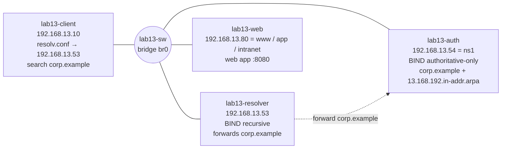

# Lab 13: Name Resolution Failure

| Field | Value |
|---|---|
| **Lab ID** | LAB-13 |
| **Related lesson** | [Day 13: DNS Troubleshooting](../course/module-3/day-13.md) |
| **Difficulty** | Intermediate |
| **Time** | 90–120 minutes |
| **Risk level** | Low. The Linux DNS servers, client and web server run inside five **isolated network namespaces**; the client's resolver and hosts files are per-namespace copies under `/etc/netns/lab13-client/`, and the firewall fault is applied only inside `lab13-resolver`. Your real `/etc/resolv.conf`, `/etc/hosts`, interfaces and firewall are not touched. The Windows tasks are read-only, except an **optional** hosts-file exercise that requires an elevated session, a backup first and a restore at the end. Use a VM or WSL2. |

## Objective

The help desk receives the same ticket six times in one day: *"`http://app.corp.example:8080/` does not work, but `http://192.168.13.80:8080/` does."* (and once, from the security team, *"the audit shows 192.168.13.80 without a host name"*). Each time the cause is different. For every round you must:

1. Prove that the network and the service work (by IP) and that **name resolution** is the failing layer.
2. Compare the three views — **application** (`getent`), **resolver** (`dig`), **authoritative server** (`dig @ns1 +norecurse`) — and find where they first differ.
3. Name the DNS status (NOERROR/NODATA/NXDOMAIN/SERVFAIL/REFUSED/refused/timeout), the **root cause** and the evidence.
4. Fix it safely (backup first), verify from the client, and write a one-line ticket note.

On Windows you will map your own resolution path, compare system, DNS-only and hosts-file-free lookups, inspect the DNS Client cache and run the course's `DNS-Check.ps1`.

**Lab network:**



## Required Environment

- **Linux:** Ubuntu 24.04 VM or WSL2 with `sudo`, and these packages: `iproute2`, `iptables`, `python3`, `curl` and `iputils-ping` (installed by default), `bind9-dnsutils` (`dig`, `host`, `nslookup`) and `bind9` (the BIND server, which also brings `bind9-utils` with `named-checkzone` and `rndc`):

    ```bash
    dpkg -s bind9 >/dev/null 2>&1 && echo "bind9 already installed - leave its service as it is"
    sudo apt update && sudo apt install -y bind9 bind9-dnsutils
    ```

    Installing `bind9` also enables and starts a `named` service on the host itself. The lab does not use it (the lab servers run separately inside namespaces). If bind9 was **not** installed before this lab, you may stop the new service with `sudo systemctl disable --now named` and re-enable it later; if it was already installed, leave it alone.

- Containers usually cannot create namespaces; use a VM or WSL2.
- **Windows:** Windows 11 with Windows PowerShell 5.1 (PowerShell 7 optional). A normal window for Tasks 6–8; an **elevated** window only for the optional Task 9.

## Initial Conditions

- No namespaces called `lab13-*` exist (`ip netns list`), and `/etc/bind/lab13` and `/etc/netns/lab13-client` do not exist. If they do, run the clean-up first.
- Create the working folders: `mkdir -p ~/lab13/backups` (Linux) and `New-Item -ItemType Directory -Path $HOME\lab13 -Force` (Windows).
- Read both scripts below before running them. The setup creates five namespaces and veth links, writes BIND configuration under `/etc/bind/lab13/` (where Ubuntu's AppArmor profile lets `named` read) and working directories under `/var/cache/bind/lab13-*`, writes the client's own `resolv.conf` and `hosts` under `/etc/netns/lab13-client/` (`ip netns exec` bind-mounts files from that directory over `/etc` **for commands in that namespace only**), starts two `named` processes as the `bind` user inside their namespaces and a test web server as `nobody`.
- **Do not put backup files inside `/etc/netns/lab13-client/`.** Every file in that directory is bind-mounted over `/etc` for the namespace, so `resolv.conf.bak` there produces *Bind … failed* warnings on every command (found while testing this lab). Keep backups in `~/lab13/backups/`.

### Lab setup (Linux)

Save as `~/lab13/setup.sh` and run `sudo bash ~/lab13/setup.sh`:

```bash
#!/usr/bin/env bash
# Lab 13 setup: client, recursive resolver, authoritative server and web server in isolated
# network namespaces joined by a bridge that lives in its own namespace (lab13-sw).
# Nothing in the host's own network or resolver configuration is changed.
set -o errexit -o nounset -o pipefail
[[ $EUID -eq 0 ]] || { echo "run with sudo" >&2; exit 1; }
command -v named >/dev/null || { echo "install bind9 first: sudo apt install bind9 bind9-dnsutils" >&2; exit 1; }
if ip netns list | grep -q '^lab13-'; then
    echo "Lab 13 namespaces already exist: run cleanup.sh first" >&2; exit 1
fi
CONF=/etc/bind/lab13          # AppArmor lets named read /etc/bind/**
WORK=/var/cache/bind          # ... and write /var/cache/bind/**

# ---- namespaces and the lab "switch" ----
ip netns add lab13-sw
ip -n lab13-sw link add br0 type bridge
ip -n lab13-sw link set br0 up
declare -A ADDR=([client]=192.168.13.10 [resolver]=192.168.13.53 [auth]=192.168.13.54 [web]=192.168.13.80)
for h in client resolver auth web; do
    ns="lab13-$h"
    ip netns add "$ns"
    ip -n "$ns" link set lo up
    ip link add "$h-eth0" type veth peer name "sw-$h"
    ip link set "$h-eth0" netns "$ns"
    ip link set "sw-$h" netns lab13-sw
    ip -n lab13-sw link set "sw-$h" master br0 up
    ip -n "$ns" link set "$h-eth0" name eth0
    ip -n "$ns" addr add "${ADDR[$h]}/24" dev eth0
    ip -n "$ns" link set eth0 up
done

# ---- per-namespace resolver files: "ip netns exec lab13-client ..." bind-mounts these over /etc ----
mkdir -p /etc/netns/lab13-client
cat > /etc/netns/lab13-client/resolv.conf <<'R'
# Lab 13 client resolver configuration
nameserver 192.168.13.53
search corp.example
options timeout:2 attempts:1
R
cat > /etc/netns/lab13-client/hosts <<'H'
127.0.0.1 localhost
192.168.13.10 client.corp.example client
H

# ---- BIND configuration ----
mkdir -p "$CONF" "$WORK/lab13-auth" "$WORK/lab13-resolver"
rndc-confgen -a -A hmac-sha256 -k lab13-rndc -c "$CONF/rndc.key" >/dev/null 2>&1
cat > "$CONF/auth.conf" <<'A'
// Authoritative-only server for corp.example (no recursion)
include "/etc/bind/lab13/rndc.key";
controls { inet 127.0.0.1 port 953 allow { 127.0.0.1; } keys { "lab13-rndc"; }; };
options {
    directory "/var/cache/bind/lab13-auth";
    pid-file none;
    session-keyfile "/var/cache/bind/lab13-auth/session.key";
    listen-on { 192.168.13.54; 127.0.0.1; };
    listen-on-v6 { none; };
    recursion no;
    allow-query { any; };
    allow-transfer { none; };   // never offer the whole zone to anyone who asks
};
zone "corp.example" { type primary; file "/etc/bind/lab13/db.corp.example"; };
zone "13.168.192.in-addr.arpa" { type primary; file "/etc/bind/lab13/db.192.168.13"; };
A
cat > "$CONF/resolver.conf" <<'C'
// Recursive resolver for the lab clients; sends corp.example questions to the authoritative server
include "/etc/bind/lab13/rndc.key";
controls { inet 127.0.0.1 port 953 allow { 127.0.0.1; } keys { "lab13-rndc"; }; };
options {
    directory "/var/cache/bind/lab13-resolver";
    pid-file none;
    session-keyfile "/var/cache/bind/lab13-resolver/session.key";
    listen-on { 192.168.13.53; 127.0.0.1; };
    listen-on-v6 { none; };
    recursion yes;
    allow-recursion { 192.168.13.0/24; 127.0.0.1; };
    dnssec-validation no;      // the lab zone is unsigned and the lab has no Internet to prove it
    max-ncache-ttl 300;
};
zone "corp.example" { type forward; forward only; forwarders { 192.168.13.54; }; };
zone "13.168.192.in-addr.arpa" { type forward; forward only; forwarders { 192.168.13.54; }; };
C
cat > "$CONF/db.corp.example" <<'Z'
$TTL 300
@        IN SOA   ns1.corp.example. hostmaster.corp.example. (
                  2026111301 ; serial (YYYYMMDDnn)
                  3600       ; refresh
                  600        ; retry
                  604800     ; expire
                  60 )       ; negative-caching TTL
         IN NS    ns1.corp.example.
         IN MX    10 mail.corp.example.
         IN TXT   "v=spf1 mx -all"
         IN CAA   0 issue "letsencrypt.org"
ns1      IN A     192.168.13.54
resolver IN A     192.168.13.53
www      IN A     192.168.13.80
www      IN AAAA  2001:db8:13::80
app      IN A     192.168.13.80
intranet IN CNAME www.corp.example.
mail     IN A     192.168.13.25
_dmarc   IN TXT   "v=DMARC1; p=reject; rua=mailto:dmarc@corp.example"
_ldap._tcp IN SRV 0 100 389 dc1.corp.example.
dc1      IN A     192.168.13.20
Z
cat > "$CONF/db.192.168.13" <<'P'
$TTL 300
@   IN SOA ns1.corp.example. hostmaster.corp.example. ( 2026111301 3600 600 604800 60 )
    IN NS  ns1.corp.example.
53  IN PTR resolver.corp.example.
54  IN PTR ns1.corp.example.
80  IN PTR www.corp.example.
25  IN PTR mail.corp.example.
P
cp -a "$CONF/db.corp.example" "$CONF/db.corp.example.orig"
cp -a "$CONF/db.192.168.13" "$CONF/db.192.168.13.orig"
chown -R root:bind "$CONF"; chmod 0750 "$CONF"; chmod 0640 "$CONF"/*
chown bind:bind "$WORK/lab13-auth" "$WORK/lab13-resolver"

named-checkconf "$CONF/auth.conf"
named-checkzone corp.example "$CONF/db.corp.example"
named-checkzone 13.168.192.in-addr.arpa "$CONF/db.192.168.13"
ip netns exec lab13-auth     named -u bind -c "$CONF/auth.conf"
ip netns exec lab13-resolver named -u bind -c "$CONF/resolver.conf"

# ---- web server (runs as nobody) ----
mkdir -p /srv/lab13-www
echo "corp.example intranet - OK" > /srv/lab13-www/index.html
ip netns exec lab13-web setpriv --reuid=nobody --regid=nogroup --clear-groups \
    python3 -m http.server 8080 --bind 192.168.13.80 --directory /srv/lab13-www >/dev/null 2>&1 &
sleep 2
echo "Lab 13 ready: client 192.168.13.10, resolver .53, authoritative .54, web .80:8080"
```

### Fault injector (Linux)

Save as `~/lab13/fault.sh`. `sudo bash ~/lab13/fault.sh N` first removes every fault, then injects fault **N** (1–6); `sudo bash ~/lab13/fault.sh reset` removes all faults. Try to diagnose each round **without** reading this script first — it gives the answers away.

```bash
#!/usr/bin/env bash
# Lab 13 fault injector: sudo bash fault.sh ROUND   (ROUND = 1..6, or "reset")
# Changes only lab files under /etc/netns/lab13-client and /etc/bind/lab13, and firewall
# rules inside the lab13-resolver namespace.
set -o errexit -o nounset -o pipefail
[[ $EUID -eq 0 ]] || { echo "run with sudo" >&2; exit 1; }
CONF=/etc/bind/lab13
CLIENT=/etc/netns/lab13-client
rndc_ns() { ip netns exec "lab13-$1" rndc -k "$CONF/rndc.key" -s 127.0.0.1 "${@:2}"; }
# A failed "rndc reload" keeps the OLD zone in memory, so round 4 restarts the server instead.
restart_auth() {
    rndc_ns auth stop >/dev/null 2>&1 || true
    sleep 2
    ip netns exec lab13-auth named -u bind -c "$CONF/auth.conf" 2>/dev/null || true
    sleep 1
}

reset() {
    sed -i 's/^nameserver .*/nameserver 192.168.13.53/' "$CLIENT/resolv.conf"
    sed -i '/app.corp.example/d' "$CLIENT/hosts"
    cp "$CONF/db.corp.example.orig" "$CONF/db.corp.example"
    cp "$CONF/db.192.168.13.orig" "$CONF/db.192.168.13"
    ip netns exec lab13-resolver iptables -F INPUT
    if rndc_ns auth status >/dev/null 2>&1; then rndc_ns auth reload >/dev/null; else restart_auth; fi
    rndc_ns resolver flush
}

case "${1:-}" in
    reset) reset ;;
    1) reset; sed -i 's/^nameserver .*/nameserver 192.168.13.80/' "$CLIENT/resolv.conf" ;;
    2) reset; echo "192.168.13.99 app.corp.example app   # added during the 2025 migration" >> "$CLIENT/hosts" ;;
    3) reset; sed -i 's/^app      IN A/apps     IN A/; s/2026111301/2026111302/' "$CONF/db.corp.example"
       rndc_ns auth reload >/dev/null ;;
    4) reset; sed -i 's/^mail     IN A     192.168.13.25/mail     IN A     192.168.13.256/; s/2026111301/2026111303/' "$CONF/db.corp.example"
       restart_auth ;;
    5) reset; ip netns exec lab13-resolver iptables -A INPUT -p udp --dport 53 -j DROP
       ip netns exec lab13-resolver iptables -A INPUT -p tcp --dport 53 -j DROP ;;
    6) reset; sed -i '/^80  IN PTR/d; s/2026111301/2026111304/' "$CONF/db.192.168.13"
       rndc_ns auth reload >/dev/null ;;
    *) echo "usage: sudo bash $0 1|2|3|4|5|6|reset" >&2; exit 1 ;;
esac
case "$1" in
    reset) echo "All faults removed." ;;
    6) echo "Round 6 applied. Ticket: \"The security audit and the web server logs show 192.168.13.80 without a host name.\"" ;;
    *) echo "Round $1 applied. Ticket: \"http://app.corp.example:8080/ does not work, but http://192.168.13.80:8080/ does.\"" ;;
esac
```

### Helper functions (Linux)

Save as `~/lab13/helpers.sh` and load them into a root shell for the rounds: `sudo -i`, then `. /home/$SUDO_USER/lab13/helpers.sh`. They only wrap commands so they run inside the right namespace:

```bash
# Lab 13 helpers — load in a root shell:  sudo -i ;  . /home/$SUDO_USER/lab13/helpers.sh
LAB="/home/${SUDO_USER:-$USER}/lab13"                          # your lab folder (backups go here)
REPO="/home/${SUDO_USER:-$USER}/linux-powershell-professional-mastery"
C="ip netns exec lab13-client"                                 # usage: $C dig app.corp.example
Z=/etc/bind/lab13
rndc_auth()     { ip netns exec lab13-auth     rndc -k "$Z/rndc.key" -s 127.0.0.1 "$@"; }
rndc_resolver() { ip netns exec lab13-resolver rndc -k "$Z/rndc.key" -s 127.0.0.1 "$@"; }
# bump ZONE FILE — increase the SOA serial by one (current serial from the server, else from the file)
bump() {
    local cur new
    cur=$(ip netns exec lab13-auth dig @127.0.0.1 +short "$1" SOA | awk '{print $3}')
    [[ -n "$cur" ]] || cur=$(grep -oE '\b20[0-9]{8}\b' "$2" | head -n 1)
    new=$((cur + 1))
    sed -i "s/\b$cur\b/$new/" "$2" && echo "serial $cur -> $new"
}
```

## Step-by-Step Instructions

### Task 1 — Baseline the healthy lab

1. Run the setup. Then, from the client, record: the client's `resolv.conf` and `hosts`; `dig www.corp.example` (full output); `dig @192.168.13.54 www.corp.example +norecurse +noall +comments +answer`; the A, AAAA, CNAME (`intranet`), MX, TXT, SRV, CAA and SOA records; `dig -x 192.168.13.80`; `getent ahosts app.corp.example`; `curl http://app.corp.example:8080/`.
2. Identify which server is the **resolver** and which is **authoritative** from the flags alone.
3. Try `dig @192.168.13.54 corp.example AXFR` and explain the result.
4. Run the course script from the client and keep the report:

    ```bash
    $C bash "$REPO"/scripts/linux/dns-check.sh \
       -n app.corp.example,www.corp.example,intranet.corp.example -t A \
       -s system,192.168.13.53,192.168.13.54 -r -o "$LAB"
    ```

### Task 2 — Six fault rounds

For each round `N` from 1 to 6: run `sudo bash ~/lab13/fault.sh N`, read the ticket text, then:

1. Confirm the service works by IP (`$C curl -s http://192.168.13.80:8080/`).
2. Compare `$C getent ahosts app.corp.example`, `$C dig app.corp.example`, `$C dig @192.168.13.54 app.corp.example +norecurse` (round 6: the same with `-x 192.168.13.80`).
3. Write down the **status** and the **first view that is wrong**.
4. Find the root cause (client files, zone files under `/etc/bind/lab13/`, `named-checkzone`, `iptables -L` inside `lab13-resolver`).
5. Back up what you will change into `~/lab13/backups/`, fix it, verify from the client (curl by name, `dig`, `getent`), and re-run `dns-check.sh` (exit code 0 expected; with `-t A`).

!!! tip "Fix the zone, not the symptom"
    Do **not** use `fault.sh reset` as your fix — that is the answer key. Fix the real file, bump the SOA serial when you change a zone, validate with `named-checkzone`, reload with `rndc`, and think about caches.

### Task 3 — Negative caching on purpose

During round 3, after fixing the zone, query the name through the resolver **before** flushing anything. Record the status, the SOA serial and the SOA TTL in the AUTHORITY section. Explain why the authoritative server and the resolver disagree, then fix it with `rndc flushname` and explain what you would do if you did not administer the resolver.

### Task 4 — Ticket notes

Write one line per round: *symptom → status → root cause → fix → evidence*.

### Task 5 — Clean up Linux

Run the clean-up script at the end of this lab.

### Task 6 — Windows: your own resolution path (read-only)

1. List your DNS servers per interface and your suffix search list.
2. Show the non-comment lines of the hosts file.
3. Show the NRPT rules (`Get-DnsClientNrptPolicy`); most home PCs have none, many corporate laptops do.

### Task 7 — Windows: three ways to resolve one name

For `www.microsoft.com` (or a name you use daily) and for `localhost`, compare: `Resolve-DnsName NAME`, `Resolve-DnsName NAME -DnsOnly -NoHostsFile`, `Resolve-DnsName NAME -Server 1.1.1.1 -DnsOnly`, `nslookup NAME` and `[System.Net.Dns]::GetHostAddresses('NAME')`. Explain every difference (CNAME chains, `localhost` behaviour, `Server: UnKnown`).

### Task 8 — Windows: statuses, cache and script

1. Produce NXDOMAIN (`Resolve-DnsName nosuch-$(Get-Random).example.com`), NODATA (an AAAA query for a name that has no IPv6 address, for example `Resolve-DnsName github.com -Type AAAA`) and print each `FullyQualifiedErrorId` or `Section`.
2. Inspect `Get-DnsClientCache` for the names you just queried, including the negative entry.
3. Run `DNS-Check.ps1` with default settings, then with `-Name` of two names you use, `-Reverse` and `-OutputPath $HOME\lab13`, and note the exit code.

### Task 9 — Windows, optional and elevated: a hosts entry beats DNS

Only on your own lab or test machine. In an **elevated** PowerShell: back up the hosts file, add one line `127.0.0.1 lab13-test.example`, show that `Resolve-DnsName lab13-test.example` returns `127.0.0.1` while `Resolve-DnsName lab13-test.example -DnsOnly -NoHostsFile` returns NXDOMAIN, and **restore the backup**. Verify with `Get-FileHash` that the file is byte-for-byte the original.

## Commands to Execute

Linux (after `sudo -i` and `. /home/$SUDO_USER/lab13/helpers.sh`; `$C` runs a command on the client, `$LAB` is your `~/lab13` folder):

```bash
$C cat /etc/resolv.conf ; $C cat /etc/hosts
$C getent ahosts app.corp.example
$C dig app.corp.example ; $C dig +noall +comments +answer +authority app.corp.example
$C dig @192.168.13.54 app.corp.example +norecurse +noall +comments +answer
$C dig -x 192.168.13.80 ; $C host app.corp.example
$C curl -sS -m 5 http://app.corp.example:8080/ ; $C curl -sS -m 5 http://192.168.13.80:8080/
named-checkzone corp.example /etc/bind/lab13/db.corp.example
named-checkzone 13.168.192.in-addr.arpa /etc/bind/lab13/db.192.168.13
rndc_auth reload corp.example ; rndc_auth zonestatus corp.example
rndc_resolver flushname app.corp.example ; rndc_resolver flushtree corp.example
ip netns exec lab13-resolver iptables -L INPUT -n -v --line-numbers
```

Windows:

```powershell
Get-DnsClientServerAddress -AddressFamily IPv4 | Where-Object ServerAddresses
Get-DnsClientGlobalSetting | Select-Object SuffixSearchList
Get-Content $env:windir\System32\drivers\etc\hosts | Where-Object { $_ -match '\S' -and $_ -notmatch '^\s*#' }
Resolve-DnsName NAME ; Resolve-DnsName NAME -DnsOnly -NoHostsFile ; nslookup NAME
Get-DnsClientCache | Select-Object Entry, Type, Status, TimeToLive, Data
.\DNS-Check.ps1 -Name NAME1, NAME2 -Reverse -OutputPath $HOME\lab13
```

## Expected Results

| Round | Ticket | `getent` (application) | `dig` via resolver | `dig @ns1 +norecurse` | Root cause | Fix |
|---|---|---|---|---|---|---|
| 1 | By name fails | nothing (exit 2) | `connection refused` to 192.168.13.80#53, *no servers could be reached* (exit 9) | NOERROR, `aa`, 192.168.13.80 | Client's resolver set to the **web server's** address | `nameserver 192.168.13.53` |
| 2 | By name fails | **192.168.13.99** | NOERROR 192.168.13.80 | NOERROR 192.168.13.80 | Stale `/etc/hosts` entry on the client | Remove the line |
| 3 | By name fails | nothing | **NXDOMAIN**, SOA in AUTHORITY | NXDOMAIN (`aa`) | Record renamed to `apps` (typo) in the zone | Rename back, bump serial, check, reload, **flush the negative cache** |
| 4 | By name fails | nothing | **SERVFAIL** | **SERVFAIL** | Zone fails to load: `bad dotted quad` (`192.168.13.256`) on line 18 | Fix the address, bump serial, check, reload |
| 5 | By name fails | nothing (after a few seconds) | `timed out` to 192.168.13.53#53 (exit 9) | NOERROR 192.168.13.80 | UDP **and** TCP 53 dropped by iptables on the resolver | Delete the two DROP rules |
| 6 | IP has no name | `getent hosts 192.168.13.80` exit 2 | `-x` → **NXDOMAIN** | NXDOMAIN | PTR for `.80` deleted from the reverse zone | Add `80 IN PTR www.corp.example.`, bump serial, reload, flush |

The healthy baseline and the final verification give `dns-check.sh` **Status: OK** and exit code `0`; during rounds 1–6 the script reports the problem and exits `3`. In Task 1, the AXFR attempt ends with `; Transfer failed.` because the authoritative server has `allow-transfer { none; };`.

On Windows: Task 7 shows that the default lookup and `[System.Net.Dns]` resolve `localhost` without any DNS query, while `-DnsOnly -NoHostsFile` and `nslookup` send DNS queries (Windows resolves `localhost` internally; DNS may answer NXDOMAIN or a server may return 127.0.0.1). Task 9 shows the hosts entry winning and the file hash matching the backup after the restore.

## Verification Steps

=== "Bash"

    ```bash
    sudo -i
    . /home/$SUDO_USER/lab13/helpers.sh
    $C curl -s http://app.corp.example:8080/                         # corp.example intranet - OK
    $C getent hosts app.corp.example                                 # 192.168.13.80
    $C dig +short -x 192.168.13.80                                   # www.corp.example.
    grep -c 'DROP' <(ip netns exec lab13-resolver iptables -S INPUT) # 0
    $C bash "$REPO"/scripts/linux/dns-check.sh \
       -n app.corp.example,www.corp.example,intranet.corp.example -t A \
       -s system,192.168.13.53,192.168.13.54 -r > /dev/null; echo "exit: $?"   # exit: 0
    ```

=== "PowerShell"

    ```powershell
    (Resolve-DnsName localhost -ErrorAction SilentlyContinue).Count -gt 0              # True
    Test-Path $HOME\lab13\hosts.backup                                                  # True only if you did Task 9
    # After Task 9: the restored file must match the backup exactly
    (Get-FileHash $env:windir\System32\drivers\etc\hosts).Hash -eq (Get-FileHash $HOME\lab13\hosts.backup).Hash
    Get-ChildItem $HOME\lab13 -Filter 'DNS-Check-*'                                     # your saved report
    ```

## Troubleshooting

| Problem | Cause | Fix |
|---|---|---|
| `Cannot create namespace file "/run/netns/lab13-sw": File exists` | An earlier run was not cleaned up | Run the clean-up script, then the setup again |
| `install bind9 first` | `named` not installed | `sudo apt install bind9 bind9-dnsutils` |
| `named` exits at once; `journalctl -k` shows `apparmor="DENIED" … named` | Files outside `/etc/bind/**` or `/var/cache/bind/**` | Keep the lab paths exactly as in the script |
| `rndc: connect failed: 127.0.0.1#953: connection refused` | That `named` is not running (or you ran `rndc` outside its namespace) | Use `rndc_auth` / `rndc_resolver`; restart: `ip netns exec lab13-auth named -u bind -c /etc/bind/lab13/auth.conf` |
| `Bind /etc/netns/lab13-client/x.bak -> /etc/x.bak failed` | A backup file was saved in `/etc/netns/lab13-client/` | Move it to `~/lab13/backups/` |
| The fix is in place but the client still gets NXDOMAIN | Negative caching on the resolver | `rndc_resolver flushname NAME` or wait for the SOA minimum (60 s) |
| `rndc reload` printed `zone reload queued` but nothing changed | You forgot to bump the serial (secondaries) or the file still has an error | `named-checkzone`; `rndc_auth zonestatus corp.example` shows the loaded serial |
| `dig` first prints `timed out` and then `connection refused` in round 1 | The first packet waits for ARP; later ones get the ICMP port-unreachable | Normal |
| `Resolve-DnsName` is not recognized | You are in PowerShell on Linux/macOS | Use a Windows PowerShell session, or `[System.Net.Dns]` |
| `Access to the path ... hosts is denied` | Not elevated (Task 9) | Use an elevated session — or skip the optional task |

## Questions

1. In round 1, why did `dig @192.168.13.54` work while everything else failed? What does "connection refused" tell you that "timed out" would not?
2. In round 2, which tools showed the right address and which the wrong one? Why?
3. In round 3, after the zone was fixed, why did the resolver still answer NXDOMAIN, and how did the AUTHORITY section prove it?
4. In round 4, both servers returned SERVFAIL. Why is this not an NXDOMAIN, and why could a broken zone file stay unnoticed after a failed `rndc reload`?
5. In round 5, what single test separates "DNS server down" from "network down" for the resolver?
6. Round 6 did not break the web application. Which systems do care about PTR records, and why is "forward-confirmed" important?
7. Why does the lab's authoritative server refuse recursion and zone transfers?
8. On Windows, why can `nslookup` and the browser disagree?
9. Why must the hosts-file exercise end with a hash comparison?
10. Which of the six faults would `dns-check.sh` without `-r` miss, and which would it catch only because `system` was in the server list?

## Solution

??? success "Bash solution"
    Load the helpers first (`sudo -i`, `. /home/$SUDO_USER/lab13/helpers.sh`). Outputs below were **captured** when this lab was tested on 2026-11-13 (Ubuntu 24.04.5 container with namespace support, BIND 9.18.39).

    **Task 1 — baseline (key lines)**

    ```bash
    $C dig www.corp.example | grep -E 'status|flags|^www'
    $C dig @192.168.13.54 www.corp.example +norecurse +noall +comments +answer | grep -E 'flags|^www'
    $C dig @192.168.13.54 corp.example AXFR | tail -1
    ```

    ```text
    ;; ->>HEADER<<- opcode: QUERY, status: NOERROR, id: 4301
    ;; flags: qr rd ra; QUERY: 1, ANSWER: 1, AUTHORITY: 0, ADDITIONAL: 1
    www.corp.example.       300     IN      A       192.168.13.80
    ;; flags: qr aa; QUERY: 1, ANSWER: 1, AUTHORITY: 1, ADDITIONAL: 2
    www.corp.example.       300     IN      A       192.168.13.80
    ; Transfer failed.
    ```

    `ra` without `aa` = the resolver (`.53`); `aa` without `ra` = the authoritative server (`.54`).

    **Round 1 — wrong nameserver**

    ```bash
    $C grep nameserver /etc/resolv.conf
    $C dig +short app.corp.example
    cp -a /etc/netns/lab13-client/resolv.conf "$LAB"/backups/resolv.conf.round1
    sed -i 's/^nameserver .*/nameserver 192.168.13.53/' /etc/netns/lab13-client/resolv.conf
    $C curl -s http://app.corp.example:8080/
    ```

    ```text
    nameserver 192.168.13.80
    ;; communications error to 192.168.13.80#53: connection refused
    ;; no servers could be reached
    corp.example intranet - OK
    ```

    *Ticket note:* client resolver pointed at the web server 192.168.13.80 (nothing on 53/udp: connection refused) → set to 192.168.13.53 → resolves.

    **Round 2 — stale hosts entry**

    ```bash
    $C getent hosts app.corp.example ; $C dig +short app.corp.example
    grep -n app /etc/netns/lab13-client/hosts
    cp -a /etc/netns/lab13-client/hosts "$LAB"/backups/hosts.round2
    sed -i '/^192\.168\.13\.99[[:space:]]\+app\.corp\.example/d' /etc/netns/lab13-client/hosts
    $C getent hosts app.corp.example ; $C curl -s http://app.corp.example:8080/
    ```

    ```text
    192.168.13.99   app.corp.example app
    192.168.13.80
    3:192.168.13.99 app.corp.example app   # added during the 2025 migration
    192.168.13.80   app.corp.example
    corp.example intranet - OK
    ```

    *Ticket note:* DNS correct (`dig` 192.168.13.80) but `/etc/hosts` override to old IP 192.168.13.99 → line removed → `getent` and curl correct.

    **Round 3 — missing record, then negative caching**

    ```bash
    $C dig +noall +comments app.corp.example | grep status
    $C dig @192.168.13.54 +norecurse +noall +comments app.corp.example | grep status
    grep -nE '^(app|apps)\b' /etc/bind/lab13/db.corp.example
    cp -a /etc/bind/lab13/db.corp.example "$LAB"/backups/db.corp.example.round3
    sed -i 's/^apps     IN A/app      IN A/' /etc/bind/lab13/db.corp.example
    bump corp.example /etc/bind/lab13/db.corp.example
    named-checkzone corp.example /etc/bind/lab13/db.corp.example
    rndc_auth reload corp.example
    $C dig @192.168.13.54 +short app.corp.example                        # authoritative: fixed
    $C dig +noall +comments +authority app.corp.example | grep -E 'status|SOA'   # resolver: still cached
    rndc_resolver flushname app.corp.example
    $C curl -s http://app.corp.example:8080/
    ```

    ```text
    ;; ->>HEADER<<- opcode: QUERY, status: NXDOMAIN, id: 13390
    ;; ->>HEADER<<- opcode: QUERY, status: NXDOMAIN, id: 35163
    16:apps     IN A     192.168.13.80
    serial 2026111302 -> 2026111303
    zone corp.example/IN: loaded serial 2026111303
    OK
    zone reload queued
    192.168.13.80
    ;; ->>HEADER<<- opcode: QUERY, status: NXDOMAIN, id: 27478
    corp.example.           59      IN      SOA     ns1.corp.example. hostmaster.corp.example. 2026111302 3600 600 604800 60
    corp.example intranet - OK
    ```

    The resolver's cached negative answer still carries the **old serial 2026111302** with 59 seconds left. *Ticket note:* record `app` typo'd as `apps` in corp.example (NXDOMAIN, authoritative) → renamed, serial 2026111303, reloaded, negative cache flushed on the resolver.

    **Round 4 — broken zone, SERVFAIL**

    ```bash
    $C dig +noall +comments app.corp.example | grep status
    $C dig @192.168.13.54 +norecurse +noall +comments app.corp.example | grep status
    named-checkzone corp.example /etc/bind/lab13/db.corp.example
    cp -a /etc/bind/lab13/db.corp.example "$LAB"/backups/db.corp.example.round4
    sed -i 's/192\.168\.13\.256/192.168.13.25/' /etc/bind/lab13/db.corp.example
    bump corp.example /etc/bind/lab13/db.corp.example
    named-checkzone corp.example /etc/bind/lab13/db.corp.example
    rndc_auth reload corp.example
    rndc_auth zonestatus corp.example | head -4
    rndc_resolver flushtree corp.example
    $C curl -s http://app.corp.example:8080/
    ```

    ```text
    ;; ->>HEADER<<- opcode: QUERY, status: SERVFAIL, id: 9418
    ;; ->>HEADER<<- opcode: QUERY, status: SERVFAIL, id: 6228
    dns_rdata_fromtext: /etc/bind/lab13/db.corp.example:18: near '192.168.13.256': bad dotted quad
    zone corp.example/IN: loading from master file /etc/bind/lab13/db.corp.example failed: bad dotted quad
    zone corp.example/IN: not loaded due to errors.
    serial 2026111303 -> 2026111304
    zone corp.example/IN: loaded serial 2026111304
    OK
    zone reload successful
    name: corp.example
    type: primary
    files: /etc/bind/lab13/db.corp.example
    serial: 2026111304
    corp.example intranet - OK
    ```

    The `bump` helper read no serial from the broken server, so it took the serial from the file. The resolver briefly caches SERVFAIL results too: `rndc flushtree corp.example` removes cached data (including SERVFAIL entries) for `corp.example` **and every name below it**, whereas `flushname` removes only the one name given. When this lab was tested with `flushname corp.example` instead, the first `curl` straight after the fix still failed with *Could not resolve host*; two seconds later it worked. *Ticket note:* zone corp.example failed to load (line 18 `192.168.13.256`, bad dotted quad) → SERVFAIL for every name in the zone → corrected to 192.168.13.25, serial 2026111304, `named-checkzone` OK, reloaded.

    **Round 5 — resolver firewalled**

    ```bash
    $C dig +tries=1 +timeout=2 app.corp.example | grep -E 'error|reached'
    $C dig @192.168.13.54 +short app.corp.example          # the authoritative server answers
    $C ping -c 1 -W 1 192.168.13.53                         # the resolver host is up
    ip netns exec lab13-resolver iptables -L INPUT -n -v --line-numbers
    ip netns exec lab13-resolver iptables-save > "$LAB"/backups/resolver-iptables.round5
    ip netns exec lab13-resolver iptables -D INPUT -p udp --dport 53 -j DROP
    ip netns exec lab13-resolver iptables -D INPUT -p tcp --dport 53 -j DROP
    $C curl -s http://app.corp.example:8080/
    ```

    ```text
    ;; communications error to 192.168.13.53#53: timed out
    ;; no servers could be reached
    192.168.13.80
    Chain INPUT (policy ACCEPT 502 packets, 61781 bytes)
    num   pkts bytes target     prot opt in     out     source               destination
    1        1    85 DROP       17   --  *      *       0.0.0.0/0            0.0.0.0/0            udp dpt:53
    2        0     0 DROP       6    --  *      *       0.0.0.0/0            0.0.0.0/0            tcp dpt:53
    corp.example intranet - OK
    ```

    (The test container had no `ping`; on Ubuntu it prints `1 packets transmitted, 1 received`.) *Ticket note:* resolver 192.168.13.53 reachable but UDP/TCP 53 dropped by two iptables rules → rules removed (backup saved) → resolves.

    **Round 6 — missing PTR**

    ```bash
    $C dig -x 192.168.13.80 +noall +comments | grep status
    grep -n PTR /etc/bind/lab13/db.192.168.13
    cp -a /etc/bind/lab13/db.192.168.13 "$LAB"/backups/db.192.168.13.round6
    echo "80  IN PTR www.corp.example." >> /etc/bind/lab13/db.192.168.13
    bump 13.168.192.in-addr.arpa /etc/bind/lab13/db.192.168.13
    named-checkzone 13.168.192.in-addr.arpa /etc/bind/lab13/db.192.168.13
    rndc_auth reload 13.168.192.in-addr.arpa
    rndc_resolver flushname 80.13.168.192.in-addr.arpa
    $C dig -x 192.168.13.80 +short
    ```

    ```text
    ;; ->>HEADER<<- opcode: QUERY, status: NXDOMAIN, id: 15453
    4:53  IN PTR resolver.corp.example.
    5:54  IN PTR ns1.corp.example.
    6:25  IN PTR mail.corp.example.
    serial 2026111304 -> 2026111305
    zone 13.168.192.in-addr.arpa/IN: loaded serial 2026111305
    OK
    zone reload queued
    www.corp.example.
    ```

    The PTR points to the **canonical** name `www`, not to every alias. *Ticket note:* PTR for 192.168.13.80 missing in 13.168.192.in-addr.arpa → added `80 PTR www.corp.example.`, serial 2026111305, reloaded, flushed → forward-confirmed.

    **Final verification**

    ```bash
    $C bash "$REPO"/scripts/linux/dns-check.sh \
       -n app.corp.example,www.corp.example,intranet.corp.example -t A \
       -s system,192.168.13.53,192.168.13.54 -r | tail -9
    ```

    ```text
    --- Resolver consistency ---
    SAME    app.corp.example             A     3 resolvers agree
    SAME    www.corp.example             A     3 resolvers agree
    SAME    intranet.corp.example        A     3 resolvers agree

    --- Reverse (PTR) check ---
    ADDRESS                                  PTR                                STATUS     CONFIRMED VIA
    192.168.13.80                            www.corp.example.                  OK         yes       192.168.13.53

    --- Problems ---
    None.
    ```

    Exit code `0`. During round 2 the same command reported `DIFFER app.corp.example A: resolvers return different answers (… system=192.168.13.99)`; during round 4 `LOOKUP app.corp.example A via 192.168.13.53: SERVFAIL`; during round 5 `TIMEOUT` for 192.168.13.53 — each with exit code `3` (captured).

??? success "PowerShell solution"
    The Windows outputs are **examples** (not captured); your servers, names and addresses will differ.

    **Task 6 — resolution path**

    ```powershell
    Get-DnsClientServerAddress -AddressFamily IPv4 | Where-Object ServerAddresses |
        Select-Object InterfaceAlias, ServerAddresses
    Get-DnsClientGlobalSetting | Select-Object SuffixSearchList
    Get-Content $env:windir\System32\drivers\etc\hosts | Where-Object { $_ -match '\S' -and $_ -notmatch '^\s*#' }
    Get-DnsClientNrptPolicy
    ```

    ```text
    InterfaceAlias ServerAddresses
    -------------- ---------------
    Wi-Fi          {192.168.1.1}

    SuffixSearchList
    ----------------
    {}
    ```

    No hosts lines and no NRPT rules on a home PC: names go to the router's DNS proxy, which forwards to the ISP.

    **Task 7 — three ways to resolve**

    ```powershell
    $name = 'www.microsoft.com'
    Resolve-DnsName $name | Select-Object Name, Type, Section, IPAddress, NameHost
    Resolve-DnsName $name -DnsOnly -NoHostsFile -Type A | Where-Object Section -eq 'Answer' | Select-Object Name, Type, IPAddress
    Resolve-DnsName $name -Server 1.1.1.1 -DnsOnly -Type A | Where-Object Type -eq 'A' | Select-Object IPAddress
    [System.Net.Dns]::GetHostAddresses($name) | Select-Object IPAddressToString
    nslookup $name
    Resolve-DnsName localhost ; [System.Net.Dns]::GetHostAddresses('localhost')
    ```

    ```text
    Name                         Type  Section IPAddress  NameHost
    ----                         ----  ------- ---------  --------
    www.microsoft.com            CNAME Answer             www.microsoft.com-c-3.edgekey.net
    www.microsoft.com-c-3.edg... CNAME Answer             www.microsoft.com-c-3.edgekey.net.globalredir.akadns.net
    ...
    Non-authoritative answer:
    Server:  UnKnown
    Address:  192.168.1.1
    ```

    The CNAME chain belongs to a CDN, so the final addresses can differ between `-Server 1.1.1.1` and your router's resolver — both correct. `Server: UnKnown` only means the router has no PTR record. `localhost` is answered locally by Windows without a DNS query.

    **Task 8 — statuses, cache and script**

    ```powershell
    $bad = "nosuch-$(Get-Random).example.com"
    try { Resolve-DnsName $bad -ErrorAction Stop } catch { $_.FullyQualifiedErrorId }
    Resolve-DnsName github.com -Type AAAA | Select-Object Name, Type, Section
    Get-DnsClientCache | Where-Object Entry -in $bad, 'github.com' | Select-Object Entry, Type, Status, TimeToLive
    Set-Location ~\linux-powershell-professional-mastery\scripts\powershell
    .\DNS-Check.ps1
    .\DNS-Check.ps1 -Name www.microsoft.com, github.com -Reverse -OutputPath $HOME\lab13 ; "exit: $LASTEXITCODE"
    ```

    ```text
    DNS_ERROR_RCODE_NAME_ERROR,Microsoft.DnsClient.Commands.ResolveDnsName

    Name       Type Section
    ----       ---- -------
    github.com SOA  Authority

    Entry                         Type Status    TimeToLive
    -----                         ---- ------    ----------
    nosuch-1234567890.example.com    1 NotExist        3594
    github.com                      28 NoRecords        895
    ```

    NXDOMAIN and NODATA are both cached (negative caching on the client). `DNS-Check.ps1 -Reverse` usually reports CDN addresses whose PTR names do **not** resolve back (`PTR … does not resolve back`) and exits `3` — normal for large CDNs, and a good example of why a "problem" from a script still needs interpretation. (At the time of writing github.com had no AAAA record; if it gains one, choose another IPv4-only name.)

    **Task 9 — optional, elevated: hosts file wins**

    ```powershell
    $hosts  = "$env:windir\System32\drivers\etc\hosts"
    $backup = "$HOME\lab13\hosts.backup"
    Copy-Item -LiteralPath $hosts -Destination $backup                 # 1. backup first
    (Get-FileHash $hosts).Hash -eq (Get-FileHash $backup).Hash          # True
    Add-Content -LiteralPath $hosts -Value "`r`n127.0.0.1 lab13-test.example   # Lab 13 test, remove today" -WhatIf
    Add-Content -LiteralPath $hosts -Value "`r`n127.0.0.1 lab13-test.example   # Lab 13 test, remove today"
    Resolve-DnsName lab13-test.example | Select-Object Name, IPAddress, Section
    try { Resolve-DnsName lab13-test.example -DnsOnly -NoHostsFile -ErrorAction Stop } catch { $_.FullyQualifiedErrorId }
    Copy-Item -LiteralPath $backup -Destination $hosts -Force           # 2. restore
    Clear-DnsClientCache
    (Get-FileHash $hosts).Hash -eq (Get-FileHash $backup).Hash          # True: identical again
    ```

    ```text
    True
    What if: Performing the operation "Add Content" on target "Path: C:\Windows\System32\drivers\etc\hosts".

    Name               IPAddress Section
    ----               --------- -------
    lab13-test.example 127.0.0.1 Answer
    DNS_ERROR_RCODE_NAME_ERROR,Microsoft.DnsClient.Commands.ResolveDnsName
    True
    ```

    `.example` is reserved (RFC 6761), so DNS can only say NXDOMAIN — the address came from the hosts file. Security software may warn about hosts-file changes; that is expected and is exactly the behaviour you want on real machines.

??? success "Answers to questions"
    1. The client asked the web server (192.168.13.80), which runs no DNS, so the ICMP port-unreachable produced *connection refused*. Asking `@192.168.13.54` explicitly bypassed `resolv.conf`. *Refused* proves the host is reachable and simply not running DNS; *timed out* would mean no reply at all (down, filtered or unroutable).
    2. `dig`, `host` and `nslookup` showed 192.168.13.80 (they query DNS directly); `getent`, `curl` and every other glibc program showed 192.168.13.99 because `files` comes before `dns` in `nsswitch.conf`.
    3. The resolver had cached the NXDOMAIN (negative caching, RFC 2308). Its AUTHORITY section still showed the SOA with the **old serial** and a TTL counting down from 60, while the authoritative server already answered with the record.
    4. NXDOMAIN is an authoritative "this name does not exist". With the zone not loaded, nobody can make that statement, so the authoritative server answers SERVFAIL and the resolver passes it on. BIND keeps serving the **previous** zone after a failed reload, so the error appears only at the next restart unless someone reads the reload result or the log.
    5. Reach the resolver host at another layer — `ping 192.168.13.53` succeeded while `dig @192.168.13.53` timed out — and query a different DNS server (`@192.168.13.54` worked). That isolates the problem to port 53 on the resolver.
    6. Mail servers (FCrDNS checks), SSH and web server logs (`UseDNS`, reverse lookups for log readability), security audits, some licensing and Kerberos setups. Forward-confirmation matters because anyone controlling an address block can set any PTR; only a matching forward record ties it to your domain.
    7. An authoritative server that recurses for everyone is an **open resolver** (abusable for amplification and cache poisoning); one that allows AXFR hands the whole zone map to anyone.
    8. `nslookup` queries the DNS server directly and ignores the hosts file and the DNS Client cache; the browser uses the system resolver (hosts file, cache, NRPT, suffixes) or even its own DNS-over-HTTPS.
    9. Because a system file was changed: the hash comparison proves the restore left no trace (no extra blank line, no encoding change).
    10. Without `-r` it misses round 6 (only PTR). Round 2 is caught only because `system` (getent, which reads `/etc/hosts`) was compared with the DNS servers; round 1 shows up as `system` NOTFOUND while the DNS servers given with `-s` still answer — another reason to include `system`.

## Clean-up

Save as `~/lab13/cleanup.sh` and run `sudo bash ~/lab13/cleanup.sh`:

```bash
#!/usr/bin/env bash
# Lab 13 clean-up: stops the lab servers and removes the lab namespaces and lab files only.
set -o nounset
[[ $EUID -eq 0 ]] || { echo "run with sudo" >&2; exit 1; }
for ns in lab13-auth lab13-resolver; do
    ip netns exec "$ns" rndc -k /etc/bind/lab13/rndc.key -s 127.0.0.1 stop 2>/dev/null
done
pkill -f 'http.server 8080 --bind 192.168.13.80' 2>/dev/null
sleep 2
for ns in lab13-client lab13-resolver lab13-auth lab13-web lab13-sw; do
    ip netns del "$ns" 2>/dev/null
done
rm -rf -- /etc/netns/lab13-client /etc/bind/lab13 /var/cache/bind/lab13-auth /var/cache/bind/lab13-resolver /srv/lab13-www
rmdir /etc/netns 2>/dev/null   # removed only if empty (no other namespace uses it)
ip netns list | grep lab13 || echo "Lab 13 removed."
```

Verify: `ip netns list | grep lab13` prints nothing, and `ls /etc/bind/lab13 /etc/netns/lab13-client` reports *No such file or directory*. Keep or delete `~/lab13/backups` as you like. If you stopped the host's own `named` service only for this lab and want it back: `sudo systemctl enable --now named`.

On Windows, nothing needs cleaning up unless you did Task 9 — then confirm once more that the hash comparison prints `True`.
