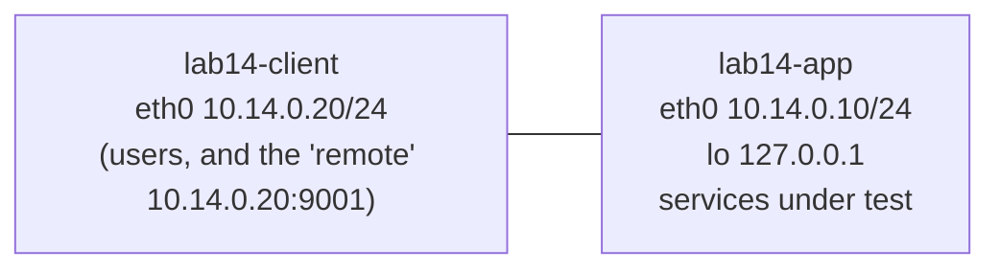

# Lab 14: Who Owns Port 443?

| Field | Value |
|---|---|
| **Lab ID** | LAB-14 |
| **Related lesson** | [Day 14: Ports, Sockets and Connections](../course/module-3/day-14.md) |
| **Difficulty** | Intermediate |
| **Time** | 75–105 minutes |
| **Risk level** | Low. The Linux part runs inside two **isolated network namespaces** (`lab14-app`, `lab14-client`); every lab process runs as the `nobody` user, its PID is saved in `/run/lab14/`, and only those saved PIDs are ever stopped. Your real services, ports and firewall are not touched. The Windows part listens on `127.0.0.1` only, inside your own PowerShell process, and everything else is read-only. Use a VM or WSL2. |

## Objective

It is 09:10 on Monday. The change ticket says *"deploy the new web service on the application host"*. The deployment fails:

```text
webapp: cannot bind 0.0.0.0:443: [Errno 98] Address already in use
```

Your job:

1. Find **which process owns port 443**, who started it, when, and from where — and prove it with at least two different tools.
2. Audit the host's listeners: which are reachable from the network (**bound to all addresses**) and which only from the host itself (**loopback**)? One of them should never have been exposed.
3. Fix both problems safely, start the real service and verify it.
4. Take a **listening-port baseline**.
5. Later the same day the security team reports *"unexpected traffic from the app host"*. Compare the host with your baseline, identify the **new listener** and the **outbound connection**, trace both to their processes, collect evidence and only then stop them.
6. Explain a connection leak (**CLOSE-WAIT**) and normal **TIME-WAIT** entries that the monitoring dashboard is complaining about.
7. Repeat the owner-finding, baseline and state observations on Windows with `Get-NetTCPConnection`, `netstat -ano` and the course's `Port-Monitor.ps1`.

**Lab network:**



## Required Environment

- **Linux:** Ubuntu 24.04 VM or WSL2 with `sudo`, and these packages: `iproute2` (provides `ss`; installed by default), `lsof`, `psmisc` (provides `fuser`), `netcat-openbsd`, `curl`, `python3`, `util-linux` (provides `setpriv`), `netbase` (provides `/etc/services`). Install anything missing with `sudo apt install lsof psmisc netcat-openbsd curl netbase`. Optional: `net-tools` for the legacy `netstat`.
- Containers usually cannot create network namespaces; use a VM or WSL2.
- The course repository (for `scripts/linux/port-monitor.sh` and `scripts/powershell/Port-Monitor.ps1`).
- **Windows:** Windows 11 with Windows PowerShell 5.1 (PowerShell 7 works too). A normal, **non-elevated** window is enough; one optional step shows what `netstat -b` adds when elevated.

## Initial Conditions

- No namespaces called `lab14-*` exist (`ip netns list`), and `/run/lab14` and `/srv/lab14` do not exist. If they do, run the clean-up first.
- Create the working folder: `mkdir -p ~/lab14` (Linux) and `New-Item -ItemType Directory -Path $HOME\lab14 -Force` (Windows).
- Read the three scripts below **before** running them. They only create the two namespaces and a veth link, write two small Python programs to `/srv/lab14/bin`, set `net.ipv4.ip_unprivileged_port_start=80` **inside the `lab14-app` namespace only** (so that the unprivileged `nobody` user can listen on 443 there; this sysctl is per network namespace and does not change your host), and start the lab processes as `nobody`.

### Lab setup (Linux)

Save as `~/lab14/setup.sh` and run `sudo bash ~/lab14/setup.sh`:

```bash
#!/usr/bin/env bash
# Lab 14 setup: an application host and a client in isolated network namespaces,
# plus the lab processes. Every process runs as the 'nobody' user and its PID is saved
# in /run/lab14/*.pid so the clean-up stops only what this script started.
set -o errexit -o nounset -o pipefail
mkdir -p /run/lab14 /srv/lab14/www /srv/lab14/bin
cd /srv/lab14 2>/dev/null || true
echo "lab14 test page" > /srv/lab14/www/index.html
cat > /srv/lab14/bin/webapp.py <<'PY'
#!/usr/bin/env python3
"""Lab 14 'production' web service: tries to listen on 0.0.0.0:443 like a real web server."""
import socket, sys
s = socket.socket(socket.AF_INET, socket.SOCK_STREAM)
s.setsockopt(socket.SOL_SOCKET, socket.SO_REUSEADDR, 1)   # like nginx/Apache: restart despite TIME-WAIT
try:
    s.bind(("0.0.0.0", 443))
except OSError as e:
    print(f"webapp: cannot bind 0.0.0.0:443: {e}", file=sys.stderr)
    sys.exit(1)
s.listen(128)
print("webapp: listening on 0.0.0.0:443")
while True:
    conn, _ = s.accept()
    conn.recv(4096)                                         # read the request
    conn.sendall(b"HTTP/1.0 200 OK\r\nContent-Length: 12\r\n\r\nwebapp ok \r\n")
    conn.close()
PY
cat > /srv/lab14/bin/leaky.py <<'PY'
#!/usr/bin/env python3
"""Lab 14 leaky service: accepts connections on 0.0.0.0:9090 and never closes them (CLOSE_WAIT bug)."""
import socket, time
s = socket.socket(socket.AF_INET, socket.SOCK_STREAM)
s.setsockopt(socket.SOL_SOCKET, socket.SO_REUSEADDR, 1)
s.bind(("0.0.0.0", 9090))
s.listen(16)
kept = []                       # the bug: accepted sockets are kept forever and never closed
while True:
    conn, peer = s.accept()
    kept.append(conn)
    time.sleep(0.1)
PY
chmod 0755 /srv/lab14/bin/*.py
for ns in lab14-app lab14-client; do
    ip netns add "$ns"
    ip -n "$ns" link set lo up
done
ip link add a-eth0 type veth peer name c-eth0
ip link set a-eth0 netns lab14-app; ip link set c-eth0 netns lab14-client
ip -n lab14-app link set a-eth0 name eth0;    ip -n lab14-client link set c-eth0 name eth0
ip -n lab14-app addr add 10.14.0.10/24 dev eth0
ip -n lab14-client addr add 10.14.0.20/24 dev eth0
ip -n lab14-app link set eth0 up;             ip -n lab14-client link set eth0 up
# Allow unprivileged users to bind ports >= 80 INSIDE lab14-app only (this sysctl is per namespace).
ip netns exec lab14-app sysctl -q -w net.ipv4.ip_unprivileged_port_start=80

# start NAME NETNS COMMAND... : run COMMAND as nobody in NETNS, in the background, save its PID.
start() {
    local name="$1" ns="$2"; shift 2
    ip netns exec "$ns" setpriv --reuid=nobody --regid=nogroup --clear-groups -- "$@" \
        > "/run/lab14/$name.log" 2>&1 &
    echo $! > "/run/lab14/$name.pid"
}
# 1. A forgotten test web server that grabbed port 443 on ALL addresses.
start rogue-443 lab14-app python3 -m http.server 443 --bind 0.0.0.0 --directory /srv/lab14/www
# 2. An admin API that should only listen on loopback, but listens everywhere.
start admin-8443 lab14-app python3 -m http.server 8443 --bind 0.0.0.0 --directory /srv/lab14/www
# 3. A local cache that correctly listens on loopback only.
start cache-6379 lab14-app python3 -m http.server 6379 --bind 127.0.0.1 --directory /srv/lab14/www
sleep 1
echo "Lab 14 ready: namespaces lab14-app (10.14.0.10) and lab14-client (10.14.0.20)."
```

`ip netns exec` and `setpriv` replace themselves with the program (they do not stay as parent processes), so the PID saved by `$!` is the PID of the Python or `nc` process itself.

### Incident injector (Linux)

Save as `~/lab14/inject.sh`. You will run it in Task 6 — **not** now:

```bash
#!/usr/bin/env bash
# Lab 14 incident injector: an unexpected listener, an outbound "beacon" connection and a
# service with a CLOSE_WAIT leak. Netcat is used WITHOUT -e/-c: nothing executes received data.
set -o errexit -o nounset -o pipefail
cd /srv/lab14
start() {
    local name="$1" ns="$2"; shift 2
    ip netns exec "$ns" setpriv --reuid=nobody --regid=nogroup --clear-groups -- "$@" \
        > "/run/lab14/$name.log" 2>&1 < /dev/null &
    echo $! > "/run/lab14/$name.pid"
}
# The "remote" side: a listener on the client network.
start remote-9001 lab14-client nc -lk 10.14.0.20 9001
sleep 0.5
# 1. Unexpected listener on all addresses, port 4444.
start implant-4444 lab14-app nc -lk 0.0.0.0 4444
# 2. Outbound connection from the app host to 10.14.0.20:9001 that stays open.
start beacon lab14-app bash -c 'sleep infinity | nc 10.14.0.20 9001'
# 3. The leaky service on port 9090.
start leaky-9090 lab14-app python3 /srv/lab14/bin/leaky.py
sleep 1
echo "Incident injected."
```

The "implant" is a plain netcat listener: it accepts a connection and prints what it receives. It never runs commands. Real bind shells and reverse shells look the same **at the socket level**, which is what this lab trains you to spot.

### Lab clean-up script (Linux)

Save as `~/lab14/cleanup.sh`:

```bash
#!/usr/bin/env bash
# Lab 14 clean-up: stop ONLY the processes whose PIDs the lab saved, then delete the namespaces.
set -o nounset -o pipefail
for f in /run/lab14/*.pid; do
    [[ -e "$f" ]] || continue
    pid="$(cat "$f")"
    # Preview: show what will be stopped, and only stop it if it still runs as nobody.
    if ps -o user=,pid=,args= -p "$pid" 2>/dev/null | grep -q '^nobody'; then
        ps -o user=,pid=,args= -p "$pid"
        pkill -TERM -P "$pid" 2>/dev/null   # children first (the beacon runs 'sleep | nc')
        kill "$pid"
    fi
    rm -f -- "$f"
done
for ns in lab14-app lab14-client; do
    ip netns list | grep -qw "$ns" && ip netns del "$ns"
done
rm -rf -- /run/lab14 /srv/lab14
echo "Lab 14 removed."
```

To keep typing short, the instructions use two shell variables. Set them in your terminal after the setup:

```bash
A="sudo ip netns exec lab14-app"        # run a command "on the app host"
C="sudo ip netns exec lab14-client"     # run a command "on a client"
NB="setpriv --reuid=nobody --regid=nogroup --clear-groups"   # ...as the nobody user
```

## Step-by-Step Instructions

### Task 1 — Reproduce the failure

1. Run the setup script.
2. Start the new web service exactly as the deployment does, in the foreground: `$A $NB python3 /srv/lab14/bin/webapp.py`. Note the error and the exit code (`echo $?`).
3. Write down the errno name and number. What does it mean in one sentence?

### Task 2 — Who owns port 443?

1. Find the listener on port 443 with `ss` (use a filter expression so you see only port 443, and show the process).
2. Confirm with **two** other tools: `lsof` and `fuser`.
3. From the PID, find: the user, the parent PID, the start time and elapsed time, the full command line, the working directory and the executable (`ps -o …`, `/proc/PID/cmdline`, `/proc/PID/cwd`, `/proc/PID/exe`).
4. Prove the link between the socket and the process: find the **socket inode** in `/proc/PID/fd` and the same inode in `/proc/net/tcp` (inside the namespace). Convert the hex port in `/proc/net/tcp` to decimal.

### Task 3 — Exposure audit

1. List every TCP listener on the app host (`ss -ltn`). For each one, write *ALL addresses* or *loopback only*.
2. From the **client**, test each port: `curl` port 443, `nc -zv` ports 8443 and 6379. From the **app host**, test 6379 on `127.0.0.1`.
3. Port 8443 is the *admin API*; the application documentation says it "must only be reachable locally". Port 6379 is a local cache. Which listener violates policy?

### Task 4 — Fix and verify

1. Preview, then stop the rogue 443 server **by its saved PID** (`/run/lab14/rogue-443.pid`) — never with `pkill python3`.
2. Preview, then stop the admin API by its saved PID and restart it bound to `127.0.0.1` only (as `nobody`, in the background, saving the new PID to `/run/lab14/admin-8443.pid`).
3. Start the web service in the background as `nobody` and save its PID to `/run/lab14/webapp.pid`. Start both background programs from a **root shell** (`sudo -i`), so that `$!` is the program's PID and not the PID of `sudo`.
4. Verify: `ss -ltnp` shows 443 on `0.0.0.0` owned by `webapp.py`'s Python process and 8443 on `127.0.0.1`; from the client `curl` 443 returns `webapp ok` and port 8443 is **refused**.

### Task 5 — Baseline

1. Save a simple baseline: `ss -Hltun` reduced to protocol and local address:port, sorted, in `~/lab14/baseline.txt`.
2. Save a second baseline with the course script: `port-monitor.sh -e -a 443 -s ~/lab14/ports-baseline.txt` (run it inside `lab14-app`). Note its exit code.

### Task 6 — "Unexpected traffic from the app host"

1. Run `sudo bash ~/lab14/inject.sh`.
2. Compare with the baseline in two ways: `diff` against `baseline.txt`, and `port-monitor.sh -e -a 443 -b ~/lab14/ports-baseline.txt -c`. Note the exit code.
3. Find **established** connections on the app host. Which one goes **out** to another host, and on which remote port?
4. For the new listener and the outbound connection, find the process, its parent and its siblings (`ps --ppid`), and confirm with `lsof -i @10.14.0.20`.
5. **Collect evidence before you change anything:** save `ss -tanp`, `ss -ltunp` and `ps -eo pid,ppid,user,lstart,args` with a UTC timestamp to `~/lab14/evidence/`.
6. Preview, then stop the listener and the beacon by their saved PIDs (children first). Confirm with `ss` that port 4444 is gone and the outbound connection is closed. What state does the closed outbound connection show, and why?

### Task 7 — CLOSE-WAIT and TIME-WAIT

1. From the client, connect to port 9090 three times with `nc -z`.
2. On the app host, list sockets in `close-wait` (with processes). On the client, list sockets in `fin-wait-2`. Explain the pair.
3. From the client, request `http://10.14.0.10:443/` five times with `curl`. List `time-wait` sockets on **both** sides with timers (`ss -tno`). Which side holds TIME-WAIT, and why?
4. Count all TCP sockets on the app host by state in one pipeline.

### Task 8 — Windows: owner, "already in use", states and a baseline

Use one normal PowerShell window; every socket in this task belongs to **your own PowerShell process** on `127.0.0.1`.

1. Start a loopback listener on port 48443 in your session and find its owner with `Get-NetTCPConnection`, `Get-Process` and `netstat -ano`. Compare `OwningProcess` with `$PID`.
2. Try to start a **second** listener on the same address and port. Record the exception message, `SocketErrorCode` and `ErrorCode`.
3. Connect a `TcpClient` to the listener, accept it, then close **only the client**. Show the state of both ends with `Get-NetTCPConnection`. Then close the accepted (server-side) connection and look for `TimeWait`.
4. Find the owner of two real system listeners, read-only: port **135** (RPC endpoint mapper) and port **445** (SMB). Map the PID to the service with `Get-CimInstance Win32_Service` and `tasklist /svc`.
5. Save a listener baseline to `$HOME\lab14\listen-baseline.csv`, start a second listener on `127.0.0.1:44444`, and find it with `Compare-Object`. Repeat with `Port-Monitor.ps1 -SaveBaselinePath` / `-BaselinePath` and note the exit code.
6. Stop all listeners and close all clients you created.

### Task 9 — Ticket note

Write `~/lab14/ticket.md` (max. 10 lines): UTC time, host, symptom, owner of 443 (with evidence), exposure finding and fix, baseline file, the two incident findings (listener and outbound connection, with PIDs and evidence file name), and what you recommended about the CLOSE-WAIT leak.

## Commands to Execute

Try each task yourself first; complete commands and captured output are in the [Solution](#solution).

| Question | Linux (`$A` = inside `lab14-app`) | Windows |
|---|---|---|
| Who listens on a port? | `$A ss -ltnp 'sport = :443'` · `$A lsof -nP -iTCP:443 -sTCP:LISTEN` · `$A fuser -v -n tcp 443` | <code>Get-NetTCPConnection -LocalPort 443 -State Listen</code> · <code>netstat -ano &#124; Select-String ':443 '</code> |
| What is that PID? | `ps -o pid,ppid,user,lstart,etime,args -p PID` · `/proc/PID/{cmdline,cwd,exe,fd}` | `Get-Process -Id PID` · `Get-CimInstance Win32_Service -Filter "ProcessId = PID"` · `tasklist /svc /fi "PID eq PID"` |
| Exposed or local? | `$A ss -ltn` (Local Address column) | `Get-NetTCPConnection -State Listen` (`LocalAddress`) |
| Established / outbound | `$A ss -tnp state established` · `$A lsof -nP -i @REMOTE` | `Get-NetTCPConnection -State Established` |
| Leaks and waits | `$A ss -tnp state close-wait` · `$A ss -tno state time-wait` | `Get-NetTCPConnection -State CloseWait, TimeWait` |
| Baseline / diff | `ss -Hltun` → file · `diff` · `port-monitor.sh -s / -b` | `Export-Csv` · `Compare-Object` · `Port-Monitor.ps1 -SaveBaselinePath / -BaselinePath` |

## Expected Results

- **Task 1:** `webapp: cannot bind 0.0.0.0:443: [Errno 98] Address already in use`, exit code `1`. `EADDRINUSE` (98 on Linux): another socket already holds that local address and port.
- **Task 2:** the owner is a `python3 -m http.server 443 --bind 0.0.0.0` process running as `nobody`, parent PID `1` (it was started in the background and its parent is gone), working directory `/srv/lab14`; all three tools report the same PID; the socket inode in `/proc/PID/fd` (for example `socket:[28697]`) matches the `inode` column of the `/proc/net/tcp` line whose local address is `00000000:01BB` (`0x01BB` = 443, state `0A` = LISTEN).
- **Task 3:** 443 and 8443 listen on `0.0.0.0` (all addresses), 6379 on `127.0.0.1`. From the client, 443 and 8443 succeed and 6379 is **refused**; locally 6379 works. **8443 violates policy.**
- **Task 4:** `ss -ltnp` shows `0.0.0.0:443` (Send-Q `128`, the new service's backlog) and `127.0.0.1:8443`; the client gets `webapp ok` and `Connection refused` on 8443.
- **Task 5:** a three-line baseline (`tcp 0.0.0.0:443`, `tcp 127.0.0.1:6379`, `tcp 127.0.0.1:8443`); `port-monitor.sh` exits `0` with *Exposed listeners: 0*.
- **Task 6:** two new listeners: `0.0.0.0:4444` (`nc`) and `0.0.0.0:9090` (`leaky.py`); `port-monitor.sh` reports `NEW` for both, flags both as `EXPOSED`, status `ALERT`, exit code `3`. One established connection `10.14.0.10:<ephemeral> → 10.14.0.20:9001` owned by `nc`, whose parent is `bash -c 'sleep infinity | nc …'`. After stopping, 4444 is gone and the outbound connection shows **TIME-WAIT** on the app host (the app host closed first).
- **Task 7:** three `CLOSE-WAIT` sockets on `10.14.0.10:9090` owned by `leaky.py` (Recv-Q `1` each), the matching three `FIN-WAIT-2` sockets on the client; TIME-WAIT entries on the **app host** for port 443 (the server closes first after each response), roughly 60 seconds on the timer.
- **Task 8:** `OwningProcess` equals `$PID`; the second listener fails with *Only one usage of each socket address (protocol/network address/port) is normally permitted*, `AddressAlreadyInUse`, `10048`; after closing the client the server end is `CloseWait` and the client end `FinWait2`; after closing the server end the client end is `TimeWait` with `OwningProcess` `0`. Port 135 belongs to a `svchost` process hosting `RpcEptMapper` (and often `RpcSs`); port 445 to PID `4` (`System`, the kernel SMB driver). `Compare-Object` shows `127.0.0.1:44444` with `=>`; `Port-Monitor.ps1 -BaselinePath` exits `3`.
- **Task 9:** a short, evidence-based note.

## Verification Steps

=== "Linux"

    ```bash
    $A ss -Hltn 'sport = :443' | grep -q '0.0.0.0:443' && echo "443 listening on all addresses"
    $A ss -Hltn 'sport = :8443' | grep -q '127.0.0.1:8443' && echo "8443 loopback only"
    $C curl -s -m 3 http://10.14.0.10:443/                       # webapp ok
    $C nc -z -w2 10.14.0.10 8443 || echo "8443 not reachable from the client (correct)"
    $A ss -Hltn 'sport = :4444' | wc -l                          # 0 after Task 6
    ls ~/lab14/                                                  # baseline.txt evidence/ ports-baseline.txt ticket.md ...
    ```

=== "Windows"

    ```powershell
    Get-ChildItem $HOME\lab14                                    # listen-baseline.csv, port-baseline.txt
    Get-NetTCPConnection -LocalPort 48443, 44444 -ErrorAction SilentlyContinue   # nothing after Task 8.6
    ```

## Troubleshooting

| Problem | Cause | Fix |
|---|---|---|
| `Cannot create namespace file "/run/netns/lab14-app": File exists` | An old lab is still present | Run `sudo bash ~/lab14/cleanup.sh`, then the setup again |
| `ss -p` shows no `users:(...)` column | You ran `ss` as a normal user, and the sockets belong to `nobody` | Use `sudo` (the `$A` variable already does) |
| `lsof` prints nothing for port 443 | `lsof` was run **outside** the namespace, or without `sudo` | `$A lsof -nP -iTCP:443` |
| `fuser: command not found` | `psmisc` not installed | `sudo apt install psmisc` |
| `python3: can't open file '/root/...': Permission denied` | You copied the Python programs to your home directory; `nobody` cannot read it (Ubuntu 24.04 home directories are mode 750) | Keep lab programs in `/srv/lab14/bin` as the setup does |
| `webapp: cannot bind ... Address already in use` **again** after stopping the rogue server | A program **without** `SO_REUSEADDR` cannot bind while old connections on that port are in TIME-WAIT; or the rogue process is still running | `$A ss -tan 'sport = :443'`: if only `TIME-WAIT` lines remain, wait about 60 s (the lab's `webapp.py` sets `SO_REUSEADDR`, like real web servers); if a `LISTEN` line remains, check the PID again |
| `kill: (PID) - No such process` | The process already ended, or you typed a PID from the captured output in this page | Always use `$(cat /run/lab14/NAME.pid)` |
| `curl` from the client hangs | A proxy is set in your environment | `curl --noproxy '*' ...` |
| Windows: `Exception calling "Start" ... Only one usage of each socket address` on the **first** listener | Port 48443 is already used on your PC | Pick another port above 1024 and below 49152 and use it everywhere in Task 8 |
| Windows: Defender Firewall asks to allow PowerShell | You bound to `0.0.0.0` (`[IPAddress]::Any`) instead of loopback | Click **Cancel**, stop that listener, and use `[System.Net.IPAddress]::Loopback` |
| `Get-NetTCPConnection : No MSFT_NetTCPConnection objects found` | No socket matches the filter (for example `-State TimeWait` after the entries expired) | Normal; add `-ErrorAction SilentlyContinue` or repeat the step faster |
| `Get-NetTCPConnection` not recognised | PowerShell 7 on Linux/macOS (the NetTCPIP module is Windows-only) | Use the `IPGlobalProperties` pattern from the lesson, or run on Windows |

## Questions

1. What does `EADDRINUSE` / Windows error 10048 tell you, and what does it **not** tell you?
2. Name three ways to find the owner of a TCP port on Linux. Which need `sudo` here, and why?
3. Why is `0.0.0.0:8443` a security problem while `127.0.0.1:6379` is not — even though both are "listening"?
4. Why do you stop processes by a saved PID instead of `pkill python3` or `killall nc`?
5. The baseline key used by `port-monitor.sh` is *protocol, address, port* — not the process name or PID. Why?
6. In Task 6, how did you decide which established connection was **outbound**?
7. Why must evidence be collected **before** stopping the suspicious processes?
8. After you stopped the beacon, its connection stayed visible in `TIME-WAIT`. Why on the app host and not on the client?
9. Which side of a connection sits in `CLOSE-WAIT`, and whose bug is it when thousands accumulate?
10. Why did the TIME-WAIT entries for port 443 appear on the **server** in this lab, when on most websites they appear on clients?
11. On Windows, why does a `TimeWait` connection show `OwningProcess` `0`?
12. What did `tasklist /svc` show for the PID behind port 135, and why can one PID own several services?

## Solution

The output below was **captured** on 2026-11-13 by running this lab's setup, every Linux task and the clean-up as root on Ubuntu 24.04.5 in a container (iproute2 6.1.0 `ss`, lsof 4.95.0, psmisc `fuser`, OpenBSD netcat, curl 8.5); the Python executable of that host was 3.11, so `/proc/PID/exe` points to `python3.11` there (Ubuntu 24.04 ships 3.12). Your PIDs, inode numbers, ephemeral ports and timer values will differ. The Windows output is an **example** and was not captured.

??? success "Bash solution"
    **Task 1 — reproduce**

    ```bash
    sudo bash ~/lab14/setup.sh
    A="sudo ip netns exec lab14-app"; C="sudo ip netns exec lab14-client"
    NB="setpriv --reuid=nobody --regid=nogroup --clear-groups"
    $A $NB python3 /srv/lab14/bin/webapp.py; echo "exit: $?"
    ```

    ```text
    Lab 14 ready: namespaces lab14-app (10.14.0.10) and lab14-client (10.14.0.20).
    webapp: cannot bind 0.0.0.0:443: [Errno 98] Address already in use
    exit: 1
    ```

    **Task 2 — who owns 443?**

    ```bash
    $A ss -ltnp 'sport = :443'
    $A lsof -nP -iTCP:443 -sTCP:LISTEN
    $A fuser -v -n tcp 443
    pid=$($A ss -Hltnp 'sport = :443' | grep -o 'pid=[0-9]*' | head -1 | cut -d= -f2); echo "$pid"
    ps -o pid,ppid,user,lstart,etime,args -p "$pid"
    sudo tr '\0' ' ' < /proc/"$pid"/cmdline; echo
    sudo readlink /proc/"$pid"/cwd /proc/"$pid"/exe
    sudo ls -l /proc/"$pid"/fd | grep socket
    $A awk 'NR == 1 || $10 == 28697' /proc/net/tcp      # use YOUR inode number
    printf '%d\n' 0x01BB
    ```

    ```text
    State  Recv-Q Send-Q Local Address:Port Peer Address:PortProcess
    LISTEN 0      5            0.0.0.0:443       0.0.0.0:*    users:(("python3",pid=5455,fd=3))
    COMMAND  PID   USER   FD   TYPE DEVICE SIZE/OFF NODE NAME
    python3 5455 nobody    3u  IPv4  28697      0t0  TCP *:443 (LISTEN)
                         USER        PID ACCESS COMMAND
    443/tcp:             nobody     5455 F.... python3
    5455
      PID  PPID USER                      STARTED     ELAPSED COMMAND
     5455     1 nobody   Fri Nov 13 16:56:43 2026       00:01 python3 -m http.server 443 --bind 0.0.0.0 --directory /srv/lab14/www
    python3 -m http.server 443 --bind 0.0.0.0 --directory /srv/lab14/www
    /srv/lab14
    /usr/bin/python3.11
    lrwx------ 1 nobody nogroup 64 Nov 13 16:56 3 -> socket:[28697]
    ```

    The `/proc/net/tcp` line has the form (captured earlier in the same session, other inode):

    ```text
      sl  local_address rem_address   st tx_queue rx_queue tr tm->when retrnsmt   uid  timeout inode
       2: 00000000:01BB 00000000:0000 0A 00000000:00000000 00:00000000 00000000 65534        0 5581 1 ...
    443
    ```

    `00000000:01BB` = `0.0.0.0:443`, `st 0A` = LISTEN, `uid 65534` = `nobody`, and the inode matches `socket:[…]` in the process's file-descriptor table. `ss`, `lsof` and `fuser` all do this matching for you. The `F` in fuser's ACCESS column means "open file". Without `sudo`, `ss -p` and `lsof` cannot see the file-descriptor tables of other users' processes, and `/proc/PID/cwd` and `/proc/PID/fd` are unreadable.

    **Task 3 — exposure audit**

    ```bash
    $A ss -ltn
    $C curl -s -m 3 http://10.14.0.10:443/
    $C nc -zv -w2 10.14.0.10 8443
    $C nc -zv -w2 10.14.0.10 6379
    $A curl -s -m 3 http://127.0.0.1:6379/
    ```

    ```text
    State  Recv-Q Send-Q Local Address:Port Peer Address:PortProcess
    LISTEN 0      5          127.0.0.1:6379      0.0.0.0:*
    LISTEN 0      5            0.0.0.0:8443      0.0.0.0:*
    LISTEN 0      5            0.0.0.0:443       0.0.0.0:*
    lab14 test page
    Connection to 10.14.0.10 8443 port [tcp/*] succeeded!
    nc: connect to 10.14.0.10 port 6379 (tcp) failed: Connection refused
    lab14 test page
    ```

    `0.0.0.0` means "every IPv4 address of this host", so 443 and 8443 are reachable from the network; `127.0.0.1:6379` is reachable only from the host itself, which is why the client gets *refused*. The admin API on 8443 violates policy.

    **Task 4 — fix and verify**

    ```bash
    ps -o user,pid,args -p "$(cat /run/lab14/rogue-443.pid)"          # preview
    sudo kill "$(cat /run/lab14/rogue-443.pid)"; sudo rm -f /run/lab14/rogue-443.pid
    ps -o user,pid,args -p "$(cat /run/lab14/admin-8443.pid)"         # preview
    sudo kill "$(cat /run/lab14/admin-8443.pid)"
    # Start the replacements from a ROOT shell, so that $! is the PID of the program itself
    # (with "sudo ... &" it would be the PID of sudo, and the clean-up would skip it).
    sudo -i
    cd /srv/lab14
    NB="setpriv --reuid=nobody --regid=nogroup --clear-groups"
    ip netns exec lab14-app $NB python3 /srv/lab14/bin/webapp.py > /dev/null 2>&1 &
    echo $! > /run/lab14/webapp.pid
    ip netns exec lab14-app $NB python3 -m http.server 8443 --bind 127.0.0.1 --directory /srv/lab14/www > /dev/null 2>&1 &
    echo $! > /run/lab14/admin-8443.pid
    exit                                       # back to your normal shell
    sleep 1
    $A ss -ltnp
    $C curl -s -m 3 http://10.14.0.10:443/
    $C nc -zv -w2 10.14.0.10 8443
    ```

    ```text
    USER       PID COMMAND
    nobody    5455 python3 -m http.server 443 --bind 0.0.0.0 --directory /srv/lab14/www
    USER       PID COMMAND
    nobody    5456 python3 -m http.server 8443 --bind 0.0.0.0 --directory /srv/lab14/www
    State  Recv-Q Send-Q Local Address:Port Peer Address:PortProcess
    LISTEN 0      5          127.0.0.1:6379      0.0.0.0:*    users:(("python3",pid=5457,fd=3))
    LISTEN 0      128          0.0.0.0:443       0.0.0.0:*    users:(("python3",pid=5489,fd=3))
    LISTEN 0      5          127.0.0.1:8443      0.0.0.0:*    users:(("python3",pid=5490,fd=3))
    webapp ok
    nc: connect to 10.14.0.10 port 8443 (tcp) failed: Connection refused
    ```

    The Send-Q of a LISTEN socket is its **backlog**: 128 for `webapp.py` (`listen(128)`), 5 for Python's `http.server`.

    **Task 5 — baseline**

    ```bash
    $A ss -Hltun | awk '{print $1, $5}' | sort -u > ~/lab14/baseline.txt; cat ~/lab14/baseline.txt
    $A bash ~/linux-powershell-professional-mastery/scripts/linux/port-monitor.sh -e -a 443 -s ~/lab14/ports-baseline.txt
    echo "exit: $?"
    ```

    ```text
    tcp 0.0.0.0:443
    tcp 127.0.0.1:6379
    tcp 127.0.0.1:8443
    ==============================================
     Port Monitor Report
    ==============================================
    Report time (UTC)    : 2026-11-13T16:56:47Z
    Host name            : ubuntu-lab
    Protocols            : TCP UDP
    Data source          : ss
    Listeners            : 3
    Exposed listeners    : 0 (allowed on all addresses: 443)
    Status               : OK

    --- Listening sockets ---
    PROTO ADDRESS                      PORT   SERVICE        PROCESS          PID      USER       BOUND_TO  FLAG
    tcp   0.0.0.0                      443    https          python3          5489     nobody     ALL       -
    tcp   127.0.0.1                    6379   redis          python3          5457     nobody     LOOPBACK  -
    tcp   127.0.0.1                    8443   n/a            python3          5490     nobody     LOOPBACK  -
    Baseline saved to: /root/lab14/ports-baseline.txt (3 listeners)
    exit: 0
    ```

    (Host renamed; the capture ran as root, hence `/root/lab14`.) The `SERVICE` names come from `/etc/services`: 6379 is registered for Redis even though our process is a Python test server — a port number never proves which program is listening.

    **Task 6 — incident**

    ```bash
    sudo bash ~/lab14/inject.sh
    $A ss -Hltun | awk '{print $1, $5}' | sort -u > ~/lab14/now.txt
    diff ~/lab14/baseline.txt ~/lab14/now.txt
    $A bash ~/linux-powershell-professional-mastery/scripts/linux/port-monitor.sh -e -a 443 -b ~/lab14/ports-baseline.txt -c
    echo "exit: $?"
    ```

    ```text
    Incident injected.
    1a2,3
    > tcp 0.0.0.0:4444
    > tcp 0.0.0.0:9090
    ...
    Listeners            : 5
    Exposed listeners    : 2 (allowed on all addresses: 443)
    Baseline             : /root/lab14/ports-baseline.txt (NEW 2, GONE 0)
    Status               : ALERT

    --- Listening sockets ---
    PROTO ADDRESS                      PORT   SERVICE        PROCESS          PID      USER       BOUND_TO  FLAG
    tcp   0.0.0.0                      443    https          python3          5489     nobody     ALL       -
    tcp   0.0.0.0                      4444   n/a            nc               5534     nobody     ALL       EXPOSED
    tcp   127.0.0.1                    6379   redis          python3          5457     nobody     LOOPBACK  -
    tcp   127.0.0.1                    8443   n/a            python3          5490     nobody     LOOPBACK  -
    tcp   0.0.0.0                      9090   n/a            python3          5536     nobody     ALL       EXPOSED

    --- Compared with baseline ---
    NEW   tcp 0.0.0.0 4444
    NEW   tcp 0.0.0.0 9090

    --- TCP connections by state (listeners excluded) ---
          3  TIME-WAIT
          1  ESTAB
    exit: 3
    ```

    (PIDs in this block are from the same run as the commands below; the three TIME-WAIT entries are left over from the `curl` and `nc` tests in Tasks 3 and 4.)

    ```bash
    $A ss -tnp state established
    $A ss -ltnp 'sport = :4444'
    bpid=$($A ss -Htnp state established '( dport = :9001 )' | grep -o 'pid=[0-9]*' | head -1 | cut -d= -f2)
    ps -o pid,ppid,user,etime,args -p "$bpid"
    ps -o pid,ppid,user,etime,args --ppid "$(ps -o ppid= -p "$bpid" | tr -d ' ')"
    $A lsof -nP -i @10.14.0.20
    ```

    ```text
    Recv-Q Send-Q Local Address:Port  Peer Address:PortProcess
    0      0         10.14.0.10:40144   10.14.0.20:9001 users:(("nc",pid=5539,fd=3))
    State  Recv-Q Send-Q Local Address:Port Peer Address:PortProcess
    LISTEN 0      1            0.0.0.0:4444      0.0.0.0:*    users:(("nc",pid=5534,fd=3))
      PID  PPID USER         ELAPSED COMMAND
     5539  5535 nobody         00:01 nc 10.14.0.20 9001
      PID  PPID USER         ELAPSED COMMAND
     5538  5535 nobody         00:01 sleep infinity
     5539  5535 nobody         00:01 nc 10.14.0.20 9001
    COMMAND  PID   USER   FD   TYPE DEVICE SIZE/OFF NODE NAME
    nc      5539 nobody    3u  IPv4  26580      0t0  TCP 10.14.0.10:40144->10.14.0.20:9001 (ESTABLISHED)
    ```

    The connection is **outbound** because the app host's side is the **ephemeral** port (40144, inside 32768–60999) and the remote side is the fixed service port 9001; there is no app-host listener on 40144. `lsof` writes it as `local->remote`.

    ```bash
    mkdir -p ~/lab14/evidence
    { date -u +%FT%TZ; $A ss -tanp; $A ss -ltunp; ps -eo pid,ppid,user,lstart,args; } \
        > ~/lab14/evidence/sockets-$(date -u +%Y%m%dT%H%M%SZ).txt
    for n in implant-4444 beacon; do
        ps -o user,pid,args -p "$(cat /run/lab14/$n.pid)"                 # preview
        sudo pkill -TERM -P "$(cat /run/lab14/$n.pid)"                     # children first
        sudo kill "$(cat /run/lab14/$n.pid)"; sudo rm -f /run/lab14/$n.pid
    done
    sleep 0.5
    $A ss -tanp '( sport = :4444 or dport = :9001 )'
    ```

    ```text
    USER       PID COMMAND
    nobody    5534 nc -lk 0.0.0.0 4444
    USER       PID COMMAND
    nobody    5535 bash -c sleep infinity | nc 10.14.0.20 9001
    State     Recv-Q Send-Q Local Address:Port  Peer Address:PortProcess
    TIME-WAIT 0      0         10.14.0.10:40144   10.14.0.20:9001
    ```

    The listener is gone. The outbound connection is in TIME-WAIT **on the app host** because the app host's `nc` closed first (the *active closer* keeps TIME-WAIT); no process owns it any more.

    **Task 7 — CLOSE-WAIT and TIME-WAIT**

    ```bash
    for i in 1 2 3; do $C nc -z -w1 10.14.0.10 9090; done; sleep 1
    $A ss -tnp state close-wait
    $C ss -tn state fin-wait-2
    for i in 1 2 3 4 5; do $C curl -s -o /dev/null http://10.14.0.10:443/; done
    $A ss -tno state time-wait
    $C ss -tn state time-wait
    $A ss -tan | awk 'NR > 1 { print $1 }' | sort | uniq -c | sort -rn
    ```

    ```text
    Recv-Q Send-Q Local Address:Port Peer Address:Port Process
    1      0         10.14.0.10:9090   10.14.0.20:44594 users:(("python3",pid=5536,fd=6))
    1      0         10.14.0.10:9090   10.14.0.20:44590 users:(("python3",pid=5536,fd=5))
    1      0         10.14.0.10:9090   10.14.0.20:44580 users:(("python3",pid=5536,fd=4))
    Recv-Q Send-Q Local Address:Port  Peer Address:PortProcess
    0      0         10.14.0.20:44580   10.14.0.10:9090
    0      0         10.14.0.20:44590   10.14.0.10:9090
    0      0         10.14.0.20:44594   10.14.0.10:9090
    Recv-Q Send-Q Local Address:Port  Peer Address:Port Process
    0      0         10.14.0.10:443     10.14.0.20:37254 timer:(timewait,59sec,0)
    0      0         10.14.0.10:443     10.14.0.20:37248 timer:(timewait,59sec,0)
    0      0         10.14.0.10:443     10.14.0.20:37238 timer:(timewait,59sec,0)
    0      0         10.14.0.10:443     10.14.0.20:44498 timer:(timewait,56sec,0)
    0      0          127.0.0.1:6379     127.0.0.1:53290 timer:(timewait,55sec,0)
    0      0         10.14.0.10:443     10.14.0.20:37264 timer:(timewait,59sec,0)
    0      0         10.14.0.10:443     10.14.0.20:37258 timer:(timewait,59sec,0)
    0      0         10.14.0.10:443     10.14.0.20:44488 timer:(timewait,55sec,0)
    0      0         10.14.0.10:40144   10.14.0.20:9001  timer:(timewait,58sec,0)
    Recv-Q Send-Q Local Address:Port  Peer Address:PortProcess
    0      0         10.14.0.20:35566   10.14.0.10:8443
          9 TIME-WAIT
          4 LISTEN
          3 CLOSE-WAIT
    ```

    The client closed (sent FIN) and waits in FIN-WAIT-2 for the server's FIN; the server's kernel acknowledged it and moved the socket to CLOSE-WAIT, where it stays until **the application** calls `close()` — `leaky.py` never does. The `Recv-Q 1` is the received FIN, which the kernel counts in the receive sequence space. TIME-WAIT for port 443 is on the **server** because `webapp.py` closes each connection right after sending its HTTP/1.0 response; the client's only TIME-WAIT (port 8443) is from the earlier `nc -z` test, where the client closed first.

    **Clean-up** — see the [Clean-up](#clean-up) section.

??? success "PowerShell solution"
    **Task 8.1 — a listener and its owner** (example output)

    ```powershell
    $listener = [System.Net.Sockets.TcpListener]::new([System.Net.IPAddress]::Loopback, 48443)
    $listener.Start()
    "This PowerShell process: $PID"
    $l = Get-NetTCPConnection -LocalPort 48443 -State Listen
    $l | Select-Object LocalAddress, LocalPort, State, OwningProcess
    Get-Process -Id $l.OwningProcess | Select-Object Id, ProcessName, Path
    netstat -ano | Select-String ':48443 '
    ```

    ```text
    This PowerShell process: 7316

    LocalAddress LocalPort  State OwningProcess
    ------------ ---------  ----- -------------
    127.0.0.1        48443 Listen          7316

      Id ProcessName Path
      -- ----------- ----
    7316 powershell  C:\Windows\System32\WindowsPowerShell\v1.0\powershell.exe

      TCP    127.0.0.1:48443        0.0.0.0:0              LISTENING       7316
    ```

    `[System.Net.Sockets.TcpListener]::new()` needs PowerShell 5.0 or later; in older shells use `New-Object System.Net.Sockets.TcpListener -ArgumentList ...`. `netstat -ano` writes the listening peer as `0.0.0.0:0` and the state as `LISTENING`; `Get-NetTCPConnection` uses `Listen`.

    **Task 8.2 — address already in use**

    ```powershell
    $second = [System.Net.Sockets.TcpListener]::new([System.Net.IPAddress]::Loopback, 48443)
    try { $second.Start() }
    catch {
        $e = $_.Exception.GetBaseException()
        $e.Message; $e.SocketErrorCode; $e.ErrorCode
    }
    ```

    ```text
    Only one usage of each socket address (protocol/network address/port) is normally permitted.
    AddressAlreadyInUse
    10048
    ```

    `GetBaseException()` unwraps the `MethodInvocationException` that PowerShell puts around exceptions thrown by .NET methods, so you reach the `SocketException` in both 5.1 and 7.

    **Task 8.3 — CloseWait, FinWait2, TimeWait**

    ```powershell
    $client = [System.Net.Sockets.TcpClient]::new()
    $client.Connect('127.0.0.1', 48443)
    $server = $listener.AcceptTcpClient()
    Get-NetTCPConnection -LocalPort 48443 | Select-Object LocalPort, RemotePort, State, OwningProcess
    $client.Close(); Start-Sleep -Seconds 1
    Get-NetTCPConnection -RemoteAddress 127.0.0.1 |
        Where-Object { $_.LocalPort -eq 48443 -or $_.RemotePort -eq 48443 } |
        Select-Object LocalPort, RemotePort, State, OwningProcess
    $server.Close(); Start-Sleep -Seconds 1
    Get-NetTCPConnection -State TimeWait -ErrorAction SilentlyContinue |
        Where-Object RemotePort -eq 48443 | Select-Object LocalPort, RemotePort, State, OwningProcess
    ```

    ```text
    LocalPort RemotePort       State OwningProcess
    --------- ----------       ----- -------------
        48443      52114 Established          7316
        48443          0      Listen          7316

    LocalPort RemotePort      State OwningProcess
    --------- ----------      ----- -------------
        52114      48443   FinWait2          7316
        48443      52114  CloseWait          7316

    LocalPort RemotePort    State OwningProcess
    --------- ----------    ----- -------------
        52114      48443 TimeWait             0
    ```

    The client closed first, so the server end waits in `CloseWait` for **our code** to close it — exactly the Linux `leaky.py` situation. After the server end closes, the client end (the active closer) is in `TimeWait`; Windows reports TIME-WAIT connections with `OwningProcess 0` because no process owns them any more. Windows keeps them for 120 seconds by default (`TcpTimedWaitDelay`).

    **Task 8.4 — real system listeners (read-only)**

    ```powershell
    foreach ($port in 135, 445) {
        $c = Get-NetTCPConnection -LocalPort $port -State Listen -ErrorAction SilentlyContinue | Select-Object -First 1
        if (-not $c) { "Port $port is not listening"; continue }
        $p = Get-Process -Id $c.OwningProcess
        $svc = Get-CimInstance -ClassName Win32_Service -Filter "ProcessId = $($c.OwningProcess)"
        '{0,-5} {1,-15} PID {2,-6} {3,-10} services: {4}' -f $port, $c.LocalAddress, $p.Id, $p.ProcessName, (($svc.Name) -join ', ')
    }
    $rpcPid = (Get-NetTCPConnection -LocalPort 135 -State Listen | Select-Object -First 1).OwningProcess
    tasklist /svc /fi "PID eq $rpcPid"
    ```

    ```text
    135   0.0.0.0         PID 1172   svchost    services: RpcEptMapper, RpcSs
    445   ::              PID 4      System     services:

    Image Name                     PID Services
    ========================= ======== ============================================
    svchost.exe                   1172 RpcEptMapper, RpcSs
    ```

    PID 4 is the **System** process: SMB (445) is served by the kernel driver `srv2.sys`, so there is no user-mode process or `Win32_Service` row with that PID. One `svchost.exe` can host several services, so one PID can own several services' ports. On some builds each service runs in its own `svchost` and you see only one name.

    **Task 8.5 — baseline and diff**

    ```powershell
    $props = 'LocalAddress', 'LocalPort'
    Get-NetTCPConnection -State Listen | Select-Object -Property $props -Unique |
        Sort-Object LocalPort | Export-Csv -Path $HOME\lab14\listen-baseline.csv -NoTypeInformation
    $extra = [System.Net.Sockets.TcpListener]::new([System.Net.IPAddress]::Loopback, 44444)
    $extra.Start()
    $now = Get-NetTCPConnection -State Listen | Select-Object -Property $props -Unique
    $base = Import-Csv -Path $HOME\lab14\listen-baseline.csv
    Compare-Object -ReferenceObject $base -DifferenceObject $now -Property $props
    ```

    ```text
    LocalAddress LocalPort SideIndicator
    ------------ --------- -------------
    127.0.0.1    44444     =>
    ```

    `=>` means "only in the difference object (now)": a **new** listener. `<=` would be a listener that disappeared. `Import-Csv` returns strings and `Get-NetTCPConnection` numbers; `Compare-Object` converts the right-hand value to the type of the left-hand one, so the comparison still works.

    With the course script (run it from the repository's `scripts\powershell` folder):

    ```powershell
    $extra.Stop()
    .\Port-Monitor.ps1 -Protocol Tcp -SaveBaselinePath $HOME\lab14\port-baseline.txt | Out-Null
    $extra = [System.Net.Sockets.TcpListener]::new([System.Net.IPAddress]::Loopback, 44444); $extra.Start()
    .\Port-Monitor.ps1 -Protocol Tcp -BaselinePath $HOME\lab14\port-baseline.txt | Select-Object -Last 3
    "exit: $LASTEXITCODE"
    ```

    ```text
    --- Compared with baseline ---
    NEW   tcp 127.0.0.1 44444
    exit: 3
    ```

    **Task 8.6 — clean up**

    ```powershell
    $server.Dispose(); $client.Dispose(); $listener.Stop(); $extra.Stop()
    Get-NetTCPConnection -LocalPort 48443, 44444 -ErrorAction SilentlyContinue   # nothing listening any more
    ```

??? success "Answers to questions"
    1. Another socket already holds that **local address and port** (or, for a wildcard bind, an overlapping one). It does not tell you *which* process — or whether that process is a listener at all: TIME-WAIT connections on the port also block a program that does not set `SO_REUSEADDR`.
    2. `ss -ltnp 'sport = :443'`, `lsof -nP -iTCP:443 -sTCP:LISTEN`, `fuser -v -n tcp 443` (also `/proc/net/tcp` + `/proc/PID/fd`). All need `sudo` here because the sockets belong to `nobody`: the process column comes from other users' file-descriptor tables, which only root can read. (`ss` without `-p` and `/proc/net/tcp` work without root but show no process.)
    3. `0.0.0.0` accepts connections on **every** IPv4 address of the host, so anyone who can route to it (and is not stopped by a firewall) can reach the admin API. `127.0.0.1` accepts only connections that originate on the host itself.
    4. Patterns match **every** process with that name — including other users' or the system's Python and netcat processes. A saved PID (checked with `ps` first) targets exactly the process you started.
    5. Process names and PIDs change on every restart and are `n/a` for non-root runs, which would create false NEW/GONE alerts. What matters for exposure is *which address and port is open*.
    6. Its local port was ephemeral (40144) and its remote port a fixed service port (9001); there was no listener on 40144, and `lsof` shows the direction `local->remote`.
    7. Stopping a process destroys volatile evidence: the connection, the remote address, the process tree and command line. Evidence collected first supports the investigation and any later report.
    8. The process on the app host closed its socket first, making it the **active closer**, which holds TIME-WAIT (2×MSL; 60 s on Linux) to absorb late segments. The client received a FIN and closed passively.
    9. The side that **received** the FIN and has not yet closed its own socket — i.e. the application that should call `close()`. Thousands of CLOSE-WAIT sockets are an application bug (leak) on that host, not a network problem.
    10. Because the lab's server closes each connection after its HTTP/1.0 response, the server is the active closer. With HTTP/1.1 keep-alive, clients usually close first, so TIME-WAIT mostly appears on clients and proxies.
    11. TIME-WAIT is kept by the TCP stack after the socket has been closed; the process may even have exited. No process owns it, so Windows reports PID 0 (Linux `ss -p` shows no process).
    12. `svchost.exe` with `RpcEptMapper` (and `RpcSs` on many builds). `svchost.exe` is a shared host process: several services can run inside one process and therefore share one PID.

## Clean-up

=== "Linux"

    ```bash
    sudo bash ~/lab14/cleanup.sh
    ip netns list | grep lab14 || echo "no lab14 namespaces left"
    ```

    **Captured output:**

    ```text
    nobody    5490 python3 -m http.server 8443 --bind 127.0.0.1 --directory /srv/lab14/www
    nobody    5457 python3 -m http.server 6379 --bind 127.0.0.1 --directory /srv/lab14/www
    nobody    5536 python3 /srv/lab14/bin/leaky.py
    nobody    5532 nc -lk 10.14.0.20 9001
    nobody    5489 python3 /srv/lab14/bin/webapp.py
    Lab 14 removed.
    no lab14 namespaces left
    ```

    Keep `~/lab14/evidence`, the baselines and `ticket.md` if you want them for the homework; otherwise preview and remove them: `ls -R ~/lab14 && rm -rI ~/lab14`.

=== "Windows"

    ```powershell
    # If you closed the window, the listeners and connections are already gone.
    Get-ChildItem $HOME\lab14
    Remove-Item $HOME\lab14 -Recurse -WhatIf
    Remove-Item $HOME\lab14 -Recurse
    ```
