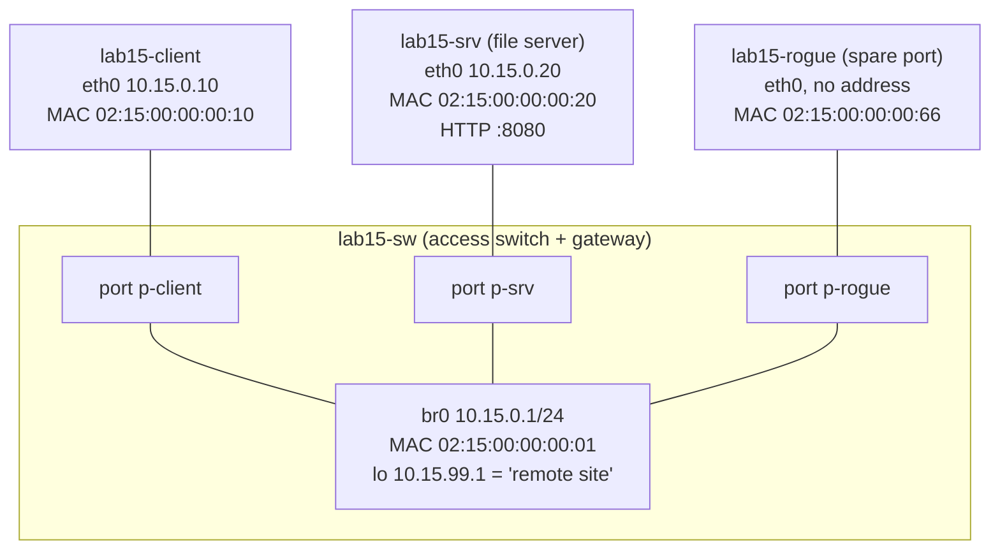

# Lab 15: Flapping Link, Silent Drops

| Field | Value |
|---|---|
| **Lab ID** | LAB-15 |
| **Related lesson** | [Day 15: Network Interfaces and Diagnostics](../course/module-3/day-15.md) |
| **Difficulty** | Intermediate |
| **Time** | 75–105 minutes |
| **Risk level** | Low. The Linux part runs inside four **isolated network namespaces** (`lab15-sw`, `lab15-client`, `lab15-srv`, `lab15-rogue`) joined by virtual cables; the only process the lab starts permanently is a small web server running as `nobody`, and the fault injector's background loop saves its PID in `/run/lab15/`. Packet captures are taken **only** on the lab's own interfaces. Your real interfaces, ARP cache, MTU and firewall are not touched. The Windows part is read-only except for one optional, elevated `pktmon` capture of your own ping traffic. Use a VM or WSL2. |

## Objective

It is Tuesday, 08:30. Four tickets arrive about the same small office network within an hour:

```text
#4711  "The file server keeps disappearing for a few seconds - copies abort."
#4712  "Small files open fine, but the 2 MB backup image never downloads. It just hangs."
#4713  "Since 08:15 the file server refuses connections - but I can still ping it!"
#4714  "One PC can reach the file server but nothing at the remote site (10.15.99.1)."
```

The network: one access switch (`lab15-sw`, which is also the default gateway 10.15.0.1 to the remote site 10.15.99.1), a client PC, the file server and a spare port. You will reproduce each fault in turn with a **fault injector**, and for each one:

1. Collect evidence **from the lowest layer upwards**: link and carrier, counters, MTU, neighbour (ARP) entries, and — when the cause is still unclear — packets.
2. Name the root cause in one sentence and prove it with at least **two** independent observations (for example a counter **and** a capture).
3. Fix it with the smallest, safest change: back up first, change one thing, verify.
4. Record the evidence in `~/lab15/evidence/` and write a short ticket note.

Finally, you collect the same kinds of evidence on Windows with `Get-NetAdapter`, `Get-NetAdapterStatistics`, `Get-NetNeighbor`, `ping -f -l` and `pktmon`.

**Lab network:**



## Required Environment

- **Linux:** Ubuntu 24.04 VM or WSL2 with `sudo`, and these packages: `iproute2` (provides `ip`, `bridge`, `ss`; installed by default), `ethtool`, `tcpdump`, `iputils-arping`, `iputils-ping`, `curl`, `python3`, `util-linux` (provides `setpriv`). Recommended: `tshark` (answer **No** when asked whether non-superusers may capture) and `iputils-tracepath`. Install with:

    ```bash
    sudo apt update && sudo apt install -y ethtool tcpdump iputils-arping iputils-ping iputils-tracepath curl
    sudo apt install -y tshark
    ```

- Containers usually cannot create network namespaces; use a VM or WSL2.
- The course repository (for `scripts/linux/network-diagnostic.sh` and `scripts/powershell/Network-Diagnostic.ps1`, optional).
- **Windows:** Windows 11 (or Windows 10 version 2004 or later for `pktmon`) with Windows PowerShell 5.1 or PowerShell 7. A normal window for Tasks 6.1–6.5; an **elevated** window only for the optional `pktmon` capture in Task 6.6. Wireshark is optional.

## Initial Conditions

- No namespaces called `lab15-*` exist (`ip netns list`), and `/run/lab15`, `/srv/lab15` and `/var/tmp/lab15-pcap` do not exist. If they do, run the clean-up script first.
- Create the working folders: `mkdir -p ~/lab15/evidence` (Linux) and `New-Item -ItemType Directory -Path $HOME\lab15 -Force` (Windows).
- Read the three scripts below **before** running them. The setup only creates the four namespaces, the bridge and three veth "cables" with fixed MAC addresses, turns segmentation offloads off on the two lab hosts' veths (so that they behave like real NICs, see the lesson), and starts a Python web server as `nobody`. The injector changes one thing per round, always inside the lab namespaces. Try to diagnose each round **without** looking at the injector again — exactly as you would on a real network.

### Lab setup (Linux)

Save as `~/lab15/setup.sh` and run `sudo bash ~/lab15/setup.sh`:

```bash
#!/usr/bin/env bash
# Lab 15 setup: a small "switch" with three ports in isolated network namespaces.
#   lab15-sw     bridge br0 = the access switch, with gateway address 10.15.0.1/24
#                and a loopback "remote site" 10.15.99.1/32 behind it
#   lab15-client eth0 10.15.0.10/24, default route via 10.15.0.1
#   lab15-srv    eth0 10.15.0.20/24, file server (Python http.server on 8080 as 'nobody')
#   lab15-rogue  eth0 (no address yet) - used by the fault injector only
# Nothing outside these namespaces is changed.
set -o errexit -o nounset -o pipefail
[[ $EUID -eq 0 ]] || { echo "run with sudo" >&2; exit 1; }
for tool in ip ethtool arping tcpdump curl python3 setpriv; do
    command -v "$tool" >/dev/null || { echo "missing: $tool (see Required Environment)" >&2; exit 1; }
done
if ip netns list | grep -q '^lab15-'; then echo "lab15 namespaces exist: run cleanup.sh first" >&2; exit 1; fi

mkdir -p /run/lab15 /srv/lab15/www
for ns in lab15-sw lab15-client lab15-srv lab15-rogue; do
    ip netns add "$ns"
    ip -n "$ns" link set lo up
done

# The switch: br0 with a fixed MAC, gateway address and a "remote" address behind it.
ip -n lab15-sw link add br0 address 02:15:00:00:00:01 type bridge
ip -n lab15-sw addr add 10.15.0.1/24 dev br0
ip -n lab15-sw addr add 10.15.99.1/32 dev lo
ip -n lab15-sw link set br0 up
ip netns exec lab15-sw sysctl -qw net.ipv4.ip_forward=1

# One veth "cable" per host: host side eth0, switch side p-<host>.
plug() {   # plug NAMESPACE MAC
    local ns=$1 mac=$2 port="p-${1#lab15-}"
    ip link add "$port" netns lab15-sw type veth peer name eth0 netns "$ns" address "$mac"
    ip -n lab15-sw link set "$port" master br0 up
    ip -n "$ns" link set eth0 up
}
plug lab15-client 02:15:00:00:00:10
plug lab15-srv    02:15:00:00:00:20
plug lab15-rogue  02:15:00:00:00:66

ip -n lab15-client addr add 10.15.0.10/24 dev eth0
ip -n lab15-client route add default via 10.15.0.1
ip -n lab15-srv addr add 10.15.0.20/24 dev eth0
ip -n lab15-srv route add default via 10.15.0.1

# Real NICs put wire-sized frames on the cable. veth "cables" normally pass 64 KiB
# super-packets (segmentation offload), which would hide MTU problems - so the lab
# turns segmentation/receive offload off on the two hosts. This affects only the lab veths.
for ns in lab15-client lab15-srv; do
    ip netns exec "$ns" ethtool -K eth0 tso off gso off gro off
done

# File server content: a small page and a 2 MiB file.
echo "lab15 file server OK" > /srv/lab15/www/index.html
head -c 2097152 /dev/zero > /srv/lab15/www/backup.img
chmod -R a+rX /srv/lab15

ip netns exec lab15-srv setpriv --reuid=nobody --regid=nogroup --clear-groups \
    python3 -m http.server 8080 --bind 10.15.0.20 --directory /srv/lab15/www \
    >/dev/null 2>&1 &
echo $! > /run/lab15/web.pid
for _ in $(seq 1 50); do      # wait (max. 5 s) until the server listens
    ip netns exec lab15-srv ss -Hltn 'sport = :8080' | grep -q LISTEN && break
    sleep 0.1
done
echo "Lab 15 ready. Web server PID $(cat /run/lab15/web.pid)."
ip netns list | grep '^lab15-'
```

### Fault injector (Linux)

Save as `~/lab15/inject.sh`. You will run `sudo bash ~/lab15/inject.sh 1` … `4`, one round at a time, and fix each round before injecting the next.

```bash
#!/usr/bin/env bash
# Lab 15 fault injector: sudo bash inject.sh ROUND   (ROUND = 1, 2, 3 or 4)
# Every change happens inside the lab15-* namespaces. Background helpers save their PID
# in /run/lab15/ so that they can be stopped precisely.
set -o errexit -o nounset -o pipefail
[[ $EUID -eq 0 ]] || { echo "run with sudo" >&2; exit 1; }
[[ -d /run/lab15 ]] || { echo "run setup.sh first" >&2; exit 1; }
case "${1:-}" in
    1)  # A bad cable / switch port: the server's link goes down for 2 s every 8 s.
        nohup bash -c 'while true; do
                           ip -n lab15-sw link set p-srv down; sleep 2
                           ip -n lab15-sw link set p-srv up;   sleep 6
                       done' >/dev/null 2>&1 &
        echo $! > /run/lab15/flap.pid ;;
    2)  # A switch port configured with a smaller MTU than the hosts.
        ip -n lab15-sw link set p-srv mtu 1400 ;;
    3)  # An unauthorised device configured with the file server's address.
        ip -n lab15-rogue addr add 10.15.0.20/24 dev eth0
        ip netns exec lab15-rogue arping -q -U -c 2 -I eth0 10.15.0.20 || true ;;
    4)  # A static ARP entry for the gateway, left over from an old migration runbook.
        ip -n lab15-client neigh replace 10.15.0.1 lladdr 02:15:00:00:00:99 nud permanent dev eth0 ;;
    *)  echo "usage: $0 1|2|3|4" >&2; exit 1 ;;
esac
echo "Round ${1} injected. Start investigating from lab15-client."
```

### Lab clean-up script (Linux)

Save as `~/lab15/cleanup.sh`:

```bash
#!/usr/bin/env bash
# Lab 15 clean-up: stop the saved lab processes and delete the lab15-* namespaces only.
set -o nounset
[[ $EUID -eq 0 ]] || { echo "run with sudo" >&2; exit 1; }
for f in /run/lab15/*.pid; do
    [[ -e $f ]] || continue
    pid=$(cat "$f")
    if ps -p "$pid" -o comm= >/dev/null 2>&1; then
        echo "stopping PID $pid ($(ps -p "$pid" -o comm=)) from $f"
        kill "$pid"
    fi
done
for ns in lab15-client lab15-srv lab15-rogue lab15-sw; do
    ip netns list | grep -q "^$ns\b" && ip netns del "$ns" && echo "deleted namespace $ns"
done
rm -rf /run/lab15 /srv/lab15 /var/tmp/lab15-pcap
echo "Lab 15 removed."
```

## Step-by-Step Instructions

Define these shortcuts in your shell first (they run a command inside one lab namespace):

```bash
C="sudo ip netns exec lab15-client"; V="sudo ip netns exec lab15-srv"; W="sudo ip netns exec lab15-sw"
```

### Task 1 — Baseline before anything breaks

1. Run the setup script.
2. From the client, record: interfaces (`ip -br link`), addresses, routes, and that the file server, the gateway and the remote site answer (`ping`), and that the 2 MiB `backup.img` downloads with `curl`.
3. Record the neighbour table of the client, the RX/TX counters and `carrier_changes` of the client and the server, the switch's port list (`bridge link`) and its learned MAC table (`bridge fdb show br br0 dynamic`).
4. Save a full baseline (`ip -s -d link` and `ip neigh show` of every namespace, with a UTC timestamp) to `~/lab15/evidence/baseline.txt`.

### Task 2 — Round 1: "The file server keeps disappearing"

1. Run `sudo bash ~/lab15/inject.sh 1`.
2. On the server, read `carrier_changes`. Start `ip -timestamp monitor link` on the server in the background for 20 seconds, writing to `~/lab15/evidence/r1-monitor.txt`, and at the same time ping the server from the client every 0.5 s for 30 packets with timestamps and "no answer yet" reports (`ping -D -O`), saved to `~/lab15/evidence/r1-ping.txt`.
3. Count the missing replies, look at their timing, read the monitor file, read `carrier_changes` again and look at the server's `ip -s -s link` counters. Do errors explain the loss?
4. Name the cause. (In real life: a bad cable, SFP or switch port. In the lab: a background loop — identify it from `/run/lab15/flap.pid` with `ps` before you stop it.)
5. "Replace the cable": stop the loop by its saved PID and make sure the switch port is up. Verify: `carrier_changes` stays constant for 20 seconds and 20 pings get 20 replies.

### Task 3 — Round 2: "Large downloads hang"

1. Run `sudo bash ~/lab15/inject.sh 2`.
2. From the client, request the small page and the 2 MiB file. What happens to each?
3. Find the largest IP packet that reaches the server **without fragmentation**: test payloads 1472, 1436, 1400, 1386, 1373 and 1372 with `ping -M do -s`. Then compare the MTU of the client, the server and **every switch port**. Which counter on the switch proves the drops?
4. Capture the failing transfer on the **server** with tcpdump: headers only (`-s 128`), a fixed client source port (`curl --local-port 50000`) and a matching capture filter, written to `~/lab15/evidence/r2-srv.pcap`. Read it back: which MSS did both sides announce, what size are the server's data segments, and how many retransmissions does `tshark` find?
5. Record the wrong setting to the evidence folder, then fix it (set the switch port back to MTU 1500). Verify with `ping -M do -s 1472` and the 2 MiB download.

### Task 4 — Round 3: "Refuses connections, but I can ping it"

1. Start an ARP capture on the client (`tcpdump -n -e -w ~/lab15/evidence/r3-arp.pcap arp`) in the background, then run `sudo bash ~/lab15/inject.sh 3`.
2. From the client: `curl` the server, ping it, and look at its neighbour entry. Compare the MAC with your baseline.
3. Prove the conflict three ways: `arping` from the client (how many MACs answer?), `arping -D` from the **real** server (exit code?), and the switch's MAC table (on which port does the unknown MAC sit?).
4. Stop the capture and read it with `tcpdump -e` and `tshark`: which frames announced the address, and which MACs replied for 10.15.0.20?
5. Contain: shut the switch port of the unknown device (`ip link set p-rogue down` in `lab15-sw`). Then let the real server re-announce its address with `arping -U` so that the client's cache is corrected without flushing it. Verify `curl` and `arping -D` (exit 0).

### Task 5 — Round 4: "Nothing at the remote site"

1. Run `sudo bash ~/lab15/inject.sh 4`.
2. From the client: ping the file server (same subnet) and the remote site 10.15.99.1. Check the route with `ip route get`. Is routing the problem?
3. Look at the neighbour entry of the **gateway**. Compare its MAC with the gateway's real MAC (ask the switch: `arping 10.15.0.1`, or `ip link show br0` inside `lab15-sw`). Prove where the client's frames go with `tcpdump -e`.
4. Back up the client's neighbour table to `~/lab15/evidence/r4-neigh-before.txt`. Try `ip neigh flush dev eth0` first and check the gateway entry again — did it help? Then delete **only** the wrong entry and verify the remote site.
5. Final check: the 2 MiB download works, a 1500-byte packet reaches the remote site with *don't fragment*, no permanent neighbour entries remain, and `carrier_changes` on the server is stable. Hash both pcap files (`sha256sum`).

### Task 6 — Windows: adapters, counters, MTU, neighbours and a capture

Use your own Windows PC; Tasks 6.1–6.5 only **read**.

1. List all adapters with `Name`, `InterfaceDescription`, `ifIndex`, `Status`, `MediaConnectionState`, `LinkSpeed` and `MacAddress`; then only the physical ones; then count the hidden ones.
2. Read `Get-NetAdapterStatistics` for your active adapter twice, 30 seconds apart, and compute the change in `ReceivedPacketErrors`, `ReceivedDiscardedPackets` and `OutboundPacketErrors`.
3. Show the driver's *Speed & Duplex*, *Jumbo Packet* and large-send-offload settings (`Get-NetAdapterAdvancedProperty`) and the IP MTU (`NlMtu`) of every connected interface.
4. Find the largest packet that reaches your **default gateway** with `ping -f -l` (start with 1472).
5. Show the neighbour entry for your gateway; list any **static** (`Permanent`) unicast entries; check whether any of your addresses is in state `Duplicate`; and search the System log for Tcpip event **4199**.
6. *Optional, elevated:* capture 4 pings to your gateway with `pktmon` (filter on the gateway address, 128 bytes per packet), show `pktmon counters`, stop, convert to pcapng, remove the filter, and — if Wireshark is installed — open the file and apply `icmp`.
7. Optional: run `Network-Diagnostic.ps1` against your gateway or a host you are allowed to test.

### Task 7 — Ticket notes

Write `~/lab15/tickets.md` with one line per ticket (#4711–#4714): root cause, the two strongest pieces of evidence (file names), the fix, and a prevention measure.

## Commands to Execute

Try each task yourself first; complete commands and captured output are in the [Solution](#solution).

| Question | Linux (`$C`/`$V`/`$W` = inside client/server/switch) | Windows |
|---|---|---|
| Link up? Carrier? | `$C ip -br link` · `$V ethtool eth0` · `/sys/class/net/eth0/carrier` | `Get-NetAdapter` (`Status`, `MediaConnectionState`) |
| Flapping? | `$V cat /sys/class/net/eth0/carrier_changes` · `$V ip -timestamp monitor link` · `ping -D -O` | System log driver events · `Get-NetAdapter` in a loop |
| Errors and drops | `$V ip -s -s link show eth0` · `$W ip -s link show p-srv` | `Get-NetAdapterStatistics` (two readings) |
| MTU | `ip link show` (`mtu`) · `$C ping -M do -s 1472 10.15.0.20` | `Get-NetIPInterface` (`NlMtu`) · `ping -f -l 1472 GATEWAY` |
| Neighbours | `$C ip neigh show` · `nud permanent` · `$C arping -I eth0 IP` · `arping -D` | `Get-NetNeighbor` · `-State Permanent` · `arp -a` |
| Duplicate IP | `arping` (two MACs) · `arping -D` exit 1 · `$W bridge fdb show br br0 dynamic` | `Get-NetIPAddress` `AddressState Duplicate` · Tcpip event 4199 |
| Packets | `$V tcpdump -i eth0 -n -s 128 -w FILE 'FILTER'` · `tcpdump -n -e -r FILE` · `tshark -n -r FILE -Y '…'` | `pktmon filter add` · `pktmon start --capture` · `pktmon etl2pcap` |

## Expected Results

- **Task 1:** client `eth0` is `UP` with `LOWER_UP`, `10.15.0.10/24`, default route via `10.15.0.1`; all pings succeed, `curl` prints `200 2097152 bytes`; counters show **0** errors and drops; `carrier_changes` is a small number (2 in the reference run — the virtual cable came up once during setup); `bridge fdb` shows the client's and server's MACs behind `p-client` and `p-srv`.
- **Task 2:** about **8 of 30** pings missing, in groups of about 4 (2 seconds) every 8 seconds; the monitor shows alternating `NO-CARRIER … state DOWN` and `LOWER_UP … state UP` events; `carrier_changes` grows (3 → 8 in the reference run); **error counters stay at 0** — a link that is down drops nothing, it is simply absent. After the fix, `carrier_changes` is stable and 20/20 pings succeed.
- **Task 3:** the small page loads, the 2 MiB download times out with **0 bytes** received; 1372-byte payloads (1400-byte packets) pass, 1373 and larger get no reply and **no error message**; both hosts have MTU 1500 but switch port **`p-srv` has MTU 1400** (and `br0` follows the smallest port); **RX dropped** on `p-srv` grows. In the capture both sides announce **MSS 1460**, the server sends 1448-byte segments (1514-byte frames) that are never acknowledged, and `tshark` counts the retransmissions (16 in the reference run). After the fix, the 1500-byte ping and the download work.
- **Task 4:** `curl` fails with *Couldn't connect to server* (a refusal), ping **works**, and the client's neighbour entry for 10.15.0.20 shows MAC **`02:15:00:00:00:66`** instead of `…:20`; `arping` gets replies from **two** MACs, `arping -D` on the server exits **1**, and the switch has learned `…:66` on port **`p-rogue`**. The capture shows two gratuitous ARPs (`Request who-has 10.15.0.20 … tell 10.15.0.20`) from `…:66`. After shutting `p-rogue` and the server's `arping -U`, the client's entry shows `…:20`, `curl` works and `arping -D` exits **0**.
- **Task 5:** the file server answers, the remote site does not; the route is correct (`via 10.15.0.1`); the gateway's entry is **`02:15:00:00:00:99 PERMANENT`** while the gateway really is `02:15:00:00:00:01`; tcpdump shows echo requests addressed to `…:99` and no replies. `ip neigh flush dev eth0` leaves the permanent entry in place; `ip neigh del 10.15.0.1 dev eth0` fixes it and the entry is re-learned as `…:01 REACHABLE`.
- **Task 6:** your adapter list, two counter readings with (normally) zero new errors, the advanced properties of your driver, `NlMtu` 1500 on Ethernet/Wi-Fi (lower on VPN adapters), a largest `ping -f -l` payload of **1472** on a normal LAN, a `Reachable` or `Stale` gateway entry, no `Permanent` unicast entries and no `Duplicate` addresses (unless your network has such a problem), and — optionally — a pcapng file with 8 ICMP packets.
- **Task 7:** four evidence-based lines.

## Verification Steps

=== "Linux"

    ```bash
    $C curl -sS -m 8 -o /dev/null -w '%{http_code} %{size_download} bytes\n' http://10.15.0.20:8080/backup.img   # 200 2097152 bytes
    $C ping -c 2 -W 1 -M do -s 1472 -q 10.15.99.1 | tail -2        # 0% packet loss
    $C ip neigh show nud permanent | wc -l                          # 0
    $W ip -br link show p-rogue                                     # DOWN (contained)
    a=$($V cat /sys/class/net/eth0/carrier_changes); sleep 20; b=$($V cat /sys/class/net/eth0/carrier_changes); [ "$a" = "$b" ] && echo "link stable"
    ls ~/lab15/evidence/                                            # baseline.txt r1-*.txt r2-srv.pcap r3-arp.pcap r4-neigh-before.txt ...
    ```

=== "Windows"

    ```powershell
    Get-ChildItem $HOME\lab15                                       # counters-*.csv, (optional) ping.etl / ping.pcapng
    pktmon filter list                                              # "No filters" after Task 6.6
    ```

## Troubleshooting

| Problem | Cause | Fix |
|---|---|---|
| `missing: arping (see Required Environment)` | `iputils-arping` not installed | `sudo apt install iputils-arping` |
| `Cannot create namespace file "/run/netns/lab15-sw": File exists` / `lab15 namespaces exist` | An old lab is still present | `sudo bash ~/lab15/cleanup.sh`, then the setup again |
| `Error: Unknown device type.` or `Operation not permitted` during setup | You are in a container without the veth/bridge features or without `CAP_NET_ADMIN` | Use a VM or WSL2 |
| `curl` from the client hangs in Task 1 | A proxy is set in your environment | `curl --noproxy '*' …` |
| In Task 3 the 2 MiB download still works | Segmentation offload is on, so the veth carries 64 KiB super-packets past the MTU check | Check <code>$V ethtool -k eth0 &#124; grep segmentation</code>; re-run the setup, which turns TSO/GSO/GRO off |
| `ping: local error: message too long, mtu=1400` | You lowered the **client's** MTU instead of testing it | Restore with `$C ip link set dev eth0 mtu 1500`; the fault is on the switch port |
| `tcpdump: … Permission denied` writing `~/lab15/...pcap0` | Ring-buffer files are written after tcpdump drops privileges to the `tcpdump` user | This lab writes single files (no `-C`); for ring buffers use a directory owned by `tcpdump` (lesson Demo 9) |
| The pcap file is empty or truncated | tcpdump was killed with `-9` or not stopped | Stop with `sudo kill -INT "$TD"` (Ctrl+C), then `wait` |
| `tshark: command not found` | tshark not installed | `sudo apt install tshark`, or use `tcpdump -r` only |
| `arping: invalid argument` / unknown option | The other `arping` package (Habets) is installed | `sudo apt install iputils-arping` (it replaces the other one) |
| `kill: (PID) - No such process` | You typed a PID from this page | Always use `"$(cat /run/lab15/flap.pid)"` |
| Windows: `pktmon : … Access is denied` | Not elevated | Run Task 6.6 in an elevated window |
| Windows: `ping -f -l 1472` reports *Packet needs to be fragmented but DF set.* | A **router** on the path has a smaller MTU and reports it correctly (a VPN, PPPoE) | Not a fault: lower the size until it passes; compare with `NlMtu` |
| `Get-NetAdapter` not recognised | PowerShell 7 on Linux/macOS | Use the `NetworkInterface` class from the lesson, or run on Windows |

## Questions

1. In Round 1, why did the interface **error** counters stay at zero although a quarter of the pings were lost?
2. Which two observations prove a flapping link, and how would you get the same evidence from a real switch?
3. In Round 2, why did the small web page work while the large download hung?
4. Why could `tracepath` (or path-MTU discovery in TCP) not solve the Round 2 problem by itself?
5. Where did the evidence of the dropped frames appear — on the client, the server or the switch? What does that mean for real investigations?
6. In Round 3, why did `ping` succeed while `curl` was refused?
7. What do the exit codes 0 and 1 of `arping -D` mean, and from which host must you run it?
8. Why did you shut the switch port and use `arping -U` instead of flushing the client's ARP cache?
9. In Round 4, why did same-subnet traffic work while all traffic to the remote site failed?
10. Why did `ip neigh flush dev eth0` not fix Round 4?
11. Why were the captures taken with `-s 128`, a precise filter and a fixed source port?
12. On Windows, which properties or events tell you that (a) the cable is unplugged, (b) the adapter was disabled, (c) another device uses your IP address?

## Solution

The output below was **captured** on 2026-11-14 by running this lab's setup, every Linux task and the clean-up as root on Ubuntu 24.04.5 in a container (iproute2 6.1.0, ethtool 6.7, tcpdump 4.99.4, iputils-arping 20240117, tshark 4.2.2, curl 8.5, Python 3.11). The run's home directory is shown as `/home/student`. In the captured run tcpdump was stopped with an equivalent `pkill -INT -f` pattern; the `sudo kill -INT "$TD"` form shown here was tested separately and stops tcpdump the same way (sudo passes the signal on). Your timestamps, switch-port MACs, sequence numbers, counter values and hashes will differ. The Windows output is an **example** and was not captured.

??? success "Bash solution"
    **Task 1 — baseline**

    ```bash
    sudo bash ~/lab15/setup.sh
    C="sudo ip netns exec lab15-client"; V="sudo ip netns exec lab15-srv"; W="sudo ip netns exec lab15-sw"
    mkdir -p ~/lab15/evidence
    $C ip -br link
    $C ip -br addr show dev eth0
    $C ip route
    $C ping -c 3 -q 10.15.0.20
    $C ping -c 3 -q 10.15.99.1
    $C curl -sS -m 8 -o /dev/null -w '%{http_code} %{size_download} bytes\n' http://10.15.0.20:8080/backup.img
    $C ip neigh show
    ```

    ```text
    Lab 15 ready. Web server PID 6268.
    lab15-sw
    lab15-rogue
    lab15-client
    lab15-srv
    lo               UNKNOWN        00:00:00:00:00:00 <LOOPBACK,UP,LOWER_UP>
    eth0@if3         UP             02:15:00:00:00:10 <BROADCAST,MULTICAST,UP,LOWER_UP>
    eth0@if3         UP             10.15.0.10/24
    default via 10.15.0.1 dev eth0
    10.15.0.0/24 dev eth0 proto kernel scope link src 10.15.0.10
    PING 10.15.0.20 (10.15.0.20) 56(84) bytes of data.

    --- 10.15.0.20 ping statistics ---
    3 packets transmitted, 3 received, 0% packet loss, time 2037ms
    rtt min/avg/max/mdev = 0.052/0.065/0.073/0.009 ms
    PING 10.15.99.1 (10.15.99.1) 56(84) bytes of data.

    --- 10.15.99.1 ping statistics ---
    3 packets transmitted, 3 received, 0% packet loss, time 2035ms
    rtt min/avg/max/mdev = 0.060/0.065/0.071/0.004 ms
    200 2097152 bytes
    10.15.0.1 dev eth0 lladdr 02:15:00:00:00:01 REACHABLE
    10.15.0.20 dev eth0 lladdr 02:15:00:00:00:20 REACHABLE
    ```

    Both hosts are up with carrier (`LOWER_UP`), the routes and neighbour entries are as designed, and the 2 MiB file downloads in a fraction of a second.

    ```bash
    for ns in lab15-client lab15-srv; do
        echo "== $ns"; sudo ip netns exec "$ns" ip -s link show eth0 | sed -n '3,6p'
        echo "carrier_changes: $(sudo ip netns exec "$ns" cat /sys/class/net/eth0/carrier_changes)"
    done
    $W bridge link
    $W bridge fdb show br br0 dynamic
    { date -u; for ns in lab15-client lab15-srv lab15-sw; do echo "== $ns"; sudo ip netns exec "$ns" ip -s -d link; sudo ip netns exec "$ns" ip neigh show; done; } > ~/lab15/evidence/baseline.txt
    wc -l ~/lab15/evidence/baseline.txt
    ```

    ```text
    == lab15-client
        RX:  bytes packets errors dropped  missed   mcast
           2195604    1487      0       0       0       0
        TX:  bytes packets errors dropped carrier collsns
             16938     253      0       0       0       0
    carrier_changes: 2
    == lab15-srv
        RX:  bytes packets errors dropped  missed   mcast
             17226     257      0       0       0       0
        TX:  bytes packets errors dropped carrier collsns
           2195700    1488      0       0       0       0
    carrier_changes: 2
    3: p-client@br0: <BROADCAST,MULTICAST,UP,LOWER_UP> mtu 1500 master br0 state forwarding priority 32 cost 2
    4: p-srv@br0: <BROADCAST,MULTICAST,UP,LOWER_UP> mtu 1500 master br0 state forwarding priority 32 cost 2
    5: p-rogue@br0: <BROADCAST,MULTICAST,UP,LOWER_UP> mtu 1500 master br0 state forwarding priority 32 cost 2
    02:15:00:00:00:10 dev p-client master br0
    02:15:00:00:00:20 dev p-srv master br0
    73 /home/student/lab15/evidence/baseline.txt
    ```

    Zero errors and drops on both hosts; `carrier_changes 2` is the single down/up of the virtual cable during setup. The switch has learned the client and the server behind their ports. Keep these numbers: every round is compared with them.

    **Task 2 — round 1: flapping link**

    ```bash
    sudo bash ~/lab15/inject.sh 1
    $V cat /sys/class/net/eth0/carrier_changes
    $V timeout 20 ip -timestamp monitor link > ~/lab15/evidence/r1-monitor.txt &
    $C ping -D -O -i 0.5 -W 1 -c 30 10.15.0.20 > ~/lab15/evidence/r1-ping.txt
    wait
    grep -c 'no answer yet' ~/lab15/evidence/r1-ping.txt
    tail -2 ~/lab15/evidence/r1-ping.txt
    ```

    ```text
    Round 1 injected. Start investigating from lab15-client.
    3
    8
    30 packets transmitted, 22 received, 26.6667% packet loss, time 14854ms
    rtt min/avg/max/mdev = 0.049/0.076/0.122/0.020 ms
    ```

    Eight of thirty replies are missing, in two blocks of four consecutive 0.5-second pings — about 2 seconds of outage every 8 seconds. That regular pattern already points away from congestion and towards the link. (`carrier_changes` was already 3 when you read it: the loop had started.)

    ```bash
    grep -E 'Timestamp|NO-CARRIER|LOWER_UP' ~/lab15/evidence/r1-monitor.txt | head -6
    $V cat /sys/class/net/eth0/carrier_changes
    $V ip -s -s link show eth0 | sed -n '3,10p'
    $W ip -br link show p-srv
    ps -o pid,ppid,user,lstart,args -p "$(cat /run/lab15/flap.pid)"
    ```

    ```text
    Timestamp: Sat Nov 14 17:00:22 2026 506829 usec
    2: eth0@if4: <BROADCAST,MULTICAST,UP,LOWER_UP> mtu 1500 qdisc noqueue state UP group default
    Timestamp: Sat Nov 14 17:00:28 2026 510810 usec
    2: eth0@if4: <NO-CARRIER,BROADCAST,MULTICAST,UP> mtu 1500 qdisc noqueue state DOWN group default
    Timestamp: Sat Nov 14 17:00:30 2026 515311 usec
    2: eth0@if4: <BROADCAST,MULTICAST,UP,LOWER_UP> mtu 1500 qdisc noqueue state UP group default
    8
        RX:  bytes packets errors dropped  missed   mcast
             19466     281      0       0       0       0
        RX errors:  length    crc   frame    fifo overrun
                         0      0       0       0       0
        TX:  bytes packets errors dropped carrier collsns
           2197940    1512      0       0       0       0
        TX errors: aborted   fifo  window heartbt transns
                         0      0       0       0       8
    p-srv@if2        UP             86:03:2a:72:4c:ce <BROADCAST,MULTICAST,UP,LOWER_UP>
      PID  PPID USER                      STARTED COMMAND
     6505     1 root     Sat Nov 14 17:00:19 2026 bash -c while true; do                            ip -n lab15-sw link set p-srv down; sleep 2                            ip -n lab15-sw link set p-srv up;   sleep 6                        done
    ```

    The monitor shows `NO-CARRIER … state DOWN` and `LOWER_UP … state UP` events 2 seconds apart, and `carrier_changes` rose from 3 to 8 (the `transns` column is the same counter). **No errors and no drops**: while the link is down, nothing is sent or received. At the moment of the snapshot the link was up again. The cause in the lab is the injector's loop (PID from `/run/lab15/flap.pid`, run by root, parent 1); on a real network it is a cable, SFP, patch panel or switch port.

    ```bash
    sudo kill "$(cat /run/lab15/flap.pid)"
    sudo ip -n lab15-sw link set p-srv up
    sleep 10
    a=$($V cat /sys/class/net/eth0/carrier_changes); sleep 10; b=$($V cat /sys/class/net/eth0/carrier_changes)
    echo "carrier_changes: $a -> $b"
    $C ping -c 20 -i 0.5 -q 10.15.0.20 | tail -2
    ```

    ```text
    carrier_changes: 8 -> 8
    20 packets transmitted, 20 received, 0% packet loss, time 9760ms
    rtt min/avg/max/mdev = 0.050/0.081/0.126/0.020 ms
    ```

    After the fix the counter stays at 8 for 20 seconds and there is no loss. Bring the port up explicitly after stopping the loop, because the loop may have been stopped during a down phase.

    **Task 3 — round 2: MTU black hole**

    ```bash
    sudo bash ~/lab15/inject.sh 2
    $C curl -sS -m 5 http://10.15.0.20:8080/
    $C curl -sS -m 8 -o /dev/null -w '%{http_code} %{size_download} bytes\n' http://10.15.0.20:8080/backup.img
    for s in 1472 1436 1400 1386 1373 1372; do
        if $C ping -c 1 -W 1 -M do -s "$s" -q 10.15.0.20 >/dev/null; then r=OK; else r="no reply"; fi
        echo "payload $s (IP packet $((s + 28))): $r"
    done
    for ns in lab15-client lab15-srv; do sudo ip netns exec "$ns" ip link show eth0 | head -1; done
    $W ip link show | grep -E '^[0-9]+: (br0|p-)'
    $W ip -s link show p-srv | sed -n '3,6p'
    ```

    ```text
    Round 2 injected. Start investigating from lab15-client.
    lab15 file server OK
    curl: (28) Operation timed out after 8002 milliseconds with 0 out of 2097152 bytes received
    200 0 bytes
    payload 1472 (IP packet 1500): no reply
    payload 1436 (IP packet 1464): no reply
    payload 1400 (IP packet 1428): no reply
    payload 1386 (IP packet 1414): no reply
    payload 1373 (IP packet 1401): no reply
    payload 1372 (IP packet 1400): OK
    2: eth0@if3: <BROADCAST,MULTICAST,UP,LOWER_UP> mtu 1500 qdisc noqueue state UP mode DEFAULT group default qlen 1000
    2: eth0@if4: <BROADCAST,MULTICAST,UP,LOWER_UP> mtu 1500 qdisc noqueue state UP mode DEFAULT group default qlen 1000
    2: br0: <BROADCAST,MULTICAST,UP,LOWER_UP> mtu 1400 qdisc noqueue state UP mode DEFAULT group default qlen 1000
    3: p-client@if2: <BROADCAST,MULTICAST,UP,LOWER_UP> mtu 1500 qdisc noqueue master br0 state UP mode DEFAULT group default qlen 1000
    4: p-srv@if2: <BROADCAST,MULTICAST,UP,LOWER_UP> mtu 1400 qdisc noqueue master br0 state UP mode DEFAULT group default qlen 1000
    5: p-rogue@if2: <BROADCAST,MULTICAST,UP,LOWER_UP> mtu 1500 qdisc noqueue master br0 state UP mode DEFAULT group default qlen 1000
        RX:  bytes packets errors dropped  missed   mcast
           2202421    1544      0      53       0       0
        TX:  bytes packets errors dropped carrier collsns
             24162     320      0       0       0       0
    ```

    The small page works, the large file never starts (the headers arrive, the data does not). The largest packet that passes is exactly **1400** bytes, and larger ones get no reply and no error. Both hosts are at 1500, but the switch port `p-srv` is at **1400** — and the bridge `br0` follows its smallest port. The **RX dropped** counter of `p-srv` is the only place where the drops are counted.

    ```bash
    $V tcpdump -i eth0 -n -s 128 -w ~/lab15/evidence/r2-srv.pcap 'tcp port 50000' 2>/dev/null &
    TD=$!
    sleep 1
    $C curl -sS -m 6 --local-port 50000 -o /dev/null http://10.15.0.20:8080/backup.img
    sudo kill -INT "$TD"                 # stop tcpdump cleanly (like Ctrl+C)
    wait
    tcpdump -n -r ~/lab15/evidence/r2-srv.pcap 2>/dev/null | sed -n '1,2p;8,9p'
    tshark -n -r ~/lab15/evidence/r2-srv.pcap -Y 'tcp.analysis.retransmission' 2>/dev/null | wc -l
    ```

    ```text
    curl: (28) Operation timed out after 6003 milliseconds with 0 out of 2097152 bytes received
    17:01:24.631816 IP 10.15.0.10.50000 > 10.15.0.20.8080: Flags [S], seq 1643235556, win 64240, options [mss 1460,sackOK,TS val 1288890435 ecr 0,nop,wscale 10], length 0
    17:01:24.631833 IP 10.15.0.20.8080 > 10.15.0.10.50000: Flags [S.], seq 2590744300, ack 1643235557, win 65160, options [mss 1460,sackOK,TS val 662340129 ecr 1288890435,nop,wscale 10], length 0
    17:01:24.633139 IP 10.15.0.20.8080 > 10.15.0.10.50000: Flags [.], seq 207:1655, ack 89, win 64, options [nop,nop,TS val 662340130 ecr 1288890437], length 1448: HTTP
    17:01:24.633139 IP 10.15.0.20.8080 > 10.15.0.10.50000: Flags [.], seq 1655:3103, ack 89, win 64, options [nop,nop,TS val 662340130 ecr 1288890437], length 1448: HTTP
    16
    ```

    Both sides announce **MSS 1460** because both believe the MTU is 1500. The server's 1448-byte segments (1514-byte frames) never reach the client; `tshark` finds 16 retransmissions in 6 seconds. With `-s 128` the capture is only a few KB and contains no file data.

    ```bash
    $W ip link show p-srv | head -1 > ~/lab15/evidence/r2-before.txt
    sudo ip -n lab15-sw link set p-srv mtu 1500
    $W ip link show | grep -E '^[0-9]+: (br0|p-srv)'
    $C ping -c 2 -W 1 -M do -s 1472 -q 10.15.0.20 | tail -2
    $C curl -sS -m 8 -o /dev/null -w '%{http_code} %{size_download} bytes\n' http://10.15.0.20:8080/backup.img
    ```

    ```text
    2: br0: <BROADCAST,MULTICAST,UP,LOWER_UP> mtu 1500 qdisc noqueue state UP mode DEFAULT group default qlen 1000
    4: p-srv@if2: <BROADCAST,MULTICAST,UP,LOWER_UP> mtu 1500 qdisc noqueue master br0 state UP mode DEFAULT group default qlen 1000
    2 packets transmitted, 2 received, 0% packet loss, time 1024ms
    rtt min/avg/max/mdev = 0.062/0.069/0.077/0.007 ms
    200 2097152 bytes
    ```

    The 1500-byte ping and the download work again. In a real network, the fix is the switch-port (or hypervisor-bridge) MTU, agreed with the network team — not lowering the MTU on every server.

    **Task 4 — round 3: duplicate IP**

    ```bash
    $C tcpdump -i eth0 -n -e -w ~/lab15/evidence/r3-arp.pcap arp 2>/dev/null &
    TD=$!
    sleep 1
    sudo bash ~/lab15/inject.sh 3
    $C curl -sS -m 5 http://10.15.0.20:8080/
    $C ping -c 2 -W 1 -q 10.15.0.20 | tail -2
    $C ip neigh show 10.15.0.20
    $C arping -c 2 -I eth0 10.15.0.20
    $V arping -D -q -c 2 -I eth0 10.15.0.20; echo "arping -D exit code: $?"
    $W bridge fdb show br br0 dynamic
    sleep 1
    sudo kill -INT "$TD"                 # stop tcpdump cleanly (like Ctrl+C)
    wait
    tcpdump -n -e -r ~/lab15/evidence/r3-arp.pcap 2>/dev/null | grep -E 'tell 10.15.0.20|is-at'
    tshark -n -r ~/lab15/evidence/r3-arp.pcap -Y 'arp.opcode == 2 && arp.src.proto_ipv4 == 10.15.0.20' -T fields -e arp.src.hw_mac 2>/dev/null | sort | uniq -c
    ```

    ```text
    Round 3 injected. Start investigating from lab15-client.
    curl: (7) Failed to connect to 10.15.0.20 port 8080 after 0 ms: Couldn't connect to server
    2 packets transmitted, 2 received, 0% packet loss, time 1032ms
    rtt min/avg/max/mdev = 0.035/0.041/0.047/0.006 ms
    10.15.0.20 dev eth0 lladdr 02:15:00:00:00:66 DELAY
    ARPING 10.15.0.20 from 10.15.0.10 eth0
    Unicast reply from 10.15.0.20 [02:15:00:00:00:66]  0.536ms
    Unicast reply from 10.15.0.20 [02:15:00:00:00:20]  0.542ms
    Unicast reply from 10.15.0.20 [02:15:00:00:00:20]  0.547ms
    Sent 2 probes (1 broadcast(s))
    Received 3 response(s)
    arping -D exit code: 1
    02:15:00:00:00:10 dev p-client master br0
    02:15:00:00:00:20 dev p-srv master br0
    02:15:00:00:00:66 dev p-rogue master br0
    17:01:33.009941 02:15:00:00:00:66 > ff:ff:ff:ff:ff:ff, ethertype ARP (0x0806), length 42: Request who-has 10.15.0.20 (ff:ff:ff:ff:ff:ff) tell 10.15.0.20, length 28
    17:01:34.010059 02:15:00:00:00:66 > ff:ff:ff:ff:ff:ff, ethertype ARP (0x0806), length 42: Request who-has 10.15.0.20 (ff:ff:ff:ff:ff:ff) tell 10.15.0.20, length 28
    17:01:35.047874 02:15:00:00:00:66 > ff:ff:ff:ff:ff:ff, ethertype ARP (0x0806), length 42: Request who-has 10.15.0.10 tell 10.15.0.20, length 28
    17:01:35.047876 02:15:00:00:00:10 > 02:15:00:00:00:66, ethertype ARP (0x0806), length 42: Reply 10.15.0.10 is-at 02:15:00:00:00:10, length 28
    17:01:36.113353 02:15:00:00:00:66 > 02:15:00:00:00:10, ethertype ARP (0x0806), length 42: Reply 10.15.0.20 is-at 02:15:00:00:00:66, length 28
    17:01:36.113353 02:15:00:00:00:20 > 02:15:00:00:00:10, ethertype ARP (0x0806), length 42: Reply 10.15.0.20 is-at 02:15:00:00:00:20, length 28
    17:01:37.113493 02:15:00:00:00:20 > 02:15:00:00:00:10, ethertype ARP (0x0806), length 42: Reply 10.15.0.20 is-at 02:15:00:00:00:20, length 28
          2 02:15:00:00:00:20
          1 02:15:00:00:00:66
    ```

    The client's entry for 10.15.0.20 now points to `…:66` (in `DELAY` because it was just used), so TCP goes to the wrong machine and is refused — while ICMP is answered by the impostor. `arping` gets replies from **two** MACs, `arping -D` on the real server exits **1** (address in use), and the switch has learned `…:66` behind `p-rogue`. The capture shows the two gratuitous ARPs (`who-has 10.15.0.20 … tell 10.15.0.20`) that poisoned the cache, and `tshark` counts the replies per MAC.

    ```bash
    sudo ip -n lab15-sw link set p-rogue down
    $W ip -br link show p-rogue
    $V arping -U -c 2 -I eth0 10.15.0.20 >/dev/null
    $C ip neigh show 10.15.0.20
    $C curl -sS -m 5 http://10.15.0.20:8080/
    $V arping -D -q -c 2 -I eth0 10.15.0.20; echo "arping -D exit code: $?"
    ```

    ```text
    p-rogue@if2      DOWN           32:11:34:23:30:2c <BROADCAST,MULTICAST>
    10.15.0.20 dev eth0 lladdr 02:15:00:00:00:20 STALE
    lab15 file server OK
    arping -D exit code: 0
    ```

    Shutting the port contains the device without deleting its configuration (it remains available for investigation). The gratuitous ARP from the real server corrected the client's entry (`STALE` with the right MAC is fine: it is used and re-verified on the next packet). `arping -D` now exits **0**.

    **Task 5 — round 4: wrong static gateway entry**

    ```bash
    sudo bash ~/lab15/inject.sh 4
    $C ping -c 2 -W 1 -q 10.15.0.20 | tail -2
    $C ping -c 2 -W 1 -q 10.15.99.1 | tail -2
    $C ip route get 10.15.99.1
    $C ip neigh show 10.15.0.1
    $C arping -c 2 -I eth0 10.15.0.1
    $C timeout 5 tcpdump -i eth0 -n -e -c 2 'host 10.15.99.1' 2>/dev/null &
    sleep 1; $C ping -c 2 -W 1 -q 10.15.99.1 >/dev/null; wait
    ```

    ```text
    Round 4 injected. Start investigating from lab15-client.
    2 packets transmitted, 2 received, 0% packet loss, time 1008ms
    rtt min/avg/max/mdev = 0.036/0.050/0.064/0.014 ms
    2 packets transmitted, 0 received, 100% packet loss, time 1011ms

    10.15.99.1 via 10.15.0.1 dev eth0 src 10.15.0.10 uid 0
        cache
    10.15.0.1 dev eth0 lladdr 02:15:00:00:00:99 PERMANENT
    ARPING 10.15.0.1 from 10.15.0.10 eth0
    Unicast reply from 10.15.0.1 [02:15:00:00:00:01]  0.534ms
    Unicast reply from 10.15.0.1 [02:15:00:00:00:01]  0.551ms
    Sent 2 probes (1 broadcast(s))
    Received 2 response(s)
    17:01:49.547143 02:15:00:00:00:10 > 02:15:00:00:00:99, ethertype IPv4 (0x0800), length 98: 10.15.0.10 > 10.15.99.1: ICMP echo request, id 7035, seq 1, length 64
    17:01:50.549889 02:15:00:00:00:10 > 02:15:00:00:00:99, ethertype IPv4 (0x0800), length 98: 10.15.0.10 > 10.15.99.1: ICMP echo request, id 7035, seq 2, length 64
    ```

    Same-subnet traffic works, the route to the remote site is correct, but the gateway's entry is a **PERMANENT** `…:99`, while the real gateway answers `arping` with `…:01`. `tcpdump -e` proves that the echo requests are addressed to the non-existent MAC.

    ```bash
    $C ip neigh show > ~/lab15/evidence/r4-neigh-before.txt
    sudo ip netns exec lab15-client ip neigh flush dev eth0
    $C ip neigh show 10.15.0.1
    sudo ip netns exec lab15-client ip neigh del 10.15.0.1 dev eth0
    $C ping -c 2 -W 1 -q 10.15.99.1 | tail -2
    $C ip neigh show 10.15.0.1
    ```

    ```text
    10.15.0.1 dev eth0 lladdr 02:15:00:00:00:99 PERMANENT
    2 packets transmitted, 2 received, 0% packet loss, time 1005ms
    rtt min/avg/max/mdev = 0.048/0.073/0.098/0.025 ms
    10.15.0.1 dev eth0 lladdr 02:15:00:00:00:01 REACHABLE
    ```

    The flush printed nothing and left the PERMANENT entry untouched (flush removes dynamic entries only). Deleting the one wrong entry fixed it immediately; the gateway was re-learned with its real MAC.

    **Final check**

    ```bash
    $C curl -sS -m 8 -o /dev/null -w '%{http_code} %{size_download} bytes\n' http://10.15.0.20:8080/backup.img
    $C ping -c 2 -W 1 -M do -s 1472 -q 10.15.99.1 | tail -2
    $C ip neigh show nud permanent | wc -l
    $V cat /sys/class/net/eth0/carrier_changes
    ls ~/lab15/evidence/
    sha256sum ~/lab15/evidence/*.pcap
    ```

    ```text
    200 2097152 bytes
    2 packets transmitted, 2 received, 0% packet loss, time 1009ms
    rtt min/avg/max/mdev = 0.041/0.052/0.063/0.011 ms
    0
    8
    baseline.txt
    r1-monitor.txt
    r1-ping.txt
    r2-before.txt
    r2-srv.pcap
    r3-arp.pcap
    r4-neigh-before.txt
    566c8fa29711bf8f2a5a1a4993c21607d42cdadac040db6db26760acb4c6a6c9  /home/student/lab15/evidence/r2-srv.pcap
    c9fb911c79f3e2049441c5f76cee6ff26c86393bc40bc99d5fa5a2197316185f  /home/student/lab15/evidence/r3-arp.pcap
    ```

    Everything works with full-size packets, no static entries remain, the link is stable and the two pcap files are hashed for the evidence record.

??? success "PowerShell solution"
    **Task 6.1 — adapters**

    ```powershell
    Get-NetAdapter | Sort-Object ifIndex |
        Format-Table Name, InterfaceDescription, ifIndex, Status, MediaConnectionState, LinkSpeed, MacAddress -AutoSize
    Get-NetAdapter -Physical | Format-Table Name, Status, LinkSpeed -AutoSize
    (Get-NetAdapter -IncludeHidden | Measure-Object).Count - (Get-NetAdapter | Measure-Object).Count
    ```

    **Expected output (example):**

    ```text
    Name                       InterfaceDescription                   ifIndex Status       MediaConnectionState LinkSpeed  MacAddress
    ----                       --------------------                   ------- ------       -------------------- ---------  ----------
    Wi-Fi                      Intel(R) Wi-Fi 6E AX211 160MHz               9 Up           Connected            866.7 Mbps 4C-77-CB-12-34-56
    Ethernet                   Intel(R) Ethernet Connection I219-LM        12 Disconnected Disconnected         0 bps      8C-04-BA-AB-CD-EF
    vEthernet (Default Switch) Hyper-V Virtual Ethernet Adapter            27 Up           Connected            10 Gbps    00-15-5D-01-02-03

    Name     Status       LinkSpeed
    ----     ------       ---------
    Wi-Fi    Up           866.7 Mbps
    Ethernet Disconnected 0 bps
    18
    ```

    `Disconnected` (no cable) is the Windows view of Linux `NO-CARRIER`; the Hyper-V adapter is not physical.

    **Task 6.2 — counter delta**

    ```powershell
    $nic = (Get-NetAdapter | Where-Object Status -eq 'Up' | Sort-Object ifIndex | Select-Object -First 1).Name
    $p = 'ReceivedPacketErrors', 'ReceivedDiscardedPackets', 'OutboundPacketErrors', 'OutboundDiscardedPackets'
    $a = Get-NetAdapterStatistics -Name $nic; Start-Sleep -Seconds 30; $b = Get-NetAdapterStatistics -Name $nic
    $delta = foreach ($n in $p) { [pscustomobject]@{ Counter = $n; Before = $a.$n; After = $b.$n; Delta = $b.$n - $a.$n } }
    $delta | Format-Table -AutoSize
    $delta | Export-Csv "$HOME\lab15\counters-$(Get-Date -Format yyyyMMdd-HHmmss).csv" -NoTypeInformation
    ```

    **Expected output (example):**

    ```text
    Counter                  Before After Delta
    -------                  ------ ----- -----
    ReceivedPacketErrors          0     0     0
    ReceivedDiscardedPackets    112   113     1
    OutboundPacketErrors          0     0     0
    OutboundDiscardedPackets      0     0     0
    ```

    **Task 6.3 — driver settings and IP MTU**

    ```powershell
    Get-NetAdapterAdvancedProperty -Name $nic |
        Where-Object RegistryKeyword -in '*SpeedDuplex', '*JumboPacket', '*LsoV2IPv4', '*LsoV2IPv6' |
        Format-Table DisplayName, DisplayValue, RegistryKeyword -AutoSize
    Get-NetIPInterface -AddressFamily IPv4 -ConnectionState Connected | Sort-Object NlMtu |
        Format-Table InterfaceAlias, NlMtu, InterfaceMetric -AutoSize
    ```

    **Expected output (example, wired Intel NIC):**

    ```text
    DisplayName                  DisplayValue     RegistryKeyword
    -----------                  ------------     ---------------
    Speed & Duplex               Auto Negotiation *SpeedDuplex
    Jumbo Packet                 Disabled         *JumboPacket
    Large Send Offload V2 (IPv4) Enabled          *LsoV2IPv4
    Large Send Offload V2 (IPv6) Enabled          *LsoV2IPv6

    InterfaceAlias              NlMtu InterfaceMetric
    --------------              ----- ---------------
    Ethernet                     1500              25
    Loopback Pseudo-Interface 1 4294967295         75
    ```

    Wi-Fi drivers often expose none of these keywords; an empty first table is normal there.

    **Task 6.4 — largest packet to the gateway**

    ```powershell
    $gw = (Get-NetRoute -DestinationPrefix 0.0.0.0/0 | Sort-Object RouteMetric | Select-Object -First 1).NextHop
    foreach ($size in 1472, 1464, 1400, 1372) {
        $ok = (ping.exe -f -l $size -n 1 -w 1000 $gw) -match 'TTL='
        '{0,5} bytes payload: {1}' -f $size, $(if ($ok) { 'OK' } else { 'no reply / needs fragmentation' })
    }
    ```

    **Expected output (example):**

    ```text
     1472 bytes payload: OK
     1464 bytes payload: OK
     1400 bytes payload: OK
     1372 bytes payload: OK
    ```

    On a normal Ethernet or Wi-Fi LAN the gateway accepts full 1500-byte packets (1472 + 28).

    **Task 6.5 — neighbours and duplicate addresses**

    ```powershell
    Get-NetNeighbor -IPAddress $gw | Format-Table IPAddress, LinkLayerAddress, State, InterfaceAlias -AutoSize
    Get-NetNeighbor -AddressFamily IPv4 -State Permanent |
        Where-Object { $_.IPAddress -notmatch '^(22[4-9]|23\d|255)\.' -and $_.LinkLayerAddress -ne 'FF-FF-FF-FF-FF-FF' } |
        Format-Table IPAddress, LinkLayerAddress, InterfaceAlias -AutoSize
    Get-NetIPAddress -AddressFamily IPv4 | Where-Object AddressState -eq 'Duplicate'
    Get-WinEvent -FilterHashtable @{ LogName = 'System'; ProviderName = 'Tcpip'; Id = 4199 } -MaxEvents 5 -ErrorAction SilentlyContinue |
        Format-List TimeCreated, Message
    arp -a | Select-String -SimpleMatch $gw
    ```

    **Expected output (example, healthy PC):**

    ```text
    IPAddress   LinkLayerAddress  State     InterfaceAlias
    ---------   ----------------  -----     --------------
    192.168.1.1 F0-9F-C2-11-22-33 Reachable Wi-Fi

      192.168.1.1           f0-9f-c2-11-22-33     dynamic
    ```

    The second, third and fourth commands print **nothing** on a healthy PC: no static unicast entries, no duplicate addresses, no conflict events (`Get-WinEvent` would otherwise write *No events were found*, suppressed by `-ErrorAction SilentlyContinue`).

    **Task 6.6 — optional pktmon capture (elevated window)**

    ```powershell
    pktmon filter add LabGw -i $gw -t ICMP
    pktmon start --capture --pkt-size 128 --file-name "$HOME\lab15\ping.etl"
    ping.exe -n 4 $gw | Out-Null
    pktmon counters
    pktmon stop
    pktmon etl2pcap "$HOME\lab15\ping.etl" --out "$HOME\lab15\ping.pcapng"
    pktmon filter remove
    Get-FileHash "$HOME\lab15\ping.pcapng" -Algorithm SHA256
    ```

    **Expected output (example, shortened):**

    ```text
    Filter added.
    Logger Parameters:
        Logger name:        PktMon
        Logging mode:       Circular
        Log file:           C:\Users\student\lab15\ping.etl
    Name                          ID Counter Direction Packets Bytes | Direction Packets Bytes
    ----                          -- ------- --------- ------- ----- | --------- ------- -----
    Intel(R) Wi-Fi 6E AX211 160MHz 9 Upper   Tx              4   296 |        Rx       4   296
    Processed 8 packets.
    Converted file : C:\Users\student\lab15\ping.pcapng
    All filters removed.
    ```

    In Wireshark, the display filter `icmp` shows four requests and four replies; `eth.src` of the replies is the gateway MAC from Task 6.5.

    **Task 6.7 — course script (optional)**

    ```powershell
    .\scripts\powershell\Network-Diagnostic.ps1 -Target $gw -Port 80
    "exit code: $LASTEXITCODE"
    ```

    The script reports the adapter, counters, gateway, neighbour state and the TCP test; exit code 3 means at least one check failed (for example, the gateway has no web interface on port 80).

??? success "Answers to questions"
    1. While the link is down the interface sends and receives **nothing**, so nothing can be counted as an error or a drop; packets are lost because there is no link at all. The evidence is in the **carrier** data — `carrier_changes`, `NO-CARRIER` events — not in the error counters.
    2. A growing `carrier_changes` counter (or `transns` in `ip -s -s link`) and timestamped `NO-CARRIER` / `LOWER_UP` events (`ip -timestamp monitor link`, or `NIC Link is Down/Up` in `journalctl -k`) that line up with the gaps in `ping -D -O`. On a real switch: the port's interface log (link up/down messages) and its flap counter, provided by the network team.
    3. The page fits into packets smaller than 1400 bytes (the 206-byte HTTP header and a 21-byte body), so it passes the 1400-byte switch port. The 2 MiB file is sent in full-size 1500-byte packets (MSS 1460 → 1448 bytes of data plus headers), which the port drops.
    4. Path-MTU discovery needs an ICMP *fragmentation needed* message from the device with the smaller MTU. A switch port is a Layer-2 device: it drops oversize frames silently. Both hosts believe the MTU is 1500 (`tracepath` reports `pmtu 1500`) and TCP keeps retransmitting the same full-size segment — a black hole.
    5. Only on the **switch port** (`p-srv` RX dropped). Host counters looked clean. In real investigations, ask the network team for switch-port counters (drops, giants, CRC errors) and compare captures from both ends.
    6. The impostor (`…:66`) answers ICMP echo requests for 10.15.0.20 itself, so ping "works" — it simply reaches the wrong machine. It runs no web server on port 8080 and resets the TCP connection, so `curl` is refused.
    7. Exit **0**: no reply to the duplicate-address probes — the address is free. Exit **1**: a reply came back — someone else uses the address. Run it from the **legitimate owner** (or from a host that is about to use the address), because probes are sent from `0.0.0.0` and any reply means "taken".
    8. The real problem is the second device; flushing caches would only work until its next ARP reply or announcement. Shutting its port **contains** the device (and keeps it for investigation), and the gratuitous ARP from the real owner corrects every neighbour's cache at once — without an ARP storm or touching other entries.
    9. For the file server the client uses that host's own (correct) neighbour entry; for every off-subnet destination it sends frames to the **gateway's** MAC — taken from the wrong static entry `…:99`, which no device owns.
    10. `ip neigh flush` removes only **dynamic** entries; PERMANENT (static) entries survive. A targeted `ip neigh del 10.15.0.1 dev eth0` removes the wrong entry, and the correct one is learned again with the next packet.
    11. To capture only what the question needs: `-s 128` keeps headers but not file contents (smaller files, less sensitive data); the filter and the fixed source port exclude other connections, earlier retransmissions and your own management traffic. Smaller, cleaner evidence is easier to analyse and safer to store.
    12. (a) `Status Disconnected` / `MediaConnectionState Disconnected`, `LinkSpeed 0 bps`, and the driver's *link is disconnected* event in the System log; (b) `Status Disabled`; (c) `AddressState Duplicate` in `Get-NetIPAddress`, the IP-conflict notification and **Tcpip event 4199** naming the other device's MAC.

## Clean-up

=== "Linux"

    ```bash
    sudo bash ~/lab15/cleanup.sh
    ip netns list | grep lab15 || echo "no lab15 namespaces left"
    ```

    **Captured output:**

    ```text
    stopping PID 6268 (python3) from /run/lab15/web.pid
    deleted namespace lab15-client
    deleted namespace lab15-srv
    deleted namespace lab15-rogue
    deleted namespace lab15-sw
    Lab 15 removed.
    no lab15 namespaces left
    ```

    The pcap files in `~/lab15/evidence` contain only lab traffic, but treat them like real evidence: keep them (with their hashes) if you want them for the homework, otherwise preview and remove them: `ls -R ~/lab15 && rm -rI ~/lab15`.

=== "Windows"

    ```powershell
    pktmon filter list                                  # should print: No filters
    Get-ChildItem $HOME\lab15
    Remove-Item $HOME\lab15 -Recurse -WhatIf
    Remove-Item $HOME\lab15 -Recurse
    ```
