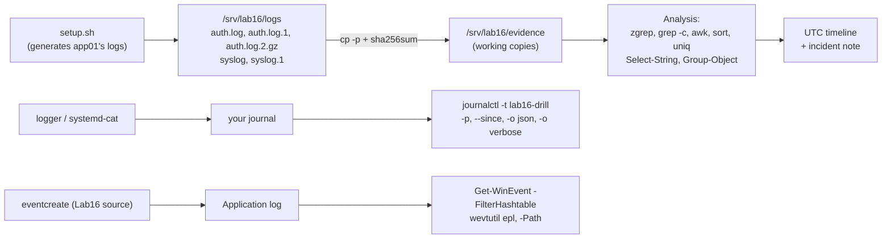

# Lab 16: What Happened at 03:12?

| Field | Value |
|---|---|
| **Lab ID** | LAB-16 |
| **Related lesson** | [Day 16: System Logs](../course/module-4/day-16.md) |
| **Difficulty** | Intermediate |
| **Time** | 75–105 minutes |
| **Risk level** | Low. The Linux part works on **generated log files** in `/srv/lab16` (created by the setup script, owned by `root:adm`) and writes a few clearly tagged test messages (`lab16-drill`) to your own journal. The logrotate task uses a **lab-only configuration and state file** and touches only `/srv/lab16/app`. No system log, journald or rsyslog setting is changed, nothing is vacuumed, cleared or truncated. The Windows part reads the System and Application logs and, in an elevated window, writes three test events with a lab-only source `Lab16` into the Application log (not the Security log). Use a VM or WSL2 and a Windows lab VM or your own PC. |

## Objective

It is 08:30 on Friday, 13 November 2026. The on-call engineer writes in the ticket:

```text
lab16-app on app01 went down at about 03:12 UTC. systemd restarted it once, then it stayed down.
I restarted it at 07:45 and it works again. Please find out what happened. Logs attached.
```

The attached logs are the `auth.log` and `syslog` files of `app01`, including the rotated copies. Your job:

1. Make an **evidence copy** of the logs and record their hashes before you analyse anything.
2. Understand which files cover which period, and read the **rotated and compressed** ones as well.
3. Find out whether the server was **attacked**: how many failed logins, from which addresses, against which accounts, when it started — and whether the attacker had been seen **before**.
4. Find out whether the attacker **got in**: the successful login, the commands run with `sudo`, and any sign that **logs were tampered with**.
5. Build one **UTC timeline** from both files and explain the **outage**: why the service died at 03:12, why the automatic restart failed.
6. Practise the **live journal** on your own VM: write tagged messages with `logger` and `systemd-cat`, filter them by tag, priority and time, export them as JSON and prove which program wrote them.
7. Test the application's **logrotate** rule safely: dry run first, then a forced rotation, and explain `delaycompress`.
8. Do the equivalent on **Windows**: boots and shutdowns, service events, lab test events, an evidence export and a query on the exported `.evtx` file.
9. Write a short **incident note**.

**Lab data flow:**



## Required Environment

- **Linux:** Ubuntu 24.04 VM or WSL2 with `sudo`, and the default tools `journalctl` (systemd), `logger` (bsdutils), `systemd-cat`, `logrotate`, `gzip` (`zcat`, `zgrep`), `grep`, `awk`, `sort`, `sha256sum`. On a minimal image: `sudo apt install -y logrotate bsdutils gzip`. WSL2 needs systemd enabled (`[boot] systemd=true` in `/etc/wsl.conf`) for the journal part; the log-file part works everywhere.
- The course repository (for the optional `scripts/linux/log-analyser.sh` and `scripts/powershell/Log-Analyser.ps1` steps).
- **Windows:** Windows 11 with Windows PowerShell 5.1 (PowerShell 7 works too). Tasks 7a–7b work in a normal window; Task 7c (test events and export to `C:\IR`) needs an **elevated** window.
- Optional: PowerShell 7 on the Ubuntu VM (`sudo snap install powershell --classic`) to run the PowerShell analysis of the Linux files directly.

## Initial Conditions

- `/srv/lab16` does not exist (`ls -d /srv/lab16` → *No such file or directory*). If it does, run the clean-up script first.
- Create your notes folder: `mkdir -p ~/lab16` (Linux) and `New-Item -ItemType Directory -Path $HOME\lab16 -Force` (Windows).
- Read the scripts below **before** running them. `setup.sh` only creates files under `/srv/lab16`: five log files for the fictional host `app01` (documentation addresses `192.0.2.0/24`, `198.51.100.0/24`, `203.0.113.0/24`), a small application log, and a logrotate configuration that applies to `/srv/lab16/app/*.log` only. It does **not** install anything into `/etc/logrotate.d`, so the system's daily logrotate run never touches the lab files.
- Note the time zone of your VM (`timedatectl | grep 'Time zone'`). The lab logs are in UTC (`+00:00`).

### Lab setup (Linux)

Save as `~/lab16/setup.sh` and run `sudo bash ~/lab16/setup.sh`:

```bash
#!/usr/bin/env bash
# Lab 16 setup: writes a set of Ubuntu 24.04-style log files (RFC 3339 timestamps) for the
# night of 2026-11-13 on the fictional host app01 into /srv/lab16/logs, a lab application
# log in /srv/lab16/app and a lab-only logrotate configuration. Nothing outside /srv/lab16
# is created or changed. Re-running the script recreates the same files.
set -o errexit -o nounset -o pipefail
[[ $EUID -eq 0 ]] || { echo "run with sudo" >&2; exit 1; }
LAB=/srv/lab16
[[ -e $LAB ]] && { echo "$LAB exists: run cleanup.sh first" >&2; exit 1; }
mkdir -p "$LAB/logs" "$LAB/app" "$LAB/state" "$LAB/evidence"
H=app01
L() { printf '2026-11-%sT%s+00:00 %s %s\n' "$1" "$2" "$H" "$3"; }

# ---------- auth.log.2.gz : 2026-11-11, a normal day ----------
{
L 11 '08:01:12.204511' 'sshd[1402]: Accepted publickey for deploy from 192.0.2.10 port 50122 ssh2: ED25519 SHA256:q1Xb4Lm0eTt8u9ZsV2pKcH7aYw3NfR5dJ6gE0oPiUkA'
L 11 '08:01:12.210377' 'sshd[1402]: pam_unix(sshd:session): session opened for user deploy(uid=1001) by deploy(uid=0)'
L 11 '08:15:40.003114' 'sudo:   deploy : TTY=pts/0 ; PWD=/home/deploy ; USER=root ; COMMAND=/usr/bin/systemctl restart lab16-app'
L 11 '08:42:09.911870' 'sshd[1402]: pam_unix(sshd:session): session closed for user deploy'
L 11 '17:00:01.120044' 'CRON[2210]: pam_unix(cron:session): session opened for user root(uid=0) by root(uid=0)'
} > "$LAB/logs/auth.log.2"
gzip -n "$LAB/logs/auth.log.2"

# ---------- auth.log.1 : 2026-11-12, reconnaissance ----------
{
L 12 '08:03:55.401220' 'sshd[1630]: Accepted publickey for deploy from 192.0.2.10 port 50418 ssh2: ED25519 SHA256:q1Xb4Lm0eTt8u9ZsV2pKcH7aYw3NfR5dJ6gE0oPiUkA'
L 12 '21:47:02.118000' 'sshd[3011]: Invalid user admin from 203.0.113.45 port 40112'
L 12 '21:47:04.552101' 'sshd[3011]: Failed password for invalid user admin from 203.0.113.45 port 40112 ssh2'
L 12 '21:47:09.002310' 'sshd[3013]: Failed password for deploy from 203.0.113.45 port 40130 ssh2'
L 12 '21:47:13.771045' 'sshd[3015]: Failed password for root from 203.0.113.45 port 40144 ssh2'
} > "$LAB/logs/auth.log.1"

# ---------- auth.log : night of 2026-11-13 ----------
{
L 13 '02:55:01.004418' 'CRON[4101]: pam_unix(cron:session): session opened for user root(uid=0) by root(uid=0)'
L 13 '02:55:01.390022' 'CRON[4101]: pam_unix(cron:session): session closed for user root'
port=51000
for i in $(seq 1 24); do
  s=$((10 + i * 10)); m=$((2 + s / 60)); s=$((s % 60))
  ts=$(printf '03:%02d:%02d.%06d' "$m" "$s" $((i * 37011 % 1000000)))
  case $((i % 3)) in
    0) L 13 "$ts" "sshd[$((4200 + i))]: Invalid user admin from 203.0.113.45 port $((port + i))"
       L 13 "$ts" "sshd[$((4200 + i))]: Failed password for invalid user admin from 203.0.113.45 port $((port + i)) ssh2" ;;
    1) L 13 "$ts" "sshd[$((4200 + i))]: Failed password for root from 203.0.113.45 port $((port + i)) ssh2" ;;
    2) L 13 "$ts" "sshd[$((4200 + i))]: Failed password for deploy from 203.0.113.45 port $((port + i)) ssh2" ;;
  esac
done
L 13 '03:04:12.660301' 'sshd[4231]: Failed password for deploy from 198.51.100.7 port 60222 ssh2'
L 13 '03:04:15.118230' 'sshd[4231]: Failed password for deploy from 198.51.100.7 port 60222 ssh2'
L 13 '03:07:55.212907' 'sshd[4260]: Accepted password for deploy from 203.0.113.45 port 51234 ssh2'
L 13 '03:07:55.219554' 'sshd[4260]: pam_unix(sshd:session): session opened for user deploy(uid=1001) by deploy(uid=0)'
L 13 '03:08:31.550710' 'sudo:   deploy : TTY=pts/0 ; PWD=/home/deploy ; USER=root ; COMMAND=/usr/bin/bash'
L 13 '03:08:31.553021' 'sudo: pam_unix(sudo:session): session opened for user root(uid=0) by deploy(uid=1001)'
L 13 '03:14:30.871205' 'sudo:   deploy : TTY=pts/0 ; PWD=/root ; USER=root ; COMMAND=/usr/bin/truncate -s 0 /srv/lab16/app/app.log'
L 13 '03:15:02.004981' 'sshd[4260]: pam_unix(sshd:session): session closed for user deploy'
} > "$LAB/logs/auth.log"

# ---------- syslog.1 : 2026-11-12, a normal day ----------
{
L 12 '00:00:01.000210' 'systemd[1]: Starting logrotate.service - Rotate log files...'
L 12 '00:00:01.310877' 'systemd[1]: logrotate.service: Deactivated successfully.'
L 12 '06:25:03.551200' 'systemd[1]: Starting apt-daily-upgrade.service - Daily apt upgrade and clean activities...'
L 12 '12:00:00.102233' 'lab16-app[2211]: heartbeat ok, 1342 requests served'
L 12 '23:59:59.900101' 'lab16-app[2211]: heartbeat ok, 2917 requests served'
} > "$LAB/logs/syslog.1"

# ---------- syslog : night of 2026-11-13 ----------
{
L 13 '02:55:01.004901' 'CRON[4101]: (root) CMD (command -v debian-sa1 > /dev/null && debian-sa1 1 1)'
L 13 '03:00:00.100112' 'lab16-app[2211]: heartbeat ok, 1188 requests served'
L 13 '03:09:12.334190' 'systemd[1]: Started session-41.scope - Session 41 of User deploy.'
L 13 '03:10:02.118650' 'lab16-app[2211]: disk usage on /srv at 97%'
for s in 05 18 31 44 57; do
  L 13 "03:10:$s.5$s""011" 'lab16-app[2211]: write failed: No space left on device (file=/srv/lab16/data/cache.db)'
done
L 13 '03:11:20.090870' 'lab16-app[2211]: write failed: No space left on device (file=/srv/lab16/data/session-7731.tmp)'
L 13 '03:12:04.118734' 'kernel: kworkerd invoked oom-killer: gfp_mask=0x140cca(GFP_HIGHUSER_MOVABLE|__GFP_COMP), order=0, oom_score_adj=0'
L 13 '03:12:04.130551' 'kernel: Out of memory: Killed process 2211 (lab16-app) total-vm:2148876kB, anon-rss:1630404kB, file-rss:2048kB, shmem-rss:0kB, UID:998 pgtables:3400kB oom_score_adj:0'
L 13 '03:12:04.212034' 'systemd[1]: lab16-app.service: A process of this unit has been killed by the OOM killer.'
L 13 '03:12:04.240117' 'systemd[1]: lab16-app.service: Main process exited, code=killed, status=9/KILL'
L 13 '03:12:04.240330' "systemd[1]: lab16-app.service: Failed with result 'oom-kill'."
L 13 '03:12:09.501002' 'systemd[1]: lab16-app.service: Scheduled restart job, restart counter is at 1.'
L 13 '03:12:09.530227' 'systemd[1]: Started lab16-app.service - Lab 16 demo application.'
L 13 '03:12:09.771120' 'lab16-app[5120]: service started, version 2.4.1'
L 13 '03:12:10.002544' 'lab16-app[5120]: cannot open database, shutting down'
L 13 '03:12:10.010987' 'systemd[1]: lab16-app.service: Main process exited, code=exited, status=1/FAILURE'
L 13 '03:12:10.011200' "systemd[1]: lab16-app.service: Failed with result 'exit-code'."
L 13 '03:15:02.010234' 'systemd[1]: session-41.scope: Deactivated successfully.'
L 13 '03:30:00.200100' 'systemd-timesyncd[612]: Contacted time server 185.125.190.56:123 (ntp.ubuntu.com).'
} > "$LAB/logs/syslog"

# ---------- lab application log (the one the intruder truncated) ----------
L 13 '03:14:31.000000' 'lab16-app: log reopened' | sed 's/^/# /' > "$LAB/app/app.log"
for n in 1 2 3; do printf 'GET /health 200 %dms\n' "$((n * 3))" >> "$LAB/app/app.log"; done

# ---------- lab-only logrotate configuration ----------
cat > "$LAB/logrotate-lab16.conf" <<'CONF'
# Lab 16 only: rotates the lab application log. Run with an explicit state file:
#   logrotate -d -s /srv/lab16/state/logrotate.state /srv/lab16/logrotate-lab16.conf
/srv/lab16/app/*.log {
    daily
    rotate 7
    compress
    delaycompress
    missingok
    notifempty
    create 0640 root adm
}
CONF
chown -R root:adm "$LAB/logs" "$LAB/app"
chmod 0640 "$LAB"/logs/* "$LAB/app/app.log"
chmod 0750 "$LAB/logs" "$LAB/app"
echo "Lab 16 ready:" "$LAB"/logs/*
```

Expected output: `Lab 16 ready: /srv/lab16/logs/auth.log /srv/lab16/logs/auth.log.1 /srv/lab16/logs/auth.log.2.gz /srv/lab16/logs/syslog /srv/lab16/logs/syslog.1`

### Lab clean-up script (Linux)

Save as `~/lab16/cleanup.sh`; run `sudo bash ~/lab16/cleanup.sh` at the end (see [Clean-up](#clean-up)):

```bash
#!/usr/bin/env bash
# Lab 16 clean-up: removes only what setup.sh and the lab tasks created.
set -o nounset -o pipefail
[[ $EUID -eq 0 ]] || { echo "run with sudo" >&2; exit 1; }
rm -rf -- /srv/lab16
echo "Removed /srv/lab16. Your own ~/lab16 notes are kept; delete them with: rm -r ~/lab16"
echo "Journal test entries (tags lab16-drill, lab16-app) expire with normal journal retention; they are not deleted."
```

## Step-by-Step Instructions

### Task 1 — Preserve the evidence and orient yourself

1. Copy the logs to `/srv/lab16/evidence` **preserving timestamps** (`cp -p`), write `SHA256SUMS` there and verify it with `sha256sum -c`. From now on, analyse only the copies.
2. Compare your hashes with the ones in [Verification Steps](#verification-steps). If they differ, your `setup.sh` was not copied exactly.
3. List the files with sizes. Which file is the newest, which the oldest? Which period does each cover? (Look at the first and last line of each; use `zcat` for the `.gz`.)
4. As your normal user (no `sudo`), try to read `/srv/lab16/logs/auth.log`. Explain the result from the permissions. Which group membership would let a support engineer read logs without root?

### Task 2 — Was there an attack?

1. Count the failed password attempts in the incident night's `auth.log`.
2. Rank them by **source address** and by **target account** (an `Invalid user admin` means the account does not exist).
3. For each source address, find the first and last failed attempt.
4. Search **all** `auth.log*` files (including the compressed one) for the main attacker's address with one command, and count the matches per day. Was the attacker seen before the incident?

### Task 3 — Did the attacker get in?

1. Find every `Accepted` login in `auth.log.1` and `auth.log`, with time, method (`password` or `publickey`), account and source.
2. List every `sudo` command run on the incident night, with time, user and command.
3. When did the attacker's SSH session start and end?
4. Look at the application log `/srv/lab16/app/app.log`. What is suspicious about it, and which line in `auth.log` explains it?

### Task 4 — One timeline, and the cause of the outage

1. Merge `auth.log` and `syslog` into a single timeline sorted by time, and show only 03:07–03:16 UTC, without the brute-force lines.
2. Count the lines per minute over both files. Where are the busy minutes, and is there a gap that matters?
3. From the timeline, explain in three steps why `lab16-app` died at 03:12:04 and why the automatic restart at 03:12:09 did not keep it running.
4. Which process name in the OOM-killer message is suspicious, and why?
5. Optional: run the course script against the evidence copy: `bash scripts/linux/log-analyser.sh -l /srv/lab16/evidence/syslog -s 0 -n 5` (`-s 0` analyses the whole file, whatever the age of the lab logs) and compare its counts with yours.

### Task 5 — The live journal on your VM

1. Write three test messages with `logger` using the tag `lab16-drill`: one `auth.warning` ("drill: 5 failed logins for user svc-backup from 203.0.113.45"), one `daemon.err` ("drill: backup job failed: destination /mnt/backup not mounted"), one `daemon.info` ("drill: backup job retry scheduled in 15 min"). Write a fourth with `systemd-cat -t lab16-drill -p warning`.
2. Show all four with `journalctl -t lab16-drill`, then only warning and worse with ISO timestamps including microseconds.
3. Export them as JSON and print, for each, `PRIORITY`, `SYSLOG_FACILITY` and `MESSAGE`. Why does the `systemd-cat` message have no facility?
4. Find which file in `/var/log` each `logger` message went to (`auth.log` or `syslog`) and explain why from the rsyslog rules.
5. Prove which program really wrote the messages, using trusted fields.
6. Optional (booted VM only): create a short-lived failing unit with `sudo systemd-run --unit=lab16-flaky /bin/sh -c 'echo starting; sleep 2; echo "fatal: config file /etc/lab16.conf missing" >&2; exit 1'` and read its story with `journalctl -u lab16-flaky`. Remove it afterwards with `sudo systemctl reset-failed lab16-flaky`.

### Task 6 — Test the application's log rotation safely

1. Read `/srv/lab16/logrotate-lab16.conf` and explain each directive.
2. Run a **dry run** with a private state file (`-d -f -s /srv/lab16/state/logrotate.state`). Confirm that nothing changed.
3. Rotate for real (`-f`, same state file) and list `/srv/lab16/app`.
4. Append one line to `app.log`, rotate again and list the directory. Which file is compressed now, and why not `app.log.1`?
5. Run the rotation a third time without adding lines. What happens, and which directive is responsible?

### Task 7 — Windows: boots, services, test events and an evidence export

1. **7a (normal window).** List the logs with the most records, and the size and mode of System, Application and Setup.
2. **7b (normal window).** List the last 10 boot/shutdown events (6005, 6006, 6008, 41, 1074) with the first line of their message, and classify each restart as planned or unexpected. Then list the service events 7036, 7045 and 7034 of the last 7 days, grouped by ID.
3. **7c (elevated window).** Create three test events with source `Lab16` in the Application log using `eventcreate` (IDs 901 warning, 902 error, 903 information). Query them with `-FilterHashtable` by provider, then only the error. Export the Application log with `wevtutil epl` to `C:\IR\Application-lab16.evtx`, hash it, save the hash to `C:\IR\Application-lab16.evtx.sha256.txt`, and query the **exported file** for the `Lab16` events with `Get-WinEvent -Path`.
4. **7d (PowerShell analysis of the Linux files).** In PowerShell 7 on the Ubuntu VM (or with the files copied to Windows, for example from `\\wsl$\Ubuntu\srv\lab16\evidence`), count the failed passwords per source address with `Select-String` and `Group-Object`, and print the timeline window 03:12–03:13.

### Task 8 — Incident note

Write `~/lab16/incident-note.md` (5–10 lines): what happened (with UTC times), the evidence (files and hashes), the root cause of the outage, the security findings, and three recommendations.

## Commands to Execute

| Task | Linux | Windows |
|---|---|---|
| 1 | `cp -p`, `sha256sum`, `sha256sum -c`, `ls -l`, `zcat`, `head`, `tail` | — |
| 2 | <code>grep -c</code>, <code>grep -oE &#124; sort &#124; uniq -c &#124; sort -rn</code>, `sed -E`, `awk`, `zgrep -h` | `Select-String`, `Group-Object` (Task 7d) |
| 3 | `grep -h 'Accepted'`, `grep 'COMMAND='`, `head` | — |
| 4 | <code>cat auth.log syslog &#124; sort &#124; awk '$1 &gt;= …'</code>, `cut`, `grep -v`, `uniq -c` | `Get-Content`, `Sort-Object`, `Where-Object` |
| 5 | `logger -t -p`, `systemd-cat`, `journalctl -t -p -o short-iso-precise -o json -o verbose --output-fields` | — |
| 6 | `logrotate -d -f -v -s`, `ls -l`, `zcat` | — |
| 7 | — | `Get-WinEvent -ListLog`, `-FilterHashtable`, `-Path`, `eventcreate`, `wevtutil epl`, `Get-FileHash` |

## Expected Results

- The evidence copies verify with `OK` for all five files, and the hashes match the table below.
- Task 2: **26** failed passwords on the incident night — **24** from `203.0.113.45` (03:02:20–03:06:10) and **2** from `198.51.100.7`; targets `deploy` (10), `root` (8) and the non-existent `admin` (8). The same address made **4** attempts on 2026-11-12 at 21:47 (reconnaissance); the 2026-11-11 file is clean.
- Task 3: `Accepted password for deploy from 203.0.113.45 port 51234` at **03:07:55**, after the brute force — the `deploy` account normally logs in from `192.0.2.10` with a **public key**. `sudo` to a root shell at **03:08:31**, then `truncate -s 0 /srv/lab16/app/app.log` at **03:14:30**; the session ended at 03:15:02. The application log starts at 03:14:31 with *log reopened*: everything before was wiped.
- Task 4: disk on `/srv` at 97% → six *No space left on device* errors (03:10:05–03:11:20) → an unknown process **`kworkerd`** triggers the **OOM killer**, which kills `lab16-app` (PID 2211) at 03:12:04 → systemd restarts it at 03:12:09 → the new process (PID 5120) cannot open its database (disk still full) and exits with status 1 at 03:12:10 → no further restart. The busiest minute is 03:12 (11 lines).
- Task 5: four `lab16-drill` entries; with `-p warning`, three (the `info` one is hidden). JSON shows priorities 4, 3, 6, 4 and facilities 4 (auth), 3 (daemon), 3, none. The `auth` message is in `/var/log/auth.log`, the others in `/var/log/syslog`; `_COMM=logger` for the `logger` messages, `_COMM=cat` with `_TRANSPORT=stdout` for the `systemd-cat` one.
- Task 6: the dry run changes nothing; the first rotation produces `app.log` (empty) + `app.log.1`; the second `app.log` + `app.log.1` + `app.log.2.gz`; the third does nothing because the log is empty (`notifempty`).
- Task 7: event lists and the `Lab16` events from both the live log and the exported `.evtx`; a SHA-256 hash for the export.

## Verification Steps

Run these checks; every line should print what is shown.

```bash
sudo sh -c 'cd /srv/lab16/logs && sha256sum *'
sudo sha256sum -c /srv/lab16/evidence/SHA256SUMS | grep -c ': OK'          # 5
sudo grep -c 'Failed password' /srv/lab16/evidence/auth.log                # 26
sudo grep -h 'Accepted password' /srv/lab16/evidence/auth.log | cut -c1-19 # 2026-11-13T03:07:55
journalctl -t lab16-drill -q --no-pager | wc -l                            # 4 (or more if you repeated Task 5)
sudo ls /srv/lab16/app                                                     # app.log  app.log.1  app.log.2.gz
```

**Expected output (captured on 2026-11-14 in an Ubuntu 24.04.5 container, first command):**

```text
e93fb872c515deebbea66d1456292250db8031620442a04138ccb265027f7d06  auth.log
f09d5b911c081d1e0891769f65cb27826ca0ec57a4435b45f2d6dc75c9a54367  auth.log.1
cd8110b562b593916735a046066ccdba6d5888a432d979248b53cdaefc940684  auth.log.2.gz
2c688b017992c8c29f3a10c84dd6c3362f2de69c0513c6a63d1198e91ba54c25  syslog
b7de56a679b0c657526d9a663cca859828fb0bc342cb0b1293c4bc2ed544a5b4  syslog.1
```

The file contents are deterministic (`gzip -n` omits the name and time), so a correctly copied `setup.sh` produces the same hashes on any Ubuntu 24.04 system.

```powershell
Get-WinEvent -FilterHashtable @{ LogName = 'Application'; ProviderName = 'Lab16' } | Measure-Object | Select-Object -ExpandProperty Count   # 3 (or more)
Get-WinEvent -Path C:\IR\Application-lab16.evtx -FilterXPath "*[System[Provider[@Name='Lab16']]]" | Measure-Object | Select-Object -ExpandProperty Count   # 3
Test-Path C:\IR\Application-lab16.evtx.sha256.txt                                                         # True
```

## Troubleshooting

| Problem | Cause | Fix |
|---|---|---|
| `/srv/lab16 exists: run cleanup.sh first` | Earlier run | `sudo bash ~/lab16/cleanup.sh`, then setup again |
| Hashes differ from the table | `setup.sh` changed while copying (tabs, quotes, a missing line) | Copy the script again exactly; compare with `diff` |
| `Permission denied` reading the lab logs | Files are `root:adm 0640` | Use `sudo`, or (for this exercise) add yourself to `adm` and start a new login |
| `gzip: auth.log.2.gz: not in gzip format` with `zcat` | File corrupted or copied in text mode | Re-run setup; copy with `cp -p` |
| `grep` finds nothing in `auth.log.2.gz` | `grep` does not decompress | `zgrep`, or <code>zcat FILE &#124; grep PATTERN</code> |
| Timeline out of order | Mixed time zones or formats | All lab lines are `+00:00`; when mixing with your own logs convert first |
| `journalctl -t lab16-drill` → `-- No entries --` | Typo in the tag, no `sudo` (other users' messages), WSL2 without systemd | Check `journalctl -F SYSLOG_IDENTIFIER`; enable systemd in WSL2 |
| `journalctl` → *No journal files were opened due to insufficient permissions* | Not in `adm`/`systemd-journal` | `sudo journalctl …` |
| logrotate: *log does not need rotating* | Rotation not due (`daily`) or log empty (`notifempty`) | Use `-f` as in the task; the third run is expected to skip |
| logrotate: *error: skipping … because parent directory has insecure permissions* | `/srv/lab16/app` group- or world-writable | `sudo chmod 0750 /srv/lab16/app` (the setup sets it) |
| `eventcreate` → *ERROR: Access denied* | Not elevated | Open PowerShell as administrator |
| `eventcreate` → *ERROR: Source parameter is used to identify custom applications/scripts only…* | A non-eventcreate source named `Lab16` exists | Use another source name, e.g. `Lab16b`, and adapt the queries |
| `Get-WinEvent : No events were found that match the specified selection criteria.` | Filter matched nothing (wrong provider name, too short a time window) | Check `ProviderName`; widen `StartTime` |
| `wevtutil epl` → *Access is denied* | Not elevated, or `C:\IR` not writable | Elevated window; `New-Item -ItemType Directory C:\IR -Force` |

## Questions

1. Why do you analyse copies and record hashes first, and why `cp -p` rather than `cp`?
2. Which file covers 2026-11-12, and how did you read the 2026-11-11 file?
3. Which facts show that the login at 03:07:55 was not the legitimate `deploy` user?
4. Why is `kworkerd` in the OOM-killer message suspicious?
5. What would you have missed if you had searched only `auth.log` for the attacker's address?
6. Why does `cat auth.log syslog | sort` produce a correct timeline for these files, and when would it fail?
7. Why did the `info` drill message disappear with `-p warning`, and what does `-p err` show?
8. Why is the `auth.warning` drill message in `auth.log` and not in `syslog`?
9. What does `delaycompress` protect against, and what does `notifempty` do?
10. Which Windows events would show (a) the attacker clearing the Security log, (b) a new service installed for persistence?
11. Why must the incident note state the time zone?

## Solution

The Linux outputs below were **captured** on 2026-11-14 by running the setup and the solution commands as root on Ubuntu 24.04.5 in a container (rsyslog 8.2312.0, systemd-journald 255.4 started by hand because the container is not booted by systemd, logrotate 3.21.0). The PowerShell and Windows outputs are **examples**: PowerShell could not be installed on the release host, so they were not executed; values that come from the Linux files are derived from the captured Bash runs.

??? success "Bash solution"
    **Task 1 — evidence and orientation**

    ```bash
    sudo cp -p /srv/lab16/logs/* /srv/lab16/evidence/
    cd /srv/lab16/evidence && sudo sh -c 'sha256sum auth.log auth.log.1 auth.log.2.gz syslog syslog.1 > SHA256SUMS' && sudo sha256sum -c SHA256SUMS
    ls -l /srv/lab16/evidence
    sudo zcat auth.log.2.gz | head -n 1 | cut -c1-19
    for f in auth.log.1 auth.log syslog.1 syslog; do printf '%-11s %s .. %s\n' "$f" "$(sudo head -n 1 "$f" | cut -c1-19)" "$(sudo tail -n 1 "$f" | cut -c1-19)"; done
    cat /srv/lab16/logs/auth.log                    # as your normal user
    ```

    **Expected output (captured):**

    ```text
    auth.log: OK
    auth.log.1: OK
    auth.log.2.gz: OK
    syslog: OK
    syslog.1: OK
    total 28
    -rw-r--r-- 1 root root  380 Nov 14 16:58 SHA256SUMS
    -rw-r----- 1 root adm  4759 Nov 14 16:58 auth.log
    -rw-r----- 1 root adm   618 Nov 14 16:58 auth.log.1
    -rw-r----- 1 root adm   375 Nov 14 16:58 auth.log.2.gz
    -rw-r----- 1 root adm  2705 Nov 14 16:58 syslog
    -rw-r----- 1 root adm   508 Nov 14 16:58 syslog.1
    2026-11-11T08:01:12
    auth.log.1  2026-11-12T08:03:55 .. 2026-11-12T21:47:13
    auth.log    2026-11-13T02:55:01 .. 2026-11-13T03:15:02
    syslog.1    2026-11-12T00:00:01 .. 2026-11-12T23:59:59
    syslog      2026-11-13T02:55:01 .. 2026-11-13T03:30:00
    cat: /srv/lab16/logs/auth.log: Permission denied
    ```

    Newest = no suffix, then `.1`, then `.2.gz`. The files are `root:adm 0640`: only root and members of **`adm`** can read them — the same model as the real `/var/log`. `cp -p` keeps the modification times, which are part of the evidence. The times shown are those of the setup run; yours will differ, the hashes must not. (The `cat` was run as a throwaway non-admin user.)

    **Task 2 — the attack**

    ```bash
    cd /srv/lab16/evidence
    sudo grep -c 'Failed password' auth.log
    sudo grep 'Failed password' auth.log | grep -oE 'from [0-9.]+' | sort | uniq -c | sort -rn
    sudo grep 'Failed password' auth.log | sed -E 's/.*Failed password for (invalid user )?([^ ]+) from.*/\2/' | sort | uniq -c | sort -rn
    sudo grep -c 'Invalid user' auth.log
    sudo grep -h 'Failed password' auth.log | awk '{ ip = $(NF-3); if (!(ip in first)) first[ip] = $1; last[ip] = $1; n[ip]++ }
        END { for (ip in n) printf "%-15s %3d  %s  %s\n", ip, n[ip], substr(first[ip], 12, 8), substr(last[ip], 12, 8) }' | sort -k2,2nr
    sudo zgrep -h '203.0.113.45' auth.log.2.gz auth.log.1 auth.log | awk '{ print substr($1, 1, 10) }' | uniq -c
    sudo zgrep -c 'Failed password' auth.log auth.log.1 auth.log.2.gz
    sudo grep -h '203.0.113.45' auth.log.1 | cut -c1-19,33-
    ```

    **Expected output (captured):**

    ```text
    26
         24 from 203.0.113.45
          2 from 198.51.100.7
         10 deploy
          8 root
          8 admin
    8
    203.0.113.45     24  03:02:20  03:06:10
    198.51.100.7      2  03:04:12  03:04:15
          4 2026-11-12
         33 2026-11-13
    auth.log:26
    auth.log.1:3
    auth.log.2.gz:0
    2026-11-12T21:47:02 app01 sshd[3011]: Invalid user admin from 203.0.113.45 port 40112
    2026-11-12T21:47:04 app01 sshd[3011]: Failed password for invalid user admin from 203.0.113.45 port 40112 ssh2
    2026-11-12T21:47:09 app01 sshd[3013]: Failed password for deploy from 203.0.113.45 port 40130 ssh2
    2026-11-12T21:47:13 app01 sshd[3015]: Failed password for root from 203.0.113.45 port 40144 ssh2
    ```

    The `sed` expression strips the optional `invalid user ` so that the account name is always captured. In the `awk` program, `$(NF-3)` is the address: counting from the end (`… from IP port N ssh2`) works for both line types. The 33 matches on 2026-11-13 are 24 failures + 8 *Invalid user* lines + the accepted login. The four lines on the previous evening — all three account names tried once — were **reconnaissance**.

    **Task 3 — compromise**

    ```bash
    sudo grep -h 'Accepted' auth.log.1 auth.log | sed -E 's/^(\S+) .*Accepted (\S+) for (\S+) from (\S+) port.*/\1 \2 \3 \4/'
    sudo grep -h 'COMMAND=' auth.log | sed -E 's/^(\S+) \S+ sudo: +(\S+) :.*COMMAND=(.*)$/\1 \2 \3/'
    sudo grep -E 'session (opened|closed) for user deploy' auth.log | cut -c1-19,33-
    sudo stat -c '%n %s bytes' /srv/lab16/app/app.log; sudo head -n 1 /srv/lab16/app/app.log
    ```

    **Expected output (captured):**

    ```text
    2026-11-12T08:03:55.401220+00:00 publickey deploy 192.0.2.10
    2026-11-13T03:07:55.212907+00:00 password deploy 203.0.113.45
    2026-11-13T03:08:31.550710+00:00 deploy /usr/bin/bash
    2026-11-13T03:14:30.871205+00:00 deploy /usr/bin/truncate -s 0 /srv/lab16/app/app.log
    2026-11-13T03:07:55 app01 sshd[4260]: pam_unix(sshd:session): session opened for user deploy(uid=1001) by deploy(uid=0)
    2026-11-13T03:15:02 app01 sshd[4260]: pam_unix(sshd:session): session closed for user deploy
    /srv/lab16/app/app.log 125 bytes
    # 2026-11-13T03:14:31.000000+00:00 app01 lab16-app: log reopened
    ```

    Normal pattern: `deploy` logs in with a **public key** from `192.0.2.10`. At 03:07:55 it logged in with a **password** from the attacker's address, 105 seconds after the brute force ended: the password was guessed (or known). The attacker opened a root shell (`sudo bash`), and at 03:14:30 emptied the application log, which therefore starts at 03:14:31. The `sudo` line survived because it is in a **different** file (`auth.log`) than the one wiped — and in a real environment, also in the journal and on the central log server.

    **Task 4 — timeline and outage**

    ```bash
    sudo cat auth.log syslog | sort | awk '$1 >= "2026-11-13T03:07" && $1 < "2026-11-13T03:16"' | cut -c1-19,33- | grep -v 'Failed password\|Invalid user'
    sudo awk '{ print substr($1, 12, 5) }' auth.log syslog | sort | uniq -c | awk '{ printf "%s=%s ", $2, $1 } END { print "" }'
    ```

    **Expected output (captured):**

    ```text
    2026-11-13T03:07:55 app01 sshd[4260]: Accepted password for deploy from 203.0.113.45 port 51234 ssh2
    2026-11-13T03:07:55 app01 sshd[4260]: pam_unix(sshd:session): session opened for user deploy(uid=1001) by deploy(uid=0)
    2026-11-13T03:08:31 app01 sudo:   deploy : TTY=pts/0 ; PWD=/home/deploy ; USER=root ; COMMAND=/usr/bin/bash
    2026-11-13T03:08:31 app01 sudo: pam_unix(sudo:session): session opened for user root(uid=0) by deploy(uid=1001)
    2026-11-13T03:09:12 app01 systemd[1]: Started session-41.scope - Session 41 of User deploy.
    2026-11-13T03:10:02 app01 lab16-app[2211]: disk usage on /srv at 97%
    2026-11-13T03:10:05 app01 lab16-app[2211]: write failed: No space left on device (file=/srv/lab16/data/cache.db)
    2026-11-13T03:10:18 app01 lab16-app[2211]: write failed: No space left on device (file=/srv/lab16/data/cache.db)
    2026-11-13T03:10:31 app01 lab16-app[2211]: write failed: No space left on device (file=/srv/lab16/data/cache.db)
    2026-11-13T03:10:44 app01 lab16-app[2211]: write failed: No space left on device (file=/srv/lab16/data/cache.db)
    2026-11-13T03:10:57 app01 lab16-app[2211]: write failed: No space left on device (file=/srv/lab16/data/cache.db)
    2026-11-13T03:11:20 app01 lab16-app[2211]: write failed: No space left on device (file=/srv/lab16/data/session-7731.tmp)
    2026-11-13T03:12:04 app01 kernel: kworkerd invoked oom-killer: gfp_mask=0x140cca(GFP_HIGHUSER_MOVABLE|__GFP_COMP), order=0, oom_score_adj=0
    2026-11-13T03:12:04 app01 kernel: Out of memory: Killed process 2211 (lab16-app) total-vm:2148876kB, anon-rss:1630404kB, file-rss:2048kB, shmem-rss:0kB, UID:998 pgtables:3400kB oom_score_adj:0
    2026-11-13T03:12:04 app01 systemd[1]: lab16-app.service: A process of this unit has been killed by the OOM killer.
    2026-11-13T03:12:04 app01 systemd[1]: lab16-app.service: Main process exited, code=killed, status=9/KILL
    2026-11-13T03:12:04 app01 systemd[1]: lab16-app.service: Failed with result 'oom-kill'.
    2026-11-13T03:12:09 app01 systemd[1]: lab16-app.service: Scheduled restart job, restart counter is at 1.
    2026-11-13T03:12:09 app01 systemd[1]: Started lab16-app.service - Lab 16 demo application.
    2026-11-13T03:12:09 app01 lab16-app[5120]: service started, version 2.4.1
    2026-11-13T03:12:10 app01 lab16-app[5120]: cannot open database, shutting down
    2026-11-13T03:12:10 app01 systemd[1]: lab16-app.service: Main process exited, code=exited, status=1/FAILURE
    2026-11-13T03:12:10 app01 systemd[1]: lab16-app.service: Failed with result 'exit-code'.
    2026-11-13T03:14:30 app01 sudo:   deploy : TTY=pts/0 ; PWD=/root ; USER=root ; COMMAND=/usr/bin/truncate -s 0 /srv/lab16/app/app.log
    2026-11-13T03:15:02 app01 sshd[4260]: pam_unix(sshd:session): session closed for user deploy
    2026-11-13T03:15:02 app01 systemd[1]: session-41.scope: Deactivated successfully.
    02:55=3 03:00=1 03:02=5 03:03=8 03:04=10 03:05=8 03:06=3 03:07=2 03:08=2 03:09=1 03:10=6 03:11=1 03:12=11 03:14=1 03:15=2 03:30=1
    ```

    Root cause in three steps: (1) after the intruder's root shell, `/srv` filled up (97%, then *No space left on device*); (2) a process called **`kworkerd`** used so much memory that the kernel's OOM killer chose the biggest victim, `lab16-app`, and killed it (SIGKILL, `status=9/KILL`); (3) systemd restarted it (the unit's `Restart=` policy covers a kill by a signal, as with `Restart=on-abnormal`), but the new process could not open its database on the full disk and exited with status 1 — a non-zero exit code, which `on-abnormal` does not restart — so it stayed down until 07:45. `kworkerd` is suspicious because real kernel worker threads are named `kworker/N:M`, run in kernel space and are **never** chosen by the OOM killer as a user-space memory hog: a miner or implant disguised as a kernel thread is a classic trick. The minute counts show the brute force (03:02–03:06), the outage (03:12) and, after the attacker's logout at 03:15, silence until the 03:30 time sync — no gap inside the incident window, because the attacker only wiped the **application** log.

    **Task 5 — live journal**

    ```bash
    logger -t lab16-drill -p auth.warning "drill: 5 failed logins for user svc-backup from 203.0.113.45"
    logger -t lab16-drill -p daemon.err "drill: backup job failed: destination /mnt/backup not mounted"
    logger -t lab16-drill -p daemon.info "drill: backup job retry scheduled in 15 min"
    echo "drill: written by systemd-cat at priority warning" | systemd-cat -t lab16-drill -p warning
    sudo journalctl -t lab16-drill --no-pager
    sudo journalctl -t lab16-drill -p warning -o short-iso-precise --no-pager
    sudo journalctl -t lab16-drill -o json --output-fields=PRIORITY,SYSLOG_FACILITY,MESSAGE --no-pager |
        python3 -c 'import sys, json
    for l in sys.stdin:
        e = json.loads(l); print(e.get("PRIORITY"), e.get("SYSLOG_FACILITY", "-"), e["MESSAGE"])'
    sudo tail -n 1 /var/log/auth.log; sudo tail -n 3 /var/log/syslog
    sudo journalctl -t lab16-drill -o verbose --no-pager | grep -E '^ +(_COMM|_PID|_UID|_TRANSPORT)='
    ```

    **Expected output (captured; host renamed):**

    ```text
    Nov 14 16:46:11 ubuntu-lab lab16-drill[4120]: drill: 5 failed logins for user svc-backup from 203.0.113.45
    Nov 14 16:46:11 ubuntu-lab lab16-drill[4121]: drill: backup job failed: destination /mnt/backup not mounted
    Nov 14 16:46:11 ubuntu-lab lab16-drill[4122]: drill: backup job retry scheduled in 15 min
    Nov 14 16:46:11 ubuntu-lab lab16-drill[4124]: drill: written by systemd-cat at priority warning
    2026-11-14T16:46:11.813129+00:00 ubuntu-lab lab16-drill[4120]: drill: 5 failed logins for user svc-backup from 203.0.113.45
    2026-11-14T16:46:11.815264+00:00 ubuntu-lab lab16-drill[4121]: drill: backup job failed: destination /mnt/backup not mounted
    2026-11-14T16:46:11.822185+00:00 ubuntu-lab lab16-drill[4124]: drill: written by systemd-cat at priority warning
    4 4 drill: 5 failed logins for user svc-backup from 203.0.113.45
    3 3 drill: backup job failed: destination /mnt/backup not mounted
    6 3 drill: backup job retry scheduled in 15 min
    4 - drill: written by systemd-cat at priority warning
    2026-11-14T16:46:11.813352+00:00 ubuntu-lab lab16-drill: drill: 5 failed logins for user svc-backup from 203.0.113.45
    2026-11-14T16:46:11.815439+00:00 ubuntu-lab lab16-drill: drill: backup job failed: destination /mnt/backup not mounted
    2026-11-14T16:46:11.817671+00:00 ubuntu-lab lab16-drill: drill: backup job retry scheduled in 15 min
    2026-11-14T16:46:11.822292+00:00 ubuntu-lab lab16-drill[4124]: drill: written by systemd-cat at priority warning
        _UID=0
        _TRANSPORT=syslog
        _COMM=logger
        _PID=4120
        _UID=0
        _TRANSPORT=syslog
        _COMM=logger
        _PID=4121
        _UID=0
        _TRANSPORT=syslog
        _COMM=logger
        _PID=4122
        _UID=0
        _TRANSPORT=stdout
        _COMM=cat
        _PID=4124
    ```

    `-p warning` hides priority 6. Facility 4 = `auth`, 3 = `daemon`. `systemd-cat` writes through journald's native stream protocol, not syslog, so there is no `SYSLOG_FACILITY` (rsyslog files it as `user`). The `auth.warning` message is only in `auth.log` because of `auth,authpriv.* /var/log/auth.log` and `auth,authpriv.none` in the `syslog` rule. The last command shows `_COMM=logger` and `_TRANSPORT=syslog` for the three `logger` messages, and `_TRANSPORT=stdout` with `_COMM=cat` for the `systemd-cat` one: without a command argument, `systemd-cat` connects its output to the journal and runs `cat` to copy standard input. The trusted fields name the real writer, whatever the tag says (`_UID=0` because the capture ran as root; you will see your own UID).

    **Optional systemd-run (example output, booted Ubuntu 24.04 VM — not captured):**

    ```text
    $ sudo systemd-run --unit=lab16-flaky /bin/sh -c 'echo starting; sleep 2; echo "fatal: config file /etc/lab16.conf missing" >&2; exit 1'
    Running as unit: lab16-flaky.service; invocation ID: 3c1f0b8e2d6a4f5e9b7c1d2e3f4a5b6c
    $ journalctl -u lab16-flaky --no-pager
    Nov 14 22:31:05 ubuntu-lab systemd[1]: Started lab16-flaky.service - /bin/sh -c "echo starting; sleep 2; echo \"fatal: config file /etc/lab16.conf missing\" >&2; exit 1".
    Nov 14 22:31:05 ubuntu-lab sh[3120]: starting
    Nov 14 22:31:07 ubuntu-lab sh[3120]: fatal: config file /etc/lab16.conf missing
    Nov 14 22:31:07 ubuntu-lab systemd[1]: lab16-flaky.service: Main process exited, code=exited, status=1/FAILURE
    Nov 14 22:31:07 ubuntu-lab systemd[1]: lab16-flaky.service: Failed with result 'exit-code'.
    $ sudo systemctl reset-failed lab16-flaky
    ```

    **Task 6 — logrotate**

    ```bash
    cat /srv/lab16/logrotate-lab16.conf
    sudo logrotate -d -f -s /srv/lab16/state/logrotate.state /srv/lab16/logrotate-lab16.conf 2>&1 | tail -n 4
    ls /srv/lab16/state/
    sudo logrotate -f -s /srv/lab16/state/logrotate.state /srv/lab16/logrotate-lab16.conf
    sudo ls -l /srv/lab16/app/
    echo 'GET /health 200 4ms' | sudo tee -a /srv/lab16/app/app.log >/dev/null
    sudo logrotate -f -s /srv/lab16/state/logrotate.state /srv/lab16/logrotate-lab16.conf
    sudo ls -l /srv/lab16/app/
    sudo zcat /srv/lab16/app/app.log.2.gz | head -n 1
    sudo logrotate -f -v -s /srv/lab16/state/logrotate.state /srv/lab16/logrotate-lab16.conf 2>&1 | tail -n 4
    sudo cat /srv/lab16/state/logrotate.state
    ```

    **Expected output (captured, after the configuration listing):**

    ```text
    renaming /srv/lab16/app/app.log.1.gz to /srv/lab16/app/app.log.2.gz (rotatecount 7, logstart 1, i 1),
    log /srv/lab16/app/app.log.8.gz doesn't exist -- won't try to dispose of it
    renaming /srv/lab16/app/app.log to /srv/lab16/app/app.log.1
    creating new /srv/lab16/app/app.log mode = 0640 uid = 0 gid = 4
    total 4
    -rw-r----- 1 root adm   0 Nov 14 16:58 app.log
    -rw-r----- 1 root adm 125 Nov 14 16:58 app.log.1
    total 8
    -rw-r----- 1 root adm   0 Nov 14 16:58 app.log
    -rw-r----- 1 root adm  20 Nov 14 16:58 app.log.1
    -rw-r----- 1 root adm 106 Nov 14 16:58 app.log.2.gz
    # 2026-11-13T03:14:31.000000+00:00 app01 lab16-app: log reopened
    considering log /srv/lab16/app/app.log
      Now: 2026-11-14 16:58
      Last rotated at 2026-11-14 16:58
      log does not need rotating (log is empty)
    logrotate state -- version 2
    "/srv/lab16/app/app.log" 2026-11-14-16:58:28
    ```

    The dry run lists the steps but `ls /srv/lab16/state/` prints nothing: no state file, nothing renamed. Directives: `daily` (due once a day), `rotate 7` (keep seven old files), `compress` + `delaycompress` (gzip old files, but not the newest one), `missingok` (no error if the log is missing), `notifempty` (skip an empty log), `create 0640 root adm` (new empty log with these permissions). The second rotation compressed the **previous** `.1` into `.2.gz` and left the new `.1` uncompressed — a program that has not yet reopened its file could still be writing to `.1`. The third run skipped the empty log (`notifempty`), and the state file records the last rotation.

??? success "PowerShell solution"
    **Task 7a/7b — normal window (example output, Windows 11):**

    ```powershell
    Get-WinEvent -ListLog * -ErrorAction SilentlyContinue | Where-Object RecordCount -gt 0 |
        Sort-Object RecordCount -Descending | Select-Object -First 5 LogName, RecordCount
    Get-WinEvent -ListLog System, Application, Setup | Select-Object LogName, @{ n = 'MaxMB'; e = { $_.MaximumSizeInBytes / 1MB } }, LogMode, RecordCount
    Get-WinEvent -FilterHashtable @{ LogName = 'System'; Id = 6005, 6006, 6008, 41, 1074 } -MaxEvents 10 |
        Select-Object TimeCreated, Id, @{ n = 'Message'; e = { ($_.Message -split "`r?`n")[0] } } | Format-Table -AutoSize -Wrap
    Get-WinEvent -FilterHashtable @{ LogName = 'System'; ProviderName = 'Service Control Manager'; Id = 7036, 7045, 7034; StartTime = (Get-Date).AddDays(-7) } -ErrorAction SilentlyContinue |
        Group-Object Id | Select-Object Count, Name
    ```

    ```text
    LogName                                           RecordCount
    -------                                           -----------
    System                                                  28411
    Application                                             19876
    Microsoft-Windows-Store/Operational                      9230
    Microsoft-Windows-StateRepository/Operational            7712
    Microsoft-Windows-PowerShell/Operational                 3120

    LogName     MaxMB  LogMode RecordCount
    -------     -----  ------- -----------
    System         20 Circular       28411
    Application    20 Circular       19876
    Setup           1 Circular         214

    TimeCreated            Id Message
    -----------            -- -------
    14/11/2026 07:58:12  6005 The Event log service was started.
    13/11/2026 23:01:40  6006 The Event log service was stopped.
    13/11/2026 23:01:39  1074 The process C:\Windows\system32\svchost.exe (WIN11-LAB) has initiated the restart of computer WIN11-LAB on behalf of user NT AUTHORITY\SYSTEM for the following reason: Operating System: Service pack (Planned)
    13/11/2026 13:11:58  6005 The Event log service was started.
    13/11/2026 13:11:58  6008 The previous system shutdown at 08:42:10 on 13/11/2026 was unexpected.
    13/11/2026 13:11:47    41 The system has rebooted without cleanly shutting down first. This error could be caused if the system stopped responding, crashed, or lost power unexpectedly.

    Count Name
    ----- ----
      812 7036
        2 7045
        1 7034
    ```

    The 23:01 restart is **planned** (1074 by `svchost`/Windows Update, then 6006); the 13:11 boot followed an **unexpected** shutdown (41 + 6008, no 1074). Two 7045 events in a week deserve a look: `Get-WinEvent -FilterHashtable @{LogName='System'; Id=7045} | ForEach-Object { ([xml]$_.ToXml()).Event.EventData.Data }` shows `ServiceName`, `ImagePath`, `StartType` and `AccountName` — legitimate driver or agent updates, or persistence.

    **Task 7c — elevated window (example output):**

    ```powershell
    eventcreate /T WARNING     /ID 901 /L APPLICATION /SO Lab16 /D "lab16: disk usage on D: at 97%"
    eventcreate /T ERROR       /ID 902 /L APPLICATION /SO Lab16 /D "lab16: write failed: There is not enough space on the disk"
    eventcreate /T INFORMATION /ID 903 /L APPLICATION /SO Lab16 /D "lab16: service restarted by operator"
    Get-WinEvent -FilterHashtable @{ LogName = 'Application'; ProviderName = 'Lab16' } | Format-Table TimeCreated, Id, LevelDisplayName, Message -AutoSize
    Get-WinEvent -FilterHashtable @{ LogName = 'Application'; ProviderName = 'Lab16'; Level = 2 } | Select-Object Id, Message
    New-Item -ItemType Directory -Path C:\IR -Force | Out-Null
    wevtutil epl Application C:\IR\Application-lab16.evtx
    Get-FileHash C:\IR\Application-lab16.evtx -Algorithm SHA256 | Tee-Object -Variable h | Format-List Algorithm, Hash
    "$($h.Hash)  Application-lab16.evtx" | Set-Content C:\IR\Application-lab16.evtx.sha256.txt
    Get-WinEvent -Path C:\IR\Application-lab16.evtx -FilterXPath "*[System[Provider[@Name='Lab16']]]" | Select-Object TimeCreated, Id, LevelDisplayName
    ```

    ```text
    SUCCESS: An event of type 'WARNING' was created in the 'APPLICATION' log with 'Lab16' as the source.
    SUCCESS: An event of type 'ERROR' was created in the 'APPLICATION' log with 'Lab16' as the source.
    SUCCESS: An event of type 'INFORMATION' was created in the 'APPLICATION' log with 'Lab16' as the source.

    TimeCreated           Id LevelDisplayName Message
    -----------           -- ---------------- -------
    14/11/2026 22:40:19  903 Information      lab16: service restarted by operator
    14/11/2026 22:40:13  902 Error            lab16: write failed: There is not enough space on the disk
    14/11/2026 22:40:07  901 Warning          lab16: disk usage on D: at 97%

     Id Message
     -- -------
    902 lab16: write failed: There is not enough space on the disk

    Algorithm : SHA256
    Hash      : 4E0A9C1B7D2F3E5A6B8C9D0E1F2A3B4C5D6E7F8091A2B3C4D5E6F708192A3B4C

    TimeCreated           Id LevelDisplayName
    -----------           -- ----------------
    14/11/2026 22:40:19  903 Information
    14/11/2026 22:40:13  902 Error
    14/11/2026 22:40:07  901 Warning
    ```

    `Get-WinEvent -Path` can also take the `Path` key inside `-FilterHashtable` (`@{ Path = 'C:\IR\Application-lab16.evtx'; ProviderName = 'Lab16' }`). The export is a point-in-time copy: events written after it are not in the file, and the live log is unchanged.

    **Task 7d — the Linux files in PowerShell 7 (example output, derived from the captured Bash results):**

    ```powershell
    Set-Location /srv/lab16/evidence          # run 'sudo pwsh' or add yourself to adm first
    (Select-String -Path auth.log -Pattern 'Failed password').Count
    Select-String -Path auth.log -Pattern 'Failed password .* from (\S+) port' |
        ForEach-Object { $_.Matches[0].Groups[1].Value } | Group-Object -NoElement | Sort-Object Count -Descending
    Select-String -Path auth.log -Pattern 'Failed password for (?:invalid user )?(\S+) from' |
        ForEach-Object { $_.Matches[0].Groups[1].Value } | Group-Object -NoElement | Sort-Object Count -Descending
    Get-Content auth.log, syslog | Sort-Object |
        Where-Object { $_ -ge '2026-11-13T03:12' -and $_ -lt '2026-11-13T03:13' } |
        ForEach-Object { $_.Substring(0, 19) + $_.Substring(32) }
    ```

    ```text
    26

    Count Name
    ----- ----
       24 203.0.113.45
        2 198.51.100.7

    Count Name
    ----- ----
       10 deploy
        8 admin
        8 root

    2026-11-13T03:12:04 app01 kernel: kworkerd invoked oom-killer: gfp_mask=0x140cca(GFP_HIGHUSER_MOVABLE|__GFP_COMP), order=0, oom_score_adj=0
    2026-11-13T03:12:04 app01 kernel: Out of memory: Killed process 2211 (lab16-app) total-vm:2148876kB, anon-rss:1630404kB, file-rss:2048kB, shmem-rss:0kB, UID:998 pgtables:3400kB oom_score_adj:0
    2026-11-13T03:12:04 app01 systemd[1]: lab16-app.service: A process of this unit has been killed by the OOM killer.
    2026-11-13T03:12:04 app01 systemd[1]: lab16-app.service: Main process exited, code=killed, status=9/KILL
    2026-11-13T03:12:04 app01 systemd[1]: lab16-app.service: Failed with result 'oom-kill'.
    2026-11-13T03:12:09 app01 systemd[1]: lab16-app.service: Scheduled restart job, restart counter is at 1.
    2026-11-13T03:12:09 app01 systemd[1]: Started lab16-app.service - Lab 16 demo application.
    2026-11-13T03:12:09 app01 lab16-app[5120]: service started, version 2.4.1
    2026-11-13T03:12:10 app01 lab16-app[5120]: cannot open database, shutting down
    2026-11-13T03:12:10 app01 systemd[1]: lab16-app.service: Main process exited, code=exited, status=1/FAILURE
    2026-11-13T03:12:10 app01 systemd[1]: lab16-app.service: Failed with result 'exit-code'.
    ```

    `Group-Object` sorts ties (`admin` and `root`, 8 each) by name, which is why the order differs from `uniq -c | sort -rn`. To read `auth.log.2.gz`, decompress it first: `gzip -dc auth.log.2.gz | Select-String 203.0.113.45` on Linux. On Linux, the live journal is available as objects with `journalctl -t lab16-drill -o json --no-pager | ForEach-Object { $_ | ConvertFrom-Json } | Select-Object PRIORITY, SYSLOG_FACILITY, MESSAGE`.

??? success "Answers to questions"
    1. Analysis must never change the evidence, and you must be able to prove later that the files you analysed are the files you received. Hashes prove integrity; `cp -p` preserves modification times and permissions, which are themselves evidence (for example, when a log was last written).
    2. `auth.log.1` and `syslog.1` cover 2026-11-12. The 2026-11-11 file is compressed (`auth.log.2.gz`) and was read with `zcat`/`zgrep`.
    3. It followed 24 failed attempts from the same address within two minutes; it used a **password** while `deploy` normally uses a **public key**; it came from `203.0.113.45`, not from the usual `192.0.2.10`; it was at 03:07 at night; the session immediately opened a root shell.
    4. Kernel worker threads are called `kworker/…`, live in kernel space and do not allocate user memory; a user-space process named `kworkerd` that triggers the OOM killer is almost certainly malware (for example a cryptominer) hiding behind a kernel-like name.
    5. The four reconnaissance attempts on the previous evening in `auth.log.1` (and potentially older activity in `.gz` files): the attack started a day earlier than the incident.
    6. All lines use RFC 3339 timestamps with the same `+00:00` offset; such timestamps sort lexicographically in time order. It fails with mixed offsets, with the old `Nov 13 03:12:04` format (no year, months sort alphabetically) and when sources have unsynchronised clocks.
    7. `-p warning` shows priorities 0–4; the retry message was `info` (6). `-p err` shows 0–3: only the "backup job failed" message.
    8. Ubuntu's rsyslog sends `auth,authpriv.*` to `auth.log` and excludes them from `syslog` with `auth,authpriv.none`.
    9. `delaycompress` keeps the newest rotated file uncompressed for one cycle, so a program that is still writing to the renamed file does not write into a compressed file or lose lines. `notifempty` skips rotation when the log is empty, avoiding a chain of empty archives.
    10. (a) **1102** in the Security log (*The audit log was cleared*), and **104** for other logs; (b) **7045** in the System log (*A service was installed in the system*), with the service name and image path in its event data.
    11. Times without a zone are ambiguous: 03:12 UTC is 08:42 IST. Other teams, tools and logs (Windows events shown in local time, appliances in local time) can only be correlated when the zone is explicit.

    **Example incident note:**

    ```text
    Incident app01 2026-11-13 (all times UTC). Evidence: /srv/lab16/evidence, SHA256SUMS verified.
    03:02-03:06 SSH brute force from 203.0.113.45 (24 failures: deploy, root, admin); recon from the same IP on 2026-11-12 21:47.
    03:07:55 successful password login as deploy from 203.0.113.45; 03:08:31 sudo bash (root shell).
    03:10-03:11 /srv full (97%, ENOSPC); 03:12:04 unknown process "kworkerd" triggers the OOM killer, lab16-app killed;
    03:12:10 restart fails (cannot open database, disk full). 03:14:30 attacker truncates /srv/lab16/app/app.log; 03:15:02 logout.
    Root cause of outage: resource exhaustion caused by the intruder's process. Host is compromised.
    Recommendations: isolate app01 and preserve memory/disk; disable password SSH (keys only) and rotate deploy's credentials;
    forward auth/syslog to a central server and alert on brute force followed by success.
    ```

## Clean-up

```bash
sudo bash ~/lab16/cleanup.sh
ls -d /srv/lab16 2>&1                       # No such file or directory
rm -r ~/lab16                               # optional: your notes and scripts
```

```powershell
# Elevated window. The three Lab16 events stay in the Application log until they are overwritten;
# do NOT clear the log to remove them. Remove the lab source registration and the export:
Remove-Item -Path 'HKLM:\SYSTEM\CurrentControlSet\Services\EventLog\Application\Lab16' -WhatIf
Remove-Item -Path 'HKLM:\SYSTEM\CurrentControlSet\Services\EventLog\Application\Lab16'
# (Windows PowerShell 5.1 alternative: Remove-EventLog -Source Lab16)
Remove-Item -Path C:\IR\Application-lab16.evtx, C:\IR\Application-lab16.evtx.sha256.txt -WhatIf
Remove-Item -Path C:\IR\Application-lab16.evtx, C:\IR\Application-lab16.evtx.sha256.txt
```

After the source is removed, Event Viewer shows the old `Lab16` events with *The description for Event ID 902 from source Lab16 cannot be found* — that is expected and harmless. The journal test messages (`lab16-drill`, `lab16-app`) on your VM expire with normal journal retention; never vacuum the journal just to remove them.
